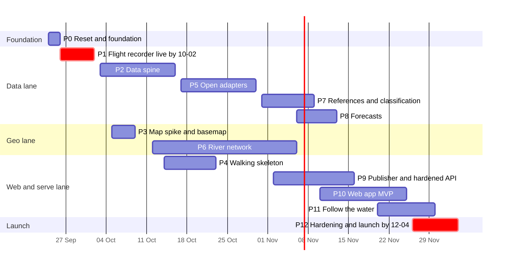
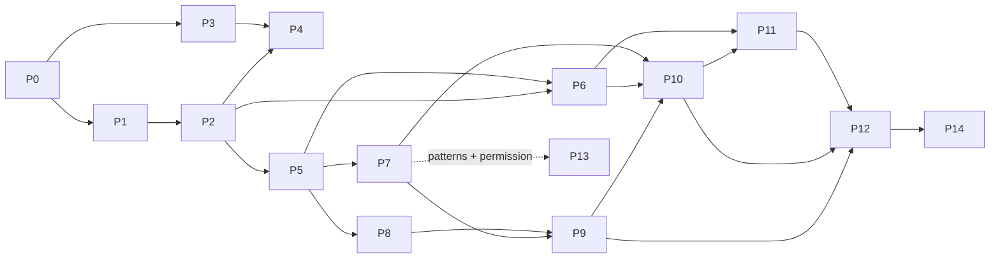
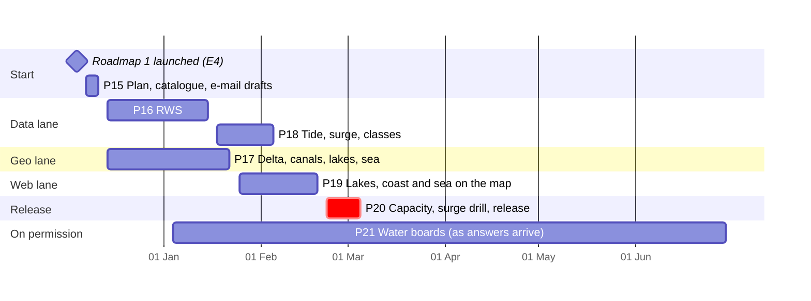
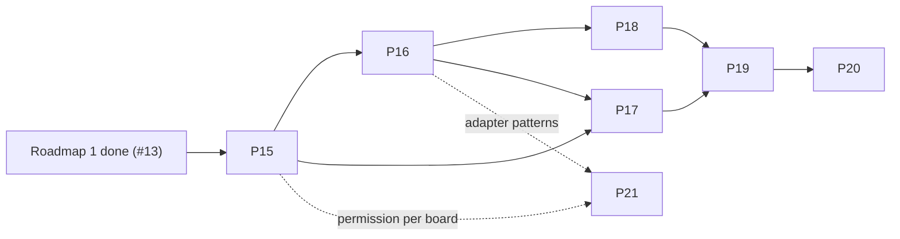

# Phases: implementation plan

**Status:** final plan, 2026-09-23. It goes with `ARCHITECTURE.md`, which is cited as A§x. Catalogue sections are cited as §x.y, and source IDs (NL-1 … CH-11) are the catalogue's. **Amended 2026-09-23 after the catalogue gap check**; §9 lists every change per gap item and the affected phases. **Amended 2026-09-24 for the owner audience** (decision D22, ADR-0017, catalogue §0.8); §10 lists every change with the affected phases and sections. **Build amendments** (what each build found or settled against this plan): §11 (P1a), §12 (P1b), §13 (P2a), §14 (P2b), §15 (P3), §16 (P4a), §17 (P4b), §18 (P5a), §19 (P5b), §20 (P5c), §21 (P6a), §22 (P6b), §23 (P7a), §24 (P7b), §25 (P8a), §26 (P8b).

**How the plan is executed:**
- Each phase becomes **one GitHub issue** containing three Claude Code prompts: Build, Code review and Security review.
- A **roadmap issue** links all the phase issues.
- A phase may ship as **2–3 PRs** (a/b/c). Each PR gets its own build → code review → security review cycle.
- **Cap per PR:** one subsystem, or at most three provider adapters.

**Hard dates:**
- **Production ingestion live ≤ 2026-10-02 (P1).**
- **Public launch ≤ 2026-12-04 (P12).**

Every other date is indicative.

---

## 1. Timeline, lanes and dependencies

| # | Phase | Lane | Window (2026) | PRs | Depends on | Build · Code review · Security review |
|---|---|---|---|---|---|---|
| P0 | Reset and foundation | – | 09-24 → 09-26 | a reset · b foundation | – | Opus xhigh · Sonnet `high` · **Fable high** |
| P1 | **Flight recorder in production** | data | 09-26 → **10-02** | a recorder · b platform | P0 | Opus xhigh · **Fable** `high` · **Fable xhigh** |
| P2 | Data spine | data | 10-03 → 10-16 | a spine + DE-1 · b NL-1/NL-2/NL-4 | P1 | **Fable xhigh** · Opus `max` · Sonnet xhigh |
| P3 | Map spike and self-hosted basemap | geo | 10-05 → 10-09 | one PR | P0 (P1b for the VPS) | Opus xhigh · Sonnet `high` · Sonnet xhigh |
| P4 | Walking skeleton (noindex) | web | 10-14 → 10-23 | a API · b web + deploy | P2 (P4a can start on P2a), P3 | Opus xhigh · Sonnet `xhigh` · Opus high |
| P5 | Open observation adapters | data | 10-17 → 10-30 | a FR + CH · b DE-7 + LU + twins · c owner-audience BE-3 + LU-2/3/4 | P2 | Opus xhigh · Sonnet `xhigh` (**Fable** `high` for P5b) · Sonnet xhigh |
| P6 | River network, snapping, chainage | geo | 10-12 → 11-06 | a graph · b snapping + tiles | P2 (P6b: P5) | Opus xhigh · Sonnet `high` · Sonnet medium |
| P7 | References, classes, warnings, honest classification | data | 10-31 → 11-09 | a parsers · b engine | P5 | Opus xhigh · **Fable** `xhigh` · Sonnet high |
| P8 | Official forecasts (bi-temporal) and the future slider | data | 11-06 → 11-13 | a run model + NL/DE (+ LU-3 owner) · b CH/FR + slider | P5 (P7 for display) | Opus xhigh · **Fable** `high` · Sonnet high |
| P9 | Static publisher and hardened read API | serve | 11-02 → 11-16 | a publisher · b API hardening | P7 (P8 contracts can be stubbed) | Opus xhigh · Sonnet `xhigh` · **Fable xhigh** |
| P10 | Web app MVP | web | 11-10 → 11-25 | a UI core · b pages | P9 contracts, P6, P7 | Opus xhigh · Sonnet `xhigh` · Sonnet xhigh |
| P11 | Follow the water | web | 11-20 → 11-30 | a minimum · b colouring + playback · c Hovmöller | P6, P10, P9 frames | Opus xhigh · Sonnet `xhigh` · Sonnet medium |
| P12 | Flood hardening, operations, **public launch** | ops | 11-26 → **12-04** | a hardening · b ops + launch | P9, P10, P11a | Opus xhigh · **Fable** `high` · **Fable max** |
| P13 | Gated sources, one PR per source as each permission arrives | data | on permission | per source | P5/P7/P8 patterns + owner permission | Opus high · Sonnet `xhigh` · Opus xhigh |
| P14 | **LATER:** historical backfill and climatology | data | 2027 | per provider group | launch + 4 weeks stable | Opus xhigh · **Fable** `high` · Sonnet high |





**Dated events:**

| Date | Event | What it means for the plan |
|---|---|---|
| 2026-10-02 | Recorder live (hard target) | Every day after this is data lost |
| 2026-10-25 | DST fall-back; the hour 01:00–02:00Z repeats in local time | Captured raw by P1. Real payloads become regression fixtures in P5. **Every parser of offset-less local times needs synthetic fall-back and spring-forward fixtures before its first production run** (catalogue §0.3; the DST gate of A§7.4) |
| 2026-10-28 | Node 26 becomes LTS | Bump from 26.10.x to the first LTS patch via Dependabot |
| 2026-11-05 | RWS documentation moves to the CTD | URLs live in config. Watch the nightly contract check. The NL-4 xlsx path under `rijkswaterstaatdata.nl/publish/…` is at risk (§2.1); API hosts unconfirmed (§10 R4; owner action D6) |
| December–March | Rhine and Meuse flood season | This is why launch is ≤ 12-04 |

---

## 2. Gates, criterion tags and workflow

### 2.1 Criterion tags

Every acceptance criterion carries exactly one tag.

| Tag | Meaning | Who is accountable |
|---|---|---|
| **[CI]** | Provable offline: in GitHub Actions, or reproducibly in the build agent's session (SessionStart hook + native PostgreSQL 18). | Build agent |
| **[agent-prod]** | Checkable from outside, without SSH, through `scripts/verify-prod.sh <domain>`, `/status/capture.json`, `/data/v1/status.json` or `/api/v1/health*`. If the agent sandbox cannot reach the domain, the owner runs the script and pastes the output. | Build agent |
| **[owner]** | Needs the owner's access or judgement: VPS console, bucket keys, a phone alert, e-mails, a signed checklist. | Owner (the agent supplies the script or checklist) |

**Soak criteria** (for example "72 h ≥ 99%") are `[agent-prod]` checks made after deploy. They **block closing the issue, not starting the next phase**.

### 2.2 Per-PR workflow

1. **Build.** A fresh session with the phase's build model and effort runs `/plan`. The owner approves the plan. The agent implements it on `claude/p<N><a>-<slug>` and opens the PR with the evidence checklist filled in.
2. **Code review.** A fresh session with the review model runs `/code-review <level> --comment <PR#>`.
3. **Security review.** A fresh session with the security model checks out the PR branch and runs `/security-review`.
4. **Fix.** A fresh session with the build model at the build effort addresses the findings. If a High or Critical finding was fixed, the relevant review re-runs on the fix diff only.
5. **Gate.**
   - CI is green.
   - No High or Critical security finding is open.
   - Medium findings are fixed or accepted in `docs/risk-register.md`.
   - Every `[CI]` item is ticked with evidence.
6. **Merge and deploy.** The owner merges and approves the `production` environment. `rws-update` pulls, verifies and deploys. The agent runs `verify-prod.sh` and ticks the `[agent-prod]` items.

### 2.3 PR evidence checklist (`.github/pull_request_template.md`)

```
## Evidence
- [ ] Every [CI] criterion → test name or CI job link
- [ ] Every [agent-prod] criterion → verify-prod.sh output (after deploy)
- [ ] [owner] items → script/checklist provided: <path>
- [ ] CLAUDE.md / runbooks / docs/threat-model.md updated where this PR changes them
- [ ] Audience: sources touched and their audience (public / owner / off), and the owner canary result, or "no audience change"
- [ ] New runtime dependencies: ADR-lite lines (why · licence · maintainer health · transitive count) or "none"
- [ ] Source IDs touched (catalogue): …
- [ ] [U] items not verified: …
```

---

## 3. Model and effort rubric

Models: `/model fable` (Fable 5.1, $10/$50 per MTok), `/model opus` (Opus 5.5, $4/$20), `/model sonnet` (Sonnet 5, $2/$10) and `/model haiku` (Haiku 4.5, $1/$5). Effort: `/effort low|medium|high|xhigh|max`.

### 3.1 Always

1. **Set effort explicitly** in every prompt. Opus 5.5 defaults to medium, which is too low for any step here.
2. **Reviews run in fresh sessions** with a mandate different from the build.
3. **Code review uses a different model from the build, always.** A security review may reuse the builder's model (P4, P13), because a fresh session with a security-only mandate already gives independence.

### 3.2 Builds

**Default builder: Opus 5.5 at xhigh**, the agentic sweet spot:
- The work is multi-file and mostly unattended.
- The provider traps are well documented in the catalogue.
- Several 2026 majors (MapLibre 6, Vite 8, Vitest 5, the PG18 image layout, Node 26) are newer than most model knowledge.

Exceptions:
- **Fable 5.1 builds only P2**, the data spine. It fixes the canonical model, the time, unit and datum semantics, idempotency and revisions, and every later adapter copies it. An error there silently corrupts the only copy of the go-live data.
- **Opus at high builds P13.** By then P5, P7 and P8 have established the adapter template, and each gated source is a small PR.
- **Sonnet 5 builds nothing before launch.** The volume of patterned work is not large enough to justify the extra review load a cheaper builder needs.
- **Haiku 4.5 is not used.** Every step either writes code that runs unattended against irreplaceable data or reviews such code. The savings are small next to the cost of one missed bug.

### 3.3 Code reviews

| Model and level | Used for | Phases |
|---|---|---|
| **Fable** | A miss would be irreversible, or would mislead the public during a flood | P1 recorder (atomicity, silent gaps); P5b LU DST and offset; P7 classification semantics; P8 forecast bi-temporality; P12 cache and versioning at launch; P14 backfill precedence |
| **Opus at `max`** | The strongest independent reviewer for the one Fable-built phase; correctness outweighs cost, and the diff is bounded | P2 |
| **Sonnet at `xhigh`** | Conformance against established patterns and the catalogue pitfall lists | P4, P5a, P9, P10, P11, P13 |
| **Sonnet at `high`** | Configuration, docs and geo work whose correctness is asserted by strong tests | P0, P3, P6 |

### 3.4 Security reviews

| Model and effort | Used for | Phases |
|---|---|---|
| **Fable** | The change is a root of trust or the public attack surface | P0 CI (high: small diff); P1 trust chain and SSRF fetcher (xhigh); P9 public API (xhigh); P12 whole-system launch gate (**max**) |
| **Opus at high/xhigh** | First exposure of a new kind | P4, the first public endpoint (high); P13, the first third-party credentials (xhigh) |
| **Sonnet at xhigh** | New untrusted-input parsers or client surface, checked against a checklist | P2, P3, P5, P10 |
| **Sonnet at high** | Parsers behind established guards | P7, P8, P14 |
| **Sonnet at medium** | Offline tools or UI-only diffs | P6, P11 |

### 3.5 Effort

- **max** only where correctness beats cost and the diff is bounded: the P2 code review and the P12 security review.
- **low** is never used.

### 3.6 Totals

- Fable: **11 of 45 steps** (P0 security, P1 review and security, P2 build, P5b review, P7 review, P8 review, P9 security, P12 review and security, P14 review).
- Opus: 14 builds, 1 review and 2 security reviews.
- Sonnet: the rest.
- Haiku: 0.

---

## 4. Issue template: the three prompts

Each phase issue contains this block. The placeholders come from the phase section. `<INVARIANTS>` is the verbatim list in A§12.1 / `CLAUDE.md`.

````markdown
### 1 · Build — `/model <build-model>` · `/effort <build-effort>`
```
/model <build-model>
/effort <build-effort>
/plan
You are implementing Phase <N>, PR <N><x> "<pr-name>" of mwijkhuisen/Waterheight.
Read first: CLAUDE.md (bill of materials, gotchas, security invariants), docs/plan/ARCHITECTURE.md,
docs/plan/PHASES.md §P<N>, docs/adr/, docs/threat-model.md, and these catalogue sections:
<§refs> in docs/sources/SOURCE-CATALOGUE.md. Source IDs in scope: <IDs>.
Security invariants (must hold for every line you write): <INVARIANTS>
Plan first: map every [CI] and [agent-prod] acceptance criterion of this PR to a test, command or
evidence item; list the [owner] items and the script/checklist you will provide; wait for approval.
Then implement on branch claude/p<N><x>-<slug>, strictly inside "Scope in" for this PR. Tests run
offline (msw onUnhandledRequest:'error'; fixtures come from the raw archive, never live calls).
No new runtime dependency without an ADR-lite line. Update CLAUDE.md, runbooks and
docs/threat-model.md where this PR changes them. Open PR "P<N><x>: <pr-name>" with the evidence
checklist filled in. Do not merge. List every [U] item you could not verify.
```
### 2 · Code review — `/model <review-model>` · `/code-review <level>`
```
/model <review-model>
/code-review <level> --comment <PR#>
Focus for this phase: <code-review focus bullets>.
Also check: each [CI] criterion has a test that fails without the change; source IDs and catalogue
pitfalls (<§refs>) are honoured; scope did not creep beyond "Scope in".
```
### 3 · Security review — `/model <sec-model>` · `/effort <sec-effort>`
```
/model <sec-model>
/effort <sec-effort>
git fetch origin && git checkout claude/p<N><x>-<slug>
/security-review
Focus for this phase: <security focus bullets>.
Verify the CLAUDE.md security invariants hold for this diff: <INVARIANTS>.
Report any threat-model delta for docs/threat-model.md. Classify findings Critical/High/Medium/Low.
```
````

---

## 5. Phases

### P0 · Reset and foundation

**Window:** 09-24 → 09-26 · **Lane:** – · **Depends on:** – · **PRs:** P0a reset, P0b foundation

**Goal.** Archive the legacy code where `main` can no longer reach it. Give every later agent the same guardrails: a buildable monorepo, hardened CI, a supply-chain policy, `CLAUDE.md`, the plan and the catalogue in the repository, and a registry keyed by catalogue source IDs.

**Scope in**
- **P0a reset**
  - Create the annotated tag `legacy-v0` on `a4106b8` (the legacy `main`; if PR #30 was merged first, `main` is `a4106b8` plus only `docs/plan/` and `docs/sources/`) and push it.
  - In one commit, `git rm -r` every legacy path: `packages/`, `spike/`, `fixtures/`, `deploy/`, `docs/INSTALL-UBUNTU.md`, `docs/INTERNATIONAL-DATA.md`, `docs/PROMPT-PHASE3-GERMANY.md` (the only legacy files under `docs/`; never `docs/plan/` or `docs/sources/`), `.github/workflows/ci.yml`, `PROMPT.md`, `README.md`, `Dockerfile`, `docker-compose.yml`, `package.json`, `package-lock.json`, `tsconfig*.json`, `.env.example`, `.dockerignore` and `.gitignore`. Add a new stub `README.md` and a rewritten `.gitignore`.
  - Write `scripts/verify-fresh-start.sh`. It fails if any blob in `main`'s tree is byte-identical to a blob in `legacy-v0`. The allowlist starts empty. The planning-bundle files are new blobs, never legacy.
- **P0b foundation**
  - **pnpm workspace** (A§5):
    - `apps/server` with a Hono `/healthz` and a role dispatcher stub (`capture | load | publish | api | replay | watchdog`);
    - `apps/web` with Vite + React and a Paraglide "Hallo / Hello" page, NL at `/` and EN at `/en/`;
    - `packages/core` and `packages/contracts`;
    - empty `db/migrations/`, plus `registry/`, `tools/geo/`, `deploy/` and `scripts/`.
  - **TypeScript configuration**: `tsconfig.base.json` with `strict`, `noUncheckedIndexedAccess`, `exactOptionalPropertyTypes`, `erasableSyntaxOnly` and `verbatimModuleSyntax`, plus project references built with `tsc -b`.
  - **Tooling**: Biome; Vitest 5 with a global msw setup using `onUnhandledRequest: 'error'`. `pnpm check` runs Biome, `tsc -b` and Vitest.
  - **pnpm policy**: `minimumReleaseAge: 10080`, `strictDepBuilds`, an explicit `allowBuilds`, `blockExoticSubdeps`, `--frozen-lockfile`. The override procedure for urgent security fixes is documented in `CLAUDE.md`.
  - **CI workflows**, with every action SHA-pinned, `permissions: {}` at top level and `persist-credentials: false`:
    - `ci.yml`: install, `pnpm check`, integration tests against a digest-pinned `postgres:18.6` service container, web build, a dbmate up/down/up round trip, `check-bom`, `check-boundaries`, `verify-fresh-start`;
    - `security.yml`: zizmor, gitleaks over the full history, a grep that every `uses:` has a 40-hex SHA, a grep for top-level `permissions: {}`, and CodeQL if the repository is public (decision D7);
    - `dependabot.yml`: npm, github-actions and docker; `cooldown` 7 days; grouped; no automerge.
  - **`CLAUDE.md`**:
    - the mission and the fresh-start rule (never read or restore `legacy-v0` content);
    - the bill of materials with exact pins (A§3);
    - gotchas: MapLibre 6 is ESM-only and WebGL2-only, with `map.transform` removed; the PG18 image moved `PGDATA` to `/var/lib/postgresql/18/docker` and the volume to `/var/lib/postgresql`; TS 7 is forbidden; Vitest 5's `clearMocks` default and failing unawaited assertions; Node 26 Temporal and type-stripping rules; corepack is not bundled; Protomaps builds are kept for 1 week; Hub'Eau v1 returns 403; RWS docs move to the CTD on 2026-11-05;
    - the security invariants (A§12.1), verbatim, including invariant 11 (owner-audience isolation);
    - the audience rules (A§6, ADR-0017): what `public`, `owner` and `off` mean, that the owner view is used by the owner alone and never shared, and that fixtures of owner-audience sources are synthetic;
    - the adapter contract, and the rule that adapters are keyed by source ID;
    - criterion tags, the definition of done, and the PR and review workflow (§2);
    - the ADR-lite rule for new dependencies.
  - **Agent set-up**:
    - `.claude/settings.json`: deny reads of `**/.env*` and `deploy/secrets/**`; deny `git push --force*`; allow `pnpm`, `psql` and read-only `git` commands;
    - `.claude/hooks/session-start.sh`, written with the `session-start-hook` skill. It is idempotent and installs Node 26.10.x, pnpm 12.6.0 (P0b pinned 12.5.1: 12.6.0 was under the 7-day release age) and native PostgreSQL 18 (a cluster on port 5433 with the builtin C.UTF-8 locale), then runs `pnpm install --frozen-lockfile`.
  - **Docs**:
    - `docs/plan/`: ARCHITECTURE.md, PHASES.md, JUDGEMENT.md and `proposals/` from the planning bundle (branch `claude/river-water-level-map-hf7bcz`, PR #30);
    - `docs/sources/SOURCE-CATALOGUE.md` and `docs/sources/research/*.md`, copied verbatim;
    - the import is conditional: if `main` already holds `docs/plan/` and `docs/sources/` (PR #30 merged), they are not re-imported but verified identical to `origin/claude/river-water-level-map-hf7bcz` if that branch still exists, else to the PR #30 merge commit, and the PR body records which case applied; otherwise they are imported with `git checkout` from that branch (explicit refspec);
    - `docs/adr/0001…0015` and `0017` (from A§13), `docs/threat-model.md` v1 (including the owner channel), `SECURITY.md`, `docs/risk-register.md`;
    - `docs/permissions.md` (tracker) and `docs/legal/requests/*.md`: ready-to-send e-mails for every row in §6.2 C (C1–C13). The tracker records per source: date sent, date answered, conditions, the **audience** (`public`, `owner` or `off`) and its `private_basis`, the licence channels granted (`display`, `api`, `bulk_export`, `history_export`; catalogue §0.7) and a **go/no-go date** after which the fallback ships (§0.2). **Every e-mail asks explicitly** whether (a) machine-readable redistribution through our public API and exports is allowed and (b) we may keep and republish a history archive (§0.2, §0.7). C1 (HIC) and C2 (VMM) request credentials for a **personal, non-commercial, private viewer** and optionally ask about public display; C3 (SPW) and C4 (AGE) ask **only for public display** (optional; nothing waits on them);
    - `docs/github-settings.md` and `scripts/gh-settings.sh` (with a `--check` mode).
  - **Registry**: `registry/providers.yaml` and `registry/sources.yaml`, listing **every catalogue source ID** with its licence, exact attribution text (§1b), **`audience`** (`public | owner | off`; it replaces `publication`, A§6) and `capture_enabled`, plus the schema and a validator test. Initial values (catalogue §0.8; ADR-0017):
    - `public`: the §0.2 "safe" sources, plus CH-2, CH-4 and CH-5 (they move to `owner` if BAFU objects in C13);
    - `owner`, each with a **`private_basis`** (`clause` verbatim from catalogue §0.8, `url`, `retrieved` date): BE-3, LU-2, LU-3, LU-4, DE-3, and DE-2 until the Belegexemplar is sent (then `public`, P12);
    - `off`: NL-3, DE-9, **DE-10 (LfU RLP) and DE-12 (LUBW)** until C11/C12 are granted (their Impressum forbids copying without consent), DE-13 and the other backlog sources, and BE-1 and BE-2 until their credentials arrive (C1, C2; then `owner`);
    - a series may narrow its source's audience, never widen it; the RLP-operated gauges inside LU-1 are narrowed to `off` (withheld), and so are the LfU RLP-origin series on the AGE site (LU-2 Bollendorf and Gemünd; the LU-3 Moselle runs at Perl, Stadtbredimus and Wasserbillig), which are not captured at all until C4 or C11;
    - one **owner canary** source (`audience: owner`, `canary: true`) and one withheld canary series, used by the tests of P2 and P9 and hidden from every UI.
  - **Licence channel flags** (catalogue §0.7) in `registry/sources.yaml` for every source: `display`, `api`, `bulk_export`, `history_export`, `attribution_text`, `attribution_url`, `needs_last_updated`, `needs_retrieval_date`. Defaults: all four channels on for CC0 / DL-DE Zero / Etalab / CC BY / Modellicentie sources (with attribution); `api`, `bulk_export` and `history_export` **off** for any source used under a written permission until its permission record says otherwise; for an `owner` source, `display`, `api` and `history_export` on (they apply to the owner channel only) and `bulk_export` off. The channels apply inside each audience. A series may narrow its source's flags, never widen them.
  - **Station registry schema** (`registry/stations/*.yaml`, one row per physical gauge and quantity; catalogue gap item 17): canonical source and provider IDs, coordinates, datum and gauge zero with validity, river and km system, tidal/weir flags, expected threshold source and forecast source, licence-gate status, `audience` and `first_release`. The rows are filled from catalogue §3 in P2 and P5; the schema and validator land here. Rows of owner-audience stations may hold identification only (provider number, name, coordinates, river and km); the validator rejects values, thresholds or forecasts in them.
  - **GitHub files**: `.github/CODEOWNERS` (the owner on `.github/`, `deploy/`, `db/migrations/` and `registry/`), `.github/ISSUE_TEMPLATE/phase.md` (§4) and `.github/pull_request_template.md` (§2.3).

**Scope out:** product code, service Dockerfiles (P1), the VPS.

**Deliverables:** the tag; a clean `main`; the scaffold, CI and Dependabot configuration; `CLAUDE.md`; the hook; the docs, ADRs, registry and e-mail drafts; the GitHub settings script.

**Acceptance criteria**
- [ ] [CI] `git rev-parse legacy-v0^{commit}` equals `a4106b8…`, and `git ls-remote --tags origin 'legacy-v0*'` returns it on the peeled `refs/tags/legacy-v0^{}` line.
- [ ] [CI] `verify-fresh-start.sh` passes: `main` contains 0 legacy blobs and none of the legacy top-level paths.
- [ ] [CI] After the P0a removal commit, the tree holds only `README.md`, `.gitignore`, `scripts/*` and, only if PR #30 was merged first, `docs/plan/**` and `docs/sources/**`.
- [ ] [CI] P0b: `docs/plan/` and `docs/sources/` equal the planning bundle (branch `claude/river-water-level-map-hf7bcz`, or the PR #30 merge commit if the branch is gone); the PR body says whether they were imported or already on `main`.
- [ ] [CI] On a clean checkout, `pnpm install --frozen-lockfile && pnpm check && pnpm -F web build` is green, and `node apps/server/dist/main.js api` serves `GET /healthz` → 200.
- [ ] [CI] zizmor reports 0 findings at medium or above. Every `uses:` is pinned to a 40-hex SHA, and every workflow has top-level `permissions: {}`.
- [ ] [CI] gitleaks passes on the full history of `main`.
- [ ] [CI] `check-bom` passes: the `CLAUDE.md` bill of materials equals the pins in `package.json` and the lockfile. A deliberately wrong pin makes it fail (test).
- [ ] [CI] `check-boundaries` fails on committed violation fixtures (web → server, adapter → adapter) and passes on the tree.
- [ ] [CI] The registry validates. Every source ID from §1a appears exactly once with an `audience`. NL-3, DE-9, DE-10, DE-12, BE-1 and BE-2 are `off`; BE-3, LU-2, LU-3, LU-4, DE-2 and DE-3 are `owner`; CH-2, CH-4 and CH-5 are `public`. No `publication` or `dark` value remains.
- [ ] [CI] **`private_basis` validation:** an `owner` source without a `private_basis`, or with an empty `clause`, a `url` that is not https, or a missing `retrieved` date, fails; a `private_basis` on a `public` or `off` source fails; each owner source's `clause` matches its catalogue §0.8 row verbatim (test against the committed catalogue).
- [ ] [CI] Every source carries the four §0.7 channel flags and its attribution fields. A test fails if a source marked as permission-based has `api`, `bulk_export` or `history_export` on, if an `owner` source has `bulk_export` on, or if a series widens its source's flags or its audience.
- [ ] [CI] A doc test asserts that `CLAUDE.md` quotes the A§12.1 invariants 1–11 verbatim, including invariant 11 (owner-audience isolation).
- [ ] [CI] The station-registry schema (gap item 17 fields) validates a committed sample of 5 rows, and a row missing `first_release` or the licence-gate status fails.
- [ ] [CI] The dbmate up/down/up round trip is green on PG 18.6.
- [ ] [CI] A fresh claude.ai/code session runs the SessionStart hook, then `pnpm check` and `pnpm test:integration` pass with no manual steps. The session log is attached to the PR.
- [ ] [owner] `scripts/gh-settings.sh` is applied, and `scripts/gh-settings.sh --check` passes (§6.2 B1–B3).
- [ ] [owner] The permission e-mails C1, C2, C5–C9 and C11–C13 are sent (C10 waits until after launch; C3 and C4 are optional public-display requests, sent or marked "deferred"), and their dates are recorded in `docs/permissions.md`, including C1 and C2 as personal-viewer requests, C11 LfU RLP, C12 LUBW and C13 BAFU hydrodaten, each with a go/no-go date.

**Providers / rivers:** none for data. The registry covers every source ID.

**Risks**
- *Losing legacy history.* Tag first, verify the tag on the remote, and only then delete, in a separate PR.
- *Losing the plan.* P0a removes only the three legacy `docs/*.md` files, never `docs/plan/` or `docs/sources/`; P0b imports the bundle only if PR #30 was not merged, and verifies it either way. Branch `claude/river-water-level-map-hf7bcz` stays until P0b merges, unless PR #30 was merged; then it may be deleted.
- *Legacy assumptions creeping back.* The blob check and the fresh-start rule prevent this.
- *The 7-day release age blocking an urgent fix.* A documented override procedure.
- *Hook drift.* The hook is idempotent and CI runs the same commands.
- *A wrong audience* (an owner-only source marked public, or a no-consent source marked owner). Values come from catalogue §0.8, the validator checks each `private_basis` against it, and CODEOWNERS covers `registry/`.

**Review focus**
- *Code review:* hook idempotency; that `check-bom` and `check-boundaries` really fail on violations; the registry against catalogue §1a/§1b (IDs, attribution text, flags), the §0.7 channel-flag defaults and the §0.8 audiences and `private_basis` clauses; that every e-mail draft asks the §0.2 redistribution and history-archive questions, and that C1/C2 ask for a personal, non-commercial, private viewer.
- *Security review:* `${{ }}` injection in `run:`; token permissions; `pull_request_target` absent; `persist-credentials: false`; the cache-poisoning surface; the Dependabot and pnpm policy; the `.claude/settings.json` deny rules; whether the `CLAUDE.md` invariants are specific enough to enforce, invariant 11 in particular; the settings script, which must not weaken anything.

| Step | Model | Effort | Justification |
|---|---|---|---|
| Build | `opus` | xhigh | Patterned scaffolding, but it writes the operating manual and policy every later agent inherits, on 2026-current versions |
| Code review | `sonnet` | `/code-review high` | Configuration and docs conformance against this plan; mechanical, and a different model |
| Security review | `fable` | high | The CI root of trust (permissions, pinning, hook, settings). A small diff where a miss becomes a repository-compromise vector |

---

### P1 · Flight recorder in production

**Window:** 09-26 → **live ≤ 10-02** · **Lane:** data + ops · **Depends on:** P0; owner actions A1–A7 · **PRs:** P1a recorder and P1b platform, built in parallel sessions

**Goal.** Stop losing data. Every perishable, legally capturable endpoint is fetched on schedule and archived raw, synced off-site and monitored, before any parser or database exists. The signed pull-based deploy and the Object Lock backups work from day one.

**Scope in**
- **P1a recorder** (`apps/server`: `http/`, `archive/`, `capture/`, `adapters/<id>/capture.ts`)
  - **Polite client** (A§7.3, A§12.2):
    - the allowlist per source ID comes from the registry and is checked in DNS `lookup`, after resolution and on each redirect hop. It includes the gap-check hosts of catalogue §6.7: `pegelonline.wsv.de` (without `www`), `rijkswaterstaatdata.nl` (NL-4 file and page), **`download.data.public.lu`** (the LU-5 CAP files are served there, not from `data.public.lu`) and `vorhersage.bafg.de` (DE-3, owner audience from P1 under D3). The owner-audience hosts are added for their own source IDs: **`hydrometrie.wallonie.be`** (BE-3) and `inondations.public.lu` for LU-2, LU-3 and LU-4 (already allowed for LU-1). The hosts of gated sources (`www.hochwasser.rlp.de`, `www.hvz.baden-wuerttemberg.de`, later `www.hlnug.de`) are added only in the PR that follows a permission (P13, or the backlog for HLNUG);
    - private, loopback, link-local, CGNAT, ULA and multicast addresses are refused;
    - same-host redirects only, at most 3. **Canonical URLs** are configured so that no cross-host redirect is needed (§6.7): `hicws.vlaanderen.be` (not the legacy `www.waterinfo.be/tsmhic/…`), `inondations.public.lu`, and each data.public.lu resource's own `url` (not the `latest` redirect link);
    - timeouts: connect 10 s, total 60 s, metadata 120 s;
    - body cap 25 MB, decompressed cap 100 MB for HTTP content encoding (ZIP members follow the ZIP rule below);
    - **per-format input guards** (§6.7; first-release inputs are JSON/GeoJSON, CSV, ZIP of CSV, CAP XML, SPARQL CSV and XLSX, not JSON only): ZIP read from the central directory, ≤ 10 members with allowlisted names (no `/`, `..` or absolute paths), ≤ 200 MB uncompressed in total, ratio ≤ 50:1, streamed, never extracted to disk by name; XML with DTDs, external entities and entity expansion off, any `<!DOCTYPE` rejected, CAP ≤ 1 MB; XLSX gets both the ZIP and XML rules; CSV ≤ 100,000 rows, ≤ 1,000 columns, fields ≤ 1 KB, encoding declared per source;
    - the User-Agent with the contact address, and the RWS `X-API-KEY`;
    - at most 2 connections per host;
    - ETag, `If-None-Match` and `If-Modified-Since`;
    - backoff and breaker as in A§7.3;
    - staggered offsets.
  - **Archive writer**: key layout, tmp + fsync + rename, the daily JSONL manifest, `dup_of`, shape fingerprints (alert on change) and byte counters.
  - **Capture specs for every row of A§7.2**, in `registry/capture.yaml`, each with:
    - a validity assertion (the payload parses; required keys are present; count ≥ minimum);
    - a retention class;
    - a gap-stretch window rule, so the window covers the time since the last success, up to the provider's maximum.
  - **The unrecoverable streams come first** (catalogue §0.1, §0.1a). A§7.2 covers every §0.1a row with its change gate: forecast runs (NL-1 `verwachting`, DE-2 `WV` (owner audience), FR-4, CH-4), alert and class states (DE-6 LHP stations of **all 16 states** plus `/data/alerts` with `If-None-Match`; FR-5 `InfoVigiCru` stored only when `DtHrInfoVigiCru` changes; LU-5 CAP; CH-1 `dangerLevel`; CH-5), and threshold versions (NL-4 xlsx plus the rijkswaterstaatdata.nl link list with an alert on a new file name; DE-1 metadata with characteristic values and PNP `validFrom`; CH-2 `wl_1..wl_4`). These specs are enabled first; observation specs follow in the same PR. DE-10 RLP is added only in P13, on the day C11 is granted.
  - **Owner-audience capture from day one** (D22; A§7.2; catalogue §0.8), with the same politeness, allowlist and attribution as every other spec:
    - **BE-3 SPW**: KiWIS `getTimeseriesValueLayer` for groups **1962373** (levels) and **1962340** (discharge) every 10 min, 2 requests, `timezone=UTC`; the station and time-series metadata daily;
    - **LU-2**: the 39 per-station JSON files of AGE-published gauges hourly, never with a query string; the LfU RLP-operated Bollendorf and Gemünd files are not fetched until C4 or C11 answers (DE-10 terms; catalogue §0.8);
    - **LU-3**: the 55 percentile files of the 11 AGE-computed forecast stations hourly, deduplicated by content hash (forecast runs nobody can refill, so they are enabled first among the owner specs, with LU-4); the LfU RLP-computed Moselle runs (Perl, Stadtbredimus, Wasserbillig) are not fetched until C4 or C11 answers;
    - **LU-4**: the station pages weekly, reading only the `data-to-json` attribute, with an alert on a threshold change;
    - **DE-2** and **DE-3**: already in the §0.1a/A§7.2 set, now `owner` instead of `dark`;
    - each of these sources has its `private_basis`. Nothing parses them yet: P5c, P7 and P8 do.
  - **RWS tiers**: `registry/seed/nl-1.csv` lists about 25 key gauges (10 min) and about 45 others (30 min), taken from §3.1 and §3.3. The forecast locations are listed separately: **all 183 H and 13 Q forecast locations** (§0.1a), about 40 curated ones hourly and the rest every 3 h, inside the ≤ 400 requests/hour budget.
  - **Ungated Belgium from day one** (catalogue §0.6): the NL-1 specs include the RWS points on Belgian soil (`antwerpen`, `lixhebiefaval`, `maaseik`, `herenlaak`, `lanaken`, `kanne`, `smeermaas.zuidwillemsvaart`), and the FR-1 `code_entite` prefixes must cover the codes of the 18 NL-bound Hub'Eau partner stations (add explicit codes where a prefix misses one).
  - **Seeds = the day-0 harvest of catalogue §0.1b**: one-off, idempotent, and recorded in `seed-report.json`. DE-1 P31D for about 60 tier-1 series; FR-1 30 days, paced at 1 request per 2 s; FR-3 about 2 months for about 15 key stations; CH-3 40 days for 11 key stations; DE-7 `pegeldaten.zip`; LU-1 (the first CSV holds 5 days); **LU-5 every CAP dump since 2025-06 (833 files, about 30 MB; it contains real AGE flood alerts, §0.4)**; LU-2 (the first capture holds 7 days; owner audience, so it is reported in the owner status, never in the public `seed-report.json`). NLWKN is not seeded (off). SPW is not seeded here: KiWIS keeps decades, and P5c catches up.
  - **Status and alerts**: `capture-status.json`, written each cycle to `public/status/capture.json` with public-audience specs only plus the aggregate `owner_specs: {fresh, total}` (no IDs, hosts or values); owner-audience specs go to `owner/status/capture.json` (A§7.1), which nothing serves until the owner site exists; a healthchecks ping per provider group, including the **owner** group (start, success and fail; grace 3× cadence); a daily capture report, whose owner part goes only to the owner status file.
- **P1b platform** (`deploy/`, `.github/workflows/release.yml`, `scripts/verify-prod.sh`)
  - **`deploy/host/bootstrap.sh`** (Debian 13; idempotent; shellcheck-clean):
    - the `ops` user; SSH keys only; no root login;
    - nftables inbound: 22 (rate-limited), 80 and 443/tcp, 443/udp;
    - nftables egress for the `egress` and `public` subnets: TCP 443 plus DNS only;
    - unattended-upgrades + needrestart, chrony and a sysctl baseline;
    - Docker 29.8.1 + Compose v5.5.1 from Docker's signed apt repository;
    - `daemon.json`: `no-new-privileges`, `live-restore`, the `local` log driver with rotation, `icc: false`;
    - `/srv/rws/{raw,public,owner,tiles,backup}` and `/etc/rws/secrets` (0700); `owner` is mounted only into `capture` (status), and later `publish-owner` and `caddy` (A§11.1).
  - **`deploy/compose.yaml`**, with the networks of A§11.1:
    - services `caddy` (NL/EN placeholder page, `/healthz`, `/status/capture.json`), `capture`, `watchdog` and `backup` (job);
    - the full hardening flags and Compose secrets.
  - **Dockerfiles**: server (built on `node:26-trixie-slim`, run on distroless `nodejs26-debian13:nonroot`) and web (`caddy:2.11.4-alpine` plus static files), with digest-pinned bases.
  - **`release.yml`**: build, SBOM + provenance, push to GHCR by digest, cosign keyless signing and attestation. Then the `promote` job in the `production` environment publishes the Release `prod-<ts>` with a signed `release-manifest.json` (A§11.2).
  - **Deploy**: `deploy/bin/rws-update` plus a systemd timer (every 5 min), and `rws-deploy <release>`. Both verify the manifest and images with the pinned identity and issuer, then pull, `up -d`, smoke-test and roll back automatically on failure.
  - **Backups**:
    - `rws-backup.timer` runs restic of `raw` hourly to the Object Lock bucket;
    - `rws-restore-drill.timer` runs monthly and can be forced once. It restores a 100-object sample, compares sha256 and writes the result to `/status/ops.json` (coarse values only).
  - **Watchdog role**: probes `https://<domain>/healthz` and `/status/capture.json` through public DNS and TLS, and checks that the certificate is valid ≥ 14 days, the disk is < 75% full and the last backup is < 2 h old.
  - **Healthchecks set-up**: `deploy/healthchecks.yaml` and `rws-hc-sync`, which creates the checks using the owner's healthchecks API key.
  - **`scripts/verify-prod.sh <domain>`**: TLS validity, the exact headers of A§12.2, `/healthz`, capture freshness per spec, and `X-Robots-Tag: noindex`.
  - **`deploy/bin/rws-reachability`** (catalogue gap item 11, §10 R7): a one-shot owner-run check **on the VPS, over IPv4 and IPv6**, against every §1a endpoint and the sandbox failures to re-test (waterstandlimburg.nl, Saarland, `server.wver.de`, `waterdata.wrij.nl`, `evrs.bkg.bund.de`, Overpass, Geofabrik). It asserts on a **body signature**, not only the HTTP status (e.g. the OSM tile server answers 200 with a "blocked" PNG). The output goes to `docs/reachability-<date>.md`.
  - **`docs/capacity.md`** (gap item 16): after 48 h of production capture, the compressed bytes per day per spec after sha256 deduplication, the projected year-1 archive (hot obs window plus forever classes) against the disk and the bucket, and the retention class per source derived from it.
  - **Runbooks**: bootstrap, recorder down, deploy/rollback, restore, disk full, lost SSH access.

**Scope out:** parsing, the database (Compose placeholders only), any public API, the map.

**Deliverables:** the recorder running on the VPS; the off-site archive; the alerts; the seed report; the signed pull-deploy pipeline; the backups and restore drill; `verify-prod.sh`; the runbooks.

**Acceptance criteria**
- [ ] [CI] Client tests (msw) refuse or abort each of these:
  - a non-allowlisted host;
  - DNS answers of `127.0.0.1`, `10.0.0.1`, `169.254.169.254`, `100.64.0.1`, `::1` and `fc00::1`, including on a redirect hop;
  - a cross-host redirect;
  - a 30 MB body;
  - a gzip bomb (1 KB → 1 GB, aborted at 100 MB);
  - a ZIP with too many entries or `../` paths;
  - a slowloris upstream.
- [ ] [CI] Per-format guards (§6.7): a ZIP with a compression ratio > 50:1 or > 200 MB uncompressed is refused, while a synthetic ZIP of 128 MB uncompressed (the real `pegeldaten.zip` size) passes; an XML body with `<!DOCTYPE`, an external entity or entity expansion is refused; a CSV with > 1,000 columns or a field > 1 KB is refused; an XLSX with an XML bomb inside is refused.
- [ ] [CI] Allowlist and redirects: `download.data.public.lu`, `rijkswaterstaatdata.nl`, `pegelonline.wsv.de`, `vorhersage.bafg.de`, `hydrometrie.wallonie.be` (BE-3) and `inondations.public.lu` (LU-1 to LU-4) are allowlisted for their source IDs, and no host of an `off` source (DE-9, DE-10, DE-12, BE-1, BE-2) is; a `data.public.lu` → `download.data.public.lu` redirect is refused, and the LU-5 spec fetches each resource's own `url` directly.
- [ ] [CI] A test enumerates catalogue §0.1a: every row (NL-1 forecasts; DE-2; DE-6 all states + alerts with `If-None-Match`; FR-4; FR-5 gated on `DtHrInfoVigiCru`; LU-5; CH-1; CH-2; CH-4; CH-5; NL-4 xlsx + link page; DE-1 metadata; LU-1) has an enabled CaptureSpec with the listed interval and change gate, and a retention class that keeps forecast, class and threshold payloads forever. DE-10 (a note under the table, gated) has no spec until P13. The one deliberate interval deviation is NL-1 forecasts: all 183 H + 13 Q locations, the ~40 curated ones hourly and the rest every 3 h, so that the RWS budget of ≤ 400 requests/hour holds (A§7.2); the test asserts that tiering.
- [ ] [CI] A registry test shows that the NL-1 specs include the 7 RWS Belgian points and that the FR-1 request covers all 18 NL-bound Belgian partner-station codes of §0.6.
- [ ] [CI] Backoff and the circuit breaker behave correctly under fake timers, and `Retry-After` is honoured.
- [ ] [CI] A `kill -9` of a capture child process during a write leaves no object under a final key and no manifest line for it. The next cycle resumes and fills the window.
- [ ] [CI] The manifest round-trips its Zod schema. An identical body produces `dup_of` and no new object.
- [ ] [CI] Every CaptureSpec has a validity assertion with one passing fixture and three failing fixtures: empty-but-200, an HTML error page, and truncated JSON. The fixtures of owner-audience specs (BE-3, LU-2, LU-3, LU-4, DE-2, DE-3) are synthetic (real structure, generated values, `synthetic: true`; invariant 9).
- [ ] [CI] The budget config test holds:
  - `ddapi20-waterwebservices.rijkswaterstaat.nl` ≤ 400 requests/hour;
  - the CH-1 interval is ≥ 10 min;
  - the DE-6 interval is ≤ 10 min;
  - FR-1 seed pages are ≥ 2 s apart;
  - BE-3 ≤ 2 value requests per 10 min plus the daily metadata; LU-2 ≤ 39 and LU-3 ≤ 55 requests/hour; LU-4 weekly; no LU request carries a query string, and none fetches an LfU RLP-origin file (LU-2 Bollendorf and Gemünd; LU-3 Perl, Stadtbredimus and Wasserbillig);
  - no spec exists for NL-3, DE-9, DE-10, DE-12, BE-1 or BE-2 (every `off` source).
- [ ] [CI] Owner-audience capture: BE-3 (2 group requests per 10 min + daily metadata), LU-2 (hourly), LU-3 (hourly, content hash), LU-4 (weekly, `data-to-json` only), DE-2 and DE-3 have enabled specs; each of their sources has a `private_basis`; LU-3 and LU-4 are in the first-enabled group. A test writes a status cycle and shows that their state lands only in `owner/status/capture.json`, while `public/status/capture.json` contains no owner source ID or host (grep) and only the `owner_specs` count.
- [ ] [CI] The release workflow produces signed images with an attached SBOM and provenance (run link).
- [ ] [agent-prod] `verify-prod.sh` passes: valid certificate, headers, `/healthz` 200, noindex.
- [ ] [agent-prod] In `/status/capture.json`, every enabled public spec has a success within 3× its cadence, and `owner_specs.fresh` equals `owner_specs.total`, sampled 3 times over 1 h.
- [ ] [agent-prod] The seed report shows DE-1 ≥ 28 days, FR-1 ≥ 28 days, CH-3 ≥ 38 days and DE-7 about 60 days for the listed series. It also shows LU-5 with every CAP dump since 2025-06 (≥ 833 files) and LU-1 with ≥ 4 days (the §0.1b day-0 harvest).
- [ ] [agent-prod, soak 72 h] ≥ 99% of scheduled captures succeed per source ID, with upstream 5xx and timeouts listed separately. The daily byte totals per spec are recorded as the size-budget baseline.
- [ ] [agent-prod] `docs/capacity.md` is committed from the first 48 h of production capture: compressed bytes/day per spec after deduplication, the projected year-1 raw archive and database size vs the ≥ 200 GB disk and the bucket, and a retention class per source.
- [ ] [owner] `rws-reachability` ran on the VPS over IPv4 and IPv6; its output is attached. Every first-release endpoint passes its body-signature check, or it is listed in `docs/risk-register.md` with its fallback.
- [ ] [agent-prod] `/status/ops.json` shows a successful forced restore drill: 100 of 100 sha256 match.
- [ ] [owner] `deploy/tests/negative-deploy.sh` shows that `rws-update` refuses an unsigned image and an image signed by another identity, and that an injected smoke-test failure rolls back to the previous manifest.
- [ ] [owner] Stopping `capture` for more than 3× cadence fires the healthchecks alert on the owner's phone (one provider group).
- [ ] [owner] `restic forget --prune` run with the VPS key fails to remove object versions.
- [ ] [owner] After a VPS reboot, `/status/capture.json` is fresh again within 20 min with no manual step.

**Providers / rivers:** NL-1, NL-2, NL-4, DE-1, DE-2 (owner), DE-3 (owner), DE-6, DE-7, DE-8, FR-1, FR-3 (seed), FR-4, FR-5, LU-1, LU-5, LU-6, CH-1, CH-2, CH-3 (seed), CH-4 and CH-5, plus the owner-audience BE-3 (the Walloon Meuse from Chooz to Lixhe, Sambre, Ourthe, Vesdre, Amblève, Semois and Walloon Escaut) and LU-2, LU-3 and LU-4 (Luxembourg observations, forecasts and thresholds). Together they cover:
- the Alpine Rhine and Bodensee, the High Rhine with the Thur, Aare, Reuss and Limmat, and the Birs;
- the Upper and Lower Rhine to the NL branches;
- the Moselle, Saar, Sauer/Sûre, Our and Alzette;
- the Main, Neckar, Lahn, Sieg, Ruhr, Lippe and Erft;
- the French Meuse, Chiers, Semoy and Sambre, and the Rur, Niers and Schwalm;
- the Escaut, Scarpe and Lys (French side);
- the Ems, Vechte, Dinkel, Berkel, Issel and Bocholter Aa;
- Belgium without permissions (§0.6): the RWS points on Belgian soil and the NL-bound Hub'Eau partner stations (Semois, Chiers, Viroin, Houille, upper Sambre tributaries, Lys at Menen).

**Risks**
- *Silent gaps.* Validity assertions, fingerprints, dead-man switches and the daily report.
- *Missing an unrecoverable stream.* Forecasts, alert/class states and threshold versions cannot be refilled (§0.1); the §0.1a enumeration test and first-enabled order.
- *Disk filling up.* NRW is captured hourly, the size baseline is measured, and an alert fires at 75%. Raw volume is 0.5–1 GB/day uncompressed before deduplication (gap item 16): body-hash and `DtHrInfoVigiCru` gates, zstd, and `docs/capacity.md` from the first 48 h.
- *Sandbox ≠ production reachability* (§10 R7). `rws-reachability` from the VPS; datacentre IP blocks (Cloudflare at AGE, Azure APIM at NLWKN, Hub'Eau "usage abusif") show up as body-signature failures, not as silent 200s.
- *Over-polling.* Budget tests and a contact User-Agent.
- *Clock skew.* chrony.
- *The RWS CTD move (11-05).* URLs live in config; the NL-4 file path is the most exposed (link-page watch, local copy, alert on 404).
- *The owner's VPS steps slipping.* The scripts are idempotent, and each step has a check command.
- *Seeds stressing providers.* Pacing and off-peak runs.
- *Owner-audience capture read as redistribution.* It is personal use only (catalogue §0.8): polite rates, attribution kept, status and data only in the owner channel, and nothing public until a provider consents.
- *AGE behind Cloudflare blocking the VPS* (§10 R7). `rws-reachability` covers `inondations.public.lu`; LU-1 and LU-5 do not depend on LU-2/3/4.

**Review focus**
- *Code review:* write atomicity (tmp → fsync → rename, and the manifest line only after rename); scheduler drift and overlap (`protect`); gap-stretch windows; `dup_of` correctness; validity assertions that cannot pass on garbage; seed idempotency; `rws-update` rollback correctness; `set -euo pipefail` and quoting; that the capture set covers every §0.1a stream with its change gate and forever retention, the §0.1b day-0 harvest, and the owner-audience specs at their polite rates.
- *Security review:* the dialer allowlist per hop and the IP classes; size caps applied before decompression; the §6.7 per-format guards (ZIP, XML/CAP, XLSX, CSV) and the canonical-URL redirect exceptions; redaction of secrets in the manifest and logs; raw-volume permissions; the cosign identity and issuer pinning (exact string, no regex wildcards); secret file modes; the bucket key's scope; nftables default-drop and egress rules; Caddy headers; that `/status/*.json` leaks nothing sensitive, and that owner-audience spec state never reaches the public status file.

| Step | Model | Effort | Justification |
|---|---|---|---|
| Build | `opus` | xhigh | Code that runs unattended 24/7, where every bug means unrecoverable data loss, plus the first infrastructure and deploy chain |
| Code review | `fable` | `/code-review high` | A small diff with the highest cost of failure. The most capable independent model hunts atomicity, scheduling and silent-gap bugs |
| Security review | `fable` | xhigh | The trust anchor: the SSRF-capable fetcher, the deploy signature chain, backups and the firewall. Everything later relies on it |

---

### P2 · Data spine

**Window:** 10-03 → 10-16 · **Lane:** data · **Depends on:** P1 · **PRs:** P2a spine + DE-1 (10-03 → 10-10); P2b NL-1/NL-2/NL-4 (10-08 → 10-16)

**Goal.** Turn the archive into a correct, provenance-tracked time-series store, and prove the design on two dissimilar providers:
- **DE-1**: GET with ETag, local offsets, a 31-day window, mixed units and mirrors.
- **NL-1**: one POST per location, fixed `+01:00` timestamps, and an NL-2 WFS whose local times are labelled `Z`.

**Scope in**
- **P2a**
  - **`packages/core`**:
    - canonical Zod types;
    - Temporal time-convention parsers for every convention in A§7.4;
    - the unit table (§4.5);
    - the datum enum with offsets, sources and uncertainty (§4.1). **IGN69 and NGF-1884 carry no usable NAP offset**: the conversion function returns "not converted" for them (catalogue C40; D16);
    - the QC bitmask and the sentinel registry.
  - **`db/migrations`**:
    - the **complete** schema of A§6, including the forecast, reference, class, warning and health tables, so later phases only add data. This includes the §0.7 licence channel columns on `source` and `series`, the recurring season and `priority` columns on `reference_value` (for NL-4), and the **audience columns**: `source.audience` with `private_basis` (a CHECK makes it NOT NULL when `audience = 'owner'`), `series.audience` (narrow only) and `reference_value.source_id`;
    - `ensure_partitions()` (`SECURITY DEFINER`, fixed `search_path`, 3 months ahead, no default partition), BRIN and `btree_gist`;
    - the roles and `pg_hba` of A§12.2, including **`rws_owner_api`** (LOGIN, read-only, `SELECT` on `own_*` only, `CONNECTION LIMIT 4`);
    - the `pub_*` and **`own_*`** security-barrier view families of A§6, with the audience filter applied at every join (station, series, reference, class, forecast, warning, attribution), and `apps/server/src/db/audience.ts` as the only place that names them (A§5);
    - a `db` service initialised with the builtin C.UTF-8 locale.
  - **Registry sync**: YAML → `provider`, `source` (with `audience` and `private_basis`), `attribution`, `station`, `station_alias` and `series`. A drift report compares the registry with the harvested DE-1 `stations.json`.
  - **`load` role** (A§7.4 steps 1–6):
    - tails the manifest from `load_cursor`;
    - QC, the idempotent upsert with `obs_revision`, `obs_latest`, and incremental `obs_1h`/`obs_1d` in the same transaction;
    - a nightly rollup reconciliation;
    - `source_health` and quarantine;
    - the retention pruner, run with `--dry-run` for the first week.
  - **`replay` CLI** (`--source --spec --from --to`).
  - **Adapter DE-1**:
    - W and Q; units `cm`, `m+NN` and `m+PNP`; sentinel `99999`; negative W is valid;
    - mirrors (RWS, BAFU Basel, RP Freiburg Konstanz, Ruhrverband) get role `mirror`;
    - 1-minute series are downsampled to 15 min;
    - station metadata and `gauge_zero` with `validFrom`.
  - **Tier-1 DE registry** from §3.1 and §3.2, with every station-registry field of P0b (expected threshold and forecast source, licence-gate status, `first_release`), so the P7/P8 coverage metrics have a denominator.
  - **Minimal `api` role**: only `/api/v1/health` and `/api/v1/health/sources`, reading `rws_api` views. Health lists public-audience sources only, plus an aggregate `owner_sources: {healthy, total}` from the count-only view `pub_owner_health` (no IDs; A§6). Caddy proxies `/api/v1/health*` only.
  - **Deploy**: `db`, `migrate`, `load` and `api`, then replay everything since P1.
- **P2b**
  - **Adapter NL-1 observations**:
    - WATHTE/NAP/meting with method F007, and Q with per-station method codes;
    - `+01:00` timestamps; quality code 99 is a gap;
    - TAW, MSL and PLAATSLR duplicates are dropped, except the Eijsden-grens TAW series, which is kept as a twin;
    - a stale-series filter (Arnhem, Driel Q, Westervoort IJsselkop Q, §2.1).
  - **Adapter NL-2**: discovery and coordinates only; `local-labelled-Z`; REST wins.
  - **NL-4**: a pinned offline converter (fflate + fast-xml-parser, under the §6.7 XLSX guards) writes `registry/thresholds/nl-4.csv` with the source sha256. The rows load into `reference_value` with semantics `provider_class`; P7 uses them. The converter follows the **catalogue §2.1 parser specification** (NL-4 holds Waterinfo *display* classes, not alert levels):
    - sheet `ParameterLimits`; `'NULL'` is a string;
    - the effective legend for a date is the union of the `Gehele jaar` rows and the rows whose `FromMonth/FromDay`–`ToMonth/ToDay` window contains the date (stored as a recurring season, not a date range);
    - a **lower `Priority` number wins**;
    - slug variants are deduplicated on (Code, Description, Period, Label, From, To): 6,245 rows → 1,542;
    - bounds come from `From`/`To`, never from the label text;
    - the curated series without classes (H: `millingenaanderijn.pannerdensekop`, `holtheme.vecht`, `lith.beneden`, `lixhebiefaval`, `antwerpen`; Q: `millingenaanderijn`, `hagestein.boven`, `maastricht.sintpieter.zuid`, `roermond.hambeek`) stay without NL-4 rows.
  - **Tier-1 NL registry** from §3.1 and §3.3:
    - Lobith `tolkamer`, Pannerdense Kop, Nijmegen, Tiel, Zaltbommel, Driel, Amerongen, Hagestein;
    - Westervoort IJsselkop / `westervoort.1` Q, Doesburg, Zutphen, Deventer, Olst, Zwolle, Kampen;
    - Eijsden-grens, Sint Pieter, Borgharen, Stevensweert, Roermond, Venlo, Grave, Megen, Lith;
    - the Vecht stations and Epen (Geul);
    - tidal stations flagged.
  - **Eijsden twin**: TAW − NAP.
  - **`contract-check.yml`** (nightly): live fetch and parse for DE-1, NL-1 and NL-2. It opens or updates a `contract-drift` issue on failure.

**Scope out:** other adapters; parsing references, classes or forecasts (their tables exist but stay empty, except NL-4 rows); the public data API; the UI.

**Deliverables:** core, migrations, registry sync, loader, replay and pruner; adapters DE-1, NL-1, NL-2 and NL-4; a production database filled since P1; the contract check; the runbooks "schema drift", "replay" and "partition maintenance" (P2b adds "outage drill").

**Acceptance criteria**
- [ ] [CI] Each adapter has ≥ 3 real fixtures from the P1 archive: a normal case, an edge case (sentinel, gap or DST) and an empty or error case. Parse + normalise equals the committed `.golden.json`, with ≥ 90% line coverage of parse and normalise.
- [ ] [CI] fast-check property tests: time parsers round-trip; the DST gap and overlap are handled explicitly for Europe/Amsterdam, Berlin, Luxembourg and Zurich; unit conversions are invertible.
- [ ] [CI] At least 30 known-instant cases pass, including:
  - RWS `2026-09-23T20:50:00.000+01:00` → `19:50Z`;
  - WFS `…T21:30:00.000Z` (local) → `19:30Z` in summer and `20:30Z` in winter;
  - PEGELONLINE `+02:00` and `+01:00`;
  - the repeated local hour on 2026-10-25 (01:00Z–02:00Z).
- [ ] [CI] Replaying the fixture archive twice gives an identical per-partition `md5(string_agg(…))` checksum, 0 new rows and 0 revisions. A changed value produces exactly one `obs_revision` row.
- [ ] [CI] A batch crossing a month boundary creates the partition. An insert beyond the partition horizon fails loudly (there is no default partition).
- [ ] [CI] Incremental `obs_1h`/`obs_1d` equal a from-scratch aggregate over the same data.
- [ ] [CI] Roles: `rws_api` and `rws_publish` cannot INSERT, UPDATE or DELETE, cannot SELECT base tables or any `own_*` view (permission denied), and see no row of the seeded withheld canary or the owner canary (`777777.777`). `rws_owner_api` is read-only, cannot SELECT base tables or `pub_*`, sees the owner canary through `own_*` and never the withheld canary.
- [ ] [CI] Audience filter at every join: an owner-audience reference (LU-4-style, `source_id` owner) and an owner forecast run attached to a public series are visible in `own_reference` / `own_forecast_run` and absent from `pub_reference` / `pub_forecast_run`; a station whose only series is owner-audience is absent from `pub_station`; a series that narrows a public source to `owner` or `off` disappears from `pub_*`. The DB rejects an `owner` source without `private_basis`.
- [ ] [CI] RWS `99`/`0.0` and PEGELONLINE `99999` never appear as values.
- [ ] [CI] The NL-4 converter on the 15-4-2026 workbook yields 1,542 rows after deduplication (from 6,245), with 237 H and 27 Q location codes. Lobith Q's Normaal/Verlaagd bound is 1,400 m³/s on 15 May and 1,000 m³/s on 15 September, while the `Gehele jaar` bounds (4,450 / 5,400 / 8,100 / 11,800 m³/s) apply on both dates. An overlap fixture resolves to the row with the lower `Priority` number. Coverage of the curated list is reported as 49/54 H and 14/18 Q (amended in §14: 61/69 H and 15/18 Q against the series P1 captures).
- [ ] [CI] The datum function returns "not converted" for IGN69 and NGF-1884 series.
- [ ] [CI] Drift simulation: a mutated payload is quarantined and raises an alert, other payloads still load, and a replay after the fix loads it.
- [ ] [CI] On the synthetic seed (3,000 series × 60 days), Q1 "all series at T" runs in < 50 ms.
- [ ] [agent-prod] `/api/v1/health/sources` is green for DE-1 and NL-1. ≥ 95% of tier-1 series have an `obs_latest` age < 45 min (DE-1) or < 60 min (NL-1) (amended in §14: each NL-1 series against its own `staleness_limit`).
- [ ] [agent-prod] Loader lag p95 < 2 min, as reported by health.
- [ ] [agent-prod] The Eijsden-grens twin TAW − NAP = 233 ± 1 cm for every aligned timestamp over 7 days (twin status in health).
- [ ] [agent-prod] The production replay since P1 is complete: health lists a checksum per partition and 0 unexplained quarantined payloads.
- [ ] [owner] **Outage drill:** `rws-drill stop-capture 2h`, then restart. Q7 (in health) reports **0 missing buckets** for tier-1 DE-1 and NL-1 series over the window.

**Providers / rivers**
- DE-1: the Rhine from Rheinweiler/Kehl to Emmerich; the federal Moselle, Saar, Main, Neckar, Lahn and Ruhr; the Ems.
- NL-1, NL-2 and NL-4: Bovenrijn, Waal, Pannerdensch Kanaal, Nederrijn-Lek and IJssel; the Maas from Eijsden to Lith; the Overijsselse Vecht and Geul; tidal stations (flagged).

**Risks**
- *Model mistakes propagate everywhere.* Fable builds from `/plan`, Opus reviews at `max`, and replay makes fixes possible.
- *Late DST coverage.* DST fixtures are synthetic now, and the real 10-25 payloads are added in P5.
- *NL-1 stalls or limit changes.* Health alerts and the contract check.
- *Retention pruning deletes too much.* Dry-run for a week, and the "forever" classes are covered by tests.
- *An owner row leaking through a join* (a public station classed by an owner threshold, an owner run in a public forecast). The audience filter at every join, the per-join tests and the canaries.

**Review focus**
- *Code review:* transaction boundaries; `IS DISTINCT FROM` with the revision CTE; rollup correctness under late revisions; the manifest cursor under a crash; parser disambiguation for the DST hour; the unit and datum declarations for every DE-1 and NL-1 series; mirror handling; the NL-4 converter against the §2.1 specification (season union, priority direction, slug deduplication, bounds from `From`/`To`).
- *Security review:* parameterised SQL only; the `SECURITY DEFINER` `search_path`; role grants against the views, including that no public role can reach `own_*` and that `rws_owner_api` (unrelated to the object owner `rws_owner`) is read-only; that every `pub_*` view applies the audience filter at every join; `pg_hba`; parser resource limits; replay CLI input handling; retention deletion constrained to the `raw/` root.

| Step | Model | Effort | Justification |
|---|---|---|---|
| Build | `fable` (start in `/plan`) | xhigh | The hardest and most consequential design: canonical model, time, unit and datum semantics, idempotency and revisions. Errors silently corrupt the only archive, and every adapter copies the pattern |
| Code review | `opus` | `/code-review max` | An independent strong model at maximum effort. Correct normalisation outweighs cost, and the diff is bounded |
| Security review | `sonnet` | xhigh | Mostly internal surface (DB roles, SQL, parser limits) with well-known checks |

---

### P3 · Map spike and self-hosted basemap

**Window:** 10-05 → 10-09 · **Lane:** geo · **Depends on:** P0 (P1b for the VPS job) · **PRs:** one

**Goal.** Settle the unverified map facts before any web phase:
- the Protomaps style package `@protomaps/basemaps` 5.7.2 with v4 tiles;
- MapLibre 6 under the strict CSP, after the CSP bundle was removed (§8 C23);
- WebKit with `temporal-polyfill`.

It also ships the basemap extract job and the style assets.

**Scope in**
- **`tools/geo/basemap/` and `deploy/bin/rws-basemap-refresh`**: a one-shot `basemap` job on the VPS, with egress to `build.protomaps.com` only (amended in §15: two hosts, `build-metadata.protomaps.dev` for the build list and `build.protomaps.com` for the files; the job is a role of the server image, run as two Compose jobs, `basemap` for the fetch and `basemap-promote`, without network, for the checks and the swap). It:
  - picks the newest build from `builds.json`;
  - extracts bbox `1.5,45.8,12.5,54.0` at z0–14, plus planet z0–6;
  - verifies the result and writes its sha256;
  - writes versioned files `tiles/basemap-<date>.pmtiles` and `tiles/planet-z6-<date>.pmtiles`;
  - swaps `tiles/manifest.json` atomically and **keeps the previous version**.

  A quarterly timer is installed but disabled until the owner enables it.
- **Style build** (in `geo.yml`): `@protomaps/basemaps` 5.7.2, muted light flavour, labels from `name:nl`/`name:en`, self-hosted glyphs and sprites under `/assets/map/` (amended in §15: flavour `white`, since 5.7.2 has no "muted"; the styles are generated offline and committed, and `geo.yml` only checks them).
- **Map module**: `apps/web/src/features/map/` with the `useMapLibre` hook, the `pmtiles` protocol and the worker URL set-up. A dev-only `/_spike` route renders the basemap with 200 fixture stations as `circle` + `feature-state` (amended in §15: the spike pages exist only in the e2e build).
- **Fixture**: a committed tile fixture of ≤ 5 MB (a small bbox around Lobith) for agents and CI.
- **ADR-0016**: the worker set-up (a same-origin worker URL vs `blob:`), the final CSP string, style compatibility, and the fallback if 5.7.2 is incompatible (pin an older compatible style, or our own style JSON).
- **Caddy**: `/tiles/*` with range requests and immutable caching; `/assets/map/*`.

**Scope out:** stations from the API, the time slider (P4), river lines (P6).

**Acceptance criteria**
- [ ] [CI] Playwright (Chromium, WebKit, Firefox) on the fixture tiles under the **exact production CSP**: the map renders (the canvas is not blank), there are **0 `securitypolicyviolation` events**, and **every request is same-origin**.
- [ ] [CI] The style validates against MapLibre 6.11.1's style specification and renders z4–14 of the fixture with no missing-source or missing-layer errors, or ADR-0016 records the alternative that does.
- [ ] [CI] MapLibre loads as a lazy chunk, and the worker file is served same-origin.
- [ ] [CI] WebKit with `Temporal` absent loads the polyfill, and a date-formatting smoke test passes.
- [ ] [agent-prod] `/tiles/basemap-<date>.pmtiles` answers `Range` requests with 206 and `Cache-Control: public, max-age=31536000, immutable`. `tiles/manifest.json` lists the current and previous versions.
- [ ] [owner] The extract job ran on the VPS; the log is attached and the sha256 matches the manifest.

**Providers / rivers:** OSM via Protomaps (ODbL; credit "© OpenStreetMap contributors · Protomaps").

**Risks**
- *Style incompatibility.* The ADR fallback.
- *Protomaps retention (1 week).* We keep our own extract and the previous version.
- *The 4.3 GB download.* The job resumes and is checksum-verified (amended in §15: go-pmtiles `extract` cannot resume, so every run starts clean; the sha256 is computed after the extraction, because Protomaps publishes checksums only for the full planet file, and `promote` re-checks it before a file is served).

**Review focus**
- *Code review:* job idempotency and atomic swap; manifest handling; that the hook cleans up the map on unmount; that the Playwright assertions are real (pixel check, request log).
- *Security review:* whether the CSP is minimal (`worker-src`, `img-src blob:`); no third-party origins anywhere, including glyphs, sprites and fonts; the egress scope of the basemap job; download integrity.

| Step | Model | Effort | Justification |
|---|---|---|---|
| Build | `opus` | xhigh | New major versions (MapLibre 6, the Protomaps v4 schema) where agent knowledge is thin; a decision under uncertainty |
| Code review | `sonnet` | `/code-review high` | Small, strongly tested diff |
| Security review | `sonnet` | xhigh | The CSP becomes site-wide policy; a checklist-driven header and origin review |

---

### P4 · Walking skeleton

**Window:** 10-14 → 10-23 · **Lane:** web · **Depends on:** P2 (P4a can start once P2a is merged), P3 · **PRs:** P4a API, P4b web + deploy

**Goal.** A visitor picks a date and time and sees the DE-1 and NL-1 levels at that moment, on the production domain, in NL or EN, behind `noindex`. This brings forward the integration risks: LOCF semantics, cache headers, the CSP, WebKit and URL state. It also gives the owner a product to look at while data accumulates.

**Scope in**
- **P4a API** (Hono + zod-openapi, `packages/contracts`):
  - endpoints `/api/v1/meta`, `/api/v1/stations`, `/api/v1/snapshot?t=`, `/api/v1/series/{id}` and `/api/v1/openapi.json`;
  - the validation and limits of A§9.2: `t` needs an offset, ≤ 32 characters, quantised to 10 min, within [`displayStart`, now]; unknown parameters → 400;
  - `Cache-Control` per age class;
  - LOCF within `staleness_limit` (Q1);
  - the LRU and singleflight;
  - the `rws_api` role.
- **P4b web**:
  - MapLibre on the self-hosted basemap, with stations as `circle` + `feature-state`;
  - the time selector: a date picker, a time input and a scrubber in 10-min steps with play and step controls, a CET/CEST label and UTC `?t=` in the URL (D11);
  - `displayStart` from `meta` (D9), with the epoch marker;
  - a station panel with a lazy ECharts H/Q chart;
  - NL at `/` and EN at `/en/`;
  - the table view as the no-WebGL2 fallback;
  - a beta banner, footer attribution from `meta` sources, and the disclaimer "Geen officiële waarschuwingsdienst / Not an official warning service".
- **Caddy**: `/api/v1/*` proxy and `X-Robots-Tag: noindex`.
- `scripts/verify-prod.sh` extended to cover the API and cache headers.

**Scope out:** other providers (P5), classes (P7), forecasts (P8), the static publisher (P9), rivers (P6).

**Acceptance criteria**
- [ ] [CI] `/snapshot?t=<now−1d>` equals a direct SQL LOCF computation for 50 random series (seeded database).
- [ ] [CI] Each of these returns **400 without any DB query** (spy): `t` without an offset, longer than 32 characters, before `displayStart`, in the future, or with an unknown parameter.
- [ ] [CI] `Cache-Control` is asserted for each age class.
- [ ] [CI] On the synthetic seed, `/snapshot` p95 is < 50 ms warm and < 150 ms cold; `/series` over 14 days raw is < 50 ms.
- [ ] [CI] Playwright (Chromium, WebKit, Firefox):
  - NL is the default, and switching to EN keeps `t` and `s`;
  - the slider updates `?t=` and the marker states;
  - a deep link restores the view;
  - the slider is keyboard-operable;
  - **02:30 CEST and 02:30 CET on 2026-10-25 are distinct selectable instants**;
  - the table fallback renders with WebGL2 disabled;
  - 0 CSP violations; only same-origin requests; axe finds 0 serious or critical issues.
- [ ] [CI] A fixture station named `` renders inert, in the popup, the panel and the chart tooltip.
- [ ] [CI] Initial JS ≤ 250 KB gzip, excluding the lazy MapLibre and ECharts chunks.
- [ ] [agent-prod] `verify-prod.sh` passes, with noindex present. `/` shows DE-1 and NL-1 stations whose latest value is ≤ 45 min old. `/api/v1/openapi.json` is served.

**Providers / rivers:** DE-1 and NL-1 (the German Rhine chain, its federal tributaries, the Dutch branches and the Maas).

**Risks**
- *MapLibre's weekly releases.* Exact pin and WebKit e2e.
- *LOCF misunderstandings.* SQL-equivalence tests.
- *The public surface arriving early.* Opus security review, noindex, strict validation.

**Review focus**
- *Code review:* LOCF and staleness semantics; quantisation and the cache-key space; typed search-parameter validation; DST display; lazy-chunk boundaries.
- *Security review:* input validation before any DB access; cache-key and poisoning risks; DoS through spans; CSP and header regressions; no HTML sinks; the error bodies leak no stack traces.

| Step | Model | Effort | Justification |
|---|---|---|---|
| Build | `opus` | xhigh | A full-stack slice on new majors (MapLibre 6, Vite 8, TanStack Router) |
| Code review | `sonnet` | `/code-review xhigh` | Independent. The LOCF, cache-header and URL-state checks are concrete and testable |
| Security review | `opus` | high | The first public attack surface. A stronger model in a fresh security-only session |

---

### P5 · Open observation adapters

**Window:** 10-17 → 10-30 · **Lane:** data · **Depends on:** P2 · **PRs:** P5a FR-1/FR-3 + CH-1/CH-2/CH-3; P5b DE-7/DE-8 + LU-1/LU-6 + twins, deduplication and the DST gate (the real 2026-10-25 set: #55, after the night); **P5c owner-audience adapters: SPW BE-3 and AGE LU-2/LU-3/LU-4** (moved out of P13; D22)

**Goal.** Parse every remaining open observation source from the archive, starting at the seeds, and publish each physical gauge exactly once. Parse the owner-audience sources captured since P1 for the owner view, without any of their rows reaching a public output.

**Scope in**
- **P5a**
  - **FR-1**:
    - H mm → cm and Q l/s → m³/s;
    - `Link: next` pagination and HTTP 206;
    - rows with `code_station: null` (site-level Q) are dropped;
    - foreign-station mirrors become `mirror` **only where the operating agency's own feed is ingested and public**. The Belgian partner stations of §0.6 are `primary` until BE-1/BE-2/BE-3 go public in P13 (their operators are all gated), in both audiences; in the owner view the SPW series of the same gauges are twins (P5c);
    - negative Q is flagged, not dropped;
    - gauge-zero metadata is stored but not trusted.
  - **FR-3**: the ~2-month seed loaded as twin and gap-fill.
  - **Ungated Belgian set** (catalogue §0.6; registry rows with the P0b fields):
    - NL-1 (the P2b adapter; registry rows only): `antwerpen` (tidal, H forecast), `lixhebiefaval`, `maaseik` (H, Q F006, H and Q forecasts), `herenlaak`, `lanaken` (H forecast), `kanne` (Q; water body unverified, §10 R9) and `smeermaas.zuidwillemsvaart` (canal intake, H and Q). `sasvangent` is in NL, not Belgium;
    - FR-1: the **18 NL-bound Hub'Eau partner stations** with commune 99131 (Chiers at Athus and Torgny, Ton at Harnoncourt; Semois at Membre, Tintigny, Chiny, Bouillon, Sainte-Marie, Straimont; Viroin at Treignes, Couvin, Nismes; Houille at Felenne; Thure at Bersillies-l'Abbaye; Hante at Beaumont and Wiheries; Trouille at Givry; Lys at Menen-Ropswalle). Excluded: `E240041201` Escaut at Tournai and `D021000101` Sambre at Solre-Erquelinnes (registered, no data) and the Yser at Roesbrugge (not NL-bound).
  - **CH-1**:
    - SPARQL results with fixed `+01:00`;
    - W in m ü. M. LN02 with `value_kind=level`;
    - relative gauges flagged;
    - duplicate observations per station resolved to the latest;
    - `cube.link/Undefined` means no danger level.
  - **CH-2**: live values as a twin, with strings like `"2500 m³/s"` parsed.
  - **CH-3**: the 40-day seed.
  - **Tier-1 FR and CH registry** from §3.1–§3.4.
- **P5b**
  - **DE-7**:
    - ZIP with count, size and path caps (§6.7: ≤ 10 allowlisted members, ≤ 200 MB uncompressed, ratio ≤ 50:1, streamed; `pegeldaten.zip` is 10.1 MB → 128 MB; UTF-8 for `pegeldaten.zip`, Latin-1 for NRW metadata);
    - fixed `+01:00`;
    - placeholder IDs (`1234567`, …) ignored;
    - WSV duplicates (`site_no` 102) deduplicated against DE-1;
    - W only;
    - the cadence rises to 15 min once the pruner is live.
  - **DE-8**: station master data (PNP, DHHN2016).
  - **Tier-1 LU registry** from §3.2, and the DE-7 stations not already in the P2 DE registry, with every P0b station-registry field.
  - **LU-1**:
    - the wide table with naive `Europe/Luxembourg` times and DST disambiguation by column order;
    - the **15-minute label offset detected daily against the DE-1 Perl twin**;
    - Esch-Sûre in m → cm;
    - stations matched by name to the **LU-6** geometry;
    - **third-party gauges inside the CSV** (LfU RLP Bollendorf and Gemünd; WSV Perl; Service de la navigation) are narrowed per series: Perl comes from DE-1 (precedence), and the RLP-operated gauges are narrowed to `off` (withheld in both audiences) until C4 confirms that the AGE CC0 covers them (§0.2, §0.8) or RLP consents (C11).
  - **DST gate** (A§7.4; catalogue §0.3): LU-1 is enabled in `load` only after its synthetic fall-back (repeated 02:00–02:59 local) and spring-forward fixtures pass. The same gate applies to every later offset-less parser (DE-6 in P7, DE-3 in P8, DE-10/DE-12/DE-13 in P13).
  - **Twin-check job**, covering the twins of A§7.4 item 7.
  - **Precedence rules** of A§7.4 item 6, with a registry test.
  - **Real 2026-10-25 payloads** from the archive for DE-1, NL-1, NL-2, FR-1, CH-1, DE-7 and LU-1, added as regression fixtures.
- **P5c owner-audience adapters** (D22; ADR-0017; catalogue §0.8, §2.4 BE-3, §2.6). Every row these adapters write has effective audience `owner`, and none reaches a `pub_*` view.
  - **Shared KiWIS client** `adapters/_shared/kiwis/` (moved from P13): value layers; `getTimeseriesValues` in batches of ≤ 100 `ts_id`s with `timezone=UTC` and ≤ 250,000 values per call; timeouts of 60–120 s; metadata daily; no wildcard listing on the hot path; `ts_path` resolved at start-up. P13 adds the OAuth2 token and credit budget for HIC and VMM.
  - **BE-3 SPW**:
    - groups 1962373 (`H`, `H_sonde`, `Habs`, `Habs_sonde`) and 1962340 (`Q`, `QADM`); `H` in m relative to the gauge zero → cm; `station_gauge_datum` in m DNG (= TAW) with `9999.0` as unknown (no conversion); `Habs` absolute m DNG;
    - `QADM` is hourly and its trailing future step (`null`/`-1`) is dropped;
    - quality codes: 200 → raw, below 200 → validated, 205/210 → provider-suspect, 253 dropped;
    - keyed on `station_no`/`site_no`, never on names (HASTIERE on the Hermeton vs Hastière; DCENN "Dinant" on the Fonds de Leffe);
    - the navigable Meuse and Sambre are weir-controlled: flagged `impounded`, Q preferred for the flow signal;
    - attribution "Sources des données : Service public de Wallonie (SPW)", linked to hydrometrie.wallonie.be;
    - **catch-up** from 2026-08-24 (the seed start of the public sources) within ≤ 250,000 values per call, paced at 1 request per 5 s, off-peak;
    - station registry rows (identification only) for the tier-1 Walloon gauges of catalogue §3.3–§3.4, with `audience: owner`.
  - **LU-2 AGE**: per-station JSON with offset timestamps; `ts_path` as the ID; Esch-Sûre in m; omitted values are gaps, not zeros; a **twin of LU-1** in both audiences, never primary. The LU-1 label-offset detector keeps using the public DE-1 Perl twin; the LU-1 ↔ LU-2 comparison is reported in the owner status only.
  - **LU-3 AGE** parse and normalise: the slug rules of §2.6 (`Ettelbrück-/-Alzette` → `ettelbruck-alzette`, Gemünd → `gemund-our`); p10/p30/p50/p70/p90; no issue time, so the run key is (series, first step, content hash); the Moselle floors (Perl 250, Stadtbredimus 260, Wasserbillig 220 cm) flagged `below_floor` (tested on synthetic fixtures; those three runs are LfU RLP's and are captured only after C4 or C11); `forecastsLimit` (h24/h48) kept as the display limit. Loading into `forecast_run` is enabled in P8a.
  - **LU-4 AGE** parse and normalise under the §6.7 HTML rule (only the `data-to-json` attribute; scripts never run): `levelsMax` yellow/orange/red in cm (0 = undefined), `newVigilanceList` HQ2…HQ100 as levels in cm, `zeroScale` (m NN) with its `serviceDate`, `pk`, `forecastsLimit`; invalid coordinates (Hesperange) fall back to LU-6 geometry. Loading into `reference_value` (with `source_id` LU-4) is enabled in P7a.
  - **Synthetic fixtures.** The repository is public by default (D7), so committed fixtures of BE-3, LU-2, LU-3 and LU-4 keep the real structure but carry generated values, and each carries a `synthetic: true` marker. `pnpm fixtures:synth` derives them from archived payloads, and the real payloads stay in the raw archive.
  - **Health**: public health shows only the aggregate `owner_sources` count; per-source owner health is written to the owner status from P9a.

**Scope out:** references, classes and warnings (P7); forecasts (P8); gated sources (P13); the owner publisher, API and UI (P9, P10).

**Acceptance criteria**
- [ ] [CI] Each P5a and P5b adapter has ≥ 3 real fixtures with golden outputs and ≥ 90% coverage of parse and normalise.
- [ ] [CI] FR-1: 491 mm → 49.1 cm and 17,300 l/s → 17.3 m³/s; pagination across 2 pages plus a 206 response works; null-station Q rows are dropped; negative Q gets a flag.
- [ ] [CI] CH-1: `2026-09-23T20:40:00+01:00` → `19:40Z`; duplicate observations resolved; relative-gauge flag set.
- [ ] [CI] DE-7 zip-bomb and zip-slip fixtures are rejected, and placeholder IDs are ignored.
- [ ] [CI] An LU-1 fixture containing the 2026-10-25 repeated hour parses to monotonic UTC with no duplicates, and the offset detector finds +15 min on a fixture.
- [ ] [CI] Every real 2026-10-25 payload listed above passes as a regression fixture. (Moved to #55 on 2026-10-02: P5b ships the harness with its `PENDING` switch.)
- [ ] [CI] DST gate: a registry test enumerates every adapter whose time convention is `naive-local`, `local-labelled-Z` or `start-of-interval` and fails unless it has both a synthetic fall-back fixture (the repeated local hour) and a spring-forward fixture (the missing hour) with golden output, **before** `load` enables it.
- [ ] [CI] A registry test shows no physical gauge published twice, and the precedence rules hold: Basel from CH-1; Konstanz and FR-1 foreign copies unpublished where the operator's own feed is public (the §0.6 Belgian partner stations stay published until P13); Perl from DE-1. The RLP gauges inside LU-1 are `off` (withheld) until C4 or C11 is answered.
- [ ] [agent-prod] The §0.6 ungated Belgian set is published: the 7 RWS Belgian points and the 18 NL-bound Hub'Eau partner stations appear in `/api/v1/stations` as `primary`, and ≥ 90% of them have a value younger than 3 h.
- [ ] [agent-prod] Twins in health:
  - Chooz FR-1 vs FR-3 |ΔH| ≤ 1 cm;
  - Uckange Q equal after unit conversion;
  - Basel CH-1 vs the DE-1 mirror (240.00 m + W/100) ≤ 1 cm;
  - Perl LU-1 (offset-corrected) equals DE-1 for ≥ 99% of timestamps, with the detected offset reported.
- [ ] [agent-prod] Health is green for FR-1, CH-1, DE-7 and LU-1. Coverage from seed or epoch to now is ≥ 95% of expected buckets on tier-1 series, with provider gaps listed from `ingest_batch`.
- [ ] [agent-prod] The CH-1 interval is never below 10 min (from manifest timestamps). DE-7 runs at 15 min, and the bytes per day are within budget.
- [ ] [CI] (P5c) BE-3, LU-2, LU-3 and LU-4 meet the fixture standard above (≥ 3 fixtures with golden outputs, ≥ 90% coverage of parse and normalise), and a test fails if any committed fixture of an `owner`-audience source (these four, plus DE-2 and DE-3 from P8 and every later `owner` source) lacks the `synthetic: true` marker or is byte-identical to an archived payload.
- [ ] [CI] (P5c) BE-3: `timezone=UTC` stamps parse to UTC; H m → cm; `9999.0` datum → unknown and no conversion; the trailing `QADM` `null`/`-1` is dropped; quality 200 → raw and 205/210 → suspect; the HASTIERE/Hastière and two "Dinant" fixtures resolve by `station_no`; KiWIS batches never exceed 100 `ts_id`s or 250,000 values.
- [ ] [CI] (P5c) LU-2: a fixture spanning the 2026-10-25 repeated hour parses to monotonic UTC; LU-2 equals LU-1 after the detected label offset (twin), and LU-2 is never `primary`. LU-3: the slug fixtures resolve; p10 ≤ p30 ≤ p50 ≤ p70 ≤ p90 or a QC flag; the Perl floor is flagged `below_floor`. LU-4: only `data-to-json` is read (a page with a script and a decoy attribute yields the same records), `levelsMax` 0 → undefined, and Hesperange takes the LU-6 geometry.
- [ ] [CI] (P5c) Audience: every BE-3, LU-2, LU-3 and LU-4 row has effective audience `owner` and none is visible through a `pub_*` view; a registry test shows no physical gauge published twice in either audience, with the SPW-operated §0.6 partner stations and LU-2 as twins.
- [ ] [agent-prod] (P5c) Public `/api/v1/health/sources` reports `owner_sources.healthy` = `owner_sources.total` and lists no owner source ID; `/api/v1/stations` contains no BE-3 or LU-2 station.

**Providers / rivers**
- FR-1/FR-3: Rhine and Ill, Moselle, Meurthe, Sarre and Nied, Meuse, Chiers, Semoy, Sambre, Escaut, Scarpe, Lys.
- CH-1/2/3: Alpine Rhine, Bodensee, High Rhine, Thur, Aare, Reuss, Limmat, Birs; Basel 2289.
- DE-7/8: Rur, Wurm, Niers, Schwalm, Issel, Bocholter Aa, Berkel, Dinkel, upper Vechte, upper Ems, Lippe, Sieg, Erft.
- LU-1/6: Moselle, Sûre/Sauer, Our, Alzette.
- BE without permissions (§0.6), about 25 points: the Zeeschelde at Antwerp, the Meuse at Lixhe, the Grensmaas (Maaseik, Herenlaak, Lanaken), Kanne and the Zuid-Willemsvaart intake (NL-1); the Chiers, Ton, Semois, Viroin, Houille, Thure, Hante, Trouille and the Lys at Menen (FR-1). On the public site the Walloon Meuse between Chooz and Lixhe, the Scheldt between Maulde and Antwerp, the Dender and the Kempen rivers stay empty until P13.
- Owner view only (P5c): BE-3 on the Walloon Meuse (Chooz → Lixhe), Sambre, Ourthe, Vesdre, Amblève, Semois and Walloon Escaut; LU-2 as the LU-1 twin; LU-3 and LU-4 on the Sûre, Alzette, Our and Moselle.

**Risks**
- *Naive local time at DST, and a silent fix to the LU offset.* Daily detection, twins and the DST gate.
- *Undocumented hydrodaten (CH-2) and the LINDAS "Draft" status.* LINDAS stays primary, CH-2 is a twin, and the contract check watches both. Whether BAFU accepts polling of the hydrodaten files is asked in C13 (§10 R5); if BAFU objects to public use, CH-2 moves to the owner audience and CH-1 alone remains public (D22, catalogue §0.8), and only a request to stop fetching stops its capture.
- *ZIP and CSV brittleness.* Fingerprints and quarantine.
- *Unclear RWS `kanne` series* (Jeker/Geer or canal; §10 R9). Published with its RWS name only, no river assignment until C7 answers; snapped by override in P6.
- *Real SPW or AGE values in the public repository* (P5c). Synthetic fixtures with a marker and a byte-identity check against the archive.
- *SPW group contents and KiWIS IDs changing without notice.* `ts_path` resolved at start-up, daily metadata, and quarantine on an unknown series.
- *An owner-audience row reaching a public view through a new join.* The P2 audience tests plus the P5c audience criterion.

**Review focus**
- *Code review:* unit factors per series; DST disambiguation and the DST gate; the offset detector's statistics (window, robustness, alert on change); precedence and alias correctness; mirror exclusion, and the §0.6 exception for Belgian partner stations; pagination termination; for P5c, the KiWIS quirks (UTC, `QADM`, datum `9999.0`, quality codes, same-name stations), the LU-3 slug and floor rules, and that owner twins never become primary.
- *Security review:* ZIP extraction limits; SPARQL response handling, and that no query is built from data; CSV injection that could reach any output; resource exhaustion in wide CSVs; for P5c, the HTML rule for LU-4 (`data-to-json` only, no script execution), KiWIS response size limits, that no committed fixture holds real owner-audience values, and that every owner row stays out of `pub_*`.

P5c uses the P5 build model and the default P5 reviewers (as P5a): `opus` xhigh, Sonnet `/code-review xhigh`, Sonnet xhigh security review.

| Step | Model | Effort | Justification |
|---|---|---|---|
| Build | `opus` | xhigh | Four dissimilar formats (paged JSON, SPARQL, zipped CSV, wide local-time CSV), each with a silent-corruption trap |
| Code review | `sonnet` for P5a; **`fable` for P5b** | `/code-review xhigh` (P5a); `/code-review high` (P5b) | P5a is conformance against the P2 pattern and the pitfall lists. P5b carries the LU DST and offset logic and deduplication, where a miss silently shifts data |
| Security review | `sonnet` | xhigh | New untrusted-input parsers (ZIP, SPARQL, CSV), checked against a checklist |

---

### P6 · River network, snapping and chainage

**Window:** 10-12 → 11-06 · **Lane:** geo · **Depends on:** P2 (P6b also needs the P5 station registry) · **PRs:** P6a graph pipeline (10-12 → 10-24); P6b snapping, chainage and tiles (10-26 → 11-06)

**Goal.** A directed river graph with the Rhine-delta bifurcations for every river that feeds the Netherlands, with stations snapped to it and given chainage, and a river overlay tileset. This is the basis for "see the water flow".

**Scope in**
- **P6a**
  - `registry/rivers.yaml`: the curated OSM relation IDs from §5.3, including Rhein 123924, Meuse 1075197, Escaut 324288, Moselle 390416, Ems 370068, Main 412876, Neckar 123881, Sambre 1600647, Ourthe 2246211, Rur 384594, Lahn 412935, Saar 390393, Sieg 409090, Ruhr 364754 and Lippe 379691. It adds the Dutch branches, Aare, Reuss, Limmat, Thur, Sauer, Our, Alzette, Leie/Lys, Dender, Niers, Vecht/Vechte, Dinkel and Berkel. The Nahe and Lys are resolved by hand. It also adds the rivers that carry the §0.6 ungated Belgian points (Semois/Semoy, Chiers, Ton, Viroin, Houille, Thure, Hante, Trouille) and, for P13 and D21, the Kempen rivers that enter NL directly (Mark, Dommel, Aa/Weerijs, Warmbeek/Tongelreep, Keersop, Merkske) and the Voer, plus the RLP tributaries (Ahr, Kyll, Prüm).
  - **River names** (catalogue gap item 19): each river in `rivers.yaml` has a reviewed `name_nl` and `name_en` (Maas/Meuse, Moezel/Moselle, Sûre/Sauer, Schelde/Scheldt, Leie/Lys …), seeded from OSM `name:nl`/`name:en` and Wikidata. Provider-published names stay in `names` as published.
  - **`geo.yml`** (manual and monthly), because Geofabrik and Overpass are unreachable from agent sandboxes:
    - download the Geofabrik PBFs (NL, BE, LU, CH, DE states in the basin, FR Grand-Est and Hauts-de-France; P6a: see §21, the old regions) and verify their md5;
    - `osmium tags-filter` → `osmium export -f geojsonseq`;
    - run the TypeScript graph builder (`tools/geo/rivernet/`).
  - **Graph builder**:
    - nodes are shared OSM nodes, and edges are ways as drawn;
    - keep `main_stream` ways, and empty-role ways that connect;
    - check for cycles;
    - allow **several downstream edges** (Pannerdensche Kop, IJsselkop);
    - EU-Hydro `NEXTDOWNID` QA through its REST API, with a buffer of about 200 m (P6a: see §21, direction from the geometry);
    - write a QA report.
  - **Outputs**: `river_graph.json`, `reaches.geojson` and the QA report, published as release assets `geo-<date>`. A committed fixture PBF is used for agent and CI tests.
- **P6b**
  - **Snapping**: water-body name or Wikidata match plus ≤ 500 m, **never distance alone**, with a manual override table (`registry/snap-overrides.yaml`). The canal points of §0.6 (`smeermaas.zuidwillemsvaart`; `kanne` until §10 R9 is answered) are placed only through the override table and never on the Meuse.
  - **Chainage**: official km first (DE-1 `km`, RWS rkm); otherwise the graph distance to an NL entry node (Lobith, Eijsden, the Scheldt border, the Dollard, the Vecht border). Stored as `(river_id, km_official, km_system, km_to_nl_entry)`.
  - **Reaches**: segmented at snapped stations, with `tidal` and `impounded` flags and indicative travel-time ranges from §3.7. Owner-audience stations (P5c) are snapped and get chainage like any other, but the public `reaches-<ver>.json` and `rivers.pmtiles` are segmented at public stations only; the owner view's extra split points are applied by the owner publisher (P11a, §35).
  - **Tiles and downloads**: `rivers.pmtiles` via tippecanoe (< 30 MB), `/data/v1/rivers/reaches-<ver>.json`, the ODbL download `/downloads/rivers-<ver>.geojson.gz`, and the attribution and licence page text.
  - **Registry**: river fields synced into `registry/stations/*.yaml`. (P6b: they are in the generated `registry/rivernet.yaml` and `station.km_system` stays the official label; see §22.)

**Scope out:** rendering and animation (P11); empirical travel-time calibration (P14).

**Acceptance criteria**
- [ ] [CI] On the fixture PBF, the graph is acyclic, the Pannerdensche Kop has 2 downstream edges, and two runs on the same input produce byte-identical outputs.
- [ ] [CI] Canal-trap fixtures (Julianakanaal, Albertkanaal, Bijlandsch Kanaal, Grand Canal d'Alsace) produce 0 name-mismatched snaps. A golden list of 50 hand-checked stations snaps 100% correctly.
- [ ] [CI] The §0.6 Belgian points snap to their own rivers (Semois, Chiers, Viroin, Lys at Menen, Grensmaas); `smeermaas.zuidwillemsvaart` and `kanne` never snap to the Meuse. Every river in `rivers.yaml` has a non-empty reviewed `name_nl` and `name_en`.
- [ ] [CI] km values are monotone from upstream to downstream along the Rhine (Basel → Lobith), the Meuse (Chooz → Lith) and the Moselle (Uckange → Koblenz).
- [ ] [CI] Paths exist from Basel 2289, Trier, Raunheim (Main), Chooz and the Escaut FR-1 gauges to the NL entry nodes, and Basel → Lobith → {Waal, Nederrijn-Lek, IJssel} is traversable.
- [ ] [CI] The SPW Meuse gauges (P5c registry rows) snap to the Meuse in km order between Chooz and Lixhe, and neither `reaches-<ver>.json` nor `rivers.pmtiles` references any owner-audience station.
- [ ] [agent-prod] A `geo.yml` run on the full PBFs succeeds: ≥ 98% of edge directions agree with EU-Hydro, every disagreement is listed, and `rivers.pmtiles` is < 30 MB.
- [ ] [agent-prod] `/tiles/rivers-<ver>.pmtiles` and the ODbL download are served, with the attribution text present.

**Providers / rivers:** OSM (ODbL) and EU-Hydro (QA only); official km from DE-1 and NL-1. All rivers in scope.

**Risks**
- *Inconsistent OSM relation roles* (Moselle, Escaut). Clean-up rules plus overrides.
- *ODbL share-alike.* The graph is published under ODbL, and station data stays a separate collective database.
- *PBF size in Actions.* Regional extracts and a cache.

**Review focus**
- *Code review:* bifurcation handling; snapping rules and overrides; km direction per river; determinism.
- *Security review:* workflow permissions and download integrity (md5); the tool image's supply chain; ODbL and attribution compliance.

| Step | Model | Effort | Justification |
|---|---|---|---|
| Build | `opus` | xhigh | Subtle topology work: bifurcations and canal-aware snapping |
| Code review | `sonnet` | `/code-review high` | Golden lists and graph invariants make the review concrete |
| Security review | `sonnet` | medium | An offline tool with no runtime surface |

---

### P7 · References, classes, warnings and honest classification

**Window:** 10-31 → 11-09 · **Lane:** data · **Depends on:** P5; P7b also on owner decision D18 (crosswalk sign-off; signed 2026-10-03) · **PRs:** P7a reference, class and warning parsers; P7b classification engine

**Goal.** Every published value carries an honestly derived state and a visible `basis`. Operational thresholds, statistical references, provider classes and warnings from every open source are stored with validity ranges.

**Scope in**
- **P7a**
  - **DE-1** characteristic values (MNW, MW, MHW, NNW, HHW, HSW, GlW, Marke I–III, with periods) and gauge-zero changes. Resolve §8 C22 live before use.
  - **NL-4** mapping to stations. NL-4 rows are **Waterinfo display classes, not alert levels** (catalogue §2.1, C39): their basis label says so ("RWS Waterinfo-legenda, geen officiële waarschuwing / RWS Waterinfo legend, not an official warning").
  - **CH-2** `wl_1…wl_4`, which are **discharge-based** (m³/s); **CH-1** `dangerLevel`; **CH-5** warning sections. They are public under the BAFU conditions (catalogue §0.8) unless BAFU objects in its C13 answer; silence by the go/no-go date (10-31) keeps them public. If BAFU objects to public use, CH-2 and CH-5 move to `audience: owner` (the owner view keeps them) and the public fallback is CH-1 `dangerLevel` plus **CH-6**, the open geo.admin.ch class layers and national warning map (opendata.swiss "Open use", no permission needed). CH-6 then gets a capture spec, an adapter and a per-source allowlist entry for `data.geo.admin.ch` (a catalogue §6.7 host) in this phase; it is not a P13 source. Only if BAFU asks us to stop fetching the files does their capture stop.
  - **FR-5** tronçon vigilance, mapped to stations through the **downward link `TronEntVigiCru` `aNMoinsUn`** (catalogue §2.5, C38; the upward `StaEntVigiCru` link is a placeholder, `"A renseigner"`): 56 sections and 331 stations in territories 2, 3 and 29, each station in exactly one section. A spatial join to the `InfoVigiCru` MultiLineStrings is a cross-check only, with a manual override table. The parser accepts both the current lowercase property names and the older casing (`LbEntCru`, `AcroEntCru`, `TypEnSup_1`). No Vigicrues section covers the French Escaut, Scarpe or Deûle, so those stations get no FR-5 class. `CruesHistoriques` are stored as historical references.
  - **DE-7** `LANUV_MNW/MW/MHW`, `LANUV_Info_1..3` and `alarmlevel`.
  - **DE-6** LHP classes and alerts: stored on change, refreshed at least every 10 min, with LHP colours kept. Per catalogue §0.4 and §4.9:
    - the station `lhpClass` is an integer −1…4; **a feature without an `lhpClass` key** (216 live, "Ohne Hochwasser-Einstufung") is `no_ref` (the catalogue writes `no-ref`), not an error;
    - the **alert** `lhpClass` is a **string** on a different scale (1 Entwarnung, 2 Vorwarnung, 4 Hochwasser, 5 Großes, 6 Sehr großes Hochwasser; no 3); alert geometry is Polygon or LineString; alerts carry no issue or validity time, so validity starts at the collection's `updated`;
    - **duplicates across states** (Worms, Perl, Kaub, Mainz, Kleinheubach, Obernau, Havelberg): group by the numeric part of the id and position (< 500 m); take the class from the state that operates the gauge (RP for Worms, Mainz, Kaub and Perl); if it reports −1 or nothing, use the worst other class and record its provenance ("class from LHP/HE");
    - the feature `timestamp` is offset-less local time, so the DST gate of P5 applies.
  - **LU-5** CAP: filter on `[AGE]`/`FLOOD`; drop `TEST` by `cb-eu-level` and headline, **not** by `<status>` (a TEST message carries `Actual`); resolve `Cancel` messages, which have no `<info>`, through `<references>` (`[AGE],<identifier>,<sent>`); map `ALERT_LVL_1…4` (inverted: 1 is red); keep all three language blocks (fr-FR, de, en-US) and `expires`; parse XML with entities off; store zone polygons.
  - **Provider label table** (catalogue gap item 19): `registry/labels/<SOURCE-ID>.yaml` maps every provider class and alert label (FR, DE, NL; CH de/en) to a reviewed NL and EN text. The raw label is always stored and shown beside our translation.
  - **Flood fixtures** (catalogue §0.4) for every class and warning parser: the LHP test server (`…/public/v1/test/data/{stations,alerts}`: the 2024-01-25 flood, station classes 1–3, alert classes 1/2/4/5) plus hand-edited class-4 stations, class-6 alerts and class-less features; the real AGE LU-Alert flood alerts from the archive (red Sud 2025-09-08/09, Moselle 2026-02-13/14) with a Cancel and a TEST; the Wayback `InfoVigiCru` capture of 2023-12-11 (levels 2 and 3, old casing; the capture is truncated at 1 MiB, so the committed fixture keeps only the complete features and closes the collection, a hand edit documented next to the fixture); a hand-built CH-5 flood section (no archived capture, §10 R2).
  - **Owner-audience references** (D22; parsers from P5c), stored with `source_id` and effective audience `owner`, so they never reach `pub_reference`:
    - **LU-4**: yellow/orange/red vigilance levels (0 = undefined, so most stations start at orange), the HQ2…HQ100 levels and the status-class bounds, attached to the LU-1 (public) and LU-2 series of each station; a change raises an alert and opens a new validity range;
    - **BE-3**: the long-term non-exceedance percentiles (`P05…P95`, `Moyen`; catalogue §4.6) as `statistical` and `CrueDeReference.Top3` as `historical`; SPW publishes no numeric alert thresholds, and `NIVCRU` is stored raw if present.
  - **Raw retention of mixed payloads**: from this phase the loader promotes every CH-1 and CH-2 payload whose class or threshold fields changed (`dangerLevel`, `wl_1..wl_4`) to the forever class, in addition to the daily copy (A§7.2).
  - Every row is stored with a validity range (`WITHOUT OVERLAPS`). A change raises an alert.
- **P7b**
  - **Pure classifier** in `packages/core` (A ADR-0009):
    - the ordinal scale plus the flags stale, suspect, tidal and impounded;
    - priority: operational > statistical > provider class;
    - **the mapping table is the catalogue §4.9 crosswalk** as signed off by the owner (D18), one row per provider class with its target level and its basis (stage, discharge or area);
    - **gauge vs area classes** (§4.9): an area class (FR-5 section, LHP alert, RLP region, LU-Alert zone, CH-5 section) colours a station only with an explicit "section" badge; where a station has both, the gauge class wins and the area class is shown alongside;
    - **per audience** (A§7.4 item 11): the classifier runs once on `pub_*` rows for the public outputs and once on `own_*` rows for the owner view. The §4.9 LU-4 rows (marked "gated") and a BE-3 percentile row apply only in the owner view. The BE-3 row is a D18 addendum; the proposal is `low` at or below P05 and `normal` otherwise, never an alert level from percentiles alone;
    - a `basis_label` on every state;
    - Δh since the window start, and the trend;
    - the "≈ m NAP ±" conversion for the detail view, **except for French stations (IGN69/NGF), which get no converted height in the first release**, nor does any station whose gauge zero comes only from Hub'Eau metadata (the §0.6 Belgian partner stations) (D16; catalogue §4.7(5), C40).
  - **Generated documentation**: the mapping table generates `docs/classification.md`.
  - **Coverage report** per country and **per audience**: the share of tier-1 stations with a class other than `no_ref`, and separately the share of `first_release` stations that get a non-grey class **from sources that need no permission** (catalogue gap item 17). The public report is published through `/api/v1/health/sources` until the P9a publisher exists, then in `status.json`, and it drives D10; the owner report goes to the owner status only (written from P9a).
  - **API**: the snapshot gains `state` and `basis`, and the P4 popup shows the basis (the full legend comes in P10).

**Scope out:** percentile climatology (P14); gated thresholds such as HIC and the DE-10 RLP alert regions (P13). (SPW and AGE LU-4 thresholds are in scope for the owner view.)

**Acceptance criteria**
- [ ] [CI] CI fails if `docs/classification.md` differs from the code's table.
- [ ] [CI] Boundary tests sit exactly at each threshold per provider. For example, Kaub at 9 cm with MNW 65 → `low`, basis "WSV MNW 2010–2020". A station without references → `no_ref`, never a guess.
- [ ] [CI] Exceedance (HIC-style) and non-exceedance (SPW-style) percentile conventions are represented and tested with synthetic fixtures.
- [ ] [CI] A changed threshold or gauge zero creates a new validity range and raises an alert. Nothing is overwritten.
- [ ] [CI] LU-5 `TEST` fixtures are excluded. XXE and entity-expansion fixtures are refused. A Vigicrues section level reaches every station in that section.
- [ ] [CI] A golden-state test covers about 30 real stations across the public providers (owner-audience references appear only in the synthetic per-audience fixtures below). Any change needs an explicit golden update.
- [ ] [CI] Every row of the catalogue §4.9 crosswalk (as signed off in D18) has a boundary test, and `docs/classification.md` lists exactly those rows with their basis (stage, discharge or area).
- [ ] [CI] Flood fixtures (§0.4) reach the expected §4.9 levels: LHP test-server stations of class 1, 2 and 3 → elevated, high, extreme; a hand-edited class 4 → extreme; alert `"4"` (string) → high, `"5"`/`"6"` → extreme, `"1"` → normal; a feature without an `lhpClass` key → `no_ref`; the Wayback `InfoVigiCru` (old casing) and a current payload with the same levels give identical classes; the real AGE red alert → extreme on zone Sud, its Cancel (no `<info>`) closes it via `<references>`, and a TEST with `<status>Actual</status>` is dropped.
- [ ] [CI] LHP duplicates: fixtures for Worms (RP 0, HE −1) and Perl (SL 0, RP −1, SL −1) resolve per the §4.9 rule, with provenance recorded.
- [ ] [CI] The FR-5 station → section table built from `TronEntVigiCru` `aNMoinsUn` has every station in exactly one section; the French Escaut/Scarpe/Deûle stations get no FR-5 class.
- [ ] [CI] Every provider class or alert label present in the fixtures has an NL and an EN entry in `registry/labels/`; an unmapped label fails CI.
- [ ] [CI] A French station and a §0.6 Belgian partner station from FR-1 (zero from Hub'Eau metadata) return no converted absolute height; an NL, DE, LU, CH or BE (TAW, fixture until BE-1 arrives in P13) station does.
- [ ] [CI] The DE-6 parser passes the DST gate of P5 (fall-back and spring-forward fixtures for the offset-less feature `timestamp`).
- [ ] [CI] **Per-audience classification:** a public LU-1 fixture station (Diekirch) with synthetic LU-4 thresholds is classed from LU-4 with basis "AGE" in the owner run, and gets its public state without them (`no_ref` or its public basis) in the public run; no public output contains an LU-4 or BE-3 basis label. A BE-3 fixture station exists only in the owner run.
- [ ] [CI] Every LU-4 crosswalk row (yellow/orange/red → elevated/high/extreme, 0 = undefined, the status classes) and the BE-3 percentile addendum row (as signed off in D18) has a boundary test run in the owner audience, and `docs/classification.md` marks them "owner view only".
- [ ] [CI] A changed LU-4 level creates a new validity range with `source_id` LU-4 and raises an alert whose text names no value (the details are in the owner status from P9a).
- [ ] [agent-prod] The coverage report is published per country (`/api/v1/health/sources`, or `status.json` once P9a is live), and 100% of displayed markers carry a basis or `no_ref`.
- [ ] [agent-prod] The DE-6 refresh interval is ≤ 10 min (manifest).

**Providers / rivers:** DE-1, NL-4, CH-1, CH-2, CH-5, FR-5, DE-7, DE-6 and LU-5 (plus CH-6 only as the C13 fallback), across every river from P2 and P5; in the owner view also LU-4 (Sûre, Alzette, Our, Moselle) and BE-3 (Walloon Meuse, Sambre, Ourthe, Vesdre, Amblève, Semois, Escaut).

**Risks**
- *Semantic misreadings*: percentile direction, "Marke", discharge-based CH thresholds. A Fable review.
- *An unsigned crosswalk.* Each agent would invent its own mapping; P7b does not start before D18 is answered (the §4.9 proposal is the default). D18 was signed on 2026-10-03 (§6.1).
- *Flood code paths never seen live* (all research ran at extreme low water; §0.4). Flood fixtures now; the first real NL-bound FR-4 and CH-5 flood payloads become fixtures when they occur (owner action D7; §10 R2).
- *Marketing display classes as warnings.* NL-4 basis label and the Method page (P10).
- *NL-4 workbook changes.* Weekly hash watch.
- *An owner-audience threshold colouring a public marker.* The per-audience classifier, `reference_value.source_id` gated in the views, and the per-audience classification test.
- *Reading SPW percentiles as alert levels.* They are `statistical`, non-exceedance, and map to `low`/`normal` only (D18 addendum).

**Review focus**
- *Code review:* every mapping row against §4.6, §4.7 and the signed-off §4.9 crosswalk; the LHP station vs alert scales (never mixed) and the duplicate rule; gauge vs area precedence; unit and quantity mismatches (a Q threshold applied to H); validity-range logic; the priority order; that `no_ref` is never replaced by a guess; that the generated doc matches the code; that the classifier never mixes audiences (LU-4 and BE-3 rows only in the owner run) and that the SPW percentile direction is non-exceedance.
- *Security review:* XML parsing (XXE, billion laughs, `<!DOCTYPE` rejection per §6.7); GeoJSON size limits; that provider label strings, including the translation table, stay inert downstream; that no owner-audience reference, basis label or coverage number reaches a public output.

| Step | Model | Effort | Justification |
|---|---|---|---|
| Build | `opus` (start in `/plan`, write the matrix first) | xhigh | Careful semantic mapping across seven providers |
| Code review | `fable` | `/code-review xhigh` | Honest cross-country comparison is the product's credibility. The strongest independent model challenges every mapping |
| Security review | `sonnet` | high | Little new surface: CAP XML and GeoJSON parsing behind the existing guards |

---

### P8 · Official forecasts (bi-temporal) and the future slider

**Window:** 11-06 → 11-13 · **Lane:** data · **Depends on:** P5 (P7 for display) · **PRs:** P8a run model + NL-1 + DE-2 + LU-3 loading (owner; parser from P5c); P8b CH-4 + FR-4 + DE-3 (owner) + future snapshot and slider

**Goal.** Every forecast run captured since P1 loads as an immutable bi-temporal run. The slider reaches into the near future using the latest run per series, with an honest horizon per station (decision D8).

**Scope in**
- **P8a**
  - **Run identity** of A§7.4 item 9, with `forecast/latest.json` groundwork.
  - **NL-1 `verwachting`**: no run ID, so the run is (series, first valid time, content hash).
  - **DE-2 `WV`** (owner audience until the P12 BfG gate, then public): `initialized`; values beyond 48 h are flagged `estimate`; `provider_segment_end` is set. The run-age alert is **schedule-aware**: `WV` runs on working days, and at weekends and on holidays only when Ruhrort is below 4 m [D]. How `WV` behaves above HSW / Marke II is unknown (catalogue §0.4, §10 R1; asked in C6): a missing, capped or stale run is shown as "no forecast", never extended.
  - **Fixtures of owner-audience forecasts** (DE-2, DE-3, LU-3) are synthetic, with the `synthetic: true` marker of P5c, while their sources are `owner`; the real payloads stay in the raw archive.
  - **LU-3** (owner audience; parser from P5c): runs keyed by (series, first step, content hash) with `issued_inferred`; `below_floor` values shown as "below forecastable range"; the per-station display limit `forecastsLimit` (h24/h48) respected. Only the 11 AGE-computed stations are captured and loaded; the Moselle runs at Perl, Stadtbredimus and Wasserbillig are computed by LfU RLP (catalogue §2.6) and wait for C4 or C11, like the RLP gauges inside LU-1 (DE-10 terms; catalogue §0.8).
  - **Forecast coverage** (catalogue §0.5; gap item 17), **per audience**: `/api/v1/health/sources` (and `status.json` once the P9a publisher is live) reports, per river reach of the §0.5 matrix and per country, the share of `first_release` stations with a current official forecast from public sources. First-release public forecast sources are NL-1, DE-2 (public after the P12 BfG gate), CH-4 and FR-4 (event-only); RLP (66 gauges), HIC and LUBW arrive through P13. The owner coverage matrix, written to the owner status only, adds DE-2 before the gate, DE-3 and LU-3 (Sauer/Sûre, Our and Alzette; the Mosel LU/DE runs are LfU RLP's and wait for C4 or C11).
- **P8b**
  - **CH-4**: median, 25–75% band, min/max; the run is inferred from the run start and `Last-Modified`. Only the `_de` files are fetched; traces are matched **by position and by name**, because names are language-specific ("Mediana", "Min / Max" vs "Min. / Max."). Flood fixture: the Wayback capture of 2023-11-02 (storm Ciarán; gzip-encoded; median rising to 476 m³/s, max 800 m³/s, threshold bands 700/1100/1450/1800). That capture is the **`_it` file** of station 2020, Ticino at Bellinzona (the only archived flood run; Po basin, not NL-bound), so its trace names are Italian ("Mediana", "Misurato", "Min / Max"): the trace-name table carries the `it` names for this fixture, while production still fetches `_de` only.
  - **FR-4**:
    - P10/P50/P90 with `DtProdSimul`;
    - HTTP 200 bodies that carry an error are detected;
    - the v1.1 route uses `+02:00` and the legacy route `+00:00`;
    - the only sample is a Loire station (K490003010): it is a schema fixture only; the first NL-bound forecast is promoted to a fixture when an event occurs (owner action D7; §10 R2).
  - **DE-3** (owner audience; shown in the owner view, public display in P13 once D4 is settled):
    - daily-mean quantiles stamped at the start of the interval, "GMT+1";
    - `---` is censored above 640 cm and stored as censored, not zero;
    - the "GMT+1" CSV is on the catalogue §0.3 list, so the DST gate of P5 applies.
  - **Future snapshot**: Q2 for future `t`, and `/api/v1/series/{id}/forecast?asof=`.
  - **Web**: the slider range extends to now + the station horizon, capped at 48 h. Forecast styling uses hollow markers, labelled with the agency and the issue time (or "opgehaald / fetched" when inferred). "Estimate" styling applies beyond the provider segment, and stations without a forecast show "no forecast".
  - **Display rules** in `contracts`: providers are never blended; provider display limits are respected.
  - **Owner view**: the future snapshot, `/series/{id}/forecast?asof=` and the coverage computation take their view family from `audience.ts` (A§5), so the owner API and owner publisher (P9) return DE-2 (before the gate), DE-3 and LU-3 runs and the owner coverage matrix, while the public ones never do. The owner UI renders them in P10.

**Scope out:** forecast verification statistics; our own forecasts (never); DE-2 public display, which stays owner-audience until the P12 BfG gate; **EFAS** (real-time restricted to authorised users) and **GloFAS** (open but modelled, not official), neither used in the first release (catalogue §0.5); the gated forecasts of DE-10 RLP, DE-12 LUBW and BE-1 HIC (P13).

**Acceptance criteria**
- [ ] [CI] Replay rebuilds the run history since P1 without duplicates: the run count equals the number of unique (series, first valid time, content hash) keys.
- [ ] [CI] DE-2 values beyond 48 h are flagged `estimate`. DE-3 `---` is stored as censored, never as 0. DE-3 start-of-interval GMT+1 stamps convert to UTC correctly.
- [ ] [CI] FR-4 v1.1 (`+02:00`) and legacy (`+00:00`) payloads of the same run give identical UTC values, and an HTTP-200 error body is quarantined.
- [ ] [CI] Quantiles must satisfy p10 ≤ p50 ≤ p90, and otherwise get a QC flag.
- [ ] [CI] "Latest run as of T" (Q2) takes < 50 ms on the synthetic seed.
- [ ] [CI] API: `t` in (now, now + horizon(station)] returns values from the latest run issued at or before now; `t` beyond 48 h → 400.
- [ ] [CI] Playwright:
  - moving past now switches to forecast styling;
  - the label shows the agency and issue time;
  - stations without a forecast are greyed;
  - the slider clamps at each station's horizon;
  - an owner-audience forecast (DE-2 before the gate, DE-3, LU-3) never appears on the public site or in a public API response (canary), while the same query over the owner family returns it.
- [ ] [CI] LU-3: replaying the archive gives one run per (series, first step, content hash); the Perl floor fixture is shown as "below forecastable range", never as a level; values beyond `forecastsLimit` are not displayed; LU-3 runs exist only in `own_forecast_run`.
- [ ] [CI] The CH-4 storm-Ciarán fixture (`_it`) parses to the documented median, max and threshold bands; a `_de` fixture with reordered or renamed traces is quarantined, never mislabelled.
- [ ] [CI] The DE-2 run-age alert does not fire on a weekend fixture with Ruhrort ≥ 4 m and does fire on a working day without a new `initialized`. A `WV` payload missing or truncated above HSW yields "no forecast", not a held value.
- [ ] [CI] DE-3 passes the DST gate of P5.
- [ ] [agent-prod] Health shows the latest run age per forecast source. NL-1 has had a new run within the last 30 h (reworded from 7 h by the owner on 2026-10-03, §25: RWS issues one run a day, first seen between 05:25 and 08:45 UTC; the check is `verify-prod` `forecast NL-1`: the newest run at most 30 h old and at least 90 % of the series with a run current). CH-4 covers 55 stations (reworded in §26: the seed has 54 stations, 40 of them answer, and 28 series are expected to store a run; the check is `verify-prod` `forecast CH-4`).
- [ ] [agent-prod] The public forecast coverage per §0.5 reach and per country is published (`/api/v1/health/sources`, or `status.json` once P9a is live); every reach whose first-release column in §0.5 is empty shows "no official forecast" and names the agency that would provide it after a permission, or says that no agency publishes one (e.g. SPW for the Walloon Meuse). It names no owner-audience source.
- [ ] [CI] The coverage computation over the owner family fills the Sauer/Sûre and Our reaches from LU-3 (the Mosel LU/DE reach stays empty until C4 or C11) and the Rhine Maxau → Emmerich reach from DE-2 and DE-3, while the public matrix is unchanged by them (the owner matrix is written to the owner status from P9a).

**Providers / rivers**
- NL-1: Lobith, the NL branches, Eijsden and the Maas, plus the Belgian RWS points `antwerpen`, `maaseik` (H and Q) and `lanaken` (§0.6).
- DE-2 and DE-3 (owner audience; DE-2 public after the P12 gate): 7 Rhine gauges.
- LU-3 (owner audience): the 11 AGE-computed stations on the Sûre, Alzette, Wark and Our (the Moselle runs are LfU RLP's and wait for C4 or C11).
- CH-4: 55 stations on the Rhine and Aare (§26: 54 seeded, 40 answering, 28 expected to store a run; §34, #78: 53 answering, 38 expected).
- FR-4: French stations, during events only.

**Risks**
- *Inferred run identity merging or splitting runs.* Hash plus first-valid key, and fixtures.
- *Event-only forecasts.* Shown honestly as "no forecast".
- *Thin upstream coverage* (§0.5): the Meuse above Eijsden and the Moselle, Saar, Main, Neckar, Lahn and Ems have no official forecast outside French events until RLP (C11) and the other P13 permissions arrive. The coverage report makes this visible.
- *`WV` behaviour in floods unknown* (§10 R1). Treated as "no forecast" when absent; C6 asks BfG.
- *CH-4 is an undocumented hydrodaten file* (§10 R5; C13). It is public under the BAFU conditions (§8: forecasts may be used freely) unless BAFU objects in C13; silence by the go/no-go date (11-06) keeps it public. If BAFU objects to public use, CH-4 moves to the owner audience and the public Swiss reaches show "no forecast"; only if BAFU asks us to stop fetching does its capture stop.
- *An owner-audience run leaking into a public forecast band or coverage number.* Per-audience Q2 and coverage, and the forecast canary.
- *Unclear NL-1 cadence* ("elke 6 uur", UNVERIFIED). The ~40 curated locations are polled hourly and the rest every 3 h (the RWS budget), with deduplication. If the P1 soak shows runs more often than every 3 h, the tiers are rebalanced within the ≤ 400 requests/hour budget. (Settled in §25 by the owner's export of 2026-10-03: RWS issues one run a day, so no rebalancing.)

**Review focus**
- *Code review:* bi-temporal semantics (issue vs valid time); the time conventions per route; horizon and estimate boundaries; that no interpolation happens across providers; the `asof` logic; CH-4 trace matching by position and name; the schedule-aware `WV` freshness; the §0.5 coverage report per audience; LU-3 run identity, floors and display limit.
- *Security review:* the added parsers, and error-body handling; the new API parameters (`asof`) and their bounds; that owner-audience runs stay out of every public forecast output.

| Step | Model | Effort | Justification |
|---|---|---|---|
| Build | `opus` | xhigh | Four formats with implicit run identity and mixed time conventions |
| Code review | `fable` | `/code-review high` | A shifted or mislabelled forecast misleads the public exactly during a flood |
| Security review | `sonnet` | high | New parsers and one parameter behind established guards |

---

### P9 · Static publisher and hardened read API

**Window:** 11-02 → 11-16 · **Lane:** serve · **Depends on:** P7 (P8 contracts may be stubbed) · **PRs:** P9a publisher; P9b API hardening

**Goal.** A flood-time spike costs almost no application CPU. Precomputed static files serve the hot paths, and the API is bounded, sheds load and can never leak withheld or owner-audience data. The owner channel (A§9.3) gets its own publisher output and API, isolated from the public ones by construction.

**Scope in**
- **P9a**
  - **`publish` role**:
    - every file of A§9.1, precompressed (zstd and gzip) and written atomically;
    - dirty-bucket tracking fed by the loader;
    - the recent and settled classes, with per-day versions in `meta.dayVersions`;
    - frames, per-station `recent.json`, `forecast/latest.json`, warnings, `sources.json` with dynamic dates, and `status.json`.
  - **Caddy**: cache classes per path, and `handle_errors 502 503 504` on `/api/v1/snapshot*` → static `latest.json` with `X-Degraded: 1`.
  - **Web**: switches to static-first fetching (meta → latest/recent/settled → API fallback) and shows the degraded banner.
  - **Owner publisher** (`publish-owner`; A§9.3, A§11.1): the same code with `--audience owner` and DB role `rws_owner_api`, writing the hot-path files (meta, latest, stations, sources with `private_basis`, recent, forecast/latest, series/*/recent, warnings/latest, status with the owner capture, health, twin and coverage results) into `/srv/rws/owner/data/v1/`. Owner split points for reaches are added in P11a (§35). The public `publish` service has no mount of `/srv/rws/owner`, and `publish-owner` has one path of `/srv/rws/public` only: the installed river release directory `/srv/rws/public/data/v1/rivers`, read-only at `/srv/rivers` (P11a, D-C; it writes the owner variant of `reaches-<ver>.json` into its own tree).
  - **Owner Caddy site** in the Caddyfile (A§11.5): `owner.<domain>` on container port 8443, `basic_auth`, `tls internal`, `Cache-Control: private, no-store`, `X-Robots-Tag: noindex, nofollow`, `/runtime-config.json` = `{"audience":"owner"}`, files from `/srv/rws/owner`, `/api/v1/*` → `api-owner`. **Its port is not published in production until P12a** (WireGuard); until then it is reached only inside the compose network by the e2e tests.
  - **Production owner canary**: the registry canary source (`audience: owner`, value `777777.777`) is loaded in production, so every production output can be checked for it.
- **P9b**
  - A global DB-concurrency semaphore returning 503 with `Retry-After`.
  - `singleflight`, and an LRU of precompressed bodies.
  - Per-client token buckets for the API only, keyed on the Caddy-set IP header with IPv6 /64. **Static files are never limited.**
  - Unknown parameters → 400.
  - `v` handling for immutable responses.
  - A **withheld canary leak test** and an **owner canary leak test** across every public file and public API response.
  - **Owner API** (`api-owner`; A§9.3): the same routes, validation, limits and caches with `--audience owner`, DB role `rws_owner_api`, pool 2, no export route, `audience: "owner"` and the attribution array in every response; reachable only through the owner site.
  - **Licence channels** (catalogue §0.7; A§9.2): our API and any export are redistribution. Static files and `/snapshot` are the `display` channel; `/series`, `/series/{id}/forecast` and `/frames` are the `api` channel; any CSV or bulk download needs `bulk_export` (the first release has no such route, but the guard and its test exist); values older than the provider's own public window need `history_export`. The filters live in the `pub_*` view layer, not only in route code. A second canary, a **`display`-only series**, proves the channel filter.
  - **Per-response attribution**: every API response carries an `attribution` array covering exactly the sources in its body, with the text, the link and the date each licence requires (Etalab/Vigicrues last update, LHP "Stand" with a link, HIC retrieval date, BAFU "Bezugsdatum", BfG credit, "LU-Alert"). The same block is in every published data file.
  - An OpenAPI snapshot test.
  - `.github/workflows/loadtest.yml`: k6 against the compose stack on a CI runner, with the synthetic seed.
  - `POST /api/v1/beacon` (≤ 8 KB, rate-limited, logged only).

**Scope out:** the UI beyond the data-layer switch.

**Acceptance criteria**
- [ ] [CI] Every published file validates against its `contracts` JSON Schema, and the OpenAPI document is snapshot-tested.
- [ ] [CI] **Withheld canary**: a series narrowed to `off` with the value `123456.789` never appears in any file or API response, public or owner. The test greps every output.
- [ ] [CI] **Owner canary** (compose e2e): the owner canary series (`777777.777`), its station, reference, forecast run and `private_basis` text appear in the owner publisher's files and the owner API's responses, and never in any public static file, public API response (every route, including `/snapshot` for 50 random `t`, `/frames`, `/series/{id}/forecast` and `/api/v1/health*`), any public `attribution` array, `status.json`, `/status/capture.json`, `sources.json`, the sitemap and `robots.txt` (once they exist), or a line of the public Caddy access log or the `api`/`publish` logs of the run. The test greps every public output for the value, the station ID, the canary source ID, its attribution text and the clause.
- [ ] [CI] **Isolation by construction:** as `rws_publish` or `rws_api`, a query on any `own_*` view fails with permission denied; the `publish` container cannot write `/srv/rws/owner` and `publish-owner` cannot write `/srv/rws/public` (compose e2e); a request for the owner hostname on the public listener returns no owner content; every owner-site response carries `Cache-Control: private, no-store` and `X-Robots-Tag: noindex, nofollow` and answers 401 without credentials.
- [ ] [CI] **Channel canary**: a `display`-only series with the value `654321.987` appears in the static files and `/snapshot` but never in `/series`, `/series/{id}/forecast` or `/frames`; a series without `history_export` is never served older than its provider window on any channel. The test greps every output.
- [ ] [CI] Every API response and published data file validates an `attribution` array that lists exactly the sources present in the body, including the required date for each source whose licence needs one (fixture: a mixed Vigicrues + LHP + BAFU response).
- [ ] [CI] Property test: for 200 random values of T, the published snapshot equals the reference SQL (Q1/Q2) result.
- [ ] [CI] A revision older than 48 h bumps that day's version. The old URL's content is unchanged, the new URL reflects the revision, and `meta.dayVersions` is updated.
- [ ] [CI] Malformed or oversized input → 400 without a DB query. Over-rate → 429 with `Retry-After`. A saturated semaphore → 503 with `Retry-After`. 50 identical concurrent requests → 1 DB query.
- [ ] [CI] k6: 300 req/s static + 30 req/s API for 2 min gives p95 < 200 ms and 0 errors.
- [ ] [CI] Compose e2e: with `api` killed, the map still loads from static files and shows the degraded banner.
- [ ] [agent-prod] `latest.json` is < 2 min behind the last loader commit (`meta` vs health), and re-rendering one day takes < 60 s (`status.json`).
- [ ] [agent-prod] `verify-prod.sh` asserts `Cache-Control` for every path class of A§9.1.
- [ ] [agent-prod] `verify-prod.sh` fetches every public path class of A§9.1, a sample of 20 settled snapshots and frames, and every public API route, and finds neither `777777.777` nor the owner canary's station ID; `sources.json` and `status.json` list no owner-audience source.

**Providers / rivers:** all public sources; in the owner channel also BE-3, LU-2, LU-3, LU-4, DE-2 (until the P12 gate) and DE-3.

**Risks**
- *Stale caches after revisions.* Per-day versions.
- *Cache-key explosion.* Quantisation and unknown-parameter 400s.
- *Withheld or owner-audience leakage* (a publisher writing to the wrong directory, a cache or LRU key without the audience, a derived state, a log line). Separate processes, roles, volumes and view families; the LRU and singleflight live per process; the withheld and owner canaries in CI and production.
- *Breaching a "display only" permission through the API.* Channel flags in the views, plus the channel canary.
- *Locking out CGNAT crowds.* Static files are never limited.

**Review focus**
- *Code review:* dirty-bucket completeness (a revision at `ts` affects buckets up to `ts + staleness_limit`); atomic writes; version bumping; the fallback path; the load-test realism; that the owner publisher and API reuse the public code paths with only the audience switched (`audience.ts`).
- *Security review:* input validation; DoS through expensive queries; cache poisoning; trusting client-IP headers; the canary coverage, including the channel canary, the `history_export` window and the owner canary over every public output; the owner site's `basic_auth`, headers and unpublished port; that no public process can read `own_*` or write `/srv/rws/owner`; header and CSP regressions; the beacon endpoint as an abuse vector.

| Step | Model | Effort | Justification |
|---|---|---|---|
| Build | `opus` | xhigh | Performance-critical publishing with cache semantics and strict contracts |
| Code review | `sonnet` | `/code-review xhigh` | HTTP and caching patterns are well known, and the tests are concrete |
| Security review | `fable` | xhigh | The internet-facing surface that takes the flood spike, where leakage or DoS does the most damage |

---

### P10 · Web app MVP

**Window:** 11-10 → 11-25 · **Lane:** web · **Depends on:** P9 contracts, P6 tiles, P7 · **PRs:** P10a UI core; P10b pages

**Goal.** A public-grade, bilingual SPA with a classified map, rivers, warnings, a time selector from `displayStart` to the near future, and a station panel showing thresholds, forecast and provenance.

**Scope in**
- **P10a**
  - **Modes**: State, Δh and Q. The default follows D10.
  - **Legend**, with the honesty note: "Klassen volgen de referenties van elke instantie; niet strikt vergelijkbaar / Classes follow each agency's own references; not strictly equivalent".
  - **Palette**: BrBG/PuOr, no red–green pairing, with redundant ▲/▼ and size cues.
  - **Styling** for stale, suspect, tidal (hatched) and impounded stations.
  - **River lines** from P6 under the stations.
  - **Warnings layer**, time-aware at `t`. Area classes (§4.9) are drawn as areas or sections; a station coloured by an area class carries a "section" badge.
  - **Station panel**:
    - the raw value as published, with unit and datum;
    - state and basis, Δh and trend;
    - an ECharts hydrograph with thresholds (`markLine` with basis), alert bands and a forecast band with agency and issue time;
    - "≈ m NAP ±" in the detail view only (D16). **French stations (and the §0.6 Belgian partner stations, whose zeros also come from Hub'Eau) show no converted height**, only "nulpunt / gauge zero: x m IGN69 (Hub'Eau-metadata, niet geverifieerd / unverified)", with the datum as Hub'Eau publishes it (IGN69, NGF-1884 or TAW).
  - **Multilingual labels** (catalogue gap item 19): station names as published in the canonical source's primary language; river names from the reviewed `name_nl`/`name_en` in `rivers.yaml` (P6); provider class and alert labels shown raw with our reviewed NL/EN translation from `registry/labels/` (P7).
  - **Live mode**, refreshing every 60 s.
  - **Table view** and keyboard operation.
  - **Map attribution control**.
  - **Owner mode** (A§10; ADR-0017): `lib/config` reads `/runtime-config.json` once at start-up; data paths stay relative, so on the owner site the same build reads the owner publisher's files and the owner API. In owner mode:
    - a persistent banner on every view, **"Persoonlijk gebruik — niet delen / Personal use only — do not share"**, links each owner-audience source's `private_basis` (clause, URL, retrieval date);
    - an "alleen eigenaar / owner only" badge on every station, series, forecast band and threshold from an owner-audience source; the sources page lists them with their clause and attribution;
    - AGE values shown as published (value and unit);
    - TanStack Query keys include the audience; the owner canary is hidden;
    - in public mode none of this renders, and the public build contains no owner data, hostname or `private_basis` text.
- **P10b** (built; the deviations, the decisions and the evidence are in §30)
  - **Bronnen & licenties / Sources & licences**, generated from `sources.json`, with every required attribution string and its dynamic date.
  - **Over / About**: the disclaimer and links to the official services: waterinfo.rws.nl, vigicrues.gouv.fr, naturgefahren.ch, inondations.lu, hochwasserzentralen.de, waterinfo.be and hydrometrie.wallonie.be.
  - **Disclaimer — "Geen officiële waarschuwingsdienst / Not an official warning service"** (catalogue gap item 18): one consolidated page, linked from the footer of every page and from the beta banner, naming the official channel per country: NL RWS/WMCN (waterberichtgeving.rws.nl and waterinfo.rws.nl), DE LHP (hochwasserzentralen.de) and the state flood centres, BE waterinfo.be and SPW (hydrometrie.wallonie.be), FR Vigicrues, LU inondations.lu, CH naturgefahren.ch. It states that real-time data are raw and unvalidated (§0.3) and that NL-4 classes are Waterinfo display classes, not warnings.
  - **Colofon / Colophon (legal)**: operator and contact (D2 mailbox; the owner approves the text, E5), the licence of our own code and of the ODbL river graph, and a link to the sources page.
  - **Methode / Method**: `docs/classification.md` rendered (the signed-off §4.9 crosswalk), datums (and why French stations have no converted height), indicative travel times, the §0.5 forecast coverage, and the **rivers that are not covered** and why (D21: the Kempen rivers until VMM, the RLP tributaries until RLP, Austria and Liechtenstein, the Dutch water-board stretches).
  - **Privacy**: no cookies, no trackers, no analytics, no third-party requests; access logs IP-masked (IPv4 /24, IPv6 /48) and kept 14 days; rate-limiter state held in memory only; if the CDN break-glass (D20) is ever armed, the CDN is named here before it goes live.
  - **Status**: per-source freshness from `status.json`.
  - An **accessibility statement** and a 404 page, all in NL and EN.
- **P10c** (built; issue #90, the evidence in §31): the Rivierkijker brand (D23): name, titles, subtitle and meta description in NL and EN, the logo and favicon, the self-hosted fonts, the brand tokens and the signal set (`docs/design/BRAND.md`).

- **P10d** (built; issue #96, the evidence in §32): the station panel, the map legend and the timebar after the waterinfo layout, neighbouring stations, threshold zones by reference role (#88) and reverse play.

- **P10e** (built; issue #101, the evidence in §33): the full-screen map under a sticky top bar (logo, name, the nine page links, beta, language, station search), the station panel as a right drawer, the timebar collapsed by default, the credits in a "Bronnen" disclosure instead of the footer, and a keyboard station search (an ARIA 1.2 combobox) that replaces the station `<select>`.

- **P10f** (built; issue #128, the evidence in §47): the public name becomes Water Radar (D23 amended): the texts, the name in the top bar with a space between its two colours, a new mark and favicon, the Open Graph card, the brand pack and the docs.

**Scope out:** flow animation, playback and Hovmöller (P11); accounts; notifications.

**Acceptance criteria**
- [ ] [CI] Playwright (3 browsers; P10a, evidence in §29):
  - mode switching works;
  - forecasts appear only where published and are labelled;
  - warnings are time-aware;
  - the legend and honesty note appear in NL and EN;
  - a deep link reproduces the view.
- [ ] [CI] A missing `nl` or `en` key, or a hard-coded UI string (`check-i18n`), fails CI.
- [ ] [CI] axe finds 0 serious or critical issues on every view. The slider, the mode control and station selection work by keyboard alone. A CVD-simulation screenshot set is attached to the PR.
- [ ] [CI] Initial JS ≤ 250 KB gzip, excluding the lazy chunks. Lighthouse CI on mobile gives performance ≥ 80 and accessibility ≥ 95, with LCP < 2.5 s on throttled 4G. *(P10a: the `lighthouse` Playwright project of the CI `e2e` job runs `lighthouse@13.5.0`, mobile with simulated 4G, against `dist-e2e` behind the real Caddy, which differs from the production build only by the test hook; the initial JS is 142.3 KiB gzip; §29.)*
- [ ] [CI] *(P10b: the sources page, evidence in §30; P10a shows the credit lines with their dates in the station panel.)* The attribution e2e enumerates the public sources and asserts that each required string appears, including the VIGICRUES date, LHP "Stand" and BAFU "Bezugsdatum". *(P10e, §33: the credits of the `meta` sources are in the "Bronnen" disclosure over the map, the table view and the no-WebGL2 view, no longer in a footer; the e2e reads the same strings there.)*
- [ ] [CI] The XSS fixture stays inert, every request is same-origin, and there are 0 CSP violations.
- [ ] [CI] The disclaimer, colophon and privacy pages exist in NL and EN and are linked from the footer of every page; the disclaimer links one official service for each of the six countries (Playwright). *(P10b, §30: the accessibility statement and the About, Sources, Method and Status pages are in the same footer, and a path that is no page is a real 404. P10e, §33: the nine links are in the top bar of every view, and behind its "Menu" button below 80rem; the slim footer of the pages and the 404 page keeps the disclaimer line and the notices link, and the map has none.)*
- [ ] [CI] A French fixture station shows the gauge-zero note and no "≈ m NAP" value; a station coloured by an area class shows the "section" badge; a German section name and a French alert label render raw beside their NL/EN translation, and a missing translation fails `check-i18n`.
- [ ] [CI] **Owner mode** (Playwright, 3 browsers, against the owner site with test credentials: in P10a the CI `e2e` job's second real Caddy container running the production `deploy/web/owner.caddy` with `basic_auth`, and one owner smoke in the compose `deploy` job; §29): the banner "Persoonlijk gebruik — niet delen / Personal use only — do not share" is visible on every view in NL and EN and links the `private_basis` of every owner-audience source except the hidden canary; BE-3 and LU-3/LU-4 fixture data render with the "alleen eigenaar / owner only" badge; every request is same-origin to the owner host; 0 CSP violations. In public mode the banner, the badges and every owner-audience station are absent, and `runtime-config.json` reads `public`.
- [ ] [CI] *(P10a: `apps/web/test/build.test.ts` greps every file of `dist/` for the canary renderings, `private_basis`, `owner_sources`, `licence_gate`, `api-owner`, `owner_basic_auth`, `/srv/rws/owner`, `:8443`, an `owner.<domain>` pattern and the first 60 characters of every owner clause, and keeps the owner chunks out of the initial load.)* The public build output (`dist/`) contains no owner canary value, no `private_basis` clause and no owner hostname (grep).
- [ ] [agent-prod] Every page is reachable in NL and EN, and `verify-prod.sh` passes.

**Providers / rivers:** all public sources; in owner mode also BE-3, LU-2, LU-3, LU-4, DE-2 (until the P12 gate) and DE-3.

**Risks**
- *New majors.* Pins and gotchas.
- *Bundle growth.* Lazy chunks and a budget test.
- *Legend clutter.* The mode-specific legend.
- *Owner mode mistaken for the public site, or shared.* The persistent banner, the badges, and the owner site's WireGuard-only access (P12a).
- *A client cache mixing audiences.* Audience in every query key; the two hosts are different origins anyway.

**Review focus**
- *Code review:* URL state and deep links; i18n completeness, including river names, the provider-label table and the banner text; that nothing implies precision (units, ≈, basis, no French absolute heights); that NL-4 display classes are never called warnings; accessibility; performance budgets; that owner mode is driven only by the runtime config and changes presentation, not data access.
- *Security review:* DOM XSS from provider strings in every sink, including the `private_basis` clause; URL-parameter injection; that the CSP is intact; no third-party links that auto-load resources; that the public build and public mode expose no owner data.

| Step | Model | Effort | Justification |
|---|---|---|---|
| Build | `opus` (start in `/plan`) | xhigh | The largest UI surface, on new major versions |
| Code review | `sonnet` | `/code-review xhigh` | React, i18n and accessibility patterns are well known; an independent, cheaper reviewer |
| Security review | `sonnet` | xhigh | Client-side surface (XSS, URL injection, CSP), checked against a checklist |

---

### P11 · Follow the water

**Window:** 11-20 → 11-30 · **Lane:** web · **Depends on:** P6, P10, P9 frames · **PRs:** P11a minimum; P11b reach colouring + playback; P11c Hovmöller

**Goal.** The visitor **sees** water flowing from the rivers that feed the Netherlands into the country. This is part of the first release.

**Cut list** (applied in this order if 11-30 slips; **P11a is the launch minimum**):
1. Drop the Hovmöller panel (P11c).
2. Drop playback (the second half of P11b).
3. Drop reach colouring (the first half of P11b).

**Scope in**
- **P11a**
  - **Animated flow direction** on the river lines (`line-dasharray`, downstream-oriented geometry): 20–30 fps cap; paused when the tab is hidden; off under `prefers-reduced-motion`, with step buttons kept.
  - **"Stroomopwaarts / Upstream" chain panel** per station: the upstream stations in graph order, each with its state at `t` and a typical travel-time **range** from §3.7, labelled "indicatief / indicative". **There is never a numeric ETA.**
- **P11b**
  - **Reach colouring** between snapped stations, by interpolated state or Δh. It may be time-shifted by an indicative travel time, and is then labelled as such. Tidal reaches are hatched and never interpolated. Impounded reaches use Q or state.
  - **Playback** of hourly frames (`frames/…`, ≤ 1 file per UTC day), with play, pause, step and speed controls, reflected in the URL. **As built in P11b (§36):** the reach colouring is by Δh, state or Q, with the span value at each reach's midpoint and no time shift (R7); impounded reaches are neutral and labelled in the Δh mode (D12); playback runs in the Δh and Q modes only (D-1); `/api/v1/frames` is built (KG-224 closed).
- **P11c**
  - **Hovmöller panel** for the Rhine (Basel → Lobith → branches) and the Meuse (Chooz → Lith): x = km to the NL entry, y = time, colour = state or Δh. It is linked both ways with the slider and the station selection.
- **Owner view** (all three PRs; D22): the upstream chain, reach colouring, playback frames and Hovmöller read `own_*` data through the owner publisher and owner API, so **the Walloon Meuse between Chooz and the border is filled from BE-3** (Chooz DGH 8702 → Waulsort → Anseremme → Dinant → Namur → Grands-Malades → Huy → Amay → … → Lixhe, in graph order; catalogue §3.3) and the Sambre joins the chain (P11a, §35). **As built in P11a:** in the P6 graph Lixhe lies downstream of Eijsden (F1), so the owner chain ends Eijsden → `be.spw.5447` … `be.spw.8702`; the Ourthe has no group because it does not touch the Meuse (F3, KG-161); the Vesdre and Amblève are not in the graph (F2, KG-163) and join once their rivers are added. The owner publisher adds the owner-audience stations as extra reach split points on the P6 graph (the public `reaches-<ver>.json` is unchanged), by reading the installed release through a read-only mount (D-C), and owner frames come from the owner API. Owner-only chain entries carry the "owner only" badge.

**Scope out:** deck.gl, WebGL shaders, crest tracking, empirical calibration (P14/backlog).

**Acceptance criteria**
- [ ] [CI] A text scan finds no numeric ETA anywhere, and every travel-time text contains "indicatief" or "indicative".
- [ ] [CI] Under reduced motion, the flow animation's `requestAnimationFrame` count is 0. In a hidden tab the animation is paused.
- [ ] [CI] The upstream chain for Lobith lists Emmerich, Rees, Wesel, Duisburg-Ruhrort, Düsseldorf, Köln… in graph order. For Eijsden it lists the Meuse chain.
- [ ] [CI] (P11b) Tidal fixtures (Scheldt, Ems) never receive interpolated colours. Playing 7 days back fetches ≤ 1 frames file per UTC day.
- [ ] [CI] (P11b) Visual regression passes for 3 scenes: the Aug–Sep 2026 low water from the archive (as built: recorded from the live site, 2026-09-28 and 2026-09-29; §36 R-D3), a synthetic flood, and the DST night.
- [ ] [CI] Performance traces show ≥ 30 fps scrubbing on a desktop profile and ≥ 20 fps on a throttled mobile profile.
- [ ] [CI] (P11c) The Hovmöller km axis runs from upstream to downstream, as in the registry.
- [ ] [CI] **Owner view** (compose e2e): in owner mode the upstream chain for Eijsden lists the SPW Meuse gauges between Chooz and Lixhe in graph order and the Meuse Hovmöller has values on that stretch; in public mode the chain goes from Chooz straight to Lixhe, and no public frames file or reach file contains an SPW series or station.

**Providers / rivers:**
- the Rhine with the Aare, Neckar, Main, Moselle/Saar/Sauer, Lahn, Sieg, Ruhr and Lippe;
- the NL branches;
- the Meuse with the Chiers, Semoy, Sambre, Ourthe, Rur and Niers (on the public site, Belgian reaches are drawn with values only at the §0.6 ungated points (Lixhe, the Grensmaas, the Semois, Chiers and Viroin gauges) until P13, and the Walloon Meuse between Chooz and Lixhe has no station values; in the owner view that stretch and the Sambre, Ourthe, Vesdre and Amblève are filled from BE-3);
- the Scheldt and Lys (tidal rules);
- the Ems and Vecht.

**Risks**
- *Visuals implying precision.* Ranges and "indicatief".
- *Weir reaches.* Q or state basis.
- *Mobile battery.* Throttling and pausing.

**Review focus**
- *Code review:* interpolation against the registry and reaches; performance guards; the honesty labels; URL state; that the owner split points and chain entries come only from the owner channel.
- *Security review:* the new endpoint parameters (frames); that the CSP is intact; that no owner-audience station or value reaches a public reach, frames or chain output.

| Step | Model | Effort | Justification |
|---|---|---|---|
| Build | `opus` | xhigh | New visual and geo logic on MapLibre 6 under performance constraints |
| Code review | `sonnet` | `/code-review xhigh` | Concrete performance and honesty criteria |
| Security review | `sonnet` | medium | Client-side rendering of already-public data; minimal new surface |

---

### P12 · Flood hardening, operations and public launch

**Window:** 11-26 → **12-04** · **Lane:** ops · **Depends on:** P9, P10, P11a; owner action A8 (WireGuard) · **PRs:** P12a hardening (including WireGuard and the owner site); P12b operations and launch

**Goal.** The site survives a flood-day spike, data keeps flowing under load, failures reach the owner, and the site launches publicly before the flood season. The owner view goes live over WireGuard only.

**Scope in**
- **P12a**
  - **k6 scenarios**: normal, flood and abusive client.
  - **Flood drill** (catalogue §0.4; gap item 2): `scripts/flood-drill` replays the flood fixtures, time-shifted to the drill clock, in the compose e2e stack (never against production data) through replay → load → publish → UI: the LHP test-server stations and alerts, a synthetic class-4 LHP station, the Wayback Vigicrues levels 2–3 plus a synthetic level-4 section, the real AGE red alert with its Cancel, a CAP TEST, and the CH-4 storm-Ciarán run (station 2020, Ticino, is outside the basin, so the drill registry adds it as a test-only station). The k6 flood scenario runs while the drill plays.
  - **Tuning**: the PostgreSQL pool and memory, the statement timeout, publisher cadence, OS limits (`nofile`, `somaxconn`) and Caddy. **Ingestion keeps priority under a spike** (gap item 9): Compose `cpus` limits per service, a connection limit on `rws_api` below `max_connections` minus the `rws_load`/`rws_publish` reservation, and `capture` and `load` never share a pool with `api`.
  - **Brownout flag** (A§9.2).
  - **Chaos tests** in compose e2e.
  - **WireGuard and the owner site** (A§11.5; ADR-0017; owner action A8). This PR may be pulled forward as soon as P9 and P10a are merged; the owner site is never served before WireGuard is up.
    - `deploy/host/wireguard/` and `rws-wg-peer add|list|revoke`: `wg0` at `10.66.0.1/24`, UDP 51820 open in nftables, peers only the owner's devices, server key root-only (0600);
    - compose publishes the owner site only as `10.66.0.1:443:8443/tcp`, and the public ports only on the explicit public IPv4 and IPv6 addresses (never a wildcard bind, which would also claim `10.66.0.1:443`); `docker.service` is ordered after `wg-quick@wg0`; nftables drops anything for `10.66.0.1` that does not arrive on `wg0`; a public catch-all site answers 421 for unknown hosts;
    - `basic_auth` with one user and a bcrypt hash of a random password of at least 32 characters (`/etc/rws/secrets/owner_basic_auth`); `tls internal`, with the Caddy root CA exported for the owner's devices; no public DNS record for the owner hostname;
    - the owner-site access log in its own file (14 days), and the owner publisher's healthchecks check;
    - `scripts/verify-owner.sh` (owner-run over WireGuard) and the negative checks in `verify-prod.sh`;
    - runbooks: adding or revoking a device, rotating the `basic_auth` password, and what to do if the owner view was exposed (revoke peers, rotate, check the access log).
  - **Egress budget** (gap item 10): a Playwright session profile measures the bytes per typical map session (tiles, JS/CSS, data, API); `docs/capacity.md` multiplies it by the expected flood-day sessions per hour and compares the peak with the VPS uplink and the month with the traffic quota. The fallback is decided in advance (D20).
  - **CDN break-glass runbook**: pre-written cache rules for a pull zone in front of the same hostname. It is documented, not enabled, unless D20 arms it for `/tiles/*` and `/assets/*`.
  - **Final security pass**: headers and CSP on both sites; `deploy/tests/hardening.sh` (`docker inspect` assertions, including that the owner port is published only on the WireGuard address); a secrets-rotation drill (including the `basic_auth` password and a WireGuard peer); `/.well-known/security.txt`; threat model v2 with the owner channel and the public ↔ owner boundary; the HSTS preload decision (D17).
- **P12b**
  - **Runbooks**: provider outage, schema drift, disk full, **VPS rebuild (RTO ≤ 4 h)**, token rotation, PMTiles refresh, DST check, flood mode.
  - **Restore drill** extended to include the database dump and a one-day replay-rebuild comparison.
  - **Launch checklist** (`docs/launch-checklist.md`):
    - the licence and attribution of each source verified, **including its four §0.7 channel flags against its licence or permission record**;
    - the permission tracker reviewed: every source past its go/no-go date runs its fallback (§0.2);
    - **the BfG Belegexemplar sent and recorded in `registry/permissions/DE-2.md`, and then DE-2 flipped from `owner` to `public`**;
    - **the owner channel**: every source's audience matches catalogue §0.8 and each `owner` source's `private_basis` is current; the owner site answers only over WireGuard; the WireGuard peer list holds only the owner's devices; `basic_auth` has one user; the owner canary is absent from every public output; no owner-audience source appears in the sitemap, `sources.json`, `status.json` or the privacy and sources pages;
    - disclaimers, privacy and accessibility statements; the disclaimer, colophon and privacy texts approved by the owner (E5), and the privacy notice matching the real logging configuration;
    - the flood drill and the egress budget passed;
    - providers notified.
  - **Going public**: remove `noindex` on the public site only (the owner site keeps `noindex, nofollow`); add `robots.txt`, a sitemap of public paths and an OpenGraph image; keep a "beta" label. (P12b, as built: the switch `RWS_SITE_PHASE`, the launch profile of `verify-prod` and the flip procedure are in §44; the launch itself is the E4 follow-up commit.)

**Scope out:** new features.

**Acceptance criteria**
- [ ] [CI] k6 in CI (API with the synthetic seed): 50 req/s API + 300 req/s static for 15 min gives p95 < 300 ms, errors < 0.1%, loader lag p95 < 2 min, and no OOM or restart.
- [ ] [owner] k6 static burst against production during a quiet hour (owner triggers `loadtest.yml`): 1,000 req/s including PMTiles range requests for 15 min, p95 < 300 ms, errors < 0.1%, with health staying green throughout.
- [ ] [CI] An abusive client is throttled with 429 without moving other clients' p95 by more than 10%. Brownout engages within 60 s of the trigger.
- [ ] [CI] Chaos (compose e2e):
  - with `api` killed, the map works from static files with the degraded banner;
  - with the DB stopped for 10 min, capture continues and the backlog loads without loss;
  - with a provider blackholed (fake upstream), the stale styling and the alert both fire.
- [ ] [CI] **Flood drill** (compose e2e): every fixture station and area reaches its expected §4.9 level in `latest.json` and `warnings/latest.geojson`; the AGE Cancel closes its alert and the TEST never appears; the CH-4 flood run shows in the forecast band; the Playwright flood scene passes visual regression; and the concurrent k6 flood scenario keeps p95 < 300 ms with loader lag p95 < 2 min.
- [ ] [CI] The egress session profile is measured and committed to `docs/capacity.md`; CI fails if bytes per session grow by more than 20% without an update.
- [ ] [owner] `docs/capacity.md` shows the flood-day peak egress ≤ 50% of the VPS uplink and the month ≤ 50% of the traffic quota, or the D20 fallback is armed before launch.
- [ ] [CI] `security.txt` is present. The CSP has no `'unsafe-inline'`. Grype reports 0 fixable High or Critical findings.
- [ ] [owner] `deploy/tests/hardening.sh` output shows every container non-root, `ReadonlyRootfs`, `CapDrop: ALL` (Caddy adds only `NET_BIND_SERVICE`), `no-new-privileges`, limits set, published ports only on Caddy and never on a wildcard address, and the owner site's port published only on `10.66.0.1` (the WireGuard address).
- [ ] [agent-prod] **WireGuard-only listener, from outside:** TCP 443 and 8443 on every public IPv4 and IPv6 address with SNI and `Host` `owner.<domain>` return no owner content (a failed handshake or the catch-all 421; never a 200 or 401 from the owner site); TCP 8443 is closed on the public addresses; no public DNS record exists for the owner hostname; the public `robots.txt`, sitemap, `sources.json` and `status.json` name no owner-audience source.
- [ ] [owner] `scripts/verify-owner.sh` over WireGuard: 401 without credentials and 200 with them; every response has `Cache-Control: private, no-store` and `X-Robots-Tag: noindex, nofollow`; `/runtime-config.json` reads `owner` (which switches on the banner) and the owner canary is present in the owner data files and API; BE-3, LU-3 and LU-4 data are fresh in the owner status; with the WireGuard tunnel down the owner hostname is unreachable. The output is attached, and `wg show` lists only the owner's devices.
- [ ] [owner] Timed rebuild on a temporary second VPS, from the repository plus backups: ≤ 4 h, with 0 post-restore gaps for sources whose windows are ≥ 7 days.
- [ ] [owner] Every healthchecks alert is tested end-to-end and reaches the owner.
- [ ] [owner] The BfG notice is sent, and CI confirms that `registry/permissions/DE-2.md` exists before DE-2's audience changes from `owner` to `public`.
- [ ] [owner] The launch checklist is signed.
- [ ] [agent-prod] Public by **2026-12-04**: `noindex` removed, `robots.txt` and sitemap served, and `verify-prod.sh` passes the launch profile.

**Providers / rivers:** all public sources, plus any P13 source already permitted; the owner channel with BE-3, LU-2, LU-3, LU-4 and DE-3.

**Risks**
- *The owner site exposed or shared* (a bind on `0.0.0.0`, a public DNS record, a shared password or device). WireGuard-only publishing checked from outside and by `hardening.sh`, `basic_auth`, no public DNS or CT entry, the banner, and the revoke-and-rotate runbook.
- *Bandwidth rather than CPU becomes the flood bottleneck.* A traffic quota of ≥ 20 TB/month, the measured egress budget, and the CDN runbook in reserve (D20). No automatic switch to OpenFreeMap: it would add third-party requests (invariant 7).
- *A dead VPS during a flood loses the unrecoverable streams* (gap item 9). Hourly off-site raw sync (RPO ≤ 1 h), RTO ≤ 4 h, and the second-collector decision (D19).
- *Alert fatigue.* Thresholds tuned from the soak data.
- *A slip past 12-04.* The P11 cut list; launch is not gated on Belgium.

**Review focus**
- *Code review:* cache and versioning correctness under revisions; brownout toggles; realism of the load model; that the flood drill exercises every flood code path of §0.4; the egress model; ingestion priority under load; that the runbooks can actually be executed.
- *Security review:* a full end-to-end pass over the threat model, **including the owner channel** (WireGuard-only listener, nftables, `basic_auth`, `tls internal`, headers, view and role isolation, volumes, logs, backups, the owner canary coverage and the public ↔ owner boundary); exposed surfaces; logging privacy; the break-glass DNS/CDN takeover risk (the CDN never fronts the owner site); secrets inventory and rotation, including WireGuard keys and the `basic_auth` hash; supply-chain state; the whole CSP and header set on both sites.

| Step | Model | Effort | Justification |
|---|---|---|---|
| Build | `opus` | xhigh | Cross-cutting operations work whose mistakes only surface under stress |
| Code review | `fable` | `/code-review high` | Serving stale or wrong data during a flood through a cache or versioning mistake is the subtle launch failure |
| Security review | `fable` | max | The whole-system gate before going public, where correctness outweighs cost |

---

### P13 · Gated sources, as permissions arrive

**Window:** on permission (it may land before launch) · **Lane:** data · **Depends on:** the P5/P7/P8 patterns and the owner's permission for each source · **PRs:** one per source

**Goal.** Complete the Scheldt, Flemish Meuse, Kempen and lower Vechte coverage and the **official German state flood forecasts upstream of NL** (catalogue §0.5), from providers that need tokens or written consent. After D22 this phase is smaller: SPW and AGE already run in the owner view (P5c), so P13 holds VMM and HIC (owner audience once their credentials arrive, public only if the agreement or token terms allow), NLWKN, LfU RLP and LUBW (consent), and flipping SPW or AGE to public if either ever grants public display.

**Expected order:** BE-2 VMM (token) → BE-1 HIC (TYPE 3 credentials for a personal, non-commercial, private viewer) → DE-9 NLWKN → DE-3 public display (D4). **DE-10 LfU RLP (C11) goes first the day it is granted**: it is the single most valuable forecast permission (66 gauges). DE-12 LUBW (C12) follows if granted and if its forecasts are in the data (UNVERIFIED). A BE-3 or LU-2/3/4 public flip is a small PR whenever C3 or C4 grants public display.

**Scope in** (per source PR)
- **Shared KiWIS client** `adapters/_shared/kiwis/` (built in P5c for SPW), extended with the first VMM/HIC PR:
  - an OAuth2 client-credentials token cached ≤ 24 h and never logged;
  - a credit budget per run.
- **Audience on arrival.** BE-1 and BE-2 enter as `audience: owner`, with a `private_basis` that quotes the credential or token terms (and the HIC User Agreement), and move to `public` only if those terms allow public display (for VMM the Modellicentie already does, once the token terms have been read).
- **BE-1**:
  - non-tidal layers 156163 (H) and 156170 (Q);
  - tidal W via `getTimeseriesValues`, because the layer returns null for those series;
  - thresholds `DrempelPrewaak/Waak/Alarm` (m TAW);
  - exceedance percentiles;
  - the compulsory dated attribution.
- **BE-2**: `Absolute Value`, sentinel `-10000`, Modellicentie attribution. Includes the **Kempen gauges** that are the only coverage of the rivers entering NL directly (§0.6): Mark (Minderhout L11_047, Merksplas L11_048, Hoogstraten/Laermolen, the Meer weirs), Dommel (Neerpelt L11_025, De Wulp L11_026, Overpelt L11_022, Peer L11_023), Warmbeek (Achel L11_024), Kleine Aa/Weerijs (Wuustwezel L11_044, Brecht L11_046) and Noordermark (Baarle-Hertog). Whether they deliver live values is checked first (§10 R8).
- **BE-3 public flip** (only if SPW grants prior written consent for public display, C3): `registry/permissions/BE-3.md` with the channels granted, `audience: public`, the SPW-operated §0.6 partner stations switched from the FR-1 copy to BE-3 (FR-1 becomes `mirror`), and the BE-3 references and crosswalk row moving into the public classification. The adapter, references and catch-up already exist (P5c, P7).
- **LU-2/3/4 public flip** (only if AGE grants written authorisation, C4): the same steps for the Luxembourg forecasts and thresholds; LU-2 stays a twin of LU-1.
- **DE-10 LfU RLP** (once C11 is granted; allowlist `www.hochwasser.rlp.de`):
  - W and Q (48 h index, 5 days per site; the CSV holds 90 days, used for catch-up);
  - forecasts at **66 gauges** with nine percentiles p10…p90 (Rhine Maxau → Emmerich 20; Mosel 9 incl. Perl, Stadtbredimus, Wasserbillig and Trier; Ahr 3, Nahe 5, Lahn 4, Sauer 2, Our 2, Kyll, Prüm, Saar, Sieg, Wied, Nette), added to the §0.1a raw archiver the same day;
  - the **46 alert regions** (`alertClassId` 1–7) and the station legend mapped through §4.9;
  - attribution "LfU Rheinland-Pfalz" with the Bearbeitungsdatum;
  - no test server: a hand-built flood fixture from the 7 alert classes and the HW2–HW100 legend (§0.4);
  - the DE-10 CSV is offset-less, so the DST gate of P5 applies;
  - the LfU RLP data republished by AGE (the Bollendorf and Gemünd series in LU-1 and LU-2, the LU-3 Moselle runs at Perl, Stadtbredimus and Wasserbillig) is enabled in the same PR, or earlier if C4 confirms that AGE's terms cover it, in the audience that answer allows.
- **DE-12 LUBW** (once C12 is granted; allowlist `www.hvz.baden-wuerttemberg.de`): the Upper Rhine tributaries (Murg, Kinzig); forecasts only if they are in the data (UNVERIFIED); "MESZ"/"MEZ" stamps, so the DST gate applies.
- **DE-9**: `DatumUTC` only; `-888` sentinel; lat/lon swap fix.
- **DE-3**: public display (D4), from `owner` to `public`, with the BfG credit and the Belegexemplar recorded in `registry/permissions/DE-3.md`.
- **For every source**:
  - the capture spec, adapter, references and forecasts where published;
  - `registry/permissions/<ID>.md`, which CI requires before `audience: public`. It records the four §0.7 channel flags the permission grants (`display`, `api`, `bulk_export`, `history_export`) and the attribution and date duties; channels the permission does not name stay off. An `owner` grant records its `private_basis` instead;
  - **catch-up to the data epoch** where the provider keeps history (KiWIS: decades), within the credit budget;
  - a documented **purge procedure** in case permission is refused or withdrawn;
  - for BE-1, BE-2 and BE-3, **when the source becomes public**: the §0.6 Belgian partner stations that the agency operates switch from the FR-1 copy (`primary` until then) to the agency's own feed, and the FR-1 copy becomes `mirror` (A§7.2 exception). While the source is owner-audience, its series of those gauges stay twins.

**Acceptance criteria**
- [ ] [CI] Every adapter meets the P5 fixture standard; a source that arrives as `owner` (BE-1, BE-2) uses synthetic fixtures with the `synthetic: true` marker (P5c) until it is `public`.
- [ ] [CI] Tokens come only from Compose secrets. A canary secret never appears in logs, the manifest, archive metadata or `ingest_batch` (redaction test).
- [ ] [CI] CI blocks an `audience: public` entry that has no permission record, an `audience: owner` entry without a `private_basis`, and `api`, `bulk_export` or `history_export` on a P13 source unless its permission record (public) or its default owner channels (owner) allow that channel.
- [ ] [CI] A BE-1 or BE-2 source that arrives as `owner` passes the P9 owner canary and audience tests: none of its rows reaches a public output until its audience is `public`.
- [ ] [CI] Every offset-less P13 parser (DE-10 CSV, DE-12 "MESZ"/"MEZ", DE-13 HTML if ever added) passes the DST gate of P5.
- [ ] [CI] (DE-10) The hand-built flood fixture maps all 7 alert classes and the HW2–HW100 legend to the §4.9 levels, and the nine percentiles satisfy p10 ≤ … ≤ p90.
- [ ] [CI] When a BE source goes public, the registry test shows every §0.6 partner station it operates published exactly once, from the operator's feed, with the FR-1 copy as `mirror`.
- [ ] [CI] BE-1 tidal IDs are fetched through `getTimeseriesValues`, never the layer. The token is refreshed at most once per 24 h (fake clock).
- [ ] [CI] BE-1 tidal stations are styled as tidal. BE-3 regulated reaches show Q. The percentile conventions are correct per provider.
- [ ] [agent-prod] Twins, once BE-1 is public: RWS Maaseik (NAP) vs HIC Maaseik (TAW) = 2.33 m ± 2 cm, and RWS Eijsden is consistent with the nearest HIC gauges.
- [ ] [owner] While BE-1 or BE-3 is owner-audience, `verify-owner.sh` shows the same twins in the owner status: Maaseik NAP vs TAW = 2.33 m ± 2 cm, and RWS Eijsden consistent with the nearest HIC and SPW gauges.
- [ ] [agent-prod] For a source that goes public: catch-up to the epoch reaches ≥ 95% of buckets, and public health is green for it.
- [ ] [owner] For a source that arrives as `owner` (BE-1, BE-2): `verify-owner.sh` shows catch-up to the epoch ≥ 95% of buckets and the source healthy in the owner status, while public health lists only the `owner_sources` count.

**Providers / rivers**
- BE-1/BE-2 (Flanders): the tidal Zeeschelde, Leie, Bovenschelde, Dender, Demer, Dijle, Nete, Grensmaas (owner view first).
- BE-2 (Kempen): Mark, Dommel, Warmbeek, Kleine Aa/Weerijs, Noordermark (owner view first).
- DE-9: Vechte and Dinkel.
- Public flips only: BE-3 (Wallonia: the Meuse from Chooz to Lixhe, Sambre, Ourthe, Vesdre, Amblève, Semois, Escaut) and LU-2/3/4 (Sûre, Alzette and Moselle forecasts and thresholds), both already in the owner view since P5c.
- DE-10: Rhine Maxau → Emmerich, Mosel (incl. Perl, Stadtbredimus, Wasserbillig), Saar, Sauer/Sûre, Our, Ahr, Nahe, Lahn, Kyll, Prüm, Sieg, Wied, Nette.
- DE-12: Upper Rhine tributaries (Murg, Kinzig).

**Risks**
- *Refusal or conditions.* The `off` default, the go/no-go date in the tracker and the purge procedure.
- *A "display only" grant.* Channel flags stay off for `api` and exports (P9 enforces them).
- *KiWIS IDs changing and slow calls.* `ts_path` resolution and long timeouts.
- *RLP forecast runs before permission are lost.* Accepted and disclosed. (LU-3 runs are captured for the owner view since P1.)
- *Credentials granted for a personal viewer used publicly.* The audience stays `owner` until the agreement allows public display, and CI blocks `public` without a permission record.

**Review focus**
- *Code review:* conformance to the adapter template; KiWIS quirks (tidal nulls, TAW, quality codes, daily stamps at UTC+1); credit budgeting; the audience and channel flags against the permission record or `private_basis`; RLP percentile and alert-region mapping against §4.9.
- *Security review:* secret storage and rotation; log redaction; token scope; that credentials never reach the browser or the archive; that an owner-audience source stays in the owner channel until its public flip.

| Step | Model | Effort | Justification |
|---|---|---|---|
| Build | `opus` | high | The pattern is established; the quirks are catalogued |
| Code review | `sonnet` | `/code-review xhigh` | Conformance to the template and the pitfall checklist |
| Security review | `opus` | xhigh | The first real third-party credentials in the system |

---

### P14 · LATER: historical backfill and climatology

**Window:** 2027, starting no earlier than 4 weeks after a stable launch · **Lane:** data · **Depends on:** P12, plus data orders and permissions · **PRs:** per provider group

**Goal.** Extend history backwards for context, for our own day-of-year percentile classes and for travel-time calibration, without ever compromising the data captured since go-live.

**Scope in**
- **Backfill runner**: a `backfill_job` checkpoint table (no new queue dependency); resumable after `kill -9`; per-provider rate budgets; off-peak; `--dry-run`; yearly partitions before the epoch.
- **Row rules**:
  - rows carry QC bit 512 (backfilled) plus the provider's validation bits;
  - backfilled rows inherit their source's audience: owner-audience history (BE-3, LU-7) stays in the owner channel, and a percentile climatology built from it is an owner-audience reference;
  - **precedence**: a live-captured row changes only through a provider-validated value, and always via `obs_revision`;
  - rollups are rebuilt and `dayVersions` bumped.
- **Sources:**

  | Source | Route and limits |
  |---|---|
  | NL-1 REST | ≤ 160k values per request, 1 request/s. **P14a built it with P40D chunks, not about 2.5 years (§49: our parser caps)** |
  | DE-8 NRW | opengeodata `hydro` (resample irregular timestamps; `hydro/q` was seen as a listing only, so verify the download first) |
  | BE-3 KiWIS | ≤ 250k values per call; **owner audience** (private backfill is personal use under the SPW mentions légales, catalogue §0.8); the full-resolution `Cmd.*.Comp` series back to 1969–2007 |
  | BE-1/2 KiWIS | ≤ 250k values per call, with credentials; the audience of the source (owner until the agreement allows public) |
  | FR-2 | `obs_elab` daily |
  | CH-8 | BAFU Datenservice order (**resolve the UTC vs UTC+1 question first**) |
  | CH-9 | data.bs.ch (2289 since 2020, 2106 since 2022) |
  | LU-7 | AGE archive 2002–2024 on request (C4); owner audience unless AGE grants public use |
  | DE-5 PEGELONLINE history form | **only with ITZBund's written OK** |
  | DE-11 HLNUG | `year.json` |

- **Analysis**: the day-of-year percentile climatology as a new `statistical` basis (only for stations with ≥ N years). Empirical travel-time calibration per reach and flow class, which enables indicative crest tracking.
- **Storage review ADR** at about 50 GB: TimescaleDB compression vs a Parquet export of closed partitions.

**Acceptance criteria**
- [ ] [CI] A test proves that backfill never changes a live row unless the provider-validated flag is set, and every such change is in `obs_revision`.
- [ ] [CI] Kill and restart resume with no duplicates and no gaps. The per-provider rate budget holds.
- [ ] [CI] Historical time-zone tests pass: the CH-8 CSV, KiWIS daily stamps, and pre-2007 FR local-time data.
- [ ] [CI] Percentile classes are enabled only for stations with ≥ N years, and they appear in the generated classification document.
- [ ] [CI] A backfill fixture with owner-audience rows (BE-3 history with the owner canary value) and the climatology derived from it never appear in a public output, and do appear in the owner outputs.
- [ ] [agent-prod] Live freshness stays within its limits during the backfill (health sampled hourly).
- [ ] [owner] The restore drill still completes in ≤ 4 h, or the RTO is revised in an ADR. The DB stays within its size budget.

**Review focus**
- *Code review:* precedence and revision rules; resumability; reconciliation against provider counts.
- *Security review:* bulk-download credentials and politeness; that data-order files are handled safely; that owner-audience history stays in the owner channel.

| Step | Model | Effort | Justification |
|---|---|---|---|
| Build | `opus` | xhigh | Long-running, rate-limited, resumable jobs across many providers |
| Code review | `fable` | `/code-review high` | Bulk writes land next to the only copy of the go-live data; the strongest independent check guards precedence |
| Security review | `sonnet` | high | Bulk egress and credentials behind the established guards |

**Backlog (not scheduled):**
- LfU Bayern, HLNUG live, Saarland, WVER and the Dutch water boards (including the Brabant boards De Dommel, Brabantse Delta and Aa en Maas; §10 R8), all with permission. (LfU RLP and LUBW moved to P13 after the gap check);
- Austria and Liechtenstein inflows (Ill, Bregenzerach, Bodensee at Bregenz), only if D21 brings them into scope;
- GloFAS as a clearly labelled "model outlook" layer, never as an official forecast (catalogue §0.5);
- a hand-curated French gauge-zero table (IGN Circé; §10 R6), after which D16 may allow converted heights for French stations;
- a second capture-only collector for the §0.1a streams at another provider (D19);
- deck.gl effects and shader-based flow;
- flood-crest ETAs, still indicative;
- a TypeScript 7 migration once 7.1 and the tooling allow it;
- EU-Hydro 2.0;
- a VictoriaMetrics/Grafana stack if operations need it.

---

## 6. Owner decisions and owner actions

### 6.1 Decisions

Defaults are recommended. "Needed by" is the phase whose build needs the answer.

| ID | Decision | Recommended default | Needed by |
|---|---|---|---|
| D1 | Commercial use (ads, paid tiers)? | **Non-commercial**, stated in every permission request (it helps with HIC, SPW, NLWKN and GKD) | P0 (e-mails) |
| D2 | Domain and contact mailbox | Register now. `contact@` and `security@` on the domain (used in the User-Agent, `security.txt` and the e-mails) | P1 |
| D3 | Capture before consent | **Amended 2026-09-24 (D22):** the owner-audience sources are captured from day one (P1) for the owner view: **BE-3 SPW and LU-2, LU-3 and LU-4 AGE** (their terms allow personal use; catalogue §0.8) and DE-2 and DE-3 (BfG duties attach to publication, not to private use). The earlier "no dark capture of SPW or AGE" no longer applies, and `dark` is retired. **DE-9 NLWKN, DE-10 LfU RLP and DE-12 LUBW stay off until consent** (their Impressum forbids storing or copying without it), and so does the LfU RLP data AGE republishes (the Bollendorf and Gemünd gauges, the LU-3 Moselle runs; catalogue §0.8) until C4 or C11; RLP forecast runs before consent are lost, which is accepted and disclosed. BE-1 and BE-2 stay off until their credentials and token arrive, then enter as `owner` | P1 |
| D4 | Publish BfG forecasts? | Yes: DE-2 at launch, after the Belegexemplar notice. DE-3 later (P13). Both are in the owner view from P8 | P8/P12 |
| D5 | Off-site backup target | An EU S3-compatible bucket with versioning + Object Lock (compliance mode, 30-day default retention); restic-encrypted | P1 |
| D6 | Public API status | Open and rate-limited, "unofficial, no SLA". Documented, not promoted | P9 |
| D7 | Repository visibility | **Public**: free CodeQL and secret scanning, fits the open-data spirit, and GHCR images need no pull token | P0 |
| D8 | Forecast horizon | **Per station**, capped at +48 h. "Estimate" styling beyond the provider's own forecast segment | P8 |
| D9 | Show seeded pre-go-live data? | Yes, labelled with the data epoch and "data since" per station | P4 |
| D10 | Default map mode | State (class) if the P7 coverage report shows ≥ 60% of tier-1 stations with a class other than `no_ref`; otherwise Δh | P10 |
| D11 | Slider step | 10 min; 15-min sources are shown by carrying the last observation forward | P4 |
| D12 | Tidal and impounded reaches | Tidal: hatched, raw level in the detail view, never interpolated, classed from operational thresholds and the NL-4 display classes (**amended, owner O-1, 2026-10-22, P18b:** `statistical` stays off tidal series). Impounded: prefer Q or anomaly vs MW, and label the reach | P7/P11 |
| D13 | Object Lock bucket provider | The owner's choice. It must offer an EU region, the S3 API, versioning and Object Lock | P1 |
| D14 | Basemap extent | Full Rhine basin at z0–14 (4.3 GB) plus planet z0–6 | P3 |
| D15 | Publish the OSM-derived river graph under ODbL | Yes; required once it is served | P6 |
| D16 | Absolute heights | Detail view only, as "≈ m NAP (±2 cm)" next to the raw value; never on the map scale. **Amended after the gap check:** NL, DE, LU, CH and BE (TAW) only. **French stations get no converted height in the first release**; they show the gauge zero as published (Hub'Eau metadata, unverified), because at the three gauges shared with PEGELONLINE the Hub'Eau zeros sit +0.535, +0.58 and +1.57 m above the NHN zeros instead of the published ≈ +0.48 m, a disagreement of about 5 cm to 1.1 m (catalogue §4.1, §4.7(5), C40, §9 Q8). The same applies to any gauge zero taken only from Hub'Eau metadata, including the §0.6 Belgian partner stations in FR-1 (P5a stores those zeros but does not trust them) | P2/P7/P10 |
| D17 | HSTS preload | Not at launch; revisit 3 months later | P12 |
| D18 | **Class crosswalk sign-off** (catalogue §4.9, §9 Q31), including whether RWS NL-4 "Licht verhoogd" counts as `elevated` | Adopt §4.9 as proposed: one row per provider class with target level and basis (stage, discharge or area); gauge class beats area class; LHP duplicates by operating state, else worst class with provenance; "Licht verhoogd" = `elevated`, labelled as a Waterinfo display class and never as a warning. **Addendum (D22):** the §4.9 LU-4 rows apply in the owner view only, plus a BE-3 row for the owner view: SPW long-term non-exceedance percentiles give `low` at or below P05 and `normal` otherwise, never an alert level. **Signed by the owner on 2026-10-03, as P7a built it** (the seven rows P7a flagged): NL-4 "Stormvloed" is `high` (RWS ranks it at order 2 with Hoogwater, below Extreem), not extreme; LU-4 HQ5, DE-1 Hochwassermarken I to III and GlW, and BE-3 `NIVCRU` are shown and never classify; CH-5 level 0 ("Keine Gefahrenstufe") is `no_ref`; the LHP operating state of Obernau is BY and of Kalkofen-neu RP; the LHP alert "2" (Vorwarnung, `elevated`) is drawn hatched in P10, with no colour stored . **P7b owner decisions (2026-10-03, R-090 closed):** DE-7 `LANUV_MHW` classifies (W ≥ MHW → elevated, as PEGELONLINE MHW); the DE-10 station legend's low bound is MNW, "< Mittelwasser" is normal (gated, P13); tidal reaches stay as D12 says; the other P7b choices of §24 are accepted | **P7b** (P7a may start without it) |
| D19 | Second collector for the unrecoverable streams (gap item 9) | Not before launch. The hourly off-site raw sync bounds loss to ≤ 1 h (RPO) and the rebuild RTO is ≤ 4 h. Capture holds no DB credentials, so a capture-only instance at a second provider, writing to its own bucket prefix, is a configuration change; revisit at the P12 retrospective, after checking its IP is not blocked (`rws-reachability`) | P12 |
| D20 | Flood egress fallback (gap item 10) | Decide in advance from the P12 egress budget: if the flood-day peak exceeds 50% of the uplink or the month 50% of the quota, arm a CDN pull zone for `/tiles/*` and `/assets/*` only (static, licence-neutral) under the same hostname, disclosed on the privacy page. **No automatic switch to OpenFreeMap** (third-party browser requests, CSP change) **Widened by ADR-0021 (#109, §50):** in tunnel mode (`RWS_EDGE=tunnel`) the whole public host sits behind Cloudflare, not only the two trees; the owner host never does. | P12 |
| D21 | **Rivers not covered in the first release** (catalogue gap item 14, §9 Q32) | **Accepted as proposed (owner, 2026-10-06; P10b).** Accept for the first release and list them on the Method page: the Kempen rivers entering NL directly (Mark, Dommel, Aa/Weerijs, Warmbeek, Keersop, Merkske, Voer) until VMM (P13); the RLP tributaries Ahr, Kyll, Prüm and Nahe with LHP classes only until RLP (P13); the NL water-board stretches through German upstream gauges and RWS (backlog, §9 Q10); canal transfers only at the RWS points (`smeermaas.zuidwillemsvaart`, `kanne`). **Austria and Liechtenstein** (Ill, Bregenzerach, Bodensee at Bregenz): out of scope for the first release; the Alpine Rhine and Bodensee come from CH-1 | P6, P10 (Method page), P13 |
| D22 | **Hybrid audience** (decided by the owner, 2026-09-24; ADR-0017; catalogue §0.8) | **Decided:** keep the public site with the open sources exactly as planned, and add a login-only **owner view** that also shows the sources whose terms allow personal use: BE-3, LU-2, LU-3, LU-4, DE-3, DE-2 until the Belegexemplar, CH-2/CH-4/CH-5 if BAFU objects to public use, and BE-1/BE-2 once their credentials arrive. Only the owner uses it; giving anyone else access (credentials, a WireGuard peer, screenshots) is forbidden, because it would be distribution to third parties. Access: WireGuard only, then `basic_auth`. HIC and VMM are asked for credentials for a personal, non-commercial, private viewer (optionally also about public display); SPW and AGE are asked only for public display | P0 (registry), P1 (capture), P2, P5c, P7–P12, P13, P14 |
| D23 | **Public name Water Radar** (was Rivierkijker; issues #90 and #128, the owner's design document of 2026-09-29) | **Amended (owner, 2026-10-10; P10f, #128, §47): the public name is Water Radar**, the same in NL and EN, two words in running text, with a new mark (a radar scope over water) and the same colours; the internal names stay. **Decided first (owner, 2026-10-06; P10c).** The public site is Rivierkijker in NL and EN, with one translated subtitle; the repository, the packages, the user agent and the internal names keep theirs. The meta description says "forecasts and warnings where available" (not "official forecasts and alert levels" for every river); the map's colours stay and are documented as the signal set; the fonts are vendored woff2, sha256-pinned. `docs/design/BRAND.md`. |
| D24 | **Scope of roadmap 2** (roadmap 2, §54; D23 in the issues as first written, §54.2) | Every live Rijkswaterstaat level (WATHTE) and discharge (Q) location in the Netherlands and on the border waters that the NL-2 WFS shows as live. Structure-internal gauges are **registered `off` with a reason** and never shown: lock chambers (`kolk`), gate slots (`schuif`), pumping-station internals and `pannerden.regelwerk.*` (catalogue §2.1 WFS pitfall 5). Offshore platforms are included, in cm MSL. The site tagline becomes "Waterstanden van Nederland en de rivieren die het binnenstromen" / "Water levels of the Netherlands and the rivers that flow into it". **Status 2026-10-16: open, default proposed (no answer on #62).** | P15 (2026-12-07) |
| D25 | **Rijkswaterstaat request budget** | Cadence tiers: **10 min** for the key coastal and delta gauges (P15 proposes about 30), **30 min** for the other tidal and river gauges, **60 min** for lakes, canals and regulated waters; the astronomical tide fetched monthly, the measured high and low waters daily; the cap in `budget.test.ts` goes from **400 to 900 requests in any 60 minutes** (answered: 1,000, see the status). The higher cap takes effect only ≥ 10 working days after C14 and only if Rijkswaterstaat has not objected; it is cut back at once if they ask. Alternatives: a lower cap with slower tiers, or waiting for an explicit "yes". **Status 2026-10-17: answered by the owner in the P16a build: cap 1,000 requests in any 60 minutes, tiers as written (10 min sea, 30 min other, 60 min slow, astronomical monthly, measured high and low water daily); the 900 default did not fit (estimated about 976, built 956). Roadmap 1's specs alone stay ≤ 400.** | P16a (2026-12-14) |
| D26 | **Sea level on the map** | Coastal, estuary and Wadden gauges show the **surge** (measured − astronomical tide, in cm) as their map value and colour, labelled "opzet"/"surge" and marked as derived; the station panel shows the measured level, the astronomical tide as a band, the measured and predicted high and low waters, and the Rijkswaterstaat forecast; offshore platforms (cm MSL) are never compared with NAP gauges; tidal gauges stay hatched and are never interpolated (D12). Alternative: the raw measured level, hatched, without surge. **Status 2026-10-22: answered (owner, P18b planning): the surge scale stops are -100, -50, 0, +50, +100, +150, +200 and +300 cm (O-2), labelled "afgeleid, geen officiële klasse" / "derived, not an official class".** | P18 (2027-01-18) |
| D27 | **Lakes on the map** | A lake polygon is coloured only by the NL-4 class of **one named reference gauge** per lake, and the legend names that gauge; every other gauge on the lake is drawn as its own point, so wind set-up (one shore up, the other down) stays visible; a lake value is never an average. P18b proposes the reference gauges (for example Krabbersgat or Lemmer for the IJsselmeer, Markermeer midden for the Markermeer). **Status 2026-10-22: answered (owner, P18b planning): the reference gauges are the table in `registry/waterbodies.yaml` (O-3; drontermeer's has no NL-4 rows, so it shows no class); the lake state and spread are a web pure function, `apps/web/src/lib/lakes.ts` (O-4).** | P18 (2027-01-18); P19 |
| D28 | **Water-board audience** (extends D22) | `public` once the board grants publication, recorded in `registry/permissions/<ID>.md`; `owner` if the board allows personal, non-commercial use only, with the clause quoted as its `private_basis` (D22, ADR-0017; Vechtstromen's and De Dommel's site terms contain such a clause); `off` otherwise. A board's viewer, app or portal is never scraped without consent, and an open endpoint is not consent. **Status 2026-10-16: open, default proposed (no answer on #62).** | The first P21 PR |
| D29 | **Offshore platforms north of 54° N** (F3, A12, D15; outside the basemap's Rhine-basin cut) | Points over the world basemap (z0–6) only; the basemap cut stays. Alternative: extend the cut to 56° N; P20 measures the size. **Status 2026-10-22: answered (owner, P19a planning): the default** (points over the world basemap, z0–6; the basemap cut stays; P20 measures the egress; recorded on #62). **Amended, owner 2026-10-23, #205 (§58):** the platforms are tier 2 and follow the tier rule, so they are drawn from z8, not z0–6; the basemap choice stands. | P19 (2027-01-25) |
| D30 | **Class crosswalk addendum for coast and lakes** (catalogue §4.9; extends D18) | Adopt the addendum that P18b proposes, which maps the NL-4 coastal classes ("Stormvloed" …) and the seasonal lake classes (`IJsselmeerWinter`/`Zomer`, `Grevelingen_*`, `VeerseMeer*`, `Haringvliet_*`) to the common scale. They are labelled as Waterinfo display classes, never as warnings, and official storm-surge warnings are a link to the national service, not data. The owner reads the addendum before answering: every coloured coast and lake on the map follows from it. **Status 2026-10-22: signed off by the owner, as proposed in P18b (catalogue §4.9 addendum, #199).** | P18b (before it merges) |
| D31 | **The tidal delta on the map** | The tidal network (Noord, Oude Maas, Nieuwe Maas, Dordtsche Kil, Spui, the Merwedes, Hollandsch Diep, Haringvliet) is hatched, with no flow animation. "Follow the water" ends at the sea or a lake with a label (Nieuwe Waterweg, Haringvliet sluices, Ketelmeer → IJsselmeer). **Status 2026-10-18: answered (owner): the proposed default.** | P17 (2026-12-14) |
| D32 | **Waters still uncovered after roadmap 2** (successor of D21) | The Method page lists each water board without a grant, with its rivers and the nearest gauge the map does show (German, Belgian or Rijkswaterstaat). **Status 2026-10-16: open, default proposed (no answer on #62).** | P19b (2027-02-08) |

### 6.2 Actions

Everything non-code the owner must do, with the phase each item gates. The e-mail drafts are in `docs/legal/requests/` (P0b). Send them from the contact mailbox and record the dates in `docs/permissions.md`.

| # | Action | Details and contacts | Deadline | Gates |
|---|---|---|---|---|
| **A — Infrastructure** | | | | |
| A1 | Answer D1, D2, D5, D7 and D13 | See §6.1 | 09-25 | P0, P1 |
| A2 | Register the domain; create the mailboxes `contact@` and `security@` | Used in the User-Agent, `security.txt` and the permission e-mails | 09-25 | P1 (User-Agent), all e-mails |
| A3 | Order the VPS | EU region, 4 vCPU / 8 GB / ≥ 200 GB NVMe, ≥ 1 Gbit/s, ≥ 20 TB/month, IPv4 + IPv6, Debian 13. Enable provider snapshots (weekly) and the provider firewall (22 from your own IPs if static). Test console (break-glass) access. Install your SSH key (FIDO2 `sk-ed25519` recommended) | 09-27 | **P1b** (so the recorder can be live ≤ 10-02) |
| A4 | DNS | A/AAAA → VPS; CAA `0 issue "letsencrypt.org"`; DNSSEC if the registrar supports it | 09-27 | P1b (TLS) |
| A5 | Off-site backup bucket | EU S3-compatible provider (D13): a versioned bucket with Object Lock at creation (compliance, 30 days). Two keys: a **VPS key** (put, get, list; **no** `DeleteObjectVersion`, `BypassGovernanceRetention` or `PutObjectRetention`) and a **workstation key** for `restic forget --prune`. Generate the restic repository password and keep it offline (password manager + paper) | 09-28 | P1b (backups) |
| A6 | healthchecks.io | Create an account and a project. Add e-mail + phone/push integrations. Create a project API key for `rws-hc-sync` | 09-28 | P1b (alerts) |
| A7 | Put secrets on the VPS | `/etc/rws/secrets/` (0600): restic password, S3 keys, healthchecks API key (plus a GHCR read token if the repo is private). DB role passwords are generated by bootstrap in P2 | as each phase asks (P1b, P2) | P1b, P2 |
| A8 | **Set up WireGuard for the owner view** (D22; A§11.5) | On the VPS: run the P12a WireGuard script (`wg0` 10.66.0.1/24, UDP 51820). On each of **your own** devices (laptop, phone): install WireGuard, generate the key pair on the device, add it with `rws-wg-peer add <name>`, and add the owner hostname to the tunnel's DNS or hosts entry. Install the exported Caddy root CA on each device. Generate the `basic_auth` password (≥ 32 random characters, kept in your password manager) and put its bcrypt hash in `/etc/rws/secrets/owner_basic_auth`. Never add another person's device or share the password. Run `verify-owner.sh` and paste the output | ≤ 11-26 (or as soon as P12a's WireGuard PR merges, if pulled forward) | **P12a** (owner site live) |
| A9 | **Capacity headroom for roadmap 2** (§54) | After P16 has run for two weeks, read the disk trend and the archive growth (`/status/ops.json`, `docs/capacity.md`). P20 projects year 1 with the new Rijkswaterstaat bytes. If the projection passes 60% of the disk, enlarge the VPS disk (or the volume) before P20b releases, then confirm in a comment on #62. **Status 2026-10-16: open** | 2027-02-15 | **P20** (P20b release) |
| **B — GitHub** | | | | |
| B1 | Run `scripts/gh-settings.sh`, then `--check` | Ruleset on `main`: PR required (**0 required approvals**, because the owner is the only merger), required checks `ci` and `security`, linear history, no force push, no deletion. Tag ruleset protecting `legacy-v0`. Require SHA-pinned actions. Allowed-actions list. Default `GITHUB_TOKEN` read-only; Actions may not approve PRs. Secret scanning + push protection. Private vulnerability reporting. Dependabot alerts | right after P0b merges (09-26) | Closing P0; every later PR |
| B2 | Create the `production` environment | Required reviewer: owner. Deployment branch: `main`. **No environment secrets** | before P1b's first release | P1b onward (every deploy) |
| B3 | Legacy clean-up | Check repository and Actions secrets, deploy keys and webhooks, and revoke anything legacy (the legacy `ci.yml` used no secrets). Revoke access to the old server that `deploy/install-ubuntu.sh` set up. Label and close legacy issues and PRs, and delete stale branches **after** the tag is verified (keep `claude/river-water-level-map-hf7bcz` until P0b merges, unless PR #30 was merged; then it may be deleted) | 09-26 | P0 |
| B4 | GHCR visibility | If public (decision D7), set the packages public after the first release. If private, create a fine-grained read-only `read:packages` token and store it on the VPS (A7), not in GitHub | first P1b release | P1b |
| B5 | GitHub secrets | **None required.** cosign uses GitHub OIDC; GHCR push and issue updates use `GITHUB_TOKEN`. Do not add server credentials to GitHub (ADR-0008) | – | – |
| B6 | GitHub Actions must be able to run | On 2026-09-24 the account's Actions minutes were used up: jobs end in about 2 s without a runner (seen on PR #30). Either make the repository public (D7; standard GitHub-hosted runners are free for public repositories) or raise the Actions spending limit or plan. Check with a trivial workflow run before starting P0b | now, before P0b | **P0b** and every later `[CI]` criterion; P1b releases, geo.yml, the nightly contract check |
| **C — Data access and permission requests** (send by 09-28; HIC needs weeks). **Every request also asks** whether (a) machine-readable redistribution through our public API and exports is allowed and (b) we may keep and republish a history archive (catalogue §0.2, §0.7). Record the answer as audience and channel flags and set a go/no-go date per source in `docs/permissions.md`. The requests to SPW, HIC and AGE may cite the EU High-Value Datasets regulation (2023/138) only as a soft argument, because it sets no real-time requirement for hydrometry (catalogue §0.2). **After D22** (2026-09-24): C1 and C2 ask for credentials for a **personal, non-commercial, private viewer** used by the owner alone (optionally also whether public display would be allowed); C3 and C4 are optional requests for **public display** only and block nothing, because SPW and AGE already run in the owner view under their personal-use terms (catalogue §0.8) | | | | |
| C1 | **HIC** (BE-1): `hic@vlaanderen.be` | TYPE 3 credentials **and a User Agreement** for a **personal, non-commercial, private viewer** (one user, the owner; data never passed to third parties), polling every 10–15 min server-side; confirm the attribution wording and the credit allowance. Optionally ask whether public, non-commercial display on the website would be allowed | 09-28 | P13 (BE-1 as owner audience on arrival; public only if the agreement allows); Maaseik twin |
| C2 | **VMM** (BE-2): `hydrometrie@waterinfo.be` | A (free) API token for automated querying by a **personal, non-commercial, private viewer**, stating the data (H and Q of the Flemish non-navigable rivers, in particular the Kempen gauges on the Mark, Dommel, Warmbeek, Kleine Aa/Weerijs and Noordermark, the only coverage of those rivers, §0.6) and the frequency (every 10–15 min); confirm the Modellicentie attribution. Optionally confirm that public display under the Modellicentie is fine with the token | 09-28 | P13 (BE-2 as owner audience on arrival; public once the token terms are read and allow it) |
| C3 | **SPW** (BE-3): `hydrometrie@spw.wallonie.be` — **optional** | Prior written consent (mentions légales) to show the data **publicly** on the website (the owner view already runs under the personal-use reading, D22), to poll server-side every 10 min, and later to backfill publicly. Ask for numeric alert thresholds (`NIVCRU`). Ask whether the Metawal clause on "support statique (… pdf ou image sur Internet)" allows an image-only public display (UNVERIFIED) | when convenient | Nothing blocks on it; a grant becomes a P13 public-flip PR (BE-3) and allows a public P14 backfill |
| C4 | **AGE Luxembourg** (LU-2/3/4/7): `hydrometrie@eau.etat.lu`, plus the Service de la navigation for the Moselle stations (address not in the research; look it up) — **optional** | Written authorisation for **public** display of the per-station JSON (LU-2), the forecasts (LU-3) and the station-page thresholds (LU-4) (the owner view already uses them under the Aspects légaux, D22). **Ask whether the CC0 of the LU-1 CSV covers its third-party gauges** (LfU RLP Bollendorf and Gemünd, WSV Perl, Service de la navigation), and whether the site terms cover the LfU RLP data it republishes (the Bollendorf and Gemünd JSON files of LU-2 and the LU-3 Moselle forecasts at Perl, Stadtbredimus and Wasserbillig). Report the CSV bugs (15-min late labels, `SN_Remich.json` 404, `Water-Levels-Localstation.csv`). Ask about the 2002–2024 archive (LU-7) | when convenient | Nothing blocks on it: the LfU RLP-origin series (the Bollendorf and Gemünd gauges in LU-1 and LU-2, the LU-3 Moselle runs) simply stay withheld (`off`, and not fetched where they come in their own files) until C4 or C11 is answered; a grant becomes a P13 public-flip PR (LU-2/3/4); LU-7 feeds P14 (owner audience unless public use is granted) |
| C5 | **NLWKN** (DE-9): `HWVZ@nlwkn.niedersachsen.de` | Written clarification (the Impressum conflicts with the manual) permitting **storage and public display** of the Vechte and Dinkel gauges | 09-28 | P13 (DE-9) |
| C6 | **BfG** (DE-2/DE-3): `vorhersage@bafg.de` | Confirm the credit wording and whether `WV` inside PEGELONLINE falls under BfG terms. Announce that the site URL will be sent as the Belegexemplar. **Ask how `WV` behaves above HSW / Marke II**: capped, stopped in favour of the state flood centres' forecasts, or kept (§0.4, §10 R1). **At launch:** send the URL (with a screenshot) and record it in `registry/permissions/DE-2.md` | now; again at launch | **P12 launch gate** (DE-2 → public); P8 (flood behaviour of DE-2); P13 (DE-3) |
| C7 | **RWS** (NL-1): the "Servicedesk Data" contact form on rijkswaterstaatdata.nl, optionally also https://github.com/Rijkswaterstaat/WaterWebservices/discussions | Courtesy notice of the load (about 9k requests/day), the `X-API-KEY` value and the contact address. Ask about the forecast cadence ("elke 6 uur"), **whether the API hosts change with the CTD migration on 2026-11-05** (§10 R4; also ask in GitHub Discussions), the meaning of quality code 25, **whether the longer waterinfo fan/ensemble forecasts exist as data, whether the NL-4 classes correspond to the WMCN warning phases and whether those phases exist machine-readably** (§10 R3), where the next NL-4 edition will be published, and **what the `kanne` Q series measures** (§10 R9) | before 10-02 | Courtesy for P1 (not blocking); the answers inform P2b, P5 (`kanne`), P7 (NL-4 labelling) and P8 |
| C8 | **ITZBund / WSV** (DE-1/DE-5): contact address not in the research; use the contact on pegelonline.wsv.de | Courtesy notice. Ask whether `WV` and the third-party mirrors fall under DL-DE Zero, and ask permission for scripted use of the history form (DE-5) | 09-28 | Courtesy for P1; P14 (DE-5) |
| C9 | **BAFU** (CH-1…CH-8): `abfragezentrale@bafu.admin.ch` (live data), `hydrologie@bafu.admin.ch` (history orders) | Courtesy notice of 10-min LINDAS/hydrodaten use. Ask what `threshold_customer` means, about the history order (CH-8), and whether the CSV is UTC or UTC+1. (The hydrodaten polling permission is C13; one e-mail may carry both) | 09-28 | Courtesy for P1; P14 (CH-8) |
| C10 | Backlog providers | HLNUG, LfU Bayern and the Dutch water boards (Vechtstromen, Rijn en IJssel, Waterschap Limburg, and the Brabant boards De Dommel, Brabantse Delta and Aa en Maas, §10 R8): addresses not researched. (LfU RLP and LUBW moved to C11/C12.) **The water-board part is superseded by C15–C36 (roadmap 2, §54; contacts researched 2026-10-03)** | after launch | Backlog |
| C11 | **LfU Rheinland-Pfalz** (DE-10) — **send now**: `poststelle@lfu.rlp.de`; Landesamt für Umwelt Rheinland-Pfalz, Kaiser-Friedrich-Straße 7, 55116 Mainz, tel. 06131 6033-0 | Consent (Impressum: *"nur mit Zustimmung des LfU … vervielfältigt … an Dritte abgegeben … öffentlichen Wiedergaben"*) to capture, store and publicly display the **forecasts at 66 gauges** (p10…p90), the **46 alert regions** and the W/Q values, with the source credit "LfU" and the Bearbeitungsdatum; the §0.2 API/export and history questions. The single most valuable forecast permission (catalogue §0.5): Rhine Maxau → Emmerich, Mosel incl. Perl/Stadtbredimus/Wasserbillig, Ahr, Nahe, Lahn, Sauer, Our, Kyll, Prüm | 09-28 | **P13 (DE-10)**; the P8 coverage matrix row "after a permission" |
| C12 | **LUBW** (DE-12) — send now: `Pegelinfo@lubw.bwl.de` | Consent under the Impressum for the Upper Rhine tributaries (Murg, Kinzig); ask whether forecasts are published as data (UNVERIFIED); the §0.2 API/export and history questions | 09-28 | P13 (DE-12); not needed for the first release |
| C13 | **BAFU hydrodaten polling**: `abfragezentrale@bafu.admin.ch` | Ask whether polling the undocumented hydrodaten website files is acceptable, and at what interval: CH-2 `hydro_sensor_pq.geojson` (thresholds `wl_1..wl_4`), CH-4 `q_forecast` (forecasts) and CH-5 `hydro_warn_levels` (warning sections); whether the 10-min rule of the BAFU 2019 conditions applies to them; and whether thresholds and forecasts are, or will be, on LINDAS (§10 R5). CH-2/4/5 are public under the BAFU conditions ("Freie Nutzung", §6 10-min rule, §8 forecasts free; catalogue §0.8), and silence by the go/no-go date keeps them public. **Fallback if BAFU objects to public use: the owner audience** (D22), instead of stopping: CH-2/4/5 stay in the owner view, and the public site shows CH-1 LINDAS `dangerLevel` plus the open CH-6 geo.admin.ch classes and national warning map (no permission needed; added in P7) and no Swiss forecasts. Only an explicit request to stop fetching the files stops their capture | 09-28; go/no-go 10-31 (P7) and 11-06 (P8) | P1 (capture continues), **P7 (CH-2, CH-5 audience)**, **P8 (CH-4 audience)** |
| C14 | **Rijkswaterstaat** (NL-1), roadmap 2: the "Servicedesk Data" contact form on rijkswaterstaatdata.nl (or the CTD successor page after 2026-11-05), optionally also GitHub Discussions (without the `X-API-KEY` value) | Courtesy notice of the wider scope and load (about 1,000 requests per hour at peak, about 22,000 per day, from the same `X-API-KEY` and User-Agent). Questions: is that load acceptable, and what cadence do they prefer; is an endpoint for several locations per request planned; which gauges are structure-internal (lock chambers, gate slots); the meaning of `MSL` at the offshore platforms; is the storm-surge warning service (WMCN Kust) available as data; when will the astronomical tide for 2028 be published. Draft: `docs/legal/requests/c14-rws-roadmap-2.md`. Status 2026-10-16: not sent | ≥ 10 working days before P16a deploys (2026-12-14 at the latest) | **P16a** (the D25 cap of 900 deploys only if Rijkswaterstaat has not objected by then) |
| C15 | **Het Waterschapshuis and the Unie van Waterschappen** (the umbrella; wave 1): `datastromen@hetwaterschapshuis.nl` (the data contact in the data.overheid.nl metadata of the IMWA datasets) or `servicedesk@hetwaterschapshuis.nl` (their homepage); `info@uvw.nl` (organisaties.overheid.nl) | One question: is there, or will there be, a public route to live water-quantity data of the water boards (the Gegevensknooppunt Waterschappen, the Digitale Delta API), and under which licence? Today they publish map objects only, under CC-BY-SA 4.0 (share-alike). Do not wait for the answer before sending C16–C36. Draft: `docs/legal/requests/c15-umbrella.md`. Status 2026-10-16: not sent | any time (recommended: now or right after launch) | P21 (a national route would be a source of its own, catalogue §2.8) |
| C16 | **Waterschap Limburg** (NL-7; wave 1): the form https://www.waterschaplimburg.nl/contact/contactformulier/ | Roer, Niers, Geul, Swalm, Worm, Jeker, Geleenbeek (the most border rivers). Data: live levels at waterstandlimburg.nl and an app, but no open endpoint (403 to automated fetches; 0 public Lizard series). Terms: none found; a search snippet says 31 of its stations feed Copernicus EFAS (UNVERIFIED). Draft: `docs/legal/requests/c16-c36-water-boards.md`. Status 2026-10-16: not sent | any time (recommended: now or right after launch) | P21 (NL-7, per D28) |
| C17 | **Waterschap Rijn en IJssel** (NL-5, keeps its ID; wave 1): `info@wrij.nl`, or the form at wrij.nl/direct-regelen/stel-vraag | Oude IJssel, Berkel, Bocholter Aa, Slinge, Baakse Beek, Schipbeek. Data: an undocumented ArcGIS layer `opengeo.wrij.nl … WaterData/Nexus_P` (catalogue NL-5); also ask whether its timestamps are UTC or local time. Terms: the site asks to be contacted about reuse and attribution. Draft: as C16. Status 2026-10-16: not sent | as C16 | P21 (NL-5, per D28) |
| C18 | **Waterschap Vechtstromen** (NL-8; wave 1): `info@vechtstromen.nl` | Vecht from De Haandrik, Dinkel, Regge. Data: none found (a HydroNET embed in earlier research). Terms (colofon): publication, copying or editing without permission is not allowed "anders dan voor persoonlijk en niet commercieel gebruik en met vermelding van de bron"; so ask explicitly for public display, or at least the owner view. Draft: as C16. Status 2026-10-16: not sent | as C16 | P21 (NL-8, per D28) |
| C19 | **Waterschap De Dommel** (NL-9; wave 1): `info@dommel.nl` | Dommel, Tongelreep, Keersop, Reusel, Beerze, Run. Data: "Dommelportaal" (ArcGIS, HydroNET behind it); one ArcGIS layer has 36 points with the latest value and class but **no timestamp**. Terms: the open-data page says "Iedereen kan en mag deze gebruiken", but the proclaimer allows personal use only without written permission; ask for written confirmation and a named licence. Draft: as C16. Status 2026-10-16: not sent | as C16 | P21 (NL-9, per D28) |
| C20 | **Waterschap Brabantse Delta** (NL-10; wave 1): the form https://formulieren.brabantsedelta.nl/form/contact-opnemen/uw-gegevens-1 | Mark, Aa of Weerijs, Donge, Dintel. Data: an "open, tenzij" open-data portal, but no live surface-water levels in it; ask whether live levels can be published. Draft: as C16. Status 2026-10-16: not sent | as C16 | P21 (NL-10, per D28) |
| C21 | **Waterschap Aa en Maas** (NL-11; wave 1): `info@aaenmaas.nl` | Aa, Raam, Hertogswetering, Leijgraaf, Peelse Loop. Data: `gisservices.aaenmaas.nl … EXTERN/Stuwinstellingen_waterstanden/MapServer` holds current weir levels with a date. Terms: none found. Draft: as C16. Status 2026-10-16: not sent | as C16 | P21 (NL-11, per D28) |
| C22 | **Waterschap Hunze en Aa's** (NL-12; wave 1): the open-data contact `gis_info@hunzeenaas.nl` | Westerwoldse Aa, Hunze, Drentsche Aa. Data: none live found (94 public Lizard series, last updated 2020). Terms: "open, tenzij"; "Iedereen is vrij om deze data te hergebruiken". Draft: as C16. Status 2026-10-16: not sent | as C16 | P21 (NL-12, per D28) |
| C23 | **Waterschap Drents Overijsselse Delta** (NL-13; wave 1): `info@wdodelta.nl` | Lower Vecht, Reest, Sallandse Weteringen. Data: none live found (48 public Lizard series, none updated since 2017); its map datasets on data.overheid.nl are CC0. Draft: as C16. Status 2026-10-16: not sent | as C16 | P21 (NL-13, per D28) |
| C24 | **Hoogheemraadschap De Stichtse Rijnlanden, HDSR** (NL-14; wave 1): `post@hdsr.nl` | Kromme Rijn, Hollandse IJssel, Leidsche Rijn. Data: a **live public Lizard API** (hdsr.lizard.net: 3,205 public series, 2,438 updated since 2026-10-01). Terms: a 2012 statement says anyone may use the data and build applications with it, but names no licence; the likeliest quick "yes": ask to confirm, and for a named licence. Draft: as C16. Status 2026-10-16: not sent | as C16 | P21 (NL-14, per D28; the likeliest first board) |
| C25 | **Waterschap Rivierenland** (NL-15; wave 1): `info@wsrl.nl` | Linge, Giessen, Alblas. Data: an ArcGIS layer of 1,178 locations, whose values sit behind HydroNET chart URLs. Terms: a disclaimer only. Draft: as C16. Status 2026-10-16: not sent | as C16 | P21 (NL-15, per D28) |
| C26 | **Waterschap Vallei en Veluwe** (NL-16; wave 1): `info@vallei-veluwe.nl` | Eem, Grift/Valleikanaal, Veluwe streams to the IJssel. Data: an ArcGIS layer of 748 points with the latest value and no timestamp (HydroNET behind it). Terms: none found. Draft: as C16. Status 2026-10-16: not sent | as C16 | P21 (NL-16, per D28) |
| C27 | **Waterschap Noorderzijlvest** (NL-17; wave 2): `info@noorderzijlvest.nl` | Reitdiep, Winsumerdiep. Data: an ArcGIS app; 22 public Lizard series, stale since 2015. Draft: as C16. Status 2026-10-16: not sent | optional, any time (boezem and polder levels; lower value for a river map) | P21 (NL-17, per D28) |
| C28 | **Wetterskip Fryslân** (NL-18; wave 2): the information-request form at mijn.wetterskipfryslan.nl (linked from wetterskip.frl/contact) | Frisian boezem. Data: the average boezem level, hourly, in an ArcGIS app. Draft: as C16 | as C27 | P21 (NL-18, per D28) |
| C29 | **Waterschap Zuiderzeeland** (NL-19; wave 2): `waterschap@zuiderzeeland.nl` | Flevoland polders. Data: 3,893 live public Lizard series. Terms: none found. Draft: as C16 | as C27 | P21 (NL-19, per D28) |
| C30 | **Hoogheemraadschap Hollands Noorderkwartier, HHNK** (NL-20; wave 2): the form at hhnk.nl/form/e-mailformulier | Noord-Holland boezem. Data: 7,270 live public Lizard series, some apparently forecasts. Terms: none found. Draft: as C16 | as C27 | P21 (NL-20, per D28) |
| C31 | **Waterschap Amstel, Gooi en Vecht, AGV** (NL-21; wave 2): the form at agv.nl/contact/contactformulier/ | Amstel, Utrechtse Vecht. Draft: as C16 | as C27 | P21 (NL-21, per D28) |
| C32 | **Hoogheemraadschap van Rijnland** (NL-22; wave 2): the form at rijnland.nl/contact/contactformulier/ | Oude Rijn, Rijnland boezem. Draft: as C16 | as C27 | P21 (NL-22, per D28) |
| C33 | **Hoogheemraadschap van Delfland** (NL-23; wave 2): `loket@hhdelfland.nl` | Delfland boezem. Draft: as C16 | as C27 | P21 (NL-23, per D28) |
| C34 | **Hoogheemraadschap van Schieland en de Krimpenerwaard, HHSK** (NL-24; wave 2): `info@hhsk.nl` | Rotte. Data: an ArcGIS "Actuele metingen water" app, historical CSV downloads. Draft: as C16 | as C27 | P21 (NL-24, per D28) |
| C35 | **Waterschap Hollandse Delta** (NL-25; wave 2): `info@wshd.nl` | Island polders. Draft: as C16 | as C27 | P21 (NL-25, per D28) |
| C36 | **Waterschap Scheldestromen** (NL-26; wave 2): `info@scheldestromen.nl` | Zeeland polders; outlets from Belgium in Zeeuws-Vlaanderen (UNVERIFIED). Draft: as C16 | as C27 | P21 (NL-26, per D28) |
| **D — During the build** (action IDs D1–D10 are separate from the decision IDs D1–D32 of §6.1; the text says "owner action Dn" for these) | | | | |
| D1 | Approve each `/plan`, merge PRs and approve `production` deployments | – | continuous | every phase |
| D2 | Run the `[owner]` acceptance items | The scripts and checklists are supplied in each PR | per phase | closing each issue |
| D3 | DST weekend | On 2026-10-25 after 03:00 local, check `/status/capture.json`: every spec is fresh, and LU-1 and NL-2 payloads are archived | 10-25 | P5 (DST fixtures) |
| D4 | Basemap job | Run the first extract (P3). Enable the quarterly timer | 10-09 | P3, P4 |
| D5 | Monthly and quarterly operations | Check the restore-drill result monthly. Run `restic forget --prune` from the workstation quarterly. Watch the disk trend | from 11-01 | P1 onward |
| D6 | RWS CTD switch | On 2026-11-05/06 check the nightly contract check and the RWS updates page; if the API hosts or the NL-4 file path moved, update the base URLs in config (§10 R4) | 11-06 | P2b, P8 (NL-1 continuity) |
| D7 | First flood event | When an NL-bound Vigicrues forecast, a Swiss warning section above level 1, or an LHP class ≥ 2 appears live, tell the agent: the archived payloads become regression fixtures (§10 R2) | when it happens | P7, P8 (fixtures; not blocking) |
| D8 | Answer the gap-check decisions | D18 (crosswalk) before P7b; D21 (uncovered rivers) before P10b; D19 and D20 before P12 | D18 10-31; D21 11-10 (answered 2026-10-06); D19/D20 11-26 | P7b, P10b, P12 |
| D9 | **First storm surge** (roadmap 2; not the decision D9 of §6.1) | When a storm surge appears live, tell the agent: the archived payloads become regression fixtures for P18 and P20 (like owner action D7). Trigger: a Rijkswaterstaat "Stormvloed" class at a coastal gauge, or a surge of more than 1 m at Den Helder, Harlingen, Delfzijl, Hoek van Holland or Vlissingen | when it happens | P18, P20 (fixtures; not blocking) |
| D10 | **Approve each `/plan`, merge each PR, approve the `production` deploys and run the [owner] items** of every roadmap 2 phase (the roadmap 2 counterpart of owner actions D1 and D2) | The acceptance items per phase are in the table below this one | continuous | every roadmap 2 phase (P15–P21) |
| **E — Launch** | | | | |
| E1 | Send the BfG Belegexemplar (C6) and record it | `registry/permissions/DE-2.md` | ≤ 12-03 | P12 (DE-2 from `owner` to `public`). P12b proves the gate (`GATED`, `DE-2.md.template`, the flip simulation) in CI; the flip is a one-commit follow-up after the answer (§44) |
| E2 | Tell RWS, ITZBund and BAFU about go-live | Courtesy | 12-04 | – |
| E3 | Timed rebuild drill on a temporary VPS | Delete the temporary VPS afterwards. Kit: `docs/runbooks/vps-rebuild.md`, `docs/drills/rebuild-timing-sheet.md`, `deploy/tests/rebuild-check.sh` (offline test in CI); the drill itself is owner work (KG-320) | ≤ 12-03 | P12 |
| E4 | Sign the launch checklist | `docs/launch-checklist.md` (ships unticked; `test/launch-checklist.test.ts` holds it to the registry; `docs/security/launch-verdict.md` holds the security review verdict: E4 is blocked until the owner clears SR-1 and SR-7). After the signature a one-commit follow-up flips the site to `launch` (§44) | 12-04 | **Public launch** |
| E5 | Approve the legal pages | The disclaimer, colophon (operator name and contact) and privacy notice in NL and EN (catalogue gap item 18); confirm the privacy notice matches the logging configuration. P12b: `test/privacy-policy.test.ts` checks the notice against the real Caddy and compose files; the approval date is an owner line in the checklist (KG-319) | 11-25 | P10b, P12 (launch checklist) |
| E6 | **Sign the roadmap 2 release checklist** (the `docs/launch-checklist.md` addendum that P20b writes) | Every new series' audience and channels, no structure-internal or `off` gauge in a public file, the Rijkswaterstaat budget within D25, and the owner channel still clean. Status 2026-10-16: open | 2027-03-05 | **P20b** (release of roadmap 2) |
| E7 | **Tell Rijkswaterstaat that the wider map is live** | A courtesy; P20b adds the draft in `docs/legal/requests/` (like E2) | at the release | – |

**Roadmap 2 requests (C14–C36).** The e-mail drafts are in `docs/legal/requests/` (`c14-rws-roadmap-2.md`, `c15-umbrella.md`, `c16-c36-water-boards.md`; P15), and the tracker rows in `docs/permissions.md`. Contacts are functional addresses or forms only, read from each board's own website on 2026-10-03: open the page once before sending, and never write a staff member's name or personal address into the repository. **Every water-board request asks** whether the data may be shown publicly, under which licence (preferably CC0 or CC-BY 4.0) and with which attribution text, whether our public API and exports may carry it, whether we may keep and republish a history archive, an acceptable polling interval (we propose every 10–15 minutes) and whether their existing endpoint may be used (Lizard, ArcGIS, Nexus) or which one they prefer (catalogue §0.2, §0.7). **If publication is not possible,** the request also asks whether the owner may fetch the data for a strictly personal, non-commercial, private view (the D22 owner view). Record each answer in `docs/permissions.md` as an audience (`public`, `owner` or `off`) plus the channel flags granted, and set a go/no-go date; a grant starts the matching P21 PR, a refusal keeps the board `off`, and D32 lists its rivers on the Method page. Partial grants: "display only" keeps `api` and the exports off, "personal use only" means `owner` (D28), and share-alike terms (CC-BY-SA) need a reviewed decision before any use, because the station data must stay a separate collective database. Wave 1 (C15–C26) may go out at any time (§54.1); wave 2 (C27–C36, boezem and polder levels) is optional. C15–C36 supersede C10's water-board part.

**Action D10: the acceptance items per roadmap 2 phase** (the [owner] items; the dates are §54.4's):

| Phase | Your acceptance items |
|---|---|
| P15 (#63) | D24 answered; C14 sent or scheduled; C15–C26 sent with go/no-go dates (or a date for each) |
| P16 (#64) | C14 sent ≥ 10 working days before the P16a deploy with no objection; after the deploy, `/status/capture.json` shows the new NL-1 specs fresh |
| P17 (#65) | `geo.yml` dispatched on `main` after each P17 merge; `rws-rivers-refresh` run after the P17b deploy |
| P18 (#66) | D26, D27 and D30 answered |
| P19 (#67) | A look at the map on a phone and a desktop around one high tide; D29 and D32 answered |
| P20 (#68) | A9 done; the k6 burst run in a quiet hour; E6 signed |
| P21 (#69) | Per board: the grant recorded (no staff names, no secrets) before its PR merges; for an `owner` board, `verify-owner.sh` shows it healthy in the owner status |

---

## 7. Roadmap issue (content)

Title: **Roadmap: river levels flowing into NL (fresh start)**.

It contains:
- the table in §1, with each phase linked to its issue;
- the Gantt chart and dependency graph from §1;
- a permission tracker for C1–C13: sent, answered, granted or refused, the audience and channel flags granted, the go/no-go date, and the permission-record link (C1/C2 as personal-viewer requests; C3/C4 as optional public-display requests);
- the **audience table** (D22): every source with `public`, `owner` or `off`, the `private_basis` link for each owner source (catalogue §0.8), and the owner-view status (WireGuard set up, A8; owner site live, P12a);
- the owner-decision table (§6.1), with status (D22 decided);
- the hard dates: **recorder live ≤ 10-02**, **launch ≤ 12-04**;
- the P11 cut list.

---

## 8. Traceability to the requirements

| Requirement | Covered by |
|---|---|
| Public map on a free/open basemap, self-hosted | P3, P4, P10 (Protomaps PMTiles, MapLibre) |
| NL, DE, BE, FR, LU and CH from the start, including Moselle/Sauer and upper Rhine/Aare | P1 capture (all public IDs and the owner-audience IDs), P2, P5, P7, P8; on the public site Belgium has the ~25 ungated points of catalogue §0.6 (P5) until P13 (HIC, VMM, NLWKN, RLP, LUBW, and SPW/AGE public flips); the owner view adds SPW and the AGE forecasts and thresholds from P5c (D22) |
| Show sources whose terms allow only personal use, to the owner alone ("if that means only myself can use, that's also okay") | D22, ADR-0017, catalogue §0.8: P0 (audience, `private_basis`, invariant 11), P1 (owner capture), P2 (`own_*` views, `rws_owner_api`), P5c (SPW, AGE adapters), P6 (public reaches unchanged), P7 (owner thresholds), P8 (owner forecasts), P9 (owner publisher, owner API, owner canary), P10 (owner mode, banner), P11 (Walloon Meuse in the flow chain), P12 (WireGuard-only owner site, security review, launch checklist), P13 (VMM/HIC as owner, public flips), P14 (private backfill) |
| See water flowing into NL | P6 (graph), P11 (flow, upstream chain, reach colouring, playback, Hovmöller) |
| Date/time selector, including the near future | P4 (past), P8 (future), P10 |
| Collection from go-live; history later | P1 (live ≤ 10-02, seeds), P14 (LATER) |
| Water level, discharge, forecasts, thresholds and alert levels, classified honestly | P2, P5 (H/Q), P8 (forecasts, §0.5 coverage), P7 (references, classes, warnings, basis; the §4.9 crosswalk signed off in D18), P12 (flood drill) |
| Modest traffic with flood spikes | P9 (static-first, load shedding), P12 (load tests, flood drill, egress budget, brownout, CDN runbook) |
| NL default + EN; names as published | P0 (Paraglide), P4, P10; registry `name`/`water_name` exactly as published |
| One VPS with Docker Compose, DB + worker + API + TLS proxy | P1b, P2, P9 (A§11) |
| Fresh start: tag `legacy-v0`, nothing reused | P0a, ADR-0001, blob check |
| Phase issues with Build, Code review and Security review prompts, and a roadmap issue | §4 template, per-phase model tables, §7 |
| Other rivers, lakes and sea level of the Netherlands (roadmap 2: the rest of the Rijkswaterstaat network, the astronomical tide and surge, lakes as water bodies, the tidal delta) | P15–P20 (§54; ADR-0022) |
| Water boards (one source ID per board feed, in the audience each answer allows) | P15 (catalogue §2.8, C15–C36), P21 |

---

## 9. Amendments after the catalogue gap check (2026-09-23)

`SOURCE-CATALOGUE.md` was revised by the gap check in `plan/CATALOGUE-GAPS.md` after this plan was written. This section lists, per gap item, what this plan now does about it. Use it to patch phase issues that were drafted before the amendment: "Affected phases" names every phase whose Scope in, Acceptance criteria, Risks or Review focus changed. "Covered" means the plan already handled it before the gap check. "Owner" means a new or amended entry in §6.1 (D) or §6.2 (A–E). Where §10 (2026-09-24) changes an item below (`dark` retired in favour of `owner` or a withheld `off` series; SPW and AGE moved from P13 to P5c as owner-audience sources; the C13 fallback now the owner audience), §10 wins; the rows below stay as the record of the 2026-09-23 amendment.

### 9.1 Gap items

| Gap # | Decision | What changed | Affected phases | Affected sections |
|---|---|---|---|---|
| 1 | amended | The unrecoverable streams (forecast runs, alert/class states, threshold versions; catalogue §0.1, §0.1a) are enabled first, and a CI test enumerates §0.1a. NL-1 forecasts now cover **all** 183 H + 13 Q locations (40 curated hourly, the rest every 3 h, inside the RWS budget). DE-6 takes all 16 states with `If-None-Match`. FR-5 is stored only when `DtHrInfoVigiCru` changes. NL-4 adds the link-page watch. Seeds = the §0.1b day-0 harvest, now including **LU-5 every CAP dump since 2025-06 (833 files)** and LU-1. CH-1 `dangerLevel` and CH-2 `wl_*` changes are kept forever (loader promotion from P7) | P1, P7 | PHASES P1 (Scope P1a; AC: §0.1a enumeration, seed report; Risks; Review); P7 (Scope P7a raw retention). A§2 principle 3; A§7.2 (priority and retention notes; rows NL-1 forecasts, NL-4, DE-6, FR-5, LU-1, LU-5, CH-1, CH-2); ADR-0003 |
| 2 | amended + owner | Flood fixtures (§0.4): LHP test server (stations 1–3, string alert classes 1/2/4/5) plus hand-edited class 4 / class 6 / class-less; real AGE LU-Alert flood alerts with Cancel and TEST; Wayback `InfoVigiCru` 2023-12-11 (old casing); hand-built CH-5; CH-4 storm Ciarán (Wayback, gzip); FR-4 Loire payload as a schema-only fixture. `WV` absent or capped above HSW → "no forecast". **Flood drill** before launch in compose e2e with the k6 flood scenario running. Owner: C6 now asks BfG about `WV` above HSW (R1); new owner action D7 in §6.2 (promote the first live flood payloads to fixtures, R2) | P7, P8, P12 | PHASES P7 (Scope P7a flood fixtures; AC flood fixtures; Risks); P8 (Scope P8a DE-2, P8b CH-4 and FR-4; AC; Risks); P12 (Scope P12a flood drill; AC flood drill; Review; launch checklist). §6.2 C6, D7 |
| 3 | amended + owner | §0.5 coverage matrix: P8 publishes forecast coverage per reach and per country (health endpoint, then `status.json` from P9a); empty reaches say "no official forecast" and name the agency that would supply it. EFAS and GloFAS are not used (P8 scope out, ADR-0010; GloFAS "model outlook" only in the backlog). **LfU RLP permission moved to "send now"** (new C11, `poststelle@lfu.rlp.de`) and LUBW too (new C12); DE-10 (66 forecast gauges p10…p90, 46 alert regions, W/Q) and DE-12 are gated P13 sources; DE-10/DE-12 `off` in the registry and in D3 until consent; RLP and LUBW removed from the backlog and from C10. C7 asks RWS about the longer fan forecasts (R3) | P0, P8, P13, P14 | PHASES P0 (registry flags; AC); P8 (Scope P8a coverage; Scope out; AC; Risks; Providers); P13 (Goal; Expected order; Scope DE-10, DE-12; AC; Providers; Risks; Review); P14 (backlog). §6.1 D3; §6.2 C7, C10, C11, C12; §7; §8. A§7.2 "Not captured"; ADR-0007; ADR-0010 |
| 4 | amended + owner | P5 adds the **ungated Belgian set** (§0.6): 7 RWS points on Belgian soil (NL-1 registry rows: `antwerpen`, `lixhebiefaval`, `maaseik`, `herenlaak`, `lanaken`, `kanne`, `smeermaas.zuidwillemsvaart`) and the **18 NL-bound Hub'Eau partner stations** as `primary` (exception to the FR-1 mirror rule until BE sources are public); Tournai, Solre-Erquelinnes and Roesbrugge excluded; `sasvangent` is NL. P6 adds the rivers of those points and keeps canal points on overrides. The permission tracker records sent/answered/conditions/channels and a **go/no-go date** per source. C2 names the Kempen gauges; C3 asks about the Metawal static-image route; the EU HVD regulation is cited as a soft argument only (§6.2 C header). P1 captures the whole set from day one (NL-1 specs, FR-1 code coverage test). When a BE source goes public in P13, its partner stations switch to the operator's feed and the FR-1 copy becomes `mirror` | P0, P1, P5, P6, P11, P13 | PHASES P0 (Scope P0b docs); P1 (Scope P1a; AC); P5 (Scope P5a FR-1 and Belgian set; AC precedence and Belgian set; Providers; Risks; Review); P6 (Scope P6a/P6b; AC); P11 (Providers); P13 (Scope "for every source"; AC); §6.2 C2, C3; §8. A§7.2 (Belgian coverage, mirror exception); A§7.4 item 6; ADR-0007 |
| 5 | amended + owner | **Licence channel flags** (§0.7: `display`, `api`, `bulk_export`, `history_export`, attribution text/URL, last-updated/retrieval-date duties) in `registry/sources.yaml` with defaults (all on for open licences; `api`/exports off for anything under written permission) and a validator; schema columns on `source`/`series` (narrow, never widen); the views enforce the channels and the history window; P9 adds the **display-only canary** and a per-response `attribution` array; invariant 8 now covers channels (goes verbatim into `CLAUDE.md` in P0); P13 permission records state the granted channels; the launch checklist verifies the flags; every permission e-mail asks about API redistribution and history archives | P0, P2, P9, P12, P13 | PHASES P0 (Scope P0b registry and docs; AC; Review); P2 (Scope P2a schema); P9 (Scope P9b; AC channel canary and attribution; Risks; Review); P12 (launch checklist); P13 (Scope "for every source"; AC; Risks; Review); §6.2 C header. A§2 principle 6; A§6 (`source`, `series`, views); A§9.2 rules; A§12.1 invariant 8; ADR-0007 |
| 6 | amended + owner | P7 uses the **§4.9 crosswalk**, which needs owner sign-off (**new D18**, §9 Q31; P7b waits for it). Gauge class beats area class; area classes colour stations only with a "section" badge (P10). LHP duplicate rule; features **without an `lhpClass` key** (216) → `no_ref`; LHP alert scale (string, 1/2/4/5/6) kept apart from the station scale. **Correction:** FR-5 station → section now comes from `TronEntVigiCru` `aNMoinsUn` (the `StaEntVigiCru` link is a placeholder), captured daily in P1; no section covers the French Escaut/Scarpe/Deûle | P1, P7, P10 | PHASES P1 (capture via A§7.2); P7 (header; Scope P7a FR-5, DE-6; Scope P7b; AC; Risks; Review); P10 (Scope P10a; AC). §6.1 D18; §6.2 D8. A§7.2 rows FR-5, DE-6; A§7.4 items 6 and 10; A§10; ADR-0009 |
| 7 | amended + owner | **Correction:** NL-4 is Waterinfo display classes, not alert levels. The P2b converter follows the §2.1 specification (union of `Gehele jaar` and seasonal windows, lower `Priority` wins, slug dedup 6,245 → 1,542, bounds from `From`/`To`, `'NULL'` as a string, the list of curated series without classes) with new AC; `reference_value` gets a recurring season and `priority`; P1 watches the link page and alerts on a new file or a 404 (CTD risk); P7 and P10 label NL-4 as "not an official warning". C7 asks about WMCN phases and the next edition (R3) | P1, P2, P7, P10 | PHASES P1 (Scope; Risks); P2 (Scope P2a schema, P2b NL-4; AC; Review); P7 (Scope P7a NL-4; Risks); P10 (Scope P10b disclaimer, Method; Review); §1 dated events; §6.2 C7. A§6 `reference_value`; A§7.2 NL-4 row; ADR-0009 |
| 8 | amended (decision) | **D16 amended: no converted absolute height for French stations** (nor for any zero taken only from Hub'Eau metadata, such as the §0.6 Belgian partner stations) in the first release; they show the published gauge zero marked unverified. The datum function returns "not converted" for IGN69/NGF-1884 (P2), the classifier skips them (P7), the panel shows the gauge-zero note (P10), each with a [CI] check. The A§6 datum line no longer states IGN69 ≈ NAP + 0.47…0.49 m. A curated French zero table is backlog (R6) | P2, P7, P10, P14 | PHASES P2 (Scope P2a; AC); P7 (Scope P7b; AC); P10 (Scope P10a; AC; Review); P14 (backlog); §6.1 D16. A§6 Datums; A§10; ADR-0009 |
| 9 | covered + amended + owner | Already covered: hourly restic of `raw` to an Object Lock bucket, monthly and forced restore drill, disk alarm at 75% (P1b); the RTO ≤ 4 h rebuild drill (P12, E3). Added: **RPO ≤ 1 h** stated for the raw archive; Compose `cpus` limits and an `rws_api` connection limit that reserves the ingestion pools (P12a); **new D19** on a second capture-only collector (default: not before launch; backlog) | P12, P14 | PHASES P12 (Scope P12a tuning; Risks; Review); P14 (backlog); §6.1 D19. A§9.2 database session; A§11.1; A§11.3 recovery objectives; ADR-0011 |
| 10 | amended + owner | **Egress budget** in P12a: a Playwright session profile measures bytes per map session, and `docs/capacity.md` compares the flood-day peak with the uplink and the month with the traffic quota ([CI] + [owner] AC). **New D20**: if either exceeds 50%, arm a CDN pull zone for `/tiles/*` and `/assets/*` only, disclosed on the privacy page; no automatic OpenFreeMap switch | P10, P12 | PHASES P10 (Scope P10b privacy); P12 (Scope P12a; AC; Risks; Review). §6.1 D20; §6.2 D8. A§10 privacy; A§12.2 privacy |
| 11 | amended | P1b adds `rws-reachability`: an owner-run check on the VPS over IPv4 and IPv6 against every §1a endpoint and the sandbox failures to re-test, asserting on body signatures; [owner] AC and a new risk (R7) | P1 | PHASES P1 (Scope P1b; AC; Risks). A§5 layout; A§12.2 |
| 12 | amended + owner | **DST gate**: an adapter with an offset-less convention is not enabled in `load` until synthetic fall-back and spring-forward fixtures pass; enforced by a registry test in P5 (LU-1) and applied to DE-6 (P7), DE-3 (P8) and DE-10/DE-12/DE-13 (P13). NL-2 in P2 was already covered by its DST criteria. RWS CTD: C7 asks about the API hosts (R4); **new owner action D6** (§6.2) checks the contract check and updates page on 11-05/06; the NL-4 path is flagged at risk | P5, P7, P8, P13 | PHASES §1 dated events; P5 (Scope P5b DST gate; AC; Risks; Review); P7 (Scope P7a DE-6; AC); P8 (Scope P8b DE-3; AC); P13 (Scope DE-10, DE-12; AC); §6.2 C7, D6. A§7.4 item 2 |
| 13 | amended | **Per-format guards** (§6.7; not "JSON only"): ZIP ≤ 10 allowlisted members, ≤ 200 MB uncompressed, ratio ≤ 50:1, streamed; XML with DTDs and entities off and `<!DOCTYPE` rejected, CAP ≤ 1 MB; XLSX gets both; CSV row, column and field caps with a declared encoding; HTML only via `data-to-json`. Allowlist adds `download.data.public.lu`, `rijkswaterstaatdata.nl`, `pegelonline.wsv.de` and `vorhersage.bafg.de` (DE-3 is captured dark from P1; gated hosts only on permission); canonical URLs avoid cross-host redirects. [CI] AC in P1 | P1, P2, P5, P7, P13 | PHASES P1 (Scope P1a polite client; AC; Review); P2 (Scope P2b NL-4); P5 (Scope P5b DE-7); P7 (Review); P13 (Scope LU-4, DE-10, DE-12). A§7.1; A§12.2 fetcher |
| 14 | amended + owner | **New D21** (§9 Q32): the uncovered rivers are accepted for the first release and listed on the Method page (Kempen rivers until VMM, RLP tributaries until RLP, NL water-board stretches via German and RWS gauges, canals only at the RWS points; **Austria and Liechtenstein out of scope**). P6 adds the Kempen rivers, the Voer and Ahr/Kyll/Prüm to `rivers.yaml`; P13 BE-2 includes the Kempen gauges (live check, R8) and DE-10 the RLP tributaries; the Brabant water boards join C10 and the backlog | P6, P10, P13, P14 | PHASES P6 (Scope P6a); P10 (Scope P10b Method); P13 (Scope BE-2, DE-10; Providers); P14 (backlog). §6.1 D21; §6.2 C2, C10, D8 |
| 15 | owner + amended | **New C13**: ask BAFU (`abfragezentrale@bafu.admin.ch`, send by 09-28, go/no-go 10-31 for P7 and 11-06 for P8) whether polling the undocumented hydrodaten files CH-2, CH-4 and CH-5 is acceptable and at what interval, and whether thresholds and forecasts are or will be on LINDAS (R5). Fallback (on a refusal, or on no answer by a go/no-go date the owner does not extend): CH-1 `dangerLevel` plus the open CH-6 geo.admin.ch classes and warning map (no permission needed, so added in P7, not P13), no Swiss forecasts | P5, P7, P8 | PHASES P5 (Risks); P7 (Scope P7a CH-2/CH-5, CH-6 fallback; Providers); P8 (Risks); §6.2 C9, C13. A§7.2 CH-2 row and "Not captured" (CH-6) |
| 16 | amended | `docs/capacity.md` from the first 48 h of production capture (after dedup and zstd): bytes/day per spec, year-1 projection vs disk and bucket, retention per source ([agent-prod] AC). Delta-friendly gates (`DtHrInfoVigiCru`, conditional GETs; NRW layer 10 if the zip dominates) | P1 | PHASES P1 (Scope P1b; AC; Risks). A§5 layout; A§7.2 retention; A§7.3 size budget; A§11.4 |
| 17 | amended | A station-registry schema with the gap-17 fields (canonical and provider IDs, coordinates, datum and zero with validity, river and km system, tidal/weir flags, expected threshold and forecast source, licence-gate status, `first_release`) lands in P0b with a validator, is filled in P2 (DE, NL) and P5 (FR, CH, LU, ungated BE), and feeds two metrics: the share of `first_release` stations with a non-grey class (P7) and with a current forecast (P8), both from sources that need no permission | P0, P2, P5, P7, P8 | PHASES P0 (Scope P0b; AC); P2 (Scope P2a tier-1 DE registry); P5 (Scope P5a Belgian set; Scope P5b tier-1 LU registry); P7 (Scope P7b coverage report); P8 (Scope P8a coverage). A§6 station registry |
| 18 | amended + owner | P10b adds a consolidated **"Geen officiële waarschuwingsdienst / Not an official warning service"** page with the official channel for each of the six countries (incl. RWS/WMCN), a **colophon** (operator, contact, licences) and an expanded **privacy notice** (masked logs 14 days, limiter state in memory, no analytics, no third parties, CDN disclosure), with [CI] AC. The launch checklist requires owner approval (**new E5**) and a privacy notice that matches the logging configuration | P10, P12 | PHASES P10 (Scope P10b; AC); P12 (launch checklist); §6.2 E5. A§10 routes, privacy, legal pages; A§12.2 privacy |
| 19 | amended | River names from a reviewed `name_nl`/`name_en` table in `rivers.yaml` (P6); provider class and alert labels mapped to reviewed NL/EN text in `registry/labels/<SOURCE-ID>.yaml`, with an unmapped label failing CI (P7); the UI shows station names as published, river names from the table, and provider labels raw beside our translation (P10) | P6, P7, P10 | PHASES P6 (Scope P6a; AC); P7 (Scope P7a; AC); P10 (Scope P10a; AC; Review). A§5 layout; A§10 |
| 20 | amended / covered | `pegeldaten.zip` is now [V]: the P1 seed was already planned (covered). DE-8 `hydro/q` is a listing only: the P14 route must be verified. DE-6 alert schema verified via the test server: used in P7. FR-4 Loire-only: schema-only fixture in P8. LU-3 "hourly" partly verified: hourly polling with content-hash dedup in P13. `WV` weekend schedule [D]: schedule-aware run-age alert in P8 with [CI] AC. §6.5 conditional requests: DE-6 `If-None-Match`, FR-5 no ETag (A§7.2). LU-1 third-party gauges: RLP-operated gauges `dark` until C4 answers (P5b); C4 asks. Open owner decisions (R12): see §9.2 | P5, P7, P8, P13, P14 | PHASES P5 (Scope P5b LU-1; AC); P7 (Scope P7a DE-6); P8 (Scope P8a DE-2, P8b FR-4; AC); P13 (Scope LU-2/3/4); P14 (Sources table); §6.2 C4. A§7.2 rows DE-6, FR-5, LU-1; A§7.3 |

### 9.2 Remaining open items R1–R12 (catalogue §10) and what closes them

| R# | Open item | Closed by |
|---|---|---|
| R1 | BfG `WV` above HSW / Marke II | Owner action **C6** (asks BfG). Until answered, P8 shows a missing or capped run as "no forecast"; P12 gates DE-2 publication |
| R2 | Flood fixtures for FR-4 (NL-bound), CH-5, DE-10 | P1 captures them live whenever they occur; hand-built fixtures in **P7** (CH-5), **P8** (FR-4 schema) and **P13** (DE-10); owner action **D7** promotes the first real payloads |
| R3 | RWS fan forecasts as data; NL-4 ↔ WMCN phases | Owner action **C7**; meanwhile **P7/P10** label NL-4 as display classes, and fan forecasts stay out of scope |
| R4 | RWS API hosts after the CTD switch on 11-05 | Owner actions **C7** (Servicedesk and GitHub Discussions) and **D6** (11-05/06 check); URLs in config (P1); nightly contract check (**P2b**) |
| R5 | Permission answers (HIC, VMM, SPW, AGE, NLWKN, BfG, LfU RLP, LUBW, BAFU) | Owner actions **C1–C6, C9, C11–C13** with the tracker and go/no-go dates (**P0b**); each grant becomes a **P13** PR (C13 decides the **P7/P8** audience of CH-2/4/5). Since D22 (§10), SPW and AGE run in the owner view without waiting (C3/C4 are optional public-display requests), and HIC/VMM credentials first enable the owner view |
| R6 | IGN69 offset and French gauge zeros | Decision **D16** (amended): no French converted heights in **P2/P7/P10**; the curated zero table is in the **P14** backlog |
| R7 | Reachability from the production VPS | **P1** [owner] criterion: `rws-reachability` over IPv4 and IPv6 with body signatures |
| R8 | VMM Kempen gauges live; Brabant water-board data | **P13** (BE-2 PR checks live delivery after the C2 token); Brabant boards via **C10** and the **P14** backlog |
| R9 | What RWS `kanne` Q measures | Owner action **C7**; **P5** publishes it without a river assignment, **P6** places it only by override |
| R10 | Austria and Liechtenstein inflows | Decision **D21** (out of scope for the first release; backlog if that changes) |
| R11 | Design items: volume, backup/RPO/isolation, bandwidth, DST fixtures, seed list and coverage, privacy/legal, multilingual | Volume: **P1** (`docs/capacity.md`). Backup/RPO: **P1b** (covered) + A§11.3; isolation: **P12a**; second collector: **D19**. Bandwidth: **P12a** + **D20**. DST: **P5** gate, applied in **P7/P8/P13**. Seed list and coverage: **P0b/P2/P5/P7/P8**. Privacy/legal: **P10b/P12b** + **E5**. Multilingual: **P6/P7/P10** |
| R12 | Owner decisions: go-live date, commercial or not, who sends the e-mails, crosswalk sign-off | Go-live: the hard dates (recorder ≤ 10-02 sets the data epoch; launch ≤ 12-04); `T_MIN` is `displayStart`, decision **D9** (default: seeded data from about 08-24, marked with the epoch). Commercial: decision **D1** (A1 by 09-25). E-mails: the owner sends §6.2 C from the contact mailbox (A2, P0 [owner] criterion). Crosswalk: decision **D18** (owner action D8, by 10-31) |

---

## 10. Amendment: owner audience (2026-09-24)

The owner decided on a **hybrid audience** (D22; ADR-0017; catalogue §0.8). The public site keeps the open sources exactly as planned. A login-only **owner view**, used by the owner alone and never shared, also shows the sources whose terms allow personal use. The flag `publication: public | dark | off` becomes `audience: public | owner | off`, and `dark` is retired: DE-2 and DE-3 become `owner`, and the RLP-operated gauges inside LU-1 become a withheld series (`off`). Use this table to patch phase issues drafted before 2026-09-24. "Affected phases" names every phase whose Scope in, Acceptance criteria, Risks, Review focus or header changed; "Affected sections" names the exact places. No window and no model/effort table changed: P5c uses the P5a models (Opus xhigh · Sonnet `/code-review xhigh` · Sonnet xhigh).

| Change | Affected phases | Affected sections |
|---|---|---|
| **O1. Decision and evidence.** New decision **D22** (hybrid audience, decided). New catalogue **§0.8** with the per-source verdict and verbatim clause: owner-only use without consent is allowed for BE-3 SPW, LU-2/3/4 AGE, DE-2/DE-3 BfG (privately, without the Belegexemplar) and CH-2/4/5 BAFU (public too); VMM needs only a token; HIC needs TYPE-3 credentials; DE-9 NLWKN, DE-10 LfU RLP and DE-12 LUBW stay off (even private storage or copying needs consent). New **ADR-0017** "Owner audience for personal-use sources". Not legal advice | P0 | PHASES §6.1 D22 (new); P0 Scope P0b Docs (`docs/adr/0017`, threat model v1 with the owner channel). A header, §1 (new row), §13 ADR-0017 (new) and ADR list note. Catalogue header, §0.2 (owner-only note), §0.8 (new) |
| **O2. Registry `audience` and `private_basis`.** `audience: public \| owner \| off` per source replaces `publication` (a series may only narrow it). `private_basis` (`clause` verbatim from §0.8, `url`, `retrieved`) is mandatory for `owner`. Initial values: `public` = the §0.2 safe sources + CH-2/4/5; `owner` = BE-3, LU-2, LU-3, LU-4, DE-3, DE-2 (until the Belegexemplar); `off` = NL-3, DE-9, DE-10, DE-12, DE-13 and the backlog, BE-1/BE-2 until credentials (then `owner`). Owner channel defaults: `display`, `api`, `history_export` on and `bulk_export` off. Station rows carry `audience`; owner-station rows hold identification only. Registry canaries: an owner canary source and a withheld canary series | P0, P13 | PHASES P0 Scope P0b Registry, Licence channel flags, Station registry schema; P0 AC registry (rewritten), **`private_basis` validation (new)**, channel flags (extended); P0 Risks (wrong audience); P0 Review (code); P13 Scope "Audience on arrival", "For every source"; P13 AC permission record. A§2 principle 6; A§5 registry line; A§6 `source`, `series`, station registry note; ADR-0007 |
| **O3. Security invariants.** Invariant 2 (public vs owner roles and views), 8 (`audience: public` only; withheld canary; `private_basis` for `owner`) and 9 (synthetic owner fixtures) amended; **new invariant 11, owner-audience isolation**, verbatim-ready for `CLAUDE.md` and every prompt's `<INVARIANTS>` block. A doc test checks that `CLAUDE.md` quotes invariants 1–11 verbatim | P0 (and the `<INVARIANTS>` block of every phase issue, P0–P14) | PHASES P0 Scope P0b `CLAUDE.md` (invariants + audience rules); P0 AC doc test (new); P0 Review (security). A§12.1 invariants 2, 8, 9, 11 |
| **O4. Owner-audience capture from day one.** Specs: BE-3 KiWIS groups 1962373 and 1962340 every 10 min (2 requests) + daily metadata; LU-2 39 JSON files hourly (no query string; the LfU RLP-operated Bollendorf and Gemünd files not fetched); LU-3 55 percentile files of the 11 AGE-computed stations hourly (content hash; first-enabled, with LU-4; the LfU RLP Moselle runs not fetched until C4 or C11); LU-4 station pages weekly (`data-to-json` only); DE-2/DE-3 now `owner`. Allowlist: `hydrometrie.wallonie.be` (BE-3), `inondations.public.lu` for LU-2/3/4. Budget tests. LU-2 7-day first capture. Owner spec status only in `owner/status/capture.json`; public `capture.json` gets the aggregate `owner_specs` count only. Healthchecks **owner** group (18 checks). `/srv/rws/owner` created. D3 amended (no longer "no dark capture of SPW/AGE") | P1 | PHASES P1 Scope P1a Polite client (allowlist), unrecoverable streams (DE-2 owner), **Owner-audience capture (new)**, Seeds, Status and alerts; P1 Scope P1b bootstrap (`/srv/rws/owner`); P1 AC allowlist, budget config, **owner-audience capture (new)**, capture freshness (`owner_specs`); P1 Providers; P1 Risks (2 new); P1 Review (both). §6.1 D3. A§4 roles table (`capture`); A§7.1 retention/audience line, Capture status; A§7.2 table column "Audience", rows DE-2, DE-3, **BE-3, BE-3 metadata, LU-2, LU-3, LU-4 (new)**, LU-1, CH-2, owner-audience paragraph, Not captured, Belgium paragraph; A§7.3 config tests; A§11.1 `capture` volumes; A§11.3 healthchecks; A§12.2 allowlist, HTML rule |
| **O5. Schema, views and role.** `source.audience` + `private_basis` (CHECK), `series.audience` (narrow only), `reference_value.source_id`; **`own_*`** view family (public + owner rows) beside `pub_*` (public rows only, audience filter at every join); **`rws_owner_api`** (LOGIN, read-only, `own_*` only, `CONNECTION LIMIT 4`; unrelated to `rws_owner`); public roles have no grant on `own_*`; view names only in `apps/server/src/db/audience.ts` (CI grep); public health shows only an `owner_sources` count | P2 | PHASES P2 Scope P2a `db/migrations` (audience columns, roles, view families), Registry sync, Minimal `api` role; P2 AC Roles (rewritten), **audience filter at every join (new)**; P2 Risks (new); P2 Review (security). A§5 import rules; A§6 schema (`source`, `series`, `reference_value`, sentinels) and "Audiences, views and roles" (rewritten); A§8 note; A§12.2 Database roles |
| **O6. New PR P5c "owner-audience adapters: SPW BE-3 and AGE LU-2/LU-3/LU-4"** (moved out of P13). Shared KiWIS client moved here from P13. BE-3 H/Q/QADM (UTC, datum `9999.0`, quality codes, same-name stations, impounded reaches, SPW attribution, catch-up from 2026-08-24). LU-2 as an LU-1 twin, never primary. LU-3 and LU-4 parse + normalise (loading enabled in P8a/P7a). **Synthetic fixtures** with a `synthetic: true` marker. Owner twins: SPW-operated §0.6 partner stations and LU-2 stay twins in both audiences; the LU-1 offset detector keeps using DE-1 Perl | P5, P13 | PHASES §1 table PR column (P5 gains c); P5 header PRs, Goal, Scope P5a FR-1 (owner twins), Scope P5b LU-1 (RLP gauges `off`), **Scope P5c (new)**, Scope out; P5 AC precedence (RLP `off`), **P5c AC ×5 (new: fixture standard and synthetic marker, BE-3, LU-2/3/4, audience, agent-prod health)**; P5 Providers; P5 Risks (3 new); P5 Review (both); P5 model note (P5c = P5a models); P13 Scope Shared KiWIS client. A§6 sentinels; A§7.2 mirrors (owner twins); A§7.4 items 6, 7 (twins table + owner twins), 8, 11 (new) |
| **O7. Public river graph unchanged by owner stations.** Owner-audience stations are snapped and get chainage, but the public `reaches-<ver>.json` and `rivers.pmtiles` are segmented at public stations only | P6 | PHASES P6 Scope P6b Reaches; P6 AC SPW snapping and no owner station in public reach files (new) |
| **O8. Owner-audience references and per-audience classification.** LU-4 vigilance levels, HQ2–HQ100 and status bounds, and BE-3 non-exceedance percentiles (`statistical`) and `CrueDeReference.Top3` (`historical`), stored with `source_id`; the classifier and the coverage report run per audience; LU-4 rows and a BE-3 percentile row (D18 addendum: `low`/`normal` only) apply in the owner view only | P7 | PHASES P7 Scope P7a **Owner-audience references (new)**; Scope P7b classifier (per audience), Coverage report (per audience); Scope out; P7 AC **per-audience classification, LU-4/BE-3 boundary tests, LU-4 change (new)**; P7 Providers; P7 Risks (2 new); P7 Review (both). §6.1 D18 (addendum). A§7.4 item 11 |
| **O9. Owner forecasts.** LU-3 loading in **P8a** (run = series + first step + content hash; floors; `forecastsLimit`); DE-2 `owner` until the P12 gate; DE-3 `owner` (public in P13); forecast coverage matrix **per audience**; the future snapshot and `asof` queries take the audience's view family | P8 | PHASES §1 table PR column (P8a + LU-3); P8 header PRs; P8 Scope P8a DE-2, **LU-3 (new)**, Forecast coverage; Scope P8b DE-3, **Owner view (new)**; Scope out; P8 AC Playwright canary (rewritten), **LU-3 (new)**, public coverage (no owner source), **owner coverage (new)**; P8 Providers; P8 Risks (CH-4, owner run leak); P8 Review (both) |
| **O10. Owner publisher, owner API and owner canary.** `publish-owner` (`--audience owner`, `rws_owner_api`) writes the hot-path files to `/srv/rws/owner/data/v1/` (settled snapshots and frames via the owner API); `api-owner` (pool 2, no export route, `audience: "owner"`, attribution); owner Caddy site in the Caddyfile with `basic_auth`, `tls internal`, `Cache-Control: private, no-store`, `X-Robots-Tag: noindex, nofollow`, **port unpublished in production until P12a**; production owner canary; **owner canary `777777.777`** absent from every public output; withheld canary (formerly dark) absent everywhere; isolation by construction (roles, volumes, listener) | P9 | PHASES P9 Goal; Scope P9a **Owner publisher, Owner Caddy site, Production owner canary (new)**; Scope P9b canary tests, **Owner API (new)**; P9 AC withheld canary (renamed), **owner canary, isolation by construction, agent-prod canary sweep (new)**; P9 Providers; P9 Risks (leakage, rewritten); P9 Review (both). A§4 diagram and roles table; A§9.1 `sources.json` row and public-output note; A§9.2 Licence channels; **A§9.3 (new)**; A§11.1 services `api-owner`, `publish-owner`, `caddy` volumes |
| **O11. Owner mode in the SPA.** One build; `/runtime-config.json` per site; relative data paths; persistent banner "Persoonlijk gebruik — niet delen / Personal use only — do not share" linking each `private_basis`; "alleen eigenaar / owner only" badges; AGE values as published; query keys per audience; public build free of owner data | P10 | PHASES P10 Scope P10a **Owner mode (new)**; P10 AC **owner mode Playwright, public build grep (new)**; P10 Providers; P10 Risks (2 new); P10 Review (both). A§5 layout (`features/owner`, `lib/config`); A§10 tree and **Owner mode** bullet |
| **O12. Walloon Meuse in the owner flow chain.** The upstream chain, reach colouring, frames and Hovmöller use owner data in the owner view (SPW Meuse gauges from Chooz to Lixhe, plus the Sambre, Ourthe, Vesdre and Amblève); owner split points added by the owner publisher; public outputs unchanged | P11 | PHASES P11 Scope **Owner view (new)**; P11 AC **owner view chain (new)**; P11 Providers (Meuse line); P11 Review (both) |
| **O13. WireGuard-only owner site and launch.** WireGuard on the host (`wg0` 10.66.0.1/24, UDP 51820, owner devices only, `rws-wg-peer`); owner port published only on the WireGuard address, nftables drop off-`wg0`, catch-all 421; `basic_auth` (bcrypt, ≥ 32 random characters); `tls internal`, no public DNS record; owner access log; `verify-owner.sh`; runbooks (device add/revoke, password rotation, exposure). The owner channel joins the final security pass, threat model v2, hardening checks and the launch checklist; DE-2 flips from `owner` to `public`; `noindex` removed on the public site only. New owner action **A8** (WireGuard) | P12 | PHASES P12 header (depends on A8, PRs), Goal; Scope P12a **WireGuard and the owner site (new)**, Final security pass; Scope P12b launch checklist (DE-2 flip, **owner channel (new)**), Going public; P12 AC hardening (extended), **WireGuard-only listener [agent-prod] (new)**, **`verify-owner.sh` [owner] (new)**, BfG (reworded); P12 Providers; P12 Risks (new); P12 Review (security). §6.2 **A8 (new)**, E1. A§5 layout (`host/wireguard/`, `rws-wg-peer`, `verify-owner.sh`); A§11.1 networks; **A§11.5 (new)**; A§12.2 headers, host, agents, threat model |
| **O14. P13 shrinks.** VMM and HIC enter as `owner` when their credentials arrive (public only if the agreement or token terms allow); NLWKN, LfU RLP, LUBW unchanged (consent); SPW and AGE are only **public flips** if they ever grant public display; DE-3 public flip (D4); partner-station precedence switches only when a BE source becomes public | P13 | PHASES P13 Goal, Expected order; Scope Shared KiWIS client (extension only), **Audience on arrival (new)**, BE-3 → public flip, LU-2/3/4 → public flip, DE-3, For every source; P13 AC permission record (rewritten), **owner BE-1/BE-2 isolation (new)**, twins (reworded to "once BE-1 is public"), **owner-status twins via `verify-owner.sh` (new)**; P13 Providers; P13 Risks; P13 Review (both) |
| **O15. Private backfill.** Backfill of owner-audience sources is allowed privately: BE-3 KiWIS history (owner audience), LU-7 AGE archive on request (owner unless public use is granted); backfilled rows and climatology inherit the audience | P14 | PHASES P14 Scope Row rules, Sources table (BE-3, BE-1/2, LU-7); P14 AC owner backfill (new); P14 Review (security) |
| **O16. C13 fallback = owner audience.** CH-2/4/5 stay public under the BAFU conditions unless BAFU objects (silence keeps them public); on an objection they move to `owner` (public: CH-1 + CH-6, no Swiss forecasts); only a request to stop fetching stops capture | P0, P7, P8 | PHASES P0 Registry (CH-2/4/5 `public`); P7 Scope P7a CH-2/CH-5; P8 Risks (CH-4). §6.2 C13. A§7.2 CH-2 row, Not captured (CH-6); ADR-0017. Catalogue §0.8 |
| **O17. Permission requests reworded.** C1 HIC and C2 VMM ask for credentials for a **personal, non-commercial, private viewer** (optionally public display); C3 SPW and C4 AGE become **optional** public-display requests that block nothing (the LfU RLP-origin data on the AGE site stays withheld until C4 or C11: the Bollendorf and Gemünd gauges in LU-1, and, not even fetched, their LU-2 files and the LU-3 Moselle runs); the C header, tracker and P0 e-mail criterion follow | P0, P5, P13 | PHASES P0 Scope P0b Docs (`docs/permissions.md`, request drafts); P0 AC e-mails (rewritten); P0 Review (code); P5 Scope P5b LU-1, P5 AC precedence; P13 Scope BE-3/LU flips. §6.2 C header, C1, C2, C3, C4; §7 permission tracker |
| **O18. Evidence and tracking.** The PR evidence checklist gains an "Audience" line; the roadmap issue gains the audience table and owner-view status; traceability gains the owner-view requirement; §9 notes that §10 wins where it changes a 2026-09-23 item; R5 updated | P0 (templates) | PHASES §2.3 (new line); §7 (audience table, tracker wording, D22 status); §8 (BE row, new owner-view row); §9 intro note; §9.2 R5 |
| **O19. Verification fixes (2026-09-24).** (a) LfU RLP data republished by AGE is treated like the RLP gauges inside LU-1: withheld in both audiences, and not fetched where it comes in its own file (LU-2 `Bollendorf.json` and `Gemünd_Our.json`; the LU-3 Moselle runs at Perl, Stadtbredimus and Wasserbillig, which LfU RLP computes). LU-2 is therefore 39 files and LU-3 55 files of 11 AGE-computed stations, the owner Mosel LU/DE forecast reach stays empty until C4 or C11, and C4 asks about it. (b) Fixtures of every owner-audience source are synthetic from P1 on (validity fixtures; DE-2, DE-3 and LU-3 in P8; BE-1/BE-2 in P13), and the P7 golden-state test uses public providers only. (c) The P5 CH-2 risk follows the C13 owner fallback. (d) Public health reads `pub_source_health`, `pub_twin_check`, `pub_ingest_batch` and the count-only `pub_owner_health`. (e) The owner canary grep also covers `/api/v1/health*`, attribution arrays, the canary source ID and its attribution text; the LU-2 seed stays out of the public `seed-report.json`; the catch-up of a BE-1/BE-2 owner source is an [owner] check. (f) Public ports are published on the explicit public addresses (a wildcard bind would also claim `10.66.0.1:443`), and Docker starts after `wg-quick@wg0`. (g) `verify-owner.sh` checks `/runtime-config.json` rather than the client-rendered banner. (h) The DE-2 `WV` schedule and HSW text is back under DE-2 in P8a. (i) Invariant 11 names health endpoints, attribution arrays and restores, and states what the repository may hold; the catalogue keeps the NLWKN key redacted | P0, P1, P2, P5, P7, P8, P9, P12, P13 | PHASES P0 Scope P0b Registry (series narrowing); P1 Scope P1a Owner-audience capture (LU-2, LU-3), Seeds; P1 AC validity fixtures, budget config; P2 Scope P2a Minimal `api` role; P5 Scope P5c LU-3; P5 AC fixture standard (P5a/P5b), P5c synthetic marker; P5 Risks (CH-2); P7 AC golden state; P8 Scope P8a DE-2, owner fixtures (new), LU-3, Forecast coverage; P8 AC owner coverage; P8 Providers; P9 AC owner canary; P12 Scope P12a WireGuard; P12 AC hardening, `verify-owner.sh`; P13 Scope DE-10; P13 AC fixture standard, catch-up (split into [agent-prod] and [owner]); §6.2 C4; §10 O4, O17. A§6 "Audiences, views and roles" (health views); A§7.2 LU-2, LU-3; A§7.3 budget; A§7.4 item 11; A§11.1 networks; A§11.3 backups; A§11.5 listener, checks; A§12.1 invariant 11; ADR-0017 consequences. Catalogue header, §0.1a, §0.1b and §0.5 (owner notes), §0.8 notes, §1a (NLWKN key redacted) |

---

## 11. Amendment: P1a build (2026-09-29)

What the P1a build found when it recorded every endpoint live (issue #16), and what the recorder does about it. Each item is also in the P1a PR.

| Item | Reality | What P1a does |
|---|---|---|
| DE-7 thresholds | `hochwasserportal.nrw/data/internet/layers/10/index.json` answers 404 (the WISKI-Web app no longer exposes it) | The same threshold values (`LANUV_MNW/MW/MHW`, `LANUV_Info_1..3`) are in `pegel_stationen.txt` inside `pegeldaten.zip`: that file is the §0.1b seed and is captured weekly, kept forever. `alarmlevel.json` per station is not captured |
| DE-3 index | `vorhersage.bafg.de/14-Tage-Vorhersage/` answers 404 | `14-Tage-Vorhersage/index.html`; the file list `registry/seed/de-3.csv` comes from the recorded indexes (Rhine files only) |
| CH-4 stations | BAFU lists 54 forecast stations (catalogue: 55) | `registry/seed/ch-4.csv` is the recorded `hydro_sensor_pq_forecast.geojson`; a daily `ch-4-stations` spec reports a change of that list |
| NL-1 budget | 25 key gauges at 10 min with their Q, 45 others and 196 forecast requests exceed 400/hour | Key gauges fetch H every 10 min; every Q, the other gauges and the Belgian points every 30 min; forecasts: 40 requests hourly, the other 156 in three 3-hourly buckets at :45. Busiest 60 min: 367 requests |
| DE-6 alerts | An empty alert list is the normal state | `min: 0` for the DE-6 alerts list as for the FR-4 list; an empty-but-200 (a zero-byte body) still fails. The checklist allows an empty list for FR-4 only; the owner OK'd the extension on 2026-09-29 (#16, issuecomment-5894422289) |
| `pegelonline.wsv.de` | The §6.7 host of DE-4/DE-5, both `off` | Allowlisted under DE-1 (same provider); no spec uses it yet |
| LU-4 pages | The Bollendorf and Gemünd pages describe LfU RLP-operated gauges | Not fetched, as their LU-2 files (40 of 42 pages) |
| XLSX guard | The NL-4 workbook has 14 members with `/` in their names | An OOXML name profile and a member cap of 20 for XLSX; the flat ZIP rule (≤ 10 members, no `/`) stays for ZIPs |
| CSV guard | `messwerte.txt` (239k rows) and `pegel_messwerte.txt` (2.1M rows) exceed 100,000 rows; LU-1 rows are one field wider than its header | ZIP members keep the column and field caps and are bounded by the ZIP total; a row one field wider than the header is accepted |
| HTTP encodings | – | Only one layer of gzip or br (what we advertise) is decoded; stacked or other encodings are refused |
| croner `protect` | croner re-fires a blocked tick as soon as the busy run ends (a late, queued run) | The scheduler keeps its own busy flag per job: a blocked tick is counted and dropped |
| NL-1 observations | – | The gap-stretch window is capped at P31D (RWS keeps decades; longer gaps are a P14 backfill) |
| FR-1 gap walks | Hub'Eau answers newest first, so a walk from the last success − 60 min (− 4 h since #53) that stops at its page cap leaves the oldest part of a gap unfetched | A gap over one day is fetched one closed day window per run, oldest first (`window.step: P1D`), and the window moves only when its whole walk completed. A walk that hits `max_expand` (20 pages after the first; a normal day is ~6) goes on next run below the oldest observation it fetched, so a flood day of any size completes and the window then moves to the end of the whole day; a capped run that got no older (a `next` that never ends) is no success, so the group goes stale and pages. The seed's `page_cap` (400) bounds the whole 30-day seed, and an unfinished seed gets another round every hour for at most 31 days, then is reported incomplete in the log and the daily report |

---

## 12. Amendment: P1b build (2026-09-29)

What the P1b build (issue #16, PR #35) changed or settled against the plan, and why. The owner decided the first five on 2026-09-29, when the plan was approved.

| Item | Plan | What P1b does |
|---|---|---|
| pnpm in the server build image | 12.6.0 | 12.5.1 through `scripts/install-pnpm.sh`: the `packageManager`, lockfile and BOM pin. Bumping to 12.6.0 is its own BOM change (owner decision) |
| `ops` and sudo | – | NOPASSWD sudo, like Debian's cloud user; the SSH key (FIDO2 recommended) is the only secret (owner decision; risk register) |
| Kernel updates | unattended-upgrades | They also reboot at 03:40 UTC when an update needs it (owner decision); the reboot path is an [owner] criterion |
| Grype gate (A§12.2) | P1b | Deferred to P12 (owner decision): Go standard-library findings in the pinned caddy and restic binaries would block the first release. buildx still attaches an SBOM (Syft) to every image |
| VPS architecture | – | amd64 only (owner confirmed) |
| Caddy capability | `NET_BIND_SERVICE` only | None at all. The stock binary's `cap_net_bind_service+ep` file capability makes exec fail under `cap_drop: ALL` (caddy-docker#396), so the web image copies the binary and drops it. Non-root Caddy (uid 65533) binds 80/443 through the namespaced `net.ipv4.ip_unprivileged_port_start` (set explicitly; it covers IPv6). Tighter than planned |
| Secret file modes (A7: 0600) | root 0600 | `root:<per-secret gid>` 0440 in a `root 0700` directory. Compose ignores `uid`/`gid`/`mode` for file secrets and bind-mounts them with their host owner, so a root 0600 file is unreadable to uid 65532. Only the consuming service has the gid in `group_add`, and only it mounts the file |
| Firewall hook | "hook the chain Docker uses" | Docker 29.8.1 still uses the iptables-nft backend: published ports are DNATed in `nat PREROUTING` and accepted in `filter FORWARD → DOCKER-FORWARD`, never INPUT. `nftables.conf` keeps its own `table inet rws` with a forward base chain at priority `filter - 5` (a drop is final in any base chain; it also holds with Docker's experimental nftables backend). It never flushes the ruleset, and `rws-firewall.service` replaces Debian's `nftables.service`, whose `ExecStop` flushes every table (Docker's included). It fails closed at start: `docker.service` `Requires=` it, and `bootstrap.sh` runs `nft -c` before installing a new ruleset. Stopping it keeps the table (no `ExecStop`), and `rws-tick` restores a table deleted by hand |
| `backup` service | on `db`, `egress` | Its own `backup` network, allowed only TCP 443 to the bucket's addresses (an nftables set that `rws-backup` fills before each run; the repository may name no other port). It is a job (`profiles: [jobs]`, `restart: "no"`, no healthcheck), started by the timers with `compose run` |
| Backup image | restic 0.19.1 + pg client | Our own image: the sha256-pinned restic binary on distroless static. `restic/restic` is `FROM alpine:latest` and is not signed by our release identity. P2 adds the pg client |
| `/status/ops.json` | written by the backup and drill jobs | Also by `rws-tick` (disk %, every 10 min), which also restarts a container Docker reports unhealthy. It lives in the root-owned `/srv/rws/public/ops/` so capture (uid 65532, owner of `public/status`) cannot rewrite it; the URL is unchanged |
| `/status/capture.json` | served from capture's status directory | Served from a copy in the root-owned `/srv/rws/public/ops/`: Caddy follows symlinks, so it never mounts the capture-writable `public/status` (P1b security review S1). `rws-status-copy` (root; `rws-status-copy.path` on every write, `rws-tick` and each deploy's smoke test as backstops) copies under a size limit just past 1 MiB and publishes only a regular file of at most 1 MiB that is a single JSON text of the contract's shape and names no owner-audience term (`deploy/owner-terms.json`). Capture's paths and the URL are unchanged |
| The "previous manifest" to roll back to | – | The last release that passed its smoke test (`/var/lib/rws/current`). A failed release goes into `skip_upto` and is never retried automatically; a failed first deploy leaves the containers running and fails loudly; a manual `rws-deploy` of a release older than the one before it holds automatic updates until the next new one (up to the newer of the release before it and the latest, also when GitHub is unreachable); redeploying the current release holds nothing back |
| Host files | from the verified bundle | `rws-update` takes only `compose.yaml` from each verified bundle. Host scripts, units and the firewall are installed by `bootstrap.sh`, run by the owner from a verified release. There is no self-updating updater: while the running release brings other host files (`deploy/bin`, `host`, `systemd`, the healthchecks, reachability and owner-term lists, the two `[owner]` tests; not the image build inputs), every `rws-update` run pings `update` `/fail` (`host_files_changed`) until the owner has run its bootstrap, except during a rollback hold |
| Release manifest | the image digests | Also the sha256 of `deploy-bundle.tar.gz` (the tar of `deploy/`), as compact JSON, which the first-install runbook reads with grep (`deploy/tests/runbook.test.sh`). The release is created as a draft and published once its assets are uploaded, and only while its commit is still the head of `main`. The VPS reads `releases/latest/download/…`, so it parses no GitHub API data at all |
| `verify-prod.sh` | a shell script | A wrapper around `scripts/verify-prod.ts`, which reuses the contract schemas (`CaptureStatus`, `OpsStatus`) and the registry for the owner-leak grep |
| `rws-reachability` | "one GET each" | One request each; the RWS API accepts only POST, so NL-1 is a POST (still without a key). Targets that are not first-release endpoints (the R7 re-tests, and the keyless later §1a endpoints BE-1, BE-2, DE-10, DE-12 and NL-5) are reported but do not fail the run; every signature is data, never a generic word. DE-9 (its key is in every URL) and the CH-6 fallback (file names not in the catalogue) are not targets (KG-046) |
| Reboot at boot | – | `net.ipv{4,6}.ip_nonlocal_bind = 1`: docker-proxy binds the explicit IPv6 address, which is still tentative (duplicate address detection) when Docker starts, and would otherwise fail, leaving Caddy down after a reboot (host-wide, R-035). `rws-resolvers` runs again once the network is online, and from `rws-tick`: the firewall's own run at sysinit may find no resolver, which left containers without DNS |

---

## 13. Amendment: P2a build (2026-09-30)

What the P2a build (issue #17) changed or settled against the plan, and why. D1–D14 are the decisions of the approved build plan; the rows after D14 are what the build found. `ARCHITECTURE.md` carries a short "(P2a: …)" note at each place it changes.

| Item | Plan | What P2a does |
|---|---|---|
| D1 · `migrate` | The official dbmate image (A§4, A§11.1; BOM row `dbmate (image)`) | The server image has a `migrate` role. It builds the database URL in the process from the file secret `db_rws_migrator`, runs the sha256-pinned **dbmate 2.36.0 release binary** (`/app/bin/dbmate`, `--no-dump-schema --wait migrate`, output scrubbed of the URL and the password), then `ensure_partitions` from 2026-08-01 to three months ahead, then the registry sync, all as `rws_owner` (`ALTER ROLE rws_migrator SET role`). `db/migrations` ships in the cosign-verified image (`.dockerignore` allowlist). Exit 0, 1 or 78. The `dbmate (image)` BOM row is dropped: the deploy bundle holds only `deploy/`, there is no shell on the host and no fourth image |
| D2 · roles and passwords | Roles and `pg_hba` in `db/migrations` | A migration cannot create the login role it runs as. `deploy/postgres/roles.sql` (idempotent, no passwords: the seven roles, read-only sessions and 2 s on the readers, `temp_file_limit` 256MB on the readers (superuser-only, so a session cannot raise it), every role's own role-wide and per-database settings reset before its own are set (a role may change its own), EXECUTE on the large-object write functions, `pg_logical_emit_message` and every advisory-lock function and USAGE on plpgsql (granted to `rws_owner`, so no reader or loader runs a DO block) revoked from PUBLIC in the application database, `CONNECTION LIMIT`s, database owner, UTC, CONNECT and TEMPORARY revoked from PUBLIC) is applied by `db_prepare` in `rws-lib.sh`, with the passwords from the file secrets, over the `db` container's local socket, from stdin, before `migrate`. Grants live in migrations. `pg_hba.conf` and `pg_ident.conf` are in `deploy/postgres` and installed by `bootstrap.sh` to `/etc/rws/postgres` (host files) |
| D3 · `pg_dump` | The backup job joins `db` and carries a pg client (A§11.1) | `pg_dump -Fc --no-large-objects` and `pg_dumpall --globals-only --no-role-passwords` run inside the `db` container as `rws_backup`, nightly (first `rws-backup` run at or after 02:00 UTC, or when the dump is 24 h old, under the deploy lock), into `/srv/rws/backup/db` (`root:61003` 0750, files 0440; its parent `/srv/rws/backup` is `root:root` 0700, so no uid-65532 process can swap `db` for a link), which the backup job mounts read-only; restic backs it up with the raw archive; failure code `dump_failed`. The backup image stays restic-only and off the `db` network (tighter than A§11.1). The restore drill does not restore the dump yet (KG-054) |
| D4 · `own_*` roles | – | Both families keep `series.role = 'primary'` only, so mirrors and twins are in neither; the twin views filter on the audience of **both** series of a pair, not on role |
| D5 · 1-minute series | "1-minute series are downsampled to 15 min" | Declared per series (`native_step`, `expected_step`; 20 basin series). A dense series with `native_step < expected_step` keeps its **on-grid samples only** (a timestamp that is a whole multiple of the expected step, UTC); a grid minute the provider did not publish is a gap, which Q7 counts, never filled with a neighbour. The basin snapshot's current value is stored as published (owner decision). A function of each sample alone, so overlapping windows, in either order, and replays store the same rows (property-tested). In the recorded 1-minute fixture 1 of 24 buckets has no on-grid sample: the leading one, where the window starts at minute 17 |
| D6 · schema | A§6 as drawn | `reference_value` key = (series_id, source_id, kind, season_from_md, season_to_md, priority, valid WITHOUT OVERLAPS): NL-4 rows that differ only in priority or season end, and two sources with the same kind, must coexist. `ingest_batch.archive_key` UNIQUE plus `loaded_at`, and `error` restricted by a CHECK to fixed codes (a replay updates a batch, it never adds one). `load_cursor.byte_offset` (`offset` is reserved). `source_health.status` and `detail jsonb`. A table `twin(id, series_a, series_b)`. `series.native_step`; `series.datum` nullable for Q; the datum list includes `DNG`. `source.history_window NOT NULL DEFAULT '0'`, hours and smaller only (a CHECK; the registry sync writes hours). `ingest_batch.n_skipped`: values a registry change could still load. No FK from `obs*.batch_id`. No `source.kind` and no `provider.homepage` (the registry has neither). `attribution` keyed (source_id, ord). `obs.value` CHECK rejects NaN and infinity. Partitions are made by `ensure_partitions` with `CREATE … LIKE` then `ATTACH` |
| D7 · QC | Range, spike and frozen-with-neighbour checks (A§7.4 step 3) | Sentinels dropped; future (more than 15 min) and older-than-45-days timestamps dropped; the range bit (16) and the provider's flags. Spike (32) and frozen (64) are defined, **not evaluated**: an in-batch spike check flips `qc` at window edges and writes false revisions, and frozen needs the P6 neighbour graph (R-039) |
| D8 · tier 1 | "Tier-1 DE registry from §3.1 and §3.2" | The catalogue §3.1/§3.2 gauges verbatim, minus mirrors: 41 stations, 69 series (29 Q). Health reports `fresh`, `provider_stale` and `total`. A stale series is provider-stale only when a payload fetched within two cadences (30 minutes for DE-1) itself stated its latest value (`obs_latest.batch_id` follows every confirmation); a series we stopped storing (a unit mismatch, a 404, a changed key) is plain stale and counts against the source. **On 2026-09-29 five tier-1 Q series were provider-stale** (Köln, Düsseldorf, Wesel, Rees, Emmerich: low-water rating cut-off): 64 of 69 = 92.8%, below the 95% [agent-prod] criterion by the letter. `verify-prod.sh` prints FAIL with the provider-stale count; the owner judges (R-041) |
| D9 · packages at runtime | – | `packages/core` and `packages/contracts` emit JS: `exports` maps the condition `rws-dist` to `./dist/index.js` and `default` to `./src/index.ts`, `files: [dist]`; the image sets `NODE_OPTIONS=--conditions=rws-dist`. Node does not strip types inside `node_modules`; dev and tests keep running from `src` |
| D10 · registry schema | The P0b station fields | `stations.ts` gains required `tier`, `role`, `provider_key`, `native_unit`, `to_canonical`, `value_kind`, `native_step`, `expected_step`, `staleness_limit`; `Source` gains optional `history_window`, required when `history_export` is off (for a source that is not `off`). `p0b-sample.yaml` moves to `packages/contracts/test/fixtures/`. `series.audience` comes from the station row's audience; `lic_override` has no registry user yet (schema and views are tested with seeded rows) |
| D11 · dependencies | `kysely`, `kysely-codegen`, `fast-check` planned | Installed. `pg` moves from dev to runtime. `@vitest/coverage-v8` 5.0.1 is new (dev only). `csv-parse` and `proj4` stay planned |
| D12 · healthchecks | 15 checks | A 16th, `load`, pinged by the watchdog from `/api/v1/health` (`load_unreachable`, `load_contract`, `load_down`, `load_stale`, `load_quarantined`, `load_lag`, and `load_backlog`: a manifest line left unconsumed for 15 minutes, which is a stalled loader; a provider that is down is capture's freshness, not the loader's). The loader has no egress. An HTTP 404 means the release with the api is not deployed: no ping |
| D13 · secrets | A7: root 0600 | The P1b convention: `root:<gid> 0440` in the root-only directory. Six database passwords, generated by `bootstrap.sh` (64 hex characters, gids 61004–61009, never overwritten) |
| D14 · agent sandbox | Trust for role `rws` on database `rws` only | Role `rws` is a superuser of the throw-away cluster and other roles log in over loopback with scram-sha-256, so the role tests run with real logins (T-DB-1, R-018) |
| Q1 | A§8 Q1 through `pub_series` and `pub_obs` | A `LIMIT` cannot be pushed into a `security_barrier` view, so the same lookup reads and sorts each series' whole staleness window (measured 90–280 ms). One `SECURITY DEFINER` function per family, `pub_obs_at` and `own_obs_at`, takes one backward step on the `(series_id, ts)` index per series: median 27.8 ms and p95 44.5 ms on 3,000 series × 60 days (17.28 M rows, local PostgreSQL 18.6). CI job `bench` asserts the index scan and the 50 ms limit. Both functions run with `SET TimeZone = 'UTC'`, so a caller's session zone never reaches them (600 series × 20 days: median 4.3 ms before, 4.2–4.8 ms after) |
| Loader-state view | Health from `pub_source_health`, `pub_twin_check`, `pub_ingest_batch`, `pub_owner_health` | Also `pub_loader`: the loader's computed-at time, backlog, the age of the oldest unconsumed manifest line (`backlog_age_s`) and bad manifest lines, numbers about the loader with no source in them. `lag_p95` is null for a source with no line loaded in the last hour (never the last known value). `own_private_basis` is the owner family's only extra view |
| Registry sync | Part of the load scope | Runs in `migrate`, as `rws_owner`, from the registry files of the signed image. `rws_load` has SELECT only on the registry tables and cannot change an audience or a channel (T-LOAD-4). A series is registered only by a station row; one that leaves becomes inactive; `registry/permissions` records are refused until P13 |
| Newest fetch wins | `ON CONFLICT … WHERE IS DISTINCT FROM` | The stored row of a point is the value stated by the payload with the greatest (`fetched_at`, batch id) among all that stated it, whatever order they arrive in, except that an exact `fetched_at` tie goes to the greater batch id, which follows the order of the first load (KG-066): a point is written only when the batch that holds it is older, or is this very batch and its value or qc now differs (a replay after a parser, normaliser or registry fix corrects what its own batch stored; KG-074 for a unit change). Gauge zeros follow the same rule for the same `validFrom` (a newer `validFrom` supersedes). A newer fetch that states the same value and qc is a **confirmation**: the row's `batch_id` (and `obs_latest.batch_id` for the latest row) moves to it, with no revision, no rollup and no count, so a late payload fetched in between cannot overwrite it. A replay with an unchanged parser writes nothing. A changed value or qc writes exactly one `obs_revision` row; the revision log records the changes in the order they were stored, so it is the one thing that depends on arrival order (the rows, rollups and checksums do not). Every re-statement of an unchanged point rewrites its `batch_id` (about six row updates per insert for DE-1's hourly `PT6H` window; `ponytail:` in `store.ts`) |
| Lines the loader does not parse | Not specified | `dup_of`, 304 and a closed gate: fetch ok, no rows, no batch row. Failed validity or an unattributable `recovered` series payload: batch `skipped`. A fetch error: a failure count. No adapter: cursor and fetch health only. A missing object: batch `skipped`, and in the tail an `object_missing` alert. `SchemaDrift` (including a document over its node or depth cap), an oversized or corrupt object or a sha256 mismatch: batch `quarantined` with a fixed code and an alert. A failure of the payload's own (a database error of class 21, 22, 23 or P0, an object that cannot be read): the payload is tried twice and quarantined on the third pass (`load_error`, `archive_unreadable`). The attempt is recorded in `app_meta` before the payload is touched, keyed by the line's place in the manifest and cleared in the commit that ends its pass, so a payload that kills the process (out of memory, a crash) is quarantined as `load_crashed` on the pass after its second attempt, without being read. A failure that is not the payload's (a connection, a lock timeout, any class 42 or 0A error: with bound parameters that is our SQL or schema) stalls the tail and never counts: alert `load_stalled` when it starts and every 15 minutes, and the age of the oldest unconsumed line in health. A damaged manifest line is counted and alerted once. A tick reads for at most 20 s, then health and the nightly jobs get their turn; the nightly jobs wait while a whole manifest line is unconsumed (a torn last line is not a backlog) |
| `rws_backup` | A login role with scram (A§12.2) | No password exists: `pg_hba` maps the container's `postgres` OS user to it on the local socket. Read-only, `pg_read_all_data` granted `WITH INHERIT TRUE` (the role is NOINHERIT like the others) |
| First-deploy order | "Deploy: `db`, `migrate`, `load` and `api`" | The installed P1b `rws-update` would deploy P2a without the database secrets, fail and roll back. The owner stops `rws-update.timer` before approving `production`, verifies and unpacks the release, runs the new `bootstrap.sh`, runs `rws-deploy <tag>`, then `rws-hc-sync` (16 checks) and starts the timer (`docs/runbooks/bootstrap.md`). The deploy runs pull → `up --wait db` → `db_prepare` → `run migrate` → `up -d` → smoke (plus `/api/v1/health` when the release has an `api`); codes `db_start_failed`, `db_prepare_failed`, `migrate_failed`; no automatic `dbmate down`; a rollback to a P1b release removes `db`, `load` and `api` and keeps the `pgdata` volume |
| History window | "Rows older than the window need `lic_history_export`" | Fail closed: a source with no history export and an unknown window (`history_window` `0`) shows no observation in `obs` or its rollups (nothing older than now). The window holds hours only (a CHECK; the sync writes `P30D` as 720 hours, and a month fails it), because `now() - interval '30 days'` depends on the session's time zone and a reader session chooses its own |
| Retention pruner | "Retention deletion constrained to the `raw/` root" | Also: only objects the loader parsed `ok` and stored whole (`n_skipped` 0: no series the registry does not know, no unit mismatch, no unknown gauge-zero unit, so a registry change and a replay can still load them); never an object whose own line or a `dup_of` line is inside 90 days; never CH-1 or CH-2 payloads before P7 or the first object per spec and UTC day of a mixed source. Bounded memory: candidates come from the manifest files older than the window, one file at a time, looked up per file; the newer files are only scanned for lines that name an old object. The nightly jobs mark their UTC day in `app_meta`, so a restart does not run them again. Dry run unless `RWS_PRUNE_APPLY=1`, which is not set in `compose.yaml` |
| DE-1 registry | 211 stations, 35 without coordinates (catalogue) | `registry/stations/de-1.yaml` is generated by `scripts/gen-de1-stations.ts` from the recorded fixtures: 199 stations (238 series: 198 H, 40 Q), 29 without coordinates. The catalogue's count included the Dutch-side waters, which the basin call does not request. 5 mirror stations (6 series: Lobith, Pannerdense Kop, Basel-Rheinhalle, Konstanz-Rhein, Hattingen); 9 `m+NN` series; 20 one-minute series; 8 `cm` series without a gauge zero (datum `LOCAL`). NEUWIED STADT (27100370, a third-party agency whose licence is unverified) is audience `off`, `licence_gate: withheld`: the loader stores nothing for it until the owner verifies the licence and switches it on in a reviewed registry change |
| `check-boundaries` | View names only in `audience.ts` | Scans more: every TypeScript file under `apps/`, `packages/`, `scripts/` and `test/` (fixture directories too; only the checker's own test trees in `scripts/fixtures/boundaries` are skipped), and `.sql` under `apps/` and `packages/` (`db/migrations` is where the views are created). The match ignores case (SQL folds unquoted names). A test or view title that contains a view name fails it |
| Registry drift report | Compare the registry with a harvested `stations.json` | Once a UTC day, from the live loader on a `de-1-basin` payload: stored in `app_meta` (`registry_drift:DE-1`), alert `registry_drift` when a series vanished or changed unit or step. It only reports |
| Bounded parsing | Strict Zod schemas with array caps | Zod records one issue per element before an array cap applies, so a wrong-shaped body inside the byte caps ran the loader out of memory (review S1: 2.1 GB for 8 MiB of `[0,…]`). Every document is bounded before JSON.parse by a scan of its text (`packages/core` `boundedJson`): at most 30,000 values and depth 8 for the basin call (the fixture: 5,776, depth 5), 200,000 and 10 for the metadata call (41,043, depth 7), 200,000 and 3 for a series window (8,920; 60,000 points are 180,001). Every array is length-checked before its elements are parsed, and a document's top-level elements are parsed one at a time, so a bad document stops at its first bad element. The worst body at each cap ends in `SchemaDrift` under a 256 MiB heap (tested in child processes; the worst, one station of 12,000 wrong-shaped characteristic values, fails at a 96 MiB heap and passes at 128 MiB) |
| Unit switch | – | `measurements.json` carries no unit. The loader keeps, per source, the series whose unit the newest basin payload showed changed (`app_meta` `unit_mismatch:DE-1`, written in that payload's transaction; an older payload never replaces a newer list) and drops those series' measurements payloads as `unit_mismatch` (`n_skipped`, so they are kept and replayed after the registry fix) |
| Role exit codes | P1: `load`, `publish` and `replay` exit 2 until their phase | Only `publish` exits 2 now; `load`, `replay` and `migrate` are implemented (`healthcheck` is unchanged: exit 0 while the heartbeat is fresh) |

---

## 14. Amendment: P2b build (2026-09-30)

What the P2b build (issue #17, PR "P2b: NL-1/NL-2/NL-4") found or settled against the plan and the issue, and why. No audience or channel flag changed (NL-1, NL-2 and NL-4 stay `public`), and the PR adds no migration, no grant, no dependency and no GitHub Action. `ARCHITECTURE.md` carries a short "(P2b: …)" note at each place it changes.

| Item | Plan | What P2b does |
|---|---|---|
| Eijsden TAW capture | "The Eijsden-grens TAW series, which is kept as a twin" (P2 scope), but the P1 specs ask RWS for `Hoedanigheid` NAP only, so nothing recorded TAW | A new spec `nl-1-obs-twin` in `registry/capture.yaml`: cron `1-59/10 * * * *` (the same minute as `nl-1-obs-key`), `variants: {seed: nl-1, where: {tier: twin}}`, `params: {proces: meting, hoedanigheid: TAW}`, window `PT3H` (maximum `P31D`, overlap `PT1H`), retention `obs`; one new seed row `eijsden.grens,H,twin,taw`. `adapters/nl-1/capture.ts` sends TAW when `params.hoedanigheid` is `TAW` and NAP otherwise, as before. The busiest 60 minutes on `ddapi20-waterwebservices.rijkswaterstaat.nl` go from 367 (the figure in §11) to **373 requests**, under the limit of 400 |
| NL-1 series key | "WATHTE/NAP/meting with method F007, and Q with per-station method codes" | `provider_key` is `<Locatie.Code>/<Grootheid>/<Hoedanigheid>/<WaardeBepalingsMethode.Code>`, verbatim (for example `eijsden.grens/WATHTE/TAW/other:F007`). The registry row is the single declaration of the method per series. A payload names its own series, so no manifest variant is needed (`needsVariant: false`) and a `recovered` line loads too. Why: a provider that changes a method code cannot make us store a different series under the old key |
| The method comes from the WFS, not the catalogue | Method codes from the catalogue (§2.1) | The catalogue lists two to seven candidate methods for most locations. `scripts/gen-nl1-stations.ts` takes the one method that is live in the recorded NL-2 WFS snapshot for each series and fails when there is none or more than one. The Q methods are F230 (Lobith, Millingen, Pannerden), F006 (Tiel, Olst, `westervoort.1`, Borgharen), F103 (Venlo, Megen, Sint Pieter, Ommen, Hagestein) and F216 (Eijsden), as the catalogue expects |
| F155 | H is method F007 | H is F007 except **F155 at `holtheme.vecht` and `ommen.vecht`**, the two Vecht gauges whose live WFS feature carries that method |
| Stale list and Driel Q | "A stale-series filter (Arnhem, Driel Q, Westervoort IJsselkop Q, §2.1)" | `STALE_SERIES` (exported from `adapters/nl-1/normalise.ts`, key prefixes): `arnhem.nederrijn/WATHTE/NAP`, `arnhem.nederrijn/Q/NVT`, `driel.boven/Q/NVT` and `westervoort.ijsselkop/Q/NVT/other:F230`. Their values are dropped as `stale_series`. `driel.boven` Q is live in the WFS snapshot (10.19 m³/s) while REST serves only code-99 gaps for it: REST wins, and NL-2 lists the key as unregistered (an info line, no alert) |
| Quality codes | "Quality code 99 is a gap" | 99 is a gap whatever the value. The codes 00, 10, 20, 25, 30 and 40 are kept with no extra QC bit (25 gets no meaning of our own: catalogue C7). **Any other code is withheld** as `unknown_quality` and alerted. `Ongecontroleerd` sets the `raw` bit; `Gecontroleerd` and `Definitief` set the `validated` bit |
| Two values for one instant | Not specified | Split lists of one series are merged and sorted by time. Same instant and same value: one row, the validated one (counted as `duplicate`). Same instant and different values: the instant is **withheld** as `conflict` and alerted; nothing is chosen between them |
| Withheld values | Only `unit_mismatch` and `unknown_zero_unit` kept the object for a replay (§13, retention pruner) | `RETAINED` in `load/pipeline.ts` also holds `unregistered_method` (a registered series arrived under another method code), `unknown_quality`, `conflict` and `registered_dropped` (a list under a registered key with another ProcesType, compartment or grouping; review F3: before it, such a list was only counted as `process`, `compartment` or `grouping`, which stay the codes of unregistered keys). These dropped values count in the batch's `n_skipped` (the pruner keeps the object; a replay after a registry or parser fix loads them) and each raises an alert under its own code with `source`, `spec` and `n` |
| NL-1 registry | "Tier-1 NL registry from §3.1 and §3.3", and a registry that holds one series per quantity | `scripts/gen-nl1-stations.ts` generates `registry/stations/nl-1.yaml` byte for byte: 76 rows at 65 stations (62 H primary, one H twin, 13 Q). Tier 1 is the 31 stations of the P2b brief (42 rows: 28 H, the twin, 13 Q); the 41 primary tier-1 rows are `first_release`. Tier 2 is 34 stations with 34 H rows. 12 of the 88 seed rows are not registered: the 9 Belgian rows (P5), `driel.boven` Q and `arnhem.nederrijn` Q (stale list) and `hedel` H (no WFS feature, so not live). `epen.geul.cottessen` Q is live at RWS but not captured, so it is not a row. `packages/contracts` gains `Twin`, `TwinsFile` and `validateTwins`: a station may carry a second row of the same quantity only when that row has `role: twin` |
| Staleness against "< 60 min" | "≥ 95% of tier-1 series have an `obs_latest` age < 45 min (DE-1) or < 60 min (NL-1)" | Each series carries its own `staleness_limit`: `PT1H` for the 25 key gauges (fetched every 10 minutes) and the twin, `PT90M` for the 49 series fetched every 30 minutes (every Q and the other H gauges) and `PT2H` for `eijsden.grens` Q, which RWS publishes about 75 minutes late. Of the 42 tier-1 rows, 23 have `PT1H`, 18 `PT90M` and 1 `PT2H`. `verify-prod.sh` judges each series against its own limit. `PT90M` is three of the 30-minute fetch intervals; a 60-minute limit would leave room for no missed fetch at all in that tier. Accepted deviation (R-054, KG-081) |
| NL-4 coverage | "Coverage of the curated list is reported as 49/54 H and 14/18 Q" (the count of an older list) | Against the series P1 captures (tiers key and other): **61 of 69 H and 15 of 18 Q**. Without classes: H `millingenaanderijn.pannerdensekop`, `holtheme.vecht`, `herenlaak`, `lixhebiefaval`, `antwerpen`, `lith.beneden`, `rhenen.grebbeberg`, `hedel`; Q `millingenaanderijn`, `hagestein.boven`, `kanne`. Of the nine series that the P2 scope names without classes, `maastricht.sintpieter.zuid` and `roermond.hambeek` are not captured |
| NL-4 rows in `reference_value` | "The rows load into `reference_value` with semantics `provider_class`" | The registry sync in `migrate` (as the object owner, from the registry files of the signed image) deletes the NL-4 rows and inserts them again on every run: for every registered primary NL-1 series whose station code and quantity match (H only on NAP series), `source_id` NL-4, `semantics` `provider_class`, the season (`season_from_md`, `season_to_md`), `priority`, `basis_label` = the workbook label verbatim, unit `cm` or `m³/s`, `valid` = [2026-04-15T00:00Z, ∞), and one row of kind **`NL4_FROM`** (value = From) and one of kind **`NL4_TO`** (value = To) where that bound is not `NULL`. Result: 702 rows on 69 series (58 H, 11 Q). The `alle*` rows match no station. NL-4 has no loader entry: its weekly archive payloads stay unparsed |
| NL-4 bound direction | Bounds from `From`/`To`, never from the label text | Unchanged, but the labels read "> 4450" (an exclusive lower bound) while the specification reads a class as [from, to). How Waterinfo treats a value exactly on a bound is unknown. `classOf` uses [from, to). The file also holds 46 bands with From ≥ To and 18 with both bounds `NULL`, kept as the file states them. P7 maps classes to states and must settle both (KG-083); whether the classes match WMCN phases is still unverified (C7) |
| XLSX limits | P1a (§11): an OOXML name profile and a member cap of 20 for XLSX | `readXlsx` in `http/guards.ts`: at most 20 members, 200 MB unzipped, ratio 50:1, streamed with CRC; XML text of at most **8 MB per member and 16 MB in total** (the NL-4 sheet is 3.8 MB; the generic rule says 1 MB); strict UTF-8; any DOCTYPE or ENTITY is refused. The converter adds an **exact member allowlist** (the 14 members of the workbook) and a pinned sha256. Review rounds 1 and 2: every XML text (CAP too) is refused before the validator runs when one tag or processing instruction is longer than 16 KiB, it holds more than 1.5 million tags plus attributes, or elements nest deeper than 256 (the workbook's longest tag has 643 characters, its sheet 669,675 tags plus attributes and a depth of 5), a ZIP entry marked as a Unix symbolic link is refused, and the NL-4 parser and the class CSV refuse control characters, format characters (Unicode Cf) and bidirectional controls |
| NL-2 count check and drift report | "Discovery and coordinates only; `local-labelled-Z`; REST wins" | NL-2 writes no observation row, ever. `parseCollection` requires `numberReturned`, `numberMatched` and `totalFeatures` to equal the number of features (`invalid_value at numberReturned` otherwise): a paged or capped answer would report every series it left out as vanished. The loader's daily drift report runs against the **NL-1 registry** (`SpecLoader.driftSource: 'NL-1'`): `unregistered`, `vanished` (a registered NAP or NVT key with no value for 12 hours, the capture's CQL filter) and `changed` (`position`, more than 1e-4°), stored in `app_meta` `registry_drift:NL-2`; only `vanished` and `changed` raise the alert `registry_drift`. On the recorded snapshot it lists two unregistered series (`driel.boven/Q/NVT/other:F103` and `epen.geul.cottessen/Q/NVT/other:F007`), nothing vanished, nothing changed |
| DST gate (A§7.4 step 2) | Synthetic fall-back and spring-forward fixtures before an offset-less local-time adapter runs in `load` | The gate is a test: `apps/server/test/adapters/nl-2.test.ts` fails when NL-2 is in `LOAD_ADAPTERS` while a fall-back fixture (two: the first and the second pass of 2026-10-25) or the spring-forward fixture (2027-03-28) is missing. NL-2 is in `LOAD_ADAPTERS` (it stores nothing) |
| Eijsden twin check | "Eijsden twin: TAW − NAP", "twin status in health" | `checkTwins` (`load/twins.ts`) runs in the loader's 60-second health pass, not as a job of its own. For the current UTC hour it checks the 24 hours before it, on timestamps both series have, **leaving out the newest 30 minutes** (values that are still being revised), and writes one `twin_check` row per pair and hour (an idempotent upsert). A pair with nothing aligned in the window gets **a failing row with `n_aligned` 0** (both deltas NULL) when it was checked before, so a side that stops (RWS no longer serves TAW, or its capture stops) shows as a failing twin; a pair never checked gets no row, so data that has not arrived yet is no breach (review F2; before it, nothing aligned wrote no row). `ok` means that every delta (TAW − NAP) differs from the expected offset by no more than the tolerance. `registry/twins.yaml` holds the pair (`eijsden-grens-taw-nap`, offset 233 cm ± 1) and the sync in `migrate` writes the `twin` table. The loader logs `twin_breach` when a pair turns failing and again at each new hour while it fails; `/api/v1/health/sources` twins gain `checks_7d` and `failed_7d`; the watchdog's `load` check adds `load_twin` |
| Q7 over the outage window | "Q7 (in health) reports 0 missing buckets for tier-1 DE-1 and NL-1 series over the window" (the window is not defined) | `findOutages` (`load/health.ts`, stateless, every 10 minutes) takes per source the last gap of at most 168 hours between two payloads loaded `ok` (by `fetched_at`) that is longer than the larger of 3 × the source's shortest capture cadence and 30 minutes. `computeHealth` counts the buckets still without data in that window for tier-1 primary series that had data in the 24 hours before, and stores `detail.outage`; `/api/v1/health/sources` shows `outage: {from, to, missing_buckets} \| null`. `deploy/bin/rws-drill stop-capture <Nm\|Nh>` (new; `docs/runbooks/outage-drill.md`) makes the outage on purpose. The criterion's 2-hour drill shows that the recorder and the loader recover and leave no gap, but not that the recorder stretches its window: the default windows (3 hours for `nl-1-obs-key`, 6 hours for `nl-1-obs-other` and `de-1-series`) already cover a 2-hour gap. `rws-drill stop-capture 4h` exercises the stretch of the 3-hour specs, `6h` (the script's maximum) that of all four, the 6-hour specs by minutes only (the runbook, §1; KG-091) |
| `provider_stale` | §13 (D8): a payload fetched within two cadences of the source (30 minutes for DE-1) stated the latest value | Judged by the cadence of the spec that stated the value (`specCadenceS`; RWS series are fetched every 10 or 30 minutes), falling back to the source's shortest cadence. It applies to DE-1 too: a value last stated by `de-1-series` (hourly in `registry/capture.yaml`) is provider-stale when that payload was fetched within two hours, where §13 allowed 30 minutes (two cadences of `de-1-basin`) |
| "Base URLs in config" (D6, 2026-11-05/06) | The RWS CTD switch changes URLs in config | The URLs are literal in `registry/capture.yaml` (with the `hosts` allowlist). The contract check reads its targets from there |
| The production replay | "Deploy: `db`, `migrate`, `load` and `api`, then replay everything since P1" | The P2a loader had no NL-1 adapter and moved its cursor past every NL-1 line. After the P2b release the owner runs `replay --source NL-1 --from <first P1 day> --to <today>` explicitly (`docs/runbooks/replay.md`). NL-2 needs no replay (it stores nothing) and NL-4 is never replayed |
| `contract-check.yml` | "Live fetch and parse for DE-1, NL-1 and NL-2; it opens or updates a `contract-drift` issue on failure" | As planned, at 03:23 UTC and by hand: `scripts/contract-check.ts` sends at most three requests (`de-1-basin`, `nl-1-obs-key`, `nl-2-wfs`) from the targets of `registry/capture.yaml`, through the loader's validity and parse path. The contact identity comes from the **Actions variables** `RWS_DOMAIN` and `RWS_CONTACT_EMAIL` (not secrets); no RWS key is sent. The report is one fixed code per spec; the `report` job re-validates every line and comments on the one open `contract-drift` issue or opens it, never a second (P5a, §18: six requests at 03:29 UTC since; the text here is the P2b build) |
| Fixtures | "≥ 3 real fixtures from the P1 archive" | None comes from the production archive (an agent has no production access). Recorded live on 2026-09-30T15:49:46Z with `smoke-capture.ts --row` (5 RWS requests): Eijsden TAW (`nl-1-obs-twin`) and NAP, Driel Q, Lobith Q and Arnhem Q (an HTTP 204). Recorded on 2026-09-29 in P1a: `nl-1-obs-key` (Lobith H), `nl-1-catalogue`, `nl-2-wfs`, `nl-4-xlsx`. Synthetic and marked so: `nl-1-obs-split`, the NL-2 DST and empty collections and `nl-4-overlap` (KG-076, KG-077); the zip-bomb, unexpected-member and DOCTYPE workbooks are built inside the tests |
| Reviewers | Security review by `sonnet` at xhigh (§3.4) | Two Opus reviewers, one for code and one for security, on the owner's instruction for this PR |
| Found on the way | – | `extractDataToJson` (the LU-4 HTML reader in `guards.ts`, P1) threw a `RangeError` on a character reference beyond U+10FFFF instead of leaving it as text: fixed in one line, with a test |

---

## 15. Amendment: P3 build (2026-10-01)

What the P3 build (issue #18, PR #45) found or settled against the plan and the issue, and why. The owner decided the flavour, the committed assets and the packaging of the job on 2026-10-01, when the plan was approved. No audience or channel flag changed, and the PR adds no migration, no grant and no healthchecks check. `ARCHITECTURE.md` carries a short "(P3: …)" note at each place it changes.

| Item | Plan | What P3 does |
|---|---|---|
| Hosts of the job | "egress to `build.protomaps.com` only" (P3 scope, A§11.1) | Two hosts. `build-metadata.protomaps.dev` serves `builds.json` (a JSON array, one entry per daily build, with its file name and tiles version; old entries are versions 0.x and 3.x) and `build.protomaps.com` serves the files (`Range` answers 206). Both are in `registry/basemap.yaml` (`protomaps.hosts`). The application holds the build list and a one-byte `Range` probe to them through the SSRF-guarded client, with no redirect at all; at the firewall the job's `egress` network is TCP 443 to any address plus DNS, like `capture` (R-060) |
| Resume and checksum | "The job resumes and is checksum-verified" | go-pmtiles 1.31.2 `extract` has no resume and writes its output directly, so `fetch` empties `.staging` first and every run starts clean (an interrupted fetch costs the whole download again; a limit of 4 hours per extract). Protomaps publishes checksums only for the full planet file, so the sha256 of each extract is computed after it is written, fsynced and recorded in `result.json`, and `promote` re-checks it before the file is served |
| Packaging of the job | A§11.1: "small job image with go-pmtiles 1.31.2 (built in CI, digest-pinned, signed)" | A role of the server image, the P2a precedent of `migrate` with dbmate: go-pmtiles is `/app/bin/pmtiles` (`ADD --checksum` of the release tarball in `deploy/server/Dockerfile`). No fourth image; the release manifest, `rws-update` and `release.yml` are unchanged. Two Compose jobs (profile `jobs`, `restart: "no"`, uid 65532, 512 MB, 1 cpu, 64 pids, no secret, healthcheck disabled): `basemap` (`basemap fetch`; network `egress`; `/srv/rws/tiles` read-only and `/srv/rws/tiles/.staging` read-write; `TMPDIR` in `.staging`, `GOMEMLIMIT` 400 MiB; `ulimits: fsize` 6.5 GB, so no file of the job grows past it, review round 1) and `basemap-promote` (`basemap promote` and `rollback`; `network_mode: none`; `/srv/rws/tiles` read-write). Why two: Caddy follows symlinks and holds the TLS keys, so the job that reads third-party bytes never writes the directory Caddy serves (T-WEB-1, T-MAP-1). `/srv/rws/tiles` is now owned by uid 65532 (root's before P3) and Caddy mounts it read-only; `bootstrap.sh` creates it and `.staging` |
| What `promote` checks | "verifies the result and writes its sha256; swaps `tiles/manifest.json` atomically and **keeps the previous version**" | No network. Every file is opened with `O_NOFOLLOW` and must be regular with one link and within its size limit (6 GB basin, 100 MB world); its hash must equal `result.json`'s; `pmtiles verify` must pass; `pmtiles show --header-json` must say vector tiles compressed with gzip or not at all (what pmtiles.js reads), the registry's zoom range, basin bounds inside the bbox ± 0.01° and a world extract spanning the world; both files are checked before either moves. After each rename the served name must still be a regular file with one link and the checked device and inode, else `file_swapped`; any failure between the first rename and the manifest removes every name the run moved in (`file_remove_failed` when one cannot be removed), so no orphan is left (review rounds 1 and 2). A served name is immutable: a name that holds other bytes is refused (`exists_different`). The manifest is written by temporary file, fsync and rename (current = the new build, previous = what was current), and retention deletes only tile names that no entry names. `result.json` is removed last, so a cut-off promote is finished by running it again. `rollback` re-checks the previous files and swaps current and previous in one manifest write; a second rollback undoes the first. Failure codes are fixed; `docs/runbooks/basemap.md` lists them |
| Which build, and `--build` | "picks the newest build from `builds.json`" | Eligible: a file name `<8 digits>.pmtiles`, a real date up to tomorrow (UTC), tiles version 4.x (`tiles_major`); a date listed twice with two versions is dropped. Without `--build` the job only moves forward: it does nothing when the newest build is the current one (`already current`), older than it (`not_newer`) or the one that was rolled back from (`rolled_back_build`), so a scheduled run never re-fetches a rolled-back build. `--build` of the manifest's previous build is refused before anything is downloaded (`build_is_previous`: a fresh extract could differ byte for byte from the files still on disk; `--rollback` makes it current again). `--build YYYYMMDD` takes a listed eligible build: the owner's first run needs it, because "previous" exists only after a second build is promoted and Protomaps keeps its builds about a week |
| Style flavour | "muted light flavour" | `white`: `@protomaps/basemaps` 5.7.2 has no "muted" flavour (owner decision, ADR-0016). Labels from `name:nl` and `name:en`. One style per language, 132 layers each (64 from the `planet` source, 68 from `basemap`): the planet extract (z0–6, overzoomed) is an underlay at every zoom with its labels to z7, the basin extract is drawn from z7; five planet label layers whose own range starts at z7 or later are dropped |
| Style build | "Style build (in `geo.yml`)" | `tools/geo/basemap/build-style.ts` generates the two styles offline and deterministically into `apps/web/src/features/map/styles/`; they are committed. `geo.yml` (a pull request that touches the geo paths, and by hand; not a required check) runs `build-style.ts --check`, `test/basemap-style.test.ts` and `fetch-assets.ts --verify`. The test is in `pnpm check`: it regenerates the styles, validates them against `@maplibre/maplibre-gl-style-spec` 26.4.4 (the version maplibre-gl 6.11.1 resolves), refuses any third-party URL, checks every source layer against the fixture's `vector_layers`, and every asset against `SHA256SUMS` and the registry pin |
| Glyphs and sprites | "self-hosted glyphs and sprites under `/assets/map/`" | Committed in full, by owner decision: `protomaps/basemaps-assets` at commit `028c18f` (about 17.8 MB, 1,031 files: four font stacks of 256 ranges, `OFL.txt`, `sprites/v4/white*`, `LICENSES.md`, `SHA256SUMS`) under `apps/web/public/assets/map/028c18f/`. Vite's public directory puts them in the web image, and Caddy serves them as immutable `/assets/map/028c18f/…`. The Devanagari stack is mostly copies of the regular one (252 of 256 upstream files are symlinks, written as regular files). Fonts SIL OFL 1.1, sprites MIT |
| Map module and spike | "A dev-only `/_spike` route" | `apps/web/src/features/map/`: `useMapLibre`; `createMap.ts` is the lazy chunk (maplibre-gl, its CSS, pmtiles with `metadata: false`, the worker through `maplibre-gl/dist/maplibre-gl-worker.mjs?worker&url` and `setWorkerUrl`); `lib/time/temporal.ts` loads `temporal-polyfill/global` only where `Temporal` is missing. The spike pages `/_spike/` and `/en/_spike/` (200 fixture stations as `circle` with `feature-state`) exist only in `vite build --mode e2e` (`dist-e2e`, with a `window.__spike` hook); production pages load none of the map chunks (`apps/web/test/map-build.test.ts`). The e2e build's chunks: the map 1,038 kB (283 kB gzip), the worker 510 kB, the polyfill 59 kB (20 kB gzip), each style 104 kB (6.5 kB gzip) |
| CSP | Security review focus: whether the CSP is minimal (`worker-src`, `img-src blob:`) | `blob:` is gone from `img-src` and `worker-src`: the final string is in A§12.2, `deploy/web/site.caddy` and `test/verify-prod.test.ts`. `img-src 'self' data:` stays, for the SVG icons in MapLibre's CSS. The worker is a same-origin module file, never a blob. ADR-0016 has the three variants that were tried in Chromium, Firefox and WebKit |
| Caddy routes | "`/tiles/*` with range requests and immutable caching; `/assets/map/*`" | GET and HEAD only. `/tiles/manifest.json` is `public, max-age=60`; `/tiles/(basemap\|planet-z6)-<8 digits>.pmtiles` is `public, max-age=31536000, immutable` and answers `Range` with 206; exact, case-sensitive path match, from `/srv/rws/tiles` only. Both routes and `/assets/*` answer only for a file that exists (a `file` matcher), because Caddy keeps headers set before `file_server` on its own 404s, so a missing tile would otherwise be a 404 marked immutable; every other `/tiles` path is a 404 without `Cache-Control`; `encode` skips `/tiles/*`. A tile file is served only for one explicit range (`bytes=<first>-<last>`, what pmtiles.js sends) without `If-Range`, `If-Match` or `If-Unmodified-Since`; no `Range`, an open range, several ranges and a range with one of those headers are a 416 (review rounds 1 and 2, SR-1, SR2-1). A path with a dot segment is a 404 (`path_regexp`, ahead of `/assets`). A whole file is still one request away (R-061) |
| Fixtures | "a committed tile fixture of ≤ 5 MB (a small bbox around Lobith)" | Two, 3.67 MB together, in `tools/geo/fixtures/`: `lobith-z14.pmtiles` (2,803,030 bytes, z0–14, bbox 6.04,51.82,6.16,51.88) and `planet-z2.pmtiles` (864,227 bytes, the world to z2), both cut from the Protomaps build 20261001 (tiles 4.15.2), with `lobith-z14.metadata.json` and a README that gives their sha256 and the ODbL credit. KG-102 |
| Playwright and axe | A§3: Playwright in P4, axe in P10 | Installed in P3 (`@playwright/test` 1.63.0, `@axe-core/playwright` 4.13.0; their BOM rows are now `installed`), because the acceptance criteria of P3 need them. The CI job `e2e` (in the `ci` aggregate) serves `pnpm -F web build:e2e` through the stock `caddy:2.11.4-alpine` (the web image's base) with `deploy/web/site.caddy` on `https://localhost`, and runs Chromium, Firefox and WebKit in the digest-pinned `mcr.microsoft.com/playwright:v1.63.0-noble` image (a BOM row; `test/e2e-pins.test.ts`). The specs: WebGL2 first; the production headers byte for byte; the lazy map chunk; the worker under `/assets`; a pixel check at z12 (the basemap alone is not blank, the station colours are present, the fallback magenta is absent); `feature-state`; the attribution text and its single link; a request log (manifest, both tile files, a glyph, the sprite); a z4–z14 sweep; unmount and remount; `Temporal`; axe on both spike pages (Chromium only). WebKit 26.6 ships `Temporal`, so that test deletes it before the page scripts run to prove the polyfill path (KG-103). Every test fails on any `securitypolicyviolation`, CSP console message, CSP-blocked request or off-origin request |
| Dependencies | A§3 plans maplibre-gl, pmtiles, `@protomaps/basemaps`, go-pmtiles and `temporal-polyfill` | All are now `installed` BOM rows. New rows: `@maplibre/maplibre-gl-style-spec` 26.4.4 (dev only) and the Playwright image. maplibre-gl, pmtiles and `temporal-polyfill` are runtime dependencies of the web bundle, each with an ADR-lite line in the PR |
| Host script and timer | "A quarterly timer is installed but disabled until the owner enables it" | As planned, in detail: `deploy/bin/rws-basemap-refresh [--dry-run \| --rollback \| --build YYYYMMDD]` first promotes what an interrupted run left staged (a no-op when nothing is), then runs `fetch` and `promote`, under its own lock (never the deploy lock); `rws-basemap-refresh.timer` (`OnCalendar=*-01,04,07,10-15 05:10:00`, the 15th of January, April, July and October, clear of the 03:40 UTC unattended-upgrades reboot, `Persistent=true`, `RandomizedDelaySec=1h`) and the service (`TimeoutStartSec=4h`) are installed by `bootstrap.sh`, which does not enable the timer. They are host files: the release that brings them pings `update` `/fail` `host_files_changed` until the owner runs its bootstrap. `deploy/reachability.yaml` gains an optional target `protomaps-builds` |
| Alerting | – (the plan names no alert for the job; A§11.3 lists the checks) | The job sends no ping: the 16 checks are a closed set. A failed run is a failed unit and its journal lines; the map keeps working from the last good extract (R-062, KG-100) |
| `verify-prod.sh` | "`/tiles/basemap-<date>.pmtiles` answers `Range` requests with 206 and `Cache-Control: public, max-age=31536000, immutable`. `tiles/manifest.json` lists the current and previous versions" | New checks: `tiles manifest`; `tiles <file>` for every listed file (a `Range: bytes=0-15` request: 206, `Content-Range` total equal to the manifest's byte count, the exact immutable header, no `Content-Encoding`, the PMTiles magic); `tiles previous` (n/a while the manifest has no previous extract); `tiles 404` (`/tiles/`, `/tiles/.staging/` and a dated name that nothing promoted); `tiles 416` (the current basemap file without `Range` and with two ranges; review round 1); `map assets` (a pinned glyph file, immutable). Before the first extract `tiles manifest`, `tiles previous` and `tiles 416` fail in production, by design (no manifest names a file) |
| Reviewers | Code review by `sonnet` at `/code-review high` and security review by `sonnet` at xhigh (§3.3, §3.4) | As planned: two Sonnet reviewers, one for code and one for security; the fixes by Opus |

---

## 16. Amendment: P4a build (2026-10-01)

What the P4a build (issue #19, PR "P4a: API") found or settled against the plan and the issue, and why. The owner approved the decisions on 2026-10-01. No audience or channel flag changed. The PR adds two migrations (the two display-window values, and the meta view pair with its grants) and one build argument in `release.yml`; it adds no dependency and no GitHub Action. `ARCHITECTURE.md` carries a short "(P4a: …)" note at each place it changes.

| Item | Plan | What P4a does |
|---|---|---|
| D9 values in `app_meta` | A§7.5: `data_epoch` "around 2026-10-02"; `display_start` is an owner decision (D9), and the default shows the seeded data. P2 had neither key | The owner took the plan's defaults: `display_start` **2026-08-24T00:00Z** (the seeded data) and `data_epoch` **2026-10-02T00:00Z** (the plan's date for the recorder going live). The hand-written migration `20261014000001_display_window.sql` inserts both as JSON strings with an explicit `Z`, because P2 wrote neither and no reader can read `app_meta`. A change is a new migration, never an edit of this one. The API reads them through the new meta view pair (logical name `meta` in `audience.ts`; `pub_meta` and `own_meta`), whose public and owner members hold only the two instants. The cast carries an explicit offset, so no session time zone reaches it |
| The window in memory | "Each of these returns **400 without any DB query** (spy)": `t` before `displayStart`, in the future, … | `DisplayWindow` (`api/window.ts`) holds both instants in memory. It is loaded from the meta view before the server listens, tried again every 10 seconds until the first load succeeds and refreshed every 5 minutes after it; a failed refresh keeps the last value and logs a fixed code. Validation compares against the held values, so a refused request costs no query. Until the first load the routes that need the window (`/meta`, `/snapshot`, `/series/{id}`) answer 503 `unavailable`. `displayStart` is rounded up to the 10-minute grid when it loads, so the floored `t` or `from` that equals it is served: it is exactly the earliest instant `t`, `from` may take |
| Views migrations | P2a (§13): `scripts/gen-views.ts` writes `20261003000006_views.sql`, and CI regenerates and diffs it | Production has applied that migration, so its text never changes. `gen-views.ts` has a table `LATER`: each view added afterwards is generated into a migration of its own, and the first migration skips it. The meta pair is `20261014000002_views_meta.sql` (CREATE VIEW and GRANT for both families, DROP on the way down). `pnpm db:views` writes every generated file and `--check` diffs every one. A change to the body of an existing view would need a migration that replaces it; there is none yet |
| OpenAPI | `@hono/zod-openapi` 1.6.3 (A§3; P4a scope: "Hono + zod-openapi") | Zod 4.6.5's own `z.toJSONSchema` (draft 2020-12, the dialect of OpenAPI 3.1). `packages/contracts/src/openapi.ts` writes the paths out, and the components are generated from the schemas that the API validates its answers against (`ApiError`, `Meta`, `Stations`, `Snapshot`, `Series`, `Health`, `HealthSources`, and `HealthUnavailable`, the 503 body of the health routes), so the document and the answers cannot drift apart. No new dependency: the BOM row of `@hono/zod-openapi` stays `planned` (P9). The document names no software version |
| "Data since" | A§7.5: "a per-station 'data since' note"; the `series` table has `first_seen` | `series.first_seen` is the registration time (the sync's `DEFAULT now()`), not the first data: the DE-1 seeds reach back to 2026-08-24. `/stations` therefore returns `dataSince` per series: the first UTC day with data in the display channel, read from the daily rollup view (so the history window applies), or `null`. Day precision (KG-112). Ceiling (`ponytail:` in `api/data.ts`): a `GROUP BY` over the daily rollup, once per computation and cached for 300 s (580 ms uncached at 3,000 series × 365 days); the first-data day is stored per series once the registry passes 1,000 active series or an uncached `/stations` passes 500 ms |
| Field names and source IDs | A§9.1: the static files are camelCase (`dataEpoch`, `displayStart`); the P2a health documents are snake_case | The new documents are camelCase like the static files (`dataEpoch`, `displayStart`, `ageSeconds`, `stalenessLimitSeconds`); the health documents keep their snake_case. The source ID is per series (`series[].source`), not per station, because a station may in principle carry series of more than one source. Values are in the canonical unit (`cm` for H, `m³/s` for Q) and `nativeUnit` names the provider's |
| Instants | P4: "`t` needs an offset, ≤ 32 characters, quantised to 10 min, within [`displayStart`, now]; unknown parameters → 400". A§9.2 allows `t` up to now + 48 h | RFC 3339 with an offset: uppercase `T` and `Z`, seconds optional (the web's `?t=2026-11-20T14:00Z` is valid), a fraction of at most 9 digits, years 1900–2099, a real calendar day, an hour of at most 23, a minute and a second of at most 59 (`:60` is refused), an offset of at most 23:59, and `-00:00` refused (RFC 3339 §4.3: the offset is unknown). At most 32 characters, checked before anything is parsed. In a query string a `+` must be sent as `%2B`: a raw `+` decodes to a space and is a 400. The instant is floored to the 10-minute UTC grid. `t` may be at most 5 minutes ahead of the server clock (client skew; a future `t` is P8), `to` at most 10 minutes; anything below `displayStart` is `out_of_range`. A repeated key, an unknown key and a missing or malformed value are 400s |
| Spans, `res` and points | A§9.2: span caps raw 14 d, 1h 366 d, 1d 10 y; at most 20k points | `from` and `to` are floored, and `from` must be before `to`. The caps are raw 14 days, 1h 366 days and 1d 3,660 days. `res` is optional: without it the finest resolution whose cap holds the span is used, and a span that fits none is `span_too_long`. `res` is part of the cache key. At most 20,000 points; the answer says `truncated` when there were more. The span is half-open, [from, to). The series id must be a positive int4 |
| Series that cannot be shown | Not specified | An unknown series, a series that is not in the api channel (`lic_api` off, an owner or `off` audience, a mirror or a twin) and an inactive series (in no other answer either) answer the same 404 `not_found`, and the answer is never cached, so a visitor cannot tell a withheld series from one that does not exist |
| Channels per route | A§9.2: the static files and `/snapshot` are the `display` channel; `/series` is the `api` channel | `/meta`, `/stations` and `/snapshot` read the display views (`/snapshot` through the at-T function). `/series/{id}` reads the api-channel views, so it needs `lic_api`, and rows older than a source's history window need `lic_history_export`, inside the views. Only active series are listed; station flags `tidal` and `impounded` are `null` when unknown |
| Errors and the HTTP surface | P4 review focus: "the error bodies leak no stack traces"; A§12.2: no CORS headers | Every refusal is `{"error": <code>}` with `Cache-Control: no-store` and echoes nothing of the request. The codes (`API_ERROR_CODES` in `packages/contracts`): `unknown_parameter`, `repeated_parameter`, `bad_parameter`, `out_of_range`, `span_too_long` (400), `not_found` (404), `method_not_allowed` (405 with `Allow: GET, HEAD`), `busy` (503 with `Retry-After: 5`), `unavailable` (503) and `internal` (500). Only GET and HEAD, for the whole `/api/v1` tree, the health routes included; any other path under it is a JSON 404; no `access-control-*` header is ever sent. The health routes keep their own 503 body (`{"status":"down","error":"unavailable"}`, `HealthUnavailable` in the OpenAPI document). Every answer is checked against its Zod contract before it is cached or sent, so a field added by mistake is a 503, never a leak. A failure is logged once per computation with a fixed code, never a driver message. Hono 4 answers HEAD through the GET route and drops the body, so a HEAD costs what a GET costs |
| `Cache-Control` | A§9.2: "now 60 s; < 48 h 600 s; older with `v` immutable" | By the age of the quantised instant (`to` for a series): the current 10-minute bucket or later `public, max-age=60, stale-while-revalidate=300`; younger than 48 hours `public, max-age=600`; older `public, max-age=86400`. Never `immutable`: there is no `v` before the versioned URLs of P9b. `/meta` is `public, max-age=60`, `/stations` and `/openapi.json` `public, max-age=300`, the health routes 30 s as before, every error `no-store`. `/meta`'s `now` is the time of its computation, so it may be up to 60 s old. No response depends on a request header |
| LRU and single flight | A§9.2: "An in-process LRU holds precompressed bodies"; "`singleflight` collapses identical in-flight requests"; a global DB-concurrency semaphore returns 503 | `api/lru.ts`: an LRU of answers bounded by 2,048 entries and 64 MiB (a body larger than that is not stored), each kept for the max-age it is sent with, least recently used out first. It holds the JSON text, not a precompressed body. Only answers are stored, never a failure. Callers that ask for a key while it is computed share that one computation, its result or its error. At most 64 distinct keys are computed at once; a new key beyond that is a 503 `busy` with `Retry-After: 5`. The fixed keys `meta` and `stations`, a closed set, are never refused, so the map holds at most 66 computations and a flood of `/series` or `/snapshot` keys cannot take `/meta` and `/stations` down. That is a bound on the in-flight map, not the semaphore of P9b: there is no per-client rate limit and no DB semaphore yet (R-067). The key space is closed: `meta`, `stations`, `snapshot\|<t>` and `series\|<id>\|<res>\|<from>\|<to>` over floored instants. One instance serves one audience per process |
| Pool | A§9.2: "a pool of 10" | P2a built 4 connections for the two health routes. P4a opens 10 (`API_POOL_MAX`, `openApiDb` in `main.ts`). The role's `CONNECTION LIMIT` 12 is unchanged and leaves room for a deploy's overlap |
| Build id | A§9.1: `meta.json` carries a build id | `RWS_BUILD` is the release commit: `release.yml` passes `build-args: RWS_BUILD=${{ github.sha }}` to the server image, whose Dockerfile sets it in the `ENV`; any other build is `dev`. `buildId()` reports only 40 hexadecimal characters or `dev`, so nothing else of the environment can reach `/meta`. `/healthz` still reports no version (A§12.2). The release before this change carries no `RWS_BUILD` (KG-109) |
| `/meta` sources | P4b: "footer attribution from `meta` sources"; A§9.2: an `attribution` array in every response | `sources` lists the public sources that have an active display series (today NL-1 and DE-1), each with its attribution rows verbatim in the registry's language (NL-1 `nl`, DE-1 `de`: the registry holds no English variant, KG-113). The per-response `attribution` array and the dates a licence asks for stay P9b (#24) |
| Q1 | A§8 Q1: the at-T form for a past `t`, "for t = now: `obs_latest`" | `/snapshot` runs the at-T function for every `t`, the current bucket included. No shortcut through the latest-value view: nothing proves it equal to the at-T result at a quantised past `t` |
| Reachability | P4: "Caddy: `/api/v1/*` proxy" | Caddy still proxies only `/api/v1/health` and `/api/v1/health/sources`, and P4a changes no Caddyfile, so the new routes are not public until P4b widens the allowlist (KG-110). `scripts/verify-prod.ts` expects a 404 from `/api/v1/stations` through Caddy: that check stays valid until then, and P4b extends `verify-prod.sh` to the data routes and their headers (the plan's scope) |
| Performance | "On the synthetic seed, `/snapshot` p95 is < 50 ms warm and < 150 ms cold; `/series` over 14 days raw is < 50 ms" | Measured by the CI job `bench` on the synthetic seed of `scripts/bench-q1.ts` (its API phase): cold means an LRU miss, so a database read; warm means an LRU hit. The numbers are in the PR (see the PR). They are not a production measurement (KG-111) |
| Review round 1 | Code review (CR-1 … CR-11) and security review (SR-1 … SR-3) of the PR | CR-1: `/series/{id}` is the same 404 for an inactive series. CR-2: the OpenAPI document gives the health routes their own 503 schema, `HealthUnavailable`. CR-3: the display window is tried again every 10 s until it loads, then every 5 minutes; tests of keep-last-value, the cadence and the load before listen (the api role of `main.ts` in a child process). CR-4: a route test of the 503 `busy` with `Retry-After: 5`. CR-5: the `dataSince` ceiling names its trigger (KG-112). CR-6: `displayStart` is rounded up to the grid. CR-7: `/openapi.json` answers the refusal's own code. CR-8 (a malformed `t` before the window loads is a 503, not a 400) and CR-10 (the in-flight cap is a bound on the map, not the load shedding of P9b) are accepted as they are. CR-9: the shared helpers live in `api/util.ts`. CR-11: the bench limit stays the issue's number (CI: `/series` 14 days raw p95 19.8 ms). SR-1: the fixed keys bypass the in-flight cap. SR-2: `apps/server/test/api/history-export.test.ts` fails when a public source or series turns `history_export` off, because the cache lifetime ignores history windows (KG-114). SR-3: `test/migrations.test.ts` pins the sha256 of every migration. Threat model v4.12 and R-067 updated |

---

## 17. Amendment: P4b build (2026-10-01)

What the P4b build (issue #19, PR "P4b: web + deploy") found or settled against the plan and the issue, and why. The owner decided the router question on 2026-10-01. No audience or channel flag changed. The PR adds no migration, no grant, no GitHub Action and no change to `deploy/compose.yaml`; it adds two runtime dependencies to the web bundle (`@tanstack/react-query` and `echarts`, each with an ADR-lite line in the PR) and takes `zod` and `@rws/contracts` as web dependencies. It changes `deploy/web/site.caddy`, the CI jobs `e2e` and `deploy` and `scripts/verify-prod.ts`, and adds `scripts/check-i18n.ts`. `ARCHITECTURE.md` carries a short "(P4b: …)" note at each place it changes.

| Item | Plan | What P4b does |
|---|---|---|
| Router | A§3 and A§10: TanStack Router with typed, validated search params (`t`, `s`, `mode`, `river`, `play`) beside TanStack Query; the P4 build row names it | Owner decision, 2026-10-01: TanStack Query only, no router. The app is two static pages (NL at `/`, EN at `/en/`) that run one `App`, and the URL state is `apps/web/src/lib/url/url.ts`. `t` is `YYYY-MM-DDTHH:MMZ` in UTC, a real day and hour (the parse is checked by a round trip), floored to the 10-minute grid; `s` must match the `ApiStation.id` pattern and be at most 80 characters. Anything else is dropped (`t` falls back to now, `s` to no selection), never thrown and never rendered. A `t` outside [`displayStart`, the slider's end] counts as no `t`. The URL is written with `history.replaceState`, so scrubbing adds no history entries; the state lives in memory and the URL follows it at most once per 400 ms (review round 1, CR-3). The language link is a full page load of `/en/` or `/` that keeps a valid `t` and `s` (built from the parsed state, never from the raw query), so `<html lang>` is static and always right and the locale needs no cookie or storage. `mode`, `river` and `play` are later phases. The BOM row of `@tanstack/react-router` stays `planned` (P10 at the earliest) |
| Data paths and fetching | A§10: `lib/data/` static-first fetchers (meta → latest/recent/settled → API fallback), keyed by audience | The static files are P9, so the page reads the API only: `/api/v1/meta` (stale after 60 s), `/stations` (300 s), `/snapshot?t=` and `/series/{id}?from=&to=&res=raw`, by relative paths (the same build can later serve the owner site), with `redirect: 'error'`. Every answer is parsed with its strict contract from `@rws/contracts` before the UI sees it; a mismatch or a failed request is an error state with a plain message, never a render. A series ID comes only from the `/stations` answer, never from the URL. `useSnapshot(t)` is keyed by the quantised `t` and debounced 150 ms while the slider moves, so a drag asks only for where it stops; a request that a newer `t` supersedes loses its observer and Query aborts it through its `signal`; the previous values stay on screen until the new ones arrive (`keepPreviousData`), marked as not current (`aria-busy`, dimmed) until the answer for this very `t` is in (review round 1, CR-4), and going back to a bucket reuses its answer. The slider's end is `floor10(min(the browser's clock, meta.now + 5 min))`, which is the API's own limit for `t`, so a skewed clock cannot produce a 400; its start is `displayStart` |
| Time selector | A§10 features/timebar and D11: a date picker, a time input and a scrubber in 10-minute steps with play and step controls and a CET/CEST label | A native date input and a native time input (`step=600`) in Amsterdam time, and a native range input over [`displayStart`, the end] with a 10-minute step: the arrows and Home/End are the input's own, PageUp and PageDown move an hour. Buttons: 10 minutes back, play/pause, 10 minutes forward, Now. The current instant is a `<time>` ("zo 25 okt 2026, 02:30 CET"), the slider's `aria-valuetext` is the same text, and CET or CEST comes from the instant's own offset (`+01:00`, `+02:00`), never from a locale's zone names. The two fields are the visitor's while they have the focus: a date counts once it is a day of the range, a time once its instant is inside it, and nothing is written back into a field being typed in (review round 1, CR-8). On 2026-10-25 the local time 02:30 occurs twice: a fieldset with two radios (02:30 CEST (UTC+02:00) and 02:30 CET (UTC+01:00)) lets the visitor choose between 00:30Z and 01:30Z, a time typed in that hour keeps the offset of the current `t` (CR-9), and the slider reaches both by itself. At a bound, the step and Now buttons keep the focus and do nothing (`aria-disabled`, CR-10). A local time that does not exist (the hour skipped when summer time starts) shows a message (role `alert`) and changes nothing |
| Play and reduced motion | A§10: "Animation is capped at 20–30 fps, pauses when the tab is hidden and is off under `prefers-reduced-motion`" | Play is not an animation: one 10-minute step per second, each a new `t`, so each a snapshot request that is debounced and aborted like a drag. It stops at the slider's end, pauses when the tab becomes hidden (`visibilitychange`) and is off under `prefers-reduced-motion: reduce`: the button is disabled with a note, and the visitor can still step and scrub. There is no frame rate to cap |
| Values as published | A§10 features/station: "raw value as published (unit, datum)"; catalogue §4.7 | The API sends canonical values (`cm`, `m³/s`); the page shows each value as its provider publishes it (`features/station/value.ts`): the canonical value divided by `TO_CANONICAL` of the series' native unit, the unit verbatim, a `stage` as "cm boven peilnul" or "cm above gauge zero", with "(PNP)" for a German source's (review round 1, CR-13), a `level` with its datum ("cm NAP") and `m+NN` as it is. A note says that values from different gauges cannot be compared, because the zeros differ (gauge zero, NAP, NN). No view sorts by value, and the marker colour does not rank stations. State, class and Δh are P7 |
| "Data since" and the epoch | A§7.5 and D9: a per-station "data since" note and the epoch marker | The panel shows `dataSince` of each series (a UTC day, KG-112) and, when it is before `dataEpoch`, "{date}, loaded in advance (this site records from {epoch})"; `null` reads "no data yet". The timebar marks `dataEpoch` on the slider with a tick and says "This site records from {date}; earlier data were fetched from the sources afterwards." |
| Station layer and popup | P4: stations as `circle` + `feature-state`; R-066: popups and tooltips fall under invariant 3 anew | A GeoJSON source with `promoteId: 'id'` whose only feature property is the station ID, so no name reaches the GL renderer (a station without coordinates is in the list and the table only). `feature-state` carries `has` (a value at `t`), `stale` (every value older than twice its series' expected step) and `selected`, and is set per station when `t` changes; the source is not rebuilt. Look (BrBG teal, no red–green pairing): dark = a value, light = only an old value, white = none, larger with a dark ring = selected. No class colours before P7. A click selects. The popup shows the name as a text node through `setDOMContent`, never `setHTML`, and its `Popup` class comes from the lazy `createMap` chunk (`export { Popup }`), so the initial bundle holds no MapLibre. Only the popup's own close button deselects: MapLibre also fires `close` when the map is removed (switching to the table), which must keep the selection (found by the e2e suite). A deep link with `s` opens the map on that station |
| Selecting without the map | P4: "the slider is keyboard-operable"; A§10: WCAG 2.2 AA | A circle layer on a canvas cannot take focus, so two other controls select a station: a native `<select>` of all stations ("name (water)") and the table, whose `<th scope=row>` holds a button with `aria-pressed`. The focus moves into the panel (its heading, `tabindex=-1`) only when a station is opened from the map or the table, never from the `<select>`, whose arrow keys change the value at each press; closing the panel, or the map popup's own close button (review round 1, CR-10), returns the focus to the `<select>`. The panel is an `<aside>` labelled by its heading, with a close button |
| No map, no basemap | P4: "the table view as the no-WebGL2 fallback"; D4: the first basemap extract is an owner action | `hasWebGL2()` (a throw-away canvas context) runs before the map chunk is requested: without WebGL2 the page shows the station table and a notice (role `status`) and never loads MapLibre. Any later map failure gives the same page: MapLibre's own context failure (`GPUInitializationError`) and `manifest_unavailable`, which is what a VPS with no basemap extract yet causes (D4, KG-096; `/tiles/manifest.json` is a 404). So the site works, as a table, before the owner's first extract. The Map/Table toggle shows only while the map can run |
| Station chart | P4: "a lazy ECharts H/Q chart"; A§3: tooltips use `renderMode: 'richText'` | `features/station/chart.ts` is a lazy chunk that registers only the line chart, the grid, tooltip and `markLine` components and the canvas renderer (no `dataZoom`, `markArea` or legend yet: thresholds, alert bands and forecasts are P7, P8 and P10). One chart per series, in the native unit with its zero as the axis name, a vertical line at `t`, no animation. The tooltip has `renderMode: 'richText'` and a formatter that returns plain text (name, time, value and unit). The x axis is a time axis with Amsterdam-time labels; its ticks follow the browser's zone (KG-119). The span is 7 days up to the next 6-hour UTC boundary after the settled `t` (the snapshot's, so a drag asks for it once; the line at `t` follows the live one), never past `floor10(meta.now + 10 min)` (the API's limit for `to`, whatever the browser's clock) and never before `displayStart` (review round 1, CR-5, SR-2), raw (the raw cap is 14 days), so stepping or playing inside six hours asks for nothing new |
| Page chrome | P4: a beta banner, footer attribution from the `meta` sources, the disclaimer "Geen officiële waarschuwingsdienst / Not an official warning service" | A beta banner. The footer: the exact disclaimer; the sources of `/meta`, each attribution row as text in an `<li>` with its own `lang` (a link only when the registry row has an `https` URL; NL-1 and DE-1 have none today, and each has one language only, KG-113); "© OpenStreetMap contributors · Protomaps" (the first part links to the OpenStreetMap copyright page); a link to `/third-party-notices.txt`. An unknown app path (`/foo`, `/en/foo`) shows a localised "not found" heading and a link to the map. The other pages of A§10 (`/over`, `/status`, the legal pages) are P10b |
| Zod in the browser | A§12.2: the CSP has no `'unsafe-eval'`; A§3: one strict Zod schema per response | Zod 4 builds a faster parser with `new Function` unless told not to, and its probe for that runs when an object schema is built. The probe is caught, but under the CSP it is still a `securitypolicyviolation` (`script-src`, eval). `apps/web/src/lib/zod.ts` calls `config({ jitless: true })` and `main.tsx` imports it first, before `@rws/contracts` builds any schema. The CSP stays as A§12.2 has it (invariant 10) |
| E2E test hook | – | `window.__rws` (`lib/testHook.ts`: the map and the live ECharts instances) exists only when `import.meta.env.MODE === 'e2e'`, a build-time constant, so the production bundle has no trace of it; `apps/web/test/build.test.ts` fails when any file of the production build contains `__rws`. Like the spike pages (P3), it is built only by `vite build --mode e2e` (`dist-e2e`, never deployed) |
| Caddy routes | P4: "Caddy: `/api/v1/*` proxy and `X-Robots-Tag: noindex`"; P4a (§16): Caddy still proxies only the two health paths (KG-110) | `deploy/web/site.caddy`, the header block unchanged. `@api` (GET or HEAD, a path as sent that starts with `/api/v1/` and has no `/.` segment) goes to `api:8080` behind `request_body { max_size 1KB }` with `Via` and `Server` removed and a client's `Forwarded` and `X-Real-IP` dropped (review round 1, SR-4), so every route of the API is public and the API answers its own 400 and 404. Any method but GET and HEAD, on any path, is a 405 with `Allow: GET, HEAD` and the site headers from `@write`, a guard ahead of every route (review round 1, SR-3; it replaced `@api_method`). `@api_other` (any other `/api` path, a wrong-case `/API/v1/…`) is a 404 from Caddy; a dot segment that stays under `/api` is a 404 from Caddy, and one that climbs out of `/api` is answered by the route of the cleaned path (SR-4). `/status` joins `/status/*` as a 404, and an `/assets` path that is not an existing file is a 404 (`@assets_miss`, a `path_regexp`, so that Caddy keeps it after `@assets`). The two api matchers exclude each other, so their order does not matter. Probed on the real Caddy 2.11 binary: GET and HEAD of `/api/v1/meta`, `/stations`, `/snapshot`, `/series/1`, `/openapi.json`, `/health` and `/x` reach the API; `/api/v1/.hidden`, `/api/v1/%2e%2e/healthz`, `/API/v1/health`, `/api`, `/api/v1` and `/api/x` are Caddy's 404 and `/api/v1/%2e%2e/%2e%2e/foo` the page of `/foo`; a POST, PUT, DELETE, PATCH or OPTIONS anywhere is the 405. The data routes are public from the merge of this PR (KG-110, R-067) |
| The 413 and the site headers | A§12.2: every response carries the security headers; KG-107 | A GET with a request body over 1 KB (a chunked one too) is a 413 from Caddy's own error path, which carries none of the site headers (measured on Caddy 2.11, like the `file_server` 404 of KG-107). P12's `handle_errors` block is what sets the headers on error responses (KG-107). A missing file under the catch-all and a miss under `/assets` are now a route's own 404, which keeps the headers |
| App routes | A§3: Caddy's `handle_errors` fallback; A§10: NL at `/`, EN at `/en/` | The catch-all serves `/srv/www` as it is. A path with no file (`file {path} {path}/`) and no `.` in its last segment is an app route: under `/en/` it answers `/en/index.html`, anywhere else `/index.html`, with status 200, and the app shows its own "not found" for a route it does not know. A missing path with a dot (`/favicon.ico`, `/robots.txt`) is a 404 answered by the route, with the site headers. `/api`, `/status`, `/tiles` and `/assets` never reach the catch-all, and `/en` is still a 308 to `/en/`. Everything the catch-all answers is `Cache-Control: no-cache`, so a page kept past a deploy never asks for asset names the new image no longer has (review round 1, CR-6). A§10 plans app pages at `/status` and `/en/status`, `/over` and `/en/about`: `/status` and `/status/*` are 404 routes and `/over` is a 308 to `/` (the info URL in the capture User-Agent, P1b), so P10 changes `site.caddy` when it builds those pages (KG-118); `/en/status` already reaches the app. *(P10b, §30: replaced. The catch-all answers exactly the nine pages per language, a file as it is, a bare 404 for a missing path with an extension and the 404 shell, with status 404, for any other path; KG-118 is closed.)* |
| `check-i18n` | A§3 and P10: "A missing `nl` or `en` key, or a hard-coded UI string (`check-i18n`), fails CI" | Built now, because P4b writes the first UI text: `scripts/check-i18n.ts` (part of `pnpm check`, and `pnpm check:i18n`) fails when `messages/nl.json` and `en.json` differ in their keys or hold an empty value, and when a `.tsx` file under `apps/web/src` (the compiled `paraglide` folder aside) has JSX text, a string literal as a JSX child or a literal `aria-label`, `aria-valuetext`, `title`, `alt`, `placeholder` or `label` that contains a letter. It reads the TypeScript syntax tree, and prints the path, the line and the kind only, never the text. P10's acceptance criterion therefore holds from P4b on |
| Third-party notices | KG-108 (P3 review SR-5): a notices file before P4 puts the map on the public pages | `apps/web/notices.ts`, a Vite plugin, writes `third-party-notices.txt` into every web build: the licence and notice files of every npm package that has a module in any chunk, the lazy ones included (MapLibre, pmtiles, the polyfill, ECharts, React, TanStack Query, Zod), sorted by code point, with a bilingual preamble that points to the glyph and sprite licences. A package with neither a licence file nor a `license` field fails the build (pmtiles ships no file, so its entry gives the field and says so). The footer links the file, Caddy serves it as `/third-party-notices.txt`. Ceiling: Vite builds the MapLibre worker in a bundle of its own that the plugin does not see; it imports only maplibre-gl's own files. KG-108 is closed |
| E2E: the API and the clock | P4: Playwright on a "seeded database"; the P4a app has a test clock seam (`createApp({ now })`) | `apps/server/test/e2e/api.ts` is a long-running, test-only process (under `test/`, which `.dockerignore` keeps out of every image): it creates a throw-away database (`createTestDb`: the real roles and migrations), syncs the real registry (NL-1 and DE-1), seeds synthetic observations from 2026-10-24T00:00Z to NOW, adds three test stations by SQL (never in `registry/`) and serves the real P4a app as a real `rws_api` login on the fixed clock NOW = 2026-10-26T12:00:00Z. The stations: `nl.e2e.xss` (a name and a water name that are HTML), `nl.e2e.gap` (values until two hours before NOW, so none at NOW) and `nl.e2e.dst` (five values from 2026-10-24 to 2026-10-26, among them those at 02:30 CEST and 02:30 CET on the 25th). It checks its own answers before it listens. Playwright fixes the browser's clock to the same instant with `page.clock.setFixedTime`, which leaves the timers running (the 150 ms debounce and the one-second play timer run in real time). Locally the Playwright config starts the API and `e2e/server.ts` (which now also mirrors the API proxy with its 1 KB limit and 405, the 404s and the app-route fallback of `site.caddy`), and needs `DATABASE_URL`; in CI the `e2e` job gets a digest-pinned PostgreSQL service, runs the API on the runner (`0.0.0.0:8080`) and starts Caddy with `--add-host=api:host-gateway` |
| Playwright and axe | P4: Playwright on Chromium, WebKit and Firefox (the criteria list); A§3: axe in P10; P3: axe on the spike pages in Chromium only (KG-104) | `e2e/app.spec.ts`, in all three browsers: NL is the default and the language switch keeps `t` and `s`; the slider and the buttons update `?t=` and the marker states; a deep link restores the time, the station, the panel and the selected marker; a `t` or `s` that does not parse is dropped; the slider and the station list work from the keyboard; 02:30 CEST and 02:30 CET are two reachable instants, on the scrubber and as two choices of the time input; without WebGL2 (and when MapLibre cannot get its own context) the table and a notice replace the map, and in the first case the map chunk is never requested; the view toggle; the station named as an img tag with `onerror` is inert in the popup, the panel, the table and the chart tooltip (`renderMode` is `richText`); play steps ten minutes a second and stops on Pause and on a hidden tab; reduced motion turns play off; an unknown path is the "not found" page; axe over three views (the map with the panel open, the English table, the page without WebGL2) fails on any serious or critical finding in all three browsers (the P3 spike pages still run axe in Chromium only). `e2e/clean.ts` makes every test fail on a CSP violation, a CSP console message, a blocked request or any off-origin request. `e2e/routes.spec.ts`, once in Chromium, asserts the routes of `site.caddy` against Caddy or its stand-in: the data routes with their `Cache-Control` per age class, the API's fixed refusals, `openapi.json`, the 405 with `Allow`, the 404s, the 413, the app routes, the `/en` redirect and the notices file |
| `verify-prod.sh` | P4: "`verify-prod.sh` extended to cover the API and cache headers"; [agent-prod]: "noindex present; `/` shows DE-1 and NL-1 stations whose latest value is ≤ 45 min old; `/api/v1/openapi.json` is served" | New checks: `api meta` (200, `Cache-Control` exactly `public, max-age=60`, the `Meta` contract, NL-1 and DE-1 among the sources), `api build` (the 40-hexadecimal release commit, not `dev`: KG-109), `api stations` (exactly `public, max-age=300`, the contract, a DE-1 and an NL-1 series), `api snapshot now`, `6h` and `3d` (three instants taken from the server's own `meta.now`, never the verifier's clock, each answered with the `Cache-Control` of its age class and `t` as asked; a "now" that crossed a bucket boundary between the two requests is judged by the response's `Date`), `api openapi` (`openapi` 3.1.0, 300 s), `api params` (an unknown parameter is the fixed 400 with `no-store`), `noindex` (`/`, `/en/`, `/api`, `/tiles`, whatever the status) and `fresh DE-1` and `fresh NL-1` (in the "now" snapshot at least one series of the source has a value no older than 45 minutes at the server's `meta.now`, review round 1 CR-11; the page itself is not loaded). The owner-leak grep now covers the `meta`, `stations` and snapshot bodies, and `health params` expects the API's own JSON 404 for `/api/v1/x` through Caddy. In the CI job `deploy` the checks `api meta`, `api stations`, `api snapshot now`, `6h` and `3d`, `api openapi`, `api params` and `noindex` must PASS; `fresh DE-1`, `fresh NL-1` and `api build` may fail (the loaded fixture is old and the test image has no `RWS_BUILD`). `deploy/tests/e2e/run.sh` also asserts the proxied routes, the 405, the 413, the app fallback and the 404s through the real stack |
| Sizes | P4: "Initial JS ≤ 250 KB gzip, excluding the lazy MapLibre and ECharts chunks" | `apps/web/test/map-build.test.ts` builds as the CLI does (it stubs `NODE_ENV=production`: under Vitest, Vite would bundle React's development build, about 60% more gzip) and asserts that the initial JavaScript of both pages, the scripts and their static imports, is at most 250 KB gzip. Production build: initial JS 375 kB (115 kB gzip: React, TanStack Query, Zod, the API contract and the app; 382 kB and 118 kB before review round 1 left the registry and health modules out); lazy chunks: the map 1,046 kB (285 kB gzip), the chart 512 kB (173 kB gzip), the polyfill 59 kB (20 kB gzip), each style 104 kB, the worker 510 kB. The first view also loads the map chunk, which the budget excludes (KG-120) |
| Dependencies | A§3 and the BOM: `@tanstack/react-router` and `@tanstack/react-query` for P4, ECharts for P10 | `@tanstack/react-query` 5.103.2 (MIT; one transitive, `@tanstack/query-core`) and `echarts` 6.1.0 (Apache-2.0; two, `zrender` and `tslib`) are now `installed`: the chart is P4b scope, so ECharts moves from P10. `@tanstack/react-router` stays `planned` (see Router). `zod` 4.6.5 and the workspace package `@rws/contracts` become direct web dependencies (the BOM note of `zod` says so). All four reach the web bundle; the two new third-party packages have an ADR-lite line each in the PR |
| R-067 | R-067: the decision point is the merge of P4b, whose change of the Caddy allowlist makes the routes public | From the merge of this PR the five data routes are public through Caddy. The bounds in R-067 are what holds until P9b, plus one new one in P4b (the 1 KB request-body limit and the 405 in Caddy), and the owner's acceptance of them at the merge is the decision. The status of R-067 does not change |
| Review round 1 | Code review by `sonnet` at `/code-review xhigh` (CR-1 … CR-13) and security review by `opus` at high (SR-1 … SR-4) (§3.3, §3.4) | CR-1 (the CI `e2e` job was red: in Firefox, axe on the panel next to the table left one colour contrast undecided): not reproduced locally (about 100 runs on the stand-in and on the real Caddy 2.11 binary). Round 1 took it for a race with the filling panel and made every axe run wait until nothing is `aria-busy` and every chart has drawn, and made a failure name each node with its selector, its markup and axe's reason (an undecided check still fails); that wait stays, but the cause was wrong: see review round 2. CR-2 and SR-1: `@rws/contracts` is `sideEffects: false`, and `api.ts` no longer imports the registry or the health module (`HealthSourceId` moved into `api.ts`, the unit constants into the new leaf `units.ts`), so the public bundle holds no canary rendering and no `private_basis`, `owner_sources` or `licence_gate`; `apps/web/test/build.test.ts` greps every production file for them. CR-3: the URL state is held in memory and written at most once per 400 ms, the last value last, in `try`/`catch` (a refused write is tried again); a WebKit-relevant e2e holds ArrowRight 150 times and counts the writes (fewer than 40; the old code froze WebKit's timebar at the 100th). CR-4: while the snapshot on screen is not the one of the current `t`, the map, table and panel region is `aria-busy` and dimmed (after 0.2 s), with an e2e. CR-5 and SR-2: the chart span follows the settled `t`, and `to` is clamped to `floor10(meta.now + 10 min)`; unit tests with a browser clock ahead of the API, and an e2e in which 40 × PageUp with a station open asks `/series` once and `/snapshot` at most three times (the old code asked `/series` six times). CR-6: the catch-all sends `Cache-Control: no-cache` (`site.caddy`, `e2e/server.ts`, `routes.spec.ts`, the pins in `test/verify-prod.test.ts`). CR-7: (a) and (d) above, (c) the bundle grep; (b) the skipped hour (2027-03-28) is outside the display range, so `wallInstant` in `lib/time/time.ts`, the logic of the date and time fields, is unit-tested for it. CR-8: the date and time fields are uncontrolled and never rewritten while they have the focus, and a year being typed (`0002-10-24`) is never clamped; a Chromium e2e types a date digit by digit (the old code ended on 2026-08-24). CR-9: a time typed in the repeated hour keeps the current offset. CR-10: step and Now keep the focus at the bounds (`aria-disabled`); Play is one button whose label changes, without `aria-pressed`; the popup's close button returns the focus to the station list. CR-11: `fresh DE-1` and `fresh NL-1` measure the age at `meta.now`. CR-12: a failed polyfill load shows a localised alert in `#app`; the debounce takes the first value at once. CR-13: "(PNP)" only for a `DE-` source's stage. SR-3: the guard `@write` before every route answers any other method with a 405, `Allow` and the site headers; `@api_method` is gone (KG-107: the 413 and the 502 remain). SR-4: the dot-segment sentences are exact (`site.caddy`, T-API-2, this section), and `header_up -Forwarded` and `-X-Real-IP`. The Caddy changes were probed on the real Caddy 2.11 binary. Threat model v4.14, KG-107, R-067 (the reviewer's two conditions: SR-2 is fixed; the owner's acceptance in the PR is open) |
| Review round 2 | A re-review of the fix diff (`a6061c3..c97425d`) by `sonnet` (code, xhigh) and `opus` (security, high), because round 1 had a blocker and two majors | Code: request changes; security: pass with follow-ups (every SR fixed; a mutation build without `sideEffects` brings the canaries back and `build.test.ts` catches it). R2-CR-1: CR-1 persisted in CI; the new failure message named the node: the panel's close button, whose label was the one character `×`, which axe in the CI image's Firefox cannot judge ("element content is too short"). The button now holds an SVG icon (`aria-hidden`, presentation attributes, no inline style) and keeps its `aria-label`. R2-CR-2: one CI run showed Firefox's own network-error page after the language link (`<html lang="en-US">`), passing before and in the other browsers; the Firefox project now runs without HTTP/3 (the CI job's Caddy advertises h3 on a UDP port its container does not publish; production publishes 443/udp and keeps h3), and the CI job prints each failed test's `error-context.md`. R2-CR-3: the dimmed busy state applies only while loading, not after a failed snapshot. R2-CR-4: the URL is written at most every 400 ms (75 writes in 30 s, under WebKit's 100). R2-CR-6: the two timing-bound e2e assertions are derived from the measured run (writes) or allow one more request (`/series`, `/snapshot`). R2-CR-5 (the digit-by-digit date typing test is Chromium-only) is accepted. R2-SR-1: the `site.caddy` comment says that other client-address headers still reach the api, and that a P9b limit keys only on Caddy's `X-Forwarded-For` or the socket. R2-SR-2: T-WEB-2 says what Play asks (one `/snapshot` a second). Threat model v4.15. The round-2 fix was small and made and verified by the lead |

---

## 18. Amendment: P5a build (2026-10-02)

What the P5a build (issue #20, PR "P5a: FR-1/FR-3 + CH-1/CH-2/CH-3") found or settled against the plan and the issue, and why. The owner decided the three open questions (Q1 to Q3 below). No audience or channel flag changed (FR-1, FR-3, CH-1, CH-2 and CH-3 stay `public`, and no `registry/permissions` record is needed). The PR adds no migration, no grant, no dependency and no GitHub Action; it changes `contract-check.yml` and the allow-fail list of the `deploy` job in `ci.yml`, and `deploy/` is untouched. `ARCHITECTURE.md` carries a short "(P5a: …)" note at each place it changes, and the source catalogue at the three places where the recordings corrected it.

| Item | Plan | What P5a does |
|---|---|---|
| Adapters and loader entries | P5a: pure `parse` and `normalise` for FR-1, FR-3, CH-1, CH-2 and CH-3 | `apps/server/src/adapters/{fr-1,fr-3,ch-1,ch-2,ch-3}/`, strict Zod, bounded before parsing, all `version: 1`. Loader entries in `load/adapters.ts`: FR-1 `fr-1-obs` (16 MiB, one page per payload) and `fr-1-ref` (8 MiB, the gauge zeros); FR-3 `fr-3-obs` and the new `fr-3-twin` (4 MiB, fill into FR-1); CH-1 `ch-1-lindas`; CH-2 `ch-2-pq`; CH-3 `ch-3-40d` (8 MiB, `needsVariant`, fill into CH-1). Time conventions: FR-1 `iso-offset` (UTC with `Z`), FR-3 `epoch-ms`, CH-1 `fixed-offset +01:00`, CH-2 and CH-3 `iso-offset` (their local offset). None is a gated convention (A§7.4 step 2), so none needed DST fixtures. The age window is 45 days, except FR-3: 90 days, because its seed reaches about 72 days back and 45 days would drop 37 % of it without a sign |
| Caps | A§12.2 and T-LOAD-1: every payload is bounded before it is parsed, with caps measured from the fixtures | FR-1 page: 20,000 rows, 250,000 values, depth 4; referentiel: 10,000 stations, 600,000 values, depth 6. FR-3: 30,000 points, 100,000 values, depth 5. CH-1: 2,000 rows, 1,000 columns, fields of 1 KB, the header pinned and no extra field. CH-2: 1,000 features, 60,000 values, depth 8. CH-3: 20,000 points per trace, 150,000 values, depth 10, and only the name, unit and x/y arrays of each trace are read (the layout and the styling are presentation) |
| `scanCsv` in core | The CSV scan lived in `apps/server/src/http/guards.ts`; adapters may import core, not http | `packages/core/src/csv.ts` holds it, with the same caps, throwing `SchemaDrift('csv_*')`; `http/guards.ts` keeps its export as a wrapper that turns the drift code into a `GuardFailure` reason, so the callers of the validity check are unchanged. The new option `extraField: false` makes a row wider than the header fail (CH-1: a shifted column must never pass); the default keeps the LU-1 allowance |
| FR-1 rules | P5: H mm → cm and Q l/s → m³/s, `Link: next` pagination and HTTP 206, rows with `code_station: null` dropped, negative Q flagged and not dropped | Key `<code_station>/<H\|Q>`; mm ×0.1 and l/s ×0.001 from the series metadata. `next` is the JSON body field (the `Link` header is not read), every page is its own payload, `count` is the walk's total and is never compared with the page, and the one-minute overlap of the walk is deduplicated by the upsert. `code_station: null` rows (site-level duplicates: 1,725 of the 5,660 rows of the P1a page) are dropped as `site_level`. A negative H is normal (a stage relative to the gauge zero) |
| Negative discharge (D-a) | Which A§6 qc bit marks a negative Q was open | Our range bit **16**, set by the FR-1 normaliser for Q < 0 (E172751201 and E171551101 are real cases); the value is kept. The core `rangeBit` stays as it is, because a negative Q is legal elsewhere (tidal gauges, Sugiez in CH-1) |
| FR-1 status and quality (D-b) | Open: how `code_statut` and `code_qualification_obs` map to the bitmask | `code_statut` 0, 4, 8 and 12 → raw (1), 16 → validated (2); `code_qualification_obs` 16 and 20 set no bit, 12 "Douteuse" → provider-suspect (4); any other code withholds the value as `unknown_quality`, which is in `RETAINED`, alerted and replayable (the NL-1 precedent) |
| Gauge zeros of FR-1 (D-c) | P5: "gauge-zero metadata is stored but not trusted"; where the "untrusted" flag lives was open | The flag lives in the datum, with no new column. `fr-1-ref` (daily) stores `altitude_ref_alti_station` as published, with datum IGN69 (system 3) or NGF1884 (system 2); both are `converted: false` in `TO_NAP` of `packages/core/src/datums.ts` (D16), so nothing converts them and P10 shows them as unverified by that rule. Systems 0, 1 and null and a null altitude are not stored (`zero_datum_unknown`, `zero_missing`). Implausible zeros (13318.0, 0.17361) are stored as published. Tests assert that no stored FR-1 zero has a convertible datum |
| FR-1 walk that ends silently (D-d) | #42 and KG-094: a failed list page keeps its window; a refused `next` was left to follow-up #44 | `adapters/fr-1/capture.ts` ended a walk without a trace when `next` was refused (another host or path, not a string), and the runner dropped a repeated `next` URL the same way, so the window moved past pages never fetched. Now `Expansion.refused` (set by FR-1 only) and a repeated URL of a walk-page variant (`#<n>`; FR-4 and LU-5 are unchanged) are treated like a capped walk: the next run resumes below the oldest fetched observation, the window never moves past an unfetched page, and the alert `walk_broken` is counted (capture counters, the daily report, the log; not the per-spec state of `/status/capture.json`: KG-126). A capped walk that gets no older is still no success and pages. The LU-5 half of KG-094 stays open |
| Hanweiler and the mirrors (D-e) | P5: foreign-station mirrors are `mirror` only where the operating agency's feed is ingested and public | FR-1 mirrors, never published: Basel `A021005050` (primary CH-1 2289), Breisach `A040000101`, Kehl `A060005050`, Plittersdorf `A355005050` and Maxau `A375005050` (DE-1 23300320, 23300900, 23500700 and 23700200) and **Hanweiler `A940000101` (DE-1 26400100)**: WSV operates it on the federal Saar, DE-1 is public and tier 1 and has a DHHN zero, and Hub'Eau's zero there is off by +1.57 m (catalogue §4.1). Three other foreign Hub'Eau stations are registered `audience: off` (A060005051, the Kehl slope station, and A937203050 and A937204050 on the Blies: out of scope, but known to the loader) |
| The Belgian set | P5: the §0.6 set of about 25 points, 7 NL-1 locations and 18 Hub'Eau partners | The 18 partners of `registry/seed/fr-1-be.csv` (commune 99131) are FR-1 **primary**, country BE (the A§7.2 exception until a Belgian source is public in P13), step PT1H, staleness PT3H. The 9 Belgian seed rows of NL-1 at 7 points are registered, country BE (`antwerpen` tidal; `kanne` Q without a river until §10 R9; `sasvangent` is in NL and stays unregistered). Excluded: Tournai `E240041201`, Solre-Erquelinnes `D021000101` and Roesbrugge. Registering `lanaken`, `maaseik` and `smeermaas.zuidwillemsvaart` attaches their NL-4 class rows: 742 rows on 74 series (61 H, 13 Q) where there were 702 on 69 |
| Gap-fill (D-f) | P5: "FR-3: the ~2-month seed loaded as twin and gap-fill"; CH-3: "the 40-day seed"; A§6 listed bit 512 for P14 | `SpecLoader.fill`, `Normalised.fill` and `upsertObs(…, fill)` in `load/store.ts`. A fill row carries qc bit **512** and is written only where the series has no row, or holds a fill row of an older fetch (newest fetch wins among fills); a row of the series' own source replaces a fill row whatever the fetch times; neither writes an `obs_revision`. So `obs`, `obs_latest`, the rollups and the revisions are the same in either load order (integration-tested). A fill goes only into an active, primary, not-off series of the target source; a key the target does not register counts as unknown (`n_skipped`, never a quarantine); a mirror, twin or off target is dropped as `fill_not_primary`. The batch's `n_rows`, `n_new` and `n_changed` include its fill rows (provenance is the FR-3 or CH-3 batch id); the target source's health does not. FR-3 fills FR-1 (the same key on purpose); CH-3 fills CH-1 |
| CH-1 rules | P5: SPARQL results with fixed `+01:00`, W in m ü. M. LN02 with `value_kind=level`, relative gauges flagged, duplicates resolved to the latest, `cube.link/Undefined` meaning no danger level | The SPARQL CSV through `scanCsv`; the header must be the fixed query's `id,name,water,time,q,w,t,dl,wkt`. A station that comes twice keeps its latest observation (`superseded`; the same time with other values is `conflict`); the payload of 2026-09-29 had duplicates at 520, 2283, 2303, 2288, 2417 and 2252. `dl` is parsed to a level 1 to 5, or to null for `https://cube.link/Undefined` (36 stations), never 0, and is not stored (P7). The temperature `t` is checked for shape and not stored |
| CH-1 relative gauges (D-g) | The flag for relative gauges | Declared per station in the registry as `stage` with datum `LOCAL` (9 of them, for example 2283 at −0.136 m), derived by the generator from the recorded W below 150 m and checked against the CH-2 unit text. A value that contradicts its station's declaration (a level below 150 m, a stage at 150 m or more) is withheld as **`datum_mismatch`**, a new `RETAINED` code (`n_skipped`, alerted, replayable); the declaration is never changed per row. Follow-up #51: an exact 0 at a level series is BAFU's missing value and is dropped as `sentinel` before that guard |
| CH-2 (D-h) | P5: "live values as a twin, with strings like `"2500 m³/s"` parsed" | One anchored pattern, `^(-?\d{1,9}(?:\.\d{1,9})?) (m³/s\|l/s\|m ü\.M\.\|m)$`, reads `sensor_waterlevel_last_value` and `sensor_discharge_last_value`; an empty string and `-` are gaps, any other form is `bad_value` drift, and a unit other than the series' own (native unit, plus level or stage) quarantines the payload (`unit_mismatch`, here a `SchemaDrift` code). CH-2 is a twin and nothing depends on it, so a unit change quarantines rather than withholds; a move to the owner audience (C13) is one registry change. `wl_*` and `threshold_customer` are not read (P7) |
| CH-3 | P5: "the 40-day seed" | The `_de` plot must have exactly two traces, `Wasserstand` (m ü.M.) then `Abfluss` (m³/s), else `trace_order` drift (the other languages translate the names). The station comes from the manifest variant; every row is a fill row of the CH-1 series; 5-minute points keep only the samples on the 10-minute grid (`thinned`), never an average; a level never fills a CH-1 stage series |
| Lake flag (D-i) | A§6: station flags `{tidal, impounded, lake, reservoir}` | The registry's `flags` gains an optional `lake` (`true` on the 34 CH-1 lake stations, left out elsewhere so that the DE-1 and NL-1 files keep their bytes). The sync writes it into `station.flags`; the API contract is unchanged until P10 needs it. `name` and `water_name` are at most 200 characters with no control or format (bidirectional) character, because the API's `Text(200)` would otherwise fail `/stations` |
| CH-1 steps (D-j) | The plan took PT10M for every CH-1 series | `registry/seed/ch-1-steps.csv` is derived from one exported day of CH-1 payloads (`gen-ch1-stations.ts --steps`): 222 stations PT10M (two of them, 2269 and 2356, appear once that day and are PT10M by rule) and 11 PT1H (KG-124) |
| Staleness (D-k) | The default is max(3 × step, 45 min) | FR-1: max(3 × step, PT90M), so PT90M up to 30-minute steps and PT3H for hourly ones (latency is 15 to 75 minutes), the partners PT3H; FR-3 twins PT12H; CH-1 and CH-2 max(3 × step, PT1H) |
| CH scope (Q2) | P5: CH-1 and CH-2 for all Swiss stations | Owner decision: stations on Rhine-basin water bodies are `audience: public`, stations on other water bodies (Rhône and Léman, Doubs, the Po basin with Ticino and Lake Lugano, Como and Maggiore tributaries, Adda, the Inn, the Adige) are `audience: off`: stored nowhere, never `unknown`, and the pruner is not blocked. `scripts/gen-ch1-stations.ts` has two curated tables, `RHINE` and `NON_RHINE` (Lac de Joux is Rhine), and fails on a water body in neither. 75 CH-1 stations (136 rows) and 71 CH-2 stations (129 rows) are `off`; `licence_gate` stays `open` (they are off for scope, not for licence) |
| Registry | P5: tier-1 FR and CH from §3.1 to §3.4 | Generated, never hand-edited: `registry/stations/fr-1.yaml` (550 rows at 304 stations: 300 H and 250 Q; tier 1: 40 stations, 71 rows, the bold codes of §3.1 to §3.4, among them the Belgian partner Torgny B422431101 since review CR-4; 9 mirror rows at 6 stations; 31 partner rows at 18; 5 off rows at 3 stations; forecast source FR-4 on 17 rows at 10 stations), `fr-3.yaml` (26 twin rows at 15 stations), `ch-1.yaml` (412 rows at 227 stations; tier 1: 17 stations, 31 rows, every station of the §3.1 Swiss table, bold or not (review CR-5); 34 lake stations; 6 cube stations without W or Q are not registered: 2113, 2130, 2392, 2462, 2613, 2623), `ch-2.yaml` (380 twin rows at 207 stations; 2648 Innableitung EKW has no CH-1 station: off, null coordinates) and `nl-1.yaml` (85 rows at 72 stations). One file per source, because FR-1 and FR-3 share their provider keys and a station id belongs to one source. The FR-1 steps are the modal gap (at most 1 h) of each series over one exported day of live runs, the P1a page and the two full exported seed pages (`gen-fr1-stations.ts --series`, into `registry/seed/fr-1-series.csv`; 3 sparse or one-point series are PT1H by rule; KG-123), and the CH-1 steps come from one day too (D-j). Expected sources: FR-4 as the forecast source of the FR-1 stations marked "F" in §3 and no threshold source; CH-1 (its `dangerLevel`) as the threshold source of the CH-1 stations whose recorded `dl` is not Undefined, and CH-4 as the forecast source of the stations of `registry/seed/ch-4.csv`; twins and mirrors none. `licence_gate: open`, `river: null` and `km: null` (P6). The public map goes from 258 stations to **712 stations and 1,127 series** (DE-1 193, NL-1 72, FR-1 295, CH-1 152) |
| `fr-3-twin` (Q1) | A§7.2: FR-3 "none recurring (gap-fill and twin only)"; P5b's Chooz and Uckange twins need recent FR-3 values | Owner decision, 2026-10-02: a new spec `fr-3-twin` in `registry/capture.yaml`, Chooz `B720000001/H` and Uckange `A850061001/Q`, cron `17 */6 * * *`, 2 s apart, retention `obs`, on `www.vigicrues.gouv.fr` (no new host). 8 requests a day of about 0.8 MB each (every answer is the whole series of about two months); the budget test is updated. Its rows feed the FR-3 twin series and, as fill, FR-1. The P5b twin check must leave out the rows with bit 512 (KG-121) |
| Health: request interval | P5 [agent-prod]: "The CH-1 interval is never below 10 min (from manifest timestamps)" | `/api/v1/health/sources` sources gain `min_interval_s: [{spec, seconds}]`, the shortest gap between two requests of one spec and variant in the last 24 hours, from the `fetched_at.start` of every root, non-seed, non-recovered manifest line (`dup_of`, 304 and errors included). The raw state is loader-private (`app_meta` `intervals:<source>`, the last 25 hours, only for a registered source since review SR-4); only the minimum is published |
| Health: coverage | P5 [agent-prod]: "Coverage from seed or epoch to now is ≥ 95% of expected buckets on tier-1 series, with provider gaps listed from `ingest_batch`" | `coverage: {from, ratio, series, series_below_95, gaps}` (null until there is one): Q7 since each tier-1 primary series' first hour with data at or after `display_start`, from `obs_1h` over `generate_series` hours up to the last full hour that ended before `now` less the series' `staleness_limit`, plus the newest 20 gaps longer than max(3 × cadence, 30 minutes) between `ok` batches (`findCoverage`, every 10 minutes beside `findOutages`). A source captured by a seed only (CH-3: no recurring spec) is no longer judged on how old its last fetch is: it was `down` after 3 hours. Both fields carry spec ids, numbers and instants only |
| Contract check | P2b: three requests at 03:23 UTC | Six requests a night, one per spec: `de-1-basin`, `nl-1-obs-key`, `nl-2-wfs`, `fr-1-obs` (the first page only, never `next`), `ch-1-lindas` (the river cube) and `ch-2-pq`. The cron moves to **03:29 UTC**, midway between the recorder's CH-1 fetches at :24 and :34, for BAFU's rule of one download per 10 minutes; the minute is nominal, because GitHub may start a scheduled run late (KG-125). The report codes now include `datum_mismatch`, and CH-2's `unit_mismatch` is a schema code. `docs/runbooks/schema-drift.md` §7, `owner-checks.md` §9 and `github-settings.md` follow |
| `verify-prod.sh` | P5 [agent-prod]: health, tier-1 coverage, the CH-1 interval and the Belgian set | New checks: `health FR-1` and `health CH-1`, `tier-1 FR-1` and `tier-1 CH-1`, `coverage FR-1` and `coverage CH-1` (`coverage.ratio` at least 95 %, the series below 95 %, the first instant and the gaps listed), `interval CH-1` (the `min_interval_s` of `ch-1-lindas` at least 595 s: 600 s less 5 s of scheduling jitter), `fresh FR-1` and `fresh CH-1`, and `belgian set` (the 25 points are all stations of `/api/v1/stations`, at least 90 % with a value no older than 3 h at `meta.now`); `API_SOURCES` is NL-1, DE-1, FR-1 and CH-1. The CI job `deploy` lets the data-dependent ones fail, as it does for DE-1 and NL-1, and requires PASS for the rest |
| Twins in health | P5 [agent-prod]: Chooz FR-1 against FR-3 ≤ 1 cm, Uckange Q equal, Basel CH-1 against the DE-1 mirror ≤ 1 cm | Not built in P5a: `registry/twins.yaml` is unchanged and the pairs are P5b's. The registry holds the series on both sides of the FR pairs (the FR-3 twins and the FR-1 mirror rows), and `fr-3-twin` supplies recent FR-3 values |
| Fixture standard | P5 [CI]: each adapter has at least 3 real fixtures with golden outputs and at least 90 % coverage of `parse` and `normalise`; invariant 9 | The new CLAUDE.md section "Adapter fixture standard". Goldens only of real payloads: recorded by `scripts/smoke-capture.ts` (P1a) or exported from the production archive by the owner (Action D2) and imported by `scripts/import-fixtures.ts` (the sha256 is checked against the manifest line; the meta records `from: archive`, `archive_key`, `source_sha256`, `trimmed`). Trimming only by a committed rule (`TRIM`: page 1 of the FR-1 walk keeps its last 400 rows and page 2 its first 400, so they meet at the cursor row; FR-3 and CH-3 the last n points; `scripts/trim-fixtures.ts` for two CH-2 subsets and CH-3 2091). Synthetic payloads (`*.synthetic.raw`, `synthetic: true`) are extra tests, never goldens, except the earlier synthetic goldens and the DST-gate ones. At least 3 real goldens per adapter (normal, edge, empty or error), at least 90 % of the lines of each `parse.ts` and `normalise.ts` (`pnpm test:coverage`), one fast-check property per parser, offline; an adapter below three real goldens (NL-2 and NL-4, from P2b) is pinned at its count by the test. Owner-audience fixtures are synthetic (invariant 9; P5c adds the marker and sha256 test). `apps/server/test/adapters/fixture-standard.test.ts` enforces the meta rules |
| Archive export (Q3, Action D2) | The owner exports fixture payloads from the production archive during the build | Ran 2026-10-02; the first production manifest day is **2026-09-30**. Picks: FR-1 seed pages 1 and 2 (HTTP 206) and an empty last page, FR-3 Uckange Q, Lauterbourg H and an empty series (Strasbourg Q), the CH-1 lake cube and a header-only answer, CH-3 2289 and 2473, and one day of FR-1 rows and CH-1 payloads (the registry derivations). The `none:` picks: no second CH-2 payload and no later river cube had been archived on the third day by noon, so CH-2 keeps the P1a recording and two subsets trimmed from it, and CH-1's river cube is the P1a recording (KG-128). `scripts/fixture-archive.ts` now also writes the FR and CH fixtures (`FRCH_FIXTURES`, 14 lines): 27 manifest lines, 26 payloads and one bare 204 line, for the loader tests and the CI end-to-end run |
| E2E: the API's data | P4b: the e2e API seeds the NL-1 and DE-1 series | `apps/server/test/e2e/api.ts` seeds every public primary series: 712 registry stations and the 3 test stations, where P4b had 258 and the same 3 (261). With about 1,130 table rows the page is taller than a browser can hit-test, so axe checks the first 250 rows (KG-129). The comment of `apps/web/e2e/app.spec.ts` says so |
| Replays after the deploy (D2) | A§2: the archive is the source of truth and replay is how a new adapter loads what was archived | The loader of the earlier releases moved its cursor past the FR and CH lines since P1, and counted the 9 Belgian NL-1 series as unknown. After the deploy the owner replays FR-1, FR-3, CH-1, CH-2, CH-3 and NL-1 from the first manifest day, `--dry-run` first (`docs/runbooks/replay.md` §6). The order does not matter, by the gap-fill rule. The objects of CH-1 and CH-2 are kept whole until P7, because they carry class and threshold state (A§7.2). Removing gap-fill rows after a withdrawn licence is §7 of the same runbook (R-068) |
| Known gaps and risks | A§2.2: every [U] item is listed; Medium findings are fixed or accepted | KG-121 to KG-129 (`docs/known-gaps.md`: the twin check and bit 512, CH-3 against CH-1, the one-day steps, the one-day CH-1 facts, the nominal 03:29 slot, `walk_broken` in the status file, the production output, the fixtures, axe on the tall table), KG-094 closed for FR-1, KG-026 closed for FR and CH, R-057 (six requests) and R-068 (gap-fill rows). Threat model 4.16 |
| Review | §3.3 and §3.4: Sonnet at `/code-review xhigh` for P5a; Sonnet at xhigh for the security review | Two Sonnet reviewers at high (the owner's instruction for this PR), read-only, with the code-review and security-review prompts of issue #20; their findings are returned, not posted. One comment with both tables is posted on the PR; a fresh Opus fixer commits the fixes, the lead verifies them, and a second round follows only on a blocker or a high finding or a large fix diff. The review rounds are added to this section |
| Review round 1 | Code review (CR-1 … CR-10, approve) and security review (SR-1 … SR-7, pass) of `c2c76ab`, no blocker, major, critical or high finding | SR-1 (medium, licence): `/api/v1/meta` also lists the attribution of the sources whose rows fill a listed source's series, as their own entries, through the same family's attribution view (`FILLED_BY` in `load/adapters.ts`, derived from the `fill` fields: FR-3 for FR-1, CH-3 for CH-1), never a fill source that view hides (integration-tested); the footer fills the date where `needsDate`: the Amsterdam date of `t` in the page's language replaces the registry's placeholder (`[date de mise à jour]`, `(Bezugsdatum)`, `<date>`, `<datum>`) or follows the text (`apps/web/src/lib/attribution.ts`, unit-tested, with a Chromium e2e), and a text another source already showed is not repeated. SR-2: `scale` refuses a canonical magnitude over 1e7 as `value_out_of_range` drift (a 1e300 no longer reaches the `real` column as 22003). SR-3: bit 512 means "a row filled from another source's payload"; the P14 archive backfill takes another marker (A§6, T-LOAD-3, R-068). SR-4: `intervals:<source>` is written only for a source the registry knows, and its last starts are pruned 25 h before the newest. SR-5 and CR-1: the `interval CH-1` text, `docs/runbooks/owner-checks.md` §5 and KG-125 say that the gap is per spec and variant (river and lake, C13) and that a restart's catch-up can fail the check for up to 24 h. SR-6: seed-only is a source with a seed spec and no cron spec (`cadences()` in `load/run.ts`, `HealthInputs.seedOnly`). SR-7: an FR-1 `next` must name exactly `/api/v2/hydrometrie/observations_tr`. CR-3: a latest row with bit 512 is neither fresh nor provider-stale for its series. CR-4: Torgny is tier 1 (FR-1: 40 stations, 71 rows; the stations table: 129 tier 1, 895 tier 2). CR-5: CH tier 1 is the whole §3.1 Swiss table, FR tier 1 the bold codes (the generated headers say so). CR-6: a batch's `n_rows` counts its own and its fill rows. CR-7: the `coverage` check text says a tier-1 series without data is caught by `tier-1`. CR-8: `minIntervals` takes the hour buckets from the one holding now − 24 h. CR-9: the Chooz name in `registry/seed/fr-3.csv` is escaped. CR-2 (`walk_broken` not in health or `capture.json`, KG-126) and CR-10 (no empty golden for FR-3, CH-1 and CH-3 that passes capture validity, KG-128) are accepted. Threat model v4.16 gains the round's delta |

---

## 19. Amendment: P5b build (2026-10-02)

What the P5b build (issue #20, PR "P5b: DE-7/DE-8 + LU-1/LU-6 + twins") found or settled against the plan and the issue, and why. The owner decided two open questions (Q1 and Q2 below). No audience or channel flag changed: DE-7, DE-8, LU-1 and LU-6 stay `public`, and the one new registry record, `registry/permissions/LU-1.md`, narrows (it withholds two series) and grants nothing. The PR adds no migration, no grant, no dependency and no GitHub Action; it changes `contract-check.yml` (the title of one step and the header comment) and the allow-fail list of the `deploy` job in `ci.yml`, and `deploy/` is untouched. `ARCHITECTURE.md` carries a short "(P5b: …)" note at each place it changes, and the source catalogue at the places where the recordings corrected it. The owner's archive export of 2026-10-02 (Action D2) was imported during the build and corrected two things the plan took from the P1a recording: AGE's LU-1 file changed format on 2026-09-30, and the pegeldaten seed is ASCII (rows below). Nothing in the P5b acceptance criteria is ticked here: the production ones wait for the deploy, the replays and the fall-back night of 2026-10-25 (KG-133, KG-134).

| Item | Plan | What P5b does |
|---|---|---|
| Adapters and loader entries | P5b: DE-7, DE-8, LU-1 and LU-6 | `apps/server/src/adapters/{de-7,de-8,lu-1,lu-6}/`, strict and pure, all `version: 1`. Loader entries in `load/adapters.ts`: DE-7 `de-7-messwerte` (8 MiB) and `de-7-pegeldaten` (25 MiB; the seed and, weekly, the P7 thresholds); DE-8 `de-8-stations` (10 MiB, no rows, daily drift against the DE-7 registry) and the new `de-8-hydro` (1 MiB, the gauge zeros); LU-1 `lu-1-csv` (2 MiB); LU-6 `lu-6-geo` (2 MiB, no rows, daily drift against the LU-1 registry). Time conventions: DE-7 `fixed-offset +01:00`, LU-1 `naive-local` (`Europe/Luxembourg`, gap and overlap `reject`), DE-8 and LU-6 none (no timestamps). LU-1 is the first gated convention (next rows) |
| DE-7: ZIP and lines | §6.7 ZIP guard: at most 10 allowlisted members, 200 MB, 50:1, streamed; `pegeldaten.zip` is UTF-8 | The loader inflates the one data member under that guard and feeds it line by line to a pure sink (`lineSink` in `adapters/de-7/parse.ts`) that keeps compact columns (a station index, a time index and the value), so the 108 MB member of `pegeldaten.zip` is never held as rows. The ZIP wiring is `zipMember` in `load/adapters.ts` (`checkZip` with `flatNames`, `lineSplitter` with the new `fatal` option, a `GuardFailure` turned into a `SchemaDrift` with the guard's reason), because an adapter may import http types only (`check-boundaries`); `checkZip` now passes a member reader's `SchemaDrift` through, so a bad line ends in its own code (`csv_header`, `csv_width`, `station_no`, `time_bad_format`, `bad_value`, `line_length`, `encoding`, `csv_rows`) with a line number, not in `zip_inflate`. Header pinned `station_no;time;value(cm)`, three fields, a line over 128 characters is drift (the splitter cuts a line without end at 1,024), `messwerte.txt` is ASCII (anything from U+0080 is `encoding`), `pegel_messwerte.txt` is decoded as UTF-8, fatal (the 2026-09-30 seed is ASCII with CRLF line ends), a block terminator `<no>;` is skipped. Caps on data rows: 400,000 and 3,000,000 (measured 238,678 rows of 252 stations with 253 terminators in `messwerte.txt`, and 2,125,687 lines in the `pegeldaten.zip` seed of 2026-09-30, 108,136,362 bytes from 2026-07-30; 2,127,026 on 2026-09-23). Review round 1 (M1) adds caps on what the sink's maps hold: at most 1,000 distinct station numbers per member (measured 252 and 253), so unknown numbers too, and 4,000 distinct times in `messwerte.txt` (measured 2,016) or 20,000 in `pegel_messwerte.txt` (measured 17,856), else `csv_stations` or `csv_times` with the line number. `de-7-pegeldaten` reads only `pegel_messwerte.txt`; the other three allowed members are inflated for their checks and dropped |
| DE-7: rules | P5b: fixed `+01:00`, placeholder IDs ignored, WSV duplicates (`site_no` 102) deduplicated against DE-1, W only | Key `<station_no>/W`; the time at a fixed `+01:00` all year, any other offset `time_offset_mismatch` drift; `1234567`, `123456` and `1234512345` are dropped as `placeholder` (670 rows of `1234512345` in the recording), never unknown; `NA` is `sentinel`; a point twice with one value is `duplicate`, with two values both are withheld as `conflict`; qc raw plus our range bit for a stage outside −2,000…5,000 cm (the value is kept); rows more than 15 minutes ahead are `future`, over 45 days old `too_old`. **`site_no` 102:** `messwerte.zip` carries no `site_no` and the WISKI `layers/10` answered 404 in P1a, so the registry is the only filter: only registered series load, and `scripts/gen-de7-stations.ts` fails on a DE-7 station with the number of a DE-1 station, within 300 m of one (any quantity) or with the name of a DE-1 station of H, case and accents aside, the 300 m that `test/registry-precedence.test.ts` holds the published registry to (review round 1, L4: LANUK numbers have 13 digits and WSV ones 7 or 8, so the number alone could hardly meet). The 2026-09-29 file holds no WSV gauge: the nearest DE-1 station is 1,171 m away and no name matches. A number the registry does not know is `unknown` (once per series, `n_skipped`). No real payload holds an `NA` or a duplicate point (neither the recording nor the 24 exported production `messwerte.zip` payloads), so those two rules are tested on synthetic input only (KG-139). The result is chunks of whole series of at most 50,000 rows (`Normalised.obsChunks`, read through `obsParts` in `packages/core`; the file's rows are about two million for a seed), and the pipeline upserts the chunks inside the payload's one transaction |
| DE-8: the zero and the file | P5b: "station master data (PNP, DHHN2016)"; A§7.2: the OpenHygon station master; catalogue: "ISO-8859-1 metadata CSV" | The recorded OpenHygon file (`OpenHygon-Pegel-Stationen_EPSG4326.txt`) is **UTF-8** with WGS84 coordinates and **has no gauge zero**; the spec declared it latin1 (fixed to `utf-8`, spec version 2). The zero (`Nullpunkt`, the PNP in m on DHHN2016) and the operator (`Betreiber`) are in the hydro file `Hydrologische-Stationen-NRW_EPSG25832_CSV.zip` (one member of 51,225 bytes, ISO-8859-1, 281 data rows of which one is a catchment of `NA` values, member dated 2024-06-12). **Q1, owner decision of 2026-10-02:** a new spec `de-8-hydro` (weekly Monday 05:40 UTC, retention forever, on the allowlisted `www.opengeodata.nrw.de`, so no new host), recorded live once on 2026-10-02 with `smoke-capture`. `normaliseHydro` turns each row of a registered DE-7 series into a gauge zero of datum NHN with `valid_from` null (the file gives no validity date), and `SpecLoader.zeroTarget: 'DE-7'` puts the zeros onto the DE-7 registry; a `NA` zero is `zero_missing`. Its EPSG:25832 coordinates are not read (the master has WGS84), so there is **no proj4 and no new runtime dependency**. 219 of the 251 DE-7 rows carry a zero. The `pegel_stationen.txt` member of the `pegeldaten.zip` seed (the P7 thresholds) equals the OpenHygon station file |
| Gauge zeros without a validity | P2a: a newer `validFrom` supersedes, the same one follows newest-fetch-wins | `applyGaugeZeros` never overwrites a zero that has no validity date with the value of another payload, whatever its source: the different value is not written, it is counted `withheld` and alerted `gauge_zero_withheld` (a confirmation takes the row over as before; the payload that holds the zero corrects it on its own replay; a dated zero supersedes a dateless one). Nothing says from when a changed `Nullpunkt` holds, and the history of zeros is P7 (R-072). Review round 1 (CR-2): this is the rule for **every** dateless zero, FR-1's too (a `fr-1-ref` zero whose `date_debut_ref_alti_station` is null), which before P5b a newer payload corrected; the behaviour is kept and documented. (L6) Because the first zero stands, DE-8 refuses an implausible one before it is stored: `Nullpunkt` outside −10 … 1000 m is `bad_value` drift (the file spans 0 … 546.221 m; its one `9999.9`, Rehringhausen, not a DE-7 gauge, is the missing marker and reads as no zero), a station listed twice gives no zero (`conflict`, CR-1: two zeros of one series broke the zero's range key and quarantined the payload), and the hydro member, read whole, is capped at 2 MiB (`zip_member_size`) |
| LU-1: the time axis | P5b: "the wide table with naive `Europe/Luxembourg` times and DST disambiguation by column order" | Strict wide CSV (`Name,Number,Unit` and the labels; `Number` always empty; a unit of `cm` or `m`; at most 100 rows; a value of `-?\d{1,5}(\.\d{1,3})?` or empty). **AGE changed the file on 2026-09-30** (measured on the owner's export): the P1a recording is the old 5-day file (480 labels, one field more than the header in every row), and every archived production payload is the new 7-day file (672 labels, rows exactly as wide as the header, Esch-Sûre filled in every cell). The parser takes both: `scanCsv` gains `extraField: 'keep'` (the existing `true` drops the one field a row has more than the header, `false` refuses it), which keeps the extra field of an old-format row. The labels are read as **one axis**, never one by one: the columns are consecutive 15-minute steps, so the last unambiguous label (searched from the end) fixes every column's instant by its position, and every label must then equal how a Luxembourg clock shows that instant (`label()` in `adapters/lu-1/normalise.ts`). On 2026-10-25 the labels 02:00 to 02:45 occur twice, `+02:00` then `+01:00` by column order, also when a payload starts or ends inside the repeated hour. Anything else is `time_axis` drift, quarantined and never guessed: a label of the spring gap, a missing, doubled or shuffled column, the repeated hour once or three times, every label ambiguous. An empty cell is a gap, never 0; a `Name` that comes twice withholds both rows (`conflict`); rows are matched by the exact NFC `Name` (the registry maps every name; a crafted name can only miss); a unit other than the series' native unit withholds the row as `unit_mismatch` |
| LU-1: Esch-Sûre | P5b: "Esch-Sûre in m → cm" | The row is a public primary level series: native unit m, ×100, `value_kind: level`, datum NG95, and the new optional station flag `reservoir` (`StationsFile`; A§6 already listed it; left out of every other row so that the other files keep their bytes). In the old 5-day file its CSV row carried one value more than there were labels (the field after the last label, empty in every other row), so it could not be placed: it is withheld as `row_width` (481 values counted in the P1a recording). In the 7-day file since 2026-09-30 Esch-Sûre fills all 672 cells and loads (192 values in the trimmed seed fixture, between 31,000 and 32,000 cm NG95), so the case is no production gap. `row_width` stays for an old-format row with a value after the last label; it is counted only, not in `RETAINED`, so it raises no alert and keeps no object for the pruner (KG-135) |
| LU-1: the label offset | P5b: "the 15-minute label offset detected daily against the DE-1 Perl twin"; A§7.4 step 8; catalogue C14: the labels are 15 minutes late | **The lag is gone in the new format.** Against DE-1 Perl the old file (the P1a recording, 2026-09-28) matches at −15 minutes (96 of 96 instants, residual 15) and the new one (2026-09-29, in the seed captured on 2026-09-30) at 0 (96 of 96); `lu-1.test.ts` holds both with `detectResidual`, which is also the plan's [CI] criterion that the detector finds +15 minutes on a fixture. So `LABEL_OFFSET_DEFAULT_MIN` is **0** (the plan and C14 said 15), and the detector measures it from the first night on. The normaliser shifts each UTC day's labels by that day's offset in minutes (`offsetFor`: the measured day, else the latest measured day before it, else the default), read from `app_meta` per payload (`SpecLoader.labelOffsets`, `load/label-offset.ts`). The nightly detector (`detectLabelOffsets`, after `claimNightly`, in its own `catch` so that its failure keeps no other nightly job from running) measures the last complete UTC day once: the stored LU-1 `Perl` series (a twin) against the DE-1 Perl W series (`c263ea53-…/W`), both without QC bit 512, at the shifts −15, 0 and +15 minutes, tolerance 0.05 cm. A day is decided when at least 48 points align at the best shift, their share is at least 0.9 and every other shift is at least 0.2 lower (`detectResidual`); the offset is the one applied at load plus the residual. It is stored in `app_meta` `label_offset:LU-1` (60 days) and in LU-1's `source_health.detail.label_offset`, which `/api/v1/health/sources` shows as `label_offset: {day, minutes, n_aligned, share} \| null`. A different offset than the loads applied raises the alert `label_offset_changed` (`source`, `day`, `from`, `to`); a day that decides nothing (DE-1 Perl missing, stale or coarser, or a flat river) raises `label_offset_unknown` and keeps the offset carried forward. **Review round 1 (CR-4, L1):** Perl is an impounded reach whose level stands still for hours, and a flat stretch agrees at every shift, so a quiet day stayed undecided and two of them failed `label offset LU-1`. Now only informative instants vote (an LU-1 instant at which DE-1 Perl differs from its value 15 minutes before and after), and `MIN_ALIGNED` counts them: **16** (the real days have 34, 2026-09-28, and 25, 2026-09-29, of 96 instants: 48 would leave both undecided, so `n_aligned` is 34 and 25 there); `MIN_SHARE` and `MARGIN` are unchanged. An undecided day is stored as `{decided: false, n_aligned}` and never read as an offset (the normaliser takes decided days only; the latest decided day survives the 60-day trim), a measured offset beyond ±15 minutes is undecided (`label_offset_unknown` with `measured`, never stored as an offset), and health shows `label_offset: {day, decided, n_aligned, share, minutes, decided_day} \| null`: the latest measured day, whether it decided (`share` null when not), and the offset in force with the day that decided it. `verify-prod`'s `label offset LU-1` judges freshness on the latest measured day, decided or not. A change reaches the stored values only by a replay of LU-1 from the day before the changed day (`replay --source LU-1 --from <day − 1> --to <today>`, each move an `obs_revision`), never silently: `docs/runbooks/label-offset.md`. The detector uses the public DE-1 twin only; no owner source (LU-2) is read |
| LU-6 | P5b: stations matched by name to the LU-6 geometry | LU-6 (51 points) is registry input and stores nothing; its names differ from LU-1's (`Uebersyren`, `Hunnebour`, `Roodt-Syre`, `Mersch ( Beringen )`, `Esch/Sûre`, `Gemünd`, `Stadtbrediums`), `Kautenbach` (14 and 104) and `Niederfeulen` (27 in service, 77 out of service) occur twice, and Perl has no point. So `scripts/gen-lu1-stations.ts` joins each CSV `Name` to the AGE station number of its fiche (the number in the `Hyperlinks` file name, as text: `0029151` for Wasserbillig, `00229150` for Remich) through an explicit curated table, never by name matching. In the loader the daily payload reports drift against the LU-1 registry (`registry_drift:LU-6`): a registered series with a position and no point within 1 km is `vanished`, one whose nearest point lies between 50 m and 1 km is `changed`, and an in-service point with a fiche number and no registered station within 50 m is `unregistered` |
| Load windows (D-a) | A§7.4: each payload is parsed and its rows upserted | A payload that re-states days the earlier ones stated (DE-7: 7 days every hour, LU-1: 7 days every 15 minutes since 2026-09-30, 5 before) would rewrite each point as a confirmation by every payload. `SpecLoader.window` (6 hours; `de-7-messwerte`, `de-7-pegeldaten` and `lu-1-csv`) loads only the rows from the previous loaded payload of the spec, less the window, on: `previousLoad` in `load/store.ts` is the newest `ok` batch of the spec fetched before this one, within 8 days (older, or none, loads the whole payload); a seed line loads whole; rows before it are dropped as `outside_window`. A replay applies the same rule, so it writes what the tail did and a no-op replay stays a no-op; a capture outage heals from the next payload, because its window reaches back to the last one that loaded (up to 8 days). Provider revisions older than the window are not picked up (R-070) |
| The DST gate | P5b: LU-1 is enabled in `load` only after its synthetic fall-back and spring-forward fixtures pass; "a registry test enumerates every adapter" | Built generic. `load/adapters.ts` declares each loaded source's `TIME` (`ADAPTER_TIME`, `null` for the sources with no timestamps), the gated kinds (`GATED_KINDS`: `naive-local`, `local-labelled-z`, `start-of-interval`) and the proof of each gated spec (`DST_PROOF`: fall-back and spring-forward fixture names), and `gate()` drops every spec of a gated or undeclared source that has no proof. It never throws (the API imports the module) and no environment variable or configuration reaches it; the loader logs `dst_gate` once per refused spec at start. Today it covers `lu-1-csv` (`lu-1-csv-dst-fall-back.synthetic`, `lu-1-csv-dst-fall-back-inside.synthetic` for a payload that starts inside the repeated hour, `lu-1-csv-dst-spring-forward.synthetic`, with hand-checked instants in `lu-1.test.ts`) and `nl-2-wfs` (the P2b fixtures, now through the same table). `apps/server/test/adapters/dst-gate.test.ts` is the enumeration: it lists every adapter folder with a `normalise.ts` (a new one must be added by hand, because `check-boundaries` forbids computed module specifiers), finds the gated ones by their declared `TIME`, checks that every proof fixture exists (raw, synthetic meta, golden) and runs, and that removing one fails. DE-1's `VALID_FROM` (a date at local midnight) is not an observation time and is outside the gate |
| Real DST set | P5b: real 2026-10-25 payloads for DE-1, NL-1, NL-2, FR-1, CH-1, DE-7 and LU-1 as regression fixtures | `apps/server/test/adapters/dst-2026-10-25.test.ts` holds the set for seven sources, asserting the exact UTC instants between 00:00Z and 03:00Z on each source's grid (NL-2: the latest value at most 70 minutes before the payload's `fetched_at`, never after it). The switch `PENDING` lists the sources whose fixture is not imported yet, all seven today: the test fails when a pending source already has its fixture or another lacks it. The fall-back night has not happened (2026-10-25). **Owner decision (2026-10-02): the real set moved to its own issue, #55**, so that P5b merges before the night: the owner runs the read-only export script (in #55's body, and `C:\temp`) after 03:30Z (Actions D3, D2), and #55's PR imports the payloads with `scripts/import-fixtures.ts` and empties `PENDING`. KG-134 |
| Twins | P5b: the twin-check job; A§7.4 step 7: lag by cross-correlation (review CR-8: the lag is a scan of the share of agreeing points per shift, not a correlation coefficient; A§7.4 says so now) | `load/twins.ts` is generalised and the pair is computed in TypeScript (`judgeTwin`, with `scoreShifts` in the new `load/align.ts`, which the label-offset detector shares). Both sides leave out QC bit 512, so FR-3 is never compared with itself (**KG-121 closed**). The lag is the shift of b within ± `max_lag_min` (default 60) in 5-minute steps at which the greatest share of the aligned points agrees, and counts only if that share beats the unshifted one by 0.05 and is at least `min_share` (a flat river agrees at every shift, a constant bias at none, so neither invents a lag); `ok` means a share within the tolerance of at least `min_share` (default 1) and a lag of 0. When shifts of both signs reach the best share (a periodic signal) the lag is undetermined and reported as 0, so `ok` is the relation at shift 0 (review CR-6; before, the first of them, the negative one, was reported). The relation schema gains the optional `min_share` (0.5 to 1) and `max_lag_min` (0 to 180, a multiple of 5); `twin_check.lag_min` existed, so there is no migration. Seven pairs in `registry/twins.yaml`: `eijsden-grens-taw-nap`, `chooz-fr3-fr1-h` (0 ± 1 cm), `uckange-fr3-fr1-q` (0 ± 0.001 m³/s), `basel-ch1-de1-h` (CH-1 − the DE-1 mirror = 24,000 ± 1 cm), `perl-lu1-de1-h` and `stadtbredimus-lu1-de1-h` (0 ± 0.05 cm, `min_share` 0.98; 0.99 until review CR-3, which with about 94 aligned points a day tolerated no stray point) and `grevenmacher-lu1-de1-h` (0 ± 3 cm, `min_share` 0.95). Maaseik (P13) and the owner twins (P5c) are not added. `docs/runbooks/twin-failure.md` |
| Registry: DE-7 | P5b: the DE-7 stations not already in the P2 DE registry | `scripts/gen-de7-stations.ts` writes `registry/stations/de-7.yaml` byte for byte from the recorded `messwerte.zip` (which gauges deliver, and their step), the recorded OpenHygon file (name, WGS84, whether `LANUV_Info_1` is stated) and the recorded hydro file (zero and operator): 251 rows (the 252 stations of the recording less the placeholder), 199 at PT15M and 52 at PT5M (the modal gap of each; any other fails the generator), staleness PT2H while the capture is hourly, 219 with the hydro zero, 104 with DE-7 as the threshold source, 9 tier 1 (the bold codes of §3.1, §3.3, §3.5 and §3.6, and the most downstream NRW gauge of a listed river that has none in bold: Bocholter Aa, Ems, Vechte). It fails on a DE-1 code, a station the master does not list, a tier-1 gauge without data, a duplicate row and a name that breaks the label rule |
| Registry: LU-1 | P5b: tier-1 LU registry from §3.2, with every P0b station-registry field | `scripts/gen-lu1-stations.ts` writes `registry/stations/lu-1.yaml`: 42 rows, one per CSV row. 37 are public primary (10 tier 1: the bold gauges of §3.2), 3 are twins (`Perl`, `SN_Stadtbredimus`, `SN_Grevenmacher`, country of Perl DE) and 2 are `off` (`Bollendorf` and `Gemünd_Our`, `licence_gate: withheld`, below). Step PT15M, staleness PT90M, datum LOCAL with no zero (the zeros are LU-4's, an owner source), the impounded Moselle flagged. **Q2, owner decision of 2026-10-02:** Grevenmacher's primary is the DE-1 series `26100200` and the LU-1 copy a twin (they differ by up to 3 cm; the catalogue notes that AGE's thresholds refer to the AGE value, which P7 has to settle); Perl and Stadtbredimus were already DE-1's. With the 251 DE-7 rows the registry syncs to **1,317 stations and 1,984 series**, and the public views show **1,000 stations and 1,415 series** (from 712 stations and 1,127 series after P5a; the 1,415 series are DE-1 231, NL-1 84, FR-1 536, CH-1 276, DE-7 251 and LU-1 37) |
| Hattingen | §1b (DE-1 risks): the Ruhrverband's Hattingen gauge in PEGELONLINE is taken from its original source | Hattingen (Ruhr) stays a DE-1 mirror, unpublished: the Ruhrverband's own feed is not ingested and DE-7 does not carry the gauge |
| Withholding record (D-b) | A§6 and CLAUDE.md: a changed audience needs a `registry/permissions/<ID>.md` record; the sync refused every record until P13 | `registry/permissions/LU-1.md` is the first record and a new kind, the **withholding record** (`WithholdingRecord` in `packages/contracts/src/registry.ts`: `source`, `withheld` provider keys, `audience: "off"`, `basis`, `recorded_on`). It narrows and grants nothing: it names `Bollendorf` and `Gemünd_Our` (LfU RLP gauges inside the CC0 file, catalogue §0.2, §0.8) and the sync (`readRegistry`) checks that each named series is registered and `off`. A record that is not a withholding record is still a grant, and the sync still refuses it (P13). The series override key of `registry/sources.yaml` `gemuend` is renamed `gemund-our` (the last segment of the station id `lu.age.gemund-our`), and `test/registry-lu1.test.ts` maps every LU-1 override to its row (KG-058 for LU-1) |
| Precedence | P5b: a registry test; no physical gauge published twice | `test/registry-precedence.test.ts` reads the whole registry as the sync does: no two public primary series of one quantity from different sources lie within 300 m (none today; a reviewed `DISTINCT_GAUGES` list is the only exemption), a series key is registered once per source and a station id belongs to one source, and each A§7.4 step 6 rule holds: Basel from CH-1 (the DE-1 and FR-1 copies mirrors, CH-2 a twin), Konstanz a mirror, the FR-1 copies of German gauges mirrors where DE-1 publishes the gauge (Hanweiler included), Perl, Stadtbredimus and Grevenmacher from DE-1 with the LU-1 copies twins, the LfU RLP gauges `off` with `licence_gate: withheld`, no WSV gauge from DE-7, the 18 Belgian partners still FR-1 primary, the seven twin pairs between public series, and the label-offset pair equal to the Perl pair of `registry/twins.yaml`. The DST gate test is the other registry test of the plan (above) |
| Canaries | A§12.1 and P2a: the owner and withheld canaries across the views | The integration tests extend the seed to a mirror, a twin and an `off` series (the withheld LU-1 gauges are `off` rows of a public source): none reaches either family |
| Fixtures | P5: at least 3 real goldens per adapter, owner-audience fixtures synthetic | Real goldens of the P1a recordings and of committed trims (`scripts/trim-fixtures.ts` gains CSV and ZIP rules, now kept in `scripts/import-fixtures.ts` and shared; the rule is the meta's `trimmed` text): LU-1 the rows of six stations and the last 96 labels, DE-7 the whole station blocks of six gauges re-zipped deterministically with `node:zlib`, DE-8 the rows of the same six, LU-6 the features of eight fiche numbers (both Kautenbach and both Niederfeulen among them); DE-7, LU-1 and LU-6 also have an empty golden, and the whole recordings are tested too. Synthetic payloads (never goldens, except the three LU-1 DST ones): the DE-7 ZIP attacks (a zip bomb, a lying central directory, a zip-slip name, an absolute name, a nested ZIP, a duplicate and an extra member, more than 10 members, a non-ZIP) and the LU-1 DST fixtures. `scripts/fixture-archive.ts` now writes 32 manifest lines (31 payloads; `NRWLU_FIXTURES` adds the DE-8 pair, the DE-7 blocks, LU-6 and one LU-1 day) for the loader tests and the CI end-to-end run. **The archive export of 2026-10-02 (Action D2)** gave four more real fixtures, imported by `node scripts/import-fixtures.ts --p5b <export dir>` (`IMPORTS_P5B`; the sha256 of each body is checked against its manifest line, and the CSV and ZIP rules moved from `trim-fixtures.ts` into `import-fixtures.ts`, which both use): `lu-1-csv-seed` (the first capture, 2026-09-30, 214,669 bytes, 672 labels; the six rows and the last 192 labels), `de-1-series-perl-w-seed` (the DE-1 Perl W seed of 31 days, cut to its last 300 points: the detector's fixture, overlapping the LU-1 seed), `de-7-messwerte-archive` (the production payload of 2026-10-01 00:50Z, 882,233 bytes; the six blocks of the recording) and `de-7-pegeldaten-blocks` (the seed of 2026-09-30, 10,080,319 bytes, 4 members; Stah and the placeholder block in every member, the rows of the six gauges in `pegel_stationen.txt`). The first weekly `pegeldaten.zip` does not exist yet (Monday 2026-10-05) (KG-139) |
| Capture and budgets | A§7.2: DE-7 every 60 minutes in P1 and every 15 from P5b once the retention pruner runs; DE-8 daily | DE-7 stays hourly (`50 * * * *`): 96 fetches a day of a 0.9 MB ZIP need the pruner to delete what the 90-day window drops, and the pruner is still a dry run (KG-062). `apps/server/test/capture/budget.test.ts` ties the two switches together: it requires `de-7-messwerte` at 3,600 s exactly while the `load` service of `deploy/compose.yaml` lacks `RWS_PRUNE_APPLY=1` and at 900 s when it has it (KG-136). `de-8-hydro` is weekly, and `www.opengeodata.nrw.de` gets at most two requests in any 24 hours (the test sums the simulated week). No request of any spec on `inondations.public.lu` carries a query string (robots `Disallow: /*?*`); LU-6 is on `features.geoportail.lu` |
| Contract check | P5a: six requests a night | **Eight**: `de-7-messwerte` (the ZIP, read through the same guard) and `lu-1-csv` (no query string) join the six; 03:29 UTC. No new code: the report codes of P5a cover them (`docs/runbooks/schema-drift.md` §7), and a ZIP guard reason or `time_axis` is a schema code |
| `verify-prod.sh` | P5 [agent-prod]: health green for DE-7 and LU-1, coverage ≥ 95 %, DE-7 at 15 minutes with the bytes per day in budget, the twins in health | New checks: `health`, `tier-1` and `coverage` for DE-7 and LU-1; `interval DE-7` (the `min_interval_s` of `de-7-messwerte` at least 895 s: 900 s less 5 s of jitter, so it passes at 3,600 s while the spec is hourly and prints the seconds); `bytes DE-7` (the days of `/status/capture.json` each hold at most 90 MB of zstd bytes stored for `de-7-messwerte`); `fresh DE-7` (a value no older than 90 minutes at `meta.now`) and `fresh LU-1` (75 minutes: the file labels its values 15 minutes late and is published 11 to 25 minutes after them); `label offset LU-1` (a `label_offset` measured on a UTC day no older than 2 days before `meta.now`; any offset passes); and, under `--soak`, `twin <id>` for each of the seven pairs (listed, latest check under 2 hours old, `ok`, aligned, lag 0, none failed in 7 days, at least 160 of 168 hourly checks). `API_SOURCES` gains DE-7 and LU-1. The CI job `deploy` lets `health`, `tier-1` and `coverage` of both, `interval DE-7`, `bytes DE-7`, `fresh DE-7`, `fresh LU-1` and `label offset LU-1` fail on its fixture-loaded database (the list in `ci.yml`) and requires PASS for the rest |
| Licence items [U] | A§7.2 and §0.2: third-party gauges inside open files | Two lists for the owner, neither blocks the release. The Service de la navigation gauges in the AGE CC0 file: `SN_Remich` and `SN_Wasserbillig` are published, `SN_Stadtbredimus` and `SN_Grevenmacher` are unpublished twins (C4). The DE-7 gauges of other operators, from the hydro file's `Betreiber`: `2761150000100` (RWE), `2766645000100` (Oester-Wasserverband), `2768529000200` (WBV Lüdenscheid) and `2768784000200` (Landschaftsverband Westfalen-Lippe), and 32 registered gauges that the hydro file does not list (operator unknown); the DL-DE Zero licence covers LANUK's publication, and whether it covers these is unverified (KG-137, KG-138) |
| Replays after the deploy (D2) | A§2: replay is how a new adapter loads what was archived | The loader of the earlier releases moved its cursor past the DE-7, DE-8, LU-1 and LU-6 lines since P1. After the deploy the owner replays DE-7, DE-8, LU-1 and LU-6 from the first manifest day, `--dry-run` first (`docs/runbooks/replay.md` §8); the `pegeldaten` seed (2.1 million lines, the rows from the last 45 days loaded) loads whole in one transaction under the loader lock, so health may blip while it runs. DE-8 hydro first or last does not matter: a zero of an unregistered series is `unknown`, and the registry is synced by `migrate` before |
| Known gaps and risks | A§2.2: every [U] item is listed; Medium findings are fixed or accepted | KG-133 to KG-140 (`docs/known-gaps.md`: the production output and replays, the fall-back night, the old-format `row_width`, DE-7 at 15 minutes, the two licence lists, the fixtures, the `site_no` filter), KG-121 closed, KG-058 validated for LU-1, KG-062 and KG-129 extended, R-070 to R-072 (load windows, the detector's one measurement per day, dateless zeros). Threat model 4.17. Review round 1: R-073 (an unregistered DE-7 or LU-1 station keeps its payloads from the pruner), KG-133, KG-136, KG-137 and KG-140 updated, R-071 and R-072 extended; threat model 4.19 |
| Review | §3.3 and §3.4: `fable` at `/code-review high` for P5b (the LU DST and offset logic and the deduplication, where a miss silently shifts data); Sonnet at xhigh for the security review | Round 1 on `0f61fed`: the code review on Fable (high) approved with 4 minor and 4 nit findings, the security review on Sonnet (high) passed with 1 medium, 6 low and 2 info findings. All fixed in round 1 (next row) |
| Review round 1 | Code review (CR-1 … CR-8) and security review (M1, L1 … L7, I1, I2) of `0f61fed`, no blocker, major, critical or high finding | **M1** (medium): the DE-7 line sink caps distinct station numbers (1,000) and times (4,000 and 20,000) per member, with the floods `de7-stations` and `de7-times` in the 256 MiB child (they end at lines 1,002 and 4,002); the worst body within the caps is now set by the row cap (a `pegel_messwerte.txt` of 3,000,000 rows of registered stations: 627 MB peak RSS in a measurement, against 492 MB for the real seed and the reviewer's 753 MB flood). **L1**: an offset beyond ±15 minutes decides nothing. **L2**: the DST export script (`.smoke/p5b-dst-export.sh`, the body of #55) checks every archive key against `^raw/[A-Za-z0-9._/-]+\.zst$` without `..` and every NL-2 time token against four digits, stops on a failure, and says that the manifest records no request header. **L3**: no withheld LU-1 row in the trims; the off path is tested on generated rows. **L4**: the DE-7 generator's distance and name checks. **L5** (owner): the third-party and unknown-operator DE-7 gauges stay public as an accepted [U] item (KG-137). **L6**: the DE-8 zero's range, the doubled station, the hydro member's cap. **L7**: R-073. **I1**: labels refuse U+2028 and U+2029 (the Label schema and the DE-7 and LU-1 generators). **I2**: the DST-gate comments say what is checked where. **CR-1 … CR-8**: as in the rows above, and CR-5 (the LU-1 axis assumes consecutive 15-minute columns and is drift only where the labels contradict that), CR-7 (a permissions record that is not a withholding record is refused as such, no longer as a grant) |

## 20. Amendment: P5c build (2026-10-02)

What the P5c build (issue #20, PR "P5c: owner-audience adapters: SPW BE-3 and AGE LU-2/LU-3/LU-4") found or settled against the plan and the issue, and why. The owner decided three open questions (Q1 to Q3 below). No audience or channel flag changed and no permission record was added: BE-3, LU-2, LU-3 and LU-4 stay `owner`, every row they write has effective audience `owner`, and no row reaches a `pub_*` view (the public views are unchanged: 1,000 stations and 1,415 series). The one change to `registry/sources.yaml` is the LU-2 series override key `gemuend-our`, renamed `gemund-our` (the last segment of the station id, as P5b did for LU-1). The PR adds no migration, no grant, no runtime or dev dependency, no egress host (`hydrometrie.wallonie.be` and `inondations.public.lu` are already allowlisted), no listener, no UI and no GitHub Action; `ci.yml` changes only the allow-fail list of the `deploy` job. `deploy/owner-terms.json` gains the spec ID `be-3-catchup`, and it is a host file (`host_files()` in `deploy/bin/rws-lib.sh`), so the owner re-runs `deploy/host/bootstrap.sh` after the release (row below). `ARCHITECTURE.md` carries a short "(P5c: …)" note at each place it changes (A§6, A§7.2, A§7.3, A§7.4 steps 6 to 8, A§12.2), and the source catalogue at the places where the owner's archive export corrected it (§2.4, §2.6). The export of 2026-10-02 (Action D2) gave the real structure of the owner payloads; it stays outside the repository and the owner deletes it. Nothing in the P5c acceptance criteria is ticked here: the production ones wait for the deploy, the replays and the catch-up (KG-141, KG-142).

| Item | Plan | What P5c does |
|---|---|---|
| Owner decisions | The plan's open questions of 2026-10-02 | **Q1:** real structure from a D2 archive export (read-only script on the VPS, exported by the owner on 2026-10-02 and run as root there); the lead ran `pnpm fixtures:synth` and the generators' `--extract` on it from the owner's machine, outside the repository, and printed counts and paths only. The owner deletes the export. **Q2:** the BE-3 registry holds **every** series of both groups (607 series at 332 stations), not only the "tier 1 rows" of the P5c plan, because the layers deliver them all, an unregistered key keeps the object from the pruner (R-074) and P6b and P11 want the tributaries; tier 1 stays the bold gauges of §3.2 to §3.4. **Q3:** R-047 is accepted by the owner and revisited in P12's final security pass (row "Known gaps and risks") |
| Adapters and loader entries | P5c: BE-3, LU-2 loaded; LU-3 and LU-4 parsed and normalised | `apps/server/src/adapters/{be-3,lu-2,lu-3,lu-4}/` (`parse.ts`, `normalise.ts`; `be-3/capture.ts`), strict and pure, all `version: 1`. Loader entries in `load/adapters.ts`: BE-3 `be-3-values` (2 MiB), `be-3-catchup` (24 MiB; a list answer is parsed for drift and stores nothing, a values answer loads) and `be-3-meta` (16 MiB, `needsVariant`: `stations` gives the gauge zeros, the two `timeseries-*` lists are parsed for drift only); LU-2 `lu-2-json` (1 MiB). Time conventions: BE-3, LU-2 and LU-3 `iso-offset` (each stamp's own offset, so a recovered line loads too), LU-4 none (a page has no observation time). LU-3 and LU-4 have no loader entry: their outputs are adapter-local strict types (a forecast run with p10, p30, p50, p70 and p90 and flags; a station reference record), not canonical types of `packages/core`, because P8a and P7a define the stored forms; `forecast_value` has no p30 and p70 column (KG-146). `ADAPTER_TIME` and `dst-gate.test.ts` list BE-3, LU-2, LU-3 and LU-4 (none is gated) |
| `_shared/kiwis` against the boundary rule | P5c: the shared KiWIS client under `adapters/_shared/kiwis/` (moved here from P13) | The rule allowed an adapter only `_shared/<its provider>`, and HIC (BE-1) and VMM (BE-2) are other providers on the same protocol. `scripts/check-boundaries.ts` now allows the folder of the provider's **protocol** too (`SHARED_PROTOCOLS = { kiwis: [spw, hic, vmm] }`; its test plants a KiWIS import from NL-1, which must fail), and `vitest.config.ts` coverage includes `adapters/_shared/*/*.ts`. `request.ts` builds the calls (`valuesRequests`: at most 100 `ts_id`s, digits only, and at most 250,000 values, bounded for a one-minute step, so 100 ids make one-day windows of 144,100 values; `timezone=UTC`, `Z` bounds; each request carries its theoretical `values` count and the caller's headers, P13's seam for the credit budget and the bearer token) and `kiwisUrlProblems` (no wildcard, no `/services/kiwcp/`, UTC, no `river_name` outside `getStationList`); `parse.ts` holds the strict schemas (a layer, a values answer, a list table) and reads a KiWIS error object as drift (`kiwis_too_many_results`, `kiwis_error`), never as a partial result. CLAUDE.md and the checker's test follow |
| BE-3: keys | P5c: key on `station_no`/`site_no`, never on names | The key is `<station_no>/<stationparameter_no>` (`8702/H`, `5451/QADM`): the layers and the values answers (md_returnfields) carry both and no `ts_path`, and `ts_id` changes with SPW's own bookkeeping. Resolving `ts_path` to `ts_id` happens only where ids are needed, at the start of the catch-up, from the group's `getTimeseriesList` (never a wildcard). A key the registry lacks counts `unknown` once (`n_skipped`: the object is kept for a replay after a regeneration; a whole-payload quarantine would drop every good series for one new one, R-074). Two `ts_id`s under one key are real: DCENN L5860 (Theux) has `Cmd.RunOff.Comp` and `Cmd.RunOff.Comp-Alarmes` in the discharge group with identical values (measured 2026-10-02), so rows that meet at one instant keep one value (`duplicate`) and two different values withhold both (`conflict`) |
| BE-3: rules | P5c: `timezone=UTC` stamps, H m → cm, `9999.0` unknown, trailing `QADM` step dropped, quality 200 → raw and 205/210 → suspect | Values are read by the payload's own `columns`, never by position. `H` and `H_sonde` are metres against the gauge zero (stage, ×100 to cm), `Habs` and `Habs_sonde` metres DNG (= TAW, level, ×100), `Q` and `QADM` m³/s; each item is judged by its own `ts_unitsymbol`, which must be the registry's unit (`m3/s` and `cumec` mean `m³/s`), else the series' values are withheld as `unit_mismatch` (retained and alerted), and a values item that states no unit is withheld as `unit_mismatch` too; BE-3 sets no `unitMismatch` (the loader keeps one such list per source, and the layers and the catch-up's calls state disjoint sets of series, so each payload would erase the others' entries; review CR-5). A layer states no quality (live data is 200, raw); a values row states it: 200 raw, 0 to 199 validated, 205 and 210 raw and provider-suspect, 253 `phantom` (dropped), -1 `sentinel`, any other code `unknown_quality` (retained). `QADM` coverage ends one step in the future with `[time, null, -1]`: dropped by its -1 code, and anything over 15 minutes ahead is `future`; a Q or QADM value of exactly -1 is `sentinel`. A value over 120 days old is `too_old` (the catch-up reaches about two months back, as FR-3's 90-day rule allows for its seed). `be-3-meta` `stations` gives a gauge zero for each registered stage series: `station_gauge_datum` in m DNG with `station_gauge_datum_from` as the validity (a date without a time starts at SPW's fixed UTC+01:00 local midnight); `9999.0` is `zero_unknown` and stores nothing; another unit is `unknown_zero_unit`; a station listed twice gives no zero (`conflict`). Measured 2026-10-02: group 1962340 has **288** series, not the catalogue's 286; the `river_name` field is a reach name; `ObjectDescription` is a cell of up to 2,204 characters (catalogue §2.4) |
| BE-3: the catch-up | P5c: catch up from 2026-08-24 within ≤ 250,000 values per call, paced at 1 request per 5 s, off-peak; resolve `ts_path` at start-up | A new seed-only spec `be-3-catchup` (no cron, `seed: {kind: once, from: 2026-08-24T00:00:00Z, pace_ms: 5000, utc_hours: [0, 5]}`, `variants.space_ms` 5,000, `max_expand` 500, metadata timeout for the root, `expand_validity` `{format: json, required: ['0.ts_id', '0.data'], count: '', min: 1}`: a KiWIS error object is an invalid body). Its root is each group's `getTimeseriesList` (the `ts_path` → `ts_id` resolution of that run); `expand` (`adapters/be-3/capture.ts`) builds the `getTimeseriesValues` calls with the shared builder over the root's window (the display start to the seed's start); each call is named `values/<group>/<day>/<first ts_id>` and recorded as seen, so a resumed seed, or a series SPW adds between rounds, skips what was fetched. Four small capture hooks carry it: `Req.timeout` (a list root gets the 120 s timeout, its data calls 60 s), `ExpandContext.window`, and the seed fields `from` and `utc_hours` (outside those UTC hours a round returns "not done" and neither starts the seed nor moves its clock; it retries within the hour; review CR-6: inside them the end of the window is the runner's `deadline`, so no request starts at or after 05:00 and the rest resumes the next night through the seen ids). About 7 calls a day since 2026-08-24 (4 batches for group 1962373 and 3 for 1962340), so 300 to 420 calls at 5 s: 25 to 35 minutes. The report goes to the owner status only (the existing filter keeps owner seeds out of `seed-report.json`). It runs once after the deploy, off-peak, and loads through the tail like any line (KG-142). `budget.test.ts` holds the pace, the hours, the `max_expand` and every built call (at most 100 ids and 250,000 values at the longest window this release can have, 130 days) |
| LU-2 | P5c: `ts_path` as the ID; Esch-Sûre in m; omitted values are gaps; a twin of LU-1, never primary | Strict one-element array, `columns: "Timestamp,Value"` (any other list is drift), at most 3,500 rows; key `ts_path` verbatim (the AGE numbers, the Service de la navigation numbers for Grevenmacher `0/02610015/W4/15m.Cmd.O` and Stadtbredimus, the WSV number for Perl `0/26100100/W/…`, Wasserbillig `0/00229151/W/…`, Esch-Sûre `0/40/W_out_LAC/…` in m, ×100 to cm on NG95; the catalogue §2.6 lists the forms). **No load window:** `previousLoad` is per spec and one run is 39 files, so a window would load the second file against the first file's batch and lose 38 files' data after an outage; the price is 39 × 672 confirmations an hour (R-075). It does not set `unitMismatch` (the loader keeps that list per source and each file states one series, so one file would erase the others); the payload's own unit is compared per series. A value older than 45 days or more than 15 minutes ahead is dropped; a duplicate time is `duplicate` or `conflict`. A synthetic file over the repeated hour of 2026-10-25 reads `+02:00` then `+01:00` as strictly increasing UTC, and `judgeTwin` shows LU-1 equal to LU-2 on the two synthetic series, also with a 15-minute label lag corrected |
| LU-3 and LU-4 | P5c: parse and normalise; LU-3 slugs, floors, run key; LU-4 `data-to-json` only | LU-3: `slugOf` (`adapters/_shared/age/slug.ts`: trim, lower case, strip accents, `\s*/\s*` and spaces to `-`) maps the 11 slugs to LU-1 stations; `normalisePart` reads one percentile file (`ts_path`, the unit, the data pairs, strictly increasing steps), `combineRun` joins the five files of a station into one run keyed by (series, first step, sha256 of the five arrays) with `issued_inferred: true`; p10, p30, p50, p70 and p90 keep their names, a run that crosses is flagged `order`, a step at or below the Moselle floor (Perl 250, Stadtbredimus 260, Wasserbillig 220 cm; review CR-7 added Mondorf 250 cm of §2.6, under its LU-1 slug `mondorf-les-bains`) `below_floor`, and an incomplete or mismatched set `incomplete_run`, `run_mismatch` or `step_mismatch`. LU-4: the attribute JSON is read by a strict schema (the field set of the P1 recording), `levelsMax` yellow, orange and red in cm with 0 undefined, HQ2 to HQ100 as levels in cm, `zeroScale` as m on NG95 with its `serviceDate` (an impossible date such as Heiderscheidergrund's, of the form `dd.dddddd`, is `valid_from` null and `bad_date`, never a throw), `pk`, `forecastsLimit`, `bannerInfoText` as capped untrusted text, and the LUREF coordinates when they lie in Luxembourg, else the LU-6 point (Hesperange's easting has six digits: `coordinates_from_lu6`; the string as measured is `<E> E | <N> N`, any other form `bad_coordinates` with the same fallback; KG-147, closed). `registry/seed/lu-4.csv` gains a `station` column (the LU-1 slug; four page slugs differ); `lu-3.csv` needs none, its 11 slugs are LU-1 slugs |
| The hardened extractor | P5c: `extractDataToJson` moves to `packages/core/src/html.ts` and is hardened | The P1 extractor took the first `<cmp-dashboard-station` and the first `data-to-json=` after it, so a copy inside a comment or a script, or the text inside another attribute's value, could be picked. `dataToJson` is one linear scan (`indexOf` and sticky matches of fixed literals) that skips comments, requires exactly one `<cmp-dashboard-station>` element (`html_tag`, `html_tag_count`), tokenises its attributes like a browser (at most 64 of at most 256 characters; the attribute must occur once, else `html_attr`), caps the value at 256 KiB, decodes the five predefined entities and numeric references and requires JSON (`html_json`). `http/guards.ts` wraps it for the capture validity check (the same fixed reasons), `guards.test.ts` cases moved along, and `packages/core/test/html.test.ts` holds the decoys, every failure code, linear-time floods and a property. The rule of A§12.2 is now as built. **Review round 1 (CR-3, SR-7):** the build skipped only `script`, `style`, `template` and `textarea` and tokenised only the target element's attributes, so a copy of the element inside another tag's quoted value (`<div title="…">`), inside `<title>` or inside `<noscript>` still counted: `html_tag_count` beside the real element, and the decoy read as the page without it. The scan now tokenises the attributes of every tag, skips bogus comments, the text of `script` (with its escaped states), `style`, `xmp`, `iframe`, `noembed`, `noframes`, `noscript`, `title` and `textarea` up to the end tag and everything after `<plaintext>`, and takes no element inside a `template` (nested ones counted); decoys in each place are tested with and without the real element. What still differs from a browser is listed in threat model T-CAP-7 |
| Registry: BE-3 | P5c: station rows (identification only) for the tier-1 Walloon gauges, owner audience; `PARTNERS`; `IMPOUNDED` a curated list | `scripts/gen-be3-stations.ts` writes `registry/stations/be-3.yaml` and `registry/twins/be-3.yaml` byte for byte from `registry/seed/be-3-stations.csv` (written by `--extract` from the owner's export: station_no, operator, parameter, unit, name as published, position, `river_name`) and the public rows the twins name: **607 series at 332 stations** (operators DCENN 386, DGH 219, EUP 1, GIL 1; `H` 300, `H_sonde` 12, `Habs` 4, `Habs_sonde` 4, `Q` 276, `QADM` 11; group 1962373 had 320 series and 1962340 had 288 on 2026-10-02), 569 primary and 38 twin; `water_name` is SPW's reach name as published and `river` null (P6 assigns rivers, as for FR-1); **28 tier-1 series at 19 stations** (`TIER1`: the bold gauges of §3.2 to §3.4, among them 8702 Chooz, 8059 Dinant, 8001 Namur, 7141 Huy, 7102 Liège, 5451 Visé, 5447 and 5436 Lixhe, 5921 Tabreux, 7319 Salzinnes-Ronet, 3282 Tournai and L5610 Martelange); **27 impounded rows at 25 stations**, taken from SPW's own reach name (`Basse Meuse`, `Haute Sambre`, … name the Meuse or the Sambre; all 25 are DGH main-stem gauges, none on a tributary), not from a curated list; two reservoir rows (the Eupen and Gileppe dam lakes, `Habs`); steps by operator (DGH and the two lakes PT5M, DCENN PT10M, `QADM` PT1H; the expected step is at least PT10M, the layer cadence). One primary per station and quantity by preference (`H` > `Habs` > `H_sonde` > `Habs_sonde`, `Q` > `QADM`); a third series fails the generator, as does an operator, parameter or unit outside its tables, a station whose rows disagree, a curated station the list lacks and a label that breaks the label rule. `PARTNERS` became `SAME_GAUGE` (below) |
| Registry: LU-2 | P5c: LU-2 rows as LU-1 twins; each file joined by the normalisation of `seedlists.test.ts` | `scripts/gen-lu2-stations.ts` writes `registry/stations/lu-2.yaml` (39 twin rows `lu.age-json.<slug>`, identification copied from the LU-1 rows) and `registry/twins/lu-2.yaml` (39 pairs) from `registry/seed/lu-2.csv`, whose `ts_path` and `unit` columns `--extract` fills from the export. A file joins its LU-1 row by the normalisation (NFD, no diacritics, lower case, `[\s/_-]+` → `-`), never fuzzily; a file that matches no row or two, a withheld LU-1 row, a doubled or malformed `ts_path` and a unit that is not the LU-1 row's fails it. Both generators export `generate(inputs)` and `readInputs()` like `gen-lu1-stations.ts`, with `test/registry-be3.test.ts` and `test/registry-lu2.test.ts` (byte stability, curated tables cover every input, failures on unknown input, identification only) |
| Owner twins | P5c: BE-3 against the FR-1 partners; LU-1 against LU-2; results reported to the owner status only | Pairs are generated into `registry/twins/<source>.yaml`, which `readRegistry` reads beside the hand-written `registry/twins.yaml` and validates as one list (an id is unique across the files); `verify-prod`'s `TWIN_IDS` stays the seven of `twins.yaml`. **LU-1 ↔ LU-2:** 39 pairs, `offset` 0 ± 0.05 cm, `min_share` 0.98. **BE-3:** 38 pairs of a new relation kind `constant` (the expected a − b is the median of the window at shift 0, reported as `median_delta`; `ok` when at least `min_share` (0.95) of the aligned points lie within the tolerance (1 cm, 0.01 m³/s) of it and the lag is 0), because SPW's stage and the partner's stage may stand against different gauge zeros that nobody published. They are the 17 SPW-operated §0.6 FR-1 partners (all of the 18 but Menen, which is Flemish), four French border gauges that SPW also measures within 30 m (Chooz Île Graviat `B720000002` with 8702; Moustier-en-Fagne `D015850401` with L7950; Gussignies `E182701002` with L7260; Marchipont `E182702602` with L6870), NL-1 `lixhebiefaval` with Lixhe Aval 5436 H (27 m) and NL-1 `eijsden.grens` Q with 5436 Q (224 m), curated with `--explain` and fixed in `SAME_GAUGE` with a distance bound of 100 m (300 m for the last). Whether RWS's border discharge is SPW's own figure relayed is unverified: a [U] item (KG-144). **Reporting differs from the plan:** a pair with an owner side is in `own_twin_check` only (the twin views require both series in their family), the loader logs `twin_breach` for it, and nothing pages, because the watchdog reads the public health document; there is no owner status before P9, so the owner reads `own_twin_check` (`docs/runbooks/owner-drift.md` §5; KG-149). The LU-1 label-offset detector is untouched (`OFFSET_PAIR` stays DE-1 Perl) |
| Owner level datum | A§6: owner rows identify only; the sync forced `LOCAL` on every owner row | The strict `OwnerStation` schema is kept (T-OWN-2: no datum on an owner row). `registry-sync.ts` takes the datum of an owner **level** row from `OWNER_LEVEL_DATUM` (`BE-3` → DNG for `Habs` and `Habs_sonde`, `LU-2` → NG95 for Esch-Sûre; stages stay `LOCAL`), and `readRegistry` fails on an owner level row of a source the map lacks, so a new owner source with levels is a reviewed decision. BE-3's gauge zeros stay out of the repository (`be-3-meta` loads them) |
| Registry numbers | A§6 | The registry syncs to **1,688 stations, 2,630 series and 84 twins** (from 1,317, 1,984 and 7): 646 owner series (607 BE-3 and 39 LU-2) and 77 owner twins; the public views are unchanged (1,000 stations, 1,415 series), and `registry-sync.int.test.ts` pins the new totals and the old public ones |
| Precedence, both families | P5c: a registry test shows no physical gauge published twice in either audience | `test/registry-precedence.test.ts` runs the 300 m rule twice, over the public primaries and over the owner family (every primary with effective audience `public` or `owner`), and holds LU-2 to role `twin` with each file paired to its LU-1 series, every other pair to one public and one owner twin side, the seven public pairs to `twins.yaml`, the §0.6 partners still FR-1 primary, and owner station rows to identification only (no datum, zero, value, threshold or forecast key, `licence_gate: owner-only`) |
| Health and the public backlog | P5c: KG-075 and R-052, filtered by the spec's audience when the first owner adapter lands | The public loader numbers (`backlog_files`, `backlog_bytes`, `backlog_age_s` and the status built on them) count only the manifest lines of sources that are not owner audience: `Loader.backlog()` returns the numbers over every line (the nightly gate waits for all of them) and `public`, which `computeHealth` takes (`publicPart` reads at most 2 MiB of a file's unread lines, 16 MiB until review SR-5 found it JSON-parsed on every loop pass; the rest counts whole as public, and a torn or damaged line counts). KG-075 and R-052 are closed. `owner_sources` and the owner views needed no change: `computeHealth` already wrote owner sources, `pub_owner_health` already returns the aggregate, and `/api/v1/health/sources` lists no owner ID |
| The export against the strict parsers | P5c: strict Zod per provider response, real fixtures (synthetic for the owner) | Every real payload of the owner's export (6 BE-3 layers, 3 `be-3-meta` lists, 40 LU-2 files, 10 LU-3 files, 40 LU-4 pages) was run through the adapters in memory, outside the repository, printing codes and counts only. It corrected six assumptions, each now in the code and its tests: (1) a KiWIS table cell holds up to 20,000 characters (SPW's `ObjectDescription` measured 2,204; the first cap of 2,000 quarantined the station list); (2) SPW marks a gauge zero it does not know by `0.0` or `9999.0` (`zero_unknown`) and a station without a datum system by the unit `---` or an empty unit (63 and 166 of 501; `zero_datum_unknown`, counted, never withheld or alerted; first read as `unknown_zero_unit`, which would have alerted every day); 254 stations state a zero in DNG and 251 of them reach a registered stage series; (3) `station_gauge_datum_from` is epoch milliseconds (negative before 1970, 0 = none), not an ISO date; (4) DCENN L5860 Theux has two Q series under one key with the same values, now kept once (`duplicate`); (5) LU-4 writes `zeroScale` as `999,99 m NN.` (numbers made up; a decimal comma and a trailing dot; `m NN.` alone is no zero), `pk` as `12,83 km` and `coordinates` as `<E> E \| <N> N`, and leaves `legendForecasts` out on 24 of the 40 pages (`forecastsFileName` is on 1); all 40 pages now parse, Heiderscheidergrund's date (of the form `dd.dddddd`) is the one `bad_date` and Hesperange the one page that takes its LU-6 point; (6) the BE-3 layers and the 40 LU-2 and 10 LU-3 files parse as built, with no unknown series. `fixtures:synth` was corrected on the way: generated coordinates stay inside the basin (the first run produced latitudes above 90, which the strict layer refuses), values are seeded by each payload (the five LU-3 files had come out identical) while the date shift is one constant per source (so one run's files keep their common times), and a generated value is never the original one (redrawn; 2 of 2,762 had coincided by chance, now 0) |
| Fixtures and the leak check | P5c: `pnpm fixtures:synth` and a test that fails when an owner source's fixture lacks the marker or equals an archived payload | `scripts/synthesize-fixture.ts` becomes `pnpm fixtures:synth` with the P1 `--spec` form kept and a new `--from <export dir>` form (the script's header describes both; CLAUDE.md has the commands): keys, structure, enumerations and the identifiers the registry itself publishes are kept, every other value is generated and never equal to the original, every timestamp moves by one constant whole number of days, and the tool refuses output whose sha256 equals the source's. The meta carries `source_sha256` and `archive_key` and never `from`, which the standard reserves for real cuts. 16 fixtures are derived from the export and the rest are hand-made (`*.synthetic.raw` with `derived_from: hand-made`); a check of every value of the export against its synthetic counterpart found 0 of 2,762 compared values identical (numeric leaves only: it could not see a kept text, and review round 1 found one, below; the tool's leak scan now complements it). `fixture-standard.test.ts` reads the owner sources from `registry/sources.yaml` (so DE-2, DE-3 and every later one are covered at once): every file of an owner adapter's `fixtures` folder is named `*.synthetic.*`, every meta says `synthetic: true` with no `from` and no `recorded_at`, `source_sha256` differs from the committed bytes, and at least three synthetic goldens replace the "three real goldens" rule for each of BE-3, LU-2, LU-3 and LU-4; a planted real payload, a cut of one and a synthetic copy of its own source are each caught. The 90 % coverage and one-property rules stand. `scripts/fixture-archive.ts` and the CI archive are unchanged: the owner integration test writes its own payloads |
| `verify-prod.sh` | P5 [agent-prod] (P5c): `owner_sources.healthy` = `owner_sources.total`, no owner source ID listed; `/api/v1/stations` has no BE-3 or LU-2 station | Three checks (two in the build; review SR-8 split the first): `owner sources` (`/api/v1/health/sources`: at least 4 owner sources, a count the registry sync of `migrate` writes whether or not anything was captured, and none of the owner IDs of `registry/sources.yaml` in `sources[]`), `owner health` (healthy equals total) and `owner stations` (`/api/v1/stations` lists no owner row of `registry/stations/*.yaml`, read through `readRegistry`, and no id under `be.spw.` or `lu.age-json.`). The CI job `deploy` lets only `owner health` fail on its fixture-loaded database (the owner sources there never load) and requires PASS for `owner sources` and `owner stations`; the build let all of `owner sources` fail, its leak half included. The `owner leak` grep needed no change: its terms come from `registry/sources.yaml` and `registry/capture.yaml` and pick up `be-3-catchup` by itself. `deploy/owner-terms.json`, the invariant-11 tripwire that `rws-status-copy` applies to the public status copy on the VPS, gains `be-3-catchup` (`test/verify-prod.test.ts` holds it to the registry's owner terms); it is a host file, so the owner re-runs `deploy/host/bootstrap.sh` after the release |
| Replays and the catch-up after the deploy | A§2: replay is how a new adapter loads what was archived | The loader of the earlier releases moved its cursor past every BE-3 and LU-2 line since P1, and no BE-3 value older than the layers exists in the archive. After the deploy the owner replays BE-3 and LU-2 from the first manifest day (2026-09-29), `--dry-run` first, and a second pass must print `"n_new":0,"n_changed":0` (`docs/runbooks/replay.md` §9); LU-3 and LU-4 have no loader entry, so `--source` refuses them. The catch-up arrives by itself, after the deploy, in UTC hours 0 to 5, and loads through the tail; nothing is run by hand |
| Known gaps and risks | A§2.2: every [U] item is listed; Medium findings are fixed or accepted | KG-141 to KG-150 (`docs/known-gaps.md`: the production output and the replays, the catch-up, the export's deletion, the unverified Eijsden Q pair, LU-3 `gemund-our`, LU-3 and LU-4 loading with the p30 and p70 columns, the unverified LU-4 coordinate string, dead SPW series counting `too_old`, unpaged owner twin breaches), KG-075 closed, KG-058 updated (its LU-2 side: the override keys are renamed `gemund-our`, and nothing is registered under the two keys because those files are never fetched). R-046 revisited and still accepted (the obs partitions are by month, not by source, so `pg_stat` can derive no per-owner-source count); R-047 accepted by the owner on 2026-10-02 and revisited in P12 (the rollups carry no batch, so an `obs` trigger cannot close it, and a second loader role with row-level security is a deploy-level change); R-052 closed; R-074 (SPW changes a group's contents: new series are `unknown` and keep every layer object from the pruner until a regeneration) and R-075 (LU-2's hourly re-statement of 7 days); R-076 (the owner parsers' worst case), closed in this PR by nine owner floods in `bounded.int.test.ts` under a 256 MiB heap. Threat model 4.20 (new untrusted inputs, the catch-up, owner twins, the synth tool and the export flow, the public backlog). `docs/runbooks/owner-drift.md` is new and `replay.md` gains §9 |
| Review round 1 | Code review (CR-2 … CR-9) and security review (SR-2 … SR-10) of the P5c branch | **SR-2** (medium): `scripts/synthesize-fixture.ts`, the one barrier between real owner payloads and the public repository, could fail open, and did: it kept the LU-4 `label` text verbatim, which carries the vigilance threshold, so five real values sat in two archive-derived fixtures of the branch (the build's leak check compared numeric leaves only, and kept keys were exempt). A kept key or column now keeps only a string or an integer, an object or array under it is generated, and a kept string with a value with a unit is refused (`VALUE_WITH_UNIT`); a text cell with a digit gets new digits and any other non-empty text cell is refused; both forms end with a leak scan (a source string of at least 4 characters anywhere in the output, or a number of at least 2 significant digits other than -1, 0 and 9999 at its own place, outside the kept places: comparing numbers anywhere refused 9 of the 99 export payloads on chance draws); the smoke form no longer overwrites without `--force`; `fixture-standard.test.ts` gains a tripwire (no value with a unit and no run of 2 or more digits under the kept keys of an archive-derived fixture, outside the identifier keys of `KEPT_WITH_DIGITS`). The 16 archive-derived fixtures were regenerated with the new tool and came out byte-identical. The branch history was rebuilt before merge; GitHub's cached pull-request refs are R-077 (owner). **CR-2:** every entry of an owner fixtures folder must be a regular `*.synthetic.raw`, `.meta.json` or `.golden.json` file (a planted `b.json`, `c.csv` or subdirectory passed). **CR-3, SR-7:** the extractor row above. **CR-4, SR-4:** `valuesRequests` refuses a limit that is not a whole number of at least 1 (0 or below looped forever) and a plan of more than `MAX_CALLS` (10,000) calls, counted before it is built. **CR-5:** BE-3 no longer sets `unitMismatch` (its payloads state disjoint series, so each erased the others' entries in the loader's one list per source); each item is judged by its own unit, and a values item without one is withheld as `unit_mismatch`. **CR-6, SR-3:** the catch-up's hours end in the runner's `deadline`. **CR-7:** the Mondorf floor. **CR-8:** R-076 is one closed entry. **CR-9:** A§7.4 step 8 says where the LU-2 comparison lands (`own_twin_check`, KG-149). **SR-5:** the public backlog scan reads 2 MiB. **SR-6:** `gen-lu2-stations.ts --extract` writes only a `ts_path` that matches `TS_PATH` and a unit `cm` or `m`. **SR-8:** `owner health` is split from `owner sources`, and the CI job `deploy` gates on `owner sources`. **SR-9** (accepted): the meta's `archive_key` and `source_sha256` and the derivable day shift expose no value; no document calls them a protection. **SR-10:** `owner-drift.md` §3 says what happens to a catch-up call that SPW answers with HTTP 200 and a KiWIS error object (archived as invalid, not retried; the group counts as done) and how to fetch it again (a fixed release, then the whole catch-up). Threat model 4.21 |
| Review round 2 | Code review (R2-CR-1 … R2-CR-7) and security review (R2-SR-1 … R2-SR-9) of the P5c branch | **R2-SR-2, R2-SR-3, R2-SR-4** (medium, medium, low): the fixture tool still refused only known bad forms. Now `VERBATIM` gives each kept key one format, measured on the export (`legend` `^HQ\d{1,4}$`, `forecastsLimit` `^h\d{1,3}$`, closed sets for units and `columns`; only ids, counts and the UTC offset take digits alone), and any other string or integer under it is refused (the probes `9.999,5 cm`, `999 centimetres`, fullwidth and Arabic-Indic digits, `999 ㎝`, `Cote 999`, a bare integer are tested); LU-4 `operator`, `serviceStatus` and `forecastsCalcul` are generated (free text, no parser needs them), and the four BE-3 keys that no BE-3 request returns (`timezone`, `ts_spacing`, `stationparameter_name`, `parametertype_name`) are no longer kept; a `Quality Code` cell keeps only SPW's codes; a first row is a KiWIS header only when every cell is a returnfield name (`HEADER_CELL`), else it is generated (the probes, a row of times and values and a row of numbers, are tested); an object key holds letters, `_`, `-` and single inner spaces or is refused (`KEYS_ALLOWED`: the one empty LU-4 logo key). The tripwire checks every kept value against its format, every header cell and every key of the 16 archive-derived fixtures; all 16 were regenerated through the CLI: 13 byte-identical, the 3 LU-4 pages with the three keys generated (their goldens change only in `operator`). **R2-SR-5** (low): the text form generates comment and station lines whole, keeps only the first line with cells and only in the `Datum` shape, and keeps a number's trailing words only when they are an allowed unit; what needs the real BfG files is KG-150 (P8). **R2-SR-6:** real LU-4 page values (an easting, a river km, a zero, a service date) in the adapter's comments, tests, two hand-made fixtures and the P5c docs are now made-up numbers of the same shape. **R2-SR-7:** a `<![CDATA[` outside comments and raw text is `html_cdata`; the cut-off start tag is documented; a test pins that `--!>` ends no escaped state of a script (CodeQL `js/bad-tag-filter`, a false positive). **R2-SR-8:** the runner's deadline is `>=`, as the seed's hour gate, with a boundary test. **R2-SR-9:** the CI job `deploy` requires `PASS owner sources` and `PASS owner stations`. **R2-SR-1** (medium, process): R-077 is Medium, open until the owner confirms the purge or records acceptance. **R2-CR-2, R2-CR-3:** this table's BE-3 row, the md_returnfields in CLAUDE.md and the `unit_mismatch` row of `owner-drift.md` say that each item carries its own unit. **R2-CR-4:** `PUBLIC_SCAN_BYTES` is exported and an integration case shows the unscanned rest of a long owner backlog counting as public. **R2-CR-6:** comment reflow, `bounds` in `seedOne`, and the text form appends `\r` only where the source line had one. Threat model 4.22 |

## 21. Amendment: P6a build (2026-10-02)

What the P6a build (issue #21, PR "P6a: graph pipeline") found or settled against the plan and the issue, and why. The owner decided the points marked "owner" on 2026-10-02. No audience or channel flag changed, and the PR adds no migration, no grant, no runtime dependency and no egress host of the VPS: the pipeline runs only in GitHub Actions. It adds `registry/rivers.yaml` with its schema, the `tools/geo/rivernet/` tools, the tool image `tools/geo/Dockerfile`, four jobs in `geo.yml`, two pinned actions (`actions/upload-artifact` 7.0.1 and `actions/download-artifact` 8.0.1) and `zod` among the root dev dependencies (already a BOM row; the tools import it). The first run of `geo.yml` on the branch is run 37051662333 (result pending). `ARCHITECTURE.md` is unchanged; ADR-0012 has an amendment, `docs/runbooks/geo-refresh.md` is new and the threat model is 4.23 (T-GEO-1 to T-GEO-5).

| Item | Plan | What P6a does |
|---|---|---|
| Regions | P6: download the Geofabrik PBFs of NL, BE, LU, CH, the DE states in the basin and FR Grand-Est and Hauts-de-France | Geofabrik has no `grand-est` or `hauts-de-france` extract (`index-v1-nogeom.json`, 2026-10-02). P6a uses the old regions `alsace`, `lorraine`, `champagne-ardenne` (= Grand-Est) and `nord-pas-de-calais`, `picardie` (= Hauts-de-France): with NL, BE, LU, CH and the DE states BW, BY, HE, RP, SL, NW and NI that is 16 PBFs, about 7.4 GB in all today. Every run checks the pinned paths against the index |
| Download and caps | Download and verify md5 | Every `-latest` URL answers 307 to the dated file on the same host; `download.ts` follows at most two same-host https redirects, anything else is `redirect_refused`. md5 is checked fail-closed with one retry, sha256 is recorded, and each region has a size cap of about twice its size today |
| No cache | The issue brief suggested caching the PBFs | **Owner:** no cache. `scripts/check-workflows.sh` forbids `actions/cache` and Geofabrik rebuilds every `-latest` file daily, so a cache would serve old or mixed extracts. Each run downloads fresh. A deviation from the issue brief |
| osmium chain | `osmium export` of the waterway relations | `osmium export` does not export `type=waterway` relations. Membership comes from `osmium cat -t relation -f opl,add_metadata=false` (read by `opl.ts`); ways from `osmium export -f geojsonseq -a type,id,way_nodes --geometry-types=linestring` (read by `geojsonseq.ts`), so shared nodes are matched by OSM node ID. Per region the filter is `tags-filter r/type=waterway [w/wikidata=<qids>]`; then merge, `getid -r` of the curated and canal-trap relations, `tags-filter w/wikidata=… r/wikidata=…` for the way selections and for rivers whose item has no P402, and the final output with `add_metadata=false` |
| Newest version wins | Merge the regions | Geofabrik cuts the regions at different moments (on 2026-10-02 Belgium was a day newer than the rest), so a border object can sit in two extracts in two versions: `extract.sh` merges with `osmium merge -H` (all versions) and keeps the newest valid version of each object with `osmium time-filter` (no time given), records each region's replication timestamp in the provenance, and refuses extracts more than 72 h apart (`extract_dates_too_far_apart`). The builder fails on a duplicate way (`duplicate_way`). The first branch run (37055917612) found the dates differ in practice, so the plan's "one timestamp" rule was dropped |
| Tool image | osmium and tippecanoe in the workflow | `tools/geo/Dockerfile`, built in each run from `node:26.10.0-trixie-slim@sha256:ec77…` (both stages) with libosmium 2.23.1, osmium-tool 1.19.1 (a tag only, commit `18ac055a…`, 2026-04-07, which needs libosmium 2.23.1 or newer) and tippecanoe 2.79.0. Each comes from a codeload tag tarball whose sha256 is an `ARG` in the Dockerfile, which `check-bom` now reads. protozero, nlohmann-json, Boost and the compression libraries come from Debian trixie's signed apt, unpinned (R-078). It runs with `--network none --cap-drop ALL --security-opt no-new-privileges --read-only --tmpfs /tmp -u <runner uid>`. It is never pushed or uploaded, so GPL-3.0 distribution duties do not arise. tippecanoe is unused until P6b. The image build has not been run on the agent's box (no Docker): CI proves it (KG-155) |
| Builder rules | A directed graph from the relations | Keep the relation's `main_stream` ways and the empty-role ways connected to them, or every empty-role way when a relation has no `main_stream`; drop the other roles and count every drop; `drop_ways` in `rivers.yaml` is the reviewed escape hatch. Graph nodes are way ends and nodes used more than once, and every way is split at them; several downstream edges are allowed (a bifurcation). A cycle fails and names its ways. Edge ids are `w<way>.<k>`, node ids `n<osm id>`; coordinates are rounded to 7 decimals and lengths to 0.1 m; keys are sorted, so two runs give the same bytes. The outputs carry ODbL-1.0, the attribution "© OpenStreetMap contributors" and the input provenance; the graph and reaches hold no OSM name string and no station data (D15). Fatal codes: `relation_missing`, `relation_not_waterway`, `wikidata_mismatch`, `river_without_edges`, `duplicate_way`, `cycle`, `provenance_invalid` |
| EU-Hydro QA | P6: `NEXTDOWNID` QA through its REST API with a buffer of about 200 m | The MapServer is EPSG:3857, not 3035 as the catalogue implies; layers 5 to 12 are Strahler 1 to 8 and layer 13 is empty in our area. The QA runs in CI only: a budget of 300 requests, at least 1 s between requests, `outSR=4326`, paging by `resultOffset` and a body cap. Direction comes from the matched piece of the digitised geometry (catalogue §5.3, "digitised downstream"), because one `NEXTDOWNID` cannot express a bifurcation (`docs/sources/research/map-rivers.md`); disagreements list `OBJECT_ID` and `NEXTDOWNID`. Strahler is not used (the Linge = 8 pitfall). `qa-report.json` cites EU-Hydro v1.3 (© EU, Copernicus Land Monitoring Service), states the modifications and implies no endorsement; no EU-Hydro geometry is published. The QA never fails the build. The 98% agreement criterion is for P6b (KG-152) |
| Publish | Release assets `geo-<date>`, signed | `rivernet-publish` runs on main only (schedule or dispatch) with `contents: write` and `id-token: write`. It checks `sha256sum -c`, signs each asset with `cosign sign-blob` keyless, verifies it against the identity `https://github.com/mwijkhuisen/Waterheight/.github/workflows/geo.yml@refs/heads/main`, creates the release `geo-<UTC date>` as a draft (`--target $GITHUB_SHA --latest=false`) and publishes it. An existing release with equal `SHA256SUMS` is a no-op (a leftover draft is published); different sums fail and nothing is rewritten. No environment gate, by design: nothing consumes the release before P6b's `rws-rivers-refresh`, which verifies cosign (R-080). The artifacts are `geo-assets` and `rivernet-fixture` (14 days) |
| Wikidata | Names and relations curated by hand | `tools/geo/rivernet/lookup-wikidata.ts` is opt-in: it refuses under `CI`, uses https to `query.wikidata.org` only, has a budget of 80 requests and needs the contact User-Agent. Five live requests ran on 2026-10-02, plus two SPARQL queries by hand: one in planning, and one for Hante/Hantes, Merkske, Aa of Weerijs, Grand Canal d'Alsace, Boven-Rijn and Pannerdensch Kanaal. Nahe is Q168696 (mouth Rhine; rejected Q878506 Schleuse and Q564312); Lys is Q208493 (mouth Scheldt; rejected four others). 17 rivers have no P402 in Wikidata: the first run selects their ways by `wikidata` plus `name`, and the build report lists the relations that carry their QID, to be pinned after review (KG-153) |
| `rivers.yaml` | A river registry with reviewed names | 64 rivers and 3 excluded (65 and 2 after review round 1); the slugs of the DE-1 station `river` field are all present. `validateRivers` (`packages/contracts/src/rivers.ts`) fails on an empty or unclean name, a duplicate id, relation or QID, an unknown or looping parent. FR-1 "La Sauer" is the Alsatian Sauer (Q705057), not the Sûre, so it is kept out of `names`. `kanne` and `smeermaas.zuidwillemsvaart` are for P6b (KG-158) |
| Tests | Fixture-based tests of the graph | Tests live under `test/` and `packages/contracts/test/`, because Vitest globs only those. The PR criterion (acyclic graph, the Pannerdensche Kop with 2 downstream edges, byte-identical runs on the fixture PBF) depends on the first full run's fixture (KG-154); the recorded real bodies (Geofabrik index and md5, EU-Hydro, Wikidata) have goldens now |
| Wikidata P402 is not proof | An id per river from Wikidata P402 (as §5.3 did) | One OSM API multi-fetch of the 54 curated relations (2026-10-02) showed three wrong P402 values: 1598599 (Limmat) and 1424029 (Albertkanaal) are multipolygon water areas, and 1812718 (given for the Scarpe) is the relation of La Sensée (wikidata Q1461589). The three are now selected by their wikidata tag (and the Limmat and Scarpe by name too) until the geo run's build report shows their waterway relations. Every other relation is `type=waterway` with the expected `wikidata` tag, and the builder's `wikidata_mismatch` check keeps it that way. `extract.sh` names a requested relation that is not in the extract (osmium `getid` exits 1 for that, silently) |
| First full run | A first `geo.yml` run after the merge | Four branch dispatches before the PR: run 37051662333 (no Actions variables: the owner set `RWS_DOMAIN` and `RWS_CONTACT_EMAIL` on 2026-10-02), 37055917612 (the one-timestamp rule, now the newest-version merge), 37058504891 (osmium `getid` exits 1 for an absent id: the three wrong P402 values) and 37061144664 (all 16 extracts, a 2.0 MB fixture PBF; 15 way-selected rivers had no tagged ways, so their relations were pinned from the extract: KG-153). Run 37064062453 then went through: extract 13 minutes, build 1 second, EU-Hydro 3 minutes (88 requests, agreement 97.29%, KG-152); its graph (3,744 nodes, 3,756 edges, 39 bifurcations) is acyclic, the Pannerdensche Kop and the IJsselkop each have two downstream edges, six tributaries do not touch their parent yet (KG-161), and its artifact was the first committed fixture. After review round 1 (EU-Hydro direction from the matched piece; the Prüm pinned), run 37071962474 measured 99.12% (31 disagreements, 15 of them on the Haine) on 3,756 nodes and 3,768 edges, and its artifact is the committed fixture; run 37070456458 before it met a transient Geofabrik redirect during the evening update (`redirect_refused`, runbook §5) |
| Review round 1 | Code review (Sonnet): request changes, one major finding; security review (Sonnet): pass, four lows | The EU-Hydro QA compares each sample with the matched piece of the segment, not the segment's chord (the major finding: on meanders correct ways counted as reversed), states its `agreement_basis` and lists `unmatched_edges`, and stops at a 20-minute deadline or 400,000 segments. `qa-report.json` drops the build report's relation tags (no OSM name in a published asset, tested) and carries the ODbL head, as `build-report.json` does. The builder caps the ways file at 256 MiB, validates the provenance file and refuses a relation that is not `type=waterway`. The fetch targets moved to `registry/geo-sources.yaml`. A left-over release is published only when all eight assets are uploaded; harden-runner stays in audit mode (R-015). The Prüm is pinned to r19137455, which needs a fixture refresh; the Voer's exclusion reason is corrected. Tests assert the root rivers and a real mid-way split. Threat model 4.24; KG-152, KG-153, KG-156 and KG-161 corrected, KG-162 new |
| Agents | PHASES §3: Haiku is unused | **Owner:** Haiku does the GitHub chores (push, dispatch, PR text) on the owner's instruction. The builders are Sonnet and the lead checks every result |

## 22. Amendment: P6b build (2026-10-03)

What the P6b build (issue #21, PR "P6b: snapping, chainage and tiles", which closes it) found or settled against the plan and the issue, and why. The owner decided the points marked "owner" on 2026-10-03. No audience or channel flag changed, and the PR adds no migration, no view change, no runtime dependency and no change of the firewall or of any container's egress (the host script fetches over https from `github.com` and `api.github.com` as the host, like `rws-update`; no container gets egress). It adds the placement pipeline in `tools/geo/rivernet/` (`stations`, `network`, `snap`, `reaches`, `place`, `outputs`, `record-nrw-waters`, `tiles.sh`), `scripts/gen-rivernet.ts`, the generated `registry/rivernet.yaml`, the curated `registry/snap-overrides.yaml` and `registry/seed/de-7-waters.csv`, the contracts `rivernet.ts`, `reaches.ts` and an extended `rivers.ts` and `RiversManifest` (`api.ts`), `readRiverRegistry` and a `rivers` argument of `syncRegistry`, the host script `deploy/bin/rws-rivers-refresh` with its two systemd units, two read-only Caddy mounts and their routes, the P6b steps of `geo.yml`, five `verify-prod` checks and the footer text of the web app. `ARCHITECTURE.md` has a P6b paragraph in A§6, ADR-0012 an amendment, `docs/runbooks/geo-refresh.md` two sections, and the threat model is 4.25 (T-GEO-6 to T-GEO-9).

| Item | Plan or issue | What P6b does |
|---|---|---|
| `km_system` and `km_graph` | The issue stores `(river_id, km_official, km_system, km_to_nl_entry)` and reads `km_system` as the graph distance | **Owner:** `station.km_system` (TEXT) keeps its P2a meaning, the label of the official km system (`RHEIN-km (PEGELONLINE)`). The numeric graph distance is `km_graph`, which lives only in `registry/rivernet.yaml` and `reaches-<ver>.json`, not in the database. No migration and no view change |
| Where the river fields live | "river fields synced into `registry/stations/*.yaml`" | **Owner:** into the generated `registry/rivernet.yaml` (`node scripts/gen-rivernet.ts`, built from the committed fixture by the code `geo.yml` runs). Eight generators own the station files byte for byte, and a river field in each would mean eight edits of generators and golden tests for a value that depends on the graph, not on the provider. The one change to a station generator is a new input of `scripts/gen-de7-stations.ts` (the water bodies, below). `readRegistry` never reads `rivernet.yaml`: it feeds capture, load and the contract check, and a stale generated file must stop none of them. `migrate` reads it through `readRiverRegistry`, and CI regenerates and diffs it |
| Rivers manifest | The plan lets `/tiles/manifest.json` carry the rivers | **Owner:** a separate `/data/v1/rivers/manifest.json` (`RiversManifest`, written by the root host script). P3's manifest is strict, read by the web map, `verify-prod` and the basemap job, whose `promote` rewrites it and prunes the names it does not reference; the river files would be pruned by the basemap job. `TILE_FILE_RE`, `basemap promote` and the web map are untouched; Caddy has a separate matcher for `rivers-<ver>.pmtiles` |
| Dispatches | Plan: up to two full `geo.yml` runs on the branch | **Owner:** at most two branch dispatches (the run links are in the PR) |
| DE-7 water bodies | The issue snaps DE-7 stations by water body | The 251 DE-7 rows had `water_name: null`, and the recorded `catchment_name` is a catchment, not a water body (the Inde and Wurm stations would land on the Rur). `WTO_OBJECT` exists only in LANUK's station list. **Owner:** exactly one live request to `www.hochwasserportal.nrw` (project User-Agent), made by the opt-in `tools/geo/rivernet/record-nrw-waters.ts` (refuses under `CI`, URL pinned in `registry/geo-sources.yaml`, body cap, strict parse, fixed error codes), which writes `registry/seed/de-7-waters.csv`; `gen-de7-stations.ts` reads it and `de-7.yaml` is regenerated |
| Matching | "water-body name or Wikidata match" | **Exact names only, never distance alone.** The river comes from a reviewed override, then the published water body (`rivers.yaml` `names` per source, verbatim; for owner sources the `waters` table of `snap-overrides.yaml`; DE-1's generated `river` slug, which must agree), and the nearest edge of that river must lie within 500 m (an override may allow up to 2 km). There is **no Wikidata matching** (no station source publishes a QID) and **no loose alias matching**: the namesakes are real (the SPW "Orne", the DE-7 "Aa"). An ambiguous name is a build error (`ambiguous_water`). The recorded rules are `override`, `name`, `official_km`, `canal`, `unsnapped`, `water_not_in_rivers`, `no_coordinates` and `no_edge_within_500m` |
| Stations without coordinates | Not planned | A station with no coordinates (DE-1: 32 ids) is placed only by its official km between two bracketing anchors of the same river and km system, linearly along the anchors' path; otherwise `no_coordinates` (3 ids today). Coordinates are never invented |
| Chainage | Official km first, else graph distance to an NL entry node | `km_official` and `km_official_system` come from an override (RWS rkm only where the catalogue ties it to that exact code) or the DE-1 value, never from the graph. `km_graph` is the longest-path distance from the river's own sources (rises along every downstream path; 0.01 km). `km_to_nl_entry` is the distance to the nearest entry node downstream (positive), else minus the distance from the nearest entry upstream (its own river's first), else null (`no_entry_path`): **positive outside the Netherlands, 0 at the node, negative below it, falling downstream everywhere** |
| Entry nodes | Lobith, Eijsden, the Scheldt border, the Dollard, the Vecht border | Five `nl_entry` blocks in `rivers.yaml` (rhine, meuse, scheldt, ems, vechte). The Rur, Niers, Berkel, Schwalm, Wurm, Oude IJssel and Geul enter the Netherlands on their own and join a river inside it, so their upstream stations have `km_to_nl_entry` null (KG-165). The Dinkel reaches the Vecht border after crossing the Netherlands near Losser, so its German stations count to `vecht-border` |
| Joins | Reviewed connections where OSM ends short (KG-161) | **One join only:** the Scheldt gap (541.2 m at (3.287, 50.224)), a routing-only link that is never drawn and never published as geometry. The Ourthe, Ill, Lys, Schwalm, Dieze and the Aa of Weerijs stay open: their stations get `nl_entry_node` null (`no_entry_path`) |
| Edge overlap and bifurcations | KG-162 | A way kept by two curated relations carries both rivers. The primary river of an edge is the **deepest in the parent tree** among its `rivers[]` (tie by id), so reaches never overlap; the Pannerdensch Kanaal is judged by path; the IJssel is judged by path (KG-156); no edge id is persisted anywhere (a reach is `<river>.<seq>`, ordered by `km_graph`) |
| Reaches | Segmented at snapped stations; owner stations get the same | Cut at **public stations only** (primary, audience public, source `display`: the rule of the public station view, verified on 1,000 of the 1,688 ids). Owner and `off` stations are placed and get a reach and chainage, but cut nothing and appear in no public output (O7); the owner publisher adds their split points in P11. A reach is a maximal chain between break points (a station, a confluence, a bifurcation, a change of primary river, the end of a join) |
| Flags | `tidal` and `impounded` per catalogue §4.7 | Curated in `rivers.yaml` (`flags: [{kind, from?, to?, evidence}]`, bounds as coordinates); a reach carries the flags of the stretch it lies in. Where the repository does not state a bound the entry says `[U]`: the Scheldt border, the Dollard and Vecht border coordinates, the lower-delta tidal limits, the Dutch Meuse and Nederrijn-Lek weirs (inferred from the RWS gauge pairs `.boven`/`.beneden`), the whole Moselle as impounded and the Upper Rhine range starting at Rheinweiler (KG-166) |
| Travel times | Indicative ranges from §3.7 | Only the **seven RWS GWIO 85.006 ranges to Lobith** (Emmerich 1 to 9 h, Wesel 6 to 20, Ruhrort 13 to 27, Düsseldorf 11 to 34, Köln 22 to 41, Bonn 24 to 49, Andernach 28 to 49 since #110; flood peak, Q Lobith above 5,000 m³/s), as `travel_times` in `rivers.yaml` with basis and source URL; a range, never an ETA. No other reach has one (superseded by #110, §38: 22 travel times in one shape, single values and day ranges included) |
| Ems | Tidal and upper Ems | No split: PEGELONLINE publishes one label `EMS-km (PEGELONLINE)` for both and it is kept as published; the monotonicity test lists the km restart at Papenburg as an allowed step with its evidence (review round 1) |
| Output set | `reaches-<ver>.json`, `rivers.pmtiles`, the ODbL download, attribution text | `outputs.ts` writes `reaches-<ver>.json` (public stations and pairs only; attribution "© OpenStreetMap contributors", `licence: ODbL-1.0` and a `licence_note` that station ids and km are a separate collective database), `rivers-<ver>.geojson.gz` (a fixed-order head, then one LineString per reach with `reach_id, river_id, name_nl, name_en, length_km, tidal, impounded, bifurcation`; no station id, no provider name; Node zlib with a fixed header), `rivers.geojsonseq` (the tippecanoe input, not an asset), `snap-report.json` and `VERSION`. `tiles.sh` runs tippecanoe 2.79.0 in the tool image (`-l rivers -Z0 -z12`, `--network none`, read-only, all capabilities dropped) |
| Snap report | A per-station report | **Public stations per id, and counts per rule of the public-audience stations only** (shown, and not shown: mirrors and sources without `display`); owner and `off` stations are not counted (review round 1). Their per-id rows exist only in `registry/rivernet.yaml`, which identifies them as the station registry does (id, river, reach, km; invariant 11). The download and the tiles carry no station data at all |
| Release assets | Four P6a assets | Nine: the P6a three, `rivers-<ver>.pmtiles`, `reaches-<ver>.json`, `rivers-<ver>.geojson.gz`, `snap-report.json`, `VERSION` and `SHA256SUMS`, each with a Sigstore bundle. `VERSION` (8 digits and a newline) is made once in the build job; the publish job reads and checks it first and derives the asset list and the tag `geo-YYYY-MM-DD` from it, so a run that crosses midnight cannot name the release another day than the files |
| `geo.yml` fixture job | Determinism | On every pull request that touches the pipeline: `outputs.ts` and `tiles.sh build` twice. The reaches file, the download, the snap report, the tiles input and the **decoded** tiles must be byte-identical (hard); the PMTiles bytes are compared and reported only, because tippecanoe's determinism is unverified. `rivers-*.pmtiles` must be under 30 MB. The ids of every non-public station (a list made in the step, never uploaded) are grepped in the decoded tiles, the reaches file, the download and the snap report. The public outputs are uploaded as `geo-fixture-outputs` for 7 days. `paths:` gains the station registry, `rivernet.yaml`, `snap-overrides.yaml`, `sources.yaml`, `de-7-waters.csv`, `packages/contracts/**` and `gen-rivernet.ts` |
| Serving | "served" | `deploy/bin/rws-rivers-refresh` (host script, root, no container, own lock): the newest published `geo-YYYY-MM-DD` or `--tag`; cosign `verify-blob` of `SHA256SUMS`, `VERSION` and each file against `…/geo.yml@refs/heads/main`; names only from `VERSION`; sha256 against exact `SHA256SUMS` lines; content checks; atomic install of immutable names, **all three into root-owned `/srv/rws/public/data/v1/rivers/` and `public/downloads`, never into `/srv/rws/tiles`** (that directory belongs to uid 65532 and `basemap-promote`; a root temp file plus chmod and chown there was a symlink race, found in review: a deviation from the issue's "swaps atomically into `tiles/`", host path only; Caddy's separate `@tiles_rivers` route serves the overlay from the rivers directory at the unchanged URL `/tiles/rivers-<ver>.pmtiles`, so no new mount is needed); manifest entries built from the verified bytes in the work directory; a target name that is a symlink or not a regular file is refused; the rivers manifest last; at most the current and previous version kept; `--rollback`; `--dry-run`. Its timer (the 5th of each month, 05:40 UTC) is installed and **not enabled**. The `caddy` service mounts `public/data/v1/rivers` and `public/downloads` read-only, never all of `public`; P9's publisher must mount its own directory and not write under `public/data/v1/rivers/` |
| Footer and attribution | "attribution and licence page text" | The `Footer` (Paraglide NL and EN, text nodes only) says the river network derives from OpenStreetMap, links the ODbL 1.0, states that station data is a separate collective database, and links the download when the rivers manifest parses (absent: text only) |
| Registry order in the sync | Plan: the sync writes river fields | One transaction, idempotent: `river` rows from `rivers.yaml` (`names` jsonb `{nl, en, sources}`, public names only) and their parents, stations as before with the river, `km_official`, the label, `km_to_nl_entry` and `nl_entry_node` from `rivernet.yaml` (the DE-1 row where it has none), `reach` rows upserted by `(river_id, seq)`, `station.reach_id` set, and stale reaches unreferenced and deleted (only when `rivernet.yaml` exists: without it the reaches, `station.reach_id`, `km_to_nl_entry` and `nl_entry_node` stay as they are). The reach rows mirror the fixture build and `<river>.<seq>` is renumbered by every graph, so nothing joins them to a release file (KG-164). A station id the registry no longer knows is ignored and counted (`rivernetUnknown`) |
| Review round 1 | Code review (Sonnet): approve, minors C1 to C7; security review (Sonnet): pass, lows S1 to S5 | **C1:** the monotonicity test covers the Saar, Main, Neckar, Lahn, Ruhr and Ems too; a step against the river is allowed only by name with its evidence (Schoden SKA, a gauge where OSM's Saar forks and the graph follows the old loop, not the navigation channel past the Kanzem locks, and Schoden OP placed by km beside it; Wachendorf, whose published EMS-km 96.71 is out of line with its neighbours; the Papenburg restart); no published km changed. **C4:** a station's reach is the reach starting at its position, also at the end of an edge (own river first, else the smallest id), the one ending there only at a sink; co-located public stations share it. **C3:** the reach rows mirror the fixture build and nothing joins them to a release file (KG-164). **C6:** the snap report counts public-audience stations only. **C7:** without `rivernet.yaml` the sync keeps the reaches and the stations' reach, entry km and entry node. **S1, C2:** the automatic refresh refuses a version older than current and skips the previous one (a rollback stays until `--tag`). **S2:** `--rollback` checks each previous name against its exact form. **S3:** the runbook covers a run that died after installing. **S4:** a placement by km takes public anchors only (no placement changed). C5 is the owner's (R-085); S5 needs no change. Threat model 4.26 |

**Measured on the fixture** (the committed P6a fixture, OSM 2026-10-01T20:22:06Z, run 37071962474): 1,688 station ids, of which 1,000 public, placed by rule as `override` 115, `name` 506, `official_km` 28, `canal` 1, `unsnapped` 57, `no_coordinates` 3 and `water_not_in_rivers` 978; 709 reaches; 484 public stations placed on a river. Wintrich OP (a Moselle lock gauge 655 m off the river line, whose foot fell 0.56 km below Wintrich UP) is a reviewed `by_km` override: placed by its official km between two anchors like a gauge without coordinates. Basel to Lobith is 700.64 km by the graph against 697.7 km by the official km; Eijsden to Venlo 103.1 km against 104.91 rkm; Chooz to Eijsden 142.06 km. 60 public placed stations have no entry node: `berkel` 4, `dortmund-ems-kanal` 7 (the canal does not reach the Ems in the graph), `geul` 1, `ill` 14 and `lys` 12 (KG-161, detached), `meuse` 1 (`fr.sandre.B022001001`, an upper Meuse component), `niers` 4, `oude-ijssel` 2, `rur` 7, `scarpe` 2, `schwalm` 3 and `wurm` 3. Sizes: `reaches-<ver>.json` 337 KB, the download 1.31 MB gzipped, the tiles input 4.06 MB; the overlay `rivers-20261001.pmtiles` is 1,626,415 bytes (under 30 MB), and the PR's `rivernet fixture` job (run 37108039712) built it twice with identical bytes and identical decoded tiles. **Full-data branch run** https://github.com/mwijkhuisen/Waterheight/actions/runs/37108017571 (fresh extracts, VERSION 20261003): the same graph (3,756 nodes, 3,768 edges), 709 reaches, 484 public stations placed, EU-Hydro agreement 99.12% (3,491 agree, 31 disagree, 246 unmatched, 88 requests, complete), the overlay 1,626,413 bytes, all nine assets and `SHA256SUMS`; publish skipped (main only). The criterion of at least 98% (KG-152) is judged again on the first run on `main` ([agent-prod]).

**What is not verified.** The curated border coordinates and tidal and impounded bounds marked `[U]` in `rivers.yaml` (KG-166); BE and FR river-km (KG-157: `km_official` is null for them); `kanne` until the owner's C7 answer (KG-158); the first real `rws-rivers-refresh` on the VPS and the `verify-prod` `rivers *` checks, which need the owner's bootstrap re-run, a dispatch of `geo.yml` on `main` and a first manual refresh.

## 23. Amendment: P7a build (2026-10-03)

What the P7a build (issue #22, PR "P7a: Reference, class and warning parsers") found or settled against the plan and the issue, and why. The owner decided four points on 2026-10-03: (1) BE-3 references come from a live recon of at most five requests and a new owner spec `be-3-refs`; (2) there is **no CH-6 now**, and a follow-up PR adds it only if BAFU objects in C13; (3) the owner ran `p7a-export.sh` (Action D2) early in the build, so the class, warning and reference parsers have real archive fixtures; (4) D18 stays unsigned and the matrix of `packages/core/src/crosswalk.ts` is the catalogue §4.9 default with flags. No audience or channel flag changed and no permission record was added: LU-4 and BE-3 stay `owner`, every reference, class and warning they write has `source_id` LU-4 or BE-3, and none reaches a public view (the public views are unchanged: 1,000 stations and 1,415 series). P7a classifies nothing: P7b reads the rows. The PR adds one migration (`20261021000001_p7a_references.sql`), no grant, no runtime or dev dependency and no egress host of the VPS (`be-3-refs` calls `hydrometrie.wallonie.be`, already allowlisted). It adds the owner spec `be-3-refs`, whose ID is in `deploy/owner-terms.json`, a host file (`host_files()` in `deploy/bin/rws-lib.sh`): the owner re-runs `deploy/host/bootstrap.sh` after the release. `ARCHITECTURE.md` carries a "P7a reality" paragraph in A§6 and notes in A§7.2 and A§7.4 (steps 2 and 10); the catalogue is corrected at C22 and in §2.2 to §2.7; `docs/runbooks/reference-change.md` is new and the threat model is 4.27 (T-REF-1 to T-REF-6). Nothing in the P7 acceptance criteria is ticked here: they are proved by the PR's CI evidence and, for production, after the deploy and the replays (KG-175).

**Live requests of the build:** 8 in all. Five BE-3 recon calls (`smoke-capture --discover`, owner payloads only in the git-ignored `.smoke/`): one of them timed out (a `ts_shortname=Cmd.POR.*` wildcard over all stations took more than 60 s), and a `ts_path` wildcard in a values call answered `TooManyResults` (the limit is 250,000 values). Three flood fixtures through `scripts/fetch-flood-fixtures.ts` (the LHP test server's stations and alerts, and the Wayback `InfoVigiCru` of 2023-12-11). All answered 200.

| Item | Plan | What P7a does |
|---|---|---|
| C22 resolved | Resolve §8 C22 live before use | Resolved from the recorded `de-1-meta` (2026-09-29, equal to the owner's export of 2026-10-03). Kaub "NW 25" is the PEGELONLINE shortname `NW` ("Niedrigster Tageswasserstand", 2010-11-01..2020-10-31, occurrence 2018-10-22) and "HW 719" is `HW` ("Höchster Momentanwasserstand", 2013-06-05). Neither is NNW or HHW: HHW is 825 (1883). MNW/MW/MHW/HSW are 65/208/544/640 as the catalogue says. The adapter stores `NW` and `HW` as historical references with their period, and they never classify. Catalogue §8 C22 and §2.2 are corrected |
| Storage | `reference_value`, `class_obs` and `warning_area` with validity ranges | The tables existed from P2a. The migration adds `reference_value.seen_at` and `seen_batch` (the newest payload that stated the row; `batch_id` stays the opener, for provenance and for the pruner), `warning_area.provider_ref` (the CAP identifier, 200 characters at most), `texts jsonb` (64 KiB at most), `seen_at`, `seen_batch`, the constraint `warning_area_no_overlap` (`EXCLUDE USING gist` over `source_id`, `area_key` and `valid`) and indexes on `batch_id` of the three tables. The views are unchanged because they select explicit columns; P7b and P10 replace `pub_warning` and `own_warning` when they read `texts` (KG-182). `db/schema.sql` and `generated.ts` are regenerated and the migration's sha256 is pinned |
| Reference rule | Every row has a validity range; a change raises an alert and overwrites nothing | `applyReferences` (`load/refs.ts`) judges each key (series, source, kind, season, priority) against its **newest range, open or closed**, by (`seen_at`, `seen_batch`): an older payload is `older_ignored` and never inserts behind a newer range. Same tuple (value compared as float32, unit, semantics, convention, period, basis label) is a confirmation that moves only `seen_*`. A different tuple from a newer payload closes the range at the later of the provider's `valid_from` and the fetch time and opens another (the same instant updates in place, never an empty range). The payload's own replay after a parser fix updates in place (`corrected`). A series in a payload's `refScope` loses a stored kind the payload no longer states (`removed`), and a later re-statement re-opens at the later of the fetch time and the closed upper bound. A reference's `source_id` is always the payload's source; `SpecLoader.refTarget` and `ctx.refRegistries` let CH-2, FR-5 and LU-4 name the registry their series keys are in, and `SeriesDecl.station` carries the station id |
| Classes | Stored on change | `applyClasses`: a row per (station, source) when the latest row at or before `ts` has another code or label; the same batch at the same `ts` corrects in place. A station whose every series has effective audience `off` takes no class (the off-station rule). An unknown station is counted in `n_skipped`. A late older payload can leave a redundant next row; P7b reads the latest row at or before `t` (KG-183) |
| Warnings | Stored with validity; LU-5 resolves Cancel | `applyWarnings` has two modes. **Snapshot** (DE-6 alerts keyed by the alert id, FR-5 by section, CH-5 by `<kind>:<key>`): the payload states every area, so an area no longer listed is closed at the payload time, a changed level closes and opens, a confirmation moves `seen_*`, and a provider end (CH-5 `valid_until`) may move. **Message** (LU-5 CAP): order-independent; a later message for the same area caps an earlier one at its `sent`, an earlier one loaded later is capped at the next one's lower bound, and `cancels` (the identifiers that Update and Cancel messages reference) close those messages' rows at `sent`. A Cancel that arrives first is held in `app_meta` `cap_closes:LU-5`, 2,000 identifiers at most (the plan said `cap_cancels:LU-5` and listed Cancel only; the build found that an Update with `<references>` supersedes its predecessor the same way, KG-184). Area keys must be unique within one payload, and the constraint is the safety net |
| Alerts | A change raises an alert | `reference_changed`, `reference_removed`, `reference_corrected`, `class_changed`, `warning_changed` and the new `gauge_zero_changed`, each with `source`, `spec` and `n` only: never a value, a threshold or provider text (invariant 11; an owner-audience threshold must not reach a log). `unmapped_class` joins `RETAINED` (a provider class or level the crosswalk lacks: counted in `n_skipped`, alerted, kept for a replay). `gauge_zero_withheld` and `gauge_zero_older_ignored` no longer exist |
| Gauge zero history (R-072) | The history of zeros is P7 | A newer payload that states another value at the same dated or at a dateless validity now ends the stored zero at its fetch time and opens a new range (`gauge_zero_changed`); before, a dated zero was overwritten in place and a dateless one withheld. `corrected` remains only for the holding batch's own replay, `superseded` (a newer `valid_from`) is unchanged. R-072 is closed; `idempotency.int.test.ts` and `nrw-lu.int.test.ts` were rewritten, because the criterion "nothing is overwritten" is the reason for the change |
| Retention promotion | The loader promotes a CH-1 or CH-2 payload whose class or threshold changed | `ch-1-lindas` and `ch-2-pq` are `retention: obs` in `registry/capture.yaml` (they were `forever` in P1a, so the plan's promotion had nothing to do). `KEEP_UNTIL_PARSED` in `load/prune.ts` is empty. `parsedOkIn` never lists a payload whose batch **opened** a `class_obs` row or a `reference_value` range, which is the forever promotion, derived from the database (the opener is `batch_id`; confirmations move only `seen_*`), beside the daily copy of the mixed sources. Existing lines stay as they are. The pruner is still a dry run |
| Crosswalk and labels | One row per provider class with its level; reviewed labels | `packages/core/src/crosswalk.ts`: `CROSSWALK` (source, scale, code, level, basis, audience, flag) and `levelOf(source, scale, code)` (1 to 5, `null` for `no_ref`, `undefined` for a code it does not know), and `REFERENCE_ROLES` (the reference kinds with their draft role for P7b). `level_norm` is stored 1 low to 5 extreme, NULL for `no_ref`, **from this unsigned draft** (D18, KG-172, R-086); the raw code and label are always stored. `registry/labels/<ID>.yaml` for DE-1, DE-6, DE-7, NL-4 (20 stems, typos included), CH-1, CH-2, CH-5, FR-5, LU-5, LU-4 and BE-3 are keyed by **our code**, never by provider prose (the R-077 lesson), with an NL and an EN text; `test/labels.test.ts` fails on a code in an adapter golden, a crosswalk row, a reference kind or an NL-4 stem on a registered series without both texts, and on an NL-4 text that says "waarschuwing" or "warning". The schema `LabelFile` (`packages/contracts/src/tables.ts`) has an optional LHP `color` |
| Registry tables | The adapters read them | An adapter reads no file (`check-boundaries`). `load/tables.ts` reads and Zod-checks `registry/classes/de-6.yaml` and `registry/vigicrues-sections.yaml` (with `vigicrues-overrides.yaml`) lazily, once, with YAML aliases off, and hands them to the pure normaliser as arguments (the API imports `load/adapters.ts` and must read nothing at import). The new sources are wired in `apps/server/src/load/wire/<id>.ts` (DE-6, FR-5, CH-5, LU-5, LU-4: `ADAPTER`, `TIME`, `PROOF`), which `load/adapters.ts` merges. The generators `gen-de6-stations.ts` and `gen-fr5-sections.ts` have a `--check` for local use; the byte-for-byte checks that CI runs are `test/registry-de6.test.ts` and `test/registry-fr5.test.ts` (review CR-11) |
| DE-6 | The duplicates rule of §4.9 and the DST gate | `scripts/gen-de6-stations.ts` writes `registry/classes/de-6.yaml` (163 rows, 157 stations, 6 duplicate groups) from the P1a stations fixture and the DE-1 and DE-7 registries, matching by the numeric id part within 500 m (two copies are further out and not grouped: HE Kleinheubach at 625 m and RP Detzem at 677 m). The class code is `<STATE>:<class>` (the provenance), an absent or null key is `none`, and the label is `stateClassName` verbatim (it can hold `&#60;`, stored inert). Alerts: `area_key` is the alert id and `level_raw` the string; "3" is `unmapped_class`; the legend "2" (Vorwarnung) is hatched (`cssStyle`), so the label table has no colour for it. `updated` is read as `iso-offset`. DE-6 is the first **gated** source (`naive-local`, Europe/Berlin): `DST_PROOF` has an entry for **both** `de-6-stations` and `de-6-alerts` (synthetic fall-back and spring-forward fixtures with goldens), the repeated hour takes the later occurrence unless that lies after the collection's `updated`, then the earlier (by hand, as NL-2), and a label in the missing hour is `dst_gap`. `dst-gate.test.ts` lists DE-6, FR-5, CH-5 and LU-5 (FR-5, CH-5 and LU-5 are `iso-offset`, LU-4 has no timestamps) |
| DE-6 ALIAS and OPERATOR (catalogue differs) | Worms, Perl, Kaub and Mainz take RP; the nine duplicates | Two things the build found. (1) **Perl:** the LHP states Perl as `26100102`, the PEGELONLINE gauge is `26100100`, so the numeric rule alone misses it: the curated `ALIAS` joins them. The Bavarian service numbers its Main gauges apart from the Hessian one (Kleinheubach `BY_24064003`, Obernau `BY_24070006`; HE Kleinheubach is 625 m away and not grouped). (2) **No recording has "a second SL Perl entry −1"** as the catalogue says: the synthetic Perl fixture invents `SL_26100101` to prove the rule. The curated `OPERATOR` table: RP for Worms, Mainz, Kaub and Perl, **BY for Obernau** and **RP for Kalkofen-neu** (HE and RP both list it, a duplicate the catalogue does not name). Obernau and Kalkofen-neu are flagged for D18 (KG-172). The real fixtures: the P1a stations (1,589 features) and alerts (empty), the archive's class-3 payload (BW Stefansweiler Mühle), and the LHP test server (the 2024-01-25 flood: 1,199 × 0, 32 × 1, 14 × 2, 1 × 3, 13 × −1; 40 alerts of classes "1", "2", "4", "5") |
| FR-5 | The `aNMoinsUn` link, 56 sections and 331 stations; both casings | `scripts/gen-fr5-sections.ts --extract <export dir>` derives `registry/seed/fr-5-sections.csv` (393 link rows) from the owner's export; the default form rebuilds `registry/vigicrues-sections.yaml` from the CSV and `registry/stations/fr-1.yaml` (56 sections, 331 stations, 233 with an FR-1 id, 11 in `none`: the Escaut, Scarpe and Deûle by water name); `registry/vigicrues-overrides.yaml` is hand-written and empty. 47 public FR-1 stations are in neither (small tributaries and the Belgian partners). `InfoVigiCru` keys go through one case-insensitive map of the known keys (today's lowercase and the 2023 `LbEntCru`, `AcroEntCru`, `TypEnSup_1`, …): an unknown key is `unknown_key` drift, a key twice `duplicate_key`; `id` is a string now and a number in 2023; `cdint` is null on 8 of 233. Only our 56 sections are stored, the others are `out_of_scope`. `CruesHistoriques` live under `VigilanceCrues.CruesHistoriques` as `{LbUsuel, ValHauteur (m), ValDebit}` (the catalogue puts them beside `StationPrevision`; `ValDebit` 0 means none): historical references `CRUE_<8 hex of sha256(LbUsuel)>` on the FR-1 primary stage series, m to cm. The Wayback body of 2023-12-11, cut at 1 MiB, **lacks `DtHrInfoVigiCru`** (it came after the cut), so the payload time is the fetch time. `fr-5-ref` has no loader entry |
| CH-5 | `level` and the sections | `level` is an integer 0 to 5 and level 0 ("Keine Gefahrenstufe") is `no_ref` (flag, D18). The payload's `meta` holds the legend in de, fr, it and en, so only the `de` variant is loaded and `en` is parsed for drift (it translates labels and `hydro_body`; its names are not stored, KG-181). Geometries are LV95 and become WGS84 by swisstopo's approximate formulas (about 1 m; the citation is from memory and must be verified, KG-177, R-087). No real CH-5 flood payload exists: the flood fixture is hand-built (all 93 sections of the archive map, river 2135 at level 4, region 47 at level 5; it kept 4 sections until review round 1 made a map of fewer than 80 drift). Goldens store geometries as sha256 digests |
| CH-1 and CH-2 | `dangerLevel` and `wl_1` to `wl_4` | CH-1 `dangerLevel` becomes a class per kept station (code '1' to '5' or `undefined`; `cube.link/Undefined` is `no_ref`, never 1); two rows at one instant that differ only in `dl` are `duplicate` (the first wins), not `conflict` (KG-184). CH-2 `wl_1` to `wl_4` (the lower bounds of levels 2 to 5) are stored as `WL2` to `WL5` on the **CH-1 primary** series of the same BAFU station (`refTarget: ['CH-1']`): rivers on the discharge series (m³/s, `l/s` ÷ 1000: 3 stations), `metric: masl` on the level series in cm (18 lakes, 2446 and 2447 among them, which also have Q); any other unit is `unit_mismatch`. `threshold_customer` is not stored (KG-179). This closes KG-124's last part |
| DE-7 | `LANUV_*` and `alarmlevel` | `layers/10` and `alarmlevel.json` answer 404 (A§7.2). The thresholds come from `pegel_stationen.txt` in `pegeldaten.zip` (254 stations, 104 with `LANUV_Info_1` to `_3`; strings in cm; **no `site_no` column**, so the registry alone keeps a WSV gauge out): `zipMember` reads a second member whole in the same pass, a missing member is `zip_member_missing` drift, and the references ignore the 6 h window. The `alarmlevel` levels 1 to 3 are not stored (KG-178) |
| NL-4 | Mapping to stations | `registry/thresholds/nl-4-map.yaml`: identity (the NL-4 `Code` equals the NL-1 `Locatie.Code`) plus ten reviewed `none` rows with a reason (antwerpen, hagestein.boven Q, herenlaak, holtheme.vecht, kanne Q, lith.beneden, lixhebiefaval, millingenaanderijn Q, millingenaanderijn.pannerdensekop, rhenen.grebbeberg), proved by `test/registry-nl4-map.test.ts`; an NL-4 stem the label table lacks fails CI. The workbook orders **Stormvloed** at order 2, below Extreem (order 1), while §4.9 says extreme: the matrix proposes `high` and flags it (KG-172). The labels say "Waterinfo-klasse" and never "waarschuwing" |
| LU-5 | CAP with the three language blocks | `fast-xml-parser` with entities off and the parser's own decoding of the five predefined entities; control and bidirectional characters are drift; an element named `__proto__`, `constructor` or `prototype` is `xml_name`. The wire (`load/wire/lu-5.ts`) runs the existing path before the pure parser: fatal UTF-8, `XML_MAX_BYTES`, `checkXmlText` (`<!DOCTYPE` or `<!ENTITY` is `xml_dtd`, the tag and attribute caps). Only `[AGE]` with `eventCode` FLOOD is read; the code's `valueName` is **`LU-Alert` in 2025 and `LU_Alert` in 2026** (both accepted). A TEST is told by `cb-eu-level` `TEST` or a TEST headline: the real 2026-02-02 TEST has `<status>Actual</status>`, so `status` cannot tell, but a status other than Actual (Exercise, System, Test, Draft) is `not_actual`. One row per `areaDesc` ("Sud du Luxembourg", "Nord du Luxembourg", "Moselle") with the fr-FR, de and en-US texts; polygons become GeoJSON `[lon, lat]` and a malformed one is `bad_polygon`. 24 real `[AGE]` files are committed (2025-09-08/09 Sud red and Nord, four Cancels, Updates, 2025-09-23..25, the 2026-02-02 TEST, 2026-02-13/14 Moselle) |
| LU-4 (owner) | Loaded in P7a | Closes the LU-4 part of KG-146. References `LU4_YELLOW`, `LU4_ORANGE`, `LU4_RED` (operational; 0 is undefined and gives no row), `HQ2` to `HQ100` (statistical; HQ5 has no status class, flagged), and `LU4_CRUE_REF` (historical; "Crue de référence", dropped as `unknown_hq` before) with the basis label `AGE` only, on the LU-1 and LU-2 **stage** series and, through `registry/twins.yaml`, on the DE-1 primary of a Moselle twin; never on a level series (the Esch-Sûre reservoir). No gauge zero is stored from LU-4 (KG-181). The spec `lu-4-pages` needs a variant (the page path, mapped to a slug through `registry/seed/lu-4.csv`; an unknown one is `bad_variant`, which now applies to LU-4 as well as BE-3). Rows carry `source_id` LU-4, so the public views drop them by the existing source filter |
| BE-3 recon and `be-3-refs` | References from the live recon (owner decision 1) | Five recon calls showed that SPW publishes the percentiles as time series named `Cmd.POR.P05, P10, P15, Med, Mean, P85, P90, P95` (POR is the period of record) in a **Rel** form (m above the gauge zero) and an **Abs** form (m DNG), one value per series stamped at the start of the period (1999-01-01 local), and the three largest floods as `Cmd.ReferenceFlood.Top3`. `LTV.Day` and `LTV.Month` are day-of-year and monthly climatologies (not read; P14). POR exists only for `H` (301 series) and `H_sonde` (14); Top3 for `H`, `Q`, `H_sonde`, `QADM` and `Habs_sonde`. The recon list held only P05 and Top3 (921 series at 331 stations); the full count is checked after the first run. **Non-exceedance is confirmed:** Huy P95 1.548 exceeds the mean 1.305. A `ts_shortname=Cmd.POR.*` wildcard over all stations timed out, and a `ts_path` wildcard in a values call answers `TooManyResults` (250,000 values), so the new owner spec `be-3-refs` (Tuesday 05:20 UTC) asks `getTimeseriesList` with the **exact** shortnames, then `getTimeseriesValues` for at most 100 `ts_id`s per call (explicit `Z` bounds 1900-01-01 to 2028-01-01, metadata, five seconds apart): about 33 requests a week, `max_expand` 45. We read Rel only (stage, to cm). Kinds `P05`, `P10`, `P15`, `P85`, `P90`, `P95` and `MEDIAN` (non-exceedance), `MOYEN` (convention null), `TOP3_1` to `TOP3_3` (historical; the label is the event's day in SPW's station time, UTC+01:00, as the period start is: review CR-10). **BE-3 has no `refScope`** (a series' kinds span several payloads), so a kind SPW withdraws is never closed (KG-180, R-088). `NIVCRU` (`ca_sta` of `be-3-meta`; 177 of 501 stations, the format `t<n>/<state>`, all "Normal" today) is stored as a raw class with `level` null: its meaning is unknown (flag, D18). Nothing loads before the deploy and the first `be-3-refs` run (KG-174) |
| Fixtures | Real class, warning and reference payloads; flood fixtures | `scripts/import-fixtures.ts --p7a <export dir>` (`IMPORTS_P7A`; the rules `whole` and `fr5-territories`: the `InfoVigiCru` features whose `cdensup_1` is 2, 3 or 29) imports the owner's export of 2026-10-03 (sha256 checked against the manifest, `from: archive`). `scripts/fetch-flood-fixtures.ts --contact … --info-url … --yes` is opt-in, refuses under `CI`, uses the project User-Agent, has three hard-coded targets, follows at most 3 redirects and only to the same https host, and reads the body as a stream capped at 4 MiB (review SR-8); the Wayback body is cut by `trimTruncated` (37 complete features kept, the collection closed; the untrimmed body stays in `.smoke/`). The hostile CAP, GeoJSON and class fixtures are hand-edited and named `*.synthetic.raw` with a meta note. LU-4 and BE-3 fixtures are synthetic (invariant 9). No real CH-5, FR-4 or DE-10 flood payload exists (R2, D7: KG-176). The export script `p7a-export.sh` stays outside the repository, as the P5b and P5c ones did |
| verify-prod | A DE-6 interval check | `owner ids` (default run): no owner source ID of `registry/sources.yaml` appears as a whole word in a string value of `/api/v1/health` or `/health/sources`. `interval DE-6` runs only with `--interval` (otherwise `n/a`): three samples of `/status/capture.json` 15 minutes apart (about 30 minutes), `de-6-stations` and `de-6-alerts` each with a `last_success` at most 660 s before the sample's `generated_at` in every sample and advancing. After the deploy: `scripts/verify-prod.sh rk.wijkhuisen.info --interval` |
| Plan text now wrong | – | (1) The P7 scope says the loader promotes CH-1 and CH-2 payloads whose class or threshold fields changed: it does so by `retention: obs` plus the opener rule above, not by a flag. (2) The scope lists DE-7 `alarmlevel`: the endpoint answers 404, so only `LANUV_*` is stored (KG-178). (3) The scope says `CruesHistoriques` are stored as historical references: as built, on the FR-1 primary stage series. (4) `level_norm` in the scope's acceptance text is from the signed-off D18 crosswalk: it is the unsigned §4.9 default until the owner signs (KG-172) |
| [U] list | – | KG-172 (D18 unsigned and its flags), KG-173 (C13 and CH-6), KG-174 (BE-3 refs after the deploy), KG-175 (the first replays), KG-176 (no real flood payloads), KG-177 (CH-5 LV95 formula citation), KG-178 (DE-7 `alarmlevel`), KG-179 (CH-2 `threshold_customer`), KG-180 (BE-3: no `refScope`, LTV not read), KG-181 (LU-4 zeros and CH-5 `en` names not stored), KG-182 (`pub_warning` hides `texts` and `provider_ref`), KG-183 (a parser-fix replay by a payload that is not the newest statement; redundant class rows), KG-184 (smaller limits: FR-5 Tron drift once a day, the LU-5 cancel map cap, the CH-1 `dl`-only duplicate). Closed or changed: KG-124 (CH-1 and CH-2 classes and thresholds are stored), KG-146 (the LU-4 part), R-072 (the gauge zero history); KG-083 is partly settled (P7b settles the NL-4 bound rule). New risks: R-086, R-087, R-088 |
| After the deploy (#72) | LU-5 drops other senders (`other_sender`) | **Finding:** the first production replay of `lu-5-cap` (2026-10-03) quarantined 63 of 891 files: Meteolux 48, the Police 6, CGDIS 5, ALVA 3 and `LU-Alert` 1, none of them AGE. Their codes were `unrecognized_keys`, `too_big` and `text_char`. `parseCap` ran the strict `Alert` schema on every file, and `normalise` checked the sender only afterwards, so a file with a `<circle>`, 11 areas in a block or a left-to-right mark was quarantined instead of dropped. LU-5 was `degraded` in health, and every new such file alerted. **Fix (LU-5 adapter version 2):** after the unchanged XML guards and root check, `parseCap` reads `<sender>`. A missing, repeated, attributed or empty sender is `not_cap`. A sender that does not decode to `[AGE]` gives `{ other: true }`, unread further, and `normalise` makes it `other_sender` with no rows and no `warnings`. AGE's files take the same strict path as before. Four real files of the owner's export (2026-10-08) are goldens (`--lu5-other`, `IMPORTS_LU5_OTHER`), with unit tests, a fast-check property and `p7a.int` (load ok, then a replay turns quarantined batches ok). The `LU-Alert` file is a TEST snow warning of the location-based SMS channel, not a flood alert. After the deploy, one replay clears the 63 (`replay.md` §10). **Done 2026-10-08 (#103):** the replay loaded 903 of 903 lines with `quarantined: 0`, the 63 batches are `ok` under version 2, a second pass changed nothing, and LU-5 is `ok` with `quarantined: 0` in `/api/v1/health/sources` |

### Review round 1 (2026-10-03)

Code review (Fable, high: request changes, CR-1 to CR-12) and security review (Sonnet, high: pass, SR-1 to SR-10). Every finding was fixed in the PR, except CR-8 and CR-9, which are recorded (KG-186, KG-185), and SR-10, which needs no change (a SchemaDrift `path` stays out of logs and `ingest_batch.error`, as before).

| # | Finding | What changed |
|---|---|---|
| CR-1 | Another batch's class at the same `ts` was lost | `applyClasses` takes the fetch time: at one instant a newer payload's other class replaces the row in place (code, label, level, `batch_id`; `class_changed`), the same class makes it the holder, an older payload changes nothing, so the final rows do not depend on load order (integration-tested in all six orders of three payloads). The comparison uses `ingest_batch` of the row's `batch_id`, as gauge zeros do; no column was added. DE-6 keeps the feature `timestamp` (the reading the state classified, the instant of the station's values and of CH-1's measurement time) rather than the collection's `updated`: a stale gauge does not look current, and a re-classification without a new reading now lands. The replaced class stays in the archive (DE-6 is `forever`); the DST gate still applies |
| CR-2 | A correcting replay moved `batch_id`; a replay could not re-open a key it had closed | The in-place rewrite of a reference keeps `batch_id` (the opener) and sets `seen_*` only; the newest statement's own replay re-opens a key it had closed (`reference_corrected`) and closes one it no longer states |
| CR-3 | A CH-5 level change at an unchanged `valid_from` was rewritten in place | A level change starts at the provider's later `valid_from`, else at the payload time `at`; the old level is closed there when `at` is after its lower bound, so the history is kept |
| CR-4 | A changed name, geometry or text at the same level was never stored | They are presentation: refreshed in place on a confirmation (an unchanged geometry or text keeps its stored value, so nothing large is rewritten), and corrected by the holder's replay |
| CR-5 | A withheld row (`conflict`, `unmapped_class`) closed its area in snapshot mode | `Warnings` (snapshot) gains `kept`: the area keys the payload lists but whose row the adapter withheld; DE-6, FR-5 and CH-5 fill it, and the loader leaves those ranges as they are |
| CR-6 | CH-1: an unknown danger code would become "no class" | It is `unmapped_class` (retained, alerted) |
| CR-7 | CH-2: a station without a CH-1 target was silent; values scaled by the target's factor | `no_target` is counted for a station that states a threshold; a value is converted by its published unit (m³/s × 1, l/s × 0.001, m ü.M. × 100) |
| CR-8 | DE-1 kinds dropped as `unknown_kind` | Recorded: KG-186 (RNW, ZS_I, OBW, UBW, HSW2, MThw, MTnw, HThw, NTnw) |
| CR-9 | The basis of the CH-1 and CH-2 rows is `discharge` for lakes too | Recorded in `crosswalk.ts` and KG-185: P7b takes the basis from the station's series |
| CR-10 | BE-3: the period start was the UTC day of a local-midnight stamp | The day in SPW's station time (a fixed UTC+01:00, STATION_OFFSET): 1999-01-01 local is 1999-01-01, not 1998-12-31; the Top3 labels likewise; goldens updated |
| CR-11 | §23 said CI runs the generators' `--check` | Corrected above: `test/registry-de6.test.ts` and `test/registry-fr5.test.ts` are the byte-for-byte checks |
| CR-12 | `n_rows` counted class rows of unknown stations; FR-5 and DE-6 handled a duplicate differently | `n_rows` counts the class rows of stations that take classes (`applyClasses` returns `kept`). A duplicate is now withheld everywhere (neither copy is read, each copy counted `conflict`): DE-6 alerts and stations as FR-5 and CH-5 already did; a DE-6 station with a feature in conflict takes no class from that payload |
| SR-1 | A flapping class or threshold promoted every payload to forever | `PROMOTE_PER_DAY` (24): of one source, spec and UTC day only the first 24 opening payloads (by archive key) are promoted, beside the daily copy; the rest follow the `obs` policy (A§7.2; integration-tested with 30 flapping payloads) |
| SR-2 | Row sizes were bounded by types only | LU-5 keeps a row's texts under 48 KiB of JSON by leaving out whole descriptions, then instructions (`texts_trimmed`); the loader (`boundWarnings` in `load/pipeline.ts`) leaves out a geometry over 2 MiB and texts over 60,000 bytes (`geometry_too_big`, `texts_too_big`, both RETAINED), so no CHECK quarantines a flood warning for its size |
| SR-3 | FR-5 coordinates were not checked | A LineString or MultiLineString of finite WGS84 `[lon, lat]` positions (every recorded section is a MultiLineString), else `bad_geometry` drift |
| SR-4 | The cancel map: no identifier bound, no aging, silent when full, a plain object | A `Map` (`__proto__` is a key), identifiers over 200 characters skipped, a closing sent more than 60 days before or after the message being loaded forgotten (so the seed's newest-first order still finds its closings), and `cap_closes_full` when a payload's closings do not fit |
| SR-5 | A flapping gauge zero added a row per payload | At most one range a day: while the open range began on the fetch's UTC day, a newer value corrects it in place (`gauge_zero_changed` all the same); a range of an earlier day is never touched |
| SR-6 | An empty or cut FR-5 or CH-5 map closed every stored area | FR-5: fewer than 75 % of our sections (42 of 56) is `too_few_areas` drift (in the normaliser, which knows the table; the trimmed P1a fixture lists 45, the cut Wayback capture none, so its real-table case is now drift); CH-5: fewer than 80 sections (live 93) in the parser. DE-6 alerts may still be empty |
| SR-7 | A far-future CAP `effective` or `expires` was accepted | More than 30 days after `sent`: the area is dropped `future` |
| SR-8 | The flood fetch script read the body before its cap and stopped at a Wayback 302 | `fetchCapped`: a streamed body that stops at 4 MiB; at most 3 redirects, only to an https URL on the same host (`test/fetch-flood-fixtures.test.ts`) |
| SR-9 | `owner ids` scanned string values only | Object keys are scanned too (test) |
| SR-10 | Short provider keys can appear in a SchemaDrift `path` | No change: the path stays out of logs and `ingest_batch.error` |

The threat model is 4.28 (T-REF-7 and the bounds above), the risk register gains R-089 and the known gaps KG-185 to KG-187.


## 24. Amendment: P7b build (2026-10-03)

What the P7b build (issue #22, PR "P7b: Classification engine") found or settled against the plan and the issue, and why. D18 was signed on 2026-10-03 as P7a built it (§6.1), so the matrix of `packages/core/src/crosswalk.ts` is the signed table plus the rows P7b adds for the owner view and for the gated sources; nothing waited for the owner, and C13 (BAFU) stays silent, so CH-2 and CH-5 stay public. P7b reads the rows P7a stores and turns them into one state per value, per audience, with its basis, and into the per-country coverage report. The PR adds one migration, `20261024000001_views_gauge_zero.sql` (the view pair `pub_gauge_zero` and `own_gauge_zero`, generated by `scripts/gen-views.ts` `LATER.gaugeZero`); no grant beyond the family roles; no runtime or dev dependency; no capture spec, egress host or host file; no audience or channel flag. The classifier is pure (`packages/core/src/classify.ts`), the table is one file, `docs/classification.md` is generated from it, and `/snapshot` and `/api/v1/health/sources` carry the result. Nothing in the P7 acceptance criteria is ticked here: they are proved by the PR's CI evidence and, for production, after the deploy (KG-196).

| Item | Plan | What P7b does |
|---|---|---|
| Final matrix | One row per provider class with level and basis, as signed (D18) | `CROSSWALK` (gauge and area classes: source, scale, code, level, basis, group, audience, `noFlood`, `gated`, `flag`) and `REFERENCE_ROLES` (kind, op `>=` / `<=` / `<` / none, level, group operational or statistical, form scale, stats or percentile, audience, short label, convention). Seven deviations from the plan text of §1 are **flagged for the owner** (R-090): (1) DE-6 River (LineString) alerts are stored and attach to no station; (2) LU-4 `lowerboundexceeded`, `mnq` and `mq` are in the table but inert, because P7a stores no MNQ or MQ, so LU-4 never says `low`; (3) the "scale" rule, that below an agency's lowest defined level is `normal`, for LU-4, DE-7 Info, CH-2 WL, BE-1, DE-9 and HQ; (4) tidal stations (D12) are classed from operational candidates only, so the 7 tidal NL-1 stations lose their NL-4 classes and the 9 tidal DE-1 stations their MNW, MHW and HSW; (5) impounded **stage** series skip the low-side statistical bounds (MNW, `LANUV_MNW`, P05); (6) LU-4 with yellow undefined is interval low..elevated with point normal, so an HQ2 passed still refines it to `elevated`; (7) NL-4 `Streefpeil` is on no registered series, and an unknown stem gives no candidate, never a guess |
| Boundaries | `>=` reaches a threshold, `<=` is low at the bound, NL-4 [From, To) | As planned. **KG-083 is settled:** NL-4 bands are [From, To) (the workbook's reading, not the label's ">"), with the lowest Priority winning where bands overlap and a band with neither bound never matching. Percentiles follow C31: a set that contradicts its declared convention is not used, and swapping the convention fails both ways. **KG-185 is closed:** the basis of a state is the quantity of the series it lands on, never the crosswalk row's `discharge` |
| Combination | Intersect in priority order, skip a disagreeing candidate | Candidates in priority order (operational classes, operational reference sets, statistical sets, the NL-4 provider class; within operational the agency's published class comes first, review CR-1) each give an interval and a point. One that agrees narrows the interval. One that disagrees is **outranked but collapses the interval to the edge nearest to it** (below AGE orange with HQ10 passed is `elevated`); the multi-set property test found that a plain skip could leave an interval that no higher-priority candidate allowed. Thresholds of the **same level** (WL4 and WL5, HQ10 and HQ20) do not cap the interval: a bug the core tests found and the lead fixed. A scale's below-lowest normal is labelled "< Info 1" (and likewise per agency). Level = the single interval value, else the first point inside it, else `no_ref`. The basis is the first candidate whose point is the level; after a collapse that no point names, both decisive candidates ("AGE < orange / AGE HQ10", review CR-2) |
| Freshness | A class or area counts while an `ok` batch is within the window | P7a writes **no** `ingest_batch` row for a 304, `dup_of` or unchanged `new-resource` fetch, so a batch rule would starve DE-6 alerts, LU-5, FR-5 and CH-5. For the **current** 10-minute bucket a class or area counts only while the family's `source_health.last_fetch_ok` is within `CLASS_WINDOW_MIN` (DE-6, CH-1, FR-5, LU-5 45 min, CH-5 90 min, pinned to `registry/capture.yaml` by test). An earlier `t` uses the stored rows and is not re-judged (KG-191); a station class outlives the station leaving the payload (KG-192) |
| Area attachment | Polygon contains the station; FR-5 map; CH-5 keys | Only when the gauge state is `no_ref` is the area the state (`section: true`); otherwise it is returned as `area`. FR-5 by the section table `registry/vigicrues-sections.yaml` (`vigicruesSections()`, read at API boot; `createApp({ sections })` overrides it); CH-5 `river:<n>` and `lake:<n>` by BAFU number (`ch.bafu.<n>`), `hydro_region:<n>` and LU-5 zones and DE-6 Regions by polygon (`pointIn`, holes included). **DE-6 River lines are not attached** (KG-189). The parsed attachments are kept **by the md5 of the stored geometry**, because P7a refreshes geometries in place (a cache by warning id would serve a stale polygon), inside the family's 60 s static entry with the stations they were computed for (review CR-5) |
| Per audience | `classify(input, family)`; `readStates` per family | `readStates(db, family, t, { now, current, sections })` reads one repeatable-read transaction over the family's views (names only from `db/audience.ts`); the public run also ignores LU-4 and BE-3 rows if one is handed in. The owner run (`readStates(…, 'owner', …)`) and `classCoverage` for it are computed and integration-tested, but **no route serves them before P9** (KG-193) |
| Coverage and `first_release` | Per-country share of tier-1 stations with a state; share of `first_release` stations from no-permission sources | `classCoverage` gives `{t, mode, tier1, first_release, countries[]}` with `Share {stations, classed, by_section, ratio\|null}`; `mode` is `state` iff at least 60 % of the tier-1 stations have a gauge state, (classed − by_section) / stations (D10; review CR-4), else `dh`. `first_release` is public ∧ primary ∧ tier 1, true for all 2,630 registry rows today and **pinned by `test/classification-pins.test.ts`**, so no database column was added; the no-permission test is `PERMISSION_REQUIRED` (BE-1, DE-9, DE-10, DE-12, DE-13), pinned to `sources.yaml`. `/api/v1/health/sources` gains `classification` (a required key, `null` when the report fails or the database is empty), computed for the public family and the current bucket, in its own try/catch, so a failure is never a 503 |
| D16 heights and gauge zeros | `napHeight`; no converted height for French or Hub'Eau-metadata zeros | `napHeight()` in `datums.ts`: a level series gives its value in its datum; a stage gives the zero valid at `t` plus W/100; null for IGN69, NGF1884 and every FR-1 zero (returned as `zero {m, datum}`, unverified); Q gives none. The zeros reach the classifier through the new view pair `pub_gauge_zero` and `own_gauge_zero` (columns `series_id`, `value_m`, `datum`, `valid`; `security_barrier`, granted to the family's roles only; `db/schema.sql`, the privileges golden and the migration sha256 pin updated) |
| API and web | `/snapshot` gains `state` and `basis`; popup shows the basis | `SnapshotValue` gains `state`, `basis {source, kind, measure, ref, label}` (null iff `no_ref`), `section`, optional `area {state, basis}`, optional `nap {m, pm}` and `zero {m, datum}`; `STATES` and `BASIS_KINDS` are written out in `packages/contracts/src/api.ts` (which still imports only `units.ts`) and pinned to core. **Δh and the trend are pure functions in core and are not in `/snapshot`** (a second at-T read would cost about 30 ms of the 150 ms budget): P9's `latest.json` and P10 carry them (KG-194). The popup gains a line per value (quantity, state word, basis kind and label as text nodes), the panel gains state, basis and the "≈ x.xx m NAP" or unverified "peilnul" line, NL and EN Paraglide keys; no marker colours (P10). API and web ship in one release, so a browser tab open across the deploy fails to parse the new snapshot until it is reloaded (KG-195) |
| verify-prod and bench | `api states`, `class coverage`; bench seeds references | `scripts/verify-prod.ts` gains `api states` (every value of the `now` snapshot has a state, a basis iff not `no_ref`, and `section` implies an area basis) and `class coverage` (the per-country report is present); both are required in the CI `deploy` job (they pass on the empty database). `scripts/bench-q1.ts` seeds references, classes, warnings and polygons, so the cold `/snapshot` p95 under 150 ms includes the classifier. Measured locally: cold p95 147 ms with everything read per request, so the stations, series, references (with their validity ranges) and gauge zeros are kept per family for 60 s (`StaticCache`, filtered by `t` in the process) and the crosswalk lookups became maps: cold p95 81 ms, warm 3 ms, Q1 median 27 ms |
| Generated doc and drift test | `docs/classification.md` from the table | `scripts/gen-classification.ts [--check]` writes it from `crosswalk.ts`; `test/classification-doc.test.ts` (in `pnpm check`) fails on any diff and has a mutation case. The doc lists every row with its level, basis, group, boundary and audience ("owner view only", "gated (P13)"), the combination rules, freshness windows, the dead band and the datum table |
| Golden and flood tests | About 30 real stations; flood fixtures give the §4.9 levels | `apps/server/test/classification/golden-states.test.ts` classifies real adapter fixtures (DE-1, DE-6, DE-7, CH-1 and CH-2, NL-1 with NL-4, FR-1 with FR-5, LU-1); the golden changes only with `UPDATE_GOLDEN=1` and a note in the PR. `flood.test.ts` runs the LHP test server, the alerts "1", "4", "5" and "6", the Wayback and re-cased FR-5 and the AGE red as flood cases. Core: `classify.known`, `crosswalk-rows` (every row at, just below and just above), `classify.prop` (monotone: a higher value never gives a lower defined level), `percentile`, `nap` |
| Plan text now wrong | – | (1) Issue #22 task 4 says a class counts "while its source has a successful batch within its staleness window": a 304, `dup_of` or unchanged `new-resource` fetch writes no batch, so the built rule is the family's `source_health.last_fetch_ok`, judged in the current bucket only. (2) The plan's combination skipped a disagreeing candidate outright; as built it is outranked but collapses the interval to its nearest edge (the multi-set monotone property failed otherwise). (3) Task 9 names `state`, `basis` and `section`; the snapshot also carries `area`, `nap` and `zero`. (4) "A band with neither bound never matches" (NL-4) cannot occur: a band exists only through a `NL4_FROM` or `NL4_TO` row |
| [U] list | – | KG-189 (DE-6 River alerts unattached), KG-190 (LU-4 cannot say low), KG-191 (past-t class freshness not re-judged), KG-192 (a station class outlives the station leaving the payload), KG-193 (no owner route for states and coverage before P9), KG-194 (Δh not in the API), KG-195 (an old browser tab across the deploy), KG-196 (`[agent-prod]` coverage per country and markers with a basis or `no_ref` after the deploy, and P7a's DE-6 interval check). Settled or closed: KG-083, KG-185. New risk: R-090 |

### Review round 1 (2026-10-03)

Code review (Fable, high: request changes, CR-1 major, CR-2 to CR-12) and security review (Sonnet, high: pass, SR-1 to SR-8, no critical or high finding), plus CodeQL alert 8. Every finding was fixed in the PR, except CR-6, CR-10 and CR-12, which are recorded (KG-191, KG-083, `docs/classification.md`), CR-8, which needs no change, and SR-7 and SR-8, which are documented (R-067, the reference runbook). Three rows the code reviewer would map differently stay owner decisions under R-090.

| # | Finding | What changed |
|---|---|---|
| CR-1 | Inside the operational group our comparison with the agency's thresholds came before the agency's published class, so it won when they disagreed (CH-1 danger level 2 with Q under WL2 was normal; LHP `NW:1` with a LANUK value still under Info 1 was normal on a rising limb) | The order is operational classes, operational reference sets, statistical sets, NL-4. Known-answer tests: danger level 2 under WL2 is elevated (basis the class), danger level 1 at or above WL2 is normal (the WL set is outranked and collapses to the class's edge), LHP `NW:1` under Info 1 is elevated. Golden states: five CH-1 entries take the basis "BAFU 1" instead of "BAFU < WL2", state unchanged |
| CR-2 | A collapse took the outranked candidate as the basis ("AGE HQ10" with state elevated, where HQ10 is high) | When no candidate's point is the state, the basis names both decisive candidates: source, kind and measure of the one that narrowed the interval, refs joined by `/`, labels by ` / ` ("AGE < orange / AGE HQ10"); tested |
| CR-3 | A lake or NAP level series reported `measure: 'stage'` | `measure` is `level` for a level series; `StateBasis.measure` gains `level` (contracts and a pin to core's `Measure`); four golden entries change |
| CR-4 | Section-only states counted as classed and inflated D10 (Vigicrues green and LU-Alert information exist at all times) | `Share` gains `by_section`; `classed` stays any state; `mode` is judged on (classed − by_section) / stations; `verify-prod` `class coverage` prints the count; unit tests on hand-made reads |
| CR-5 | The attachment cache was keyed by station count | The attachments live in the family's 60 s static entry, computed for its stations and renewed with it; a read without the cache uses a fresh map; the module global and `CACHE_MAX` are gone |
| CR-6 | Freshness is per source, not per spec (`de-6-stations` and `de-6-alerts`) | Recorded in KG-191; per spec once P9 has per-spec health |
| CR-7 | The FR-5 server path was not exercised end to end | `states.int.test.ts` seeds a real section of `registry/vigicrues-sections.yaml` at vigilance 2: a public FR-1 station of it gets `section: true` with the FR-5 basis through `/snapshot`, a station of another section does not |
| CR-8 | An open period prints "1999–" | No change: it reads as "since 1999" |
| CR-9 | The NL-4 popup line repeated the agency; the panel's area row repeated "gebiedsklasse"; "(± 0 cm)" was shown | The NL-4 label is the workbook label only (the source and the disclaimer name RWS Waterinfo); the area row is the state word and the area's label; a height whose uncertainty rounds to 0 cm reads "≈ x.xx m NAP" (`height_nap_exact`); three golden labels change |
| CR-10 | 69 NL-4 workbook rows disagree with their own label by one unit | Recorded under KG-083: none is on a registered series today |
| CR-11 | `setCandidate` takes the form of a set's first role | `test/classification-pins.test.ts` pins one form per (source, group) of the classifying kinds |
| CR-12 | In the owner report an LU-4 or BE-3 basis counts as a source that needs no permission | Documented in `docs/classification.md` and CLAUDE.md: personal-use terms (§0.8); the public report never sees them |
| SR-1 | gitleaks `generic-api-key` matched the fixture name `nl-1-obs-key-eijsden-grens-h` in `apps/server/test/classification/inputs.ts` | An allowlist entry for that exact string, file and rule (`.gitleaks.toml`), recorded under R-006; history is not rewritten; the history scan finds no leak and `scripts/gitleaks-planted.sh` still passes |
| SR-2 | A clear between the cache check and the geometry read could cache an empty attachment | A polygon is attached only from a geometry the same read fetched; nothing is kept otherwise |
| SR-3 | Stale attachments after a registry sync | With CR-5 |
| SR-4 | T-CLASS-2 and T-CLASS-4 were incomplete or wrong | Provider area names and NL-4 labels reach basis labels as inert, bounded text; line geometries are read and attach to nothing; DE-10 is a polygon source; the attachment and static caches are described; the `ponytail:` claim is gone; T-CLASS-1 gains the SR-5 boundary (threat model 4.30) |
| SR-5 | Nothing at the public boundary refused an owner source in a basis | `publicSnapshot` throws the fixed code `owner_basis` (a 503 `unavailable`) when a basis or an area basis names LU-4 or BE-3; unit-tested on a hand-made read |
| SR-6 | A label over the contract maximum would fail every snapshot holding it | `classify()` cuts a basis label at 700 and a ref at 200 characters (never half a surrogate pair); tested with a 2,000-character area name |
| SR-7 | A cold `/snapshot` is about 1 MB at 3,000 series | Recorded under R-067: about 400 KB at 1,415 series today, so the 64 MiB LRU holds about 50 to 150 snapshot keys; Caddy compresses `/api/v1` answers (`encode zstd gzip`) |
| SR-8 | A withdrawn series or reference can be served for 60 s plus the answer's max-age | Noted in `docs/runbooks/reference-change.md` |
| CodeQL 8 | `js/polynomial-redos` on `nl4Stem` | `nl4Stem` cuts at the first `(` with `indexOf` and trims; the label and pin tests use it |

Owner decisions recorded under R-090, no code change: the reviewer would map DE-7 `LANUV_MHW` to elevated (not in D18), DE-10 "< MW" to low against "< MNW" (gated, P13), and treat DE-1 HSW differently (statistical as signed; a navigation mark). The threat model is 4.30.

### Owner decisions and review round 2 (2026-10-03)

The owner closed R-090: DE-7 `LANUV_MHW` now classifies (W ≥ MHW → elevated, as DE-1; catalogue §4.9 amended; the golden entry of Pannenmuehle, a gauge without Info levels, moves from `no_ref` to `normal`, basis "LANUK MNW/MHW"); the DE-10 station legend's low bound is MNW and "< Mittelwasser" is normal (gated, P13); the tidal rule stays D12-literal; the other choices of this section are accepted.

A combined round-2 review of the round-1 fix diff (Fable, high: approve and pass; a probe of 30,000 random configurations found no step where a higher value gives a lower state) left two small findings and two nits, fixed here.

| # | Finding | What changed |
|---|---|---|
| R2-1 | Since CR-1 a left-over station class (KG-192) also outranks a live threshold comparison in the current bucket | Recorded in KG-192; the fix stays KG-192's snapshot-mode close |
| R2-2 | The boundary check saw only the first source of a two-part basis | `Classified.sources` (every source behind the state, its basis parts and the area; never served) is checked by `publicSnapshot` too, tested |
| R2-3 | Rows sharing one polygon fetched it once per row | One fetch per geometry digest |
| R2-4 | "700 characters" | The cut counts UTF-16 code units, never inside a surrogate pair (doc, threat model) |

### Production check (2026-10-03)

`scripts/verify-prod.sh rk.wijkhuisen.info` on the installed release (`api build` 640110961fe5…, the merge of PR #73) passed both P7b `[agent-prod]` criteria and P7a's, and KG-196 is closed:
- **`api states`:** every value of the "now" snapshot has a state and, unless `no_ref`, a basis. The run at about 16:00Z had 1,149 values: 888 classed, 412 of them by section, and 261 `no_ref`. The run at 16:33Z had 1,350 values.
- **`class coverage`:** the report is published per country. Of the tier-1 stations with a public series, 80.4 % (119 of 148) have a state: BE 1/1, CH 17/17, DE 43/50, FR 30/39, LU 0/10, NL 28/31.
- **D10:** 32 of the 119 classed stations are classed by a section only (Vigicrues green, LU-Alert), so gauge classes cover 87 of 148 (58.8 %). The default map mode is therefore `dh`, just under the 60 % of D10. Luxembourg has no public reference (LU-4 is owner view only).
- **`interval DE-6`** (P7a): `de-6-stations` and `de-6-alerts` were 210, 510 and 210 s old in three samples 15 minutes apart, under the 660 s limit.
- **Owner isolation:** the owner checks passed on the new snapshot bodies.
- **Other FAILs:** the same runs failed checks outside P7, and none of them is P7's. `health FR-1`, `fresh FR-1`, `freshness` and `loader lag` were transient after the deploy restart and passed at 16:33Z. `interval CH-1` is expected for 24 h after a restart (KG-125). The known low-water `tier-1` and `belgian set` results remain. `owner_specs` was 8 of 9, most likely `be-3-refs` before its first weekly run (KG-174).

---

## 25. Amendment: P8a build (2026-10-03)

What the P8a build (issue #23, PR "P8a: Forecast run model, NL-1, DE-2 and LU-3") found or settled against the plan and the issue, and why. P8a loads every forecast run captured since P1 (`nl-1-fc-*`, `de-2-wv`, `lu-3-percentile`, all `retention: forever`) as an immutable bi-temporal run into `forecast_run` and `forecast_value`, and adds Q2 ("the latest run as of T") with an index and a bench, the forecast health and coverage, and the `forecast/latest.json` contract and its builder. P8b (CH-4, FR-4, DE-3, the future snapshot and the slider) is not part of it. The PR adds two migrations (`20261106000001_p8a_forecasts.sql`, hand-written, and `20261106000002_views_forecast.sql`, generated by `scripts/gen-views.ts`), the CI job `bench-q2`, no runtime or dev dependency, no capture spec, egress host or host file, and no audience or channel flag. Nothing waits for the owner: the LfU RLP runs (Perl, Stadtbredimus and Wasserbillig) are simply not in the LU-3 seed. The owner decided four points on 2026-10-03 before the build and a fifth, the NL-1 freshness window, after his D2 export of the same day (the first with forecast runs in it), which settled the run identity from data. Nothing in the P8 acceptance criteria is ticked here: the [CI] ones are proved by the PR's evidence and the [agent-prod] ones only after the deploy and the production replay (KG-204).

**Owner decisions of 2026-10-03 (final).**

| # | Decision | Where it lands |
|---|---|---|
| 1 | **NL-1: load the 71 attachable series now.** Of the 196 forecast series of `registry/seed/nl-1-forecast.csv` only 71 have a registered primary NL-1 series. The other 125 (coastal, estuary and IJsselmeer locations, the stale `arnhem.nederrijn` Q and `driel.boven` Q, the unregistered `tiel.sluis.waal` Q) stay in the archive: each payload counts them `unknown` (`n_skipped` above 0, so the pruner keeps the object). No station is registered, so the registry, map and station counts do not change | KG-197 (register forecast-only NL-1 stations in a follow-up, then replay) |
| 2 | **LU-3 display limit:** a `limit_h` column (24 or 48 per slug) in `registry/seed/lu-3.csv`, read from the LU-4 pages' `forecastsLimit` in the owner's export: display metadata like the slugs, no water value. Bigonville, Bissen, Dasbourg, Diekirch, both Ettelbruck stations, Hesperange, Kautenbach and Mersch 24, Rosport 48, Gemünd Our empty (no LU-4 page). The LU-4 wire counts `forecast_limit_drift` when a page states another limit | A§6 P8a reality; `ForecastLatest` cuts at read time |
| 3 | **`p30` and `p70`** are columns of `forecast_value` (no series per percentile, none dropped). KG-146 is decided this way | KG-146 closed |
| 4 | **KG-145, Gemünd:** withheld but still fetched. Its LU-1 series is `off`, so its run stores nothing (and stages nothing); a replay loads it if C4 or C11 lifts the withholding | KG-145 closed |
| 5 | **NL-1 forecast freshness is 30 h, not 7 h.** RWS issues one run a day (a series' new run is first seen between 05:25 and 08:45 UTC), so the criterion reads "NL-1 has had a new run within the last 30 h". `verify-prod` `forecast NL-1` is the check: the newest run at most 30 h old and at least 90 % of the series with a run current | The P8 criterion above; no open item |

The reviews are, by the owner's choice, a Fable (high) code review and a Sonnet (high) security review of the PR, read-only, with #23's P8a prompts.

**What P8a does against the plan.**

| Item | Plan | What P8a does |
|---|---|---|
| Run identity (A§7.4 item 9) | The key (series, first valid time, content hash); the hash over what the provider sends | The hash is sha256 over `encodeRun` of `packages/core` (core has no `node:` imports, so it returns the canonical bytes and the server hashes them with `createHash`, review C1): a header (encoding version, kind, step, the provider issue time when stated, the provider segment end) and per point the int64 UTC milliseconds, the 12 value columns as a presence byte plus float32 bits, and the int16 flags, never raw bytes, so another offset or a read-back from `real` rows hashes alike. `mergeDecision` (pure, core) merges only for a source whose captures drop the head of a run (`headDrops`, review C2: NL-1): `same` (the key exists, or the capture is the exact tail of a stored run with the same end: only `fetched_at` and an inferred `issued_at` are lowered), `extend` (a stored run is the exact tail of the capture, an earlier capture loaded after a later one: the leading points are inserted, `first_valid` and the hash over the union are set), `insert`, and a tail that matches two stored runs changes nothing (`forecast_ambiguous`). **`extend` is the deviation:** the plan and the build prompt say the only update lowers `fetched_at`, and the prompt's TRAP clause allows changing A§7.4 item 9 instead. Without `extend`, Q2 at an earlier `asof` would miss the leading points of a run whose later capture was loaded first; with it, existing values never change (R-091). DE-2 and LU-3 keep the plain key (insert, or lower `fetched_at`). A key another source's run holds is `forecast_collision`: `UNIQUE (series_id, first_valid, content_hash)` omits `source_id`, which is harmless because the hash covers the kind and the issue time. A§7.4 item 9 is rewritten to this |
| The export (Task 0) | NL-1 "recalculated every 6 hours" (catalogue §2.1, UNVERIFIED); an hourly split of runs unless captures merge | **RWS issues one run a day.** A series' new run is first seen between 05:25 and 08:45 UTC and every run ends at 05:00 UTC two days later; a capture starts 5 minutes before its fetch and spans 23 to 48 h in one `WaarnemingenLijst` (method `RWSM-F232`, cm and m3/s, quality `00`); consecutive captures of one run are exact tails (73 of 76 hourly transitions at Lobith, 21 or 22 of 25 in each 3-hour tier), and a new run ends later and differs on its overlap. DE-2: one run a day, `initialized` 07:00 local, fetched by 07:12 UTC, on Saturday 2026-10-03 (a holiday) too, 49 points (25 `forecast`, 24 `estimate`); the type agrees with "later than `initialized` + 48 h" on every point. LU-3: every hourly file is a new run (the window shifts by an hour, the values differ), so `headDrops` stays false; 827 of 830 station-hours hold all five files within about 5 s, 198 more are all `dup_of`, no partial `dup_of` group. The catalogue is corrected (§2.1, §2.2, §2.6). The one all-gap body of the export (`alblasserdam/H`, 288 values, all quality 99) is the empty golden |
| NL-1 forecasts | `normaliseForecast` in `adapters/nl-1/normalise.ts`, so the 90 % coverage rule applies; four loader entries | `ProcesType` `verwachting` with method `RWSM-F232` only (any other is drift of the payload; replaced by the method per series, "Production replay follow-up" below); the lists of one series are concatenated and sorted; the fixed `+01:00`; quality 99 a gap, any code but `00` `unknown_quality` (retained), two values at one instant `conflict`, a unit that is not the one `FORECAST_SOURCES` declares for the quantity `unit_mismatch`; no `isFuture` and no age limit. A list attaches only to the **one** primary series registered under `<code>/WATHTE/NAP/` or `<code>/Q/NVT/`, whatever its observation method; none or two is `unknown`. The entries `nl-1-fc-1h` and `nl-1-fc-3h-0/1/2` (`maxBytes` 1 MiB, `needsVariant: false`: the lists name their series, so a `recovered` line loads too). **71 of the 196 series attach**, so the plan's "all 196" is not met (decision 1, KG-197). Fixtures: 8 real bodies imported whole by `node scripts/import-fixtures.ts --p8a` (`IMPORTS_P8A`, sha256 checked against the manifest line): four Lobith Q captures of 2026-10-01 (04:25, 05:25, 06:25, 07:25 UTC, across a run change), three Driel beneden H (03:45, 06:45, 09:45) and the all-gap body; real goldens for the normal, the edge and the empty case beside the P1a recording; synthetic extras (never goldens): a run across 2026-10-25 and split lists with a code 99 (none occurs in the export) |
| DE-2 | `parse.ts`, `normalise.ts`, the `estimate` flag, a schedule-aware run-age alert | A strict Zod array of at most 200 points, bounded JSON; one `initialized` per payload (else `run_mismatch` drift); `issuedAt = initialized`; the `ESTIMATE` flag when the point's `type` is `estimate` or it is later than `initialized` + 48 h (`estimate_mismatch` counts a disagreement; the point is stored); `providerSegmentEnd` the last `forecast` point; step PT2H; unit cm from `FORECAST_SOURCES`; 99999 a `sentinel`, null a `gap`. The run is `target: 'DE-1'`, series `<uuid>/W` (`refTarget`, `needsVariant: true`). The schedule is pure core (`de2-schedule.ts`): due by 12:00 Europe/Berlin on a working day and on a weekend or holiday while Ruhrort is below 400 cm (an unknown stage is silence); `forecast_run_late {source, day}` once per missed due day (`app_meta` `forecast_late:DE-2`); `isCurrent` with `de2Superseded` makes a superseded run "no forecast" in coverage and `forecast/latest.json`, never the held run; a truncated run is never extended. The plan's `holidays_expired` alert and its hourly repeat are cut (review C14): the list covers 2026 and 2027 (KG-198). Owner source: the fixtures are synthetic (`de-2-wv-kaub`, `-oestrich`, `-ruhrort`, `-weekend`, `-truncated`, `-dst-fall-back`, `-empty`; `VERBATIM['DE-2']` keeps only the `type` enumeration); `dst-gate.test.ts` lists DE-2 (`iso-offset`: not gated) |
| LU-3 | A parts group in `app_meta` `forecast_parts:LU-3`, at most 60 groups, combined at the fifth part, pruned at 3 h | Review C3 replaced it: one row per station (`forecast_part:LU-3:<slug>`, because `rws_load` has no DELETE and rows must not accumulate), at most 4 fetch-hour groups per station, parts counted **distinct**, a group of five combined and removed, a fifth group evicts the oldest (alert `incomplete_run`), and the health pass drops groups staged more than 2 h ago (never pruned relative to an incoming line: the tail and a replay interleave per line). The run is `quantiles` with p10, p30, p50, p70, p90 and `value` = p50, flags `ORDER` (crossing) and `BELOW_FLOOR` (the Moselle floors, tested on synthetic files: Perl is never fetched), `issued_at` inferred from the earliest part. Only the 11 seed slugs load; Gemünd stores nothing (decision 4). A staged part that no longer parses is `combine_drift`. A gap in the middle of a run drops the whole run (`step_mismatch`, the P5c semantics: KG-200); a partial `dup_of` hour leaves an incomplete group, so `incomplete_run` there is expected. A registry test pins that Perl, Stadtbredimus and Wasserbillig are neither in the seed nor loadable. Fixtures synthetic (Diekirch, the archive form, Perl, a gap, the empty file) |
| Schema and views | p30 and p70, indexes, Q2 functions, the first views migration frozen | `20261106000001_p8a_forecasts.sql` adds the columns and the indexes `forecast_run_merge (series_id, source_id, last_valid)` (the loader's merge lookup) and `forecast_run_asof (series_id, source_id, (COALESCE(issued_at, fetched_at)), fetched_at, id)` (Q2); the GiST index of the plan was not needed (review C14). The generated `20261106000002_views_forecast.sql` replaces the four forecast value views with `p30` and `p70` appended and creates the two Q2 functions; `gen-views.ts` keeps the first migration byte-identical by freezing the old body (`forecastValueV1`, restored by the down), and gained replaced-view and later-function support. The functions are `SECURITY DEFINER` with a fixed `search_path`, `EXECUTE` for the family's roles only; `privileges.golden.json`, `db/schema.sql`, `generated.ts` and the migration sha256 pins follow |
| Q2 and its bench | `pub_forecast_at(asof, t)`; under 50 ms on the synthetic seed | As built (A§8): per (series, source) the latest run **known** at `asof` (`COALESCE(issued_at, fetched_at) <= asof AND fetched_at <= asof`, ties by `fetched_at`, then `id`), **then** `first_valid <= t <= last_valid`, step-held, never an older run that reaches further, never two sources mixed, nothing for `t < asof`. Review C7 chose the `obs_at` form (loose index scan over the pairs, one backward step per pair and one on the value partition) over the GiST plus `NOT EXISTS` form. `scripts/bench-q2.ts` (296 series, 60 days at twice the volume: 211,440 runs, 25,043,040 values, seeded in SQL), as `rws_api` through the public function: **median 7.0 ms, p95 9.7 ms, maximum 12.3 ms**, limit 50 ms; its own CI job `bench-q2` (30 minutes) in the aggregate `ci` (C8). The random naive-reference test of the plan is replaced by targeted integration tests (`forecast-at.int.test.ts`, C7) |
| Flags | `FORECAST_FLAGS` with bit 1024 | `forecast_value.flags` is a bitmask of its own (review C11): `ORDER` 16, `CENSORED` 128, `ESTIMATE` 256, `BELOW_FLOOR` 1024; bit 16 means `RANGE` in the observation `qc`, and 1024 lies above its maximum (1023), so a forecast flag never passes the observation `qc` schema; `checkRun` refuses any other bit (`bad_flags`). A§6 documents the reuse |
| Loader | `applyForecasts`, staging, the `RETAINED` additions, `replay` for the three sources | `load/forecasts.ts` (`applyForecasts`, `stagePart`, `pruneStagedParts`, `runHash`) and the pipeline: after `spec.run`, `checkForecasts` applies the core bounds (`future_issue`, `bad_value`, `bad_flags`, `duplicate_ts`, `forecast_points`, `forecast_runs` are drift and quarantine the payload; `beyond_horizon`, past (issue, else fetch) + horizon + 1 h, is dropped); a run resolves through the payload's registry or `ctx.refRegistries[target]`, so an unknown key is `unknown` (once), an `off` series silently nothing, a non-primary one `forecast_not_primary`. `beyond_horizon`, `incomplete_run`, `combine_drift`, and LU-3's `run_mismatch` and `step_mismatch` (a whole run withheld) join `RETAINED`; `forecast_ambiguous`, `forecast_collision`, `estimate_mismatch` and `forecast_limit_drift` are counted. `n_rows` counts every point of a run that attached to a series, as a confirmation does (review round 1, F2), whatever the series' audience (review C10: a DE-1 series is not DE-2's audience), `n_new` the points inserted, `n_changed` the runs lowered or extended. `replay --source DE-2` and `--source LU-3` are valid, and the NL-1 forecast specs load |
| Health and coverage | `detail.forecast`, the §0.5 matrix per audience | `source_health.detail.forecast {issued_at, run_age_s, series, current, late}` for each source with runs (`/api/v1/health/sources` `sources[].forecast`, null otherwise; the contract and the lenient `Detail` gain it; DE-2 and LU-3 have no series of their own, so a late or stale run never changes a source's status, review C9). `registry/forecast-reaches.yaml` holds the 15 rows of catalogue §0.5 in order (`km_min` inclusive, `km_max` exclusive, the Rhine split at Maxau km 362.3, the first matching row wins; no `stations` override, C14; `test/forecast-reaches.test.ts` pins it row by row to the catalogue). `forecastCoverage(db, family, now)` (`apps/server/src/api/forecast.ts`) covers the **148 first-release stations**, 27 of which match no row (`other`, KG-201); a station is covered when a series has a current run (Q2 at `asof = t = now`, and for DE-2 the schedule rule); the public report is `forecast_coverage` in `/api/v1/health/sources` (own try/catch, null on failure) and names no owner source, no BfG and no canary (C12); the owner report fills Sauer/Our from LU-3 and Maxau → Emmerich from DE-2 and leaves the Mosel LU/DE reach empty, computed and integration-tested, served from P9a (KG-202) |
| `forecast/latest.json` | The A§9.1 fields per series | `ForecastLatest` and `OwnerForecastLatest` in `packages/contracts/src/forecast.ts` (imports only `zod`); `buildForecastLatest` (pure) and `readForecastLatest(db, family, now)` in `apps/server/src/api/forecast-latest.ts`: columnar values up to now + 48 h, `band {p10, p90, p30, p70}` where the provider states them, LU-3 cut after `first_valid + limit_h`, a `BELOW_FLOOR` point carries no number (label "below forecastable range"), a superseded DE-2 run is dropped (C4). P9a writes the file |
| Ops | Contract check 9, `verify-prod` checks, `bench-q2`, fixtures in tooling | `scripts/contract-check.ts`: **nine** requests, `nl-1-fc-1h` joins, probing the registered row `lobith.bovenrijn.tolkamer/Q` through a per-spec row override (the first seed row, `arnhem.nederrijn/Q`, is stale), the forecast points counted as rows and the run bounds applied; no owner source (the script, the workflow and the docs say "nine"). `scripts/verify-prod.ts`: `forecast NL-1` (the newest run at most **30 h** old and at least 90 % of the series current; joins the deploy job's allowed-fail list) and `forecast coverage` (present, one entry per reach row in order, no owner source id or BfG; must PASS in CI). `scripts/import-fixtures.ts --p8a`. `scripts/fixture-archive.ts` writes 74 manifest lines and 73 payloads (nine NL-1 forecast lines, `NL_FORECAST_FIXTURES`). `dst-2026-10-25.test.ts` has eight pending entries (the NL-1 forecast spec joins the seven sources). The coverage gate of `pnpm test:coverage` includes `packages/core/src/forecast.ts` and `de2-schedule.ts` |

**Plan text now wrong.** (1) The catalogue's "RWS recalculates every 6 hours" (§2.1) and the P8 risk "unclear NL-1 cadence": RWS issues one run a day. (2) The criterion "NL-1 has had a new run within the last 7 h" could not hold with one run a day: the newest run across the series is up to about 21 h old. The owner reworded it on 2026-10-03 (decision 5) to "within the last 30 h"; the check is `forecast NL-1`: the newest run at most 30 h old and at least 90 % of the series current. (3) "All 196 NL-1 forecast series load": 71 attach (decision 1, KG-197). (4) A§7.4 item 9's key alone, and "the only update lowers `fetched_at`": NL-1 captures are tails of one run and are merged, with the `extend` deviation (R-091). (5) The A§8 Q2 sketch had two faults, a run that no longer reached `t` was skipped for an older one that did, and no knowledge guard (`fetched_at <= asof`) and one run per series across sources; both are fixed in A§8. (6) The plan's `forecast_parts:LU-3` map of 60 groups and its 3-hour prune relative to an incoming line: one row per station and a wall-clock prune (C3). (7) The plan's `holidays_expired` alert, its hourly repeat of `forecast_run_late` and the `stations` override of the reach file are cut (C14).

**Acceptance criteria and evidence** (the P8 criteria P8a answers; the CH-4, FR-4, DE-3 and web criteria are P8b's).

| Criterion | Evidence |
|---|---|
| [CI] Replay rebuilds runs without duplicates (NL-1, DE-2, LU-3) | `apps/server/test/load/nl-1-forecast.int.test.ts` (the real consecutive captures through the real loader in order, reversed and twice: one run per (series, first valid time, hash), the earliest capture of each, and a second pass and a `replay` over `fixture-archive`'s NL-1 lines print `n_new 0, n_changed 0`), `de-2.int.test.ts`, `lu-3.int.test.ts`, `forecasts.int.test.ts`; core `forecast.test.ts` and the property tests of `forecast.prop.test.ts` (any permutation of a capture set gives the same stored runs; the hash is invariant under offset and order and changes with any column) |
| [CI] DE-2 values beyond 48 h are flagged `estimate` | `adapters/de-2.test.ts` goldens (normal, DST fall-back, weekend, truncated, empty) and `de-2.int.test.ts` through the loader |
| [CI] Quantiles that cross get a flag | LU-3 `ORDER` in `adapters/lu-3.test.ts` and `lu-3.int.test.ts` (CH-4 and FR-4: P8b) |
| [CI] Q2 under 50 ms | `node scripts/bench-q2.ts` (median 7.0 ms, p95 9.7 ms, maximum 12.3 ms) and the CI job `bench-q2`; semantics: `db/forecast-at.int.test.ts` |
| [CI] The DE-2 run-age alert is silent on a weekend with Ruhrort at 4 m or more, fires on a working day without a new run; a missing or truncated run is "no forecast" | core `de2-schedule.test.ts`, `load/forecast-health.int.test.ts` (once per due day, never twice; a weekend with Ruhrort at 4 m or more or unknown is silent), the truncated fixture through Q2 and `api/forecast-latest.int.test.ts` (a superseded run is left out) |
| [CI] LU-3: one run per (series, first step, hash); the Perl floor; the display limit; only in `own_forecast_run` | `load/lu-3.int.test.ts`, `adapters/lu-3.test.ts` (Perl floor on synthetic files), `api/forecast-latest.test.ts` (the cut at `limit_h`), `db/audience.int.test.ts` |
| [CI] An owner-audience run on a public series never appears publicly (canary), and does in the owner family | `db/audience.int.test.ts` and `db/roles.int.test.ts`: a `777777.777` DE-2 run on a public DE-1 series and an LU-3 run on a public LU-1 series are absent from the public forecast run views, value views, api variants and the public Q2 function as `rws_api` and `rws_publish`, and present through the owner ones as `rws_owner_api`; the withheld canary appears nowhere; `api/forecast-latest.int.test.ts` for the files |
| [CI] The owner coverage fills Sauer/Our and Maxau → Emmerich; the public matrix is unchanged | `api/forecast.int.test.ts` over both families |
| [agent-prod] Health shows the latest run age per forecast source; NL-1 has had a new run within the last 30 h (reworded from 7 h, decision 5); the public coverage per reach and per country | **Pending the deploy and the production replay** (KG-204): `verify-prod.sh <domain>`: `forecast NL-1` (newest run at most 30 h old, at least 90 % of the series current) and `forecast coverage` |

**[U] list.** KG-197 (125 NL-1 forecast series have no registered series), KG-198 (the DE-2 holiday list ends 2027-12-31), KG-199 (DE-2 above HSW is unknown, C6), KG-200 (an LU-3 gap in a run drops the run; a partial `dup_of` hour leaves a group incomplete), KG-201 (27 first-release stations are in no §0.5 reach), KG-202 (the owner coverage and the owner forecast file are not served before P9a), KG-204 ([agent-prod] after the deploy and the production replay, `docs/runbooks/replay.md` §11), and KG-134 now lists eight pending entries (the NL-1 forecast spec joins). Closed: KG-145, KG-146 and KG-203 (the owner's 30 h wording, decision 5). New risk: R-091. Threat model 4.31: T-FC-1 to T-FC-4 and T-CI-5 with nine requests.

### Review round 1 (2026-10-03)

Code review (Fable, high: approve, F1 minor, F2 and F3 nits) and security review (Sonnet, high: pass with follow-ups, SEC-1 to SEC-4, all low; no critical, high or medium finding) of `54f51a9`. Every finding was fixed in the PR, except SEC-4, which is accepted (R-092).

| # | Finding | What changed |
|---|---|---|
| F1 | Past the 15-day look-back `de2Late` returned the constant day issued + 16 d, so after about two weeks without a DE-2 run the once-per-due-day alert went silent (and on that day before 12:00 it named a day whose deadline had not passed) | `de2Late` walks back from today to the later of the run's next day and today − 15 and names the latest due day whose deadline passed, never a capped day; `de2Superseded` stays true for a run more than 15 days old. Tests: a run 20 days old names Monday at 15:00 Berlin, Tuesday at 15:00 and Monday again on Tuesday morning (core); the health pass raises two distinct alerts on two working days 17 days after the newest run (`forecast-health.int.test.ts`) |
| F2 | The docs said `n_rows` counts "every stored point", but it counts the points of a run that then ends `forecast_ambiguous` or `forecast_collision` too | Wording only (CLAUDE.md, A§6 "P8a reality", the Loader row above): every point of a run that attached to a series, as a confirmation does |
| F3 | The `extend` update did not check the key it moves the run to; the unique key omits the source, so another source's run holding it would fail the payload with a class-23 error instead of counting `forecast_collision` | `applyForecasts` looks the extended key up first; if any other run holds it, nothing changes and the collision is counted. Test: a DE-2 row seeded on the key, then the full NL-1 capture: loaded, `n_new` 0, `n_changed` 0, the stored run unchanged (the tail stalled on that payload before) |
| SEC-1 | A forecast valid time was bounded only from above, so a stamp years back would make `ensure_partitions` create every month in between | `checkRun` drops a point more than `MAX_LEAD_MS` (2 days; DE-3: four days, `leadMs`, KG-261) before the issue time, else the fetch time, as `before_window`, which joins `RETAINED` (counted in `n_skipped`, alerted). Core tests and a DE-2 payload through the loader; the property test, the LU-3 adapter test and one loader test now fetch near their points |
| SEC-2 | The public `ForecastLatest` schema refuses only the canary's source, so only the SQL filter kept an owner run out of a public document; the coverage likewise | `readForecastLatest` and `forecastCoverage` hold every run the family's Q2 function returned to `visibleSources(family)` (`assertVisible`) and throw the fixed code `owner_source` otherwise (the public `forecast_coverage` is then null). Tests: the guard per source; the owner reader's DE-2 and LU-3 runs held to the public sources make both reads throw |
| SEC-3 | Run immutability was enforced by the loader's code only: `rws_load` had UPDATE on all of `forecast_value` and `forecast_run` | The hand-written migration `20261106000003_forecast_grants.sql`: no UPDATE on `forecast_value`, and on `forecast_run` UPDATE only of `fetched_at`, `issued_at`, `first_valid` and `content_hash` (the partitions carry no grant of their own). The privileges golden changes in the two forecast tables only; a roles test shows every other UPDATE, a partition's included, is 42501 while the loader's lowering and extending still work |
| SEC-4 | Nothing bounds the distinct runs per series per day if a provider changes a run's tail on every capture | Accepted as R-092 (beside R-091, the extension): the exact-tail rule merges the captures of one run, so a flapping provider makes at most one run per capture (about 71 × 24 a day for NL-1), visible as `forecast_run` growth and in `detail.forecast`; threat model T-FC-7 |

Threat model 4.32: T-FC-1 (the lower bound), T-FC-2 (the public schema refuses only the canary; the runtime check is the control, and P9a's writer keeps it), T-FC-5 (the display limit and the below-floor nulling live only in `buildForecastLatest`), T-FC-6 (P8b's `/series/{id}/forecast` needs the api-channel views and a history filter), T-FC-7 (flapping runs, accepted) and T-DB-1, T-DB-3 (no UPDATE on `forecast_value` for `rws_load`).

### Production replay follow-up (2026-10-03)

The production replay of `nl-1-fc-1h` after the P8a deploy quarantined **80 payloads** as `forecast_method`. Cause: `normaliseForecast` accepted method `RWSM-F232` only, but the recorded catalogue lists exactly one `verwachting` method per series of `registry/seed/nl-1-forecast.csv`, `RWSM-F232` for 195 and **`other:F058` for maaseik Q** alone; so every maaseik Q capture (hourly) was drift of its payload, maaseik Q (one of the 71 attachable series, decision 1) never loaded, and since `computeHealth` marks a source `degraded` while any of its batches is quarantined, NL-1 stayed `degraded` (`verify-prod` `health NL-1` failed) with every new capture. Fix: the forecast method is declared per series, as the observation method is (`FORECAST_METHODS`: default `RWSM-F232`, `maaseik/Q` → `other:F058`); a list that would attach but carries another method counts `unregistered_method` (retained: `n_skipped`, alerted, kept for a replay) and the payload's other lists load; an unregistered combination stays `unknown`, and a ProcesType other than `verwachting` stays `forecast_process` drift. Tests: the declared method of every seed row equals the catalogue's (a catalogue refresh that changes one fails), a maaseik Q list under `other:F058` attaches and under `RWSM-F232` is `unregistered_method`, the loader stores a maaseik Q run and an ok batch with `n_skipped` and the alert for a wrong method (two real maaseik Q captures, 2026-10-01T05:25Z and 06:25Z, imported with `import-fixtures --p8a-maaseik` from the owner's export of 2026-10-03, are goldens; that export shows F058 runs like F232: one run a day, 10-minute steps, consecutive captures exact tails, 76 of 79). The 80 quarantines are cleared by one replay of `nl-1-fc-1h` after the deploy (`docs/runbooks/replay.md` §11). The nightly contract check now reports a wrong method as `unregistered_method` instead of `forecast_method`.

## 26. Amendment: P8b build (2026-10-04)

What the P8b build (issue #23, PR "P8b: CH-4, FR-4 and DE-3 forecasts and the future slider") found or settled against the plan and the issue, and why. P8b loads the forecast runs of CH-4 and FR-4 (public) and of DE-3 (owner audience) through the P8a run model, sets the quantile order flag for every source, serves official forecasts after now (the future snapshot, `GET /api/v1/series/{id}/forecast` and the horizons in `/meta`) and gives the slider a forecast part with forecast, estimate and no-forecast styling. The PR adds no migration, no registry change, no runtime or dev dependency, no capture spec, egress host or host file, and no audience or channel flag; it adds `forecast CH-4` to the deploy job's allowed-fail list of `ci.yml` and two specs to the contract check (eleven requests). Its real data come from the owner's D2 export of 2026-10-04 (130 CH-4 bodies, 1,878 FR-4 station bodies and 362 FR-4 lists, and the seven DE-3 14-day files), read in the git-ignored `.smoke/p8b/` and never committed except through `scripts/import-fixtures.ts --p8b`; DE-3 is owner data, so the repository holds it only as synthetic files (invariants 9 and 11). Nothing in the P8 acceptance criteria is ticked here: the [CI] ones are proved by the PR's evidence and the [agent-prod] ones only after the deploy and the production replay (KG-204; `docs/runbooks/replay.md` §12).

**Owner decisions of 2026-10-04 (final).**

| # | Decision | Where it lands |
|---|---|---|
| 1 | **The Wayback request:** one GET of BAFU's `_it` figure of station 2020 (storm Ciarán, 2023-11-02), by `node scripts/fetch-flood-fixtures.ts --only ch-4-forecast-ciaran-it`, approved by the owner. It is committed whole with a provenance meta (`wayback: true`, `source_sha256`, a note) and is never a golden | `apps/server/src/adapters/ch-4/fixtures/ch-4-forecast-ciaran-it.{raw,meta.json}`; the fourth target of `TARGETS`; threat model T-REF-6 |
| 2 | **The CH-4 lake gap:** the 13 lake stations and 2646 answer 404 on `q_forecast` every hour (2026-09-30 … 10-04). A known gap with a follow-up issue to find the lake forecast path; health and `verify-prod` count coverage against the answering stations; no capture change in P8b | KG-207; `CH4_NO_FORECAST` and `ch4ExpectedSeries()` in `scripts/verify-prod.ts` |
| 3 | **FR-4 goldens:** three real archive bodies are FR-4's real goldens (they pass the fixture standard, so FR-4 is not pinned in `BELOW_STANDARD`); the NL-bound flood fixture stays open | KG-176 ([U], D7) |

**What P8b does against the plan.**

| Item | Plan and issue | What P8b does |
|---|---|---|
| CH-4 stations and coverage | "55 stations (40 Q, 15 H)"; "all 55 attach to a CH-1 primary series"; "CH-4 covers 55 stations" | `registry/seed/ch-4.csv` has **54** stations (the catalogue counted 55) and only **40** have forecasts: the 13 lake stations (`m ü.M.`: 2004, 2022, 2023, 2027, 2032, 2043, 2093, 2101, 2118, 2207, 2208, 2209 and 2642) and 2646 answer 404 on `q_forecast` every hour (decision 2, KG-207). 15 of the 54 sit on CH-1 series that are `audience: "off"` (non-Rhine water bodies, the P5a scope), 3 of them among the 404 stations, so the expected `forecast.series` of CH-4 is **28** (`ch4ExpectedSeries()`: 54 − 15 − 11 further 404 stations; its test pins it). Health (`detail.forecast`) and `verify-prod` `forecast CH-4` count against that |
| CH-4 traces and columns | "median, 25–75 % band, min/max"; "traces matched by position and by name" | Verified in all 130 bodies of the export. Trace 0 `Min. / Max.` is the maximum (`vmax`), trace 1 (the same name) the minimum (`vmin`), trace 2 `25.-75. Perzentil` a closed polygon of 2n + 1 points (p25 forward, p75 reversed, the closing point equal to the first), trace 3 `Median` (`p50`, `value`), trace 4 `Gemessen` ignored. The unit is each trace's `meta.unit` (`m³/s` everywhere; the band's is empty). Position and name must both match, else `ch4_layout` drift. A swap of traces 0 and 1 (one name) cannot be told by name: the core then flags every point `ORDER`, so it is never mislabelled silently |
| CH-4 run identity | "A new run start and a new `Last-Modified` make a new run; `issued_inferred`" | The capture gate stores one body per (`Last-Modified`, run start), and hourly captures of one run carry byte-identical forecast traces (64 of 64 same-run pairs), so the loader key (series, first valid time, content hash) merges them into one run with the earliest `fetched_at`; the issue time is inferred from it |
| The storm-Ciarán file | "gzip-encoded"; Italian names ("Mediana", "Misurato", "Min / Max"); median up to 476 m³/s, maximum 800 m³/s, bands 700/1100/1450/1800 | Stored as **plain JSON** (the fetch decoded the transport gzip). The names are `Min. / Max.`, `Min / Max`, `25.-75. percentile` (the band is English), `Mediana` and `Misurato`; the median peaks at 476.4 and the maximum at 800.3, and the threshold bands have lower edges 700, 1100, 1450 and 1800 (upper 1100, 1450, 1800 and 3600), read by `parseBands`. The test reads it with a test-only Italian layout table; production, which reads `_de` names, refuses it (`ch4_layout`). One GET (decision 1), never a golden |
| FR-4 runs | "P10/P50/P90 with `DtProdSimul`"; v1.1 `+02:00` and legacy `+00:00` give identical values; error bodies detected; the slider caps at 48 h | `ResMinPrev`, `ResMoyPrev` and `ResMaxPrev` are p10, p50 and p90 (`value` = p50), H in `m` × 100 and Q in `m3/s` × 1 by `GrdSimul`. The provider's horizon is **72 h** (`FORECAST_SOURCES['FR-4']`), not 48 (48 h is only the display cap, D8), the steps **differ from body to body** (1 h, 10 min, 30 min, 12–12.5 h, or a single value), so `stepMs` is null (in the runs and, after review F3, in the declaration), and the first value can lie up to 34 h after `DtProdSimul`. The v1.1/legacy test (review F1) proves the offset semantics on the v1.1 document labelled `+00:00`; the legacy route's own document shape (`CdStationHydro`) is not recorded and the strict schema would refuse it. The capture fetches v1.1 only, so this is [U] until a legacy body is ever recorded (KG-176). The error body (`error_msg`) is `provider_error` drift; the 204 body (told by `code` 204, never by its wording) and an empty `Prevs` load nothing and raise nothing; a list body with a malformed entry is drift (strict). The v1.1 and legacy pair of one run have identical canonical bytes and hash. `CommentSimul`, `LbEntVigiCru`, `Link` and `Scenario` never leave the parser; the envelope is shared (`adapters/_shared/vigicrues/parse.ts`) |
| FR-4 fixtures | "The only sample is a Loire station (K490003010): a schema fixture only; hand-made samples are never goldens" | The archive holds 1,878 station bodies (55 station and parameter pairs, 846 distinct runs), all from non-NL basins (fetched on 2026-09-30 and 10-01, before #39 limited the capture to the NL-bound basins): no NL-bound run exists. By decision 3 three whole bodies are real goldens (`fr-4-station-l800001020-h-20260930t1620z`, `…-q-…` and `fr-4-station-y210002001-h-20260930t1220z`, imported by `--p8b`, `IMPORTS_P8B`), beside the P1a national list. The loader counts their stations `unknown`, so the loader test uses synthetic bodies (never goldens) on the registered FR-1 station `A443064001`: the v1.1 and legacy pair, the error body, the 204 body and an empty `Prevs`. `A021005050` (Basel) is an FR-1 mirror: a mirror takes no run (`forecast_not_primary`) |
| DE-3 files | "four `#` header lines"; "`---` is censored above 640 cm"; "13 quantile columns" | Five `#` lines (the issue date with `GMT+1`, the source, the forecast days, the publication limit and the start-of-step line), then the station line and `Datum` with 13 percentile columns. The header's `GMT+1` must equal the declared +01:00 (a `GMT+2` header is drift). Kept 5, 10, 25, 50, 75, 90 and 95 % as p05 … p95 (`value` = p50); dropped 20, 30, 40, 60, 70 and 80 % (A§6). `---` is null plus `CENSORED`, never 0; the limit is a number in the fourth `#` line whose shape is checked and which is never used as a value, so no 640 cm constant exists. The real archive (7 files) holds no `---` cell and no crossed percentiles. `registry/seed/de-3.csv` lists 7 fourteen-day and 16 six-week files; the six-week files load nothing and stay in the raw archive. DST proof: `DST_PROOF['de-3-files']` names a synthetic fall-back (2026-10-25) and spring-forward (2027-03-28) file, and DE-3 is in the gated set of `dst-gate.test.ts`. Every committed DE-3 fixture is synthetic; the text form of `scripts/synthesize-fixture.ts` now keeps the five BfG comment lines' words (new digits for the issue date and the limit) and `---` cells (KG-150) |
| Quantile order | "p10 ≤ p50 ≤ p90, else QC bit 16"; "p05 ≤ … ≤ p95 and vmin ≤ p50 ≤ vmax" | `FORECAST_FLAGS.ORDER` (16) of the forecast mask, never the observation `qc` (P8a), set by `checkRun` for **every** source over the stored float32 values (A§6, `orderBroken`), never reordering a value. LU-3's own copy of the check is removed (same stored flags). A censored point with no value is kept (DE-3), any other without a value is a `gap` |
| Future snapshot | "Q2 for future `t`; no covering run → `no_forecast`"; each value carries its provenance, band and horizon; `t` beyond 48 h is 400 | `t` ≤ now + 48 h (400 `out_of_range` beyond, before any query). For `t` after now `values` is empty (observations are never carried past now) and `forecasts[]` lists the series with a forecast: Q2 at `asof` = now floored to 10 minutes, one source per series by `FORECAST_PRECEDENCE`, the value held at the greatest valid time ≤ t, `horizonEnd` = min(run end, now + 48 h, the LU-3 limit). **There is no `no_forecast` value: a series absent from `forecasts` has no forecast.** The key of the answer includes now's bucket. A§8, A§9.2 |
| Forecast route and `/meta` | "`asof` within [displayStart, now]"; "cache 300 s, immutable with `v`"; "horizon per public source in `/meta`" | `asof` follows the rules of `t` (floored to the grid, within [displayStart, now + 5 minutes], default now); `public, max-age=300` (`v` and `immutable` are P9b). It reads the api-channel views (`lic_api`) with the knowledge guard `COALESCE(issued_at, fetched_at) ≤ asof AND fetched_at ≤ asof`: the latest run per source that still reaches `asof`, one by precedence, its points up to its horizon end; 404 for an unknown, inactive or api-off series; a strict query. `/meta` has `forecastHorizons` (the public sources that forecast, each min(48, provider horizon)) |
| Display rules and state | "providers are never blended"; "classify forecast values with basis if P7b is merged" | `FORECAST_PRECEDENCE` (NL-1, DE-2, DE-3, FR-4, LU-3, CH-4: the order of `registry/sources.yaml`, held by a test) and `pickRun` in `packages/contracts`; the first source whose run is current wins and a superseded DE-2 run falls to DE-3. A forecast value is **classified against the references valid at t only**: a provider class or an area warning describes the present and is never applied; `no_ref` where no reference decides |
| Owner family | "the future snapshot, `/series/{id}/forecast` and the coverage take their view family from `audience.ts`" | The functions take `family`; `routes.ts` passes the constant `'public'` and the tests run them over `'owner'` (DE-2 before DE-3, DE-3 alone, the LU-3 limit and floor, the canary run, the owner coverage of Maxau → Emmerich from DE-3). The owner API of P9 passes `'owner'` (KG-202) |
| Web | The slider extends to now + the station horizon (at most 48 h); hollow, estimate and no-forecast styling with agency and issue time; keyboard across now | A§10 has the detail. The page's now is `quantise(min(Date.now(), meta.now))` (P4b's 5-minute allowance removed), so it never asks a forecast-only snapshot for "now". The slider's end is the latest `run.horizonEnd` among the station's series (`/series/{id}/forecast`, stale after 300 s, a 404 is no run); no selection, loading or error uses the largest `forecastHorizons` entry. Forecast mode follows the snapshot answer, so values and forecasts never mix. Text only for provider strings; NL and EN messages; initial JS 122.26 KB gzip (budget 250). The station chart has no forecast band (#25) |
| Ops and tooling | `contract-check.yml` extended to the new public parsers; a health field for CH-4 coverage; a runbook entry | `scripts/contract-check.ts` makes **eleven** requests (`ch-4-forecast` at station 2091, because the seed's first row is a 404 lake, through the per-spec row override, and the `fr-4` national list, never a station) and CH-4 must yield a run (`RUNS_EXPECTED`); no owner source is probed. `scripts/verify-prod.ts` `forecast CH-4` (newest run at most 12 h old, `forecast.series` at least `ch4ExpectedSeries()` = 28) joins the deploy job's allowed-fail list. `docs/runbooks/replay.md` §12 loads the three sources after the deploy. `scripts/import-fixtures.ts --p8b`, `scripts/fetch-flood-fixtures.ts --only`, the text form of `scripts/synthesize-fixture.ts` |

**Plan text now wrong.** (1) "CH-4 covers 55 stations" and "55 stations on the Rhine and Aare": 54 are seeded, 40 answer and 28 series are expected to store a run (decision 2). (2) "Four `#` header lines" in DE-3 files: five; and the "640 cm" of the censored value is a per-file limit that is never read. (3) The storm-Ciarán capture "gzip-encoded" with Italian names: plain JSON, with the band named in English and the two envelope traces under two spellings (`Min. / Max.`, `Min / Max`). (4) "The only FR-4 sample is a Loire station and no golden is real": three real archive bodies are goldens (decision 3). (5) "`no_forecast`" as an answer: absence from `forecasts`. (6) "QC bit 16" for the quantile order: it is the forecast flag `ORDER`, a mask of its own. (7) "`asof` within [displayStart, now]" and "cache immutable with `v`": `asof` may be up to 5 minutes ahead like `t` was, and `v` is P9b. (8) FR-4's horizon is 72 h and its steps differ from body to body (a run has no step), not an hourly 48 h run.

**Acceptance criteria and evidence** (the P8b group of #23; the counts of the gates are in the PR).

| Criterion | Evidence |
|---|---|
| [CI] Replay rebuilds the run history since P1 without duplicates (all six forecast sources) | `apps/server/test/load/ch-4.int.test.ts`, `fr-4.int.test.ts` and `de-3.int.test.ts`: the captures through the real loader in order, reversed and twice give one run per (series, first valid time, hash), the earliest capture of each, and a second pass and a `replay` print `n_new 0, n_changed 0` (FR-4's also in a fully reversed second database), with P8a's `nl-1-forecast`, `de-2`, `lu-3` and `forecasts.int.test.ts`. The production replay is KG-204 (`replay.md` §12) |
| [CI] DE-3 `---` is censored, never 0; the start-of-interval GMT+1 stamps convert to UTC | `adapters/de-3.test.ts` (`---` null and `CENSORED`; 23.09.2026 00:00 is 2026-09-22T23:00:00Z; the DST runs one UTC day apart), `load/de-3.int.test.ts` (stored NULL with the flag, a row of only `---` kept), core `forecast.test.ts` (a censored point with no value is kept, any other a gap) |
| [CI] FR-4 v1.1 and legacy payloads of one run give identical UTC values; an HTTP-200 error body is quarantined | `adapters/fr-4.test.ts` (the v1.1 and legacy labels: identical canonical bytes and sha256 content hash; the envelopes: `provider_error`, 204, empty `Prevs`), `load/fr-4.int.test.ts` (an error body, a body of another station and a malformed variant are quarantined with a fixed code) |
| [CI] Quantiles out of order get a flag | core `forecast.test.ts` (ORDER set when present quantiles decrease or p50 leaves [vmin, vmax]; a property: exactly then, values byte-identical), `adapters/de-3.test.ts`, `fr-4.test.ts`, `ch-4.test.ts` (a traded envelope pair is flagged by the core), `lu-3.test.ts` (its own check removed, the same flags) |
| [CI] API: `t` in (now, now + horizon] returns the latest run issued at or before now; `t` beyond 48 h is 400 | `api/forecast-at.int.test.ts` (the HTTP routes: 400 `out_of_range` with no database at all; a future `t` answers forecasts, no observation and the now class; the key holds now's bucket; the future snapshot: the held value, never interpolated, nothing past now + 48 h, a run issued after the bucket unused), `api/forecast-at.test.ts` (`pickHeld`, `horizonEnd`, `heldForecast`), `api/params.test.ts`, `packages/contracts/test/forecast.test.ts` |
| [CI] Playwright: moving past now switches to forecast styling; the label shows the agency and issue time; stations without a forecast are greyed; the slider clamps at each station's horizon; an owner-audience forecast never appears publicly | `apps/web/e2e/forecast.spec.ts`, 12 tests in each of Chromium, Firefox and WebKit, against seeds in `apps/server/test/e2e/api.ts` (an NL-1 run with an inferred issue time, a band and an estimate part reaching now + 30 h; one with a stated issue time reaching now + 20 h; Lobith's H series reaching now + 40 h beside its Q series with none; and `nl.e2e.gap`, which has no public run and carries the owner canary's run on a public series): the styling and "Nu", the estimate wording, the panel and popup as text, "Geen verwachting", the table, the slider end and the clamp, the keyboard across now, and the canary absent from the DOM at several `t`, from every `/api/` answer and from direct API calls. Axe: 0 serious or critical on 3 views; 0 CSP violations; same-origin only. Full local run: 154 passed, 44 skipped (existing), 0 failed |
| [CI] The CH-4 storm-Ciarán fixture parses to the documented median, maximum and threshold bands; a `_de` figure with reordered or renamed traces is quarantined | `adapters/ch-4.test.ts` (the Ciarán capture: median up to 476 m³/s, maximum 800 m³/s, bands 700, 1100, 1450 and 1800, production refuses it; layout drift: reordered, renamed, missing and extra traces, `ch4_axis`, `ch4_band`), `load/ch-4.int.test.ts` (a reordered figure, a renamed trace and a malformed variant: quarantined with a fixed code, nothing stored) |
| [CI] DE-3 passes the DST gate | `adapters/dst-gate.test.ts` (DE-3 is in the gated set and both proofs run), `load/de-3.int.test.ts` (the gate admits the spec, `replay --source DE-3` is valid) |
| [CI] The owner coverage fills Maxau → Emmerich from DE-2 and DE-3, the public matrix unchanged | `api/forecast-at.int.test.ts` (the forecast coverage of the owner family: Maxau → Emmerich from DE-3 alone, public unchanged), P8a's `api/forecast.int.test.ts` |
| [CI] An owner run (DE-3, DE-2, LU-3) and the owner canary are in no public answer and are in the owner family's | `api/forecast-at.int.test.ts` (the owner canary and every owner run stay out of the public answers; the owner-family sections for the snapshot and the route; the route's answer for a public series an owner source forecasts is `run: null`), `load/de-3.int.test.ts` (a DE-3 run is in the owner forecast views and functions and in no public one), P8a's `audience.int.test.ts` and `roles.int.test.ts` |
| [CI] The fixture standard: at least 3 goldens per adapter (3 synthetic for DE-3), 90 % of the lines of each `parse.ts` and `normalise.ts`, a property per parser | `adapters/ch-4.test.ts` (3 archive goldens and the P1a recording), `fr-4.test.ts` (3 archive goldens and the list), `de-3.test.ts` (7 synthetic goldens, the DST pair included), the properties in each, `fixture-standard.test.ts` (no new `BELOW_STANDARD` entry) and `pnpm test:coverage` (ch-4, fr-4 and de-3: 100 % of the lines of `parse.ts` and `normalise.ts`) |
| [CI] Display rules: one source per series, never blended; `/series/{id}/forecast` on the api channel; `/meta` horizons | `packages/contracts/test/forecast.test.ts` (`FORECAST_PRECEDENCE` equals the order of `registry/sources.yaml`; `pickRun`), `api/forecast-at.test.ts` (`forecastHorizons`: the public family CH-4, FR-4 and NL-1 at 48 h, no owner source), `api/forecast-at.int.test.ts` (the route: the run known at `asof`, a run fetched after it invisible, an api-off or inactive series the one 404, the routes' bounds and cache) |
| [CI] The contract check makes eleven requests and CH-4 yields a run; `forecast CH-4` | `test/contract-check.test.ts` (all eleven ok, exactly the eleven registry targets, the workflow says "Eleven live requests"), `test/verify-prod.test.ts` (28 expected series from the registry, 12 h, the 404 list) |
| [CI] Web gates: NL and EN strings, no third-party request, bundle | `pnpm check` (`check-i18n`, `check-boundaries`), `apps/web/test/forecast.test.ts`, the e2e above; initial JS 122.26 KB gzip (budget 250) |
| [CI] The gate | `pnpm check` (150 files, 3,979 tests; check-bom, check-boundaries, check-i18n OK), `pnpm test:integration` (36 files, 544 tests), `pnpm test:coverage` (ch-4, fr-4 and de-3: 100 % of lines), `node scripts/bench-q2.ts` (Q2 median 7.5 ms, p95 12.0 ms, limit 50 ms), `pnpm -F web build` (initial JS 122.26 kB gzip), `pnpm -F web e2e` (local: 154 passed, 44 skipped, 0 failed on Chromium, Firefox and WebKit); CI on the PR |
| [agent-prod] Health shows the latest run age per forecast source; CH-4 covers the stations that answer (reworded from 55) | **Pending the deploy and the production replay** (KG-204): `verify-prod.sh <domain>` `forecast CH-4` (newest run at most 12 h old, at least 28 series with a run) and `forecast coverage`; `docs/runbooks/replay.md` §12 |

**[U] list.** KG-176 (no NL-bound FR-4 flood fixture; D7), KG-173 (C13: BAFU's answer, go/no-go 11-06 in the P8 risk and #23, 2026-10-31 in KG-173; CH-4 moves to `owner` on an objection), KG-207 (the 13 CH-4 lake stations and 2646 have no forecast: decision 2), KG-208 (DE-3 public display waits for D4 and P13), KG-209 (the web's known edges), KG-204 (the [agent-prod] checks after the deploy and the replay, now with `forecast CH-4`, the future snapshot and `replay.md` §12), KG-202 (the owner API from P9 serves the owner future snapshot and forecast route). Updated: KG-150 (the text form is now used), KG-117 (the page's now). No new risk-register entry (the future snapshot adds at most 288 keys of 60 s to the cache, inside the existing bounds: T-API-2, T-FC-4). Threat model 4.34: T-FC-1 (the three new parsers), T-FC-4 and T-FC-5 (the routes that take `t` and `asof`), T-FC-6 (realised), T-CI-5 (eleven requests) and T-OWN-1 (DE-3 runs are owner only, tested).

## 27. Amendment: P9a build (2026-10-04)

What the P9a build (issue #24, PR "P9a: static publisher") found or settled against the plan and the issue, and why. P9a builds the `publish` role in both audiences (`publish [--audience public|owner] [--once]`), the static files of A§9.1 with their contracts, the dirty log, day versions and settled days, the Caddy routes (precompressed static files, the degraded stand-in, the owner site), the compose services, the 18 healthchecks, the owner canary in production, the web's static-first fetch chain and the `static` checks of `verify-prod`. The PR adds one hand-written and one generated migration, no runtime or dev dependency, no capture spec, egress host, registry row, audience or channel flag. **This section ticks no criterion**: the evidence column of the issue is filled in the PR, and the [agent-prod] checks wait for the deploy.

**What was built, in short.** `apps/server/src/publish/` (`write.ts` the only way to the file system, `plan.ts` the pure planner, `cycle.ts` the loop, `render/*` one module per file kind, `index.ts` and `main.ts`); `packages/contracts/src/static.ts` (web-importable: paths, the settled rule and the file contracts) with `static-owner.ts` and `status.ts` (server only); `packages/core/src/forecast-hold.ts` (the step-hold the web uses for a future `t` without the API); `load/dirty.ts`, `load/canary.ts` and the tail of `load/migrate.ts`; the migrations `20261107000001_p9a_publish.sql` and `20261107000002_views_publish.sql`; `deploy/web/{site,owner}.caddy`, `Caddyfile.owner`, `deploy/compose.yaml` (`publish`, `publish-owner`) and `deploy/compose.owner.yaml`; the web's `lib/data/{chain,static}.ts`. Architecture: A§4, A§6 "P9a reality", A§9.1 "P9a as built", A§9.3, A§11.1, A§11.3, A§11.4 and A§11.5. Runbook: `docs/runbooks/publisher.md`. Threat model 4.35: T-PUB-1 to T-PUB-3 (new), T-OWN-1, T-OWN-3, T-OWN-4, T-WEB-1, T-GEO-7 and T-DB-2.

**Deviations from the plan and the issue.**

| # | Plan or issue | What P9a does, and why |
|---|---|---|
| 1 | The loader gets `SELECT, INSERT` on `publish_dirty` (plan §9 C4) | **`INSERT` only** (and USAGE on the sequence). The loader never reads the log, so it gets no SELECT (least privilege; invariant 2, T-LOAD-3); `runMigrate` prunes rows older than 3 days as the owner role under the loader lock |
| 2 | The owner site: "`route` first: `basic_auth { … }`" (plan §4.6) | **`basic_auth` at the site level.** Measured on Caddy 2.11.4: a `basic_auth` inside a `route` does not gate the `handle` blocks (Caddy orders `handle` before `route`) and answered 200 without credentials. The 401 and every other error get `private, no-store` and `noindex, nofollow` through `handle_errors`, because error routes get no site `header`; the owner site fails closed because Caddy refuses to start without the imported credential file |
| 3 | `caddy-owner` as a compose profile or in `compose.yaml` | **An overlay file**, `deploy/compose.owner.yaml` (plan decision 2, A§11.1): the CI deploy job adds it with `-f`, production uses it only from P12a, so a missing owner secret can never stop the public Caddy |
| 4 | The files are listed, no contract for the warnings files | **A `WarningsFile` contract is added** (GeoJSON feature collection with `schemaVersion`, `generatedAt`, `day`, `attribution`), as is a status contract per family |
| 5 | The degraded stand-in on `/api/v1/snapshot*` through `handle_errors` | **Two mechanisms on the exact path `/api/v1/snapshot`:** an upstream 502, 503 or 504 response (the API answers 503 itself) is caught only by `handle_response` inside the proxy, a dead upstream only by `handle_errors 502 503 504`; the proxy of that path is its own, so no other API path changes (`copy_response` would drop the upstream's headers) and a site-wide `handle_errors` does not touch `file_server` 404s (KG-107). Both need `file_server { status 200 }` or the stand-in would carry the error's status |
| 6 | A future `t` through the static files | **API first, with the static `forecast/latest.json` as the degraded fallback**: the API holds the states, the file only the held values (no state), so a future `t` falls back to it only when the API is down or Caddy's stand-in answered |
| 7 | `registry_visible:<family>` = `{series id: [staleness_s, lic_display, lic_history_export]}` (plan §9 C10) | `{series id: [staleness_s, history_export]}`: a series in the family's series view has display by construction, so the flag adds nothing. The fingerprint also holds digests of the NL-4 reference rows and of the family's attribution rows (a changed attribution is reason `registry`, so a settled file stays a function of (day, version)) |
| 8 | The owner status like the public one | **No loader backlog in the owner status** (`backlogAgeS` null, no backlog-based `degraded`): the owner role cannot read the loader view (public-only), and widening that is not P9a's call (KG-219) |
| 9 | The e2e stand-in renders what production renders | **The web e2e stand-in (`apps/server/test/e2e/api.ts`) renders one settled day** (the newest), the other settled days stay 0 in `meta.dayVersions` and go to the API; the real Caddy and the full chain are exercised by the CI `e2e` and `deploy` jobs (KG-221) |
| 10 | `Health.loader.last_commit` as the newest `loaded_at` | Read by `lastCommit(tx, family, now)` with a one-hour range qualifier, which the `security_barrier` view pushes into the new `ingest_batch_loaded` index (an unbounded `max` is a sequential scan). It is the one value for `meta.latestFrom`, `status.json` and `Health.loader.last_commit` |
| 11 | Settled size "about 5 GB" for all static files | About 45 KB plain per snapshot, 3–4 GB a year, **an estimate that is not yet measured in production** (A§11.4) |

**Owner decisions of the plan (2026-10-04, binding for this PR).** The history window is a render-time exclusion, not a bump (plan §9 C5; dormant while every source keeps `history_export`: KG-114, KG-215); `rws_load` still has no DELETE anywhere; the pools are `rws_publish` 3 and `rws_owner_api` 2; `reconcileRollups` has no dirty hook (plan §9 C9: a rollup repair is a bug that raises an alert, KG-220); `static rerender` is [agent-prod] only (plan §9 C23).

**[U] list.** KG-210 (a dated warnings file is frozen), KG-211 (owner-mode presentation in the web is #25), KG-212 (the owner site is off in production until P12a, which also generates `owner_basic_auth`), KG-213 (the owner site mounts no basemap tiles), KG-214 (DE-6 Stand has no history before P9a), KG-215 (a no-history series is in no file but `latest.json`), KG-216 (the stand-in is a 404 before the first publish), KG-217 (the publisher heartbeat is liveness, not success), KG-218 (the precompressed sibling window), KG-219 (the owner status has no loader backlog), KG-220 (a rollup repair does not re-render frames), KG-221 (the e2e stand-in renders one settled day), KG-222 (the `static rerender` and `static lag` checks and the settled size wait for production). Updated: KG-202 (the owner `forecast/latest.json` is now written; the owner API is P9b), KG-114 (the static files carry the rule). Threat model 4.35, no new risk-register entry: a flood of dirty rows only costs re-renders, bounded to one settled day a cycle and a 35 s budget (T-PUB-2).

### Review round 1 (2026-10-04)

Code review (Sonnet): approve, minors CR-1 to CR-6 and nits CR-7 to CR-9. Security review (Fable): pass with follow-ups, lows SEC-1 to SEC-5 and two informational notes. CI of the first push: `deploy` stopped on a readonly variable in the new `run.sh` step, `integration` hit its 15-minute limit, CodeQL flagged the owner check's switched-off certificate verification.

| Finding | Fix |
|---|---|
| CR-1 | A hot step that fails in a cycle (stations, latest, forecast, dirty, recent, station files) sets `meta.degraded` (`cycle.int.test.ts`) |
| CR-2 | Recent buckets and station files fail one at a time: the rest of the list is still written (`cycle.int.test.ts`) |
| CR-3 | A series that becomes visible with data older than 48 h bumps every settled day, reason `registry` (`publish-tail.int.test.ts`) |
| CR-4 | `writeAtomic` fsyncs every directory `mkdir` created, so a marker never names a day directory a power loss took back |
| CR-5 | The vacuous kill assertion is gone; the injected rename fault is the deterministic proof of a crash between write and rename |
| CR-6 | The compose e2e asks `/api/v1/snapshot` for a past t with the api stopped: 200, `X-Degraded: 1`, `no-store`, latest.json |
| SEC-1 | The public site's 502, 503 and 504 error route repeats the A§12.2 headers and never names Caddy (the stand-in and every other path) |
| SEC-2 | A station-level dirty touch takes the widest effective audience of that station's series (`dirtyEntriesOf`, `dirty.test.ts`) |
| SEC-3 | `rws-tick` removes every link in the two www trees and fails the tree's check with `links` (`backup.test.sh`); T-PUB-1 reworded |
| SEC-4, SEC-6, SEC-7 | The `/data/v1` comment names the canonical path; the owner's error answers carry HSTS; the runbook covers a narrowing deploy |
| SEC-5 | The CI throw-away owner password is hashed from stdin |
| CI | `run.sh` passes `DOMAIN` through `env`; `owner-check.mjs` verifies caddy-owner's certificate against its `tls internal` root; the `integration` job may take 30 minutes and `hook` 40 (it runs the whole suite after the install); the caddy-owner write probe runs its redirection in a subshell (a failed redirection of `:` ended `sh`) |
| CI `verify-prod` | `static sources` and the owner-leak sweep took AGE's `inondations.public.lu` for an owner term: the public LU-1 shares the host with LU-2 to LU-4, and `sources.json` names LU-1's provider terms page there. The static checks and their own sweep use `staticLeakTerms` (the leak terms without a host a public source shares); every other body and the status tripwire `deploy/owner-terms.json` keep the full list |

CR-7 to CR-9 are accepted (KG-223). Threat model 4.36.

## 28. Amendment: P9b build (2026-10-05)

What the P9b build (issue #24, PR "P9b: API hardening", `Closes #24`) found or settled against the plan and the issue, and why. P9b makes `/api/v1` a bounded fallback behind the P9a static hot path: a DB-concurrency semaphore, a hardened LRU with precompressed variants, per-client token buckets keyed on a header Caddy sets from the TCP peer, strict and capped input, `v` and immutable answers, `POST /api/v1/beacon`, an `attribution` array on every answer, the owner API `api-owner`, the withheld, owner and channel canaries, an OpenAPI snapshot, the k6 load test in CI and the `verify-prod` sweeps. The PR adds one generated migration (`20261108000001_views_history.sql`), no runtime or dev dependency (k6 is a release binary checked by sha256 in `loadtest.yml`, a tool only), no capture spec, egress host, registry row, audience or channel flag. A§9.2, A§9.3, A§11.1 and the threat model (4.37, T-API-2 to T-API-5) carry the design; `docs/runbooks/api.md` the operation.

**What was built, in short.** `apps/server/src/api/`: `limiter.ts` (token buckets, key normalisation), `semaphore.ts`, `versions.ts` (day versions, immutability), `lru.ts` (the P4a LRU with lazily added zstd and gzip variants and `negotiate`), `channels.ts` (`ROUTES`, `rateClass`, `channelViews`), `answer.ts` (`bodySources`, `attributionOf`, `historyCapMs`), `beacon.ts`, and `routes.ts`, `health.ts`, `cache.ts`, `params.ts`, `data.ts`, `states.ts` changed to run one pipeline per family; `apps/server/src/attribution.ts` (moved from `publish/render/attribution.ts` and `dates.ts`, shared with the publisher); `app.ts` (`createApp({family, …})`) and `main.ts` (`api [--audience public|owner]`, `API_POOL`, `RWS_API_DB_CONCURRENCY`); `packages/contracts` (`api.ts` data and wire schemas through the `apiContracts` factory, `api-owner.ts` server only, `health.ts`, `openapi.ts`) with `openapi.json` and `openapi-owner.json` (`scripts/gen-openapi.ts`); `scripts/gen-views.ts` (`HISTORY_MIGRATION`) and the migration; `deploy/web/{site,owner}.caddy` (`X-Rws-Client`, `@beacon`, `Reporting-Endpoints`); `deploy/compose.owner.yaml` (`api-owner`, `owner_edge`); `deploy/tests/e2e/run.sh` and `api-sweep.mjs`; `.github/workflows/loadtest.yml`, `deploy/tests/loadtest/{k6.js,compose.loadtest.yaml}` and `scripts/seed-loadtest.ts` (with `apps/server/test/e2e/seed.ts` extracted from the e2e API); `scripts/verify-prod.ts` (`api sweep`, `settled sweep`); the publisher's `stations.json` (`schemaVersion` 2, `api` per series) and the web's schemas.

**Deviations from the plan and the issue.**

| # | Plan or issue | What P9b does, and why |
|---|---|---|
| 1 | Build-prompt task 10: the owner API serves "settled snapshots and frames" | **`/frames` is deferred to #26**, as the issue's scope says. P9b registers its `heavy` rate class and lists it in `ROUTES` as `planned` (channel `api`), so the canary sweeps and the `verify-prod` sweep cover it the day #26 adds the handler (a test fails if a non-planned `api` route lacks a sweep). The owner view gets settled snapshots from owner `/snapshot` and no frames until #26 (KG-224) |
| 2 | Task 10: `api-owner` on "edge + db" in the compose file | **`api-owner` is in the overlay `deploy/compose.owner.yaml` and on its own networks `owner_edge`** (internal, shared only with `caddy-owner`) **and `owner_db` (internal, shared only with `db`; review F1: on the shared `db` network the public `api` could have opened `api-owner:8080`): the public `caddy` and `api` share no network with it (C15; A§11.1). Production starts the overlay only with P12a, so this release changes nothing on the VPS: no new healthchecks.io slug (like `api`, `api-owner` has the container's node healthcheck only), no bootstrap re-run (KG-226) |
| 3 | The plan's first draft: health stops caching errors | **Health keeps its 5 s error cache** (C5, so the watchdog still sees "down" on a real database error) and gains a last-good body: with no permit free it answers that body (at most 10 minutes old (longer than the watchdog's 5-minute look, review F4)) with `no-store` and `X-Stale: 1`, else 503 `busy` with `Retry-After: 2` |
| 4 | KG-114: a tripwire test only | **KG-114 is closed by the cap** (`historyCapMs`): an answer that holds a series without `history_export` is cached and sent for at most the time left of its history window, and is never immutable. `history-export.test.ts` stays as a registry tripwire |
| 5 | Forecast values: the history window "on every channel" | The observation views had it; the forecast value views and the Q2 functions did not. **The new migration `20261108000001_views_history.sql`** adds it (same columns and signatures, grants kept); the P8a bodies are frozen as `forecastValueV2` and `forecastAt(…, 'v2')`, so `20261106000002` regenerates byte for byte. Dormant while every source keeps `history_export` (KG-230) |
| 6 | C19: fail closed when a body source has no attribution row | **Fail closed on a source outside the family's source view** (`attribution_missing`, 503), not on a missing row: LU-3 is an owner source with no attribution text, so a row-based rule would make every owner body that names LU-3 a 503. A family source with no row gives no entry (KG-229) |
| 7 | C4: the health 503 body stays `{"status":"down","error":"unavailable"}` | **Every error body carries `attribution: []`** (owner decision 5 of the handoff, which wins over C4), the health 503 included: `{"status":"down","error":"unavailable","attribution":[]}`; the watchdog's strict parse follows |
| 8 | C6: the day versions are read inside the compute's transaction | **A short query of its own after the data read** (`readVersionTag`), compared with the in-memory versions now and with the versions the key was built from: simpler (the data read is `readStates`' own transaction), and a bump between the reads makes the answer not immutable, never wrongly immutable (KG-231) |
| 9 | C7: k6 with `--network host` | **k6 runs in a client network namespace (`ext`) with `--local-ips`**, one process on each of six public-looking addresses, because a host-originated request to a published port is masqueraded to the bridge gateway, which the limiter keys as `unknown-gw`. TLS is verified against the e2e root (`SSL_CERT_FILE`); the limiter is never disabled |
| 10 | C16: `settled sweep` | Returns **N/A** while no settled day is complete or none of the sampled files is served; the CI allow list requires PASS for `api sweep` only (`ci.yml`) |
| 11 | A§9.2: `GET /stations/{id}` | **Not built** (C23): not a P9b criterion; `ROUTES` lists it as planned (KG-225) |
| 12 | The plan's cache lifetime of an immutable answer | The LRU keeps the age-class TTL (at most 24 h), never a year; `immutable` is only a per-request header (C6). A§9.2 table: `/series/{id}/forecast` takes no `v` (`unknown_parameter`) |
| 13 | One OpenAPI document | **Two committed snapshots**, `openapi.json` and `openapi-owner.json` (the owner schemas with `audience`), both compared byte for byte; the owner API serves the second at its own `/openapi.json` |

**Decided during the build (plan §9, binding).** The limiter is off in `createApp` unless passed and the role always passes it (C1); the limiter's own monotonic clock; a peer in a private, loopback, unique-local or link-local range is `unknown-gw` with 100 times the buckets and logs `limiter_gateway_key` at most once a minute (C7), with a CI probe that the masked Caddy access log shows the runner's real prefixes and never a bridge gateway, and an [owner] check in production (KG-228); the beacon has a global bucket of 20/s, burst 100, beside the per-client 1/10 (C14); Caddy adds `@beacon` before the unchanged `@write` guard as an expression, not a `path` matcher (C3); `stations.json` is `schemaVersion` 2 with `api` on the static series metadata only (C18); `seed.ts` is not edited (C8): the new tests add their own rows, and `654321.987::real` renders `654322` (both are grepped).

**Evidence, criterion by criterion** (issue #24, group "P9b"; the run output and links go into the PR).

| Criterion | Evidence |
|---|---|
| [CI] The OpenAPI document is snapshot-tested | `test/openapi.test.ts` (both documents byte for byte, the paths against `ROUTES`, the mutation case) and `node scripts/gen-openapi.ts --check` in `pnpm check` |
| [CI] Withheld canary: no file or response, public or owner | `apps/server/test/api/canaries.int.test.ts` "withheld" (both APIs and both publishers, identity, gzip and zstd, the logs; the mutation proof that a view without its audience filter shows it); `deploy/tests/e2e/api-sweep.mjs` in the CI `deploy` job |
| [CI] Owner canary (compose e2e) | `deploy/tests/e2e/api-sweep.mjs` run by `run.sh` (public: every route, 50 random snapshots, health, openapi, beacons, static files, the `api`, `publish` and `caddy` logs and the public access log; owner: the canary present, `audience: "owner"`, `private, no-store`); `canaries.int.test.ts` "owner" |
| [CI] Channel canary and history window | `canaries.int.test.ts` "channel" (654321.987 in the static files and `/snapshot`, in no `api` route of `ROUTES`) and "history window"; `test/api/channels.test.ts` (an `export` route reads nothing; no `api` view outside `channels.ts`); the history migration through `db-check.sh` and `channels.int.test.ts` |
| [CI] `attribution` lists exactly the body's sources, with the date each licence needs | `apps/server/test/api/answer.test.ts` (the pure rule), `attribution.int.test.ts` (the mixed FR-5, DE-6 and CH-1 with CH-4 fixture over every route, an independent extractor), the P9a files through `walk()` |
| [CI] Malformed or oversized input is a 400 before the database | `routes.int.test.ts` "refuses every invalid request with a fixed 400 before any database query" (the connect spy counts 0 for every refusal path: unknown, repeated, over-long, query over 256 bytes, bad `v`, bad id, span and range) and `limits.int.test.ts` |
| [CI] Over rate is a 429 with `Retry-After` | `limiter.test.ts` (buckets, classes, keys, the bound), `limits.int.test.ts`, the production wiring through `api-child.ts`, and the compose e2e (static files never limited while the API is) |
| [CI] A saturated semaphore is a 503 with `Retry-After`; health under saturation | `semaphore.test.ts`, `limits.int.test.ts`, `health.int.test.ts` (`X-Stale: 1` within 10 minutes, else 503 `busy`), `cache.test.ts` (`lastGood`, transient failures) |
| [CI] 50 identical concurrent requests are 1 database query | `routes.int.test.ts` "shares one query between concurrent requests of one key" (counts real connects), `lru.test.ts` (single flight) |
| [CI] `v`: immutable only when current for every settled spanned day | `versions.test.ts` (`isImmutable`, `spannedDays`), `versions.int.test.ts`, `routes.int.test.ts` (Cache-Control per age class) |
| [CI] Beacon | `beacon.test.ts` (types, 8,192 bytes while streaming, log cleaning, strict shapes, no CORS, 405, its own bucket); the Caddy pins in `test/verify-prod.test.ts` and `test/caddy-owner.test.ts`; `apps/web/e2e/server.ts` and `routes.spec.ts` |
| [CI] Owner API | `owner-api.int.test.ts` (routes, `audience`, attribution, at most 2 connections under 10 concurrent computes, 404 equality), `main.test.ts` (`apiArgs`, `API_POOL`), `test/caddy-owner.test.ts` (the `api-owner` shape), the pool and role assertions of `roles.int` |
| [CI] k6: 300 req/s static + 30 req/s API for 2 minutes, p95 < 200 ms, 0 errors | `.github/workflows/loadtest.yml` run, with the k6 summary per client (KG-227) |
| [agent-prod] `verify-prod.sh` sweep: neither canary rendering nor `nl.canary.owner`; 20 settled snapshots and frames | `api sweep` and `settled sweep` (`test/verify-prod-sweeps.test.ts`); ticked after the deploy |

**[U] list.** KG-224 (`/frames` waits for #26; the owner view has no frames), KG-225 (`/stations/{id}` is not built), KG-226 (`api-owner` and `owner_edge` are not in production until P12a), KG-227 (the k6 load test and the compose e2e proofs of the limiter, the owner API and the canary sweep run in CI only), KG-228 (the client addresses Caddy shows the API are an [owner] check in production), KG-229 (LU-3 has no attribution text), KG-230 (the history rule on forecast values is new and dormant), KG-231 (the version tag of an answer is read by its own query). Updated: KG-114 (closed by the cap), KG-219 (the owner API's health has no loader backlog either), KG-202 (the owner routes exist; served from P12a), KG-107 (the beacon's 413 from Caddy carries no site headers). R-067 closed; R-093 (the limiter's /64 rotation ceiling). Threat model 4.37.

## 29. Amendment: P10a build (2026-10-06)

What the P10a build (issue #25, PR "P10a: UI core", `Part of #25`) found or settled against the plan and the issue, and why. P10a is the web's classified map: the modes State, Δh and Q with their legend and palette, the river lines and the warning areas at `t`, the station panel with its basis, Δh, forecast band and credits, the live mode, the paged table, the multilingual label catalogue and the owner mode (banner, badges, owner schemas and labels), with the owner site, the CI end-to-end for it and Lighthouse. The PR changes no ingestion, database, migration, API route or `site.caddy`; it adds one dev dependency (`lighthouse` 13.5.0, the ADR-lite line is in the PR) and no capture spec, egress host, registry row, audience or channel flag. A§10 and the threat model (4.39, T-WEB-2, T-OWN-5, T-WEB-3) carry the design.

**What was built, in short.** `packages/core` (`./qc` and `./trend` subpaths: `QC`, `SUSPECT_BITS`, `deltaH`, `TREND_BAND`, re-exported by `classify.ts` and `crosswalk.ts`); `packages/contracts` (`sourceEntry` and the public `StaticSources` moved to `static.ts`, re-exported by `static-owner.ts`); `apps/web/src/lib` (`url/url.ts` mode and river, `data/contracts.ts` the per-site schema record, `data/chain.ts` and `data/api.ts` the loaders and hooks for sources, status mode, warnings, recent and rivers, `data/change.ts`, `data/warnings.ts`, `stationStates.ts`, `labels/`); `features/map/` (stations by mode, `rivers.ts`, `warnings.ts`, `icons.ts`, `popup.ts`); `features/legend/` (palette, legend, mode control, river chip); `features/station/` (basis label, panel, chart and its pure `chartModel.ts`, credits); `features/table/` (mode columns, paging); `features/owner/` (banner, badge, `contracts.ts`, `labels.gen.ts`, the lazy `index.ts`); `scripts/gen-web-labels.ts` with `check-i18n`; `deploy/web/owner.caddy` and `deploy/compose.owner.yaml` (tiles and rivers); the CI `e2e` job (owner Caddy, the artifact `e2e-test-results`), `deploy/tests/e2e/run.sh` (owner smoke) and `isolation.sh`; `apps/server/test/e2e/{api,public-seed,owner-seed}.ts`; and the Playwright projects and specs listed in CLAUDE.md.

**Deviations from the plan and the issue.**

| # | Plan or issue | What P10a does, and why |
|---|---|---|
| 1 | T12: a web-local owner schema for `sources.json` | **The owner record `OWNER_CONTRACTS`** (`features/owner/contracts.ts`, a lazy chunk) re-exports the owner family's schemas from `@rws/contracts/static-owner` and builds the owner API answers from `apiContracts` (C1: the public schemas refuse the owner canary's source id, and the owner API adds `audience`). `chain.ts` and `api.ts` take a `Contracts` record, public by default, and `hidden(source)` drops `CANARY-*` by source id on read. The public initial closure holds only `PUBLIC_CONTRACTS` |
| 2 | None | **`strictExecutionOrder`.** The owner chunk shares `@rws/contracts` with the page, so Rolldown put the schemas in a shared chunk that ran before `lib/zod.ts` set `jitless`: a CSP eval violation on every page. `build.rolldownOptions.output.strictExecutionOrder: true` in `apps/web/vite.config.ts` fixes it; the CSP is unchanged |
| 3 | T1: the default mode from `status.json` `classification.mode` | **By audience (C11):** the public `classification.mode` on the public site, `classification.owner.mode` on the owner site, with a narrow schema (the rest of the file ignored); `dh` is the `delta` mode, a failed read or none is `delta`, and the mode is undefined until the file has answered, so there is no state-to-delta flash |
| 4 | T1: Δh at any `t` | **`dh24` of `latest.json` at the current bucket, a second snapshot at t − 24 h otherwise, none after now.** Both values must exist, else null. The trend is core's `deltaH`. `/snapshot` is unchanged (KG-194 closed). After now the Δh mode shows hollow markers and "n.v.t." in the popup, table and panel, and a page-level note (`dh_future_note`) |
| 5 | T3: "hidden" after 25 hours | **No hidden state (C3):** the at-t functions return a value only inside the series' `staleness_limit`, so the page never sees an older one; `test/staleness-limit.test.ts` fails if a registry limit passes 25 hours. Stale stays the P4b rule (older than twice the step). The age of a series' last value in `latest.json` is KG-233 (**built in #87, PR #107:** `latest.json` gains `lapsed` and `lapsedAge`; a series with no value whose newest value is at least `stalenessLimitSeconds` old is lapsed, and its station (no value at t) is drawn as a small grey dot (`stale` without `has`; `LAPSED_COLOUR`), distinct from the hollow "no value" ring, and the popup, table and panel say "no value within the staleness limit"; a station whose series are all over 25 hours old (`HIDE_AFTER_S`, `lib/stationStates.ts`) is hidden from the map, table and search; a link to it still opens the panel, which says so, with no popup. The legend's stale key shows the dot and names both rules. A series that never had a value, a past `t` and the API fallback have no age, so nothing changes there; "older than two measuring steps" stays the cue for a carried-forward value) |
| 6 | T3: a suspect value has a dashed outline | **A second outer ring**: a MapLibre circle cannot be dashed. The panel and table say it in words (an "!" note) |
| 7 | T3: icons as a sprite; "self-hosted sprite" | **Icons are drawn at run time** (`features/map/icons.ts`: `hatch`, `hatch-area`, `tri-up`, `tri-down` as RGBA, added with `map.addImage`): no sprite file, no request, no `data:` or `blob:` URL, the CSP and the asset pins unchanged (V7) |
| 8 | T5: warnings at any past `t` | **A contract gap, no server change.** The publisher writes a dated file only for ended UTC days and only for the public family, so `t` earlier today (and any past `t` on the owner site) reads `latest.geojson` filtered by validity, which lacks areas that ended earlier today, and the page says "Waarschuwingen eerder vandaag mogelijk onvolledig / Earlier warnings today may be incomplete"; a 404 on a dated file does the same. KG-232 proposes that the publisher write the current day's dated file every cycle |
| 9 | T4, T5: river alerts and rivers | **`warnings-line` draws DE-6 river alerts** (KG-189), **`warnings-hatched` the LHP class "2"** (a pattern cannot use feature-state, V7); `?river=` highlights by the tile property `river_id` and is kept until `reaches-<ver>.json` has answered (C17). There is no tippecanoe fixture: the e2e asserts the layer, its `source-layer` and the filter, and a unit test the filter builder (C7) |
| 10 | T3: a keyboard `<datalist>` search; `scripts/bundle-report.ts` | **Both cut (C15).** The table's buttons give keyboard selection and focus returns to the invoking button (else the station list); `map-build.test.ts` prints the per-chunk gzip sizes. A marker has no focus of its own |
| 11 | T6: "also forecast by" and other runs listed separately | **One run per series (C16).** `recent.json` and `/series/{id}/forecast` hold one run, and only `forecast/latest.json` names other providers; the optional line is not built (KG-236) |
| 12 | T-i18n: `labels-index.gen.ts` maps (source, scale, code) to message keys | **To the message functions imported by name**, so the code never indexes the `m` namespace with data (a computed key makes the bundler keep every message). The map is a null-prototype object read with `Object.hasOwn`; owner labels are in the generated `features/owner/labels.gen.ts` only (the owner chunk) |
| 13 | Plan C1 and C13: widen the dist grep (`api-owner`, `owner_basic_auth`, `/srv/rws/owner`, `:8443`, an `owner.<domain>` pattern, the first 60 characters of every owner `private_basis` clause; `CANARY-` only in the owner chunk; `static-owner` not in the public closure) | **As planned, by the lead after the docs pass.** `build.test.ts` builds with a manifest and fails on every C13 needle in any file of `dist/`, on an owner chunk (`features/owner/{contracts,labels.gen,index}.ts`) or the owner sources schema in a page's initial load, and on the literal `CANARY-` outside the owner chunks. That last check found the owner source-id regex of `OwnerForecastLatest` in the main chunk (`packages/contracts/src/forecast.ts`, shared with the public schema): `OwnerForecastLatest` moved to `static-owner.ts` (server imports follow). `check-boundaries` enforces the import rule: in `apps/web/src`, `@rws/contracts/static-owner` only under `features/owner/`, `/api-owner` and `/status` nowhere, and never the root of `@rws/core` (fixture `scripts/fixtures/boundaries/web-owner`) |
| 14 | T-core: only subpaths | **Also the `StaticSources` move** and a `Contracts` record; `QC`, `SUSPECT_BITS`, `deltaH` and `TREND_BAND` come from `@rws/core/qc` and `@rws/core/trend` (the root pulls XML and CSV code) |
| 15 | T10: attribution | **Already built in P3 (C9):** a unit test asserts `createMap` passes no `customAttribution` and that the new river and warning sources set no `attribution` |
| 16 | T-chart: alert bands between levels | **`markArea` bands between consecutive levels of one source, at 15 % opacity, a heuristic:** every reference with a canonical unit counts as a level, so a low-water reference also starts a band (KG-234). The lines are right |
| 17 | A§10: `reaches` coloured by feature-state | **Not built**: the river line is one colour (the reach colouring, flow and playback are P11, #26) |
| 18 | Owner decision 1: the owner e2e in the CI `e2e` job | **As decided, with C4:** the owner API is a second in-process listener of the e2e API (`createApp({family: 'owner'})`, `rws_owner_api`) on the runner's primary address, which the owner Caddy reaches as `api-owner`; the public API listens on `172.17.0.1`, what `host-gateway` resolves to. The publisher's pool closes before the owner API's opens (the role's limit is 4). The password is made in the job (`openssl rand -hex 16`, hashed in the Caddy image, masked, never written to the repository). One owner smoke runs in the compose `deploy` job on the production build (`E2E_OWNER_SMOKE=1`) |
| 19 | Owner decision 2: owner tiles | **KG-213 closed:** `owner.caddy` has the tiles and river routes of `site.caddy` before `@data`, `compose.owner.yaml` mounts exactly `/srv/rws/tiles` and `/srv/rws/public/data/v1/rivers` read-only, and `isolation.sh` and `test/caddy-owner.test.ts` pin that exact list (C6). Neither is a host file (`host_files()`): no bootstrap re-run. The owner site runs only with P12a |
| 20 | Owner decision 3: Lighthouse | **`lighthouse` 13.5.0, exact pin (published 2026-09-18), a root dev dependency with a BOM row.** The spec is a Playwright project (`lighthouse.spec.ts`, Chromium with `--remote-debugging-port=9222`), not a script (C8); it asserts performance at least 80, accessibility at least 95 and LCP under 2.5 s on the median of 3 runs and writes JSON and HTML to `test-results/lighthouse/`, uploaded with `actions/upload-artifact` (no upload path of its own). It measures `dist-e2e`. The lockfile gains 91 entries (lighthouse and 90 more, a second Zod major, `puppeteer-core` and `@sentry/node` among them, inert unless opted in); no build script, so `allowBuilds` is unchanged |

**Decided during the build (plan §10, binding).** Query keys carry the audience and every query waits for the contracts record (C1); the public e2e seed is raw SQL on base tables, never a view name (C2: `public-seed.ts`), the owner seed likewise (C19: `owner-seed.ts`, called only with `E2E_OWNER_PUBLISH_DIR`); no `site.caddy` change; the banner is a region with the persistent one-line text and the sources list in a `<details>`, never dismissible (C14); a lookup on data uses `Object.hasOwn` over a null-prototype map; an `href` from data only for `https:`; the compose job's owner smoke reaches `caddy-owner` through the host network with `--add-host owner.$DOMAIN:<its rws_edge address>` and does not join the network (C5); `workers: 1`, every project has its own `testMatch` or `testIgnore` (C5).

**Evidence, criterion by criterion** (issue #25, group "P10a"; the run output and links go into the PR).

| Criterion | Evidence |
|---|---|
| [CI] Mode switching; forecasts only where published and labelled; warnings time-aware; legend and honesty note in NL and EN; a deep link reproduces the view | `p10a.spec.ts` (e2e, three browsers); units: `url.test.ts` (mode and river), `p10a-data.test.ts` (warnings at t, Δh and trend at t, the history source, palette, `stationStates`), `map-layers.test.ts` (the paint of every mode, the layers, `warningsGeoJson`), `station-chart.test.ts` (`forecastView`, `referenceMarks`), `legend-table-owner.test.ts`; the P8b `forecast.spec.ts` stays |
| [CI] A missing `nl` or `en` key, or a hard-coded UI string, fails CI | `test/check-i18n.test.ts` (a removed translation, a missing key, the label catalogue), `test/gen-web-labels.test.ts` (deterministic, `--check` drift, collision, empty text, the committed files current), `pnpm check` |
| [CI] axe on every view; keyboard-only slider, mode control and station selection; CVD screenshots | `p10a.spec.ts`, `no-webgl2.spec.ts` and `owner.spec.ts` (axe on the map, table, panel, legend open, no-WebGL2 and owner views); `cvd.spec.ts` (protanopia, deuteranopia and tritanopia times the three modes, the artifact `e2e-test-results`; for the owner's eyes: no automatic check judges it); `legend-table-owner.test.ts` (table paging, which lets axe cover every row, KG-129) |
| [CI] Initial JS ≤ 250 KB gzip; Lighthouse on mobile | `apps/web/test/map-build.test.ts` (142.3 KiB gzip, per-chunk sizes printed); `lighthouse.spec.ts` (locally: performance 90, accessibility 100, LCP 2,457 ms, medians of 3) |
| [CI] The attribution e2e | The sources page is P10b; P10a: `station-chart.test.ts` "credit lines prefer the page language and carry the licence date", `attribution.test.ts`, and the panel's credit lines in `p10a.spec.ts` |
| [CI] The XSS fixture stays inert, same-origin, 0 CSP violations | `p10a.spec.ts` and `owner.spec.ts` with the XSS string in a station name, river name, basis and provider label, warning name and label and the LU-3 `private_basis` clause (the map popup, table, panel, chart tooltip, legend and owner banner); `clean.ts` fails on a CSP violation or an off-origin request in every browser test |
| [CI] A French fixture station: the gauge-zero note and no "≈ m NAP"; a station coloured by an area class shows "section"; a German section name and a French alert label raw beside the translation; a missing translation fails | `p10a.spec.ts` over `public-seed.ts` (the FR-1 IGN69 zero, the FR-5 section area, the DE-6 areas; self-checked by the e2e API before it listens); `labels.test.ts`; `check-i18n.test.ts`; `p10a-data.test.ts` (`stationStates` section) |
| [CI] Owner mode on three browsers against the owner site | `owner.spec.ts` in the `owner-chromium`, `owner-firefox` and `owner-webkit` projects against the production `owner.caddy`; `owner-smoke.spec.ts` in the `deploy` job; `test/caddy-owner.test.ts` (the exact mounts, the routes and headers); `p10a-data.test.ts` "the owner record" (the canary dropped from stations, series, sources, credits, runs and references; the private basis read); `legend-table-owner.test.ts` (https-only `href`) |
| [CI] The public build holds no owner canary, `private_basis` clause or owner hostname | `apps/web/test/build.test.ts` (the C13 needles in every file, the owner chunks outside the initial load, `CANARY-` only in owner chunks); `test/check-boundaries.test.ts` (the owner import rule) |
| [CI] Tiles and rivers on the owner site | `test/caddy-owner.test.ts`, `deploy/tests/e2e/isolation.sh` (the exact mount list, CI `deploy` job) |
| [agent-prod] Every page reachable, `verify-prod.sh` passes | P10b. P10a changes no route or header: after the deploy, `verify-prod.sh` as before |

**Local e2e (WSL, the stand-in `server.ts` for both sites, all projects).** 261 passed, 47 skipped by design (the Chromium-only route and spike checks, the compose-only specs), 0 failed: chromium, firefox and webkit (the public specs), no-webgl2, cvd (9 screenshots), lighthouse, and owner-chromium, owner-firefox and owner-webkit. The specs found two product defects, fixed in the PR: the triangles of a change were lone glyphs that axe could not judge (now SVG), and an owner-source forecast band had no owner badge.

**Lighthouse performance (owner decision 2026-10-06: keep 80, 95 and 2.5 s and optimise).** The first measurement was 42: a layout shift of 0.85 (the loading frame was one line tall, so the arriving content pushed the footer out of view; a child margin collapsed through `<main>`), 2.4 s of total blocking time (MapLibre's set-up, about 1.7 s at 4× CPU) and an LCP of 2.9 s. Three changes: `.main` has `display: flow-root` and a minimum height of one screen (CLS 0); the map starts only when its container comes within 200 px of the viewport (`useMapLibre`, IntersectionObserver; on a phone it sits below the time bar, the controls and the legend, on a 1024 × 768 desktop it starts at once); and the loading frame shows what the static shell says (the intro and the not-official note), so the largest paint does not wait for the data. Result: performance 90, accessibility 100, LCP 2,457 ms (medians of 3). CI on the same build then measured performance 73, 95 and 74 (total blocking time 1.3 s, 0.2 s, 1.3 s on the shared runner), accessibility 100, LCP 1.9 s; the owner chose to report Lighthouse in CI rather than gate on it (`LIGHTHOUSE_GATE=1` gates; KG-237, the P12 performance pass).

### Review round 1 (2026-10-06)

Two read-only reviews with the #25 prompts (code: Sonnet, high, approve with minor changes; security: Sonnet, high, pass with four lows), one PR comment; the lead fixed every finding but two nits:
- **Code, major:** the chart asked `/api/v1/series/{id}/forecast?asof=` at every step of a held key (the panel's `t` is not debounced) and asked the API at the now bucket: the as-of query now waits for the settled `t`, and the now bucket uses `recent.json`'s run (`Chart.tsx`).
- **Code, major:** an equal-level area class won the tie against the gauge's own class: the gauge wins now (`lib/stationStates.ts`, a tie test in either order).
- **Code, minor:** `check-i18n` reads `.ts` too and flags a UI-text property (`name`, `text`, `title`, `subtext`, `label`) set to a literal; the dead `markerStates` and `forecastStates` are gone (their tests run on `stationStates`); a `?t=` that lands on now is live mode; the owner-labels query key carries the audience; the owner site offers no river download (it serves no `/downloads`).
- **Security, low:** `Referrer-Policy: no-referrer` on the owner site; `/runtime-config.json` failures are retried and then an alert, never public (a 404 stays public); a display-only series is not asked for its forecast run; the owner label index moved into the owner chunk, with a `build.test.ts` needle.
- **Not changed (nits):** the fixed "Hub'Eau" wording of an unverified zero (only FR-1 zeros reach it today) and an area issued inside the current bucket showing up to 10 minutes late.

**[U] list.** KG-232 (warnings earlier today and the owner's missing dated files wait for a publisher change), KG-233 (per-series last-value age), KG-234 (the band heuristic), KG-235 (the browser stack, the owner site, the CVD set and Lighthouse are proven in CI only; the CVD screenshots are for the owner's eyes), KG-236 (small edges), KG-237 (Lighthouse reported, not gated, in CI). Nothing needs a bootstrap re-run: `owner.caddy` and `compose.owner.yaml` are not host files (`host_files()` in `deploy/bin/rws-lib.sh`), and the owner site stays off in production until P12a (KG-226). Closed: KG-117, KG-129, KG-189 (as an overlay), KG-194, KG-211, KG-213; KG-120 closed once the Lighthouse run is green; KG-209 partly. KG-119 (the chart's ticks) stays open. No risk changes: `docs/risk-register.md` is unchanged. Threat model 4.39.

## 30. Amendment: P10b build (2026-10-06)

What the P10b build (issue #25, PR "P10b: Pages", `Closes #25`) found or settled against the plan and the issue, and why. P10b is the web's information and legal pages in NL and EN: About, Sources, Method, Disclaimer, Colophon, Privacy, Status and an accessibility statement; the page routes and a real HTTP 404 with a 404 page; the operator, the contact address and the CDN in `/runtime-config.json`; a `verify-prod` check of every page; and the licence of our own code. The PR changes no ingestion, database, migration, API route, registry row, audience or channel flag, capture spec or egress host, and adds no dependency (no ADR-lite line, no BOM row). It changes no host file (`host_files()` in `deploy/bin/rws-lib.sh` lists `deploy/bin`, `deploy/host`, `deploy/systemd` and a few others; `site.caddy`, `owner.caddy`, `compose.yaml` and `compose.owner.yaml` are not among them), so no bootstrap re-run is needed. A§10 and the threat model (4.40, T-WEB-1, T-WEB-2, T-WEB-3, new T-WEB-4) carry the design.

**Where reality differs from the plan** (`~/.claude/plans/snappy-mapping-candle.md`, owner decisions of 2026-10-06 and its §10):
- **The branch is not stacked.** The plan stacked `claude/p10b-pages` on `claude/p10a-ui-core` because #85 was unmerged. P10a (#85) was merged (64b88e2) before P10b started, so the branch came from `main` and the PR's diff is P10b alone: no "also shows P10a" note and no later merge of `main` into the branch.
- **No router and no markdown dependency** (the A§10 owner decision stands): a route table (`lib/routes.ts`) and per-language JSX content files, each its own lazy chunk.
- **One registry, no shell per page.** `features/pages/Page.tsx` holds a static map of 16 `lazy()` imports (8 pages × 2 languages) and renders `content/<locale>/<Page>.tsx` in a `Suspense`; there is no `features/pages/index.ts` and no `<Page>Page.tsx` per page.
- **The route table is `PAGE_ROUTES`**, not `ROUTES`: `scripts/verify-prod.ts` already imports a `ROUTES` (`apps/server/src/api/channels.ts`).
- **The code licence is PolyForm Strict License 1.0.0** (owner, 2026-10-06; ADR-0018, written at the owner's request after review round 1). `LICENSE` is the official text, byte for byte, from the PolyForm Project's repository (no "Required Notice" line and no name added) and the root `package.json` has `"license": "SEE LICENSE IN LICENSE"`. The code is "source available" and the colophon says so; it is never called "open source". The river graph stays under the ODbL (data, a separate licence).
- **The operator and the CDN come from the runtime config**, never from git or the build: `RWS_OPERATOR_NAME` and `RWS_CDN_NAME` sit beside `RWS_CONTACT_EMAIL` in the host's `rws.env` and reach the page through Caddy's `/runtime-config.json`.

**What was built, in short.** `apps/web/src/lib/routes.ts` (`PAGE_ROUTES`, `routeOf`, `pathOf`); `App.tsx` (the map, a page or the 404 page) inside `features/layout/Layout.tsx` (header with the language link to the same page, beta banner with a link to the disclaimer, owner banner, `<main>`, footer with the nine page links, the map credits and the notices link); `features/pages/` (`Page.tsx`, `content/{nl,en}/{About,Sources,Method,Disclaimer,Colophon,Privacy,Status,Accessibility}.tsx`, `parts/`, `official.ts`, `policy.ts`, the generated `method.gen.ts`); `apps/web/404.html` and `en/404.html` as Vite inputs; `lib/config/runtime.ts` and `lib/data/{api,chain,contracts}.ts` (the runtime config's three fields, the loose `StatusPage` and `ReachTravel` readers, `useSiteConfig`, `useStatusPage`, `useReachTravel`); `lib/href.ts` (`httpsHref`, one copy of the only way data becomes an `href`); `lib/attribution.ts` (BAFU's "(Bezugsdatum: <date>)"); `features/owner/OwnerBasis.tsx` in the existing lazy owner chunk; `@rws/core/datums` (a new subpath export of `TO_NAP`); `scripts/gen-web-method.ts` and `scripts/check-i18n.ts` (the content-file rule); `deploy/web/site.caddy` and `owner.caddy` (the page allowlist and the 404 shells), `deploy/compose.yaml` and `compose.owner.yaml` (the three variables), `.github/workflows/ci.yml` (the e2e Caddy containers' environment and the two new required `PASS` lines of the `deploy` job), `deploy/tests/e2e/{run.sh,isolation.sh,owner-check.mjs}`; `scripts/verify-prod.ts` (`pages <path>`, `not found`, `runtime config`); `LICENSE`; and the pages' messages in `messages/{nl,en}.json`.

**Deviations from the plan and the issue.**

| # | Plan or issue | What P10b does, and why |
|---|---|---|
| 1 | T1: the table is `ROUTES` | **`PAGE_ROUTES`** (C1: `verify-prod.ts` imports a `ROUTES`). `lib/routes.ts` has no imports, so Node reads it as it is: `scripts/verify-prod.ts`, `test/page-routes.test.ts` and the e2e stand-in import it, and `tsconfig.tooling.json` and the e2e `tsconfig.json` list it (TS6307) |
| 2 | T3: `features/pages/index.ts` and a shell `<Page>Page.tsx` per page | **One `Page.tsx` with a static map of 16 lazy imports**; a page's text and its language are one chunk, and the map imports none of them |
| 3 | T7 (as C3 and C4 amended it): `@page_nl path …` and `@hidden path /404.html /en/404.html` | **`@page_nl` and `@page_en` are `expression` matchers** `{path} in ['/', '/over', …]` (a `path` matcher folds case and merges slashes: `/Over` and `//over` would be soft 404s), and the shells' hiding is `not path /404.html /en/404.html` inside `@file`, so `/404.html`, `/en/404.html` and their other spellings fall to `@dotted` and are a bare 404. `@dotted` (`path_regexp \.[^/]*$`, `respond 404`) keeps `/favicon.ico` and `/robots.txt` bare 404s; the 404 shell answers only extensionless paths. The same list is in `site.caddy` and `owner.caddy`; `test/page-routes.test.ts` holds both equal to `PAGE_ROUTES` |
| 4 | T6: compose `RWS_OPERATOR_NAME: ${RWS_OPERATOR_NAME:?}` on `web`, and a deploy env check | **`${RWS_OPERATOR_NAME:-}` and `${RWS_CDN_NAME:-}` on service `caddy`** (and on `caddy-owner`, which also gets `RWS_CONTACT_EMAIL:?`), and **no change to `rws-lib.sh`, `bootstrap.sh` or `env_ready`** (C5): a required variable would break the drill, update and basemap tests and flag `host_files_changed`. An unset operator therefore blocks no deploy; it shows "not configured" on the colophon and fails `verify-prod`'s `runtime config` until the owner sets it. The `{ } # " \` rule (Caddy expands `{…}` in a `respond` body, a quote breaks the JSON, `#` starts a comment in an env file) is checked there, and `load_env` already rejects `"`, `'`, a backtick, `$` and `\` |
| 5 | T5: the Method tables come from `scripts/gen-classification.ts` | **A separate `scripts/gen-web-method.ts`** (C7) writes `features/pages/method.gen.ts` from the public, ungated rows of public sources, with `--check` in `pnpm check`; `gen-classification.ts` and `docs/classification.md` are unchanged. `test/web-method.test.ts` fails on any owner or permission source id or agency in the file. The datum table reads `TO_NAP` from `@rws/core/datums` (nothing is generated for datums) |
| 6 | T5: the licence kind through `m.licence_<kind>` | **A static `switch` over the six kinds of the public sources** (`cc0`, `dl-de-zero-2.0`, `etalab-2.0`, `cc-by`, `cc-by-sa-4.0`, `ch-open-use`); any other kind is shown as the registry spells it (`licence.kind` is a free string), so that no owner licence name enters the public bundle (KG-243) |
| 7 | T4: the CDN line says "no CDN" when `cdn` is empty | As planned, and **a missing or malformed `cdn` says that it is not known**, never "no CDN": a privacy page must not claim there is none because a field was dropped |
| 8 | T4: the contact is a `mailto:` built from a `z.email()` value | **Stricter than `z.email()`:** `contactHref` makes a link only for a plain address of letters, digits and `._+-` (no `?`, `&`, `%`, quote or space), else the page shows the text; it is the only `href` of the site with a scheme other than https |
| 9 | T5: Status and Sources show names | **Status shows source ids** (the Sources page has the names); the loose status reader's id pattern is the public one (no canary branch) and a hidden source is dropped (KG-244) |
| 10 | T5: owner crosswalk rows on the Method page | **Not built** (KG-241): the tables hold public rows on both sites |
| 11 | Plan C13: the owner Sources page needs a new owner chunk or none | **`OwnerBasis` joins the existing owner chunk** (`features/owner/index.ts`), so `build.test.ts` keeps pinning three dynamic owner chunks |
| 12 | C2: the runtime-config pins | **Every pin now parses the JSON** and asserts the audience and the four keys: `scripts/verify-prod.ts`, `test/verify-prod.test.ts`, `isolation.sh`, `owner-check.mjs`, `apps/web/test/runtime.test.ts`, the e2e stand-in; no check prints the operator's name (personal data) |
| 13 | Reported by a build package, not in the plan | The entry chunk holds bare ids of sources that are not public: `'BE-3'` (an owner source) in `CLASS_SCALE` and `'DE-10'` (an `off` source) in `AREA_SCALE` of `apps/web/src/lib/labels/labels-index.gen.ts`, the copies that `scripts/gen-web-labels.ts` writes; P10a's build test greps `lbl_be_3_` only. They are ids, no value, and both ids are public in the registry and the catalogue; moving them out of the entry chunk is a follow-up (KG-242) |
| 14 | P10 and T4: the official services are named waterinfo.rws.nl, vigicrues.gouv.fr, naturgefahren.ch, inondations.lu, hochwasserzentralen.de, waterinfo.be and hydrometrie.wallonie.be | **The link text is the host of the link as `features/pages/official.ts` has it** (`new URL(href).host`, so no literal in a part): `waterberichtgeving.rws.nl` and `waterinfo.rws.nl`, `www.hochwasserzentralen.de`, `www.waterinfo.be` and `hydrometrie.wallonie.be`, `www.vigicrues.gouv.fr`, `inondations.public.lu` and `www.naturgefahren.ch`. `inondations.lu` redirects to `inondations.public.lu`, so the page links the target |

**Decided during the build (plan §10, binding).** A path is a page only by exact match (a trailing slash, another case or a doubled slash is a 404, and the PR says so); `routeOf` decodes the percent escapes first, as Caddy matches the path, and refuses a broken one; a link between pages is a plain anchor (a full page load); the language link of a page is the same page's path in the other language and keeps `t`, `s`, `mode` and `river`; the 404 page never shows the path; the footer imports `MapCredits` statically, so the entry chunk holds "ODbL" (`verify-prod`'s `rivers attribution`); an external link in prose is `<a href="https://…" rel="noopener noreferrer">` with no `target`, no image and no icon; every external `href` that comes from data (a credit or licence URL, a travel-time source, an owner basis) goes through `httpsHref`; a content file imports only `react` and `../../parts/<Name>` (`check-i18n`); a part takes every word from the messages and a content file carries only prose; a message key never contains `private_basis`, `owner_sources`, `licence_gate`, `canary`, `__rws` or `nl.e2e.`; a bad optional runtime-config field is dropped on its own and never changes the audience; one query, `['runtime-config']`, serves the audience and the three fields; the owner site's Method page shows the owner family's forecast coverage (the one its map shows) and the public site's the public one; the 404 inherits the site header block and `Cache-Control: no-cache` (public site) or `private, no-store` (owner site, from its deferred header block); `/status/*` stays a 404 on the public site (`/status/capture.json` and `/status/ops.json` stay the status files) and closing KG-118 changed two "other handlers" of `site.caddy` (`redir /over` and `handle /status`); the D21 text of the Method page (the rivers that are not covered) is static prose, so the owner's answer (due 2026-11-10, §6.2 action D8) changes only its two content files.

**Evidence, criterion by criterion** (issue #25, group "P10b"; the run output and links go into the PR).

| Criterion | Evidence |
|---|---|
| [CI] The disclaimer, colophon and privacy pages exist in NL and EN and are linked from the footer of every page; the disclaimer links one official service for each of the six countries | `e2e/pages.spec.ts` (every one of the 18 paths: 200, `<html lang>`, one `h1`, the footer's nine links in the page's language, the beta banner's link to the disclaimer, the language switch of each pair keeping `t`, `s` and `mode`, at least one https official link per country with `rel` containing `noopener` and no `img`, the colophon's operator and contact, the privacy numbers, keyboard use); `apps/web/test/pages-static.test.ts` (`OFFICIAL`: six countries, https front pages only; `contactHref`); `test/page-routes.test.ts` (the list, `routeOf` and `pathOf`) |
| [CI] The attribution e2e: each required string on the Sources page, the VIGICRUES date, LHP "Stand" and BAFU "Bezugsdatum" | `e2e/attribution.spec.ts` (reads `registry/sources.yaml`: every public source, every `attribution_text` and variant with its placeholder replaced by a date, no non-public id); `apps/web/test/pages-data.test.ts` ("the attribution rows of the Sources page") and `attribution.test.ts` (`(Bezugsdatum: <date>)`, the placeholder forms, a `$` in a date) |
| [CI] A missing `nl` or `en` file or key, or a hard-coded UI string, fails CI | `test/check-i18n.test.ts` (the content rule: the same names in both languages, non-empty, imports only `react` and `../../parts/*`, no dynamic import, no HTML string; the scan exempts only `features/pages/content/`), `pnpm check` |
| [CI] axe on every view; keyboard use | `e2e/pages.spec.ts` (axe on all 18 paths and the 404 pages, Tab to the footer links and Enter), `e2e/owner-pages.spec.ts` (the owner site, both languages) |
| [CI] The XSS fixture stays inert, same-origin, 0 CSP violations | `e2e/pages.spec.ts` (sources.json and status.json patched with the XSS string in a source name, provider, credit, licence kind and the DE-6 date text, and in a reach name and its agencies), `e2e/owner-pages.spec.ts` (the LU-3 `private_basis` clause on the owner Sources page), `clean.ts` in every browser test |
| [CI] A path that is no page is a real 404; `/Over`, `//over` and `/EN/about` too; `/status/x` stays a 404 | `deploy/web/site.caddy` and `owner.caddy` on the real Caddy: `e2e/routes.spec.ts` (CI `e2e` job: `/Over`, `//over`, `/EN/about` and `//404.html` are no pages), `deploy/tests/e2e/run.sh` (`page_is`, CI `deploy` job); `test/page-routes.test.ts` and `test/verify-prod.test.ts` (the catch-all rules in file order) and `test/caddy-owner.test.ts` (the owner catch-all has no `Cache-Control` line) |
| [CI] The runtime config carries the contact, the operator and the CDN, and a bad field never changes the audience | `apps/web/test/runtime.test.ts`; `test/verify-prod.test.ts` (`runtimeConfigProblems`); `isolation.sh` and `owner-check.mjs` (both sites, CI `deploy` job) |
| [CI] The privacy page says what the configuration does | `test/privacy-policy.test.ts` (`ip_mask 24 48` on all three fields of both Caddy files, `roll_keep_for` equal to 14 days, `BEACON_MAX_BYTES` and Caddy's `max_size 8KiB` equal to `policy.ts`) |
| [CI] The Method tables hold public rows only and are current | `test/web-method.test.ts` (the committed file equals the generated one; no owner or permission source or agency in it), `node scripts/gen-web-method.ts --check` in `pnpm check` |
| [CI] The public build holds no owner data; the entry chunk keeps the ODbL text; the initial JS stays within the budget | `apps/web/test/build.test.ts` (four HTML shells, no page prose in the initial chunk, the dist needles, no bare owner id in a page chunk, "ODbL" in the entry chunk) and `map-build.test.ts` (the budget for all four HTML inputs) |
| [CI] `verify-prod` checks every page in the compose stack | the `deploy` job requires `PASS pages `, `PASS not found `, `PASS headers / ` and `PASS runtime config ` (none is in the tolerated-FAIL list) |
| [agent-prod] Every page is reachable in NL and EN, and `verify-prod.sh` passes | After the deploy: `scripts/verify-prod.sh rk.wijkhuisen.info` (`pages <path>` for the 18 paths, `not found`, `runtime config`), with `RWS_OPERATOR_NAME` set (`docs/runbooks/bootstrap.md`, "the release with the pages"); the output goes into #25 |

**[U] list.** None of P10b's own: the owner approved the E5 texts and accepted D21 on 2026-10-06 (KG-238 and KG-239 closed). Open, recorded: KG-240 (Lighthouse still measures `/` only), KG-241 (the owner crosswalk rows are not on the Method page), KG-242 (bare ids of sources that are not public in the public entry and shared chunks: P10a's `BE-3` and `DE-10`, P8's forecast precedence with `DE-2`, `DE-3` and `LU-3`), KG-243 (an owner licence kind shown as the registry spells it), KG-244 (the Status page shows source ids, not names). The [agent-prod] check waits for the deploy. Closed: KG-118. The owner sets `RWS_OPERATOR_NAME` (and leaves `RWS_CDN_NAME` empty) in `/etc/rws/rws.env` before the deploy; nothing needs a bootstrap re-run, a migration or a new secret. No risk changes: `docs/risk-register.md` is unchanged. Threat model 4.40.

### Review round 1 (2026-10-06)

Two read-only reviews on Sonnet (high) with #25's prompts: code **approve** (3 minor, 11 nits), security **pass** (4 low, 3 info); no blocker, critical or high, so no second round (owner rule). CI was green on the first push (90b2b01). Fixed by the lead:
- **The owner audience no longer depends on the free text** (security low): `RuntimeConfig` reads `audience` on its own and ignores unknown keys; a bad `contact`, `operator` or `cdn` is dropped on its own. Residual: a body that is no JSON at all (a raw tab or another control character in a value, which `load_env` lets through) is public, so the owner site would lose its banner; the runbook rules out such characters and verify-prod checks the public host (the owner host has no verifier until #27).
- **The access log drops every client-address header but the masked `X-Forwarded-For`** (security low): `Forwarded`, `X-Real-Ip`, `Cf-Connecting-Ip`, `True-Client-Ip`, `X-Client-Ip` and `Fastly-Client-Ip` are deleted in both Caddy log filters (`test/privacy-policy.test.ts`), so the privacy page stays true behind any proxy or a CDN (D20).
- **A doubled slash is never a file** (security low): `@file` adds `not expression {path}.contains('//')`, so `//en//` and `//index.html` are 404s, not a shell with 200 (verified on Caddy 2.11.4; the stand-in mirrors it).
- **`privateBasis` is read only in the owner chunk** (security low): `OwnerBasis` takes the whole source; `build.test.ts` greps the page chunks for the field's name. KG-242 now also names P8's forecast precedence.
- **A page chunk that cannot load** shows an alert and a reload link inside the layout instead of a blank page (code minor: an error boundary in `features/pages/Page.tsx`).
- **The colophon and privacy parts say when the runtime config failed** (code minor: `data_unavailable`, role alert), instead of dropping the operator, contact and CDN lines.
- **The owner Sources spec asserts the owner sources' credit rows** (code minor; `owner-pages.spec.ts`).
- Nits: `routeOf` uses `Object.hasOwn`; the footer nav marks the current page (`aria-current`); the screen-tall `min-height` applies to the map only; a status the page does not know is shown as unknown instead of dropping the row. Not changed (accepted): the information paths get the map's static shell until the app mounts; `MapCredits` on the colophon and Sources pages as well as in the footer (the approved texts); the status and reach readers in the entry chunk (initial JS 156 KiB gzip, budget 250); the CH-1 code `undefined` (the agency's own code); the words "eigenaarsbronnen / owner sources".
- **Owner answers (2026-10-06):** the E5 texts are approved; the access log's stated purpose is right; the sentence on the Autoriteit Persoonsgegevens stays; no sentence about the LAN reverse proxy's log (rk.wijkhuisen.info is an acceptance server); no link to the repository; ADR-0018 records the licence; D21 is accepted as proposed.

## 31. Amendment: P10c build (2026-10-06)

What the P10c build (issue #90, PR "P10c: Rivierkijker brand", `Closes #90`) settled against the issue and its design document. P10c applies the brand (D23): `docs/design/BRAND.md` is the brand pack and says where each part lives.

**Owner decisions (2026-10-06):** the meta description is softened ("met verwachtingen en waarschuwingen waar beschikbaar"), because public forecasts exist for NL and CH (FR only during events) and warning classes for DE, FR and CH, none for BE; the existing map palettes are documented as the signal set, with a test and the beta banner restyled, and the map's colours stay; the fonts are vendored woff2, sha256-pinned, with no npm dependency; the slot is P10c after P10b (#89).

**Where reality differs from the issue:**
- **The fonts are in `apps/web/src/styles/fonts/`, not `public/fonts/`.** Imported from `base.css`, they get hashed names under `/assets/` and Caddy's immutable cache, with no Caddy change; `public/` files keep their names and are revalidated. No CSP change: `font-src 'self'` was already there.
- **No outlined lockup and no DM Sans.** The lockup on the site is the SVG mark plus the name as live text (two message keys, `name_lead` and `name_accent`, so `check-i18n` holds) and the subtitle as text, as the document allows.
- **No `favicon.ico`, no app-icon PNGs, no manifest.** `/favicon.svg` is linked from the four shells; `/favicon.ico` stays the bare 404 that `routes.spec.ts`, verify-prod and the deploy e2e assert. The PNGs wait for home-screen install (KG-247).
- **Tabular numerals on `:root`**, not per table: Source Sans 3 has them by default, and the fallback font gets them too.
- **The `intro` text and the README** say the same softened claim as the meta description.
- **The e2e `mapReady` helper scrolls the map into view.** The map mounts only near the viewport (`useMapLibre`); on the owner site the open owner banner and the taller brand header put it past that margin in the 768 px window, and three owner tests timed out locally.

**Evidence ([CI]):**
- `apps/web/test/brand.test.ts`: the fonts are what `SHA256SUMS` lists, byte for byte, and every woff2 is used by `base.css` with a same-folder `url()`; the brand tokens are the document's; ten contrast pairs meet their minimum (Waterblauw below 4.5:1 by test, so it stays out of small text); no colour of the signal tokens, `palette.ts`, `labels-index.gen.ts` or `stationLayer.ts` is a brand colour.
- `apps/web/test/build.test.ts`: the titles and the h1 of the shells, the meta description, the favicon link and the theme colour in all four shells; `favicon.svg` at the root and no `favicon.ico`; six hashed woff2 under `/assets/`; both OFL texts in `third-party-notices.txt`.
- e2e: the h1 and the subtitle; both fonts loaded (`document.fonts`) while the test's third-party check still passes (invariant 7); `/favicon.svg` is `image/svg+xml`, `no-cache`, with the site headers; the axe colour-contrast runs pass on the new palette.

## 32. Amendment: P10d build (2026-10-07)

What the P10d build (issue #96, PR "P10d: station panel, legend and timebar (waterinfo-like)", `Closes #96`, `Closes #88`) settled against the issue. P10d restyles the station panel, the map legend and the timebar after the layout of waterinfo.rws.nl, in the Rivierkijker brand (`docs/design/BRAND.md` §8). Only layout patterns are taken: no RWS logo, icon, font, CSS or text.

**Owner decisions (2026-10-07):**
1. **Neighbour data:** the web widens its existing read of `reaches-<ver>.json` (one fetch, one query key, each reader parses its own section); no new API field, contract, golden, ETag or `schema_version` change. In the committed build 484 of 1,000 public stations are placed on a river; the others get no neighbour rows.
2. **Cross-river:** the walk follows the reach graph to the first public station. At a confluence or bifurcation it prefers the branch on the same river, else the first branch in file order; the row names the other river.
3. **Zones (#88 folded in, web-side):** a low zone below a `<=` or `<` level; elevated, high and extreme zones from each `>=` level to the next higher level of the same source or the top of the axis; shown-only references (`op: null`: MW, NNW, HHW, NW, HW, Marke I to III, GLW, FR-5 floods) stay lines; NL-4 classes are zones between their From and To bounds. A class with more than one distinct bound at one priority is seasonal, and `recent.json` carries no season, so it stays lines and text (KG-249; #99 since: `recent.json` states each seasonal reference's `season`, and the chart keeps only the rows whose season holds at t, in Europe/Amsterdam). This supersedes #88's "low references stay lines": the owner chose shaded low zones. KG-234 is closed.
4. **Panel "Tabel":** a new per-series table of the chart's points, paged at 100 rows; the page-level `StationTable` stays the no-WebGL2 fallback, unchanged.
5. **Reverse play** and a step-back are in the issue (#96). The P10 scope lists "playback" as P11, but play has existed since P8b; reverse play only adds the other direction (stop at the first day, forward stops at the end of the forecast). No Opslaan, Delen or Export buttons and no placeholders for them.

**Where reality differs from the plan:**
- **The neighbour walk takes the file's own end station, and never a co-located one.** Co-located stations share a reach and a `km_graph`, and the file names one of them per reach end (the alphabetically first). The walk refuses any station with the same reach and `km_graph` as the selected one, and a station is at a sink only when its reach's end station shares its `km_graph` (review round 1: a station upstream on a reach that ends at a sink shares that reach too).
- **A span beyond `recent.json` asks the API only when the series has data from before it.** `dataSince` decides, so a station whose data begins inside the 7 days asks nothing extra; a display-only series (no `api`) says "only the last 7 days are available here" instead.
- **The run's name moved from a paragraph under the chart into the Reeksen legend** (the line, its estimate part and the band), so `p10a.spec.ts` asserts the two list items instead of a paragraph.
- **The threshold model lives in `thresholds.ts`** (re-exported nowhere: `chartModel.ts` keeps points and runs), with tests in `thresholds.test.ts` instead of `station-chart.test.ts`.
- **The timebar** is docked, and sticky only in a window at least 48rem wide and 32rem high (a phone's or a short window's bar would take a quarter of the screen); its heading is visually hidden. The page's `scroll-padding-bottom` follows the bar's measured height (review round 1), so a focused control is never under it, whatever notes the bar shows.

**Evidence ([CI]):**
- Unit: `neighbours.test.ts` (same river up and down; no neighbour at a source, a river end, an unplaced station or one the file lacks; across a confluence and a bifurcation, same river first; a fallback branch; unknown ids walked past; co-located stations; a sink; a cycle and the depth cap; the lenient parse with a bad row, a bad section and a prototype-named id); `thresholds.test.ts` (DE-1, DE-7, CH-2, FR-5, a kind with no role, NL-4 whole-year, seasonal and overlapping classes, the legend text in NL and EN with the unit and its zero, the owner badge, no references); `timebar-play.test.ts` (both bounds, a station without a forecast, reverse play across the DST night in NL and EN); `app-logic.test.ts` (`chartSpan` with 2, 7 and 14 days); `station-chart.test.ts` (`mergeHistory`, `seriesRows`, `recentGap`, `xRange` and `onAxis`).
- e2e (`p10d.spec.ts`, three browsers): the header and last-measurement line; the Grafiek|Tabel radios, the table with its caption, rows and keyboard pager; the period select; the thresholds checkbox against the chart's `markLine` and `markArea`; the Reeksen and Grenswaarden legends with the raw label as text; the neighbour rows across a fork, a click that moves the focus to the new heading, and no block for an unplaced station; the legend in the map's corner, above the attribution button, collapsing with Enter, and in the flow in the table view; the timebar below the map, step-back at the first day, reverse and forward play (one "Pauzeren" at a time, the focus kept), reduced motion, and the bar never hiding a focused control (in its tallest state, with the forecast note and the DST choice, and not sticky in a short window); the legend's open state kept across the map and table views; no now line or key at an earlier t; axe on the panel in both views and on the bar.
- Selector changes in existing specs (nothing weakened): the first `time` of the page is no longer the bar's (`timebarTime` in `helpers.ts`, used by `app.spec.ts` and `p10a.spec.ts`); axe's scope `section` now names the bar's section; the panel's value paragraph reads "Last measurement: 111 cm NAP at …"; the run's name is asserted as two list items; the hostile-label host sweep gains exactly one host (`span`, the Grenswaarden row of the seeded NL-4 class) and is still an exact list; the Tab bound to the slider is 40 (the bar is now after the panel, so more stops come first); the two play selectors are `exact`.
- `screens.spec.ts` (the `cvd` project, Chromium) writes `test-results/screens/*.png` at 1440×900 and 390×844 (map with panel, panel chart, Tabel view, legend collapsed, the timebar in the DST hour); CI uploads them in the `e2e-test-results` artifact.

**Review round 1 (2026-10-07; Sonnet high code review: approve with changes, 1 medium, 8 low, 4 nit; Sonnet high security review: pass with follow-ups, 3 low, 2 info).** All fixed in pass 2 (Opus high), with tests:
- **Medium:** the Grenswaarden rows of an owner source's reference carry the owner badge, zones and lines, as its chart line does (P10a T12).
- **Low:** the co-located and sink cases of the neighbour walk (above); the measured scroll padding and the height condition of the sticky bar (above); legend and neighbour keys that cannot collide (the row's position; the side); a seasonal NL-4 row named by its stem, the whole workbook label kept as the raw text; a neighbour on another river named "andere rivier" when we have no name for it; the now line and its key only when now is on the axis, the axis being the chart's span stretched to the run's end, and likewise the selected time's dashed line; the span-beyond-`recent.json` decision as the pure `recentGap`; step and play clamp once, and play does not start at its bound; the travel-time `select` is stable and the graph is parsed once per file.
- **Nit:** the unused `loadRivers` is gone; the table caption says "over the chart's period"; the bar's e2e names the control it focuses; the legend keeps its open state across the views (one keyed element).
- **Info** (none required): the reaches file has no byte limit before parsing (same origin, first party, accepted); neighbour rows carry no owner badge (the reaches file is public-only).

**e2e in parallel (owner, 2026-10-07, pass 2).** The suite had grown to 553 tests and about 31 minutes serially. Playwright now runs its files in parallel (`workers`: 2 in CI, half the cores locally; `--workers=N` overrides), the tests of one file still in order; this supersedes the `workers: 1` noted under P10a's C5, which only restated P3's setting. The specs share no server-side state (the e2e api answers reads on a fixed clock, every peer is loopback, so no rate limit) and each test has its own browser context. Measured locally: 553 passed and 0 flaky in 7.0 minutes, with 6 and with 8 workers. Lighthouse runs last and alone (`dependencies` on every other project), so other browsers never share its CPU: on the local box it read performance 57 under parallel load and 62 alone (a software-rendering box; CI runners read 70–95, KG-237).

**Owner decisions after pass 2 (2026-10-07).** KG-251: the map legend starts collapsed at every width (open, it covered about a third of the map beside a station panel; the states are also in words in the panel, the popup and the table), so the specs that read the legend open it first and `screens.spec.ts` adds a `legend-open` picture; KG-251 is closed. KG-249 and KG-250 are accepted for now, with follow-up issues #99 (the season of an NL-4 reference in `recent.json`) and #100 (more public stations placed on the river graph).

**[U] list.** The owner's visual check of the screenshots; KG-249 (seasonal NL-4 classes, #99) and KG-250 (stations not placed on a river have no neighbours, #100), both accepted for now.

## 33. Amendment: P10e build (2026-10-07)

What the P10e build (issue #101) settled against the issue. P10e makes the map the whole page: a sticky top bar, the station panel as a drawer, a collapsed timebar, the credits in a disclosure and a station search. It is web-only: no API, contract, migration, registry or Caddy change and no new dependency (`apps/web/src` and its tests). The look follows `docs/design/BRAND.md` §9; only existing tokens are used.

**Owner decisions (2026-10-07):** decisions D1 to D8 of the issue (#101) were confirmed as written, and four were settled in the planning session:
1. **The bar is sticky** and the map fills the rest of the window. The bar is 3.5rem tall and its measured height is `--chrome-h` on `<html>`; the map stage is `100dvh - --chrome-h`, with no page scroll and no footer on the map. The owner banner is a slim strip directly under the bar (its terms scroll inside 30dvh).
2. **Menu breakpoint 80rem.** The nine page links do not fit the bar at 1024 px, so from 80rem they are a row in the bar and below it a popover under the bar, opened by a "Menu" button.
3. **D6: the station search is an ARIA 1.2 combobox** (no `<datalist>`, so no spike). It replaces the station `<select>` and matches case- and diacritics-insensitively on the name and the water name.
4. **The timebar is collapsed by default** (time, slider, step, play, "Nu", and a "Tijdopties" expander); the legend stays collapsed (KG-251).

**Where reality differs from the plan:**
- **1024 × 768 is below the menu breakpoint**, so the nav is behind "Menu" in the e2e default viewport. BRAND.md said the subtitle hides below about 64rem; the nine links plus the subtitle only fit from 100rem.
- **The name is 1.5rem (24 px) on the bar**, large text, so "kijker" stays Waterblauw (BRAND.md §3); below 40rem the name is 1.1rem and "kijker" takes `--accent`, the colour allowed for small text.
- **The nav is one `<nav aria-label>` with the `popover` attribute**: a row from 80rem (an author `display` beats the closed state), a popover below it. Escape and a click outside close it and the browser returns the focus to the button.
- **Choosing a mode or view by Enter or click closes its disclosure** (the focus goes to the summary); an arrow-key move does not, so a keyboard or screen-reader user can move through the radios. Opening one disclosure closes the other. Escape closes.
- **Below 48rem the station panel is a full-width sheet** that ends above the timebar. With the sheet open the view under it is `visibility: hidden` and the mode and view controls are not shown, so the mode cannot be changed until the panel closes; the status lines are a band above the sheet (KG-254, review round 1).
- **Station panel focus**: choosing the open station again from the search does not re-focus the panel, whose focus effect runs on mount (KG-252). A deep link centres the station in the part the 26rem drawer leaves free (`jumpTo`, then `panBy` half the drawer); a station chosen later does not move the camera (KG-253).
- **MapLibre's compact attribution text and button stay** (OpenStreetMap and Protomaps); the "Bronnen" button and the legend stand above its row. `MapCredits` is still imported statically, so the entry chunk holds "ODbL" (`verify-prod`'s `rivers attribution`).
- **The `.tall` page layout is gone**; `html` gets `scroll-padding-top` of the bar's height plus 0.5rem (WCAG 2.4.11), as the timebar's measured height already feeds `scroll-padding-bottom`.

**What was built, in short.** `features/layout/Layout.tsx` (bar, nav popover, compact "bèta" link whose accessible name is the banner text plus the link text, language link, search slot on the map, owner strip, slim footer); `features/attribution/Attribution.tsx` (the "Bronnen" button with `aria-expanded` and `aria-controls`; the panel is a `<section aria-label>` with an `h2`, the credits of the sources of `t` (`attributionText`, `httpsHref`, the dedup key language, link and text, the Amsterdam date of `t`, `li[lang]`), `MapCredits`, the disclaimer line and the links to the Sources page and the notices; text nodes only, nothing goes to MapLibre's `customAttribution`; Escape closes and returns the focus, and so does the focus leaving; present on the map, the table view and the no-WebGL2 view); `features/search/StationSearch.tsx` and `lib/stationSearch.ts` (a magnifier button, "Zoek een station", then the combobox and listbox with arrows, Enter and Escape; every word of the query must match, a name that starts with the query first, at most 20 results, the list's order breaks ties; options keyed by station id so equal labels stay distinct; the typed text never reaches the URL, a fetch or an HTML sink, only the registry station id leaves, through `?s=`); `features/legend/MapControls.tsx` (the two disclosures, the existing `ModeControl` radios `map-mode` and the Kaart|Tabel buttons inside); the legend, always a floating `<details>` in the bottom-right stack, also in the table view; `features/timebar` (collapsed and expanded states, `--timebar-h` measured in both, the date, time, reverse play, DST choice, missing alert, notes and ticks only when expanded); `App.tsx` and `App.module.css` (the stage under the bar, the status lines stacked under the mode and view row with their roles unchanged, `--drawer-w` of 26rem from 48rem); `station.module.css` and `table.module.css` (the drawer or sheet; the table fills the window and scrolls inside). Closing a panel focuses its opener button, else the magnifier. Messages added in NL and EN: `search_open`, `search_none`, `search_count`, `menu_button`, `beta_short`, `mode_summary`, `view_summary`, `timebar_more`, `attribution_panel_label`.

**Evidence ([CI]):**
- Unit: `apps/web/test/station-search.test.ts` (`fold`; partial, case and diacritics matches; the water name; the rank; all words; a blank query; duplicate labels; the limit of 20).
- e2e (`p10e.spec.ts`, 21 tests after review round 1, three browsers, 63 runs): the bar sticks while a page scrolls, with the slim footer; the nine links in the bar and, at 390 px, in the menu (Escape, focus return, keyboard); the beta link and the language link keep the view; the map fills the window at 1440 × 900, 1024 × 768, 768 × 1024 and 390 × 844 with no page scrollbar and no footer; the mode and view disclosures by keyboard and `?mode=`; the search (`lobit` finds Lobith, Enter opens the panel with the focus in it, the typed text is not in the URL, Escape returns the focus to the magnifier, arrows and `aria-activedescendant`, the no-match text, a click on a result); the table button's focus return; the drawer keeps the map's size and the sheet below 48rem; the timebar collapsed and expanded (controls only when expanded, `aria-expanded`, geometry, never over the legend or the credits; at 390 × 844 not over the legend, the credits or the panel's close button); the credits disclosure lists every credit of the old footer for that `t` (computed from `/data/v1/meta.json` with `attributionText`: the same texts, languages, links and date), the Sources link, the disclaimer and the notices; English and the table view; axe on the map, the open credits, the mode menu, the table view and the open menu.
- Selector changes in existing specs, by a separate package (nothing weakened): `app`, `p10a`, `p10d`, `forecast`, `cvd`, `no-webgl2`, `owner*`, `pages` and `screens` follow the moved controls (the station `<select>` is the search, the footer links are the bar's, the credits are in the disclosure, the mode and view are in disclosures, the timebar's date and time are behind "Tijdopties"); `helpers.ts` gains the helpers for them.
- `screens.spec.ts` (the `cvd` project, Chromium) writes new pictures to `test-results/screens/*.png`; CI uploads them in the `e2e-test-results` artifact.
- Lighthouse stays report-only (KG-237); the numbers after the layout change are KG-255.
- Commands: `pnpm check`, `pnpm -F web build`, `pnpm -F web build:e2e` and `pnpm -F web e2e` (needs `DATABASE_URL`). Final run on the build of this PR, after review round 1: `pnpm check` green (186 unit files, 4790 tests, `check-bom`, `check-boundaries`, `check-i18n` with 492 messages, `gen-openapi --check`; the initial-JS budget of 250 KB gzip per shell, `test/map-build.test.ts`, holds); `pnpm -F web e2e` locally on the three public browsers, `no-webgl2`, `cvd` (with `screens`), the three owner projects and Lighthouse last: 623 passed, 54 skipped (the compose and owner-smoke runs that need their own environment), 0 failed, in 7.7 minutes. Lighthouse (report-only, KG-237), mobile, median of 3 on the owner's WSL box: performance 66, accessibility 100, LCP 2888 ms (the build pass measured 56 and 4954 ms on the same box); CI measured 73 for P10d on another machine, so the comparison to make is the CI run of this PR (KG-255).

**Review round 1 (2026-10-07; Sonnet high code review: 2 medium, 2 medium-low, 1 low-medium, 4 low, nits; Sonnet high security review: pass, 2 low advisories).** All fixed in the fix pass (Opus), each with a test that fails without it (run against the build before the fix):
- **Medium, the credits beside the drawer:** at 768 to about 839 px with a station open the "Bronnen" panel was as wide as the window and its start was cut off; it is now at most `100vw - --drawer-w - 1rem` wide. Test: `p10e.spec.ts` "the Bronnen panel stays inside the window" (768 × 1024, the box inside the window and left of the drawer).
- **Medium, the sheet below 48rem:** the map canvas, MapLibre's attribution button and the table's rows under the sheet were still focusable, and the status lines were under the sheet. Now the view is `visibility: hidden` (MapLibre's open compact attribution by name too, as it sets its own `visibility: visible`), the controls are not shown, the status lines are a band in the flow above the sheet, and `close()` returns the focus in an effect once the panel is gone (a hidden button takes no focus). Test: "below 48rem the sheet hides the view under it" (390 × 844: canvas and attribution button hidden, the Δh status line above the sheet and clear of its close button, Shift+Tab never into the map, the focus back on the magnifier and, in the table view, on the row button). Desktop is unchanged. KG-254 updated.
- **Medium-low, reverse play and the collapse:** collapsing the timebar took away the only pause of reverse play; collapsing now stops it. Test: "collapsing the timebar stops reverse play".
- **Medium-low, the active result out of sight:** the active option scrolls into view (`scrollIntoView({ block: 'nearest' })` through a ref on the active option; no id lookup). Test: the search arrows test walks 17 options down a list of 20 and checks the active one is inside the list's box.
- **Low-medium, the credits in a short window:** the panel's `max-height` is now the room above the button (`100dvh - --chrome-h - --timebar-h - 8rem`, at most 28rem). Test: the same Bronnen test at 720 × 450 (200 % zoom of 1440 × 900) with the timebar expanded: the panel starts under the bar, clear of the timebar, its heading in view.
- **Low, the menu's `aria-expanded`:** the nav's `toggle` event sets React state and the button's `aria-expanded` (Chromium mapped popover invokers implicitly, Firefox and WebKit did not, and the open-state CSS was dead). Test: the menu test asserts `false`, `true` and `false` again; `openMenu` in `helpers.ts` uses the attribute.
- **Low, a press on a toggle where a click does not focus a button (WebKit, Firefox on macOS):** the magnifier and "Bronnen" take the focus on `mousedown` themselves (`preventDefault`, then `focus()`), so the open field or panel no longer closes and reopens. Test: "a press on the magnifier or on Bronnen keeps the focus in the control", which emulates Safari's default action (a press on a button that nobody prevented moves the focus to nothing), since the suite's Linux browsers focus a button on a click.
- **Low, rounded heights:** `--chrome-h` and `--timebar-h` are `Math.ceil` of `getBoundingClientRect().height` (`offsetHeight` rounded a 53.2 px bar down, and the map was a sliver too tall). Test: "a bar of a fractional height never makes the map a sliver too tall" (root font size 15.2 px).
- **Low, the camera padding:** the deep link no longer passes `padding` to `jumpTo` (it outlived the drawer and moved every later zoom); it jumps to the station and `panBy`s half the drawer. Test: "a deep-linked station is in the part the drawer leaves free" (1024 × 768: the popup's tip in the middle of the free part, its close button clear of the drawer, `getPadding()` all zero); the two `p10a` axe views of deep-linked panels run at the default 1024 px again. KG-253 updated (the deep-link case is closed).
- **Nits:** `station_select_label` and `station_select_none` are gone from both catalogues (no consumer; `gen-web-labels` and `check-i18n` green); the search field has `maxLength` 100 (test: the attribute); "Bronnen" sets `aria-controls` only while the panel exists (test: absent while closed, the panel's id while open); the `Layout.tsx` header comment says the subtitle shows from 100rem. The fold of ß, ø, ł and đ is unchanged (owner). On the map the disclaimer line is inside the "Bronnen" panel and the bèta link's accessible name carries the banner text while it shows "bèta": both as the approved plan placed them (D1 and the bar), so unchanged.
- **The bar measured:** the nine links fit one row between the name and the tools at 1280 × 720 and 1366 × 768 on the map (which also holds the magnifier) in NL and EN, with no horizontal scroll; at 360 × 640 the bar holds the name, the menu button and the tools. Test: "the bar fits". The 80rem breakpoint stays.
- **Security L1 (licence visibility):** the OSM and ODbL credits are behind the "Bronnen" disclosure and MapLibre's compact attribution; this reads as compliant with OSM's attribution guidelines, but it is a licence reading for the owner to confirm (KG-257, [owner]). **L2:** T-WEB-5 now names the `metadata: false` guard of the PMTiles protocol behind MapLibre's compact attribution.

**[U] list.** The owner's visual check of the screenshots on a phone and a desktop; the real-device and screen-reader pass of the combobox, the disclosures and the popover menu (KG-256); KG-252 to KG-254 (small behaviours, listed in `docs/known-gaps.md`); the Lighthouse numbers (KG-255); the owner's confirmation of the OSM/ODbL reading of the folded credits (KG-257).

## 34. Amendment: fix #78, CH-4 lake forecasts from `p_forecast` (2026-10-08)

What the fix of issue #78 (follow-up of P8b, KG-207) settled. BAFU publishes the forecasts of the 13 CH-4 lake stations under `plots/p_forecast/{id}_p_forecast_de.json`, not `q_forecast` (owner probe, 2026-10-08, issue comment). They are now captured and loaded; 2646 (Kander – Emdthal) answers 404 on both paths and stays the only station without a forecast.

**Owner decisions (2026-10-08, planning):** real lake fixtures from a live smoke capture of exactly three stations (2209 Zürichsee, 2032 Bodensee-Obersee, 2642 Lac de Neuchâtel; at most one retry); 2646 stays in the seed with its hourly `q_forecast` capture; only the `_de` figure; the three lakes on `off` CH-1 series (2022, 2027, 2101) are captured like the off rivers and store nothing; no contract-check probe for the lake spec.

**What was built:**
- **Seed:** `registry/seed/ch-4.csv` gains a column `plot`: `q` for the 41 river stations (2646 included), `p` for the 13 lakes. The unit test holds `p` to exactly the stations with no CH-1 `/Q`. `ch-1.yaml` and `ch-2.yaml` were regenerated: only the seed's sha256 in their headers changed.
- **Capture:** `ch-4-forecast` takes `where: { plot: q }` (41 variants, URL unchanged); the new `ch-4-forecast-lake` (`cron "37 * * * *"`, `where: { plot: p }`, 13 variants) fetches `p_forecast` with the same conditional, gate, caps, retention and validity. Same host; the hydrodaten budget is unchanged (`budgets()`: peak 65 per hour, 10,759 a week, before and after), as the 13 requests move from `q_` to `p_`.
- **Loader:** `load/wire/ch-4.ts` has a second spec entry with the same caps and `refTarget`. The adapter version stays 1 (it is only recorded in `ingest_batch`), because a `q_forecast` payload normalises exactly as before (the four river goldens are byte-identical).

**Where reality differs from the plan:** the plan expected no adapter change. The recordings showed one: **the lake figure states every trace in `m³/s`** although the values are lake levels in metres (Zürichsee 405.26); only its y-axis label (the one `layout.annotations` entry on the paper in both axes) says `m ü.M.`. Unchanged, the run would have gone to `<id>/Q` in metres. Fix, without loosening the strictness: `parseAxisLabel` (parse.ts, strict and capped: exactly one paper-anchored annotation with a text, else `ch4_axis_label`) and an optional `axisUnit` in normalise's context that only the lake entry passes. For a lake figure the label is the unit: it must be a declared H unit (else `unknown_unit` at `plot.layout`), and the median must state the label or `m³/s` (`LAKE_TRACE_UNITS`, else `unit_mismatch`); the envelope and band rules are unchanged. A river figure never reads the label. The capture test helper also needed an `ALIAS` from the spec to its first recording (`validity.test.ts` wants a fixture per spec).

**Datum check (no extra BAFU request):** the measured trace of each recording against the CH-1 lake level that our public API serves for the same instants (`/api/v1/series/<id>` on rk.wijkhuisen.info, 2026-10-08): Zürichsee 21 instants, −0.4 to +0.5 cm; Bodensee-Obersee 21, −0.4 to +0.5 cm; Lac de Neuchâtel 20, −0.5 to +0.6 cm. Same datum (LN02), the difference is the figure's centimetre rounding.

**Live requests:** 3 GETs to `www.hydrodaten.admin.ch` (`scripts/smoke-capture.ts`, contact the owner's address), all 200 on the first try, no retry; 3 to our own public API for the datum check.

**Evidence ([CI]):**
- `apps/server/test/adapters/ch-4.test.ts`: the three lake recordings are goldens (114 hourly points, `<id>/W` in centimetres, no drop); a lake case (the five traces and their units, the label, the W run, the measured trace not stored, and the same traces read the q way give `2209/Q`: why the label is passed); the label rules (H units only, the trace unit the label or `m³/s`, every other spelling drift); `parseAxisLabel` (none, two, no text, a non-string, too long, too many annotations, a bad layout, not JSON); every real figure has exactly one label (`m³/s` for rivers); `parseAxisLabel` joins the bytes-to-SchemaDrift property; the seed test reads `id,plot`.
- `apps/server/test/capture/budget.test.ts`: 41 + 13 variants, 54 distinct, 2646 on `q`, the lake URL for 2209, both hourly. `catalogue-01a.test.ts` checks both specs (cadence, `first`, gate, conditional, retention).
- `apps/server/test/load/ch-4.int.test.ts`: the real 2209 figure through `ch-4-forecast-lake` stores one run of 114 points on `2209/W` (40526 cm first), none on `2209/Q`; the same figure for 2022 (an off lake) stores nothing.
- `test/verify-prod.test.ts`: `CH4_NO_FORECAST` is `['2646']`, `ch4ExpectedSeries()` is **38** (54 seeded, 15 on off CH-1 series, 2646); `test/contract-check.test.ts`: still eleven specs, the first `ch-4-forecast` row is now 2009, the probe still asks 2091.

**[agent-prod] after the deploy:** `verify-prod.sh rk.wijkhuisen.info` → `PASS forecast CH-4` with at least 38 series once the lakes have had a run (the first `:37` capture after the deploy); `/status/capture.json` lists `ch-4-forecast-lake` with 13 variants and `ch-4-forecast` with 41. No replay: no `p_forecast` line was archived before this release, and the archived 404 lines of the lakes hold no object.

**Review round 1 (2026-10-08; Sonnet high code review: approve with changes, 2 minor, 3 nits; Sonnet high security review: pass, 3 info).** Fixed by the lead: the stale "28" in KG-204 and in the ARCHITECTURE P8b paragraph (minors); `parseAxisLabel` reads the anchors of every annotation strictly but the text of the label only, so a longer note elsewhere never quarantines a lake (code nit 4 and security info 2; test: a 500-character run-start note); the label-derived `unknown_unit` is reported at `plot.layout`, as `ch4_axis_label` (nit 3). Accepted: identical `recorded_at` in the three metas (written by `smoke-capture.ts` per run, not per request), no nightly contract probe of the lake spec (info 1, decided in planning), the seed's ids not schema-checked (info 3, encoded by `render`, pre-existing). No major or high finding, so no round 2.

**[U]:** KG-207, narrowed to 2646 (the owner accepts it or keeps #78 open for it).

## 35. Amendment: P11a reality, flow direction and upstream chain (2026-10-09)

What the P11a build (issue #26, branch `claude/p11a-flow-direction-upstream-chain`) settled against the plan and the issue. P11a draws the flow direction on the river lines and adds the "Stroomopwaarts / Upstream" chain to the station panel. It adds no migration, no new runtime dependency and no URL key (A§10 is unchanged: the flow toggle has none). The public outputs are byte-identical: no public `reaches-<ver>.json`, `rivers.pmtiles`, `geo.yml` or public publisher change.

**Owner decisions (2026-10-09, binding for this PR).**
- **D-A, travel data: "file as-is, flag gaps".** At runtime (superseded by #110, §38) the chain shows only the 7 flood-peak ranges to Lobith that `reaches-<ver>.json` holds (Emmerich, Wesel, Ruhrort, Düsseldorf, Köln, Bonn, Andernach; `registry/rivers.yaml`). Every other row reads "geen bronwaarde / no sourced value"; no arithmetic derives a number. The one formatter (`apps/web/src/lib/travel.ts`) accepts a range, a labelled single value or a derived one, and its goldens (`travel-priors.ts`, 59 priors with catalogue references) cover every §3.7 anchor; the figures §3.7 does not source well enough are `unverified` and give no text. No P6 contract, registry or geo change. Flagged in KG-262, KG-263 and the follow-up issue.
- **D-B, fps: stop and ask.** `apps/web/e2e/fps.spec.ts` (project `fps`, Chromium, after `lighthouse`) measures presented frames while the timebar is scrubbed with the flow on: desktop at least 30 fps, mobile viewport at 4× CPU throttle at least 20 fps. The thresholds are never lowered; a shortfall goes to the owner before the PR is ready. **Result (2026-10-09):** with software WebGL (local Chromium on the WSL box) the desktop run measured 26.4 fps as first written, a count bounded by the key presses (Chromium presents a frame only when something changed, about 26 presses a second), and 23.3–25.6 fps over two runs once the map repaints continuously while measured (the method kept: frames the page can render); the mobile run (Pixel 5 viewport, 4× CPU throttle) measured 30.2 fps, above its 20. The same continuous-repaint measurement gave 22.7 fps with the flow off and no scrubbing, 19.1 with the flow on and no scrubbing, 27.7 scrubbing with the flow off: the map alone is below 30 before the flow is added, and the flow costs about 3–4 fps. **Owner decision (2026-10-09): report-only plus a GPU check** — the thresholds stay; `fps.spec.ts` fails on them only with `FPS_GATE=1`, CI reports the numbers and uploads the traces, and the owner runs the spec once with `FPS_GATE=1` on a machine with a real GPU before the launch (KG-269, [owner]).
- **D-C, owner split: read-only mount and km split.** `publish-owner` mounts `/srv/rws/public/data/v1/rivers` read-only at `/srv/rivers`, splits the installed release at the owner stations, placed by river and calibrated `km_graph` from `registry/rivernet.yaml`, and writes `v1/rivers/reaches-<ver>.json` into the owner tree; `owner.caddy` serves that file in preference to the public one.
- **Reviewers:** Sonnet (high) code and Sonnet (high) security, read-only, returning findings (the issue's table is overridden).

**Data facts (decided, not fixed; tests follow the data; `registry/` is not edited).**
- **F1:** Lixhe (`nl.rws.lixhebiefaval`, km_graph 554.91) is downstream of `nl.rws.eijsden.grens` (554.74) in the P6 graph (KG-264). The public Eijsden chain has no Lixhe row (gap, Chooz, … Saint-Mihiel); the owner chain is Eijsden, `be.spw.5447`, `5451` … `8702` (Chooz, co-located with `fr.sandre.B720000002` at 0.03 km).
- **F2:** the Vesdre and Amblève are not in the graph (KG-163, open): the owner chain has no group for either.
- **F3:** the Ourthe does not touch the Meuse (KG-161), so `ourthe.1` has no upstream or downstream reach: the 15 Ourthe SPW gauges are placed in the owner variant but no chain reaches them. The owner Eijsden chain has the Sambre group only, beside the public Houille, Viroin, Semois and Chiers groups (KG-265).
- Release reach ids are renumbered per build (KG-162, KG-164): the owner split joins registry and release by station id, river and km, never by reach id.

**What was built.**
- **Fixture river release (L0).** `test/fixtures/reaches-fixture.json` (the `reachesFile()` of the committed `tools/geo/fixtures` graph, version `20261003`: 709 reaches, 484 stations, 65 rivers, 5 NL entries, 7 travel pairs; since #100: 907 reaches, 586 stations, 98 rivers; since #126: 1,080 reaches, 660 stations, 134 rivers; since #125: 1,092 reaches, 667 stations, 137 rivers; since #139: 1,185 reaches, 692 stations, 162 rivers; since #140: 1,427 reaches, 723 stations, 195 rivers; since #141: 1,583 reaches, 766 stations, 240 rivers) and `tools/geo/fixtures/rivers-fixture.pmtiles` (the CI tiles of the same fixture, provenance in `tools/geo/fixtures/README.md`). `test/reaches-fixture.test.ts` regenerates and diffs the reaches. The e2e `prepare-tiles.ts` serves both instead of an empty file and a basemap.
- **Flow direction** (`apps/web/src/features/flow/`, a lazy chunk). `flowLayer.ts` adds the dash layer `rivers-flow` over the non-tidal reaches of the `rivers` source (filter: `reach_id` present and `tidal` not true; the tile `tidal` equals the file's `flags.tidal`) and the symbol layer `rivers-flow-arrows`, visible only while the clock is stopped. The arrow icon is drawn on a canvas and added with `map.addImage`: no request. `animation.ts` is pure with an injected host: one loop, at most 25 ticks a second with at least 40 ms between them (20 a second on a 60 Hz screen), none under reduced motion, cancelled in a hidden tab and resumed when visible. `FlowToggle.tsx` ("Stroming animeren / Animate flow", `aria-pressed`, WCAG 2.2.2) sits beside the map controls, defaults to on (**amended, owner 2026-10-22, #205, §58:** off by default; the visitor turns it on), is inert under reduced motion and has no URL key. In the e2e build only, `window.__rwsFlowFrames` counts the ticks; `build.test.ts` fails if a production file contains it.
- **Upstream chain** (`chain.ts`, `rows.ts`, `UpstreamChain.tsx`, lazy, in `StationPanel` after Nearby). `chain(graph, rivers, targetId, known)` walks the graph with the walk of `neighbours.ts` (exports shared): main-stem rows with co-located stations in one row, tributaries collapsed to native `<details>` groups, a gap row when two main-stem rows are more than `GAP_KM = 120` km apart (KG-268). Stations not in `known` (the site's audience-filtered `stations.json`) are skipped. Rows show the name, river, state, basis, the travel text and its source as a plain `https` link through `httpsHref`; the section and "owner only" badges follow P10. A note says travel times vary 1.5–2× with discharge.
- **One travel formatter and the ETA scan.** `lib/travel.ts` (`travelText`) replaces the Method page's own text; `apps/web/e2e/eta-scan.ts` (`scanEta`) forbids ETA, arrival and clock wording everywhere, and a clock, date, weekday or countdown in a travel row; a travel row with a number must say "indicatief" or "indicative".
- **The owner variant of the reaches file.** `splitReaches` (`apps/server/src/publish/render/reaches-owner.ts`, pure) cuts a release reach into parts `<river>.<seq>-<k>` with `part_of` at each owner station; the contract is `@rws/contracts/reaches-owner` (a subpath, not in `index.ts`, so never in the web bundle). `publish/rivers.ts` (`OwnerRivers`) reads the manifest and the two releases from `RWS_RIVERS_DIR` (default `/srv/rivers`), verifies bytes and sha256, parses strictly and writes the variant for `current` and `previous` only when the version or the owner set changed. On the fixture release: 72 BE-3 primaries placed of 316, 1 skipped (`be.spw.3884`, `owner_reach_ambiguous`, KG-267), 0 unplaced; 709 → 778 reaches, 20 of them split. The variant is served without `immutable` (its content follows the owner station set; `private, no-store` applies).

**Deviations from the plan and the issue.**

| # | Plan or issue | What P11a does, and why |
|---|---|---|
| 1 | Issue: "public mode goes Chooz → Lixhe" | Proven as "no station row between Chooz and the border stations (Eijsden), only the gap and §0.6 tributary groups" (F1, KG-264) |
| 2 | Issue: the owner chain has Sambre, Ourthe, Vesdre and Amblève groups | **Sambre only** (F3, F2; KG-265, KG-163) |
| 3 | Plan: the chain shows travel times from §3.7 | Only the 7 pairs of the file; all other §3.7 anchors are test priors (D-A, KG-262; superseded by #110, §38) |
| 4 | Plan: `GAP_KM` chosen from the fixture | 120 km, one number for all rivers (KG-268) |
| 5 | Plan: the variant is served `immutable` like the public file | Not immutable: its content follows the owner station set as well as the release |
| 6 | Plan: a missing or bad release is logged once | Fixed log codes once per process and release (`rivernet_*`, `rivers_manifest_*`, `rivers_reaches_*`, `owner_reaches_invalid`; `docs/runbooks/publisher.md`); `owner.caddy` falls back to the public file |
| 7 | Plan: calibration of the fixture km | Piecewise-linear between the public stations both files place; identity on the fixture release; ceiling KG-266 |
| 8 | Issue: "a labelled Walloon Meuse gap" | The gap rows read "{km} km Maas zonder meetpunt" (the river's name, no region), and the Sambre and Houille groups split the stretch into three rows |
| 9 | (merge of #107, KG-233) | The chain lists the site's visible stations only: a station hidden for a value older than 25 hours is no chain row, as it is not on the map, in the table or in the search |
| 10 | (review round 1) | The e2e build starts with the flow animation off unless a spec sets `window.__rwsFlow` before the page loads (`p11a.spec.ts`, `fps.spec.ts`): an animating map keeps a software renderer from going idle and made the CI e2e step run past its 35 minutes; the step now has 45 (job 60). The production build starts with it on; Lighthouse (report-only, KG-237) runs on the e2e build, so its numbers do not include the flow |
| 11 | (review round 1) | A source arm of the river it joins is labelled "zijtak / branch", not "zijrivier / tributary"; the chain note says "Indicatief / Indicative"; a travel pair to a station co-located with the target counts |

**Evidence ([CI]) of #26's criteria.**

| Criterion | Test |
|---|---|
| C1: no ETA, every travel text says indicatief/indicative | `apps/web/test/eta-scan.test.ts` (positive controls, every message of both languages, every golden prior and file pair as travel rows, the Lobith, Nijmegen and Eijsden chain rows; the negative fixture `fixtures/eta-negative.json` must be reported); `apps/web/test/travel.golden.test.ts` over `fixtures/travel-priors.ts`; DOM scan in `p11a.spec.ts` |
| C2: reduced motion 0 `raf`; hidden tab paused | `apps/web/test/flow-animation.test.ts` (fake host: reduced motion never requests a frame, hidden cancels and ticks nothing, at most 25 ticks a second, dispose); `test/flow-tiles.test.ts` (tile `tidal` equals `flags.tidal`; each reach ends where its downstream reaches start, except across the transparent joins; no reach is drawn against its flow); `p11a.spec.ts` on three browsers with `__rwsFlowFrames` |
| C3: Lobith and Eijsden chains | `test/flow-chain.test.ts` (Lobith: Emmerich, Rees, Wesel, Ruhrort, Düsseldorf, Köln, no gap; Nijmegen, Pannerdensche Kop, Lobith, Emmerich; public Eijsden: gap with the Sambre, then Chooz up to Saint-Mihiel; unknown stations left out; fast-check properties: no repeated id, main stem ordered, groups whole); `apps/web/test/flow-rows.test.ts`; `p11a.spec.ts` renders the Lobith chain |
| C4: fps ≥ 30 desktop, ≥ 20 at 4× throttle | `apps/web/e2e/fps.spec.ts` (two tests; D-B above): report-only in CI, gated with `FPS_GATE=1` on the owner's GPU run before the launch (KG-269, [owner]) |
| C5: owner chain and public reach file | `test/owner-reaches.test.ts` (`splitReaches` on `reaches-fixture.json`: public release untouched, valid owner file that the public schema refuses, Eijsden chain `be.spw.5447`, `5451` … `8702` in km order, Sambre group, no Vesdre or Amblève, lengths conserved, references resolve, ε co-location, ambiguity skip, any subset valid); `apps/server/test/publish/owner-reaches.int.test.ts` (the owner cycle step on a fixture rivers directory; the public cycle never builds `reaches`); `test/caddy-owner.test.ts` and `deploy/tests/e2e/isolation.sh` (the one read-only mount line and an EROFS probe on `/srv/rivers`); `owner-smoke.spec.ts` and `owner-check.mjs` in the compose e2e |
| P10 gates | `apps/web/test/build.test.ts` (flow layers in no initial chunk, `__rwsFlowFrames` absent from production, owner contract absent from public chunks), `apps/web/test/map-build.test.ts` (initial JS ≤ 250 KB gzip), `no-webgl2.spec.ts` (no flow without WebGL2), axe, keyboard, XSS-row, CSP and same-origin assertions in the e2e, `check-i18n`, `check-boundaries` |

**[U] list.** None created by the build. **[owner]:** the GPU run of `fps.spec.ts` with `FPS_GATE=1` before the launch (KG-269). The open data gaps are KG-262 to KG-268 (and KG-163, KG-161, KG-164, which they cite); the follow-up issue "P11a follow-ups: travel-time v2, Lixhe placement, Ourthe join, Vesdre and Amblève" belongs to the #21 lane.


## 36. Amendment: P11b reality, reach colouring and playback (2026-10-09)

What the P11b build (issue #26, branch `claude/p11b-reach-colouring-playback`, draft PR #111) settled against the plan and the issue. P11b colours the river reaches between stations and plays back the hourly frames of the last 14 days. It adds one API route (`/api/v1/frames`, in `api` and `api-owner`), no migration, no new runtime dependency and no Caddy or host file (so no bootstrap re-run). The public static outputs are unchanged. The PR says "Part of #26": P11c is not cut.

**Owner decisions (2026-10-09, binding for this PR).**
- **D-1, State mode during playback: "play in Δh/Q only".** Frames carry hourly values and no per-hour state, so there is no browser classification and no P9 change. In State mode Play and reverse Play are `disabled` with the visible hint `play_state_hint` ("Playback works in Δh and Q mode"), linked by `aria-describedby`; switching to State mode while playing pauses. Stepping while paused works in every mode (a paused `t` is ordinary page state and reads its snapshot, which has states). KG-270; follow-up issue lane P9.
- **D-2, owner sub-reaches: "midpoint per public reach".** No tile change. Each tile feature (one public reach) takes the colour at its own chainage midpoint; on the owner variant that midpoint is evaluated in the owner sub-reach that contains it, between that sub-span's two SPW ends. KG-271; follow-up issue lane P6 (position bins in the tiles).
- **D-3, low-water scene: "the lead records at most 20 files".** `scripts/record-frames.ts`: opt-in, exit 2 under `CI`, one fixed host (`rk.wijkhuisen.info`, a constant, not configurable), User-Agent with the repository URL and no e-mail, at most 20 requests in all (preflight and redirects included), public `meta.json`, `stations.json` and `frames/<day>/v<n>.json` only. 16 live requests were made in all. If production had held no Aug–Sep frames the build would have stopped and asked; the scene is never made by hand. See R-D3 below for the substitution.
- **D-4, reviewers:** Sonnet (high) code and Sonnet (high) security, read-only, returning findings (the issue's table is overridden).
- **D-5, base:** #108 (P11a) merged before the build started.
- **D-6, nothing cut:** both halves are built.

**Reality against the brief (R1–R12, decided facts).**

| # | The brief or plan said | What P11b does, and why |
|---|---|---|
| R1 | `/api/v1/frames` exists (A§9.2) | It was `planned` in `ROUTES` (KG-224). Built: `framesParams(url, now, displayStartMs)` in `apps/server/src/api/params.ts` adds no error code. Unknown, repeated, over-long or missing `step` hit the pipeline's codes; `from`/`to` not whole UTC hours or `from >= to` is `bad_parameter`; over 336 h (`FRAMES_MAX_HOURS`) is `span_too_long`; `from` before `ceilHour(displayStart)` or `to` after now is `out_of_range`; all before any query. `readFrames(db, family, {from, to})` (`data.ts`) reads the **api** views (`lic_api`, the history window inside the view; A§8 Q5) and shares the pure `assembleFrames` with `publish/render/frames.ts`. `qc_or` rides as a non-enumerable property for `bodySources` (so FR-3 and CH-3 fill sources are credited) and never reaches the body; the attribution is dated by `to`. Rate class `heavy` (5 a second, burst 20). Immutable only when `v` equals the version of every spanned day, every day is settled and no series lacks `history_export`; the owner answers `audience: "owner"` and `private, no-store`. The owner host depends on it: `publish-owner` writes no frames |
| R2 | A series-order hash guards a frames file | Frames name their series explicitly (ascending id, one `vlast` row each), there is no hash. The check is: the strict Zod parse plus `checkFrames` (whole hours, series unique, one row per series, one entry per hour); every series id must be a series of **this audience's** `stations.json` (a `Map` lookup); an unknown id is dropped and counted, never mapped; a file that fails schema or bounds is not used (the API covers the range, else no data). KG-273 |
| R3 | `FramesFile` rows are capped at 120 h | `FramesFile` keeps 120; the API needs 336. One shared `framesObject(source, maxHours)` lives in `api.ts` (`static.ts` imports `api.ts`, so the reverse is impossible); `FramesAnswer` = rows ≤ 336, `OwnerFramesAnswer` in `api-owner.ts`; the web `Contracts` has both, the owner record `FramesFile: z.never()` |
| R4 | Reaches run from station to station | A reach starts at a confluence, a bifurcation, a river change or a station, so the colouring unit is the **span**: the run from a station to the next station downstream on the same river (`spansOf` in `features/flow/reaches/spans.ts`, a depth-first walk over same-river downstream reaches, first closed path wins; tributaries never colour the main stem). Each tile feature gets the span value at its own chainage midpoint (D-2) |
| R5 | A gap in the Meuse (Chooz → Lixhe) | A span longer than `GAP_KM` (120, `features/flow/chain.ts`) is grey and never interpolated. On the fixture public graph `meuse.24+25+26` = 139.2 km (Chooz `fr.sandre.B720000002` → Eijsden) is a gap; `meuse.23` (2.3 km) and Eijsden → Lixhe are coloured. The only other span over 120 km is `scheldt.8→12` (Maulde → Antwerpen, 165.6 km). The canal points `nl.rws.smeermaas.zuidwillemsvaart` and `nl.rws.kanne` are not in the graph. KG-272 |
| R6 | "Stale" | Two rules, both documented: a **reach end** is stale when its age exceeds the series' `stalenessLimitSeconds` (then the reach is "no data"; no one-ended extrapolation); a **station dot** keeps P10's rule (dimmed past 2 × the expected step, lapsed past the limit; `lib/stationStates.ts`) |
| R7 | Optional travel-time shift | Skipped. D-A (§35) leaves 7 pairs to Lobith and no span-level travel times; add it when the §3.7 travel-time v2 lands (#110; the v2 data landed in §38, the shift itself is still open). KG-274 |
| R8 | (no visual infrastructure) | A Playwright project `visual` (Chromium; ignored by the public projects, run in the CI `e2e` job, locally only with `VISUAL=1`; part of `LIGHTHOUSE_AFTER`) with baselines made in CI's pinned Playwright image. The first CI run is red by design (a missing baseline is written and fails); the lead views every PNG before it is committed. KG-278 |
| R9 | P10d's timebar plays 10-minute snapshots | Replaced for `t ≤ now` by hourly frames playback (below). There is no play after now (the future stays on the P8 slider) |
| R10 | The e2e stand-in renders frames for its newest settled day only (KG-221) | `publishOnce(…, settledDays: 9)` in `apps/server/test/e2e/api.ts`: a 7-day playback reads one file per day; KG-221 closed |
| R11 | One frames path | Two paths hold different series: the static files come from the display views (plus `historyExcluded(f,'other')`), the API from the api family (`lic_api`, history window in the view). **An API-fallback range lacks display-only series**: such a series shows "no data" for those hours, never zero, never carried forward. KG-275 |
| R12 | What a frame shows at t | Bucket `h` holds the last value in `[h, h+1h)`. Playback at hour `t` shows bucket `t − 1 h` (or the last non-null bucket before it), so every value is ≤ t and its age is measured from `t`; a value at or past its staleness limit is omitted. The playback range ends at `floorHour(now)`, so the partial bucket of now is never used |

**What was built (as built, with the facts the plan did not have).**
- **Reach colouring** (`apps/web/src/features/flow/reaches/{spans,colour,reachLayer}.ts`, lazy, with the flow chunk). Paint kinds: `v` (colour and width), `nodata`, `tidal`, `impounded`. Rule order: a tidal reach is `tidal` (hatch, never interpolated), and a span that contains a tidal reach is `nodata` for its other reaches; a gap, an open span or an unknown length is `nodata`; an impounded reach in **Δh** mode is `impounded`; a missing or stale end is `nodata`; otherwise the mode rule (Δh: linear in cm with core's dead band then `dhBin`; State: the rounded ladder index between the ends, `no_ref` at either end is `nodata`; Q: both ends needed, `Q_COLOUR` with `Q_WIDTH {0: 0.6, 1: 0.8, 2: 1, 3: 1.4, 4: 1.9}`). The base `rivers` line has opacity 0.7 only where a reach has no paint. Layer order under `rivers-highlight`: `rivers-reach`, `rivers-reach-nodata` (#8c8c8c, dashed), `rivers-reach-impounded` (#9aa5ad), `rivers-reach-tidal` (the hatch image `reach-hatch`, width at least 3 px). `paintReaches` writes feature state (`k`, `c`, `w`) only for reaches whose paint changed; no HTML. The legend gains the reach entries (`reach_*` messages). No toggle and no URL key: the colours follow the mode.
- **D12 recorded.** Impounded reaches "never stage Δh; neutral in the Δh mode, labelled" ("gestuwd / impounded"); in State and Q mode they use the span's values like any other reach.
- **On the fixture** (709 public reaches, 484 stations; since #100: 907 and 586; since #126: 1,080 and 660; since #125: 1,092 and 667; since #139: 1,185 and 692; since #140: 1,427 and 723; since #141: 1,583 and 766; since #142: 1,656 and 785; since #143: 1,767 and 815) 172 reaches are open and grey. Impounded is not only `meuse.23–27` (`meuse.26–30` since #126, `meuse.30–34` since #142): `nederrijn.3–5` and `moselle.15/17/18` are impounded too. `scheldt.8` (`scheldt.11` since #142) is not tidal itself, but its span (Maulde → Antwerpen) holds tidal reaches, so it is "no data" in every mode (KG-272). On the owner variant only `meuse.25` is split by SPW stations; `meuse.24` and `meuse.26` end at them (since #126: `meuse.28` split, `meuse.27` and `meuse.29` end at them; since #142: `meuse.32` split, `meuse.31` and `meuse.33` end at them).
- **Frames loader** (`lib/data/frames.ts`: `framesPlan`, `framesUrl`, `buildFrameStore`, `MAX_FRAMES_BYTES` = 16 MiB, `readFramesBody`; `useFrames` in `lib/data/api.ts`). Stage 1 reads the static files (a settled day from `frames/<day>/v<n>.json`, an absent day is v1; the unsettled days as one `frames/recent.json`); stage 2 asks the API for the days with version 0 or a failed fetch, and for the whole range on the owner host (one call per range of at most 14 days). A failed `recent.json` sends its unsettled days to the API. A failed API range is answered with no data and never retried in a loop. Credits are text only; the sources panel lists the played frames' credits first (`played_sources`).
- **Playback** (`features/flow/playback/{engine,usePlayback}.ts`, `features/timebar/steps.ts`; `features/timebar/play.ts` is removed). Speeds 9, 12 and 16 hours a second (slow, normal, fast; 7 days in about 18.7, 14 and 10.5 s); the engine holds, never skips, while an hour is missing and a `role="status"` says `play_waiting` after 1.5 s; it stops at the ends of the range `[ceilHour(max(displayStart, now − 14 d)), floorHour(now)]`; the play window loads 25 hours before the first hour (bucket `t − 1 h` and the Δh hour). The speed is a native `<select>` in the collapsed bar. Any manual change pauses; a hidden tab pauses; reduced motion disables Play (stepping stays); the step buttons step ±1 hour. URL: `play=slow|normal|fast`, an enum, an invalid value dropped; a deep link `?t=…&play=…` floors `t` to its hour inside the range and starts paused; live or a `t` after now drops it.
- **While playing**: no snapshot, changes or warnings requests (warnings stay as they were when play started); no lapses, so a station hidden for more than 25 hours without a value comes back as an empty marker during playback (KG-277); a `played` flag hides state, basis and class in the panel, the table, the chain, and gives the popup the badge "afgespeeld / played back". The e2e build has `window.__rwsPlayHold` (set before load) to hold on the first hour.
- **Recording and synthetic scenes.** `scripts/record-frames.ts --out <dir> --days <YYYY-MM-DD,…> [--report <seriesId>]` and `scripts/synthesize-frames.ts --out <dir> [--seed <n>]` (default seed 11; scenes `flood` 2026-10-10…12 and `dst` 2026-10-24…26, both marked `synthetic: true`). Files under `apps/web/e2e/fixtures/visual/`; Biome ignores that directory. A paraglide pitfall hit again: `m[\`play_speed_${s}\`]` bundled every message into the main chunk (the spike page's text tripped `build.test.ts`); the three functions are named instead.

**Deviations from the plan.**

| # | Plan | What P11b does, and why |
|---|---|---|
| R-D3 | The low-water day is the lowest daily-mean Lobith H of Aug–Sep | **NL-1 has no frames before 2026-10-02** on production, so Lobith H could not rank those days. The day was chosen by the Rhine gauges that do have Aug–Sep data (Basel CH-1, Lauterbourg FR-1): the lowest of the 10 sampled days (every 4th day, 2026-08-24 … 2026-09-29) is **2026-09-29**, kept with 2026-09-28 for its Δh. `apps/web/e2e/fixtures/visual/lowwater/` holds the two day files, `meta.json` and `stations.json`, each with a provenance `.meta.json` (`from: recording`, url, sha256, `fetched_at`). KG-276 |
| 2 | `reachColour(span, ends, mode, pos)` | `reachColour(fs, ends, mode)` (the position is inside the feature span); `framesPlan(from, to, meta, audience, failed?)` |
| 3 | Only `meuse.23–27` are impounded | `nederrijn.3–5` and `moselle.15/17/18` are impounded in the data as well; they are shown neutral in the Δh mode (KG-279) |
| 4 | Owner `meuse.24–26` all impounded in Δh | Only `meuse.25` is split by SPW stations on the owner variant; `meuse.24` and `meuse.26` end at them |
| 5 | The API fallback is equivalent | It lacks display-only series (R11, KG-275) |
| 6 | `readFrames` joins the api hourly view to the api series view `WHERE active` (as `readSeries` does) | Two reads in one snapshot instead (the active ids, then the hourly view), filtered in code: the join of two security-barrier views that both repeat the series and source join made the planner estimate one row and re-run the hourly view per series. On the e2e stand-in (1,418 public api series) a 4-hour range took 5.4 s, past `rws_api`'s 2 s `statement_timeout` (a 503); quadratic in the series count, so production would have hit it too. `/series` was never affected (one series id) |
| 7 | The speed `<select>` beside Play | In the expanded part, beside the reverse play: in the collapsed bar it wrapped to a row of its own. The State mode's play hint (D-1) is still one more line in the tallest bar, so P10d's narrow-window check of the station sheet runs at 400 × 600 instead of 400 × 560 (KG-280) |
| 8 | Reach colours from the mode palettes as they are | A coloured reach has a grey casing under it (`rivers-reach-casing`, 1.6 px wider): the steady Δh bin and the normal state are near-white and vanished on the light map in the first CI baselines, as the markers would without their dark ring. The visual scenes carry no `?river=` highlight, which covered the Rhine's colours |

**Evidence ([CI]) of #26's criteria.** Results of the CI-only runs are in PR #111; no number here is invented.

| Criterion | Test |
|---|---|
| **B1:** tidal fixtures never get interpolated colours | `apps/web/test/reach-colour.test.ts` (the fixture's tidal ids `scheldt.9–13`, `ems.23–33`, `lek.4–6`, `meuse.55`; fast-check over the end values: tidal always `tidal`, a span that contains one is never interpolated; impounded in Δh; gap; stale and missing ends; `nederrijn.3`, `scheldt.8`, `moselle.15`; the canal points absent; the owner midpoint mapping) and the feature state of those reaches in `p11b.spec.ts` |
| **B2:** playing 7 days back fetches at most 1 frames file per UTC day | `apps/web/test/frames.test.ts` (an absent day is v1, 0 goes to the API, the recent/day boundary, owner ranges ≤ 14 days, the `t − 1 h` rule, the staleness omission, unknown ids and misaligned rows give no values) and `p11b.spec.ts` on the request log in three browsers (see PR #111) |
| **B3:** visual regression, 3 scenes | `apps/web/e2e/visual.spec.ts` (the `visual` project): low water from the recording (R-D3), the synthetic flood, the DST night; baselines from CI's pinned image (see PR #111; R8, KG-278) |
| **OV:** no public frames file or `/api/v1/frames` answer holds an SPW series; owner playback reads the owner API | `apps/server/test/api/*` and `canaries.int.test.ts` (public frames free of the owner, withheld and display-only canaries; the owner answer has the synthetic SPW series and the owner canary; the 14-day cap, the heavy class, the immutable rule), `apps/web/e2e/owner-p11b.spec.ts`, and in the compose e2e `owner-smoke.spec.ts`, `owner-check.mjs` and the `api-sweep.mjs` frames generator (see PR #111) |
| ETA re-run | `apps/web/test/eta-scan.test.ts` covers the new messages; `p11a.spec.ts` stays green |
| fps re-run (report-only, KG-269) | `apps/web/e2e/fps.spec.ts` with the reach layers on and playback running (numbers: see PR #111) |
| Server | `apps/server/test/api/{params,frames}.test.ts` and `frames.int.test.ts` (the pipeline codes, params before any query proved with a DB spy), `channels.test.ts` (the handlers map), `openapi.test.ts` (both snapshots regenerated), `verify-prod-sweeps.test.ts`; a fast-check property for `assembleFrames` |
| P10 gates | axe and keyboard on the playback controls, `no-webgl2.spec.ts` (the table plays from frames), the XSS station inert, `map-build.test.ts` (initial JS ≤ 250 KB gzip), `build.test.ts` (the reach code in no initial chunk, no `__rws*` in production, no canary, owner host or `private_basis`), CSP and same-origin logs, `check-i18n`, `check-boundaries` |

**[U] list.** None created by the build. **[owner]:** the GPU run of `fps.spec.ts` with `FPS_GATE=1` stays open (KG-269). KG-224 (the frames API) closes in #111. The open gaps are KG-270 to KG-279; the follow-up issue "P11b follow-ups: per-hour state in frames, tile position bins, travel-time shift" holds the P9 lane (state in frames), the P6 lane (position bins) and the #110 lane (R7).

## 37. Amendment: P11c reality, the Hovmöller panel (2026-10-09)

What the P11c build (issue #26, branch `claude/p11c-hovmoller`, stacked on PR #111) settled against the plan and the issue. P11c adds the lazy "Langs de rivier / Along the river" panel: x = river kilometre to the NL entry (upstream left), y = hourly time, colour = the map's 24-hour change, so a flood wave shows as a diagonal band. It is the last PR of Phase 11 ("Closes #26"). It adds one URL key (`hov`, A§10), no migration, no API route, no new runtime dependency and no host or Caddy file. The public static outputs are unchanged.

**Owner decisions (2026-10-09, binding for this PR).**
- **D-1, base: stack on P11b.** The branch starts at the head of #111 (`a78402f`); the PR targets `main` and says "Stacked on #111, review the commits after `a78402f`". When #111 merges, `main` is merged into the branch (never a rebase).
- **D-2, colour = the map's Δ (24 h), no state.** Frames have no per-hour state (§36 D-1, KG-270), so the State choice is shown disabled with the hint `hov_state_hint`. Per column the series follows the map's own Δh-mode rule (`lib/stationStates.ts`, `trendSeries`): the first H series with a change, else the Q series, binned with `dhBin(change, quantity)`. H stations show Δh in cm; Q-only stations (the SPW gauges 8078, 8016, 7132, 5451 are Q-primary) the same ±1 trend bin the map shows, with the Δ in m³/s in the tooltip and the table. No Q level colour. An H-only panel would have left every SPW column grey and the owner criterion could not pass. KG-282.
- **D-3, weir pairs: key gauge, a tie goes to `.boven`.** A `<base>.boven` / `<base>.beneden` pair on the path is one column, the lower `tier` wins; exact same-km duplicates merge public before owner (C5: an owner station copies the public km), then tier, then the smaller id. No proximity merge: Maaseik and Herenlaak stay two columns. KG-286.
- **Models and reviews:** build packages on cheaper models; code and security reviews Sonnet (high), read-only, returning findings; all GitHub work by haiku.

**Reality against the brief (R1–R9).**

| # | The brief or plan said | What P11c does, and why |
|---|---|---|
| R1 | The km axis "as in the registry" | The sign convention is A§6 (`tools/geo/rivernet/place.ts`, `test/rivernet-place.test.ts`): `km_to_nl_entry` is positive upstream of the entry node, 0 at it, negative below, and falls downstream. So **x = −km_to_nl_entry** and the axis grows downstream. `packages/contracts/src/reaches.ts` gets a doc comment saying so |
| R2 | Lixhe is above Eijsden (the issue's listing) | The registry puts the Lixhe weir after Eijsden (+0.34 against +0.51, F1 of §35, KG-264). The order is the data's: `path.ts` sorts by km and hard-codes no station order, and the test asserts Lixhe after Eijsden. KG-287 |
| R3 | `stations.json` gives km, river and role | It gives none (`ApiStation`). Kilometres and reaches come only from `reaches-<ver>.json`, which holds the audience's primary stations (twins, mirrors, canal points and unsnapped stations are absent); the owner host serves its variant at the same path, read by the same `useReachGraph`. `GraphStation` of the web contract gains `km_to_nl_entry` (nullable, optional, `.catch(undefined)`, so older typed literals still compile); name, tier, flags and series come from `ApiStation` |
| R4 | A station's `river_id` says which branch it is on | It does not: the Millingen gauges carry `rhine` on `waal.2/.3`. Membership is therefore taken from the **reach graph**: `buildPath` walks `downstream` from the start station's reach and, at each split, enters only the downstream reaches whose river ranks highest in the path's list (`rhine.57` to `waal.1` or `pannerdensch-kanaal.1`; `nederrijn.1` to `ijssel.1` or `nederrijn.2`; weir side channels of equal rank both kept). A station is a member when its reach was visited, its km is a number, it is in `stations.json` and, on the Meuse, it lies between Chooz and Lith beneden |
| R5 | Kilometres of BE and FR rivers are river km | They are the graph's chainage (KG-157); the browser never recomputes them. Owner and public km come from different builds (KG-164). KG-285 |
| R6 | State or Δ colour | Δ only (D-2). The State choice is disabled with the KG-270 hint |
| R7 | The Meuse path is continuous | On the public graph there is one gap of 139 km, `fr.sandre.B720000002` (+139.74) to Eijsden (+0.51), longer than `GAP_KM` (120, `features/flow/chain.ts`): a hatched band with the text `hov_gap_wallonia`, in the chart and as a column of the table. On the owner variant the SPW gauges fill it and no gap shows. KG-287 |
| R8 | The fps criteria are re-verified | `fps.spec.ts` gets two scenarios with the panel open and playing (desktop, 4× CPU mobile), report-only in CI like KG-269 (`FPS_GATE=1` fails on them); the owner's GPU run stays [U]. KG-281 |
| R9 | Visual baselines come with the PR | They were not needed: CI's pinned image passed the three scenes of `visual.spec.ts` against the P11b baselines on the P11c head (the toggle is within `maxDiffPixelRatio` 0.002; the panel is in no scene). KG-284 |

**What was built (as built, with the facts the plan did not have).**
- **Paths and columns** (`features/flow/hovmoller/path.ts`, pure). `rhine-waal`, `rhine-lek`, `rhine-ijssel` from Basel (`ch.bafu.2289`) and `meuse` from Chooz (`fr.sandre.B720000001`) to `nl.rws.lith.beneden`; a missing start station gives an empty path. A column is `{ id, name, riverId, x, tier, tidal, owner }` (`owner` = the station has a series of an owner source, `tidal` from the reach or the station flag); gaps are consecutive columns more than `GAP_KM` apart, `wallonia` on the Meuse when the gap ends at or above the NL entry, else `plain`.
- **Rows and cells** (`grid.ts`, pure). Rows are whole UTC hours in pages of 168 aligned to the end of `playRange`; there are at most two pages, and a range that starts exactly 14 days back on a whole hour leaves its first hour off both (KG-290). A full page asks **192 h** of frames: 168 rows plus the 24-hour lead, `[from, to)` through `hovFetch`. `buildGrid` reads each hour once (memoised, one row's h − 24 h is another's h), restricted to the path's series, and returns a grey cell for no value, a value past its staleness limit or no value 24 h before.
- **The panel** (`HovmollerPanel.tsx`, `HovTable.tsx`, `chart.ts`, a dynamic entry; ECharts only through `import('./chart.ts')`). It calls `useFrames` itself (the page's frames exist only while playing) with the full station list, so a lapsed station is a column with grey cells; the public query keys are shared with the page's own frames, and on the owner host the page is one bounded `/api/v1/frames` call (again on the next whole hour, and one beside the playback's own while both run). The chart is created only in the chart view; the t line and the selected column are a small separate series. The table renders the newest 48 rows first (`NEWEST_ROWS`, "Toon alle uren" for the rest, KG-289); every cell says its change in words ("+12 cm", "−40 m³/s", "geen gegevens"). A click on a cell or a row or column header pauses playback, moves `t` and opens the station. The frames credits are listed under the panel.
- **App and layout.** A toggle in `.controls` (`aria-pressed`) opens the panel with `meuse` when the river chip says so, else `rhine-waal`. Closed, the DOM and CSS are as before; open, the panel is an in-flow child of the stage between the view and the timebar, `min(40dvh, 20rem)` high (`--hov-h`), and the two `.corner` rules add `--hov-h`; `--timebar-h` is reset in `.hovOpen .body`. **Known limit:** on a 768 px screen the plot gets under 1 px per hour row for 168 rows, so the chart is for the pattern and the table is the precise view (KG-288).
- **URL.** `hov` is the enum `rhine-waal|rhine-lek|rhine-ijssel|meuse` (`HOV_PATHS` in `lib/url/url.ts`, so the entry chunk never loads the panel); an invalid value is dropped; opening the panel never autoplays.
- **Hook.** `window.__rwsHov` (e2e build only, `import.meta.env.MODE === 'e2e'`): the chart, columns, rows, `cellAt` and `pixelOf`. It is not in `__rws.charts` (the station panels' idle check counts those); `build.test.ts` greps every built file for `__rws`.

**Evidence ([CI]) of #26's criteria.** Results of the CI-only runs are in the PR; no number here is invented.

| Criterion | Test |
|---|---|
| **P11c:** the km axis runs upstream to downstream as in the registry | `apps/web/test/hov-path.test.ts` on the fixture graph and synthetic `ApiStation[]` ("x strictly increasing, and the order is the registry's km, upstream first" for the four paths; one branch per path; Millingen on the Waal only; "puts Lixhe after Eijsden, the Grensmaas points in, and Maaseik and Herenlaak in two columns"; the D-3 merges; the canal point, the unsnapped gauge, the canary and the SPW gauges never a column; "finds exactly one on the public Meuse: Wallonia"), and `apps/web/e2e/p11c.spec.ts` (tick order and table headers equal the registry order) |
| **OV, Hovmöller part:** the owner Meuse panel shows the SPW columns | `test/hov-path-owner.test.ts` (SPW main-stem gauges between Chooz and Lixhe in km order and flagged owner, no Wallonia gap, the canary never a column, "keeps the public column where an owner station shares its km", "is the public path plus the SPW columns, and nothing else"), `apps/web/e2e/owner-p11c.spec.ts` on the stand-in, and in the compose end-to-end `owner-smoke.spec.ts` (the be.spw.5447 and 5451 columns hold a value in the newest rows; the public describe sees the gap text; the existing request and file sweeps find no `be.spw.` or `777777.777`). The owner's own look: KG-283 |
| Rows, cells and the Δ rule | `apps/web/test/hov-grid.test.ts` (pages of 168 up to the end, the 192-hour fetch, "falls back to the Q trend", Q-only ±1 bins, no value or too old is grey, "asks each distinct hour once per call", the DST rows 00:00Z and 01:00Z of 2026-10-25 as two 02:00 rows) |
| `hov` in the URL; invalid dropped | `apps/web/test/url.test.ts` ("hov (P11c)": "drops anything else, never throws") and `p11c.spec.ts` (restore from a deep link, no autoplay) |
| Click sets t; map and panel agree; DST rows | `p11c.spec.ts` (hook `pixelOf` clicks; the repeated hour as two rows); layout: `p10d.spec.ts` (narrow window with the panel open) and `p10e.spec.ts` re-run |
| ETA re-run | `p11a.spec.ts` unchanged, `eta-scan.test.ts` for the new messages, and `scanEta` over the panel and the table in `p11c.spec.ts` with its negative control |
| fps re-run (report-only, KG-269, KG-281) | `apps/web/e2e/fps.spec.ts`, the two panel scenarios (numbers: see the PR) |
| P10 gates | `pnpm check` (`check-i18n`, `check-boundaries`); axe and a keyboard walk over the panel and the table; `map-build.test.ts` (ECharts sits in a shared chunk that only the station chart and the Hovmöller chart entries load, never in an initial load; `HovmollerPanel.tsx` and `chart.ts` are `isDynamicEntry`, in no initial load, and the panel closure holds neither `createMap` nor the MapLibre worker) and the 250 KB budget; CSP and same-origin request logs; the XSS-named station inert in the axis label, the tooltip and the table; the dist grep for the canary, `private_basis` and the owner hostname unchanged |

**[U] list.** **[owner]:** the GPU run of `fps.spec.ts` with `FPS_GATE=1` (KG-269, KG-281); the owner's look at the owner Meuse panel on `owner.<domain>` after the deploy (KG-283). The open gaps are KG-281 to KG-291.

## 38. Amendment: fix #110, travel-time v2 and the Ourthe join (2026-10-10)

What PR 1 of issue #110 (the follow-ups of P11a, KG-262 to KG-265) settled. PR 2 (#115, below) holds the Vesdre and Amblève.

**Owner decisions (2026-10-10, binding for this PR).**
- **Published anchors only.** The v2 data are the sourced catalogue §3.7 anchors: no low-water legs (map-rivers' own cross-correlation), no map-rivers medians, no UNVERIFIED figure. Chalaines to Chiers is left out (no gauge at the confluence); Namur or Ourthe to Borgharen is left out (owner-only SPW gauges can never be in the public reaches file).
- **Whole hours, rounded outward, for the seven Rhine ranges, Emmerich with a floor of 1 h** (KG-263): Andernach 28–49, Köln 22–41, Wesel 6–20, Emmerich 1–9; Bonn 24–49, Düsseldorf 11–34, Ruhrort 13–27 unchanged. The scan of GWIO 85.006 appendix 1 is the evidence (unstruck rows; catalogue §3.7, §8 C1).
- **Lixhe stays after Eijsden** (KG-264): both providers' coordinates put the gauge in the downstream pool of the weir, about 190 m north of `eijsden.grens`. Documented in the `registry/snap-overrides.yaml` reason; no graph change.
- **Two PRs.** The Ourthe join is in this one; the Vesdre and Amblève are PR 2.

**What changed.**
- **Contract** (`packages/contracts/src/reaches.ts`, `rivers.ts`): a travel time holds exactly one of `h` or `d`, each a range or a single positive number; a single number needs a reviewed `label` {nl, en} (1 to 80 characters each); `derived: true` marks a derived figure. `schema_version` stays 1 (`deploy/bin/rws-rivers-refresh` pins it) and a pre-#110 row is still valid. `validateRivers` reports `exactly one of h and d`, `a single value needs its label` and `a range must be lo < hi`.
- **Registry** (`registry/rivers.yaml`): 22 `travel_times`: the seven Rhine ranges; Basel to Maxau 23 h; Maxau to Lobith 4 to 5 d, Kaub 2 d and Koblenz 40 to 45 h (derived); seven Lobith onward values (GWIO 85.006 appendix 2); Eijsden to St. Pieter 1 h, Borgharen 3.5 h, Venlo 38 h and Megen 82 h (§3.7). The label text is reviewed registry text, rendered as text only (T-WEB-6).
- **Outputs** (`tools/geo/rivernet/outputs.ts`, `place.ts`): every travel field is copied to `reaches-<ver>.json`; a reach's own `travel_time_h` is set only for an `h` range.
- **Join rule** (`tools/geo/rivernet/build.ts`): for a join onto another river, the vertex of a kept way that carries `to_river` but not `river`, nearest `at` and within `max_m`, becomes a graph node. New join `ourthe → meuse` at [5.5796611, 50.6230914], `max_m` 150, landing 97 m away. `ourthe.1` now runs into `meuse.27`; the 15 Ourthe SPW gauges get `km_to_nl_entry` 22.78 to 149.72 and entry node `eijsden`. The old `meuse.26` is now `meuse.26` and `meuse.27`; every old Meuse N of 27 or more is now N+1 (Meuse km_graph values are unchanged). KG-161 still lists the Ill, Lys, Schwalm, Dieze and Aa of Weerijs as detached.

**Where reality differs from the plan:** the issue named the PEGELONLINE gauge for Basel; `de.wsv.2310010` is a tier-2 mirror that never reaches the public file, so the pair starts at the BAFU primary `ch.bafu.2289` (a placement test now fails when any registry pair is dropped).

**Evidence ([CI]):** the v2 shapes: `packages/contracts/test/rivers.test.ts` (travel_times describe) and `packages/contracts/test/reaches.test.ts` (a pre-#110 row stays valid); every registry pair reaches the file: `test/rivernet-placement.test.ts`; the landing vertex: `test/rivernet-build.test.ts` (the join splits the target way, a same-river join splits nothing, beyond `max_m` nothing splits and `join_too_far` throws, a shared way never counts); the Ourthe group: `test/owner-reaches.test.ts`; the 22 texts in NL and EN: `apps/web/test/travel-file.test.ts`, with `eta-scan.test.ts`, `flow-rows.test.ts` and `pages-data.test.ts`; the renumbered Meuse reaches: `reach-colour.test.ts`, `reach-spans.test.ts`, `test/reach-spans-owner.test.ts` and the e2e `p11b`/`owner-p11b` specs; the fixture tiles: `tools/geo/fixtures/README.md` (run 38005400582, whose reaches file equals the fixture but for `version` and `travel_times`).

**Production needs** a geo release published from main (`geo.yml` `rivernet-publish`: a `workflow_dispatch` on main, or the monthly cron) and `rws-rivers-refresh` on the VPS. Until then production serves the old file (7 ranges, no Ourthe join). The e2e river tiles `tools/geo/fixtures/rivers-fixture.pmtiles` carry the old reach ids until the lead replaces them from CI.

**Gaps:** KG-262, KG-263, KG-264 and KG-265 close in #110 (KG-262 and KG-265 show in production after the geo release); KG-161 narrows (the Ourthe is joined); KG-274 (the time shift of the reach colours) stays open.

**PR 2 (#115): the Vesdre and the Amblève, with a fixture refresh.**
- **Registry.** `registry/rivers.yaml` gains `vesdre` (Q707598, OSM relation 12117339, "Vesder" / "Vesdre") and `ambleve` (Q461361, relation 12641506, "Amblève"), both `parent_river_id: ourthe`. `registry/snap-overrides.yaml` `waters` maps the BE-3 label "Vesdre" to `vesdre` (7 gauges, all within 154 m of the river) and "Amblève" to `ambleve` (8 gauges, all within 25 m). The distances in the older `reason`s were measured on the earlier fixture (OSM 2026-10-01); the two new `waters` rows were measured on this one (OSM 2026-10-09).
- **Fixture refresh.** The four `tools/geo/fixtures/rivernet.*` files are the artifact of `geo.yml` run 38006225186 (`workflow_dispatch` on `claude/fix-110-vesdre-ambleve`, OSM 2026-10-09T20:21:04Z; PBF 2,073,740 bytes). The refresh changed almost nothing else: only the lengths of `ahr.1` and `mark.1` by metres; the Meuse and every other reach id are unchanged. The readers' golden moved from 6,672 ways and 223 relations to 6,724 and 225; the bifurcation golden is unchanged.
- **Reach split of the Ourthe.** The Ourthe (130.98 km) is now cut at its two confluences, which are shared OSM nodes (no join needed): `ourthe.1` (101.147 km, to the Amblève at Comblain), `ourthe.2` (27.108 km, to the Vesdre at Chênée) and `ourthe.3` (2.726 km, to the Ourthe join onto `meuse.27`). New reaches `ambleve.1` (85.3 km) and `vesdre.1` (72.3 km) carry no public station. The 15 Ourthe SPW gauges sit on parts of `ourthe.1` to `ourthe.3`; the BE-3 placement rises by the 15 new gauges (87 added points); the owner Eijsden chain has a Vesdre and an Amblève group, nested in the Ourthe's, in graph order.
- **Production needs** a geo release published from main and `rws-rivers-refresh`, as for the Ourthe join; until then it serves the old file.
- **Gaps:** KG-163 narrows to the unmapped Ourthe and Dendre headwater labels; KG-164 now names OSM 2026-10-09.

## 39. Amendment: fix #112 PR A, per-hour state in frames (2026-10-10)

What PR A of issue #112 built: item 1 (a state code per series and hour in the frames, so playback runs in the State mode) and the Hovmöller State choice. PR B (the tile position bins and the travel-time shift) is separate and not described here.

**Owner decisions (2026-10-10, binding).**
- **D-1 Two PRs.** PR A is item 1 plus D-3 (server, contracts, web; no geo release; "Part of #112"). PR B is items 2 and 3 ("Closes #112").
- **D-2 The played hour shows the state and the section badge.** Frames gain a state code per series and hour (`no_ref` to `extreme`, plus a bit when the state comes from an area class). Table, chain, popup, panel, markers and reaches show the played state; the basis text, the class label and the `area` beside a gauge state stay hidden behind the existing "played back" badge. No provider text enters frames.
- **D-3 The Hovmöller State choice is enabled** and the cells are coloured by the played state ladder (KG-282 closes).
- **Reviewers** (workflow default): Sonnet (high) for the code review and Sonnet (high) for the security review, read-only; the lead fixes small findings.

**What changed.**
- **Contract** (`packages/contracts/src/api.ts`, `static.ts`): `framesObject` is `schemaVersion: 2` with a `state` matrix parallel to `vlast`. Code = `STATES.indexOf(state)` (0 `no_ref`, 1 `low`, 2 `normal`, 3 `elevated`, 4 `high`, 5 `extreme`) plus `SECTION_BIT` (8) when the state comes from an area class; the valid codes are exactly 0 to 5 and 8 to 13 (`stateCode`, `isStateCode`, `stateOf`). `checkFrames` also demands one `state` row per series and a valid code exactly where `vlast` holds a value and `null` exactly where it is null. `FramesFile`, `FramesAnswer` and `OwnerFramesAnswer` are v2 only; `framesObjectV1` and `FramesFileAny` (a discriminated union of the refined v1 and v2 shapes) exist for the static readers only: the web's static parser, verify-prod's settled-day reads and the frames recorder.
- **Classifier** (`apps/server/src/api/states.ts`): the shared builders of `readStates` were extracted without changing its answers, and `readHourStates(db, family, {ids, vlast}, from, to, opts)` classifies a whole range in one read snapshot (warnings overlapping the range, the latest class row before `from` and every one inside it, refs and series from the `StaticCache`), in process, per hour. A series with no ref, class or area in the range is code 0 without `classify`.
- **Producers:** `renderFrames` (`publish/render/frames.ts`, display views for the values) and `readFrames` (`api/data.ts`, api views) both write v2 with `state`. The refs, classes and warnings always come from `VIEWS[family]`; the values come from the caller's views.
- **Re-render:** `#framesDirty` is also set by dirty `reference`, `class` and `warning` rows that reach the unsettled span. `BumpReason` gains `'schema'` (like `'registry'`: the old complete version stays named until the new one completes). `framesSchemaBump` (P18a: replaced by `schemaBump(tx, now)` in `load/dirty.ts`, which also stores `snapshot_schema:tide`, §54 "P18a as built") runs in `migrate`'s `publishTail`, before `registryBump`.
- **Web:** the frame store decodes the code of the bucket a value came from; a v1 chunk gives values with the state unknown (shown as no data in the State mode, never as `no_ref`); `playDisabled(reduced)` no longer looks at the mode, the State-mode hints (`play_state_hint`, `hov_state_hint`) are gone; the Hovmöller State choice is on, with a state reader beside the Δ one in `grid.ts`.

**Where the build differs from the issue's proposal, and why.**

| # | Issue or plan said | Built | Why |
|---|---|---|---|
| C1 | The state "of the hour" | The cell of hour h is classified at the instant h + 1 h - 1 ms (the partial current hour at `min(that, now)`) | `pub_obs_at` takes `ts <= t` and a stamp exactly on :00 is common (10-minute and hourly sources); at t = h + 1 h the snapshot would take the next hour's :00 value, while bucket h holds the last value before it (§36 R12). The cell therefore equals the snapshot at the last instant the value belongs to |
| C3 | Re-render on `obs` dirty rows | `recent.json` also re-renders on `reference`, `class` and `warning` rows reaching the unsettled span | The state is derived from them; a new class or warning changes a cell without any new value |
| C4 | "Bump the day versions of rendered days" | A one-time bump of the last 16 public days (reason `schema`), stored under the meta key `frames_schema:public`; a database never migrated before bumps nothing and only stores the schema | 16 days cover the 14-day playback start and its 25 h Δh lead; a fresh database has rendered nothing, so a bump would only waste cycles |
| C5 | State of a v1 file unspecified | A v1 file is "state unknown" and shows as no data in the State mode, never as `no_ref` | `no_ref` means "this series has no reference", a statement about the data; a day rendered before the schema says nothing about it |
| C6 | One shape | Strict v2 in the publisher and the API; `FramesFileAny` (v1 or v2) only in the static readers | A publisher that could write v1 would hide a regression; the readers must still parse the days not yet re-rendered and the recorded low-water scene |
| C13 | Each non-null cell has a state | The partial current hour (never played) is classified at `now` | Its last instant is still in the future; classifying at now keeps `state` non-null exactly where `vlast` is |
| C14 | Views unspecified | Rows (refs, classes, warnings) from `VIEWS[family]`, values from the caller's views | The same split as `readStates`; the publisher's values come from the display views and the API's from the api views (§36 R11) |
| D-2 | "`state` and `basis` for the played hour" | No basis in frames | Basis text is provider-derived; the issue mentions it, the owner decision keeps it out. The played hour shows the state word and the section badge only |
| Memo | A bounded LRU per (family, day, version) in both processes | An exact per-series memo inside `readHourStates` (key: the valid rows, the NL-4 season day and the value's place among the series' reference values; classify compares a value only with reference values, so this is exact); a settled-day memo (`HourMemo`, key `family|day|version`) in the API route only, used when the day versions are known; none in the publisher | A settled day renders once per version in the publisher, so a memo there would never hit; in the API, repeated 14-day requests reuse the settled days |
| Owner | Public frames never hold an owner-shaped state | In the public family a code whose state an owner-only source shaped throws `owner_basis` (fail closed, as `publicSnapshot`) | Belt and braces beside the public views and the `family: 'public'` classify rule (invariants 8 and 11) |

**Measured (L0, the `bench-q1` style seed: 1,500 series, half with 4 DE-1 references, a third with DE-6 classes, 200 warnings; random values).** Real data compresses better and repeats values, so these are upper bounds.
- A `recent.json` render (82.5k cells): the state codes take 127 to 208 ms wall. A settled day: 89 to 155 ms.
- A 14-day `/api/v1/frames`: cold 1.7 to 1.9 s CPU in total, warm (settled days from the memo) 1.3 to 1.4 s. The 2 s `statement_timeout` does not bound Node CPU; the heavy rate class, the semaphore and the single flight still apply.
- Sizes: a settled day 418 KiB plain (169 KiB gzip) against 344 KiB (161 KiB gzip) in v1; 7 days 2.85 MB (1.14 MB gzip); 14 days 5.7 MB, under `MAX_FRAMES_BYTES` (16 MiB). The A§8 Q5 estimate (370 KB gzip for 3,000 × 72) predates the state rows and is for the values alone.

**Criteria (#112 "Verify", item 1).**

| # | Criterion | Evidence |
|---|---|---|
| 1a | State mode: Play enabled; reaches, markers, table and chain show the played state | evidence: see PR |
| 1b | A frames file without the new row fails the strict parse | evidence: see PR |
| 1c | The 7-day size within `MAX_FRAMES_BYTES` and the Q5 order of magnitude | evidence: see PR (measured above) |
| 1d | The played state equals the snapshot state of the same hour | evidence: see PR |
| 1e | The canary sweeps stay green; no owner state in a public file | evidence: see PR |

**Upgrade.** No host file and no migration file: the bump runs in `migrate` (`publishTail`, under the loader lock) and logs `frames schema bump N day(s)` (P18a: `schema bump N day(s)`). It marks the public days of the last 16 (the unsettled ones included, which only get an early version) with reason `schema`; the publisher then re-renders about 14 settled days at one per cycle, and each day also re-renders its 144 snapshot files (the `registryBump` load pattern), while the old complete versions stay named and served. Meanwhile the web plays those days from the v1 frames with the state unknown: Δh and Q work, the State mode shows no data for those hours. Days older than the bump window keep v1 for good. A second `migrate` bumps nothing.

**Gaps:** KG-270, KG-280 and KG-282 close; KG-292 to KG-296 open (see `docs/known-gaps.md`).

## 40. Amendment: fix #112 PR B, reach position bins and the travel-time shift (2026-10-10)

What PR B of issue #112 built: item 2 (position bins in the river tiles, so a long reach shows its change along it) and item 3 (an indicative travel-time shift of the reach colours). It is stacked on PR A (§39) and closes #112.

**Owner decisions (2026-10-10, binding).**
- **D-1 Two PRs.** PR A is §39. PR B is items 2 and 3 ("Closes #112").
- **D-4 The shift is exact pairs only.** A span is shifted only where a sourced (never `derived`) travel time names exactly its two ends (`from` in the span's up group, `to` in its down group). Everywhere else the colours are unshifted. The legend says "tijdverschoven, indicatief / time-shifted, indicative". No apportioning by chainage, and no numeric ETA anywhere.

**What changed.**
- **Tile layer `reach_bins`.** `tools/geo/rivernet/bins.ts`: `BIN_M` 500, `BIN_MAX` 8, `BIN_MINZOOM` 8; `binCount(km)` is the rounded metres divided by 500, floored, clamped to 1..8 (null: 1); `binLines` cuts the drawn line into n equal parts. `outputs.ts` writes `reach-bins.geojsonseq` (per bin `reach_id`, `bin` 0-based, `seg` = `<reach_id>/<bin>`, `tidal`, feature-level `tippecanoe.minzoom` 8). `tiles.sh build <rivers> <out> [<bins>]` names the two layers (`-L rivers:`, `-L reach_bins:`), the bins file beside the input, no network; `geo.yml` passes it.
- **Two tile generations in the web.** `hasReachBins` (`features/map/rivers.ts`) reads the archive's metadata once (same origin, lazy `import('pmtiles')`) and takes only the ids of `vector_layers`; any failure means false. The rivers source has `promoteId: {rivers: 'reach_id', reach_bins: 'seg'}`. Without the layer the reach colouring paints per reach at every zoom, as before.
- **Per-bin paints.** Each bin is painted from the span value at its own centre `(i+0.5)·L/n` (`FeatureSpan.bins`); on the owner variant the centre is evaluated in the owner part that holds it. `addReaches` adds the five bin layers (`<id>-bin`, source-layer `reach_bins`, minzoom 8, butt caps) when the bins promise resolves true, limits the per-reach layers to zooms [0, 8) and writes per-bin feature states (changed keys only).
- **The shift.** `reaches/shift.ts`: `shiftHours` (the range's midpoint, or the single value, whole hours, days × 24; derived: null), `spanShift`, `shiftAt(T, pos)` (T · position, rounded to the hour) and `maxShift`. A shifted span reads its down end at t and its up end `shiftAt` hours earlier. A missing past value makes that end missing, so the reach is "no data".
- **Frames window.** While playing, the lead is 25 h + the largest T (`usePlayback` `extraLeadHours`). Paused, a second frames read covers the whole UTC days around [t − T − 25 h, t) (from the day of t − T − 25 h to the end of t's day, never past now nor before the display start), only while the map shows the reach colours and for a t up to now, reading only the shifted ends' series; it is one file per UTC day, cached 300 s and shares query keys with playback and the Hovmöller panel, and a scrubbed t rebuilds nothing until its day changes. Nothing is read when no span is shifted. T is capped at 96 h (`MAX_SHIFT_H`, review round 1): a longer figure leaves its span unshifted. The lead is fixed when Play starts (KG-302).

**Where the build differs from the issue's proposal, and why.**

| # | Issue or plan said | Built | Why |
|---|---|---|---|
| C8 | Bins in the `rivers` tiles | A second layer `reach_bins` | The flow dashes and the existing per-reach features stay untouched; a bin feature carries only `reach_id`, `bin`, `seg`, `tidal` |
| C9 | Bins at every zoom | Feature-level minzoom 8, per-reach layers drawn below it | Tippecanoe's per-tile limits would drop features unpredictably in the dense low-zoom tiles; z5 and z7 tiles hold `rivers` alone |
| C10 | The web assumes the new tiles | A metadata read picks the generation | Between the web deploy and the tile refresh the installed archive has no bins; a rollback of the tiles must also work |
| C12 | Shift every travel time to Lobith or a span | Exact pairs only (D-4) | Most sourced travel times span an intermediate station; apportioning them by chainage would invent a figure. One span matches on the national release |

**Measured.** Fixture run and full-data run 38038752392 are both green, and the national release equals the fixture graph.
- `rivers-20261010.pmtiles`: 2,471,390 bytes (1,653,660 without bins; the gate is 30 MB). Layers `rivers` 714 features and `reach_bins` 4,332 (1 to 8 per reach: 153 reaches of 1 bin, 473 of 8). Bins sit only in tiles of zoom 8 and above.
- Item 3: exactly one shifted span: Emmerich `de.wsv.2790020` to Lobith, [1, 9] h, T = 5 h, reach `rhine.56` (10.328 km, 8 bins). Every other travel time spans an intermediate station or is derived.
- Cost: production's `frames/recent.json` (v1) is 430 KB raw and 123 KB gzip (2026-10-10). The paused shift read adds about that per paused page view (cached 300 s, shared with playback and the Hovmöller panel). On the owner site it is one bounded `/api/v1/frames` call (two to three days, ending at now) per paused day.

**Criteria (#112 "Verify", items 2 and 3).**

| # | Criterion | Evidence |
|---|---|---|
| 2a | Tiles carry `reach_bins` with 1 to 8 bins per reach, only from zoom 8; the 30 MB gate holds | evidence: see PR |
| 2b | At zoom 8 and above a long reach shows more than one colour; below it one per reach | evidence: see PR |
| 2c | Old tiles (no `reach_bins`): per-reach colours at every zoom, no error | evidence: see PR |
| 2d | Owner variant: a bin takes the colour of the part that holds its centre | evidence: see PR |
| 3a | Only exact sourced pairs are shifted; derived and intermediate-station figures are not | evidence: see PR |
| 3b | The legend labels the shift; no numeric ETA appears; the frames window grows by T and stays within `MAX_FRAMES_BYTES` | evidence: see PR |

**Deploy order.** (1) The owner merges; the web deploys. The installed tiles are the old archive, so the map keeps per-reach colours as today. (2) The owner dispatches `geo.yml` on `main`; first check for a same-day `geo-*` release (a geo release is never rewritten). (3) `sudo rws-rivers-refresh` installs the new archive; the bins are live. (4) `scripts/verify-prod.sh <domain>` rivers checks. A rollback of the tiles (`--rollback`) falls back to per-reach colours.

**Gaps:** KG-271 and KG-274 close; KG-298 to KG-303 open (see `docs/known-gaps.md`; KG-303 is the bins' frame-rate cost measured in the build).

## 41. Amendment: fix #100 stage 1, 31 tier-1 tributaries (2026-10-10)

What stage 1 of issue #100 (KG-250) built: the 31 water bodies with three or more shown public gauges are curated in `registry/rivers.yaml` the ADR-0012 way (Wikidata QID, P403 mouth as the namesake check, the P402 relation or the relation that carries the QID in the extract), so their stations are placed on the river graph and get nearby measurements. No pipeline step, server or web code changed.

- **Result.** Shown public stations placed 484 → 586; with at least one neighbour (web `neighbours()` over `test/fixtures/reaches-fixture.json`) 483 → 585. Per source, before → after: CH-1 29 → 34, DE-1 190, DE-7 64 → 101, FR-1 122 → 177, LU-1 18 → 23, NL-1 61. Rivers 67 → 98; the fixture graph 3,808 → 4,779 nodes and 39 → 48 bifurcations; reaches in `reaches-fixture.json` 714 → 907 (the earlier fixture figures in this file are historical).
- **Joins.** The Seille gets a routing-only join onto the Moselle at Metz (947 m). The Alme has none (its relation has a gap, KG-161).
- **Not placed of the 111 tier-1 gauges: 9** (Alme 3, Wupper 1, Nied 2, Syre 2, Murg 1), with their reasons in KG-250.
- **Fixture refresh** from `geo.yml` run 38072080277; the station overrides, the generated files and the goldens follow it.
- **Gaps:** KG-250 stays `accepted` (owner decision D-9) with stage 2 (#126, two-gauge tier), stage 3 (#127) and the lakes (#125) as follow-ups; KG-161 gains the Alme and the Seille; KG-165 gains 35 stations without an entry node; KG-201 notes the 31 rivers are `other`.

## 42. Amendment: P12a reality, flood hardening, WireGuard and the owner site (2026-10-10)

What P12a (#27, PR #130, "Part of #27") built, and where the build differs from the P12 brief. The plan was approved by the owner on 2026-10-10 (one PR; the connection limit stays in `roles.sql` with a guard migration).

**Owner decisions (2026-10-10, binding).**
- **One PR** for the whole of P12a (WireGuard was not pulled forward).
- **The `rws_api` connection limit stays in `deploy/postgres/roles.sql`** (applied as superuser by `db_prepare` on every deploy). A migration cannot set it because `rws_migrator` cannot `ALTER ROLE`. A read-only guard migration (`20261109000001_connection_budget_guard.sql`) fails a migrate when the budget is broken.

**Where the build differs from the brief, and why.**

| # | Brief said | Built | Why |
|---|---|---|---|
| D-1 | "a migration sets `rws_api` CONNECTION LIMIT" | `roles.sql` sets it; a read-only guard migration checks `rws_api ≤ max_connections − (load + publish + owner_api) − 5` | `rws_migrator` has no `ALTER ROLE`; `roles.sql` already runs as superuser on every deploy (owner decision) |
| D-2 | Brownout auto-arms "when 503 responses exceed 2 % for 5 min" | Every 5xx on `/api/v1/*` over all `/api/v1/*` requests, ≥ 200 requests, 15 s buckets; the brownout's own 503s (`X-Brownout`) excluded; disarm after 10 min under 0.5 % | A dead upstream answers 502 from Caddy and a saturated api 503 `busy`: both mean the API cannot keep up. Excluding its own refusals keeps the brownout from holding itself on (KG-307) |
| D-3 | "file-watched" flag | A host-side evaluator (`rws-brownout evaluate`, systemd timer every 15 s, root) reads Caddy's access log; the containers only read `/run/rws-brownout/active` (2 s cache) | The access log is on the `caddy_data` volume, which no container but Caddy may read; the flag directory is mounted read-only |
| D-4 | "one offset" for the flood drill | One offset per payload; an alert and its Cancel share one | The recordings come from different days (2023 to 2026), so a single offset would put some in the future. The LHP test-server stations carry two clocks (`updated` vs. the readings), so their events land 35 min before the drill clock. LU-Alert identifiers are shifted too, since the base archive already holds the real Cancel of the drilled alert |
| D-5 | Wayback Vigicrues levels 2–3 replayed | A synthetic level-4 map (`fr-5-vigilance-level4.synthetic`) with the Wayback's structure on the 56 real sections (levels 2, 3 and 4) | The real Wayback payload names none of our 56 sections; the loader refuses it as `too_few_areas` |
| D-6 | Provider blackholed by the fake upstream | The fake upstream blackholes per host (a control file), and the chaos check proves the cause through `capture.json` and `status.json` | Pausing the whole fake would also silence the fake healthchecks; every capture group holds unfaked specs, so a `/fail` alone is not causal (KG-305) |
| D-7 | "others' p95 moves ≤ 10 %" | ≤ max(10 %, 5 ms) | CI p95 values are a few milliseconds; 10 % of that is below the run-to-run noise (KG-304) |
| D-8 | History view clamps to 30 days | The API refuses spans over 30 days while the brownout is on, and the chart asks `res=1h` | The panel's periods are 2, 7 and 14 days, so no web clamp is needed (KG-312) |
| D-9 | "loader lag holds while api is saturated", from the six k6 clients | The saturation phase sends from a crowd of 126 addresses (203.0.114.128–253 in the outside namespace, 21 per k6 process, about 6 r/s each, inside the limiter), at most 2 × the rate in flight | Six addresses at the edge of their limiter got 429s and 2 ms answers and never saturated the API. The first crowd run without the in-flight cap filled Caddy's 256 MiB with about 7,600 TLS connections and measured Caddy, not the API (KG-313, ADR-0019 §5) |

**What changed.** The PR body of #130 lists every piece. The new commands are in CLAUDE.md § Commands, and the gaps are KG-304 to KG-316, R-094 (R-029 closed), R-095 (the expiring Grype rules) and, from review round 1, R-096 and R-097. ADR-0019 records the tuning values with the k6 evidence; ADR-0020 records the HSTS preload decision (D17: not at launch).

## 43. Amendment: fix #126 stage 2, 36 two-gauge tributaries (2026-10-11)

What stage 2 of issue #100 (KG-250) built: 36 water bodies with exactly two shown public gauges are curated in `registry/rivers.yaml` the same way as in §41 (Wikidata QID, P403 mouth as the namesake check, the P402 relation or the relation that carries the QID in the extract of `geo.yml` run 38123404612), and the name "Birse" is added to the Birs. Their stations are placed on the river graph and get nearby measurements. No pipeline step, server or web code changed.

- **Result.** Shown public stations placed 586 → 660; with at least one neighbour (web `neighbours()` over `test/fixtures/reaches-fixture.json`) 585 → 659. Per source, before → after (with a neighbour): CH-1 34 → 50 (50), DE-1 190, DE-7 101 → 121 (121), FR-1 177 → 209 (208), LU-1 23 → 29 (29), NL-1 61. Rivers 98 → 134; reaches in `reaches-fixture.json` 907 → 1,080 (the earlier fixture figures in this file are historical). Snap report of `geo.yml` run 38127563889, `counts.public`: name 460 → 525, override 98 → 107, water_not_in_rivers 374 → 308, unsnapped 31 → 25, no_edge_within_500m 6 → 4. The Ennepe gauge Altenvoerde snaps by name at 245 m, the farthest of the new name matches (cap 500 m).
- **Placed by override:** the two Nied française gauges (new `nied-francaise`), Glatt Thur 1, Attert 2, Wiltz 2 and Eisch 2 (Eischen, Hunnebour; 3 m each). All 74 shown public gauges of the 36 rivers and the name "Birse" (72 + 2) are placed.
- **Left out of the two-gauge tier:** the Weser basin (the two Aa, Bega, Brucht, Eder, Nethe; D-7), the lakes and lake-linked (#125), the Canal de la Deule, three whose parent is not curated (Ibbenbürener Aa, Sülz, Marque; stage 3), and seven with no usable OSM data in the extract (Töss, Düssel, Baarbach, Hesperbach, White Ernz, Black Ernz, Clerve), with their reasons in KG-250 and under `excluded:` in `registry/rivers.yaml`. The 261 single-gauge water bodies stay stage 3 (#127).
- **Reach ids moved.** The Mouzon and Vair mouths move every Meuse reach from `meuse.6` on by +3 (Chooz–Eijsden gap `meuse.27–30`, tidal `meuse.59`, `ourthe.3` into `meuse.30`); Hessel moves the Ems tidal tail to `ems.25–35`; the Rhine mouths move Emmerich–Lobith to `rhine.61`; the Sambre chain gains the Solre group. The unit-test pins were re-derived from the old and new fixture by km, length and stations.
- **Joins.** None. The Clarence is detached from the Lys (1,166 m to the nearest Lys vertex) and the Eisch from the Alzette (its sink at Mersch is 1,285 m away; KG-161). Small disconnected fragments next to the main component of the Attert, Vair, Angel and Yron have no station and no effect on placement (KG-161).
- **Bifurcations.** The 8 new nodes of the golden are 7 side channels inside one new river each (Zorn 2, Mouzon 2, Hessel, Nied française, Clarence) and the Yron's 47 m dead-end stub.
- **Fixture refresh** from `geo.yml` run 38127563889; the station overrides, the generated files and the goldens follow it.
- **Gaps:** KG-250 stays `accepted` with stage 3 (#127) and the lakes (#125) as follow-ups; KG-161 gains the Clarence, the Eisch and the fragments; KG-165 gains 14 stations without an entry node (95 → 109); KG-201 notes the 36 rivers are `other`; KG-272, KG-279, KG-265 and KG-301 follow the moved reach ids.

## 44. Amendment: P12b reality, operations and launch (2026-10-11)

What P12b built, with where each piece is proved. The new commands are in CLAUDE.md § Commands, the gaps are KG-317 to KG-336, the risks R-098 to R-100 and the threats T-LAUNCH-1..3, T-DRILL-1, T-DRILL-2 and T-GATE-1 (threat model v4.52).

- **Registry gate (E1).** `GATED` in `packages/contracts/src/registry.ts` (13 sources) and, since review round 1 (SR-9), every source whose baseline licence kind is not open require a grant record for `audience: public` whatever `baseline.ts` says; `readRegistry` applies grant records; `registry/permissions/DE-2.md.template` is the form. Proved in CI by `packages/contracts/test/registry.test.ts`, `apps/server/test/load/registry-sync.int.test.ts` and the flip simulation `apps/server/test/publish/de2-flip.int.test.ts`. The attribution digest is now `dayAttribution` (KG-330). The flood drill's owner scene is DE-3 (KG-329).
- **Go-public switch (E4).** `RWS_SITE_PHASE` on the caddy service; `deploy/web/phase-{prelaunch,launch}.caddy`; robots, sitemap and OG per A§9.1 and A§12.2; `verify-prod.sh --profile prelaunch|launch [--site]`. Proved in CI by `test/launch-phase.test.ts`, `apps/web/e2e/launch.spec.ts` and the compose stack in both phases; the production run after the flip is [agent-prod] (KG-318).
- **Restore drill.** Restores the dump and replays a settled day (A§11.3). Proved in CI by `deploy/tests/backup.test.sh`, `test/restore-drill-sql.test.ts` and the restore block of `deploy/tests/e2e/run.sh`; the real duration is [owner] (KG-322). KG-054 closes.
- **Rebuild kit (E3), alert drill, runbooks.** `deploy/tests/rebuild-check.sh`, `docs/runbooks/vps-rebuild.md`, `docs/drills/rebuild-timing-sheet.md`, `RWS_CAPTURE_SKIP`; `deploy/tests/alert-drill.sh`, `docs/ops/alert-tuning.md`; the runbooks provider-outage, dst-check, token-rotation and vps-rebuild plus extended basemap, brownout, schema-drift and disk-full, linted by `deploy/tests/runbooks-lint.test.sh`. The drills themselves and real alert receipts are [owner] (KG-320, KG-321).
- **Launch checklist (E4/E5).** `docs/launch-checklist.md`, `docs/security/launch-verdict.md` (the security review's round 1 verdict, with the round 1 fixes) and `test/launch-checklist.test.ts`; `test/privacy-policy.test.ts` reads the real Caddy and compose files (KG-319).

### 44.1 Flip procedure

Both flips are one-commit follow-up PRs by the owner's go; an agent never merges them.

**E1, DE-2 `owner` to `public`** (after the BfG answer). The commit changes:
- `registry/sources.yaml`: DE-2 `audience: public`, `private_basis` removed, channels equal to the grant;
- `registry/permissions/DE-2.md`: from the template, real values only (`granted_by`, `granted_on`, `evidence`, channels);
- `deploy/owner-terms.json`: regenerate (it has no generator; a test pins it equal to `ownerTerms(registry)`): load the registry with `loadRegistry` (`apps/server/src/capture/specs.ts`), compute `ownerTerms` (`scripts/verify-prod.ts`) and write `{...doc, terms}`, keeping `note`. `ownerAgencies()` then allows BfG publicly while DE-3 stays owner;
- tests that state DE-2 as owner: `apps/server/test/load/de-2.int.test.ts` (about lines 200-245), `api/forecast-at.int`, `forecast-latest.int`, `forecast.int`, `forecast-health.int` (about line 243), `fr-ch.int` (about line 414), and `publish/de2-flip.int` (becomes the real-registry check);
- the DE-2 goldens (three real ones, or a `BELOW_STANDARD` pin plus a gap);
- `docs/permissions.md` (C6 and E1 rows), `docs/launch-checklist.md` (remove DE-2 from table (c), add it to table (a) with D/A/B/H, tick E1; `test/launch-checklist.test.ts` is the tripwire) and the CLAUDE.md owner list (A22);
- then the owner's E1 run of `apps/web/e2e/de2-beleg.spec.ts` (`E2E_DE2_BELEG=1`, `--project=cvd de2-beleg`).

**The DE-2 runs captured in the owner period become public history at this flip**, within the `history_export` channel the grant record states (security review SR-12): the flip PR says so in its description, and the owner confirms the channel in the record before merging.

**E4, site `prelaunch` to `launch`** (after the checklist is signed). The commit changes the compose default of `RWS_SITE_PHASE` and `DEFAULT_PROFILE` in `scripts/verify-prod.ts`, and nothing else: the drill host's pin `RWS_SITE_PHASE=prelaunch` is already in the runbook's `rws.env` table and check (`docs/runbooks/vps-rebuild.md` §4), and the deploy job and the compose end-to-end run follow the compose default, so the commit needs no change to `ci.yml` or `deploy/tests/e2e/run.sh`. Preconditions: the checklist's section 4 items SR-1 (`scripts/gh-settings.sh --check` clean) and SR-7 (Caddy 2.11.7 or newer deployed and Grype re-run) and the CAA record. Then deploy and run `scripts/verify-prod.sh <domain> --profile launch --site`.

## 45. Amendment: fix #125, the lake-linked Linth and Simme (2026-10-12)

What #125 (KG-250) built: the Linth, the Simme and the Simme's parent, the Kander, are curated in `registry/rivers.yaml` as in §41 and §43 (Wikidata QID, P403 mouth as the namesake check; the P402 relations r2198016 and r2205224, and r2205219 for the Kander, which has no P402 but carries the QID in the extract of `geo.yml` run 38165279934). No pipeline step, server or web code changed.

- **Result.** Shown public stations placed 660 → 667; with at least one neighbour 659 → 666 (CH-1 50 → 57). Rivers 134 → 137; reaches in `reaches-fixture.json` 1,080 → 1,092. Snap report of `geo.yml` run 38209008630, `counts.public`: name 525 → 532, water_not_in_rivers 308 → 301.
- **Lakes.** The Kander's relation ends in a flowline on the Aare's Thunersee flowline (Swiss river relations carry lake flowlines: the Aare, the Rhine through the Bodensee, the Reuss through the Vierwaldstättersee), so the Kander and the Simme reach Lobith without a join. The Linth relation ends at the Zürichsee shore, about 35 km from the Limmat: it stays detached, without a join (owner, 2026-10-11; KG-161).
- **Lake gauges** stay off the graph (`water_not_in_rivers`; owner, 2026-10-11): a lake level is not a river stage. The Areuse and the Orbe (into the Lac de Neuchâtel) move to stage 3 (#127).
- **Reach ids moved.** The Kander mouth cuts `aare.3` (now 47.18–67.67 km); the new `aare.4` runs from the mouth, and the old `aare.4–14` are now `aare.5–15` (no pin refers to them).
- **Fixture refresh** from `geo.yml` run 38209008630; the generated files and the goldens follow it.
- **Gaps:** KG-250 stays `accepted` with #127 as the follow-up; KG-161 gains the Linth; KG-165 gains 3 stations without an entry node (109 → 112).

## 46. Amendment: fix #139 stage 3 B1, 25 Sieg, Wupper, Erft and Ruhr tributaries (2026-10-12)

What batch B1 of stage 3 of KG-250 (umbrella #127; the batches are #139 to #143) built: 25 rivers curated in `registry/rivers.yaml` the same way as in §41 and §43 (Wikidata QID, P403 mouth as the namesake check, the P402 relation or the relation that carries the QID in the extract of `geo.yml` run 38211213229). Their stations are placed on the river graph and get nearby measurements. No pipeline step, server or web code changed.

- **Result.** Shown public stations placed 667 → 692; with at least one neighbour (web `neighbours()` over `test/fixtures/reaches-fixture.json`) 666 → 691. Only DE-7 changes: 121 → 146 (146); CH-1 50 (50), DE-1 190 (190), FR-1 209 (208), LU-1 29 (29) and NL-1 61 (61) are unchanged. Rivers 137 → 162; reaches in `reaches-fixture.json` 1,092 → 1,185 (the earlier fixture figures in this file are historical). Snap report of `geo.yml` run 38223263614, `counts.public`, #125 → B1: name 532 → 557, water_not_in_rivers 301 → 276; override 107, official_km 28, unsnapped 25, no_edge_within_500m 4, canal 1 and no_coordinates 2 are unchanged.
- **The 25 rivers.** Agger, Dörspe, Sülz (`suelz`, two gauges, held back in #126), Kürtener Sülz, Wisserbach, Hanfbach, Pleisbach, Morsbach, Itter, Veybach, Rotbach (`rotbach-erft`), Gillbach, Henne, Neger, Röhr, Wenne, Möhne, Deilbach, Felderbach, Hardenberger Bach, Elbsche, Öse (`oese`), Hundem, Oester and the gaugeless connector `else-lenne` (its `names` are empty because the only DE-7 "Else" gauge is on the Weser Else). All 25 shown public candidate gauges are placed by name and reach Lobith.
- **Owner decisions of 2026-10-12.** Lake gauges stay off the graph and lake tributaries are curated only with a join of at most 2 km (the #125 rule); natural gaugeless connectors are curated; the Deûle, the Alsace Ried ditches, the WSL research catchments, the Weser basin, canals, mill races and karst springs stay out. Remaining batches: B2 #140, B3 #141, B4 #142, B5 #143 (can start: #125 is merged).
- **Left out of B1:** no usable OSM data in the extract (Weiß, Steinagger, Eschweiler Bach, Waldbach, Hasper Bach, Rinderbach, Anger; under `excluded:` in `registry/rivers.yaml`); no Wikidata item with P402 or P403 (Hombecke, Jubach); mill races and a canal (Mühlengraben at Belecke, Liblarer Mühlengraben, Nordkanal). The Sülz is no longer "parent not curated"; the Ibbenbürener Aa moves to B2 (#140); the Marque stays out (the Deûle is a canal). Reasons in KG-250.
- **Reach ids moved.** The Itter mouth splits old `rhine.53` at km 927.48, so every Rhine id from 54 up moves by +1 (63 → 64 Rhine reaches): Emmerich–Lobith `rhine.61` → `rhine.62` (km 1059.52–1069.85, 10.328 km, `de.wsv.2790020`). Rhine 1–52 and every Meuse, Moselle, Ems, Scheldt, Ourthe and Lek id are unchanged. The unit-test pins were re-derived from the old and new fixture by km, length and stations.
- **Joins.** Four routing-only joins, never drawn, measured on the extract: Itter 21 m, Oester 15 m, Rotbach (`rotbach-erft`) 296 m, Deilbach 217 m (KG-161). No new detached river.
- **Bifurcations.** The golden gains 3 nodes, 56 → 59: two in the Itter and one in the Veybach, side channels inside new rivers; none removed.
- **Fixture refresh** from `geo.yml` run 38223263614 (on the merge of #125 and B1); the placement bounds (869 → 894 and 699 → 724) and the readers golden follow it.
- **Gaps:** KG-250 stays `accepted` with batches B2 to B5 (#140 to #143) as follow-ups (the lakes stay off by the #125 decision); KG-161 gains the four joins; KG-165 is unchanged at 112 of 692 placed stations (667 before) without an entry node, because every B1 gauge reaches Lobith; KG-201 notes the 25 rivers are `other`; KG-301 follows `rhine.62`.

## 47. Amendment: P10f build, the Water Radar brand (2026-10-12)

What the P10f build (issue #128, PR "P10f: Water Radar brand", `Closes #128`) settled. The owner renamed the public brand on 2026-10-10 (D23 amended): Rivierkijker becomes **Water Radar**, the same in NL and EN, because the roadmap (#61) adds the lakes, the delta, the coast and sea level, and the name should read the same in Dutch and English. Web and docs only: no API, contract, migration, registry or Caddy change. §31 keeps the history of P10c as it was built.

**Owner decisions:** the name and its texts (the issue's table); the colours, the fonts and the internal names unchanged; the mark chosen on 2026-10-12 from three proposals shown as inline SVG at 64, 32 and 16 px and in the dark variant: "Sweep ring" (a round outline, a range ring and a sweep over a water half with a wave as its top edge and a white blip), over a solid scope disc and the eye with a sweep for an iris.

**Where reality differs from the issue:**
- **The Open Graph card is redrawn too** (`apps/web/public/og.png`, KG-326, closed). P12b added it after the issue was written, and it carried the old name and the eye. The new card keeps the old layout with the dark mark, the name in Bricolage Grotesque and the texts in Source Sans 3 (BRAND.md §4); it is 78 KB (the old one 247 KB), still 1200 × 630.
- **The mark has no separate 32 px drawing**, as before: the top bar scales the 64 px drawing, which the proposals showed at 32 px.

**Evidence ([CI]):**
- `apps/web/test/build.test.ts`: the titles, the h1 and the meta description of the four shells and the 404 titles read "Water Radar"; a new case fails if any built file, of any type and in any case, contains "rivierkijker", and checks the favicon's `<title>Water Radar</title>`.
- `apps/web/e2e/app.spec.ts`: the h1 reads "Water Radar" (with the space) on the map and on the static fallback page.
- `apps/web/test/brand.test.ts` unchanged and green: no token or value changed (only the comments in `base.css` name "Water" and "Radar").
- `test/launch-phase.test.ts`: the new `og.png` is a PNG of 1200 × 630 under 500 KB.
- `pnpm check` (`check-i18n`: the space between the two name parts is a JSX expression, not a word).

**[U] items:** the four visual baselines of `apps/web/e2e/visual.spec.ts` (`dst-0000z`, `dst-0100z`, `flood-q`, `lowwater-delta`) show the top bar, so they change: CI writes them, and the owner looks at the PNGs before they are committed (the CLAUDE.md rule for baselines; KG-338). Registering the name's domains and, if wanted, the mark stays with the owner (KG-245), as does the repository's About text.
## 48. Amendment: fix #140 stage 3 B2, 33 Lippe, Lower Rhine, Maas, Ems and Vechte tributaries (2026-10-12)

What batch B2 of stage 3 of KG-250 (umbrella #127; stacked on B1, #139) built: 33 rivers curated in `registry/rivers.yaml` the same way as in §41, §43 and §46 (Wikidata QID, P403 mouth as the namesake check, the P402 relation or the relation that carries the QID in the extract of `geo.yml` run 38222297911). They cover the single-gauge DE-7 water bodies of LANUK GKZ 278x to 286x (Lippe, Lower Rhine, Urft, Rur, Inde, Wurm, Schwalm, Niers), 31x to 34x (Ems) and 92x (Vechte, Oude IJssel). Their stations are placed on the river graph and get nearby measurements. No pipeline step, server or web code changed.

- **Result.** Shown public stations placed 692 → 723; with at least one neighbour (web `neighbours()` over `test/fixtures/reaches-fixture.json`) 691 → 719. Only DE-7 changes: placed 146 → 177, with a neighbour 146 → 174; CH-1 57 (57), DE-1 190 (190), FR-1 209 (208), LU-1 29 (29) and NL-1 61 (61) are unchanged. Three gauges are placed without a neighbour, each alone on a detached piece: Afte (Büren, `de.lanuk.2782490000200`), Rodebach (Süsterseel, `de.lanuk.2818100000200`) and Münstersche Aa (Roxel, `de.lanuk.3323000000200`). Rivers 162 → 195; reaches in `reaches-fixture.json` 1,185 → 1,427 (the earlier fixture figures in this file are historical). Snap report of `geo.yml` run 38231302342, `counts.public`, B1's run 38223263614 → B2: name 557 → 588 (+31), water_not_in_rivers 276 → 245; override 107, official_km 28, unsnapped 25, no_edge_within_500m 4, canal 1 and no_coordinates 2 are unchanged.
- **The 33 rivers.** Beke, Pader, Heder, Thune, Glenne (Lippe); Liese (Glenne); Afte, Altenau (Alme); Ellerbach (Altenau); Geleenbeek (gaugeless connector to the Meuse through the Oude Maas arm) and Rodebach (Roode Beek; into the Geleenbeek); Genfbach, Olef (Urft); Platißbach (Olef); Wehebach (Inde); Merzbach (Rur); Beeckfließ, Broicher Bach, Haarbach (Wurm); Beeckbach (Schwalm); Gelderner Fleuth, Issumer Fleuth (Niers); Dalke (DE-7 "Dalkebach"), Lutter (`lutter-ems`), Axtbach, Münstersche Aa, Glane and the gaugeless connector Große Aa (Ems); Wapelbach (Dalke); Ölbach (Wapelbach); Speller Aa (Große Aa; DE-7 "Hopstener Aa", its Wikidata alias); Bocholter Aa (Oude IJssel); Steinfurter Aa (Vechte). All 31 shown public candidate gauges are placed by name.
- **Where the data overturned the issue.** The Schlinge flows through the Bielheimerbeek into the Oude IJssel (not the Berkel); the Hopstener Aa is the Speller Aa; the Ibbenbürener Aa has no Wikidata item and its LANUK code 3448 makes it a Speller Aa tributary (not a Hase one), so it is out and no Hase connector was needed.
- **Left out of B2:** no relation or way carries the QID and there is no P402 (Funne, Kalflack, Reifferscheider Bach, Schmittwasser; the Schmittwasser's gaugeless parent, the Sauer of the Altenau, is therefore not curated); Haustenbach and Krollbach (OSM maps the upper Glenne as r370365 "Haustenbach" with the Glenne's QID next to r379737 "Glenne"; the build follows one relation per river and only r379737 reaches the Lippe); Schlinge (r14213627 holds only the Dutch Boven-Slinge, 7.3 km from the Südlohn gauge); Rothebach of Paderborn (the only Wikidata Rothebach flows into the Oker's Altenau); no Wikidata river item (Salzbach, Ahauser Aa, Schermbecker Mühlenbach, Groesbecker-Bach, Weidenbach, Abrooksbach, the two Ibbenbürener Aa gauges); canals (Boker Kanal, Nierskanal). The first four, Krollbach and Schlinge are also under `excluded:`. Remaining batches: B3 #141, B4 #142, B5 #143.
- **Reach ids moved.** Among the pinned or documented ids only the Ems moved: the tidal span old `ems.25–35` is now `ems.30–40` (km 276.58–356.72, the same stations); old `ems.1–3` keep their ids, old `ems.4` is split into `ems.4–7`, old `ems.5–9` move by +3, old `ems.10` and `ems.11` are split in two each, and old `ems.12` on move by +5. Rhine, Meuse, Moselle, Scheldt, Lek and Ourthe ids are unchanged. The unit-test pins were re-derived by km, length and stations.
- **Joins and detached rivers.** Seven routing-only joins, never drawn, measured on the extract: Ellerbach 462 m, Wapelbach 172 m, Thune 686 m (onto the Lippe), Rodebach 42 m (onto the Geleenbeek), and the stray pieces of the Ölbach 137 m, Broicher Bach 46 m and Pader 14 m. Detached without a join: the Geleenbeek (1,384 m from the Meuse; owner decision 2026-10-12, the ~1 km precedent of the Clarence and the Eisch), the Münstersche Aa (a 2.4 km crossing of the Aasee, over the 2 km cap), and the Afte and Altenau with the Ellerbach (the Alme gap, KG-161).
- **Bifurcations.** The golden gains 35 nodes, 59 → 94: side channels inside new rivers (Altenau 15, Pader 7, Heder 3, Lutter 3, Axtbach 2, Ölbach 2, Thune, Wapelbach and Dalke 1 each); none removed.
- **Fixture refresh** from `geo.yml` run 38231302342; the placement bounds (894 → 925 and 724 → 755) and 13 golden rows follow it.
- **Gaps:** KG-250 stays `accepted` with batches B3 to B5 (#141 to #143) as follow-ups; KG-161 gains the seven joins and the three detached rivers; KG-165 gains 17 stations without an entry node, 129 of 723 placed (112 of 692 before); KG-201 notes the 33 rivers are `other`; KG-301 is unchanged (`rhine.62`).

## 49. Amendment: P14a backfill runner, row rules and NL-1 (2026-10-12)

What P14a (issue #29, group P14a) built: the resumable backfill runner (`backfill` server role, `registry/backfill.yaml`, `backfill_job` and its ledger `backfill_chunk`), the row rules in the loader's upsert, yearly partitions below 2026-01-01, and the NL-1 history on top of them. The runbook is `docs/runbooks/backfill.md`; the rules are A§6 and A§8 Q6; the threat is T-BF-1 (trust boundary 7). The owner decisions of 2026-10-12: bit 512 plus `ingest_batch.origin` (no new qc bit); P40D chunks; validated is Gecontroleerd and Definitief; at most 5 live NL-1 requests (made by `scripts/smoke-capture.ts`, no X-API-KEY).

- **Evidence ([CI]).**
  - Backfill never changes a live row unless the provider-validated flag is set, and every such change is in `obs_revision`: `apps/server/test/load/backfill-precedence.int.test.ts` (the Q6 matrix, plus a fast-check property over random live, fill and backfill sequences in random orders: the same final `obs`, a revision for every live-row change, no live row changed by an unvalidated backfill row).
  - Kill and restart resume with no duplicates and no gaps: `apps/server/test/backfill/resume.int.test.ts` with `backfill/crash-child.ts` (a real SIGKILL since review round 1, after the put, after the append and after the cursor; 9 of 9 tests green on 3 runs (about 15 s each), kills after the put, after the append, after the cursor and in the middle of a request; the row set equals the fixtures exactly once, the ledger is reconciled, a re-run gives 0 new and 0 revised).
  - The per-provider rate budget holds, on top of the live 400 requests an hour: `apps/server/test/capture/budget.test.ts` (live stays above 300 and at most 400; backfill `min_interval_ms` at least 1000, `max_per_hour` at most 3600, the off-peak window) and `apps/server/test/backfill/pacer.test.ts` (fake clock: spacing, refused outside the window, stops at the budget).
  - Partitions: `apps/server/test/db/partitions.int.test.ts`; rollups, `dayVersions` and D9: `apps/server/test/load/backfill-rollups.int.test.ts`; reconciliation and truncation: `apps/server/test/backfill/truncation.test.ts` and the ledger asserts of `resume.int.test.ts`; the dry-run: `apps/server/test/backfill/dry-run.test.ts`.
- **[U] items** (also in `docs/known-gaps.md`): KG-339 (RWS at 160,000 values), KG-340 (where the 10-minute data starts per station), KG-341 (the `recover()` race on the shared day manifest), KG-342 (history under other methods is dropped), KG-343 (the [agent-prod] freshness check waits for the production run), KG-344 (the DB projection is computed, not measured), KG-345 (the order-independence assumption), KG-346 (a throttled run forgets its backoff on restart; review round 1). KG-122 is updated.
- **Reality differs from the plan and the issue.**
  - **Chunks are P40D, not about 2.5 years.** Our parser caps are 10,000 values per list and 150,000 nodes (about 11 nodes per value), so a 2.5-year chunk of 10-minute values would be cut. P40D holds 5,760 values per list, under 90 % of the cap. The caps stay (`JSON_CAPS`, 25 MiB wire and 100 MiB decoded). 13,776 chunks and 15,293 requests for NL-1 up to the data epoch, about 4.2 hours at 1 request/s. A truncated answer halves the chunk at its cursor down to one day (review round 1).
  - **Validated means Gecontroleerd and Definitief** (qc bit 2, the mapping live and in the backfill since P2b). The issue's default was Definitief only; one bit and a single mapping won, because every qc bit is taken and live rows are Ongecontroleerd in practice.
  - **Hoedanigheid NVT is sent for Q in the backfill only.** The smoke showed RWS answers 200 for Q with `Hoedanigheid NVT`; the live bodies are byte-identical to before (a test).
  - **Fill detection moved to the batch's origin.** Bit 512 now means "not captured live from the series' own source"; `ingest_batch.origin` (`live` or `backfill`) tells a fill from a backfill row. The set of fill rows is found by bit 512 and `origin = 'live'` (replay.md §7, R-068).
  - **Rollups stay inline per chunk.** A deferred drain would make the nightly `reconcileRollups` raise false `rollup_mismatch` alerts; each chunk is a bounded batch (one series, 40 days, about 960 hourly buckets), and `backfill_guard` throttles the runner while the loader lags.
  - **Yearly partitions below a constant boundary 2026-01-01**, not one read from the catalog (that depended on call order and broke the existing tests), with a `pg_partition_tree` guard that raises if a monthly `obs` partition lies below it. `forecast_value` keeps none below 2026-01-01.
  - **`dataSince` is clamped to `DATA_FLOOR`** (and `computeChecksums` reads from it): otherwise the public stations list would show 1990.
  - **204 chunks write no manifest line**, so a `key: null` line never reaches fetch health; the cursor moves only.
  - **History under other methods is dropped** (`unregistered_method`: F216, F009, F001, F029 are not registered series), counted and retained, never merged into the instantaneous series; registering them is the follow-up P14b (KG-342).
  - **The role budget** goes from 38 to 40 of `max_connections` 40 (33 + 2 + 5, no headroom; pinned by `roles.int.test.ts`): `rws_backfill` has CONNECTION LIMIT 2, the running job plus a status, pause or abort call beside it. Host files change, so the owner re-runs `bootstrap.sh` after the deploy (it creates `db_rws_backfill`); nothing starts the service. A rollback to an older release counts the new manifest lines (`retention: backfill`, `backfill`) as bad lines.
- **Left for later P14 PRs:** the other providers (DE-8, BE-3, BE-1/2, FR-2, CH-8, CH-9, LU-7 and so on), the climatology, and the storage ADR at about 50 GB.

### Review round 1 (2026-10-12)

Code review C1–C10 (Sonnet, high) and security review S1–S9 (Sonnet, high) on head 86f9cd2. No blocker or high finding. What was done:

| Finding | Done |
|---|---|
| C1 = S1 (two runners) | A lease table `backfill_lease(host, holder, until)` in migration 000001 (`rws_backfill`: SELECT, INSERT, UPDATE; advisory locks stay revoked). `runBackfill` takes the lease of every host its runnable jobs use with an atomic `INSERT … ON CONFLICT … WHERE until < now() OR holder = me`, renews it to now + 2 min before every request and gives it back at exit; a run that cannot take it exits 1 with `stopped: busy`. A killed runner's lease lapses within 2 minutes (runbook; its false "a second run only waits on the pacer" is gone). Tests: `backfill/run.test.ts` (memory store), `backfill/resume.int.test.ts` (two runners, the second `busy`, after the lapse it proceeds) |
| C2 + S2 (the job row, `--to`) | `DATA_EPOCH` (2026-10-02, `load/dirty.ts`, pinned to the `data_epoch` seed of `20261014000001_display_window.sql` by `backfill/spec.test.ts`); `plan` defaults `--to` to it and refuses a later one; `runJob` fails a job as `invalid_job` before any request unless its chunk is the spec's, its range lies in [spec floor, `DATA_EPOCH`] and its budget is at most the plan's. The fixed code is `invalid_job`, not `invalid`, which already names an invalid response body. T-BF-1's "never from the database" is corrected |
| S3 (loader window) | `LoadContext.backfill` (the line's chunk cut at `DATA_EPOCH`, set by the pipeline for a backfill spec); the NL-1 backfill loader also cuts at the spec floor `NL1_BACKFILL_FLOOR` (pinned to `registry/backfill.yaml`) and drops the rest as `outside_backfill`, counted in `dropped`, so both identities hold. Tests: `adapters/nl-1-backfill-golden.test.ts`, `load/backfill-precedence.int.test.ts` |
| C7 (partition floor) | `ensure_partitions` keeps the 2000-01-01 floor for every live caller and calls the body, now `ensure_history_partitions` (floor 1900, SECURITY DEFINER, fixed `search_path`, EXECUTE to `rws_load` only), which `upsertObs` calls in backfill mode only. Yearlies below 2026 come from either within its floor; the `pg_partition_tree` guard stays. `partitions.int.test.ts` and the privileges golden updated |
| C3 (truncation) | A truncated answer, a parser cap error or the client's size cap halves the chunk at that cursor (40, 20, 10, 5, 2.5, 1.25, 1 day) and asks again; below a day the job fails `truncated`. Nothing is committed for a truncated answer; every request counts. `backfill/truncation.test.ts` |
| C6 + S4 (backoff) | `stopped: throttled` (exit 1) when the client backs off past the window after a 403, 429, 451, 5xx or network failure; a request is counted only once it went out (not for a backoff, an open breaker or a refused URL; a request a kill interrupts is not counted). The runbook says a restart forgets the backoff |
| C5 + S6 (unloaded chunks) | `backfill_job.chunks_with_data` (the runner's, in the cursor's update); `backfill_guard` says `backlog` when a job of the source has more than 2 chunks with data the ledger does not hold (round 2, N1: now its own verdict `unloaded` above 30, active jobs only). Health `detail.backfill` gains `chunks_with_data` and `quarantined` (backfill batches of the source set aside), optional in the contracts; OpenAPI regenerated |
| S5 | `backfill_guard` fails closed when `computed_at` is missing (`COALESCE(…, '-infinity')`) |
| S7 | `roles.sql`: `rws_backfill` gets `statement_timeout` 5 s and `idle_in_transaction_session_timeout` 30 s; the roles.int defaults list follows |
| S8 | `loadBackfill` refuses a spec whose source is not `public` or has `history_export` off, or that selects a series narrowed to another audience (`backfill/spec.test.ts`) |
| S9 | The compose and nftables comments name the backfill job; the threat model writes down any-address egress on 443, the `db` network and the read-write archive |
| C8 | A comment at the `upsertObs` `ON CONFLICT`: race-free only because every obs writer holds the loader lock |
| C9 | `crash-child.ts` dies by `process.kill(process.pid, 'SIGKILL')`; `resume.int.test.ts` asserts `signal === 'SIGKILL'` |
| C4 | No code: with `--to` at most `DATA_EPOCH` a backfill never reaches the newest live point, so `obs_latest` never needs it (KG-345) |
| C10 | Accepted as is: `budget.test.ts` asserts the backfill limit and the live at most 400 an hour separately; their sum is the policy, and `max_per_hour` 3600 equals the 1 request/s cap |

The threat-model delta of the security review (items 1–8) is in v4.55. A budget-paused job is re-planned (abort, `plan --from` the cursor's day) instead of raised in SQL, since the runner refuses a budget above the plan's.

### Review round 2 (2026-10-12)

Combined code and security re-review of the round-1 fix diff (Sonnet, high), findings N1 to N6:

| Finding | Done |
|---|---|
| N1 (the guard throttled the run to weeks) | `backfill_guard` has a verdict of its own for unloaded chunks, `unloaded`, above **30** chunks with data that the ledger does not hold; `loader_lag` and `backlog` (age, files) come first, `stale` last. 30 is the arithmetic of a healthy night: the runner writes at most 1 chunk/s, the loader ticks every 10 s (`TICK_MS`) and reads up to 20 s a tick (`TICK_BUDGET_MS`), so 10 to 30 chunks wait normally. The runner sleeps `UNLOADED_SLEEP_MS` (15 s) on `unloaded` and `GUARD_SLEEP_MS` (5 min) on the others, so the 4.2 h pace of §7 holds. Tests: `pacer.test.ts` (a loader ticking every 10 s on a fake clock: 154 requests in under 3 minutes, no sleep over 1 s; the short sleep), `resume.int.test.ts` (31 and 30) |
| N2 (halved length for one cursor only) | `runJob` keeps the last working (halved) chunk length for the rest of the job; the halves cost requests, which the plan's 20 % can run out of (the job then pauses `budget` and is re-planned). `truncation.test.ts` |
| N3 (cursor not validated) | `runJob` also needs `cursor_ts` in [max(`range_from`, floor), `range_to`], else `invalid_job`. `run.test.ts` |
| N4 (aborted and failed jobs block the source) | Fixed with N1: the guard counts `planned`, `running` and `paused` jobs only. `resume.int.test.ts` |
| N5 (SIGTERM, throwing release) | The `run` CLI sets a stop flag on SIGTERM and SIGINT (`RunOptions.stop`, `stopped: interrupted`, exit 0; the sleep wakes at once), polled at the top of each pass, never between put, append and cursor; the `finally` releases the lease and a throwing `release` no longer masks the original error. Runbook §3. `run.test.ts` |
| N6 (a crash inside the fetch consumes no budget) | Accepted: the runbook already says `requests` may be one short after a crash |

Migration 000001 was edited in place (none of this PR's migrations is merged); its sha256 in `test/migrations.test.ts`, `db/schema.sql` and `generated.ts` follow.

### Incident 2026-10-12/13 and the health-scan fix (issue #29)

P14a was deployed on 2026-10-12 at 16:01Z. The first NL-1 backfill night ran from 22:01 to 05:00 UTC and inserted 7.29M history rows in 2,072 chunks (`revised` 0, `unreconciled` 0). Live freshness failed the [agent-prod] criterion (KG-343):

| Live lag (`loaded_at - fetched_at`, `origin = 'live'`) | p50 | p95 |
|---|---|---|
| Night 10-11 to 10-12, and 10-12 16:00 to 21:59 UTC after the deploy | 5 s | 10 s |
| 10-12 22:00 to 10-13 05:00 UTC (backfill) | 157 to 2,660 s | 743 to 3,598 s |
| 10-13 07:00 UTC | 31 s | 53 s |
| 10-14 11:41Z, no backfill for 30 h | - | 74 s (`/api/v1/health`) |

NL-1 and up to nine other sources were `down` from 01:00 to 04:00 UTC. The loader logged no errors and PostgreSQL no lock waits.

- **Root cause.** `computeHealth` runs every 60 s inside the single load loop. Its Q7 gap scan (and the outage variant) had `NOT EXISTS (SELECT 1 FROM obs ... o.ts >= g.b AND o.ts < g.b + step)` with `g.b` from a lateral `generate_series`: no constant `ts` bound, so the planner read every `obs` partition, history included. The cost grows with rows per tier-1 series times buckets times series, and the backfill put all 7.3M rows on 41 tier-1 NL-1 series. Reproduced on PostgreSQL 18: `computeHealth` 2.2 s without history, 43 to 45 s at 6.5M rows, 137 s at 21M. While the pass ran the loop loaded nothing, so the live lag was the tick budget (about 20 s) plus the pass: the 74 s that remained after the backfill. The live upsert (5 to 13 ms), `checkTwins`, `findOutages` and a backfill chunk load (about 0.1 s) were fine, and so was the P14a code alone (lag 10 s after the deploy).
- **The guard did not protect live data.** `backfill_guard` paused at a backlog age above 600 s, five times the 120 s freshness limit, and read a loader row that the slow pass refreshed once per cycle.
- **The fix.**
  - Both Q7 scans (24 h and last outage, `EXISTS` and `NOT EXISTS`) carry a constant `o.ts` bound of `Q7_LOOKBACK_MS` (48 h), so every history partition is pruned. The counts are identical; at 21M rows Q7 takes about 845 ms. The registry's longest `expected_step` is PT1H and its longest `staleness_limit` PT12H, pinned by `test/staleness-limit.test.ts`, so 48 h covers every window.
  - `backfill_guard` answers `backlog` above **60 s** (was 600 s, five times the 120 s freshness limit) and `loader_lag` for a loader row older than **150 s** (was 5 minutes; the health pass rewrites it every 60 to 90 s), in migration `20261111000001_backfill_guard_60s.sql`; the 3-file rule and the 30-chunk `unloaded` rule are unchanged. The Q7 bound is the fix; the guard is defence in depth (review R1).
  - `run.ts` raises the alert `health_slow` (`ms`) when the health block takes more than 10 s.
  - Evidence ([CI]): `health.int.test.ts` (about 300k backfilled rows in 2003 leave both counts unchanged; the scans without the bound agree over a sweep of `now` and outages, and a bound 2 h too tight fails it; `EXPLAIN` names no `obs_y...` partition), `roles.int.test.ts` (the guard at 59, 60 and 61 s, and `loader_lag` at 151 s), `test/staleness-limit.test.ts`.
- **Process lesson.** A migration that names a new database role, or a release that needs a new secret, needs that release's bootstrap **before** its deploy (CLAUDE.md Gotchas, `docs/runbooks/bootstrap.md`).
- **Not in this fix ([U], `docs/known-gaps.md`).** KG-353 (`findCoverage` grew from 0.5 s to 3 s), KG-354 (health still inside the load loop), KG-355 (job 7, Eijsden Q F216, `schema_drift` at chunk 2010-12-27; cross-reference KG-342).
- **The [agent-prod] criterion stays open** until a backfill night passes with live lag within the limits (KG-343): the owner starts the next night (`docs/runbooks/backfill.md` §3) and the per-hour lag query of §6 is the evidence.

### Nights 2 and 3 (2026-10-14/15 and 2026-10-15/16) and the queue fix (issue #29)

- **Night 2 did not run.** The owner scheduled it at 14:37Z with `systemd-run`, and a reboot at 17:01Z (issue #155) removed the transient timer: no journal entry, no chunk. With no backfill, live lag p95 was 16.7 to 29.1 s all night (`/api/v1/health`, every 30 minutes). Runbook §3 now says to check `systemctl list-timers` after a reboot.
- **Night 3 ran** from 22:01 to 05:03 UTC. Chunks rose from 2,072 to 6,083 and rows from 7.29M to 21.09M. 21 of the 41 jobs are done, 13 planned, 1 running. 5 more jobs failed `schema_drift` (KG-355). There was no `health_slow` and no `load_stalled`. NL-1's tier 1 stayed fresh (41/41), but **live freshness failed again**:

  | Hour (UTC) | Backfill batches | Chunk load p50 / max | Live p95 |
  |---|---|---|---|
  | 22h | 595 | 2 / 88 s | 631 s |
  | 23h | 63 | 57 / 72 s | 1,284 s |
  | 00h | 303 | 2 / 87 s | 2,037 s |
  | 01h | 1,996 | 2 / 12 s | 57 s |
  | 02h | 459 | 2 / 30 s | 760 s |
  | 03h | 253 | 8 / 21 s | 490 s |
  | 04h | 292 | 6 / 27 s | 377 s |

- **Cause.**
  - Backfill lines share the daily manifest with the live lines, and the loader reads a manifest in order (its cursor is a byte offset). So every unloaded chunk sits in front of the live lines written after it.
  - The guard let 30 chunks wait (`unloaded`). That number was sized for the runner's pace, not for load time: 30 chunks of 2 s are a minute, but 30 of about a minute each are half an hour. That is the lag measured (2,037 s, about 30 × 68 s).
  - The hour with the most chunks (01h) had the lowest lag.
  - Why a chunk sometimes takes a minute is not isolated (KG-356). There were 4 forced checkpoints since 10-01, and autovacuum ran on the yearly partitions in bursts after 01:30.
- **The fix.**
  - Migration `20261112000001_backfill_guard_unloaded.sql` answers `unloaded` for any chunk of an active job that is not in the ledger (it was more than 30). The runner looks again after 2 s (it was 15 s). It stays one chunk ahead of the loader, so at most one chunk waits in front of a live line.
  - A chunk the loader sets aside (quarantined or skipped) gets a ledger row with no counts and `reconciled` false, so the guard never waits for it forever. Its job fails `unreconciled`.
  - The job line of a `schema_drift` carries `drift`, the parser's fixed code.
  - The runbooks' `rwsc` and the unattended start call `rws_compose`, which adds the tunnel and owner overlays: no "orphan `rws-cloudflared-1`" warning, and no `--remove-orphans`.
  - Review round 1 (Q1, Q2): the guard counts the ledger by distinct chunk start, so a chunk fetched again after a `kill -9` counts once; a job is `done` only once its last chunk is in the ledger; and a run whose guard says `unloaded` for 10 minutes in a row stops `stuck` (exit 1) instead of waiting silently to the end of the window, for a chunk that never reaches the ledger (a damaged or recovered manifest line, KG-341).
  - Cost: at the usual 2 s load about 300 to 400 chunks an hour instead of up to 2,000 (fewer in a slow hour, where a load over 60 s also trips `backlog`), so the rest of NL-1 (14 jobs) takes about two nights.
  - Evidence ([CI]):
    - `resume.int.test.ts`: the guard at one unloaded chunk; for each way a line is set aside (a missing object, skipped; an object that does not inflate, quarantined; the tail's two-attempt quarantine) the chunk gets an unreconciled ledger row, nothing of the job is left unloaded and the job fails `unreconciled` (the test fails without the loader change); a chunk with two ledger rows counts once.
    - `pacer.test.ts`: the runner stays one chunk ahead of a loader that ticks every 10 s, with short sleeps only; a finished job waits for its last chunk; 10 minutes of `unloaded` in a row stop the run `stuck`, and a break starts the count again.
    - `run.test.ts` and `truncation.test.ts`: the drift code.
- **The [agent-prod] criterion stays open** (KG-343) until a night passes within the limits.

### Night 4 (2026-10-17/18): the freshness criterion passes (issue #29)

The first night with the queue fix (#165) ran from 22:01 to 05:00 UTC. It loaded 745 chunks and 3.32M rows (24.41M in all; jobs 24 done, 10 planned, 1 running, 6 failed; `revised` 0, `unreconciled` 0). **Live p95 stayed under 120 s in every hour of the window**, from the per-hour ledger query of `docs/runbooks/backfill.md` §6:

| Hour (UTC) | Backfill chunks | Chunk cycle p50 | Live p50 | Live p95 | Live max |
|---|---|---|---|---|---|
| 22h | 139 | 19 s | 25 s | 65 s | 73 s |
| 23h | 149 | 17 s | 26 s | 62 s | 70 s |
| 00h | 102 | 24 s | 33 s | 86 s | 97 s |
| 01h | 132 | 19 s | 28 s | 54 s | 74 s |
| 02h | 97 | 24 s | 37 s | 76 s | 87 s |
| 03h | 72 | 35 s | 38 s | 75 s | 93 s |
| 04h | 47 | 44 s | 49 s | 100 s | 169 s |

- **Ticked in #29 and KG-343 closed** on 2026-10-18.
- **Heavier live load.** #176 (P16b, merged 20:02Z on 10-17) had doubled the loader's live batches, from about 620 to about 1,200 an hour, and loaded about 18,000 archived lines at 20 to 21h, before the window. The night held the limit on top of that.
- **Margin (KG-356).** The chunk cycle and live p95 grew through the night, and one line waited 169 s at 04h, so the 60 s backlog limit was crossed briefly. The outside 30-minute samples are missing that night (the workstation stopped its sampler for lack of memory), so the evidence is the ledger query.
- **Pace.** About 106 chunks an hour (11,104 guard waits), so the 11 jobs left take about four more nights.
- **The six `schema_drift` jobs**, resumed for one request each, all printed `drift` `invalid_format`. In the NL-1 parser that is only `Kwaliteitswaardecode` (`^\d{2}$`) (KG-355, P14b).
- **`rwsc` starts from `/`** (`backfill.md` §2, `replay.md` §2). A shell left in a release directory that a deploy had removed made compose fail with `getwd: no such file or directory`.

## 50. Amendment: fix #109, the Cloudflare Tunnel edge (2026-10-12)

What #109 built (ADR-0021, owner decisions of 2026-10-12): the public site can run behind a Cloudflare Tunnel on the current home host (KG-228), switched back to Caddy direct by one line. Direct mode is unchanged byte for byte (`deploy/tests/caddy-edge.test.sh` compares the adapted Caddy JSON with today's text; measured equal to main's). The domain moves to `waterradar.io` first, in direct mode and without code (`docs/runbooks/domain-change.md`); the tunnel follows (`docs/runbooks/edge-switch.md`).

**What was built.**
- **The switch.** `RWS_EDGE=direct|tunnel` in `rws.env` (default `direct`); `edge_mode()` and `rws_compose` in `deploy/bin/rws-lib.sh` refuse any other value before docker runs, add `deploy/compose.tunnel.yaml` from the release's own bundle in tunnel mode, and die if the overlay is missing or `/etc/rws/secrets/cf_tunnel_token` is empty. `smoke()` uses `http://` with `--resolve $RWS_DOMAIN:80:127.0.0.1` in tunnel mode. Deploys use `up -d` without `--wait`, so a `cloudflared` that cannot connect never rolls a release back; `rws-tick` restarts an unhealthy one.
- **The overlay.** Service `cloudflared` (`cloudflare/cloudflared:2026.9.3@sha256:…`, BOM row; 2026.10.0 was under the 7-day rule), uid 65532 with `group_add 61012`, read-only, `tmpfs /tmp`, `cap_drop: ALL`, `no-new-privileges`, 256m, 1 cpu, 128 pids, `GOMEMLIMIT` 230MiB, `--no-autoupdate --edge-ip-version 4`, metrics on `127.0.0.1:20241`, `tunnel run --token-file /run/secrets/cf_tunnel_token`, healthcheck `cloudflared tunnel ready` (no shell in the image). `caddy` gets `RWS_SITE_SCHEME=http`, `RWS_TRUSTED_PROXIES=172.30.41.10/32` and `ports: !override ["127.0.0.1:80:80/tcp"]`.
- **Caddy.** The site address is `{$RWS_SITE_SCHEME:https}://{$RWS_DOMAIN}`. `edge-https.caddy` (direct) and `edge-http.caddy` (tunnel) are imported at the top of `site.caddy` as `edge-{$RWS_SITE_SCHEME:https}.caddy` (Web Dockerfile, `.dockerignore` and the CI e2e mount follow); each defines the 421 catch-all (`:80, :443`, or `:80` alone) and the snippet `edge_site`, imported in the site block after the phase snippet: empty in direct mode, and in tunnel mode a 308 to `https://` for a request with `X-Forwarded-Proto: http` (review round 1, S6). Any other scheme value stops Caddy.
- **Host.** `bootstrap.sh`: the secret file `cf_tunnel_token` (gid 61012, group `rws-cftunnel`, created empty, never filled) and `RWS_EDGE=direct`, `RWS_WG_ENDPOINT=` in the template for a new host; `nftables.conf`: the set `cftunnel4` and one rule, TCP and UDP 7844 from `rws-tunnel` to it, no 443; `rws-wg-peer`: the optional `RWS_WG_ENDPOINT`.
- **verify-prod.** `--edge direct|cloudflare` (default `direct`, output unchanged). With `cloudflare`: the `Server` header may be `cloudflare` or absent; the owner listener passes on a refusal, failed handshake, timeout, certificate error or an edge answer that is neither 200 nor 401 and carries no `WWW-Authenticate`, counting only the owner site's exact headers (`OWNER_CACHE_CONTROL` `private, no-store` and `OWNER_ROBOTS` `noindex, nofollow`, exported by `scripts/lib/verify-owner-listener.ts` and held to `owner.caddy` by `test/caddy-owner.test.ts`; either suffices) as owner signs, through the pure `parseProbeHead`, so a Cloudflare error page (`Cache-Control: private, max-age=0, no-store, …`) passes. The new group `edge` runs: `edge headers` (no `NEL`, `Report-To`, `Set-Cookie`, `Speculation-Rules` on `/` and `/en/`), `edge html` (no `/cdn-cgi/`, `cloudflareinsights`, `rocket-loader`, `email-decode`, `challenge-platform`, `__cf_bm`, `beacon.min.js`), `edge tile range` (two `Range: bytes=0-1023` GETs of the current tile file: 206, exact `Content-Range`, 1024 bytes; n/a without a manifest), `edge not cached` (`/api/v1/health`, `/api/v1/meta`, `/status/capture.json`, a missing `/data/v1` file and a missing `/assets` file pass only with an absent `cf-cache-status`, `DYNAMIC` or `BYPASS`; `HIT`, `MISS`, `EXPIRED`, `STALE`, `UPDATING`, `REVALIDATED`, `NONE`, `UNKNOWN` or anything else fail; the 404 stays 404) and `edge runtime config cdn` (exactly `Cloudflare`, the name that selects the Cloudflare privacy text).
- **Privacy.** With `cdn` named the privacy page puts the CDN paragraph first with the stronger text (A§10, A§12.2); "no CDN" stays the committed default. The owner approves NL and EN (E5). After review round 1 (S4) the US / Data Privacy Framework / "`/assets` and `/data`" sentences appear only when `RWS_CDN_NAME` is exactly `Cloudflare` (message `privacy_cdn_cloudflare`); any other name gets a neutral text (`privacy_cdn_named`).
- **Other.** `check-bom` requires every compose `image:` to be an allowed variable or an installed row's pin; `scripts/record-frames.ts` records from `https://waterradar.io`.

**Where the build differs from the plan (stricter; the lead's decisions).**
- cloudflared's egress bridge is a network of its own (`tunnel`, `rws-tunnel`, not internal), separate from the internal link to Caddy (`tunnel_edge`, `rws-tunnel-edge`): the plan had one network for both.
- The trusted proxy is cloudflared's fixed /32 (172.30.41.10), not the plan's /24: a /24 holds the bridge gateway, which is the host, and a host or LAN request to the published port would be trusted with its `X-Forwarded-For`.
- Caddy publishes only `127.0.0.1:80` in tunnel mode, so no plain HTTP can be served on a public address even if a router forward stays open; R-097's "no inbound path" then holds structurally once the forwards are closed.
- The catch-all moved to per-scheme files: `:80, :443` kept a certificate-less `:443` listener in tunnel mode (measured with Caddy 2.11.4 `caddy adapt`), which the plan's "one `:80` server" needed to avoid.
- `RWS_CDN_NAME=Cloudflare` goes in with `RWS_EDGE=tunnel`, in the same deploy, and `edge-switch.md` checks the runtime config over loopback before the DNS switch: set earlier, the privacy page would name Cloudflare while the site is still direct; from the tunnel deploy on, Cloudflare sees no visitor's request until the DNS switch, so the disclosure still comes first (A§12.2). The owner approves the texts from the PR (E5).

**Evidence ([CI]).**
- `compose config -q` with `compose.tunnel.yaml` alone and with the owner overlay: `deploy/tests/e2e/run.sh`.
- Direct mode identical, tunnel mode one `:80` server with no TLS policy and no ACME: `deploy/tests/caddy-edge.test.sh` (13 cases after round 1, 14 after round 2, in the CI `deploy` job's offline loop; includes the `no-store` 308 for `X-Forwarded-Proto: http`; 14 cases after round 2).
- The overlay's networks, hardening keys, secret mount, no `TUNNEL_TOKEN`, the nft rule and the BOM pin: `test/compose-tunnel.test.ts`, `deploy/tests/hardening.sh` with `deploy/tests/hardening.test.sh`, `deploy/tests/rws-update.test.sh` (`RWS_EDGE` refusal, overlay, smoke), `deploy/tests/rws-wg-peer.test.sh` (`RWS_WG_ENDPOINT`) and `test/check-bom.test.ts` (an unpinned compose image fails).
- The stand-in run: `deploy/tests/e2e/tunnel.sh` with `tunnel-probe.mjs` in the `deploy` job after verify-prod (a container at cloudflared's address appends `X-Forwarded-For`; the limiter keys the appended address, a client prefix, `CF-Connecting-IP` and `X-Rws-Client` do not; `api`, `api-owner`, `caddy-owner` and `db` are unreachable; only TCP 7844 to Cloudflare's ranges leaves; the masked log; the token not in `docker inspect`), then `hardening.sh --ci` again.
- The privacy page names the CDN first in NL and EN, "no CDN" the default: the privacy e2e and `apps/web/test/pages-static.test.ts`.
- The new checks: `test/verify-edge.test.ts`.

**[U] and [owner] items** (also `docs/known-gaps.md`, KG-347 to KG-352): the real `cloudflared` (read-only start with `--token-file`, the `tunnel ready` healthcheck, QUIC or HTTP/2 on 7844) never runs in CI and is first proved at cutover; rollout step 1 (domain change); rollout step 2 (dashboard settings and cache rules, tunnel and token, `rws.env` lines, bootstrap re-run, deploy, DNS switch, close the router's 80/443 forwards, retire the LAN proxy, clear `RWS_TRUSTED_PROXIES`); `verify-prod.sh waterradar.io --edge cloudflare` after cutover; the KG-228 check; the privacy text (E5). Dashboard drift is caught only when `verify-prod --edge` runs (no Terraform).

**Gaps and risks:** KG-347 to KG-352 (KG-228 gains a pointer: fixed in tunnel mode); R-102 (home power or line outage), R-103 (Cloudflare's terms on uncached tile ranges), R-104 (Cloudflare as processor and silent dashboard drift), R-105 (token theft), R-106 (Cloudflare account compromise); R-097 updated; T-EDGE-1 new, T-CDN-1, T-API-3 and T-HOST-3 changed (threat model v4.56). D20 is widened by ADR-0021 (the whole public host may sit behind Cloudflare; the owner host never).

**Review round 1 (2026-10-12).** Two read-only reviewers on head e8202e6. Code review (Sonnet, xhigh): 1 blocker, 1 major, 4 minor, 5 nits. Security review (Fable, xhigh): 2 Medium, 7 Low, no Critical or High. Direct mode's adapted Caddy JSON was verified byte-identical to main in both phases. Each finding and its fix:
- **C1 (blocker).** `deploy/tests/e2e/Caddyfile.ci` had no trusted-proxy globals, so CI Caddy never read cloudflared's `X-Forwarded-For`. It now carries those of `deploy/web/Caddyfile`; `test/caddy-public.test.ts` holds the two equal but for the ACME lines.
- **C2 / S1 (major, Medium).** The owner listener check took any `Cache-Control` containing `private` as an owner sign, which a Cloudflare error page sends. It now matches only the owner site's exact headers, through `parseProbeHead`, with a test on a Cloudflare-style head.
- **S3 (Low).** Cache rule 3 is now "use `Cache-Control` if present, bypass if not" (our `/assets` 404 has none); `edge not cached` accepts only an absent `cf-cache-status`, `DYNAMIC` or `BYPASS` and probes a missing `/assets` file.
- **S6 (Low).** An origin guard in tunnel mode (`edge_site`, 308 on `X-Forwarded-Proto: http`) and the per-scheme files renamed `edge-https.caddy` and `edge-http.caddy`, imported at the top of `site.caddy`; direct mode still adapts byte for byte.
- **C4 / S5 (minor, Low).** Solved by dashboard settings, with direct mode left byte-identical (a log-filter change would alter its adapted JSON): runbook rows for IP Geolocation, Pseudo IPv4 and the Managed Transforms, a statement of which Cloudflare request headers reach the access log, and a `client_ip`-is-never-a-Cloudflare-range assertion in the KG-228 check; residuals in T-API-3 and T-WEB-4. C5: Browser Cache TTL "Respect Existing Headers".
- **C3.** T-REF-8 names `waterradar.io`. **C6.** `deploy-rollback.md` says a rollback past #109 in tunnel mode is refused and `RWS_EDGE=direct` comes first. **C7, C8.** `tunnel.sh` wording and a captured grep. **C9.** `RWS_WG_ENDPOINT`'s IPv4 form is range-checked per octet. **C10.** A missing `rws.env` reads as direct. **C11.** `hardening.sh` reads `RWS_EDGE` from `$RWS_ETC/rws.env`: with `tunnel` cloudflared must run and caddy may publish only `127.0.0.1:80/tcp`.
- **S2 (Medium).** The Cloudflare account as a root of trust: runbook prerequisite (hardware key, mailbox behind two-factor sign-in, one member, no API tokens or each rotated with the tunnel token, no Workers, Snippets or extra transform rules, the audit log read at each `edge` run), a row in `docs/security/secrets.md`, T-EDGE-1 and the new R-106.
- **S4 (Low).** Cloudflare's own sentences only for exactly `Cloudflare`; another name gets a neutral text.
- **S7 (Low).** `domain-change.md` §1a: DNSSEC before the proxied switch. **S8 (Low).** `RWS_WG_ENDPOINT` guidance (a dynamic-DNS provider name or a non-guessable label) and the residual in T-HOST-3 and T-WG-1.
- **S9 (recommendation).** Recorded in KG-352 (a scheduled `verify-prod.sh <domain> --site --edge cloudflare`, in the style of `contract-check.yml`), not built: scope out of #109, the owner decides.

The threat model stays at v4.56 with its changelog entry extended. A re-review of the fix diff follows, because the fixes add host code.

**Review round 2 (2026-10-12).** Code review: 3 minor and 6 nits (CR-1 to CR-9). Security review: 5 Low (SR-1 to SR-5). No Critical, High, Medium, blocker or major. Each fix:
- **SR-1.** `edge runtime config cdn` wants `cdn` to be exactly `Cloudflare`; `cloudflare`, `Cloudflare, Inc.` or another name FAIL.
- **SR-2 / CR-6.** The origin guard's 308 carries `Cache-Control: no-store` (tunnel mode only; direct mode still adapts byte for byte; `caddy-edge.test.sh` has 14 cases).
- **SR-3.** Documented, not coded: the Pseudo IPv4 modes (pseudo addresses in `Cf-Connecting-IP` and `X-Forwarded-For`, the full IPv6 in `Cf-Connecting-IPv6`) in the runbook row, T-API-3 and T-WEB-4.
- **SR-4 / CR-5.** `OWNER_CACHE_CONTROL` and `OWNER_ROBOTS` are exported by `scripts/lib/verify-owner-listener.ts` and `test/caddy-owner.test.ts` holds `owner.caddy` to them; either exact header suffices (the OR is kept, with a comment in the code).
- **SR-5.** The Global API Key (it cannot be deleted): never used, rolled at setup, at every token rotation and after a suspected session compromise (runbook §1, `secrets.md`, R-106, T-EDGE-1).
- **CR-1.** `cdn-break-glass.md` step 2: the page makes no promise about caching, and a name other than `Cloudflare` gets the neutral text until a reviewed message exists (E5). **CR-2.** `compose.owner.yaml` gives `caddy-owner` `RWS_CDN_NAME: ""`: the owner site never has a CDN, so its page says none whatever the public site's value (tests updated; the CLAUDE.md runtime-config gotcha is corrected).
- **CR-3.** KG-352 and R-104 name IP Geolocation (on by default: `Cf-Ipcountry` in the 14-day access log from the first proxied request) and the "Remove visitor IP headers" transform as checked by nothing. The optional log-filter trick was not taken: direct mode stays byte-identical.
- **CR-4.** `edge not cached` fails closed on `NONE` and `UNKNOWN` (runbook §11). **CR-7.** `hardening.sh` FAILs an `RWS_EDGE` value other than empty, `direct` or `tunnel` (a CRLF, a trailing space, quotes), as `rws-lib.sh` refuses it. **CR-8.** A test for a missing `rws.env` reading as direct. **CR-9.** T-CDN-1 gains the owner-header clause, and this section's verify-prod bullet now states the rules as built.
- **CodeQL.** The `js/incomplete-sanitization` alert in `test/caddy-public.test.ts` is fixed by a full RegExp escape.
- **CI** on head 95d471d is green: `ci` (with the tunnel step's 28 probe checks), `loadtest`, `security` and `release`; the first run's loadtest crowd failure did not repeat.

The threat model stays at v4.56 with its changelog extended by the round-2 delta.

## 51. Amendment: fix #141 stage 3 B3, 41 FR-1 Rhine, Moselle and Saar tributaries and the LU-1 Gander and Mamer (2026-10-15)

What batch B3 of stage 3 of KG-250 (umbrella #127; after B1 and B2, PRs #146 and #151, which are merged) built: 45 rivers curated in `registry/rivers.yaml` the same way as in §41, §43, §46 and §48 (Wikidata QID, P403 mouth as the namesake check, the P402 relation or the relation that carries the QID in the extract of `geo.yml` run 38783923983). They cover the single-gauge FR-1 water bodies of Sandre zone A (Alsace, the Vosges, Lorraine) and the LU-1 Gander and Mamer, and two gaugeless natural connectors (owner, 2026-10-12). Their stations are placed on the river graph and get nearby measurements. No pipeline step, server or web code changed; the 45 river names follow in `tools/geo/rivernet/wikidata-labels.txt`, the web messages and their generated index.

- **Result.** Shown public stations placed 723 → 766; with at least one neighbour (web `neighbours()` over `test/fixtures/reaches-fixture.json`) 719 → 762. FR-1 placed 209 → 250, with a neighbour 208 → 249; LU-1 29 → 31 (29 → 31); CH-1 57 (57), DE-1 190 (190), DE-7 177 (174) and NL-1 61 (61) are unchanged. Every one of the 43 new gauges has a neighbour. Rivers 195 → 240; reaches in `reaches-fixture.json` 1,427 → 1,583 (the earlier fixture figures in this file are historical). Snap report of `geo.yml` run 38786878827, `counts.public`, B2's run 38231302342 → B3: name 588 → 629 (+41), override 107 → 109 (+2), unsnapped 25 → 23 (−2), water_not_in_rivers 245 → 204 (−41); official_km 28, no_edge_within_500m 4, canal 1 and no_coordinates 2 are unchanged.
- **The 45 rivers.** 43 with a gauge and the connectors `zinsel-du-nord` (Falkensteinbach → Moder) and `schwarzbach-blies` (Horn → Blies). By parent: Thalbach, Andlau, Ehn (Ill); Traubach (Largue); Béhine (Weiss); Lièpvrette (Giessen); Petite Fecht, Strengbach (Fecht); Lauter (Rhine, a direct mouth at Lauterbourg); Zinsel du Sud (Zorn); Eberbach, Seltzbach (Sauer, `sauer-alsace`); Falkensteinbach (Zinsel du Nord); Avière, Moselotte, Vologne, Esch (FR-1 "Ruisseau d'Esche"), Rupt de Mad, Fensch, Kiesel, Canner, Veymerange, Gander (Moselle); Cleurie (Moselotte); Neuné (Vologne); Brénon, Gitte (Madon); Blette (Vezouze); Plaine, Sanon (Meurthe); Petite Seille (Seille); Conroy, Ruisseau de Vaux (`vaux-orne`) (Orne); Ruisseau de la Vallée (`vallee-woigot`) (Woigot); Albe, Isch, Bièvre, Bisten, Sarre Rouge, Ruisseau de Gondrexange, Rosselle (Saar); Horn (Schwarzbach); Mamer (Alzette). All 41 shown public FR-1 gauges of these are placed by name; the 2 LU-1 gauges (Schoenfels → `mamer`, nearest vertex 7 m and edge 3 m; Mondorf-les-Bains → `gander`, vertex 9 m and edge 3 m) by a `river:` override in `registry/snap-overrides.yaml`, with their LU-2 twins (id and river only). The relations of 32 rivers come from the extract (the type=waterway relation that carries the QID; none has a second relation with the same QID, the cross-border Lauter, Bisten, Rosselle and Gander included).
- **Where the data overturned the issue.** Its stage-3 hit for "Brenon" (Q1151551) is the commune Brenon (Var) and its P402 r2144175 is a boundary relation; the river is Q995687 Brénon (P403 Madon). "Kayl" is a commune too, and Wikidata has no stream item for the Kaelbach. Six rows with no hit resolved by a label variant or an alias: Traubach (Q138660769, into the Largue), Petite Seille (Q1672443), Ruisseau de Gondrexange (Q125190477, into the Saar), Ruisseau de Vaux (Q3453060, into the Orne), Ruisseau de la Vallée (Q135338410, into the Woigot) and Ruisseau le Veymerange (Q17640436, into the Moselle). The Falkensteinbach is Wikidata's "Falkensteinerbach". The Rupt de Mad's relation r3295662 has no wikidata tag: it is taken as a member of the Moselle relation with its name verbatim. The Gander's relation is "Ruisseau l'Altbach" (a Wikidata alias). The Mamer has no relation: one tagged way (12 km of the lower Mamer, 3 m from the Schoenfels gauge).
- **Left out of B3.** The Augraben (Hégenheim; into the Grand Canal d'Alsace, a canal; the Deûle precedent); the Alsace Ried ditches Hanfgraben, Neugraben, Riedbrunnen, Heulachgraben and Landgraben (owner, 2026-10-12); Rainbach (Ligsdorf), Zembs (Herbsheim) and Kaelbach (Ottange): no Wikidata stream item. Nothing new goes under `excluded:`: every curated QID has OSM data. Remaining batches: B4 #142, B5 #143.
- **Reach ids moved.** The Lauter mouth cuts old `rhine.26` at km 561.03, so every Rhine id from old `rhine.27` on moves by +1 (64 → 65 Rhine reaches): Emmerich–Lobith is `rhine.63` (was `rhine.62`; 10.328 km, 8 bins, [1, 9] h unchanged). The Moselle braid `moselle.16/18/19` is now `moselle.19/21/22` (+3: the Moselotte, Avière and Vologne mouths; lengths unchanged; 71 → 81 Moselle reaches). `rhine.5`, the Meuse pins, the tidal `scheldt.9-13`, `ems.30-40`, `lek.4-6` and `nederrijn.3-5` do not move. The unit-test pins (`reach-colour`, `reach-shift`, `reach-spans`, `rivernet-placement`) were re-derived by km, length and stations.
- **Joins and detached rivers.** Two routing-only joins, never drawn, measured on the extract of run 38783923983 (byte-identical to the fixture run 38786878827, OSM 2026-10-14): Canner 14 m and Veymerange 58 m onto the Moselle (the Kœnigsmacker and Thionville gauges need them). No B3 river is detached from its parent. Stray pieces without a gauge stay unjoined: a 26.6 km second Lauter piece (`lauter.2`, not connected to the Rhine), and short pieces of the Schwarzbach (12 edges), Rosselle (7), Veymerange (8) and Ruisseau de la Vallée (1). Components 48 → 55; graph 9,209 nodes and 9,237 edges (8,007 and 8,037 before). The 8 Ill-basin gauges (Thalbach, Andlau, Ehn, Traubach, Béhine, Lièpvrette, Petite Fecht, Strengbach) have neighbours but no NL entry node, because the Ill is detached.
- **Bifurcations.** The golden gains 5 nodes, 94 → 99: side channels inside new rivers (Canner 2, Rupt de Mad, Vologne and Plaine 1 each); none removed; three Moder and Madon nodes only renumber an outgoing way split by a new mouth.
- **Fixture refresh** from `geo.yml` run 38786878827 (`reaches-fixture.json`, the tiles, the readers golden, 16 golden rows in `test/fixtures/rivernet-golden.yaml`); the placement bounds (925 → 970 and 755 → 796) follow it.
- **Process.** `geo.yml` branch dispatches 2 of 3 (runs 38783923983 and 38786878827); Wikidata 2 requests on 2026-10-15, 5 minutes apart with the approved User-Agent (stage 3: 12 of 50).
- **Gaps:** KG-250 stays `accepted` with batches B4 and B5 (#142 and #143) as follow-ups; KG-161 gains the two joins and the stray pieces; KG-165 gains 8 stations without an entry node, 137 of 766 placed (129 of 723 before); KG-201 notes the 45 rivers are `other`; KG-301 follows `rhine.63` and KG-279 `moselle.19/21/22`.

## 52. Amendment: fix #142 stage 3 B4, 18 FR-1 Meuse, Sambre and Scheldt tributaries (2026-10-15, refreshed after B3 2026-10-16)

What batch B4 of stage 3 of KG-250 (umbrella #127; the batches are #139 to #143) built: 18 rivers curated in `registry/rivers.yaml` the same way as in §41, §43, §46 and §48 (Wikidata QID, P403 mouth as the namesake check, the P402 relation or the relation that carries the QID in the extract of `geo.yml` run 38783389922). They cover the single-gauge FR-1 water bodies of Sandre zones B (Meuse, Chiers), D0 (Sambre) and E (Scheldt, Scarpe, Lys). Their stations are placed on the river graph and get nearby measurements. No pipeline step, server or web code changed. B4 was built from main 8add2b3 in parallel with B3 (§51, #141), which merged first: B4 then merged main (the B3 text of the two docs files and B3's fixtures came in whole) and refreshed the fixture, the tests and the counts from a third `geo.yml` dispatch (run 38855615356, on the merge commit f3a856c, OSM extract 2026-10-15T20:21Z for every region). The counts below are the combined ones (B1 to B4).

- **Result.** Shown public stations placed 766 → 785 (B3's figure → B3 and B4 together); with at least one neighbour (web `neighbours()` over `test/fixtures/reaches-fixture.json`, the 1,000 shown public ids as known) 762 → 778. Only FR-1 changes: placed 250 → 269, with a neighbour 249 → 265; CH-1 57 (57), DE-1 190 (190), DE-7 177 (174), LU-1 31 (31) and NL-1 61 (61) are unchanged. Three gauges are placed without a neighbour: Étaing (Sensée, `fr.sandre.E156601001`; the Sensée is detached), Bousignies (Décours, `fr.sandre.E237601001`) and Lecelles (Elnon, `fr.sandre.E237721001`), which reach only an isolated 294 m piece of the Scarpe. Rivers 240 → 258; reaches in `reaches-fixture.json` 1,583 → 1,656 (the earlier fixture figures in this file are historical). Snap report of `geo.yml` run 38855615356, `counts.public`, B3's run 38786878827 → B3 and B4 together: name 629 → 647 (+18), override 109 → 110 (the Vieille Lys), water_not_in_rivers 204 → 185 (−19); official_km 28, unsnapped 23, no_edge_within_500m 4, canal 1 and no_coordinates 2 are unchanged. Graph of the refreshed fixture: 9,943 nodes, 9,970 edges, 60 components.
- **The 18 rivers.** Aroffe, Bar, Sormonne and Vence (Meuse); Othain and Crusnes (Chiers); Flamenne and Tarsy (Sambre); Écaillon, Rhonelle, Selle (FR-1 "Selle ou Escaut", the station La Selle à Denain) and Sensée (Scheldt); Aunelle (Hogneau; FR-1 "rivière l'aunelle"); Becque de Steenwerck, Laquette and Meteren Becque (Lys); Décours (Scarpe; FR-1 "Courant de l'Hopital") and Elnon (Décours). 18 shown public gauges are placed by name, and the Vieille Lys Aval gauge (Merville, `fr.sandre.E364628201`) by a reviewed override onto the Lys in `registry/snap-overrides.yaml`: an old arm of the Lys, 30 m from the lys edge, where the next curated river, the Clarence, is 2.3 km away. So 19 of the 27 candidate gauges are placed.
- **Where the data overturned the issue.** The Elnon flows into the Décours and the Décours into the Scarpe (Wikidata by-id request of 2026-10-15). The "Courant de l'Hopital" gauge lies on the Décours itself: OSM names the Décours relation r9083480, which carries its QID, "Courant de l'Hôpital", so the Décours is a gauged river, not a gaugeless connector. The Souchez flows into the Canal de Lens, part of the Deûle system: out (owner rule).
- **Left out of B4** (8 of the 27 candidate gauges; only the Bourre is also under `excluded:` in `registry/rivers.yaml`): the Bourre (its P402 relation r4510497 ends 4.5 km short of the Lys; the Merville gauge `fr.sandre.E365851301` lies 4.2 km from it and 832 m from the Lys, on the lower Bourre, which no way carrying the QID covers; FR-1 also gauges that stretch as the Canal d'Hazebrouck [La Bourre]); canals (owner rule): the Canal du Nord and the Canal d'Hazebrouck; the Souchez (its mouth is the Canal de Lens, the Deûle system); the Surgeon (its mouth is the Canal Dunkerque-Escaut, Wikidata P403); no Wikidata river item: the Courant de Coutiches Amont, the Courant Frenelet and the Laque Bras Est. The Marque stays out (the Deûle canal). Remaining batch: B5 #143.
- **Reach ids moved.** Among the pinned or documented ids the Meuse and the Scheldt moved (B3's Rhine and Moselle ids, §51, are unchanged by B4). Meuse reaches from the old `meuse.21` on move by +4, from the Aroffe, Bar, Vence and Sormonne mouths: the Chooz–Eijsden gap `meuse.27–30` is now `meuse.31–34` (139.2 km), the impounded `meuse.26–30` is `meuse.30–34`, `meuse.23` and `meuse.24` are `meuse.27` and `meuse.28`, `meuse.32` is `meuse.36`, the tidal `meuse.59` is `meuse.63`, the owner split reach `meuse.28` is `meuse.32` (the owner's `meuse.27` and `meuse.29`, which end at the SPW stations, are `meuse.31` and `meuse.33`), and `ourthe.3` now flows into `meuse.34`. Scheldt reaches from the old `scheldt.5` on move by +3, from the Selle, Écaillon and Rhonelle landings: `scheldt.8` is `scheldt.11` (Maulde → Antwerpen, still 165.6 km: 165.571 km, where old `scheldt.8` was 165.581 km) and the tidal `scheldt.9–13` are `scheldt.12–16`; the downstream ids sort as text, so the first arm in walk order is now the 0.406 km `scheldt.12`, and the 165.581 km walk through `scheldt.13` is asserted too. The Sambre group of the flow chain gains the Flamenne and the Tarsy. The unit-test pins were re-derived by km, length and stations.
- **Joins and detached rivers.** Four routing-only joins, never drawn, measured on the extract of run 38783389922: the Décours 41 m onto the Scarpe (it lands on an isolated 294 m piece of the Scarpe: the canalised Scarpe relation stops 3.6 km above the Décours mouth and its mouth piece at Mortagne starts about 1 km below it; a Scarpe-internal join of about 1,030 m would close it, which is over the ~1 km precedent, so it is left for a Scarpe fix), the Rhonelle 912 m onto the Scheldt in Valenciennes (the Seille precedent, 947 m; its other sink, 1,097 m off, stays unjoined), the Othain 810 m (its upper piece, which holds the Othe gauge, onto its own lower piece) and the Crusnes 8 m (a stray piece without a gauge). Detached without a join: the Sensée (its relation ends 12.8 km from the Scheldt, where the Canal de la Sensée takes over). KG-161.
- **Bifurcations.** The golden gains 7 nodes on B3's 99, 99 → 106: side channels inside new rivers (Crusnes 5, Sensée 1, Rhonelle 1); none removed.
- **Fixture refresh** from `geo.yml` run 38855615356 (a branch dispatch on the merge commit f3a856c, OSM 2026-10-15T20:21Z); the placement bounds (989 and 814, the measured 1,004 placed rows and 829 placed by name, each minus 15) and B4's 14 golden rows follow it (12, plus Crusnes and Elnon from review round 1): Sormonne, Aroffe, Othain, Crusnes and Tarsy (Eijsden), Selle, Rhonelle and Aunelle (`scheldt-border`), Sensée, Décours, Elnon and Becque de Steenwerck (no entry path), the Vieille Lys override, and the Bourre gauge as `water_not_in_rivers`. Against main (B3), 94 station rows of `registry/rivernet.yaml` change only their reach id, 31 of the 332 BE-3 owner rows among them; five more move by metres with the newer OSM extract (`sambre.6` is 2 m shorter: the km of `be.spw.7394`, which also changes its reach id, and the `km_to_nl_entry` of `fr.sandre.D013701001` and `D015658001`; the Eisch: the `km_graph` of `lu.age.hunnebuer` and its LU-2 twin). Every owner row keeps only its station id, rule, river, reach, km and nl_entry_node fields (no values).
- **Budget.** 13 of the 50 stage-3 Wikidata requests are used (B1 and B2 10, B3 2, B4 one by-id request of 2026-10-15; no response or address is committed); B4's `geo.yml` branch dispatches 3 of 3 (runs 38783389922, 38786779891 and 38855615356).
- **Gaps:** KG-250 stays `accepted` with batch B5 #143 as the follow-up; KG-161 gains the four joins and the detached Sensée; KG-165 gains 7 stations without an entry node, 144 of 785 placed (137 of 766 before); KG-201 notes the 18 rivers are `other`; KG-272, KG-279 and KG-265 follow the moved Meuse and Scheldt ids; KG-301 is unchanged (`rhine.63`).

## 53. Amendment: fix #143 stage 3 B5, 31 CH-1 Rhine-basin tributaries (2026-10-16)

What batch B5 of stage 3 of KG-250 (umbrella #127; the batches are #139 to #143) built: 31 rivers curated in `registry/rivers.yaml` the same way as in §41, §43, §46, §48 and §52 (Wikidata QID, P403 mouth as the namesake check, the P402 relation or the relation that carries the QID in the extract of `geo.yml` run 38873561012). They cover the single-gauge CH-1 water bodies of the Rhine basin. Their stations are placed on the river graph and get nearby measurements. No pipeline step, server or web code changed. With this batch stage 3 of #127 is complete: all five batches (B1 #139, B2 #140, B3 #141, B4 #142, B5 #143) are built.

- **Result.** Shown public stations placed 785 → 815 (B4's figure → B5); with at least one neighbour (web `neighbours()` over `test/fixtures/reaches-fixture.json`, the 1,000 shown public ids as known) 778 → 807. Only CH-1 changes: placed 57 → 87, with a neighbour 57 → 86; DE-1 190 (190), DE-7 177 (174), FR-1 269 (265), LU-1 31 (31) and NL-1 61 (61) are unchanged. One new gauge is placed without a neighbour: Hitzkirch, Richensee (Aabach, `ch.bafu.2416`), alone on the 3.9 km piece of the Seetal Aabach above the Hallwilersee, 8.1 km from the lower Aabach (KG-161). Rivers 258 → 289; reaches in `reaches-fixture.json` 1,656 → 1,767 (the earlier fixture figures in this file are historical). Snap report of `geo.yml` run 38878209797 (the PR run on the refreshed fixture), `counts.public`, B4's run 38855615356 → B5: name 647 → 675 (+28), override 110 → 112 (Ilanz, Murgenthal), unsnapped 23 → 22 (Murgenthal), no_edge_within_500m 4 → 6 (Dischmabach Davos, Rein da Sumvitg Sumvitg), water_not_in_rivers 185 → 154; official_km 28, canal 1 and no_coordinates 2 are unchanged. Graph of the refreshed fixture: 10,357 nodes, 10,384 edges, 63 components.
- **The 31 rivers.** Rhine: Plessur, Landquart, Wiese (DE and CH, Basel), Glenner and Rein da Sumvitg (their mouth is the Vorderrhein, which OSM maps as the main stream of the Rhine relation r123924; owner decision of 2026-10-16: no `vorderrhein` entry). Hinterrhein: Albula. Albula: Julia (OSM "Gelgia") and Landwasser. Landwasser: Dischmabach. Aare: Dünnern, Gürbe, Suhre, Wigger, Worble, Aabach (`aabach-seetal`, Q300674), Lütschine, Suze and the gaugeless connector `murg-aare` (the Aare's Murg Q1953660, `names: {}`, display "Murg (Aare)"). Wigger: Luthern. Murg (Aare): Langeten (CH-1 "Langeten", CH-2 "Langete"). Reuss: Muota, Engelberger Aa and Sarner Aa (CH-2 "Sarneraa"). Limmat: Sihl. Sihl: Alp and Minster. Alp: Biber. Thur: Necker. Birs: Sorne. Saane: Sense. Emme: Ilfis.
- **Overrides.** 28 shown public gauges are placed by name and 2 by reviewed overrides in `registry/snap-overrides.yaml`: Ilanz (`ch.bafu.2033`, "Vorderrhein") onto the `rhine`, 39 m from w174752117, which carries the Vorderrhein QID, and Murgenthal (`ch.bafu.2471`, "Murg") onto `murg-aare`, 7 m (the Langeten is 94 m, the Aare 1,256 m), both with their CH-2 twins. 29 of the 30 have a neighbour (not the Aabach). The Dischmabach (Davos, Kriegsmatte `ch.bafu.2327`) and the Rein da Sumvitg (Sumvitg, Encardens `ch.bafu.2430`) are curated but their gauges stay `no_edge_within_500m`: in OSM only one way near the mouth carries the QID, 3.2 and 3.8 km from the gauges; they place themselves once OSM tags more.
- **Lake rule** (owner #127: lake gauges off; a lake tributary only with a join of at most 2 km to a curated flowline), measured on the extracts of `geo.yml` runs 38869567719 and 38873561012 (identical). Joined, routing only, never drawn: the Lütschine, 469 m to the Brienzersee flowline of the Aare (w164431385); the Suze, 984 m to the Aare at the Bielersee outflow in Nidau (n1425220465 on w129123291, the Nidau-Büren-Kanal). No join needed: the Muota, Engelberger Aa and Sarner Aa relations end on the Reuss's Vierwaldstättersee flowline; the Minster ends on the Sihl's course through the Sihlsee. Out, no entry: the Goldach (its relation ends 7.1 km from the Bodensee flowline), the Seez (13.4 km from the Linth, which touches only the west end of the Walensee) and the Aach (its relation r11163320 holds only the 1.8 km Fallentürlibach, 6.2 km from the gauge; Romanshorn is about 5 km from the flowline).
- **Where the data overturned the issue.** The Wikidata request of 2026-10-16 (one, by id and label) found no Swiss Allenbach (the five "Allenbach" items are German streams, a disambiguation page and a family name), so the Allenbach is out and its Engstligen connector is not curated; it found no item for the Grosstalbach and the Sellenbodenbach; it gives the Rein da Sumvitg (Q18027187) the P403 Hinterrhein, but its coordinate is at Sumvitg on the Vorderrhein. The extract then showed that no relation or way carries the QID of the Ergolz, Scheulte, Schächen, Weisse Lütschine (Q83196288), Chli Schliere, Sionge and Grossbach: these 7 are under `excluded:`. The Aach relation does not reach its gauge.
- **Left out of B5** (of the 48 candidate gauges, the 83 rows of #143 minus 35 policy outs: 29 placed [28 by name, Ilanz by override], 2 curated but `no_edge_within_500m`, 17 out; Murgenthal, not one of the 83 rows, is placed by override too, so 30 gauges are newly placed): the 7 under `excluded:` above; the Allenbach, Grosstalbach and Sellenbodenbach (no Wikidata item); the Broye, Menthue, Seyon and Parimbot (no curated flowline in the Lac de Neuchâtel); the Goldach, Seez and Aach (lake rule); and by owner rule 17 lake gauges (Aegerisee, Baldeggersee, Bielersee, Bodensee Obersee and Untersee, Brienzersee, Greifensee, Hallwilersee, Lac de Joux, Lauerzersee, Murtensee, Pfäffikersee, Sarnersee, Sempachersee, Thunersee, Walensee, Zugersee), 10 canals and mill races (Betriebswasser KLL, Canal de la Broye, Dorfbachableitung, Liechtensteiner Binnenkanal, Mühlbach, Rheintaler Binnenkanal, Untertorer Mühlbach, Werdenberger Binnenkanal, Werkkanal, Zihlkanal), 5 WSL research catchments (Rappengraben, Sperbelgraben, Rietholzbach, Rotenbach, Schwändlibach) and 2 karst springs (Hölloch, Schlichenden Brünnen). The Kander was curated in #125.
- **Reach ids moved.** Among the pinned or documented ids the Rhine and the Aare moved. The Rhine moves +6, from the Rein da Sumvitg mouth, the Ilanz station, and the Glenner, Plessur, Landquart and Wiese mouths: `rhine.5` is `rhine.10` (147.35–251.91 km, still the longest Rhine span), Emmerich–Lobith `rhine.63` is `rhine.69` (KG-301), and the `E2E_CHAIN` ids `rhine.52` and `rhine.49` are `rhine.58` and `rhine.55`. The Lütschine join cuts `aare.2`. The unit-test pins were re-derived by km, length and stations.
- **Joins and detached pieces.** Two routing-only joins (the Lütschine 469 m, the Suze 984 m, above); they are attached only through these joins. One detached piece: the Aabach's 3.9 km above the Hallwilersee (it holds the Hitzkirch gauge), 8.1 km from the lower Aabach, no join (over 2 km). The components go 60 → 63 (the Suze, the Lütschine and that Aabach piece). KG-161.
- **Bifurcations.** The golden gains 4 nodes on B4's 106, 106 → 110: side channels inside one new river each (Plessur 2, Worble 1, Aabach 1); none removed.
- **Fixture refresh** from `geo.yml` run 38873561012 (OSM 2026-10-15); the placement bounds (1049 and 870, the measured 1,064 placed rows and 885 placed by name, each minus 15) and B5's 25 new golden rows follow it; the Murgenthal row is now the `murg-aare` override.
- **Budget.** 14 of the 50 stage-3 Wikidata requests are used (B1 and B2 10, B3 2, B4 1, B5 1; no response or address is committed); B5's `geo.yml` branch dispatches 2 of 3 (runs 38869567719 and 38873561012).
- **Gaps:** KG-250 stays `accepted` with stage 3 complete; KG-161 gains the two joins and the detached Aabach piece; KG-165 gains one station without an entry node, 145 of 815 placed (144 of 785 before); KG-301 follows `rhine.69`.

## 54. Amendment: roadmap 2 (all Dutch waters) (2026-10-16)

Roadmap 2 extends the map from the rivers that flow *into* the Netherlands to **all Dutch waters** (owner decision of 2026-10-03; issues #61 to #69; ADR-0022). It follows roadmap 1 (#13) and rebuilds nothing: it keeps roadmap 1's stack, data model, security invariants (all 11 of `CLAUDE.md`), audience rules (D22, ADR-0017), PR workflow and model rubric, and adds sources, registry rows, a water-body model and map layers. Until P15 merged, the issues were the plan; from this section on, **this section is the plan**, and P15 prepared the renumbering of the bodies of the issues #61 to #69 to match it (§54.2); the owner applies it on GitHub before the merge.

Roadmap 2 covers:
- **the rest of the Rijkswaterstaat network:** the lakes (IJsselmeer, Markermeer, Ketelmeer, the Randmeren, Volkerak-Zoommeer, Haringvliet, Hollandsch Diep, Grevelingen, Veerse Meer), the tidal delta (Rotterdam, Dordrecht, the Merwedes, Oude Maas, Hollandsche IJssel), the canals, the coast, the Wadden Sea, the Eastern and Western Scheldt and the offshore platforms;
- **sea level**, shown honestly: measured level, astronomical (predicted) tide and **surge** (measured − astronomical);
- **the smaller rivers that the 21 water boards measure** (Roer, Niers, Geul, Berkel, Oude IJssel, Dinkel, Regge, Dommel, Aa, Mark, Westerwoldse Aa, Kromme Rijn, Linge …), **one water board at a time, as permissions arrive**.

The IDs continue roadmap 1's: decisions **D24–D32** (§6.1), infrastructure **A9**, permission and notice requests **C14–C36**, build actions **Action D9–D10** and release tasks **E6–E7** (§6.2); ADR-0022 (A§13); water-board sources **NL-7…NL-26** (catalogue §2.8, §54.2). The non-code prerequisites are tracked in #62 until `docs/permissions.md` takes over the C rows.

### 54.1 Start gate

Roadmap 2 starts when **roadmap 1 is done: P0–P12 closed and the launch checklist signed (E4 in #14)**. P13 (#28, gated sources as permissions arrive) and P14 (#29, LATER: backfill in 2027) are open-ended by design: they keep running alongside roadmap 2, and neither roadmap waits for them.

**One exception: the water-board e-mails (C15–C36) may go out as soon as the owner likes.** Water boards answer slowly, nothing in roadmap 1 depends on them, and an early "yes" lets P21 start sooner.

**Early start of P15 (owner, 2026-10-16).** Roadmap 1's E4 is **not signed**: the site is in prelaunch (§44). The owner chose on 2026-10-16 to run P15 now. P15 writes documents, a generator and `off` registry rows only: no capture spec, no migration, no runtime dependency and no change of behaviour, so it does not touch the launch. **P16 to P20 still wait for the gate above**, and every date below still assumes that roadmap 1 launches on 2026-12-04.

### 54.2 Reality and renumbering

The issues #61 to #69 were written before the repository's own numbers were checked against them. P15 corrected them in this plan and prepared the renumbering of the issue bodies; **the owner applies it on GitHub before the merge**, so until then the GitHub copies still carry the old numbers. Every difference:

| The issues as first written | Reality | In this plan |
|---|---|---|
| Decisions D23–D31 | D23 is the brand decision (P10c, P10f, §6.1) | **D24–D32** (D23 → D24 … D31 → D32); the brand history is untouched |
| ADR-0018 (`0018-roadmap-2-…`) | `0018-code-licence-polyform-strict.md` exists; the highest ADR was 0021 | **ADR-0022**, `docs/adr/0022-roadmap-2-all-dutch-waters.md`, with a bullet in A§13 |
| PHASES.md §22 | §22 is "Amendment: P6b build"; the highest section was §53 | **§54** (the next free number when P15 was built) |
| The NL-7… rows carry `permission_required: true` with all four channels false | The registry validation fails that shape: the §0.7 default of a permission-based source is `display` on, so a permission-based source with every channel false is rejected | The **NL-5/NL-6 shape**: `permission_required: false`, all four channels false, `licence_kind: null`, `licence_text: null`, `private_basis: null`, `audience: "off"`, `capture_enabled: false`. No core change; the null (not open) licence plus D28 keeps each board `off` until a permission record exists |
| The untrimmed NL-1 catalogue is recorded with `scripts/smoke-capture.ts` | smoke-capture trims a public body above 1 MB and would overwrite `nl-1-catalogue.raw` (the trimmed fixture that the tests read) | One new flag, **`--keep-as <name>`**: it writes `fixtures/<spec>-<name>.raw` whole (never trimmed, never overwriting) with an honest meta; the trimmed fixtures stay for the tests |
| The off-source tests "pass unchanged" | Two hard-coded counts: `toHaveLength(52)` in `packages/contracts/test/registry.test.ts` and `idRows(…, 52)` in `test/catalogue.ts` | **52 → 72** (20 new sources). These are data counts, not logic |
| The status of D24–D32 is "recorded in #62's comments" | #62 has one comment, the e-mail drafts; no answer has been posted | The status in §6.1 and §6.2 reads "open, default proposed (no answer on #62 as of 2026-10-16)" |

**Water-board source IDs** (one per board feed; no board has two live feeds as of 2026-10-03; a second feed found later takes the next free ID):

| C | Board | ID | C | Board | ID |
|---|---|---|---|---|---|
| C16 | Limburg | **NL-7** | C27 | Noorderzijlvest | **NL-17** |
| C17 | Rijn en IJssel | **NL-5** (keeps its ID) | C28 | Wetterskip Fryslân | **NL-18** |
| C18 | Vechtstromen | **NL-8** | C29 | Zuiderzeeland | **NL-19** |
| C19 | De Dommel | **NL-9** | C30 | Hollands Noorderkwartier (HHNK) | **NL-20** |
| C20 | Brabantse Delta | **NL-10** | C31 | Amstel, Gooi en Vecht (AGV) | **NL-21** |
| C21 | Aa en Maas | **NL-11** | C32 | Rijnland | **NL-22** |
| C22 | Hunze en Aa's | **NL-12** | C33 | Delfland | **NL-23** |
| C23 | Drents Overijsselse Delta | **NL-13** | C34 | Schieland en de Krimpenerwaard (HHSK) | **NL-24** |
| C24 | De Stichtse Rijnlanden (HDSR) | **NL-14** | C35 | Hollandse Delta | **NL-25** |
| C25 | Rivierenland | **NL-15** | C36 | Scheldestromen | **NL-26** |
| C26 | Vallei en Veluwe | **NL-16** | | | |

**NL-6** stays as the generic placeholder, renamed so that it says it is superseded by NL-7…NL-26 (catalogue §2.8). The `SourceId` pattern `NL-[1-9][0-9]?` allows NL-26. Provider IDs follow `^[a-z][a-z0-9-]*$`: one new provider per board; NL-5 keeps `wrij` and NL-6 keeps `nl-waterboards`. **C15–C36 supersede C10's water-board part.**

### 54.3 Why the plan is shaped this way

- **Most of it is already open data.** The recorded NL-2 WFS snapshot (2026-09-29, in the repository) shows **247 live Rijkswaterstaat level locations** that roadmap 1 does not register. P15 makes the grouping exact; by name they are roughly:
  - about 40 on lakes and closed estuaries;
  - about 45 on the coast, the Wadden Sea and the Scheldt estuaries;
  - about 20 in the tidal delta;
  - about 25 more river points, including 9 on the Grensmaas;
  - **12 offshore platforms**, in cm MSL rather than NAP;
  - about 100 canal, lock and regulated-water gauges.

  There are also **92 more live discharge locations**. All of it is CC0 and served by the NL-1 adapter that already runs.

  **Exact counts: the generated inventory in catalogue §2.1 (P15).** Every figure of this kind in §54 (247 level locations, 92 discharge locations, about 250 more locations, the per-type numbers, about 40, 45, 20, 25, 12 and 100) is an estimate from the research of 2026-10-03; the generated block replaces them.
- **Forecast history is already there.** Since P1 (#16) the recorder has archived the forecast runs of **all 183 Rijkswaterstaat forecast locations**, the coast and the lakes included. Registering those series in P16 lets a replay load their forecast history from go-live.
- **The request budget is the bottleneck.** NL-1 asks one location per request, and roadmap 1 uses **373 of its own cap of 400 requests per hour**. About 250 more locations at sensible cadences need roughly 800–900. Rijkswaterstaat publishes no limit; the 400 is our own politeness rule. So Rijkswaterstaat is told first (C14), the owner sets the cap and cadences (D25), and CI keeps asserting the budget.
- **Sea level is mostly tide.** A coastal gauge swings 2–4 m a day, and what matters in a storm is the **surge**, the measured level minus the astronomical tide. Rijkswaterstaat publishes the astronomical tide up to the end of 2027 at 98 locations, plus measured and astronomical high and low waters (catalogue §2.1).
  - P18 computes the surge, labels it as derived, and never compares MSL with NAP.
  - Tidal water is never interpolated, in time or along the coast (D12, extended).
  - The astronomical tide lies in the future, and invariant 4 rejects future values in `obs`, so it gets a store of its own.
- **Lakes are not rivers.**
  - The IJsselmeer and Markermeer are held at seasonal target levels, and wind piles their water up against one shore while the other drops. So one gauge never silently stands for a whole lake (D27).
  - NL-4 already has seasonal classes for the IJsselmeer, the Grevelingen, the Veerse Meer and the Haringvliet.
  - Lakes become **water bodies** (polygons), not graph edges.
- **The delta is a network, not a tree.** The Noord, the Dordtsche Kil and the Spui connect the branches, and the tide reverses their flow. Roadmap 1's graph builder fails on any cycle, by design. P17 adds a declared **tidal zone** where cycles are allowed and no direction is asserted; everywhere else the cycle check stays.
- **Water boards need permission, one at a time.** The research of 2026-10-03 is summarised in catalogue §2.8.
  - Four boards state in writing that their data may be reused (De Dommel, Hunze en Aa's, Brabantse Delta, De Stichtse Rijnlanden), and none of them names a licence.
  - Vechtstromen forbids reuse without permission. Most of the others state nothing.
  - Few publish live levels in a machine-readable form: the HDSR Lizard API, Aa en Maas weir levels, Rijn en IJssel's Nexus layer, and the De Dommel, Rivierenland and Vallei en Veluwe ArcGIS layers without timestamps.
  - The umbrella organisations (Het Waterschapshuis, Unie van Waterschappen) have **no public live-data feed**. Their open map objects are CC-BY-SA, which is share-alike.

  So every board gets its own request, and the umbrella gets one question (C15). Each grant is a small PR in **P21**, in the audience the answer allows (D28): `public` with a permission record, `owner` if only personal use is allowed (D22), `off` otherwise. Until then the map keeps showing the German and Belgian gauges just upstream, and the Rijkswaterstaat points.
- **Flood and storm season.** Roadmap 2 runs from December to March, the Rhine and Meuse flood season and the North Sea storm season, on a site that is already public.
  - Every roadmap 2 deploy follows roadmap 1's rules: signed, pull-based, with rollback.
  - Recommendation: no roadmap 2 deploy while an official flood or storm-surge warning is active.
  - The first real storm surge becomes a fixture (Action D9).

**Audience of roadmap 2** (D22, ADR-0017; per source, never widened by a series):

| Audience | Sources | Basis |
|---|---|---|
| `public` | **NL-1, extended**: every D24 location (H, Q, MSL offshore), the astronomical tide and the high and low waters; NL-2 for discovery (stores nothing); NL-4 classes of the new series | Rijkswaterstaat CC0, unchanged |
| `off` → `public` or `owner` on a grant | **The water boards** (NL-7…NL-26; NL-5 keeps its ID; NL-6 stays `off` and is superseded) | Each board's answer to C16–C36 (D28); the CC-BY-SA of Het Waterschapshuis' map objects is share-alike and needs a reviewed decision before any use |
| `off` | Structure-internal Rijkswaterstaat gauges (D24); NL-3 (unchanged) | No use, or undocumented |

### 54.4 Phases, dates and dependencies

Phase numbering continues from roadmap 1, so branch names (`claude/p<N><x>-<slug>`), PR titles and the PR template keep working. The phase blocks follow below; the tracker rows C14–C36 are in §6.2 and `docs/permissions.md`.

| # | Phase | Issue | Lane | Target window | PRs | Build · Code review · Security review |
|---|---|---|---|---|---|---|
| P15 | Roadmap 2 plan, catalogue and permission drafts | #63 | docs | 2026-12-07 → 12-11 | one | Opus xhigh · Sonnet high · Sonnet high (owner, 2026-10-16; the issue said medium) |
| P16 | Rijkswaterstaat: the rest of the network (lakes, coast, delta, canals, offshore; astronomical tide, high and low water) | #64 | data | 12-14 → 2027-01-15 | a capture + budget · b registry + loading | Opus xhigh · Sonnet xhigh · Sonnet high |
| P17 | Delta, canals, lakes and sea on the river graph | #65 | geo | 12-14 → 01-22 | a delta + canals · b water bodies, snapping, tiles | Opus xhigh · Sonnet high · Sonnet medium |
| P18 | Sea level and lakes: tide, surge and honest classes | #66 | data | 01-18 → 02-05 | a tide + surge · b classes + forecasts | Opus xhigh · **Fable high** · Sonnet high |
| P19 | Lakes, coast and sea on the map | #67 | web | 01-25 → 02-19 | a layers + legend · b panels, pages, "to the sea" | Opus xhigh · Sonnet xhigh · Sonnet xhigh |
| P20 | Capacity, storm-surge drill and **release of roadmap 2** | #68 | ops | 02-22 → **03-05** | a capacity + drill · b release | Opus xhigh · **Fable high** · **Fable xhigh** |
| P21 | Water boards, as permissions arrive | #69 | data | as each permission arrives | one per board (or per platform) | Opus high · Sonnet xhigh · Opus xhigh (first board), Opus high (later) |

**The dates are proposed targets.** They assume roadmap 1 launches on 2026-12-04 (P12). If it launches later, shift every date by the same number of days, and change them to fit the owner's own pace.

Other dated events:
- **≥ 10 working days before P16a deploys:** C14 sent to Rijkswaterstaat, and no objection received.
- **End of 2027:** the published astronomical tide ends (catalogue §2.1). P16 alerts when the stored horizon drops below 60 days.
- **The RWS CTD move (2026-11-05):** if the API hosts moved, roadmap 1 handled it (Action D6). P16 reads the hosts from config only.





**How every phase runs** is roadmap 1's way (§2.2, §3, §4): build in a fresh session on `main` with `/plan`; code review in a fresh session with a **different model**; security review in a fresh session; fix with the build model; gate (CI green, [CI] criteria ticked with evidence, no open High or Critical finding, Medium findings fixed or accepted in `docs/risk-register.md`); the owner merges and approves `production`, the agent ticks the [agent-prod] items with `scripts/verify-prod.sh`, and the [owner] items are the owner's. Models: Opus 5.5 at `xhigh` is the default builder; **Fable 5.1** reviews where a miss would mislead the public during a storm or flood, P18 (surge and classes) and the P20 release gate; Sonnet 5 reviews conformance; Haiku is not used.

---

### P15 · Roadmap 2 plan, catalogue and permission drafts

**Window:** 2026-12-07 → 12-11 (run early on 2026-10-16, §54.1) · **Lane:** docs · **Depends on:** roadmap 1 done (#13: P0–P12 closed, launch checklist signed; the owner waived the wait for this docs-only phase, §54.1) · **PRs:** one (#63)

**Unblocks:** P16 (#64), P17 (#65), P21 (#69). **Owner prerequisites (#62):** decision **D24** (scope of roadmap 2) answered, or its default accepted; the e-mail drafts in #62's first comment reviewed; standing action **Action D10**. **Not blocking:** D25–D32 (later phases); the answers to C14–C36.

**Goal.** Write roadmap 2 into the binding plan and the source catalogue **before any code**. The issues #61–#69 are the plan until this phase merges. P15:
- writes them into `docs/plan/PHASES.md` §54, the ARCHITECTURE amendments and ADR-0022;
- makes the Rijkswaterstaat inventory exact from the recorded fixtures (catalogue §2.1), with a generator instead of hand-typed counts;
- records the water-board research as catalogue §2.8 with one source ID per board feed;
- adds those sources to the registry as `off`;
- copies the e-mail drafts into `docs/legal/requests/`, with tracker rows in `docs/permissions.md`.

It is the roadmap 2 counterpart of roadmap 1's planning branch and P0b.

**Scope in**
- **`docs/plan/PHASES.md` §54 "Amendment: roadmap 2 (all Dutch waters)":**
  - the start gate;
  - P15–P21 with goal, scope, acceptance criteria and model table, copied from #63–#69 with source IDs and criterion tags unchanged;
  - the timeline table and dependency graph of #61;
  - D24–D32, A9, C14–C36, Action D9–D10 and E6–E7 added to §6, with defaults and status;
  - §8 traceability rows: other rivers, lakes and sea level; water boards.
- **`docs/plan/ARCHITECTURE.md` amendments,** in the existing "(P15: …)" note style:
  - §1: a product-constraint row (all Dutch waters, lakes as water bodies, sea level as surge);
  - §6: the planned water-body model (P17b) and the astronomical-tide store (P16b, never `obs`, invariant 4);
  - §7.2: the new NL-1 rows;
  - §7.3: the budget per D25;
  - §13: an ADR-0022 bullet.
- **ADR-0022** "Roadmap 2: from the inflowing rivers to all Dutch waters":
  - context, decision and consequences: a tidal zone in the graph, surge as a derived value, water boards by permission only;
  - rejected alternatives: scraping board viewers; `OphalenLaatsteWaarnemingen` in the core loop (catalogue §2.1).
- **Catalogue §2.1, the Rijkswaterstaat inventory, generated.** `scripts/rws-inventory.ts [--check]` reads the recorded NL-1 catalogue and NL-2 WFS fixtures and writes a marked block of §2.1.
  - The block counts locations and live series by water type: lake and closed estuary, coast and Wadden Sea, Scheldt estuaries, tidal delta, river, canal and regulated water, offshore (MSL), structure-internal.
  - Series per type: H, Q, forecast, astronomical, measured and astronomical high and low water.
  - The type comes from a curated table in the script (location code → type). Each structure-internal row carries a reason (lock chamber, gate slot, pumping station, `pannerden.regelwerk.*`). A live location missing from the table fails the script.
  - The NL-1 catalogue fixture is **trimmed** (WATHTE/NAP meting, Q meting and verwachting only). Record an untrimmed one, so MSL, `astronomisch` and the `GETET*` groupings are covered: opt-in `scripts/smoke-capture.ts` with the new `--keep-as` flag (§54.2), at most 3 requests. Keep the old fixture where tests use it.
  - `--check` runs in CI beside the other generators.
- **Catalogue §2.8 "Dutch water boards" (new):**
  - one row per board, from the research summary of 2026-10-03: website, contact route, rivers, viewer and platform, machine endpoint, terms quoted verbatim with URL, checked 2026-10-03;
  - the umbrella routes (Het Waterschapshuis, Unie van Waterschappen, Lizard, HydroNET, Waterinfo);
  - **source IDs NL-7…NL-26** (§54.2), one per board feed; NL-5 (Rijn en IJssel Nexus) keeps its ID; NL-6 stays as the superseded placeholder;
  - §0.2 licence-gate rows and §10 open items.
- **Registry:**
  - `registry/sources.yaml` rows for NL-7…NL-26: `audience: "off"`, `capture_enabled: false`, all four channels false, `licence_kind: null`, in the NL-5/NL-6 shape with `permission_required: false` (§54.2; the issue text said `true`);
  - `registry/providers.yaml` rows;
  - `packages/contracts/src/baseline.ts` entries (approved baseline `off`; a reviewed change);
  - NL-6's name marks it superseded;
  - the hard-coded source counts of the registry tests go 52 → 72 (§54.2);
  - no capture spec for any of them.
- **Permissions:**
  - `docs/legal/requests/c14-rws-roadmap-2.md`, `c15-umbrella.md` and `c16-c36-water-boards.md`, verbatim from #62's first comment, with the "Verbatim from issue …" header line the C1–C13 drafts carry;
  - links in the README;
  - rows C14–C36 in `docs/permissions.md`;
  - C10's water-board part marked "superseded by C15–C36".
- **`CLAUDE.md`:** a commands row for `scripts/rws-inventory.ts`; the source-ID note for NL-7….

**Scope out**
- **P16:** new capture specs, seed rows, budget changes.
- **P17:** graph and water-body geometry.
- **P21:** any adapter or capture for a water board, after a grant.
- **Live checks** beyond ≤ 10 opt-in requests in total.

**Deliverables**
- PHASES.md §54 and the §6 and §8 additions; the ARCHITECTURE notes; `docs/adr/0022-roadmap-2-all-dutch-waters.md`.
- `scripts/rws-inventory.ts` with tests; the untrimmed catalogue fixture (`.raw` + `.meta.json`); the generated §2.1 block; the new §2.8; §0.2 and §10 rows.
- `registry/sources.yaml`, `registry/providers.yaml` and `baseline.ts` rows for NL-7…NL-26.
- `docs/legal/requests/c14…`, `c15…`, `c16-c36…`; `docs/permissions.md` rows; `CLAUDE.md` rows.

**Acceptance criteria**
- [ ] [CI] `node scripts/rws-inventory.ts --check` passes in CI:
  - the §2.1 inventory block equals what the recorded catalogue and WFS fixtures contain;
  - every live location has a water type;
  - every structure-internal one has a reason;
  - a live location missing from the curated table fails it (test).
- [ ] [CI] Every §2.8 source ID has a `registry/sources.yaml` row (`audience: "off"`, no channel), a provider and a baseline entry, and no capture spec. The registry and baseline tests pass.
- [ ] [CI] `docs/permissions.md` has rows C14–C36, each linked to a draft that exists. A test fails if a draft or the tracker holds an e-mail address outside the functional addresses listed in #62.
- [ ] [CI] `test/docs.test.ts` passes (the invariant block is unchanged). A docs test asserts that PHASES.md §54 names P15–P21 and §6 names D24–D32.
- [ ] [owner] D24 answered; C14 scheduled (≥ 10 working days before the P16a deploy); C15–C26 sent or dated.

**Review focus**
- *Code review:* faithfulness of §54 to #63–#69 (every phase, criterion, tag and model table, without loss or invention); the inventory is generated, never typed, and the curated table covers every live location and fails on a missing or extra row; the untrimmed fixture's meta is honest (`recorded_at`, url, no trimming claimed); NL-5 and NL-6 keep their IDs and NL-7… are one per feed, each in `sources.yaml` (off, no channel), `providers.yaml` and `baseline.ts`, with no capture spec; the drafts are verbatim, the tracker links resolve, no personal address and no staff name anywhere; no migration, spec or dependency.
- *Security review:* an audience or channel widened by mistake; personal data in a public repository (functional addresses and forms only; website quotes stay data); the opt-in recording stays within its request count, never under CI, with the project User-Agent and no secret; no owner-audience data in the diff (invariant 11); the new script reads fixtures only, has no network access and writes only its marked block.

| Step | Model | Effort | Justification |
|---|---|---|---|
| Build | `opus` | xhigh | A docs-heavy PR whose generated inventory and registry rows feed every later phase. A wrong water type or a missing structure-internal reason would surface in P16 to P19. Opus 5.5 defaults to medium effort, which is too low here |
| Code review | `sonnet` | `/code-review high` | Configuration, docs and a generator whose correctness its tests assert (§3.3: Sonnet at high, as in P0, P3 and P6); a different model from the Opus build |
| Security review | `sonnet` | medium (the owner chose high for this PR, 2026-10-16) | A docs and registry diff with no runtime surface. The risks are an audience or channel widened by mistake, personal data in a public repository and an opt-in recording that breaks its budget; all three can be checked against a list (§3.4) |

---

### P16 · Rijkswaterstaat: the rest of the network

**Window:** 2026-12-14 → 2027-01-15 (P16a 12-14 → 12-23; P16b 01-04 → 01-15) · **Lane:** data · **Depends on:** P15 (#63: the inventory, the water types, the structure-internal list); roadmap 1's NL-1 adapter and generator (P2b, #17); the forecast run model (P8, #23) · **PRs:** a capture + budget · b registry + loading (#64)

**Unblocks:** P17b (#65 snaps the new rows), P18 (#66 builds on the tide and the high and low waters). **Owner prerequisites (#62):** decisions **D24** (scope) and **D25** (request budget) answered; **C14** sent to Rijkswaterstaat **≥ 10 working days before the P16a deploy**, with no objection received; standing action Action D10.

**Goal.** Capture and load every D24 Rijkswaterstaat location within the D25 request budget:
- the lakes and closed estuaries, the tidal delta, the canals and regulated waters, the coast, the Wadden Sea and the Scheldt estuaries;
- the offshore platforms (cm MSL);
- the **astronomical tide** and the **measured and astronomical high and low waters**.

All of it is CC0 and goes through the NL-1 adapter that already runs. Registering the series also lets a replay load the forecast runs the recorder has archived since P1 for all 183 Rijkswaterstaat forecast locations. **Capture first:** P16a deploys the capture before P16b parses it (A§2 principle 1).

**Scope in**

*P16a: capture and budget*
- **`registry/seed/nl-1.csv`:**
  - every D24 location and quantity (H and Q) of the P15 inventory;
  - tiers per D25: `sea` every 10 min (the key coastal and delta gauges P15 proposes, about 30), `other` every 30 min (other tidal and river gauges), `slow` every 60 min (lakes, canals, regulated waters);
  - offshore platforms as a new kind with `Hoedanigheid` `MSL`;
  - structure-internal locations stay out of the seed.
- **`registry/capture.yaml`:**
  - `nl-1-obs-sea` and `nl-1-obs-slow`, offset from `nl-1-obs-key` and `nl-1-obs-other`;
  - `nl-1-astro`: `ProcesType` `astronomisch`, method F012 (F227 at Knock); monthly, at night; the window runs to the end of the published horizon, within 160,000 values per request; catalogue §2.1;
  - `nl-1-hwlw`: measured high and low water, `Groepering` `GETETM2` (`GETETMSL2` offshore); daily; a 3-day window;
  - `nl-1-hwlw-astro`: `GETETBRKD2` (`GETETBRKDMSL2` offshore); monthly.
  - Each spec keeps the NL-1 validity rules (JSON, `Succesvol`, `WaarnemingenLijst`, 204 allowed) and gets a `max_bytes` measured from a real payload.
- **Budget:**
  - `apps/server/test/capture/budget.test.ts` raises the RWS cap from 400 to the **D25 cap** (1,000, owner 2026-10-17) in any 60 minutes of a simulated week;
  - roadmap 1's specs alone stay ≤ 400;
  - at most two concurrent requests to the host (A§7.3);
  - `capture --dry-run` prints the busiest hour.
- **`verify-prod`:** `interval NL-1 <spec>` for each new spec, its cadence less 5 s.
- **The nightly contract check:** at most one more request (`nl-1-astro`), so it stays ≤ 9.

*P16b: registry and loading*
- **`scripts/gen-nl1-stations.ts`** (byte-for-byte generator) gains:
  - the new seed rows;
  - flags: `tidal: true` for coast, Wadden, Scheldt and tidal delta; `lake: true` for lakes and closed estuaries;
  - datum `MSL` for offshore rows (`TO_NAP` leaves MSL unconverted, so no NAP height is ever shown for them);
  - a curated `water_name` table: RWS metadata has no water name; never invent one, null otherwise;
  - structure-internal locations as `off` rows with a reason, so the loader knows them and stores nothing;
  - tier 1 for the key coastal gauges and the D27 lake reference gauges.
- **The NL-1 adapter** parses and normalises strictly:
  - the `astronomisch` series;
  - the high and low waters. The field that tells a high water from a low water is **[U]**: find it in the real payload and fail closed (drift) when it is missing.
  - New real fixtures recorded with `scripts/smoke-capture.ts` (opt-in), meeting the fixture standard: an astronomical payload, measured high and low water, astronomical high and low water, an offshore MSL gauge, a lake gauge, a tidal-delta gauge.
  - Caps for every new JSON shape (`boundedJson`), measured from the fixtures.
- **The astronomical tide is not an observation.** Invariant 4 rejects timestamps more than 15 min ahead in `obs`. It is stored outside `obs`:
  - **either** through the P8 run model as a run of kind `astronomical` (issued = `fetched_at`; the horizon is what Rijkswaterstaat published),
  - **or** in a table of its own.

  The plan picks one, with an ADR-lite line. Its readers get views in both families through `scripts/gen-views.ts` (`LATER`, a migration of its own), and only `apps/server/src/db/audience.ts` names them.
- **High and low waters** are stored so P18 can list each day's high and low waters with their times, measured and astronomical. They never enter the map snapshot as a station value.
- **Catch-up:** a seed to the data epoch for every new series (Rijkswaterstaat keeps decades), off-peak and within the D25 cap.
- **Forecast runs:** once the series are registered, a `replay` of the archived `nl-1-fc-*` lines loads their runs through the P8 model, back to go-live. The runbook `docs/runbooks/replay.md` gets the commands.
- **NL-4 classes:** the registry sync in `migrate` writes NL-4 rows for the new series by itself. Report how many new H series have classes.
- **Health:** tier-1 freshness and Q7 coverage for the new tiers. `/api/v1/health/sources` shows the astronomical horizon (the last stored instant per source), and the alert `astro_horizon` fires when it drops below 60 days ahead (the publication ends 2027-12-31).

**Scope out**
- Surge, classes, the crosswalk addendum → P18.
- Map display → P19.
- Graph, snapping and water bodies → P17.
- Water boards → P21.
- `OphalenLaatsteWaarnemingen` stays out of the core loop (catalogue §2.1).

**Deliverables**
- `registry/seed/nl-1.csv`, `registry/capture.yaml` (new specs), `budget.test.ts`, `verify-prod` checks, the contract-check spec list.
- `scripts/gen-nl1-stations.ts` and the regenerated `registry/stations/nl-1.yaml`.
- The NL-1 adapter extensions with real fixtures, goldens and properties.
- The astronomical-tide store (migration, generated views, `audience.ts`).
- The high- and low-water store.
- The catch-up seed; health and `astro_horizon`.
- Runbook updates (`replay.md`; a new `docs/runbooks/tide.md`); CLAUDE.md gotchas; `docs/threat-model.md` delta.

**Acceptance criteria**

*P16a: capture and budget*
- [ ] [CI] `budget.test.ts`: Rijkswaterstaat ≤ the D25 cap in any 60 minutes of a simulated week; roadmap 1's specs alone ≤ 400; at most two concurrent requests to the host.
- [ ] [CI] Every new spec takes its targets only from the registry seeds (invariant 1), and no structure-internal location of the P15 table is requested (test).
- [ ] [CI] `capture --dry-run` lists the new specs and prints the busiest hour (output in the PR).
- [ ] [agent-prod] After the deploy, `/status/capture.json` shows `nl-1-obs-sea`, `nl-1-obs-wide`, `nl-1-obs-slow`, `nl-1-hwlw`, `nl-1-astro` and `nl-1-hwlw-astro` fresh, and `interval NL-1 <spec>` passes for the three sub-daily ones (sea, wide, slow).
- [ ] [owner] C14 was sent ≥ 10 working days before the deploy, and Rijkswaterstaat did not object.

*P16a as built (2026-10-17, branch `claude/p16a-rws-capture-budget`)*
- **Specs and seeds.** Six NL-1 specs, none with a loader entry (CLAUDE.md "NL-1 roadmap-2 capture (P16a)"): `nl-1-obs-sea` (27 rows), `nl-1-obs-wide` (92, a tier of its own instead of "other (30 min)" in #64, so that roadmap 1's seven NL-1 specs stay byte-identical and the cut-back is removing specs), `nl-1-obs-slow` (207), `nl-1-hwlw` (83), `nl-1-astro` (79) and `nl-1-hwlw-astro` (79). `registry/seed/nl-1.csv` gains a `hoedanigheid` column and 326 rows; `registry/seed/nl-1-tide.csv` is new (astro 79, hwlw 83, hwlw-astro 79; the inventory's 79/139/89 count combinations that differ only in method).
- **The sea list** (27 rows: coast 18, Scheldt 6, delta 3) was curated by the build; the owner reviews it in the PR. With the three roadmap-1 key rows there are 30 ten-minute coastal and delta gauges. Six main tide gauges stay roadmap-1 `other` (hoekvanholland, hansweert, terneuzen, rilland.bath, antwerpen, moerdijk).
- **Budget (review round 1).** Busiest 60 minutes **946** (limit 1,000; 956 before round 1), roadmap 1 alone 373, at most 2 requests in flight in any modelled second. The astro window is `ahead: P400D` (owner, after seeing the 17 MB body). The tide specs got `space_ms: 179000` (a 180 s period, at most 20 requests an hour each) and a seconds field so that no spaced request meets the 10-minute NL-1 starts: `nl-1-hwlw` `30 0 0 * * *` (00:00:30 to 04:06:31 daily), `nl-1-astro` `30 0 20 1 * *` (20:00:30 to 23:54:30 on the 1st, `timeout: metadata`, 120 s, for the 17 MB body) and `nl-1-hwlw-astro` `30 30 4 2 * *` (04:30:30 to 08:24:30 on the 2nd; since #174 158 rows to about 12:24:30, "#174 as built" below). They never overlap each other; a first start, a catch-up or a retry can run all three at once, and that worst case (the busiest hour of every other RWS spec, 926, plus 3 × 20) is **986**, tested. The model projects every day-, month-, `L`-, `W`- and nth-weekday-restricted cron onto every day of the week, counts seconds at their minute and throws on a cron with no run in the week; every RWS-host spec must have a cron and no seed (tested).
- **Retry (every source).** For a spec with a cadence of at least 24 h, more than one row and no `expand`, the hourly retry after a transient failure re-runs only the variants that did not succeed (it skips `doneVariants`); one-row and expanding specs behave as before. This applies to every source's daily or weekly multi-row specs.
- **Build guards.** The NL-1 build throws on `groepering`/`method` for a Q row and on `ahead` unless the ProcesType is `astronomisch`. `test/nl1-seed.test.ts` fails if a P16a spec or a `CAPTURE_ONLY` id has a `LOAD_ADAPTERS['NL-1']` entry.
- **Growth.** Archive growth until P16b gives the observation specs a loader (measured on the committed fixtures, one request each, zstd -3 per object): sea 6,275 B raw / 894 B zstd × 3,888 requests a day = 24.4 MB / 3.5 MB; wide 11,298 / 940 B × 4,416 = 49.9 MB / 4.2 MB; slow 11,604 / 916 B × 4,968 = 57.7 MB / 4.6 MB; hwlw adds nothing while it answers 204 (no object is written; 83 requests a day). Together about 132 MB a day raw and 12.2 MB a day in the archive, about 4.0 GB and 365 MB a month. None of it is pruned before P16b, because the pruner deletes only payloads whose batch parsed `ok`, and a line of a spec with no loader entry writes no batch.
- **Contract check** runs 12 requests, not "≤ 9" (it already had 11): `nl-1-astro` is added, capture-only until P16b; its probe asks a 2-day window (`PROBE_PARAMS`, `ahead: P2D`), not the registry's 400 days, so the nightly body is small.
- **verify-prod** has `interval NL-1 <spec>` only for the three sub-daily specs (sea ≥ 595 s, wide ≥ 1795 s, slow ≥ 3595 s); `min_interval_s` spans 24 h, so hwlw, astro and hwlw-astro are judged by `freshness` (3 × cadence, 84 days for the monthly ones). Acceptance criterion 4 below therefore names `nl-1-obs-wide` and `nl-1-hwlw-astro` too for freshness.
- **Smoke.** One extra live request beyond the plan (7 in all, owner-approved) for the `GETETM2` question: hwlw at vlissingen answers 204 for a 3-day and a 31-day window, so whether measured extremes are published through `OphalenWaarnemingen` is unverified (KG-366); C14 asks. No `other:F227` exists at any live non-structure location.
- **`scripts/gen-nl1-stations.ts`** skips the tiers sea, wide and slow (registered in P16b); `registry/stations/nl-1.yaml` and `registry/thresholds/nl-4.csv` are unchanged.

*P16b: registry and loading*
- [ ] [CI] `gen-nl1-stations.ts` regenerates `registry/stations/nl-1.yaml` byte for byte. In it:
  - every D24 location appears once per quantity;
  - structure-internal locations are `off` with a reason;
  - coast, Wadden, Scheldt and tidal-delta rows are `tidal: true`;
  - lake rows are `lake: true`;
  - offshore rows have datum `MSL`;
  - no row carries an invented water name or km.
- [ ] [CI] The new parser paths meet the fixture standard: real goldens for astronomical, measured high and low water, astronomical high and low water and MSL offshore; ≥ 90% line coverage of `adapters/nl-1/parse.ts` and `normalise.ts`; a fast-check property.
- [ ] [CI] Integration (PostgreSQL 18):
  - no astronomical value ever lands in `obs` (a future-timestamp test);
  - the astronomical store is readable only through its view pair, `rws_api` reading the public one;
  - a replay with an unchanged parser writes nothing.
- [ ] [CI] A replay of archived `nl-1-fc-*` fixture lines loads forecast runs for at least one newly registered coastal series.
- [ ] [CI] NL-4 rows are synced for the new series, and the PR reports the coverage.
- [ ] [agent-prod] `verify-prod` checks:
  - `fresh NL-1 coast` and `fresh NL-1 lakes`: ≥ 90% of the new tier-1 gauges hold a value ≤ 45 min old at `meta.now`;
  - `health NL-1` is green;
  - the catch-up reaches ≥ 95% of buckets since the data epoch for the new tier-1 series;
  - `astro horizon` is ≥ 60 days.

*P16b as built (2026-10-17, branch `claude/p16b-rws-registry-loading`; issue #64, the last PR of it)*
- **Decisions Q1 to Q4 (owner, 2026-10-17) and what happened.**
  - **Q1, the high or low label: probe, else derive.** The probe of the type series (`Grootheid NVT`, `Typering GETETTPE`, `Groepering GETETBRKD2`, Vlissingen, 3 days) **answered 200 with 12 values** (`hoogwater` and `laagwater`, unit DIMSLS, method `other:F012`); the matching `GETETBRKD2` heights, labelled by strict alternation, agreed with RWS's labels 12 of 12. The plan said "stop and ask" on data; the owner chose **derive now, capture the type series later** (issue #174, KG-369). The loader therefore labels by strict alternation inside each time-ordered payload list and a break (from review round 1 also a value dropped between the first and last kept one, or extremes more than 10 h apart) is the retained drop `hwlw_unlabelled` (nothing stored for that series from that payload, KG-370). This deliberately deviates from the review prompt's "read from a field": no field exists in the `GETETBRKD2` payload.
  - **Q2, measured high and low water: probe a past month.** `GETETM2` at Vlissingen for 2025-09-01 to 2025-10-01, without and with `WaardeBepalingsMethode other:F010`: **204 and 204**. The extreme loader ships with the real 204 (it never reaches an adapter, so no golden) and a synthetic normal case (`nl-1-hwlw-vlissingen-nap-measured.synthetic.*`, built from the hwlw-astro structure with `Groepering` `GETETM2` and `ProcesType` `meting`); KG-366 stays open. P16b makes no capture change.
  - **Q3, lake references: two, at 10 minutes.** `krabbersgat.ijsselmeer` and `markermeer.midden` moved from tier `slow` to `sea` (sea 29, slow 205), both tier 1; the other lakes stay tier 2 until P18b (KG-372). Recordings: markermeer.midden H (200, 11,405 B) and, for the delta type, hellevoetsluis H (200, 6,236 B).
  - **Q4, live requests: at most 8, 7 used,** all on 2026-10-17 (the contact and info URL of the P16a metas, no X-API-KEY): markermeer.midden H, hellevoetsluis H, the two September 2025 `GETETM2` probes, scheveningen `nl-1-fc-3h-0` (200, 83,714 B, for D7), the `GETETTPE` probe and its matching `GETETBRKD2` heights (the last two not committed).
- **Build-time owner decisions.**
  - **Seed budget accepted.** The catch-up runs at `pace_ms` 85,000 (42 an hour, about two nights; live 956, live plus seeds 998 of 1,000). The P16a worst case, a restart that fires the three tide specs while a seed runs, reaches 1,038 an hour. The owner accepted it with a rule: approve the deploy between 06:00 and 22:00 UTC, pause a running P14a backfill, and do not restart capture in 00:00 to 05:00 UTC until the seed report says done (KG-377, R-108, `docs/runbooks/tide.md` §6). The worst-case test stays "live alone at most 1,000"; live plus seeds at most 1,000 is its own test.
  - **First release = tier 1.** The rule `first_release` = public, primary and tier 1 holds, so the 29 new `sea` rows and the new `epen.geul.cottessen` Q row are `first_release: true` (71 public rows; 41 before). The forecast-coverage denominator moves from 148 to 177 (the 29 new ones are all `other`).
  - **NL-4 stems.** Fourteen new stems get crosswalk rows (display classes, never warnings; typos kept as published, the `Verlagde waterstand` precedent): Licht vehoogd, Licht verhogd, Licht verhoogde waterstand, Licht verhoogde afvoer, Veroogd, Vorhoogde waterstand, Verhoogde instroom naar Veerse Meer: elevated; Hoog water: high; Extreem hoog water, Extreem hoog: extreme; Streefpeil, Strefpeil: normal (a zero-width marker, From = To at priority 10, that never holds a value; the order guard in `test/classification-pins.test.ts` skips zero-width bands). Verhoogde aanvoer and Verhoogd uitstroom uit Veerse Meer are **no_ref**: they are reversed-flow bands below Normaal at almen, genemuiden, markelo, zwartsluis.meppelerdiep and kats.zandkreekdam, which a one-directional scale cannot place.
- **Deviations from the plan.**
  - The label is **derived**, not read from a field (Q1 above).
  - `first_release` is **true** on the sea rows; the plan said every new row false.
  - **The debounce flush rule.** The plan flushed `bump_pending` "at the first cycle with no catch-up payload", which would flush after every paced request (85 s apart). The loader flushes when `now - since` is at least 1 h or `now - last` is at least 15 min, with one `bumpDays` per family.
  - **The tide views carry the obs history rule** (`lic_history_export OR ts >= now - history_window`), which the plan's "like `gaugeZero`" did not name.
  - **`NVT` is accepted as an extreme method** (and an empty one), beside F009, F010 and F029; astro and extreme_astro accept `other:F012` only.
  - **The astronomical horizon is the earliest series horizon** (review round 1, CR-4 and SR-3), not "the last stored instant per source": the earliest of the newest `astro` instants of the source's active, displayed primary series of its own audience, read with one primary-key probe per series (CR-1).
- **What the build found.** Registry: 429 rows at 391 stations (public 411 rows at 373 stations, 18 `off` structure rows); `tidal` 102 rows, `lake` 35; curated water names 44; the NAP H primary rows 300, MSL 12 (offshore only), TAW 2, NVT Q 97. NL-4: new public NAP H series with a class 164 of 232 (all public NAP H 225 of 300), new public Q 12 of 81 (`convert-nl4.ts` prints H 225/301, Q 27/99 over every tier); `nl-4-map.yaml` `none` 10 to 147. `registry/rivernet.yaml` lists 2,007 stations (+319), none placed (KG-378). Caps measured on the real bodies: astro Vlissingen NAP 17,003,443 B = 633,666 nodes, depth 6, 1 list, 57,600 values; hwlw-astro Goeree MSL 457,172 B = 17,072 nodes, 1,546 values. The plan's "about 100 days at 10 minutes is 60,000 values" was an arithmetic slip (100 days is 14,400); 60,000 is kept as the catch-up cap (about 416 days). `capture --dry-run` prints `998 (limit 1000)`. The old NL-2 recording drifts against the new registry (3 unregistered, 5 vanished; KG-379).
- **Evidence for the criteria of #64 (P16b).** The outputs are in the PR.

  | # | Criterion | Command or test | Output |
  |---|---|---|---|
  | 1 | [CI] The generator is byte for byte; D24 rows once per quantity; structure rows off with a reason; `tidal` and `lake` flags; MSL offshore; no invented water name or km | `node scripts/gen-nl1-stations.ts` then no diff; `test/registry-nl1.test.ts`, `test/nl1-seed.test.ts` | see PR |
  | 2 | [CI] The fixture standard holds for astro, measured high and low water, astro high and low water and MSL offshore; 90 % lines; a fast-check property | `apps/server/test/adapters/nl-1-tide.test.ts`, `fixture-standard.test.ts`, `pnpm test:coverage` | see PR |
  | 3 | [CI] No astro value in `obs`; the store is readable only through its view pair, `rws_api` reading the public one; an unchanged replay writes nothing | `apps/server/test/load/tide.int.test.ts`, `audience.int.test.ts`, `privileges.golden.json`, `test/migrations.test.ts`, `pnpm db:views --check`, `scripts/db-check.sh` | see PR |
  | 4 | [CI] A replay of archived `nl-1-fc-*` lines loads runs for a new coastal series | `apps/server/test/load/nl-1-forecast.int.test.ts` (the scheveningen capture; the second pass 0/0) | see PR |
  | 5 | [CI] NL-4 rows are synced for the new series and the coverage is reported | the integration count after the registry sync; `node scripts/convert-nl4.ts`; `test/registry-nl4-map.test.ts` | see PR |
  | 6 | [agent-prod] `fresh NL-1 coast` and `fresh NL-1 lakes`, `health NL-1` green, the catch-up at least 95 %, `astro horizon` at least 60 days | after the deploy, the catch-up (about two nights) and the replay (`docs/runbooks/replay.md` §13): `scripts/verify-prod.sh waterradar.io --edge cloudflare`; [U] until then; `--dry-run` lists the four new checks (KG-373) | pending |

*#174 as built (2026-10-17, branch `claude/fix-174-getettpe-labels`; issue #174, stacked on the P16b branch of PR #176, so its PR targets that branch)*
- **Owner decisions (2026-10-17).**
  - **D-1, capture: fold into `nl-1-hwlw-astro`, no new spec.** The variants are `each: { typering: [GETETTPE, NVT] }` with the key `[code, hoedanigheid, typering]`: per location the type series first, the heights 180 s later. 158 rows a month (79 before), day 2, 04:30:30 to about 12:24:30 UTC, +79 requests a month. `capture --dry-run` is unchanged: `998 (limit 1000)` (live alone 956, burst 996, the P16b worst case with seeds 1,038). The type body is `Compartiment` OW, `Grootheid` NVT, the row's `Groepering`, `Typering` GETETTPE, `ProcesType` astronomisch, no `Hoedanigheid`, no method, and the same `Periode` as its heights (every body of a run is built with the run's `now`); the heights bodies are byte-identical. The builder throws on any other typering and on GETETTPE outside an astronomical extreme row.
  - **D-2, conflict: RWS's label wins.** The row is stored with RWS's label and counted `hwlw_type_conflict` (counted, not retained), one alert per payload.
  - **D-3, live requests: at most 6; 5 used.** See the results below.
  - **D-4, reviewers:** code review Sonnet high and security review Sonnet high, both read-only.
- **Deviations from the issue and the plan.**
  - **Folded into the spec instead of "a monthly spec on a day of its own".** A fourth tide spec would make the burst test 1,016 requests an hour, above 1,000. Variant names change from `vlissingen/NAP` to `vlissingen/NAP/NVT`; nothing persistent depends on them (`needsVariant: false`, no production lines of the spec yet).
  - **The missing-extreme spacing rule went from 10 h to 12 h** (`EXTREME_MAX_SPACING_MS`, both kinds). The real spacings of the astronomical extremes peak at 10.1 h (Hoek van Holland), 9.73 h (Vlaardingen), 9.4 h (Maassluis) and 8.0 h (Goeree lichteiland); under 10 h all 1,545 real Hoek van Holland rows would have lost their labels. A single missing extreme breaks alternation anyway, and a missing pair leaves at least 14.63, 15.0, 15.3 and 16.92 h, so 12 h still catches it.
  - **Item 3 (replay of archived `nl-1-hwlw-astro` lines) is not built:** the type window starts at the run, so a replay of earlier heights lines could only label instants that the run fetches again. Merge #174 before the first P16a/P16b deploy and there is no gap; if P16b goes live first, the past extremes between the two deploys that alternation could not label stay missing (KG-370).
  - **Item 4 (a measured type series, `GETETTPE` with `ProcesType` `meting`) is deferred** while `GETETM2` answers 204; its condition is on KG-366. No request was made.
  - **Stacked on P16b** (PR #176, not yet merged): the migration, the `tide` loader and the fixtures it builds on are that PR's.
  - **New deploy rule:** never deploy or restart capture on the 2nd of a month between 04:30 and 12:30 UTC (the run of about 7.9 h has no resume, KG-382). It joins the P16b rule (06:00 to 22:00 UTC, no restart in 00:00 to 05:00 UTC until the seed is done).
- **Live requests (5 of 6), 2026-10-17, through `scripts/smoke-capture.ts`, no X-API-KEY.**
  - **Vlissingen type series** (`vlissingen/NAP/GETETTPE`): 200, 1,546 labels (773 `hoogwater`, 773 `laagwater`). Committed.
  - **Goeree lichteiland MSL type series** (`goeree.lichteiland/MSL/GETETTPE`): 200, 1,545 labels. `GETETBRKDMSL2` has a type series too, so the 9 MSL rows get RWS labels (no KG needed). Against the committed Goeree heights, 1,544 instants are shared and all agree with the alternation label. Committed.
  - **Hoek van Holland heights** (`hoekvanholland/NAP/NVT`): 1,545 values, they alternate. Committed. **Maassluis and Vlaardingen heights** alternate too (kept in the ignored `.smoke/` only). So no agger double low water exists in RWS's astronomical extremes at the three Nieuwe Waterweg candidates; the agger case is tested synthetically, derived from a real body's structure (KG-380).
  - Only the words `hoogwater` and `laagwater` appeared; the question "stop and ask if other words" did not arise.
- **What was built.**
  - **Parser** (`adapters/nl-1/normalise.ts`): `normaliseTideType` returns `tideLabels` only; the drift codes are `tide_quantity`, `tide_typering` (new), `tide_unit` (DIMSLS), `tide_compartment`, `tide_process`, `tide_datum` (`Hoedanigheid` must be NVT) and `tide_grouping`; the datum comes from the grouping; `hwlw_type_unknown` (new, retained, counted per value, the word never stored) and the existing drops. `normaliseTide` keeps the rows of an `extreme_astro` series that does not alternate with `hilo: null`; measured `extreme` keeps its `hwlw_unlabelled` drop. `nl-1-hwlw-astro` dispatches on the first list's `Typering.Code`.
  - **Store** (`db/migrations/20261114000001_tide_label.sql`, `load/store.ts`): the table `tide_label`, `applyTideLabels` and `labelTide`, inside `commit(tx)`; RWS's label first, alternation as the fallback, neither means not stored and `hwlw_unlabelled`. Label rows join `n_rows`, `n_new`, `n_changed`. ADR-lite in ARCHITECTURE §6.
  - **Limit (KG-381):** a type payload that loads after its heights relabels nothing until the next heights fetch or a replay.
- **Evidence for the criteria of #174.**

  | # | Criterion | Command or test | Output |
  |---|---|---|---|
  | 1 | [CI] `nl-1-hwlw-astro` asks the type series before each location's heights; 158 rows; hourly budget figures unchanged (busiest 956 live, burst 996, live plus seeds 998 of 1,000) | `apps/server/test/capture/budget.test.ts`, `test/nl1-seed.test.ts`, `apps/server/test/adapters/nl-1-backfill.test.ts` (type body, heights bodies byte-identical, bad typering), `capture --dry-run` | see PR |
  | 2 | [CI] Type parser: real goldens, every drift and drop, a fast-check property, at least 90 % of the lines | `apps/server/test/adapters/nl-1-tide.test.ts`, `fixture-standard.test.ts`, `pnpm test:coverage` | see PR |
  | 3 | [CI] Labels: RWS first, alternation fallback, conflict stores RWS's label with a counted code and an alert, an agger stored with RWS's labels, neither is `hwlw_unlabelled`; measured `extreme` unchanged; a second pass writes `n_new` and `n_changed` 0/0 | `apps/server/test/load/tide.int.test.ts`, `apps/server/test/load/tide-dispatch.test.ts`, `nl-1-tide.test.ts` | see PR |
  | 4 | [CI] `tide_label` readable by `rws_load` only; no view; no API role | `apps/server/test/db/privileges.golden.json`, `tide.int.test.ts`, `test/migrations.test.ts` (sha256 pin), `scripts/db-check.sh` | see PR |
  | 5 | [owner] After the first run on the #174 deploy: no `hwlw_unlabelled` alert for an agger station, and `hwlw_type_conflict` alerts only with a reason | the alert channel and the read-only count of `docs/runbooks/tide.md` §6 | pending |
  | 6 | [agent-prod] `verify-prod` still passes `fresh NL-1 coast`, `fresh NL-1 lakes` and `astro horizon` | `scripts/verify-prod.sh waterradar.io --edge cloudflare` | pending (KG-373) |

- *Review focus (#174), code:* the type body equals the probe shape and every heights body is unchanged; only `extreme_astro` emits null labels; `labelTide` runs inside the transaction and no null `hilo` reaches `applyTide`; the counts; a replay writes 0/0; the migration, its pins and goldens. *Security:* provider words are mapped to an enum and never stored, logged or alerted; SQL is parameterised; `tide_label` has no reader but the loader; no new egress, host, dependency or secret.

**Review focus**
- *Code review (P16a):* simulate the week yourself from the cron lines and the seed: the busiest 60 minutes stay within the D25 cap, roadmap 1's specs alone within 400, no minute starts more than two RWS requests; the astronomical and high/low-water requests fit the 160,000-value cap and send both `ProcesType` and `Hoedanigheid`; every target comes from the seed, no structure-internal location is requested, and `max_bytes` was measured, not guessed.
- *Code review (P16b):* byte-for-byte regeneration, flags per water type, MSL rows never get a NAP height, no invented water name or km; the high/low-water marker is read from a field that exists in the real payloads and a payload without it is drift, never a guess; MSL and NAP never mix in one series; timestamps keep their fixed `+01:00` and come out UTC; the astronomical tide never reaches `obs`, its views exist in both families and only `audience.ts` names them, and the new migration is pinned; the forecast replay really loads runs for a new coastal series; NL-4 coverage is reported; the catch-up respects the cap; health shows the astronomical horizon.
- *Security review:* invariant 1 (targets from registry seeds, no new egress host); politeness as a safety property (the budget test cannot be bypassed by a spec outside its simulation; backoff and the circuit breaker apply to the new specs; a 429 slows every NL-1 spec); parser hardening (every new JSON shape bounded; a hostile payload is drift or quarantine, never a partial write or a crash loop); invariant 4 (no future value reaches `obs`; the astronomical store cannot be read as observations by the at-T functions); invariant 2 and the view rule (generated, read-only views in the right family, no SQL concatenation); invariant 6 (the `X-API-KEY` never appears in a fixture, meta, log or manifest line); invariant 3 (names stay data).

| Step | Model | Effort | Justification |
|---|---|---|---|
| Build (a and b) | `opus` | xhigh | A patterned extension of an adapter that already runs, but with three new semantics: a predicted series that must stay out of `obs` (invariant 4), typed high and low waters and the MSL datum; the request budget sits on top. Both PRs use the same settings |
| Code review (each PR) | `sonnet` | `/code-review xhigh` | Conformance to the NL-1 adapter, generator and loader patterns and to the catalogue's pitfall list (§3.3, as P5a and P13), with an independent model from the Opus build. One prompt for both PRs |
| Security review (each PR) | `sonnet` | high | New parser paths behind the established guards, and more requests to a host that is already allowed (§3.4: Sonnet at high, as P7 and P8). One prompt for both PRs |

---

### P17 · Delta, canals, lakes and sea on the river graph

**Window:** 2026-12-14 → 2027-01-22 (P17a 12-14 → 01-08; P17b 01-11 → 01-22) · **Lane:** geo · **Depends on:** P15 (#63: the inventory and its water types); roadmap 1's graph pipeline and snapping (P6, #21), as built; additionally for P17b, P16b (#64: the new station rows) · **PRs:** a delta + canals · b water bodies, snapping, tiles (#65)

**Unblocks:** P19 (#67: lake, delta and sea layers; "follow the water to the sea"). **Owner prerequisites (#62):** decision **D31** (the tidal delta on the map) answered; D15 (ODbL publication; decided in roadmap 1) still applies; after each merge, dispatch `geo.yml` on `main` once; after the P17b deploy, run `rws-rivers-refresh` once; standing action Action D10.

**Goal.** Extend roadmap 1's directed river graph so the water can be followed **past the delta to the sea and into the lakes**:
- the lower Rhine–Meuse delta (the Merwedes, Noord, Oude Maas, Nieuwe Maas, Nieuwe Waterweg, Hollandsche IJssel, Dordtsche Kil, Spui, Amer, Bergsche Maas, Hollandsch Diep, Haringvliet);
- the Zwarte Water;
- the canals that carry Rijkswaterstaat gauges;
- a new **water-body model** for lakes, closed estuaries and the sea.

The tide makes the delta a network with loops, so the builder gets a declared **tidal zone**. Inside it cycles are allowed and no direction is asserted; everywhere else the cycle check stays. Every new station of P16 is snapped to a channel or a water body, never by distance alone.

**Scope in**

*P17a: delta and canals in the graph*
- **`registry/rivers.yaml`** gains:
  - the lower-delta channels: Boven-Merwede, Beneden-Merwede, Nieuwe Merwede, Noord, Oude Maas, Nieuwe Maas, Nieuwe Waterweg, Hollandsche IJssel, Dordtsche Kil, Spui, Amer, Bergsche Maas, Hollandsch Diep and Haringvliet, as channels where OSM draws them as waterways;
  - the Zwarte Water;
  - the canals of P15's "canal and regulated water" rows (for example Amsterdam-Rijnkanaal, Lekkanaal, Noordzeekanaal, Twentekanaal, Maas-Waalkanaal, Julianakanaal, Zuid-Willemsvaart, Wilhelminakanaal, Kanaal Gent-Terneuzen, Van Starkenborghkanaal, Prinses Margrietkanaal; the exact list comes from the inventory).

  Each gets a `kind` (`river`, `delta_channel`, `canal`), reviewed `name_nl` and `name_en`, and documented evidence for its OSM and Wikidata IDs, never a guess. Take a QID only with its mouth (P403), as roadmap 1 does.
- **The tidal zone:**
  - the channels flagged `tidal_zone: true` (the delta below the tidal limit, per D31);
  - inside it, cycles are allowed and edges carry `direction: none`;
  - outside it, a cycle still fails the build and names its ways.
- **Canals:** `direction: none`, unless a documented regulated direction exists. The P6 canal traps still give 0 name-mismatched snaps: river stations stay on rivers.
- **Mouths:** curated end points where a channel enters a water body or the sea. Examples: Nieuwe Waterweg → Noordzee; Haringvliet sluices → Noordzee; IJssel → Ketelmeer; Zwarte Water → Zwarte Meer; Eems → Dollard; Westerschelde → Noordzee. Each carries the water-body id that P17b defines.
- **EU-Hydro QA:** agreement measured on edges outside the tidal zone; edges inside it are reported, not scored.
- **Fixture:** the fixture PBF is extended with the delta and the canals, as a committed `geo.yml` artifact; outputs stay byte-identical across runs.

*P17b: water bodies, snapping and tiles*
- **`registry/waterbodies.yaml`** (schema and validator in `packages/contracts`):
  - lakes and closed estuaries as polygons from OSM: the lakes of the P15 inventory, for example IJsselmeer, Markermeer, Ketelmeer, Zwarte Meer, Vossemeer, Drontermeer, Veluwemeer, Wolderwijd, Nuldernauw, Nijkerkernauw, Eemmeer, Gooimeer, Volkerak, Zoommeer, Grevelingenmeer, Veerse Meer and Haringvliet;
  - each with relation or way ID and evidence, Wikidata, reviewed `name_nl`/`name_en`, `kind` (`lake`, `closed_estuary`, `estuary`, `sea`), `managed_level` and outflows (for example IJsselmeer → Waddenzee through the Afsluitdijk sluices at Den Oever and Kornwerderzand);
  - **the open sea and the tidal estuaries** (Noordzee, Waddenzee, Oosterschelde, Westerschelde, Eems-Dollard) as **point-only** water bodies unless OSM has a usable polygon ([U]). A polygon is never hand-drawn without review.
- **Snapping** (extends P6b):
  - a lake or sea station snaps to its water body by containment, or ≤ 500 m from the shore, plus a name, Wikidata or curated match, **never distance alone**;
  - delta and canal stations snap to their channel;
  - overrides go in `registry/snap-overrides.yaml`;
  - the snap report lists every rule used.
- **Reaches and contract:**
  - `reaches-<ver>.json` gains the water bodies: id, kind, names, stations, the **D27 reference gauge** or null, outflows, and the mouths of P17a;
  - the Zod contract in `packages/contracts` takes a `schemaVersion` bump;
  - delta edges carry the `tidal` flag.
- **Tiles and download:**
  - a `waterbodies` layer in `rivers-<ver>.pmtiles` (or a file of its own, with the size budget below);
  - the ODbL download includes the water bodies, with attribution.
- **Registry sync:** the station's water-body field is written into `registry/stations/*.yaml` by the snap script and synced by `migrate` (a migration only for a missing column).
- **Audience:** no owner-audience or `off` station in any public file (invariants 8 and 11).

**Scope out**
- Rendering and animation → P19.
- Surge and classes → P18.
- Water-board streams → P21; the rivers they need are already in `rivers.yaml` since P6a.
- Travel times inside the tidal zone: none, by design.

**Deliverables**
- `registry/rivers.yaml` additions; `registry/waterbodies.yaml` with schema and validator tests; `registry/snap-overrides.yaml` additions.
- Builder changes: tidal zone, `direction: none`, mouths. The extended fixture PBF and exports.
- Snapping to water bodies; a golden list of 40 hand-checked lake, coast, delta and canal stations.
- The `reaches-<ver>.json` contract bump; tiles and download with water bodies.
- ADR-0012 and ADR-0022 notes; `docs/runbooks/geo-refresh.md`; `docs/threat-model.md` delta.

**Acceptance criteria**

*P17a: delta and canals in the graph*
- [ ] [CI] On the fixture PBF, outside the declared tidal zone, the graph is acyclic: a planted cycle outside the zone fails the build and names its ways. Inside the zone, the Noord–Oude Maas–Dordtsche Kil loop exists and its edges carry `direction: none`.
- [ ] [CI] These paths exist on the fixture:
  - Lobith → Waal → Boven-Merwede → Beneden-Merwede or Noord → Nieuwe Maas → Nieuwe Waterweg → the sea mouth;
  - Lobith → Waal → Nieuwe Merwede → Hollandsch Diep → Haringvliet;
  - Eijsden → Maas → Bergsche Maas → Amer;
  - IJssel → the Ketelmeer mouth;
  - Vecht → Zwarte Water → the Zwarte Meer mouth.
- [ ] [CI] Every new river has a reviewed `name_nl`/`name_en`, evidence for its IDs and a `kind`; two runs on the same input give byte-identical outputs.
- [ ] [agent-prod] A full `geo.yml` run succeeds; EU-Hydro agreement is ≥ 98% on edges outside the tidal zone, and the edges inside it are listed.

*P17b: water bodies, snapping and tiles*
- [ ] [CI] Every registered public D24 station snaps to a river or canal edge or a water body, or stays unsnapped with a reason, never by distance alone. A golden list of 40 hand-checked lake, coast, delta and canal stations snaps 100% correctly.
- [ ] [CI] Every lake of the P15 inventory has a polygon with reviewed names. Each water body lists its stations and its D27 reference gauge (or null).
- [ ] [CI] `reaches-<ver>.json` validates against the bumped contract, and a test proves that no owner-audience or `off` station appears in any public file.
- [ ] [agent-prod] `rivers-<ver>.pmtiles` with water bodies is < 40 MB and served, and the ODbL download includes the water bodies with the attribution text.

**Review focus**
- *Code review (P17a):* the tidal zone is declared, not inferred; outside it the cycle check is unchanged (a planted cycle fails with its ways named); inside it edges carry `direction: none` and no travel time; canals are `direction: none` unless evidence says otherwise; every new river or canal ID has evidence, a reviewed name pair and a `kind`, and QIDs were taken with their mouth; the five paths exist, the mouths resolve, and EU-Hydro agreement excludes the zone and lists it.
- *Code review (P17b):* snapping never uses distance alone; containment and the 500 m shore rule use the full geometry, not the simplified tile geometry; the 40 golden stations are hand-checkable (station, target, reason); point-only water bodies stay point-only unless a real OSM polygon was found, with no hand-drawn polygon; the reaches contract bump is backward-compatible where needed and the D27 reference gauge is a registered public station or null; no owner or `off` station in any public file; determinism (two runs, shuffled input).
- *Security review:* `geo.yml` (SHA pins, `permissions: {}`, least privilege per job, `persist-credentials: false`, no `pull_request_target`, no expression injection, no caches; `rivernet-publish` the only job with a write token, `main` only); OSM tags and Wikidata labels capped and kept as data, multipolygon extraction bounded (size, vertex and member caps); the Wikidata lookup stays opt-in (never in CI, at most 80 requests, https to `query.wikidata.org` only); (P17b) `rws-rivers-refresh` verifies cosign and sha256 before an atomic swap for every file, rejects path traversal in asset names, caps sizes and keeps the previous version, and Caddy serves the new files with the right `Content-Type` and the A§12.2 headers; invariants 8 and 11 for the reaches file, tiles and download; ODbL attribution in the tiles metadata, the download and the page text, with station data kept out of the ODbL database.

| Step | Model | Effort | Justification |
|---|---|---|---|
| Build (a and b) | `opus` | xhigh | Subtle topology again: a zone with loops inside an acyclic graph, canals beside rivers, polygons beside edges. The tools (osmium, tippecanoe) are thin in model knowledge. Both PRs use the same settings |
| Code review (each PR) | `sonnet` | `/code-review high` | Golden lists and graph invariants make the review concrete (§3.3: Sonnet at high, as P6); an independent model from the Opus build. One prompt for both PRs |
| Security review (each PR) | `sonnet` | medium | Offline geo tooling with no runtime surface. The risks sit in the workflow, the asset hand-over to the VPS and keeping owner-audience stations out of public files (§3.4: Sonnet at medium, as P6). One prompt for both PRs |

*P17a as built (2026-10-18, branch claude/p17a-delta-canals):* the differences from the plan. **Het Scheur** (`het-scheur`, Q2669073) is a gaugeless directed `delta_channel` outside the zone with a whole-river `flags: tidal` (hatched, no arrows, like the zone), the connector between the Nieuwe Maas / Oude Maas and the Nieuwe Waterweg; `nieuwe-waterweg`'s parent is `het-scheur`, whose parent is `nieuwe-maas`. The Hollandse IJssel id is `hollandse-ijssel` (the Wikidata nl label; "Hollandsche IJssel" is an alias). The zone is the 14 channels of ADR-0012's amendment. **Zwarte Water** is a new root (`kind: river`) and the Vecht's parent. **15 canals** are in (`kind: canal`, direction `none`): Noordzeekanaal, Amsterdam-Rijnkanaal, Maas-Waalkanaal, Julianakanaal, Kanaal Wessem-Nederweert, Zuid-Willemsvaart, Wilhelminakanaal, Eindhovensch Kanaal, Twentekanaal, Meppelerdiep, Zwolle-IJsselkanaal, Eemskanaal, Reitdiep, Schelde-Rijnkanaal and Kanaal Gent-Terneuzen. The Oude Eemskanaal and the Prinses Margrietkanaal left after the first extract (no relation or QID-tagged way carries them, and a name-only selection is refused), and the Schelde-Rijnkanaal's P402 relation is another item (the Schelde-Rijnverbinding), so that row selects its QID-tagged ways; the canals with no Wikidata evidence (no item with P402 or P403 for any label tried, lookup 2026-10-18) are deferred and listed in `docs/known-gaps.md`, the regulated Brabant brooks go to P21, and `kanne` stays open. Julianakanaal and Zuid-Willemsvaart left `canal_traps`. The planned third selection mode (`osm_member_of`, the named members of the Rhine relation) was built and removed again: every channel had its own relation (P402) or QID-tagged ways. The Wikidata lookup took 18 requests (512 labels in batches of 30; budget 80). The branch run (`geo.yml` run 39154893388, 2026-10-18; its extract is the fixture) passed: 10,589 nodes, 10,621 edges, 110 bifurcations (the list unchanged: the new extract with the old registry gives the old graph exactly, and the zone and canal edges count for none); EU-Hydro agreement 98.94% on the directed edges (9,207 agree, 99 disagree, none on a P17a river; 95 requests, complete), 235 edges `unscored` (68 tidal zone, 167 canal). No `joins` and no `drop_ways` were needed: every channel shares nodes with its neighbours, the Vecht meets the Zwarte Water at a shared node, and Het Scheur is the only connector. Path 4 of the criteria runs Rhine → Pannerdensch Kanaal → Nederrijn → IJssel (the IJssel's parent is the Nederrijn). The Spui ends at two unregistered tidal channels (Beningen, Droogte voor de Hoorn) 3.5 km short of the Haringvliet, so it is a dead end (KG-419). The Haringvliet mouth is the river's own last node; OSM's Rhine runs 3.8 km on as the Deltageul to the sluices (KG-415). The Scheldt relation ends at the head of the Westerschelde, so its mouth names the pending water body `westerschelde`, as the Ems ends in the Eems-Dollard. `place()` has no canal edges, so a `joins` entry naming a canal or `flags` on a canal fails there until P17b. The probe branch `claude/p17a-probe` was used once for an extract while the core was being built and never merged.

*P17b as built (2026-10-19, branch claude/p17b-waterbodies-snapping, stacked on #187; PR #189):* the differences from the plan and the evidence. Owner decisions of 2026-10-19: **D-1** stacked on #187; **D-2** the D27 reference gauge of every body is null (the field exists and must be a public station or null; P18b proposes the values); **D-3** a canal station snaps to its canal's edge and canal lines get their own layer; **D-4** live requests only from this box (at most 30 Wikidata requests) and one `geo.yml` branch-run name probe.
- **R-1, the water body is in `registry/rivernet.yaml`, not in `registry/stations/*.yaml`.** `scripts/gen-rivernet.ts` writes `canal`, `waterbody` and `waterbody_rule` per station; the station files stay what their generators write. The registry sync (`migrate`) stores the bodies in the new table `waterbody` and the station's body in `station.waterbody_id` (migration `20261117000001_p17b_waterbodies.sql`; no view, no grant; the reference gauge is not stored, so there is no circular key).
- **R-2, no station QID.** No station source publishes a Wikidata item, so identity is an exact `water_name` held in the body's `names[<source>]` or a curated `waterbody:` override; geometry alone never assigns a body. Wikidata is the body's own evidence (its QID, with P402 = the OSM id where Wikidata has one). The geometry then decides: inside the polygon (`waterbody_contains`), within 500 m of its shore, or up to `waterbody_max_m` (at most 2000) on an override (`waterbody_shore`), else no body and `waterbody_too_far` with the distance kept in the report; a point-only body gives `waterbody_named` inside its reviewed `bbox` and the fatal `waterbody_outside_bbox` outside it.
- **R-3, the tile gate is 40 MB** (under 40,000,000 bytes, both places in `geo.yml`; P6b had 30 MB). Four layers: `rivers`, `reach_bins`, `waterbodies` (the full polygon, which tippecanoe simplifies per zoom; the point of a point-only body) and `canals`.
- **R-4, the Haringvliet is both** a P17a delta channel (`rivers.yaml` `haringvliet`) and a water body (`closed_estuary`, `r8115766`); a gauge on it has its edge placement and its body. The Hollandsch Diep stays a channel only.
- **R-5, zone chainage is published as computed.** `km_graph` of a station on a tidal-zone channel stays in the report and in the reaches file; it is bookkeeping and not a chainage (KG-414 gets a note), not nulled.
- **R-6, the river fixture is not refreshed.** The four `tools/geo/fixtures/rivernet.*` river files stay byte-identical (the bifurcation golden and P17a's evidence do not move); only the water-body files `waterbodies.osm.pbf`, `rivernet.waterbodies.geojsonseq[.gz]` and `waterbodies.provenance.json` are added from a branch run (`registry/rivernet.yaml` pins their sha256 as `fixture.waterbodies_sha256`; committed in `8d3d038`).
- **D-3 as built.** A `river:` override (or a water name) that resolves to a `kind: canal` id snaps to the nearest edge of that canal within 500 m (the override's `max_m`): rule `canal_edge`, `river`, reach and chainage null, a `canal` field, never a `Placement`, so the reaches, the travel times and `station.river_id` are unchanged. The canal index is built from the edges before `place()` strips the canals. `by_km` on a canal is `by_km_on_canal`; `joins` and `flags` on a canal still fail. Canal lines are the `canals` layer and, with the bodies, the tail of the ODbL download (`layer: waterbody|canal`), named after the canal (`river_id`, `name_nl`, `name_en`, `kind: canal`); no station data.
- **D-4 as built.** Water bodies are one hand-curated file, `registry/waterbodies.yaml`, with `tools/geo/rivernet/waterbody-labels.txt` and `lookup-wikidata.ts --kind waterbody --labels` for the Wikidata evidence. The OSM ids of bodies without a Wikidata P402 came from the name probe (`RWS_GEO_PROBE=1`, the dispatch input `probe`; artifact `rivernet-probe`: ids and tags of the objects named like a body).
- **Contracts.** Reaches `schema_version` 2 (`waterbodies[]`: id, kind, names, public station ids sorted, `reference_station_id`, outflows; `mouths[]`); the reader accepts 1 and 2 (`rws-rivers-refresh` is a host file: re-run `bootstrap.sh`). `SNAP_RULES` gains `canal_edge`; `WATERBODY_RULES` is `waterbody_contains`, `waterbody_shore`, `waterbody_named`, `waterbody_too_far`. `PENDING_WATERBODY_IDS` is deleted: every `rivers.yaml` mouth names a body of the file (`validateWaterbodies`). The snap report gains `canal`, `canal_distance_m`, `waterbody`, `waterbody_rule` per public station and `waterbody_counts`.
- **The bodies.** 23: 18 with an OSM polygon (the 17 lakes IJsselmeer, Markermeer, Ketelmeer, Zwarte Meer, Vossemeer, Drontermeer, Veluwemeer, Wolderwijd, Nuldernauw, Nijkerkernauw, Eemmeer, Gooimeer, IJmeer, Volkerak, Zoommeer, Grevelingenmeer and Veerse Meer, and the closed estuary Haringvliet) and 5 point-only (the seas Noordzee and Waddenzee; the estuaries Westerschelde, Oosterschelde and Eems-Dollard; Q218377 is the Dollard bay item and the Ems's P403 mouth [U]). IJsselmeer and Markermeer come from Wikidata P402. **Oosterschelde is point-only with its reviewed bbox [U]:** OSM's QID-tagged relation r6846427 is the main basin only (one outer ring, 3.682 to 4.223 E), and on the extract of branch run 2 the stations of the northern arms lie 0.8 to 7 km outside it. **Zoommeer takes r1166442**, the natural=water lake relation named Zoommeer, by its name [U] (as the Haringvliet's r8115766 [U]): the way tagged with its QID, w1191602077, is a 2 km fragment of 275 vertices. The Ramsdiep is no body (OSM has only a place=locality relation for it); the Zwarte Meer flows to the Ketelmeer through it (Wikidata P201) and `ramspolbrug.ramsdiep` lies inside the Ketelmeer polygon. Volkerak and Zoommeer are two bodies. `nl.rws.nieuwvossemeer` (TABLE lake) snaps to the Schelde-Rijnkanaal edge (`canal_edge`, 53 m) and has no body: it lies on the Eendracht between the two lakes, 5.9 km from the Volkerak and 7.9 km from the Zoommeer polygon. `dronten.reevesluis.vossemeer` (RWS names the Vossemeer, 2.7 km from its polygon, but the gauge lies inside the Drontermeer) and `elburg.elburgerbrug` (where the Veluwemeer and the Drontermeer meet, named for neither) are `unsnapped` without a body after review round 1 (R1-3, R1-4): geometry alone never decides; `eemdijk` has `waterbody_max_m` 1500 (1,223 m from the Eemmeer).
- **Curation.** 268 new NL-1 snap overrides. Every one of the 373 public NL-1 stations has an edge placement, a canal edge (85), a water body, or an `unsnapped`/`canal` entry with a reason. Left unsnapped with reasons: 71 canal stations (KG-410 canals not in the graph, KG-411 Groningen and Frisian, KG-412 Brabant brooks, locks farther than 100 m whose code does not name the canal, Marksluis) and 1 `canal` entry, 18 delta (port basins, Biesbosch creeks), 4 lake (the Houtribsluis pair and, after review round 1, the Reevesluis gauge named Vossemeer and the Elburgerbrug) and 3 river; 6 coast and scheldt stations are `unsnapped` from the edge graph but have their water body (103 NL-1 `unsnapped`/`canal` entries in all). Moerdijk and Werkendam Nieuwe Merwede now sit on their P17a channels, and Nieuw-Vossemeer (TABLE lake) on the Schelde-Rijnkanaal edge. **Final counts** (the committed `registry/rivernet.yaml`, on the committed fixtures): 85 `canal_edge` stations; 97 stations with a body (`waterbody_contains` 23, `waterbody_shore` 6, `waterbody_named` 68) and 1 `waterbody_too_far` (`dronten.reevesluis.vossemeer`, named Vossemeer, 2,724 m from it; its distance is in the snap report, `waterbody_distance_m`).
- **Requests and branch runs.** Wikidata from this box: 4 at most, 3 answered (`--kind waterbody`; budget 30, D-4). Geofabrik and EU-Hydro were asked only in the three `geo.yml` branch runs. Run 1 (https://github.com/mwijkhuisen/Waterheight/actions/runs/39228736682) ran the name probe on the Netherlands and Belgium and failed on a Geofabrik timeout (luxembourg); its probe gave the OSM objects of 18 bodies. Run 2 (https://github.com/mwijkhuisen/Waterheight/actions/runs/39231149979) built green and made the first extract, which showed the Oosterschelde and Zoommeer problems above. Run 3 (https://github.com/mwijkhuisen/Waterheight/actions/runs/39238147583; attempt 1 `md5_mismatch` on baden-wuerttemberg, attempt 2 built green) made the committed water-body fixture (`tools/geo/fixtures/README.md`: `waterbodies.osm.pbf` 721,782 bytes, the export 2,435,334 bytes, 18 areas from 1,043 vertices (Nijkerkernauw) to 18,866 (IJsselmeer)); in all three runs the `rivernet fixture` job failed only because that fixture was not committed yet. Run 3's outputs: `rivers-20261019.pmtiles` 5,415,708 bytes (the 40 MB gate holds with room), layers `rivers` 1,829 features, `reach_bins` 10,201, `canals` 167 and `waterbodies` 23 (attribution "© OpenStreetMap contributors", description "River network derived from OpenStreetMap, ODbL 1.0"); the download `rivers-20261019.geojson.gz` 4,213,413 bytes; EU-Hydro agreement 98.94 % over 95 requests; `reaches-20261019.json` schema 2 with 1,829 reaches, 850 stations, 23 bodies and 6 mouths.

Criterion → evidence (the #65 P17b criteria):

| # | Criterion | Evidence |
|---|---|---|
| C1 | [CI] every public D24 station snaps to an edge, a canal edge or a body, or is unsnapped with a reason, never by distance alone; the golden 40 snap 100% | `test/waterbody-place.test.ts` (identity first, shore and bbox rules, geometry alone assigns nothing, canal edge); `registry/snap-overrides.yaml` (a reason on every entry); `test/fixtures/waterbody-golden.yaml` (40 rows: station, target, class, reason); `test/waterbody-snap.test.ts` ("every public NL-1 station has an outcome (C1)": a TABLE row and an outcome for each of the 373, a body for every lake, coast, scheldt and offshore station bar six listed exceptions, a body only from identity; "the golden list of 40 stations (C1)": 100 %; "planted cases on the real polygons (C1)"). |
| C2 | [CI] every P15 lake has a polygon with reviewed names; each body lists its stations and its D27 gauge or null | `test/waterbodies-registry.test.ts` (the file validates with the mouths, no reference station, names are NL-1 spellings); `packages/contracts/test/waterbodies.test.ts`; `test/waterbody-areas.test.ts` (`loadWaterbodyInput`: every polygon body exactly once); `test/rivernet-outputs-v2.test.ts` (`waterbodies[]` with sorted stations and `reference_station_id`); `test/waterbody-snap.test.ts` ("the lakes of the P15 inventory (C2)": the 17 lakes of #65 with an OSM object, reviewed names and a polygon in the committed export, every TABLE lake station in a lake body bar the listed exceptions, every body in the reaches file with its public stations and no D27 gauge, the tidal-zone reaches flagged tidal). |
| C3 | [CI] reaches validate against the bumped contract; no owner or `off` station in any public file | `packages/contracts/test/reaches.test.ts` (v1 and v2 parse, v2 without `waterbodies` and v1 with them fail); `test/rivernet-outputs-v2.test.ts` ("puts the owner station in a lake in no output at all", byte-identical writes); `apps/server/test/publish/rivers.test.ts`; `test/verify-prod.test.ts`; `test/rivernet-placement.test.ts` ("planted in a lake and on a canal (P17b, invariants 8 and 11)": synthetic BE-3 and LU-2 owner stations, the owner canary and a real `off` NL-1 row inside the Markermeer and on a canal appear in no public output, every public output byte-identical with and without them, a non-public reference station refused); `test/waterbody-snap.test.ts` ("determinism with the stations and the water bodies shuffled"); the `geo.yml` leak grep over the new files. |
| C4 | [agent-prod] tiles with water bodies under 40 MB and served; the download carries the bodies with the attribution | Not tickable in the PR: after the merge, the main `geo.yml` run, the bootstrap re-run and `rws-rivers-refresh`: the release asset size, `scripts/verify-prod.sh waterradar.io --edge cloudflare` (`rivers reaches` also lists the water-body stations), `pmtiles show` lists the four layers, the first bytes of the download carry the attribution and the tail a `layer: waterbody` feature. |

[U] items (in the PR and in `docs/known-gaps.md`, KG-420 on): which bodies stay point-only (Noordzee, Waddenzee, Westerschelde, Oosterschelde, Eems-Dollard); the OSM objects found by name only (Haringvliet, Zoommeer) and the Dronten Vossemeer override; the `@type`/`@id` of exported areas (settled: osmium 1.19.1 gives an area the original `@type` and `@id`, runs 2 and 3 parsed them, KG-422 closed); the tippecanoe per-tile limit on the polygon layer; delta harbour basins left unsnapped; canal stations on canals not in the graph and the Brabant brooks (P21); zone-station chainage as bookkeeping (KG-414); D27 gauges null (D-2) until P18b; C4 after the merge; KG-419 (the Spui) stays open.

*P18a as built (2026-10-21, branch claude/p18a-tide-surge; issue #66, part of it):* the differences from the plan and the evidence. **Owner answers (2026-10-21).** **O-1** the `surge` denominator is the tier-1 tidal NL-1 gauges that have an RWS astronomical series: 22 of 27 (`registry/seed/nl-1-tide.csv`); the five without (borssele, breskens.handelshaven, brouwershavensche.gat.08, bruinisse.krammersluis.oosterschelde.2, cadzand.1) are named in the check's counts and in KG-430; the [agent-prod] criterion above is amended. **O-2** KG-371 (no astro 2026-10-02 to 10-17) is accepted: `null` surge for those days, no capture change. **O-3** no real storm golden: the synthetic Den Helder fixture only, Action D9 stays a [U] item. Reviewers: Sonnet high code review and Sonnet high security review (owner; the Fable line above is overridden).
- **D-1 SQL reads, TypeScript subtracts.** `pub_tide_at` / `own_tide_at` (`TIDE_AT`, migration `20261118000001_views_tide_at.sql`, sha256 `6f544a62c5d36e49e19a11566246f737d15c65fc81b661c10034dc5b18afdc7d`) return the tide rows a snapshot at T can use; `tideAt` in `packages/core/src/tide.ts` subtracts at the measured value's own instant. Q1 is byte-identical. ADR-lite in ARCHITECTURE §6 and §8. The api tide views `pub_api_tide`/`own_api_tide` come from `API_LATER` of `scripts/gen-views.ts` (the frozen first migration is untouched).
- **D-2 One rule for "carries tide": tidal stations only** (`flags.tidal = true`, one fragment for the function and the api views). The 5 astro series at `tidal: null` stations (dalem, hagestein.beneden, krimpenaandelek.lek, lith.beneden, schoonhoven) carry none (KG-431).
- **D-3 Contract.** One optional nested `tide` object on the snapshot item (`astro`, `surge`, `derived: "surge"`, `extremes` at most 6, refine surge null iff astro null); `/series` raw branch only; the static `tide` column is optional and omitted when every entry is null (schemaVersion stays 1). A `/series` tide is capped at `MAX_POINTS` (raw spans are at most 14 days, so it is never reached). `tideAt` drops an extreme without `hilo`.
- **D-4 High and low waters** within 15 h: astronomical previous and next per `hilo`, measured previous only (a measured next would leak the future into a settled snapshot). Display-only series have tide in `/snapshot` and the static files (display channel) and never in `/series` (api channel).
- **D-5 Units and datum.** cm, stored as given; a test pins `to_canonical = 1` for every series with tide rows; surge rounded to 0.1 cm.
- **D-6 Versioning.** An `applyTide` write touches `obs` dirtiness for [ts − 15 h, ts + 15 h]; the tide specs defer their bumps (a replay of 79 payloads bumps each day once); `framesSchemaBump` became `schemaBump(tx, now)` in `load/dirty.ts` with two stored keys, `frames_schema:public` and `snapshot_schema:tide` (`TIDE_SCHEMA = 1`), and `migrate` logs `schema bump N day(s)`. Recent files written before the deploy carry no tide for up to 7 days (KG-434).
- **D-7 Health.** `source_health.detail.surge = {tidal, astro, surge}` per source, `null` for a source with no tier-1 tidal series. **DE-1's 9 tidal gauges are all tier 2, so DE-1 has no `surge` entry (null); NL-1 is the only source with one** (27 tier-1 tidal series, 22 of them with an astro series). `verify-prod` `surge` per O-1.
- **D-8 Rollout.** One release; tabs with the old strict web bundle show their error state until reloaded (KG-435).
- **Bench** (`scripts/bench-q1.ts`, local 2026-10-21): `pub_tide_at` median 9.3 ms (limit 20, no Seq Scan on `tide`), Q1 median 31.9 ms (limit 50), `/snapshot` cold p95 90.5 ms (limit 150), warm 5.1 ms (limit 50), `/series` 14 d raw 44.1 ms (limit 50); `/snapshot` +8.6 % (+55,468 bytes, about 555 bytes per tidal series; KG-436).
- **Fixture and tests.** The storm fixture is `apps/server/src/adapters/nl-1/fixtures/nl-1-storm-denhelder-{obs,astro,hwlw-astro}.synthetic.raw` (`recorded_at` 2026-12-12T03:55:00Z, +250 cm plateau 2026-12-11T20:00Z to 2026-12-12T01:50Z, a high exactly at local midnight 2026-12-11T23:00Z); tests `apps/server/test/api/tide.int.test.ts`, `apps/server/test/publish/tidal.int.test.ts`, `apps/server/test/db/tide-at.int.test.ts`, `apps/server/test/load/surge-health.int.test.ts`, `packages/core/test/tide.test.ts`.

Criterion → evidence (the #66 P18a criteria): see the table in the PR body; the [CI] criteria above carry their test files; the [agent-prod] one is ticked after the deploy.

[U] items (in the PR and in `docs/known-gaps.md`, KG-430 on): the 5 tier-1 tidal gauges without an astro series (KG-430); the 5 astro series at `tidal: null` stations (KG-431); measured high and low waters empty (KG-366, KG-432); no tide on 1h/1d or the station `recent.json` (KG-433); recent files from before the deploy (KG-434); open tabs (KG-435); file growth (KG-436); no real storm golden (KG-437, Action D9); the `surge` [agent-prod] check after the deploy; the surge ends at the astro horizon 2027-12-31 (KG-367); KG-371 accepted.

*P18b as built (2026-10-22, branch claude/p18b-coast-lake-classes, stacked on #195; issue #66, part of it):* the differences from the plan and the evidence. **Owner answers (2026-10-22).** **O-1** D12 amended: NL-4 display classes decide on every tidal series, coast and tidal delta rivers alike; `statistical` stays off (`packages/core/src/classify.ts` filters only that group). **O-2** surge stops -100, -50, 0, +50, +100, +150, +200, +300 cm ("afgeleid, geen officiële klasse"). **O-3** the lake reference gauges (14 bodies; `null` for veluwemeer, wolderwijd, vossemeer, zoommeer and the sea and estuary bodies). **O-4** lake state and spread are a web pure function. D30 was proposed and signed off by the owner on 2026-10-22, as proposed. Reviewers: Sonnet high code review and Sonnet high security review (owner).
- **What was built.** T1: NL-4 on tidal series; 15 NL-4 label stems on tidal or lake NAP H series, 89 tidal NL-1 station codes and 32 lake codes (`flags.tidal`, `flags.lake`); the only golden that moved is Delfzijl (`no_ref` to `normal`, `Normaal (-223 tot 260 cm)`); `test/nl4-seasons.table.test.ts` runs 1,856 `classify` cases over 10 series and no window disagrees with its independent oracle. T2: the catalogue §4.9 addendum (D30) and `test/crosswalk-coast-lake.test.ts`. T3: `SURGE_STOPS_CM`. T4: `reference_station` in `registry/waterbodies.yaml`, `apps/web/src/lib/lakes.ts` (`lakeView`), the reaches fixture regenerated. T5: `forecasts[].tide` in the future snapshot (`readFutureSnapshot` reads the family's `TIDE_AT` function at t without the measured `extreme` rows, in the same snapshot transaction; astro at the held point's own valid time, surge = forecast - astro). T6: `STORM_SURGE_WARNING`. T7: these docs.
- **No schema change elsewhere.** No migration, route, parameter, header, CSP change, egress host, secret, dependency, role or audience. The P9 static files keep their schema (static `values[].tide` as in P18a; the forecast surge is API future snapshot only) and the health document is unchanged.
- **Plan deviations.** None of substance. Canary tests received additions only (a visible owner-canary forecast run with tide rows, `onlyOwner`, the withheld series, and a positive control); one existing assertion in `tide.int.test.ts` changed for T1 (Den Helder's `attribution` is now `['NL-1', 'NL-4']`; not a canary assertion). R-090 gets a dated note, the row stays closed.
- **Bench** (`scripts/bench-q1.ts`, local): `pub_tide_at` at now + 24 h p95 9.0 ms (limit 20), Q1 p95 41.0 ms, cold `/snapshot` p95 102.5 ms (150), Q2 p95 11.6 ms (50). Integration suite 75 files, 934 tests green.
- **Data oddity.** On the Haringvliet overlap days (03-15 and 07-15) hellevoetsluis has two equal-priority bands that both hold from 130 to 151 cm; the label depended on row order (never the state). Settled in review round 1: the higher From wins, then the label (KG-443, closed).
- **Review round 1 (2026-10-22, PR #199).** Sonnet high code review: approve (7 minor, 4 nits); Sonnet high security review: pass (2 low, 3 info). The lead fixed them in one commit, no round 2: a deterministic NL-4 tie-break (F3); `lakeView` carries the reference's `tidal` flag and keeps suspect gauges out of the spread (F1, F2); a tidal + operational + NL-4 known test (F4); the registry sync requires an H series for a lake reference (S2); the threat-model v4.70 changelog bullet (S1); runbook and KG wording (F5, F6, F7, N3); no shadowing in `readFutureSnapshot`, and the canary test merges the tidal flag (N1, N2). Not done: S4 (filter the future tide read by the held series; the read is within budget). F7: the `storm_surge_link` label stays, and P19b renders it only once KG-438 is answered.

[U] items (in the PR and in `docs/known-gaps.md`, KG-438 on): the storm-surge warning URL (KG-438; confirmed by the owner on 2026-10-22, closed); the D30 sign-off ([owner] box; signed off 2026-10-22); static P9 forecast files carry no forecast surge (KG-439); settled frames from before the deploy keep `no_ref` on tidal stations (KG-440); lakes without a gauge and drontermeer's missing class (KG-441); the references reach the map after the next `geo.yml` release (KG-442); the Haringvliet overlap-day label order (KG-443, closed in review); P18a's [agent-prod] `surge` box before #66 closes (PASS on 2026-10-22: surge 21/22 after the deploy of `prod-20261022T155416Z`; #66 closed with the #199 merge).

---

### P18 · Sea level and lakes: tide, surge and honest classes

**Window:** 2027-01-18 → 02-05 (P18a 01-18 → 01-27; P18b 01-25 → 02-05) · **Lane:** data · **Depends on:** P16 (#64: the astronomical-tide store, the high and low waters, the new series); roadmap 1's classification engine and crosswalk (P7, #22; D18); the forecast run model (P8, #23); the publisher and API contracts (P9, #24) · **PRs:** a tide + surge · b classes + forecasts (#66)

**Unblocks:** P19 (#67 draws what P18 computes), P20 (#68 drills it). **Owner prerequisites (#62):** decisions **D26** (sea level on the map) and **D27** (lakes) answered by 2027-01-18; **D30** (the crosswalk addendum) signed off before P18b merges; standing action Action D10. **Not blocking:** Action D9 (a real storm surge becomes a fixture when it happens).

**Goal.** Show sea level and lake levels **honestly**, in the same spirit as roadmap 1's states with a stated basis:
- **Surge = measured − astronomical tide**, at the measured value's own instant and in the same datum. It is labelled as a derived value, never stored as an observation, and never computed across datums (MSL offshore, NAP inland).
- **The day's high and low waters,** measured and astronomical, with their times.
- **Coastal and lake classes** from NL-4, including the seasonal lake windows, through the P7 engine. A §4.9 crosswalk addendum (D30) maps them to the common scale. "Stormvloed" is a Waterinfo display class, never a warning.
- **The Rijkswaterstaat forecasts at the coast and the lakes,** loaded through P8 with history since go-live, plus **forecast surge** (forecast − astronomical).
- **Lakes:** the state comes only from the named reference gauge (D27). The spread across the lake (highest minus lowest gauge at T) is shown as information, so wind set-up stays visible, never as a state.
- **Official storm-surge warnings** are linked, never copied.

During a storm surge the public will read these numbers, so the code review is Fable's.

**Scope in**

*P18a: tide and surge*
- **Surge, computed and never stored as `obs`:**
  - measured − astronomical at the measured value's own timestamp (never at the query instant T, never across a carried-forward gap);
  - both in the same datum (NAP, or MSL offshore);
  - a missing astronomical value at that instant gives `null`, never an interpolated one.

  The plan picks where it is computed (an at-T function pair beside `pub_obs_at`/`own_obs_at`, or the publisher), with an ADR-lite line; the view and function names live only in `audience.ts`.
- **High and low waters:** each day's measured and astronomical high and low waters with their times, per station, from the P16b store.
- **Contracts (`packages/contracts`, OpenAPI, the P9 static files):**
  - snapshot items of tidal stations gain `astro`, `surge` (with `derived: "surge"`) and the previous and next high and low water;
  - `/series/{id}` returns measured, astronomical and surge;
  - the static `recent`, `latest` and `settled` files carry them.

  The API cache keys and the P9 versioning stay closed.
- **Tidal rules (D12, extended):**
  - no interpolation in time beyond the staleness limit, and never in space;
  - tidal stations keep `tidal: true` in every contract.
- **Health:** surge coverage per source (the share of tier-1 tidal gauges with a surge at now).

*P18b: classes, lakes and forecasts*
- **NL-4 classes** for coastal and lake series through the P7 engine, including the seasonal windows (`IJsselmeerWinter`/`Zomer`, `Grevelingen_*`, `VeerseMeer*`, `Haringvliet_*`, `Winterstand`/`Zomerstand`) and their wrap-around (catalogue §2.1 NL-4).
- **Crosswalk addendum** (catalogue §4.9, owner sign-off D30):
  - every NL-4 coastal and lake label stem mapped to the common scale, with basis `provider_class`;
  - "Stormvloed" and the lake classes are never labelled as warnings.
- **The map colour of a coastal gauge follows D26.** By default it is a continuous surge scale with fixed breakpoints in cm, labelled "derived, not an official class". The station's state on the P7 ordinal scale stays the NL-4 class of the measured level.
- **Lakes:**
  - a water body's state comes only from its D27 reference gauge, labelled as such;
  - the spread (max − min of the lake's NAP gauges at T) is information only;
  - a short NL/EN wind-set-up note is attached.
- **Forecasts:**
  - the coastal and lake runs (loaded by P16b's replay) go through the P8 future snapshot;
  - forecast surge = forecast − astronomical at the same instant, or `null`.
- **Official warnings:** a link per coastal region to the national storm-surge warning page. The URL lives in config, taken from C14's answer or the catalogue ([U] until verified). No warning text is ever copied.

**Scope out**
- Drawing it → P19.
- Load and drill → P20.
- A surge model of our own, wind data, or Delta works (Maeslantkering) status as data → never in roadmap 2.

**Deliverables**
- The surge function or publisher step with an ADR-lite line; the high- and low-water reader.
- Contract and OpenAPI updates; P9 static-file updates; health fields.
- The P7 engine changes for seasonal windows; the catalogue §4.9 addendum.
- Lake reference-gauge state and spread; forecast surge.
- Runbook `docs/runbooks/tide.md` (surge, horizon, storm checklist); CLAUDE.md gotchas; `docs/threat-model.md` delta.

**Acceptance criteria**

*P18a: tide and surge*
- [x] [CI] Property test: surge equals measured − astronomical only at the measured value's own instant and in the same datum. MSL never mixes with NAP, and a missing astronomical value gives `null`, never an interpolated one. *(P18a: `packages/core/test/tide.test.ts` (fast-check), `apps/server/test/db/tide-at.int.test.ts`.)*
- [x] [CI] A hand-built storm-surge fixture (synthetic, marked `synthetic: true`; for example measured +2.5 m above the astronomical tide at Den Helder for six hours) gives the expected surge series and the right high- and low-water listing. Input timestamps carry the fixed `+01:00` and come out UTC. *(P18a: `apps/server/test/api/tide.int.test.ts`; the fixture `nl-1-storm-denhelder-*.synthetic.raw`.)*
- [x] [CI] The snapshot and series contracts carry `astro`, `surge` (`derived: "surge"`) and the high and low waters. The OpenAPI snapshot test and every P9 static file validate. *(P18a: `packages/contracts/test/{api,static}.test.ts`, `test/openapi.test.ts`, `apps/server/test/publish/tidal.int.test.ts`.)*
- [x] [CI] Tidal stations are never interpolated in time beyond their staleness limit, and never in space (a test on the publisher output). *(P18a: `apps/server/test/publish/tidal.int.test.ts`.)*
- [ ] [agent-prod] `verify-prod` `surge`: ≥ 90 % of the tier-1 tidal gauges that have an RWS astronomical series (22 of 27; owner, 2026-10-21) carry a surge at `meta.now`. *(P18a: `--dry-run` lists it in CI; ticked after the deploy.)*

*P18b: classes, lakes and forecasts*
- [ ] [CI] A table test shows the seasonal NL-4 windows select the right classes on both sides of every boundary date, wrap-around included.
- [ ] [CI] The addendum maps every NL-4 coastal and lake label stem to the common scale. A test fails if "Stormvloed" or a lake class is labelled as a warning, or lacks basis `provider_class`.
- [ ] [CI] A lake's state comes only from its D27 reference gauge, and the spread is never a state (test).
- [ ] [CI] Forecast surge equals forecast − astronomical at the same instant, and is `null` without an astronomical value. The P8 future snapshot shows coastal forecasts.
- [ ] [CI] The owner canary, withheld canary and channel canary tests pass unchanged.
- [ ] [owner] D30 signed off before P18b merges.

**Review focus**
- *Code review (P18a):* the instant: surge is taken at the measured value's own timestamp (check the at-T path with a carried-forward value, T = 10:10 with the last measurement at 10:00, and with a gap; no interpolated astronomical value anywhere); datums: an offshore MSL gauge and a NAP gauge never meet in one subtraction, one series or one comparison, and a datum change inside the window is handled or refused; high and low waters: times are UTC, measured and astronomical are kept apart, and a local-time day boundary does not drop or double one; contracts: `derived: "surge"` is present wherever surge is, caching keys stay closed, static files and API agree.
- *Code review (P18b):* seasonal windows on both sides of every boundary, wrap-around, priority order (lower wins) and the NL-4 dedup rule; no NL-4 class (Stormvloed, Streefpeil …) is rendered or named as a warning, with basis `provider_class` everywhere and the official warning a link, never copied text; lakes: the state comes from the named reference gauge only, the spread is information, no average anywhere; forecast surge uses the same instant and datum, and a run without an astronomical value gives `null`; performance: `bench-q1` and the future-snapshot timing stay within budget.
- *Security review:* invariant 2 (new functions and views read-only, `SECURITY DEFINER` only where needed with a fixed `search_path` and `SET TimeZone = 'UTC'`, granted to the right role family only, named only in `audience.ts`, no SQL string concatenation); invariants 8 and 11 (surge, classes and forecasts of owner-audience or `off` series never reach a public output; the canary tests; the channel canary still holds); API surface (no new parameter echoes input, refusals stay `{"error": <code>}`, the LRU key space stays closed, no bypass of the span or range limits); invariant 3 (NL-4 labels and water-body names reach the browser as data for text nodes); the warning link comes from config, not from data.

| Step | Model | Effort | Justification |
|---|---|---|---|
| Build (a and b) | `opus` | xhigh | The semantics are subtle: derived values at the right instant, datums that must not mix, seasonal windows that wrap, a state that must come from one named gauge. The patterns (P7, P8, P9) exist to follow. Both PRs use the same settings |
| Code review (each PR) | `fable` | `/code-review high` | During a storm surge the public reads these numbers. A surge taken at the wrong instant, a datum mixed or a display class shown as a warning would mislead people at the worst moment: the §3.3 rule for Fable (as P7 and P8). One prompt for both PRs |
| Security review (each PR) | `sonnet` | high | New readers and contract fields behind the established guards (§3.4: Sonnet at high, as P7 and P8). One prompt for both PRs |

---

### P19 · Lakes, coast and sea on the map

**Window:** 2027-01-25 → 02-19 (P19a 01-25 → 02-05; P19b 02-08 → 02-19) · **Lane:** web · **Depends on:** P17 (#65: water bodies, the tidal zone, tiles); P18 (#66: surge, high and low waters, classes, lake states); roadmap 1's web app (P10, #25) and "follow the water" (P11, #26) · **PRs:** a layers + legend · b panels, pages, "to the sea" (#67)

**Unblocks:** P20 (#68, the release). **Owner prerequisites (#62):** decisions **D29** (offshore platforms), **D31** (tidal delta) and **D32** (waters still uncovered) answered; after the deploy, a look at the map on a phone and a desktop around one high tide; standing action Action D10.

**Goal.** Put the lakes, the coast, the sea and the tidal delta on the public map, in NL and EN, with the same care as the rivers:
- **lake polygons** coloured by their reference gauge's state;
- **coastal and Wadden points** showing the surge;
- **offshore platforms**;
- **the tidal delta** hatched, without flow animation;
- **canals** drawn as canals.

The station panels explain tide, surge, high and low water and lake set-up. "Follow the water" continues past the delta to the sea and into the IJsselmeer. The Method page lists what is still uncovered (D32). Every rule of roadmap 1's web app still holds: no third-party request, the strict CSP, provider and OSM names as text only, and the bundle budget.

**Scope in**

*P19a: layers and legend*
- **Lakes:** polygons from the `waterbodies` tile layer, coloured by the D27 reference-gauge state, or a neutral "no class" when there is none. The lake's other gauges are drawn on top as their own points.
- **Coast:** coastal, estuary and Wadden points coloured per D26 (by default the surge scale), hatched as tidal.
- **Offshore platforms:** shown with an "MSL" marker. A measured MSL level is never put on a NAP scale. The surge is a difference within one datum, so it may share the surge scale.
- **Platforms north of 54° N** over the world basemap at low zoom (D29).
- **Tidal delta channels:** hatched, no flow animation (D31).
- **Canals:** drawn distinctly, with no flow.
- **Layer toggles:** rivers / lakes / coast and sea, kept in the URL state of `lib/url` (strictly parsed, dropped when invalid).
- **Legend (NL and EN):** the surge scale says "afgeleid, geen officiële klasse" / "derived, not an official class". Hatching and colours have a non-colour encoding (patterns, ▲/▼, labels).
- **The time slider** works on every layer: the past through the P9 files, the future through P8.
- **Budgets:** the initial JS budget unchanged (250 KB gzip, `map-build.test.ts`); new tiles and chunks lazy; the snapshot size within the P9 budget (measured with every new station).

*P19b: panels, pages and "to the sea"*
- **Tidal station panel:**
  - measured level, the astronomical tide as a band, the surge, the day's high and low waters;
  - the Rijkswaterstaat forecast and forecast surge;
  - the class with its basis;
  - the official storm-surge warning link (P18b), as a link only.
- **Lake panel:**
  - the reference gauge and its state;
  - the other gauges and the spread;
  - the season's target-level classes;
  - the wind set-up note.
- **Follow the water (P11):**
  - from Lobith and Eijsden through the delta channels to the labelled exits (Nieuwe Waterweg, Haringvliet sluices);
  - from the IJssel to the Ketelmeer, the IJsselmeer and through the Afsluitdijk to the Waddenzee;
  - each chain ending with a label at the water body (D31);
  - no animation inside the tidal zone.
- **Method page (D32):**
  - the waters still uncovered: each water board whose source is `off`, with its rivers and the nearest gauge the map shows, generated from the registry and never typed by hand;
  - short sections on surge and on lakes.
- **About page:** the D24 tagline.

**Scope out**
- Load tests and the storm drill → P20.
- Water-board stations → P21, which fills the D32 list as grants arrive.
- An owner-view variant beyond what the owner publisher already gives: the owner view inherits the layers.

**Deliverables**
- Map layers, legend, toggles and URL state; panels; follow-the-water extensions; Method and About page texts (Paraglide NL and EN).
- e2e seed additions (`apps/server/test/e2e/api.ts`): synthetic tide, surge and lake test stations under `nl.e2e.*`, including an offshore MSL point and an HTML-looking water-body name.
- Playwright specs and axe views; CLAUDE.md gotchas; `docs/threat-model.md` delta.

**Acceptance criteria**

*P19a: layers and legend*
- [x] [CI] Playwright (Chromium, Firefox, WebKit), on the e2e seed:
  - the lake layer, the coast points, an offshore point and the tidal delta render;
  - a lake without a reference gauge shows "no class";
  - there is no CSP violation and no off-origin request (invariant 7). Evidence: `apps/web/e2e/p19a.spec.ts` in the chromium, firefox and webkit projects (lake fill and "geen klasse" popup, coast surge 80 and ▲, the MSL platform at zoom 5 (**amended in §58:** the spec checks it at z8, where tier 2 appears), the hatched delta with no tidal flow feature, canals without flow, the `?hide=` toggles and deep link, the legend, the slider, playback; every test ends in `finish()`: no CSP violation, same-origin only); CI `e2e` green on #207 (run 39840132431, head 29b086a; the final head's run is linked in the PR).
- [x] [CI] The e2e API seeds synthetic tide, surge and lake data for `nl.e2e.*` test stations, including an offshore MSL point, and the surge legend says "derived". Evidence: `apps/server/test/e2e/api.ts` `P19A_STATIONS` and its self-check (coast surge 80 now, −60 at 2026-10-24T12:00Z, 150 at NOW + 6 h; no tide on the MSL platform; lake-ref elevated, lake-gauge high), `apps/web/e2e/prepare-tiles.ts` `e2eReaches`; the legend tests of `p19a.spec.ts` (NL "afgeleid, geen officiële klasse", EN "derived, not an official class"); `grep -rn nl.e2e registry/` empty.
- [x] [CI] The initial bundle budget is unchanged (`map-build.test.ts`); `check-i18n` passes; no production file contains `__rws`. Evidence: `map-build.test.ts` initial JS 200,561 → 205,055 B gzip on the four shells, the 250 KiB budget line unchanged, `waterLayer.ts` a dynamic entry whose marker is in no initial closure; `pnpm check` (check-i18n OK, 121 files, 823 messages); `build.test.ts` (no `__rws`, no `nl.e2e.`).
- [x] [CI] An HTML-looking water-body name in the e2e seed renders inert (text node only; invariant 3). Evidence: the `p19a.spec.ts` test "a water-body name that looks like HTML is text in the popup: no image, no alert" (`Gooimeer` in the e2e reaches file; the popup text equals the literal, no `img`, `alert` never called) in three browsers; the popup uses `textContent` and `setDOMContent`, the name comes from the reaches file only (T-WEB-9).

*P19b: panels, pages and "to the sea"*
- [ ] [CI] Playwright: the tidal panel of a seeded coastal station shows measured, astronomical, surge, high and low waters and the forecast; the lake panel shows the reference gauge and the spread. axe passes on three new views.
- [ ] [CI] "Follow the water" from Lobith reaches the Nieuwe Waterweg and Haringvliet labels, and from the IJssel reaches the IJsselmeer. No flow animation runs inside the tidal zone (test on the layer configuration).
- [ ] [CI] The Method page lists every water board whose source is `off`, generated from the registry (test).
- [ ] [agent-prod] `verify-prod`: the new tile layer and pages are served with the site headers, and `fresh NL-1 coast` passes.
- [ ] [owner] A look on a phone and a desktop around one high tide (Action D10).

**Review focus**
- *Code review:* honest display (no measured MSL level on a NAP scale; surge labelled derived wherever it appears; a lake coloured only by its named reference gauge; tidal water hatched and never animated; canals without flow); (P19a) toggles: the URL state is parsed strictly and dropped when invalid, the throttled `replaceState` rule still holds and the language link keeps the toggles; budgets: the initial bundle is unchanged, new code is in lazy chunks and the snapshot size is measured; (P19b) the panels show the right series at the right instant (against the P18 contract), the warning is a link, never fetched or copied, the follow-the-water chains end at labelled water bodies with nothing animating inside the tidal zone, and the Method page is generated from the registry and catalogue (adding an `off` water-board source changes it without a code edit); accessibility (non-colour encodings, axe, keyboard paths); Playwright tests assert behaviour in all three browsers, not screenshots.
- *Security review:* invariant 3 (every water-body, station and provider name reaches the DOM as a text node; ECharts tooltips `richText` only; the HTML-looking e2e name stays inert in all three browsers); invariant 7 and the CSP (no third-party request, the warning link is a link and not a fetch, no CSP change, no `blob:` or `unsafe-eval`); URL state (the new toggle parameter validated strictly, bounded in length, never reflected unescaped, cannot inject into a request); invariants 8 and 11 (no owner-audience station, value or canary rendering in the public bundle or the answers the page reads); `window.__rws` stays out of every production file.

| Step | Model | Effort | Justification |
|---|---|---|---|
| Build (a and b) | `opus` | xhigh | A multi-file UI change on MapLibre 6, React 19 and ECharts 6 under a strict CSP and a bundle budget, with honest-display rules: no mixed datums, derived values labelled, tidal water never animated. Both PRs use the same settings |
| Code review (each PR) | `sonnet` | `/code-review xhigh` | Conformance to the P10 and P11 patterns and the display rules (§3.3: Sonnet at xhigh, as P10 and P11); an independent model from the Opus build. One prompt for both PRs |
| Security review (each PR) | `sonnet` | xhigh | New client surface: layers, panels, URL state, names from OSM and providers, checked against the web checklist (§3.4: Sonnet at xhigh, as P10). One prompt for both PRs |

*P19a as built (2026-10-22, branch claude/p19a-lakes-coast-layers; issue #67, part of it):* the differences from the plan and the evidence. **Owner answers (2026-10-22).** **O-1** coast markers are surge-only: hollow without a surge, hollow during playback (frames v2 carry no surge; frames v3 out of scope, KG-444). **O-2** D29 answered: the default. **O-3** `?hide=` hides lines, areas and station points of a group.
- **What was built.** `lib/water.ts` (pure: groups, lake levels, surge) and `features/map/waterLayer.ts` (lazy): `water-lakes` (fill by the reference gauge's state, grey for "no class"), `water-lakes-tidal` (hatch, filtered on the tile property `waterbody_id`: a filter's `['id']` is the raw tile id, not the promoted one), `water-lakes-line`, `water-canals` (dashed, no flow); station layers `stations-surge-up/down` (▲/▼ at surge ≥ +50 / ≤ −50 cm) and `stations-msl` (text "MSL"); `hide` in `lib/url` (strict, canonical); layer toggles in `MapControls`, legend entries (surge scale "afgeleid, geen officiële klasse"), lake popup (text only). Water-body names come from the reaches file.
- **Plan deviations.** (1) The e2e "settled hour" is a `recent/` P9 file: no seeded day is settled (the past hour `?t=2026-10-24T12:00Z` is served from `recent/2026-10-24/1200.json` and the API). (2) `reach_tidal` was extended ("tidal water: hatched, no flow, not interpolated") rather than a new message key. (3) Surge colours are PuOr (`SURGE_COLOURS`) with positive surge orange, while Δh rising is purple; the two scales are never shown in the same mode and the legend labels each. (4) Coast forecast markers stay rings, so the future surge shows as ▲/▼ and in the popup's surge line, not as fill. (5) The popup of a coast station in the state mode has a line "Opzet: +80 cm (afgeleid)" (`popup_surge`, review CR-7), and a station whose primary H series is in MSL counts as coast in any body (CR-8).
- **Budget.** Initial JS 200,561 → 205,055 B gzip (budget 250 KiB unchanged, `map-build.test.ts`); the layers are the lazy `waterLayer` chunk, the eager part is the pure `lib/water.ts` core (about 1.1 KB gzip), the toggles and the legend.
- **Review round 1 (Sonnet code, Sonnet security).** Security: pass (SR-1 low: the T-WEB-9 row added). Code: three majors fixed: a `?hide=rivers` deep link left the five reach bin layers visible (they are added after the pmtiles metadata read; each now copies its twin's visibility, CR-1); the D29 status had gone onto D24 (CR-2); lakes kept their state colours in the delta and Q modes (now grey there, CR-3). Minors: a lake popup no longer hides the station popup of a new selection (CR-5); the coast popup's surge line (CR-7); MSL counts as coast (CR-8); the lake class has no keyboard path in P19a (KG-448, P19b's lake panel, CR-4). The fixer's hatch test found that `water-lakes-tidal` had matched nothing (a filter's `['id']` is the raw tile id). The build's own e2e found that a new station list re-ran the map set-up and waited for `load` forever (Firefox); the set-up now runs once per map and a new list only calls `setData`.
- **T9 snapshot measurement (2026-10-22, about 19:00Z, three public GETs, gzip only).** `settled/2026-10-19/v1/1200.json`: 137,322 B plain, 19,472 B gzip, 1,717 series (no `tide` column: the day before the P18a deploy), **3.05× the 45 KB estimate**. `latest.json` (t 2026-10-22T16:50Z): 171,398 B plain, 24,077 B gzip, 1,423 series, 70 with tide. `status.json` `publisher.settledBytes` 973,317,100. Projection: 144 buckets a day × (137 KB plain + about 19.5 KB .gz + a .zst sibling of similar size) ≈ 25 MB a day ≈ **9 GB a year** plus frames, over the 5 GB static line (A§11.4). P19a adds no snapshot field; P20 owns the publisher budgets (KG-446). The e2e `latest.json` grows 150,626 → 160,044 B plain (10,744 → 10,900 gzip), 1,742 → 1,747 series with the new seed stations.
- **[U] items** (in the PR and in `docs/known-gaps.md`, KG-444 on): coast points hollow during playback (KG-444); static forecast files carry no surge (KG-439); sea and estuary polygons not drawn (KG-445); settled snapshot size over the estimate (KG-446, KG-222); the [owner] look around one high tide (KG-447, Action D10); the lake class without a keyboard path (KG-448).
- **[CI] criteria:** the four P19a boxes above are ticked with their evidence (the lead's local gate and CI on #207).

---

### P20 · Capacity, storm-surge drill and release of roadmap 2

**Window:** 2027-02-22 → **03-05** (P20a 02-22 → 02-26; P20b 03-01 → 03-05) · **Lane:** ops · **Depends on:** P16 (#64), P17 (#65), P18 (#66) and P19 (#67), all merged and deployed; roadmap 1's hardening and launch tooling (P12, #27): k6, the flood drill, `verify-prod`, the launch checklist · **PRs:** a capacity + drill · b release (#68)

**Unblocks:** the roadmap 2 release; #61 closes when this phase does (P21 stays open as permissions arrive, like P13). **Owner prerequisites (#62):** **A9** (capacity headroom); the k6 static burst run in a quiet hour; **E6** (sign the release checklist addendum); **E7** (tell Rijkswaterstaat); standing action Action D10.

**Goal.** Prove that the wider map holds on a storm day and release it.
- **Capacity:** the database, API and publisher stay within their budgets with roughly twice the public series. Disk and archive growth are projected for year 1.
- **Storm-surge drill:** the coastal side gets a drill like roadmap 1's flood drill. It replays archived payloads (from Action D9 if a storm has happened) and a hand-built storm under load. Surge, classes and hatching must stay right, degraded mode must still work, and no owner value may leak.
- **Release:** `verify-prod` gathers every roadmap 2 check, and the launch checklist gets a roadmap 2 addendum for the owner to sign (E6).

**Scope in**

*P20a: capacity and drill*
- **Benchmark:**
  - `scripts/bench-q1.ts` takes a series count. It runs at ≥ 4,000 series × 60 days: median < 50 ms through `pub_obs_at`, and the backward index scan is asserted.
  - The API phase: `/snapshot` cold p95 < 150 ms and warm < 50 ms; `/series` over 14 days raw < 50 ms; with the P18 surge path included.
- **Publisher:** the run time per 10-minute bucket and the gzip size of `latest.json`, `recent/…` and `settled/…` stay within the P9 budgets with every new station; measured and recorded.
- **Archive and disk:** bytes per day of each new NL-1 spec, from the manifest and `/status/capture.json`. `docs/capacity.md` gets a year-1 projection against the disk and the bucket, and the A§7.3 alert thresholds are checked against it.
- **Storm-surge drill** (compose e2e, beside roadmap 1's flood drill):
  - the hand-built storm fixture and any real storm payloads from Action D9, replayed under a k6 static burst;
  - checks: surge, classes, colours and hatching; the publisher keeps up; the degraded mode (`handle_errors` serving the static `latest.json` with `X-Degraded: 1`); no owner canary in any public output.
- **k6:** `loadtest.yml` gets the new tile layer and pages; the owner runs it in a quiet hour.
- **Egress:** the A§11 egress budget recomputed with the new layers, and with D29's choice if the basemap cut was extended.

*P20b: release*
- **`verify-prod`:**
  - every roadmap 2 check in one list: `interval NL-1 <spec>`, `fresh NL-1 coast`, `fresh NL-1 lakes`, `astro horizon`, `surge`, the water-body tiles, the new pages;
  - the CI deploy job's allow-fail list grows only by checks that need live data;
  - the owner-leak grep covers the new files.
- **The launch checklist addendum** (`docs/launch-checklist.md`, E6):
  - every new series' audience and channels;
  - no structure-internal or `off` gauge in a public file;
  - the Rijkswaterstaat budget within D25;
  - the owner channel clean;
  - the Method page lists the uncovered waters (D32).
- **Runbooks:** `docs/runbooks/tide.md` complete, with a "storm day" section (what to watch, what never to do: no hot fixes during an active storm-surge warning without a rollback plan); `geo-refresh.md` with water bodies; the status page lists the new specs.
- **E7:** a draft go-live notice to Rijkswaterstaat in `docs/legal/requests/`.

**Scope out**
- Water boards → P21.
- New sources, a second collector or a CDN change: those are roadmap 1 decisions D19 and D20, revisited only if the measurements demand it.

**Deliverables**
- The `bench-q1.ts` series-count option and evidence; publisher and snapshot measurements; `docs/capacity.md`.
- The storm-surge drill in the compose e2e; k6 additions.
- `verify-prod` and `ci.yml` allow-fail updates; the launch checklist addendum.
- Runbook updates; the E7 draft; CLAUDE.md; `docs/threat-model.md` delta.

**Acceptance criteria**

*P20a: capacity and drill*
- [ ] [CI] `bench-q1.ts` at ≥ 4,000 series × 60 days:
  - median < 50 ms with the backward index scan;
  - API phase `/snapshot` cold p95 < 150 ms and warm < 50 ms;
  - `/series` over 14 days raw < 50 ms.
- [ ] [CI] The storm-surge drill (compose e2e) passes:
  - the expected surge, classes and hatching under the hand-built storm;
  - the publisher keeps up;
  - the degraded mode serves the static `latest.json` with `X-Degraded: 1`;
  - no owner canary appears in any public output.
- [ ] [CI] The publisher's gzip sizes and run time per bucket stay within the P9 budgets with every new station (test or bench output).
- [ ] [agent-prod] `docs/capacity.md` shows the measured bytes per day of the new specs and the year-1 projection.

*P20b: release*
- [ ] [CI] `verify-prod --dry-run` lists every roadmap 2 check. The CI deploy job requires PASS for every check that needs no live data.
- [ ] [agent-prod] `scripts/verify-prod.sh <domain>` passes every roadmap 2 check in production.
- [ ] [owner] A9 done; the k6 burst run in a quiet hour, with its output attached; E6 signed; E7 sent.

**Review focus**
- *Code review (P20a):* the benchmark measures what production runs (the real at-T path with the surge, a realistic series mix, cold and warm separated; the numbers in the PR are observed, with machine and method); the drill: the storm fixture really drives surge and classes to the high end, the degraded path is exercised and not mocked, and the owner-canary grep covers every public output in both renderings; the capacity projection uses measured bytes per day and the real retention classes, and the alert thresholds still fit.
- *Code review (P20b):* each roadmap 2 `verify-prod` check fails when it should (break one locally); the allow-fail list holds only live-data checks, each with its reason; the checklist addendum covers every new series' audience and channels and the owner channel; the runbook's storm-day section is actionable.
- *Security review:* the roadmap 2 attack surface as a whole, not only the diff: every new public output (static files, API fields, tiles, pages) against invariants 2, 3, 7, 8 and 11; the Caddy routes and headers for the new files (correct `Content-Type`, cache classes, the `file` matcher on immutable routes, no directory listing, `noindex` where roadmap 1 requires it, no CSP change); the capture side (the RWS budget and backoff as a safety property, no new egress, the contract check's request count); the drill and k6 tooling (no production credentials, no secrets in fixtures or logs, k6 runs only by the owner); `docs/threat-model.md` lists every roadmap 2 component (P16 capture, the astronomical store, the surge function, water-body tiles, the new layers) with its threats and mitigations.

| Step | Model | Effort | Justification |
|---|---|---|---|
| Build (a and b) | `opus` | xhigh | Multi-file ops and test work across the database, publisher, Caddy and compose e2e. The patterns exist from P12, but the numbers must be measured, not assumed. Both PRs use the same settings |
| Code review (each PR) | `fable` | `/code-review high` | This is the release gate of roadmap 2, ahead of the next storm and flood season. Cache, publisher and drill mistakes would mislead the public at the worst moment (§3.3: Fable, as P12). One prompt for both PRs |
| Security review (each PR) | `fable` | xhigh | The whole-system gate of roadmap 2. The public surface roughly doubled in series and gained layers, routes and files; one leak of owner data or one relaxed header here is public. §3.4 uses Fable at max for roadmap 1's launch gate; xhigh suits this smaller delta. One prompt for both PRs |

---

### P21 · Water boards, as permissions arrive

**Window:** as each permission arrives (it may come before or after the P20 release); target 2027-01-04 → 06-30 · **Lane:** data · **Depends on:** P15 (#63: catalogue §2.8 and the `off` source rows NL-7…NL-26); the adapter patterns of roadmap 1 (P5, P13) and P16; **for each board, its permission**: a grant recorded in #62, or the owner's decision in #62 to use a board's published personal-use clause for the owner view (D28) · **PRs:** one per board, or one per platform when several boards are granted at once (#69)

**Unblocks:** the D32 list on the Method page shrinks with each board. **Owner prerequisites (#62):** decision **D28** (water-board audience) answered; per board, the grant recorded in a comment (no staff names, no secrets); a token or key placed only in `/etc/rws/secrets/` on the VPS (A7), if a board gives one; standing action Action D10.

**Goal.** Show the smaller rivers that the water boards measure, **one board at a time, as permissions arrive**. Among them:
- **Roer, Niers, Geul, Swalm** (Limburg);
- **Oude IJssel, Berkel** (Rijn en IJssel);
- **Vecht, Dinkel, Regge** (Vechtstromen);
- **Dommel and its Belgian tributaries** (De Dommel);
- **Mark and Aa of Weerijs** (Brabantse Delta);
- **Aa and Raam** (Aa en Maas);
- **Westerwoldse Aa** (Hunze en Aa's);
- **Kromme Rijn** (De Stichtse Rijnlanden), **Linge** (Rivierenland), **Eem** (Vallei en Veluwe).

This is roadmap 2's counterpart of P13: each board is a small PR in the audience its answer allows (D28).
- `public`, with `registry/permissions/<ID>.md`, when the board allows publication;
- `owner`, with a `private_basis`, when it allows personal, non-commercial use only (D22);
- `off` otherwise.

**No board is fetched before its permission.** An open endpoint is not consent, and a viewer or portal is never scraped.

**Expected order:** by arrival of the grants. The research of 2026-10-03 suggests these are quickest to say yes:
- **De Stichtse Rijnlanden** (NL-14): a public Lizard API and a public reuse statement;
- **De Dommel** (NL-9), **Hunze en Aa's** (NL-12) and **Brabantse Delta** (NL-10): written reuse statements without a licence;
- **Aa en Maas** (NL-11): a live MapServer of weir levels;
- **Rijn en IJssel** (NL-5): the Nexus layer.

The border-river boards **Limburg** (NL-7) and **Vechtstromen** (NL-8) matter most but have no open endpoint.

**Scope in** (per board PR)
- **The permission first.** For `public`: `registry/permissions/<ID>.md` with the four §0.7 channels the grant names (channels it does not name stay off), the attribution and date duties, and `granted_by`/`granted_on`/`evidence` (where the e-mail is kept, never its text or a name). For `owner`: the `private_basis` (the clause verbatim, its URL and retrieval date) in `registry/sources.yaml` and catalogue §0.8. CODEOWNERS and the registry tests apply.
- **Capture:**
  - a spec in `registry/capture.yaml` whose targets come only from the registry;
  - the board's host added to the spec's allowlist;
  - the polling interval the board agreed, or every 15 minutes at most if it named none;
  - conditional GETs where the endpoint supports them;
  - the existing backoff and circuit breaker;
  - `budget.test.ts` holds the interval.
- **Shared platform clients**, built with the first board that needs them, like `_shared/kiwis` in P5c:
  - `adapters/_shared/lizard/`: Lizard API v4 time series, paged only to the same host, every array bounded;
  - `adapters/_shared/arcgis/`: ArcGIS REST FeatureServer and MapServer `query` with fixed parameters from the registry (`where`, `outFields`, `f=json`, `outSR=4326`), a capped `resultRecordCount`, and `exceededTransferLimit` treated as drift, never as a silently truncated answer.

  `check-boundaries` gains `SHARED_PROTOCOLS` entries for these, for the boards' providers only.
- **The adapter:**
  - `parse.ts` (strict Zod, bounded) and `normalise.ts` (pure);
  - the time convention declared: an explicit offset or IANA zone; an offset-less local time needs its DST fixtures and a `DST_PROOF` entry (the P5b gate);
  - **a value without its own timestamp is never stored.** The De Dommel, Rivierenland and Vallei en Veluwe ArcGIS layers carry none; those boards need a timestamped source first;
  - units mapped to the canonical cm and m³/s; datum NAP or a declared gauge zero;
  - sentinels declared.
- **Fixtures:**
  - a `public` board gets ≥ 3 real goldens (recorded with `scripts/smoke-capture.ts` after the grant), ≥ 90% line coverage and a fast-check property;
  - an `owner` board gets synthetic fixtures only (`pnpm fixtures:synth`, the P5c rules).
- **Registry:**
  - a generator `scripts/gen-<id>-stations.ts` from recorded metadata (byte for byte; it fails on anything it does not know); identification only for an owner board;
  - tier 1 for the gauges nearest the border or the main river;
  - rivers missing from `registry/rivers.yaml` (for example Regge, Raam, Slinge, Kromme Rijn, Linge, Eem, Westerwoldse Aa) added through the geo pipeline;
  - snapping to the board's own rivers, never by distance alone;
  - **twins** where a board gauge and a DE-7, BE or Rijkswaterstaat gauge measure the same place (`registry/twins.yaml` for public pairs, `registry/twins/<source>.yaml` for owner pairs).
- **Catch-up** to the data epoch where the board offers history, within the agreed load.
- **A documented purge procedure** in case permission is withdrawn.
- **Health and `verify-prod`:** `health <ID>`, `tier-1 <ID>`, `fresh <ID>` for a public board. An owner board shows in the owner status only; public health counts it in `owner_sources`.
- **The Method page (D32)** drops the board from the uncovered list by itself (P19b generates it).

**Scope out**
- Any board without a recorded grant or an owner decision under D28.
- Boezem and polder dashboards, beyond showing their gauges as points, unless the owner asks.
- A national feed: it comes only if C15 opens one, as a new source of its own.

**Deliverables** (per board)
- `registry/permissions/<ID>.md` or the `private_basis`.
- The capture spec, adapter, fixtures, goldens and properties.
- Shared clients where needed.
- The station generator and registry rows; river and twin additions.
- Health and `verify-prod` checks; the purge runbook section; CLAUDE.md gotchas; `docs/threat-model.md` delta.

**Board lines** (the platform seen on 2026-10-03; the IDs are §54.2's):

| C | Board | ID | Platform seen 2026-10-03 | Notes |
|---|---|---|---|---|
| C16 | Waterschap Limburg | NL-7 | own site, app; no open endpoint | Roer, Niers, Geul, Swalm, Worm, Jeker, Geleenbeek; twins with DE-7 (Rur at Stah, Niers at Goch) where the same gauge |
| C17 | Waterschap Rijn en IJssel | NL-5 | ArcGIS FeatureServer `WaterData/Nexus_P` | timestamps UTC or local: ask (C17); Berkel and Oude IJssel twins with DE-7 near the border |
| C18 | Waterschap Vechtstromen | NL-8 | none found | Vecht at De Haandrik, Dinkel, Regge; the colofon allows personal use with attribution (D28) |
| C19 | Waterschap De Dommel | NL-9 | ArcGIS (HydroNET behind it), **no timestamps** | needs a timestamped source first |
| C20 | Waterschap Brabantse Delta | NL-10 | open-data portal, no live levels | Mark, Aa of Weerijs |
| C21 | Waterschap Aa en Maas | NL-11 | ArcGIS MapServer `EXTERN/Stuwinstellingen_waterstanden` (weir levels with a date) | Aa, Raam |
| C22 | Waterschap Hunze en Aa's | NL-12 | Lizard (stale since 2020) | Westerwoldse Aa |
| C23 | Waterschap Drents Overijsselse Delta | NL-13 | Lizard (stale since 2017) | lower Vecht, Reest |
| C24 | Hoogheemraadschap De Stichtse Rijnlanden | NL-14 | **Lizard API v4, live** | Kromme Rijn, Hollandse IJssel |
| C25 | Waterschap Rivierenland | NL-15 | ArcGIS (values behind HydroNET chart URLs) | needs a timestamped source first |
| C26 | Waterschap Vallei en Veluwe | NL-16 | ArcGIS (HydroNET behind it), **no timestamps** | needs a timestamped source first |
| C27–C36 | wave 2 boards | NL-17…NL-26 | see catalogue §2.8 | boezem and polder levels |

**Acceptance criteria**

*Every P21 PR*
- [ ] [CI] The adapter meets the fixture standard: a `public` board has ≥ 3 real goldens, ≥ 90% line coverage of `parse.ts` and `normalise.ts` and a fast-check property; an `owner` board uses synthetic fixtures only (`fixture-standard.test.ts`).
- [ ] [CI] Every fetch target comes from the registry, the host is allowlisted for that spec only, and `budget.test.ts` holds the agreed interval.
- [ ] [CI] CI blocks:
  - `audience: public` for the board without its permission record;
  - `audience: owner` without a `private_basis`;
  - any channel the grant does not name.
- [ ] [CI] Every timestamp has an explicit offset or zone, and an offset-less local time passes the P5b DST gate. A value without its own timestamp is never stored (test).
- [ ] [CI] An `owner` board passes the owner-canary and audience integration tests: none of its rows reaches a public output.
- [ ] [CI] Every station snaps to its own river or stays unsnapped with a reason, never by distance alone.
- [ ] [CI] If the board issued a token or key, it comes only from Compose secrets, and a canary secret never appears in logs, the manifest, archive metadata or `ingest_batch` (redaction test).
- [ ] [agent-prod] For a `public` board:
  - `health <ID>` is green;
  - ≥ 90% of its tier-1 gauges are fresh;
  - catch-up reaches ≥ 95% of buckets where history exists;
  - the Method page no longer lists it.
- [ ] [owner] For an `owner` board, `verify-owner.sh` shows it healthy in the owner status, and public health lists only the `owner_sources` count.

*The first PR with a Lizard board*
- [ ] [CI] The Lizard client follows `next` only to the same host and path prefix, caps pages and series, and bounds every array before its elements are parsed.

*The first PR with an ArcGIS board*
- [ ] [CI] The ArcGIS client sends only the fixed query parameters from the registry, caps `resultRecordCount`, and treats `exceededTransferLimit` as drift.

**Review focus**
- *Code review:* the permission record or `private_basis` matches the grant exactly, the registry uses no more audience or channel than it grants, and there is no staff name, e-mail text or secret; capture targets only from the registry, the host allowed for this spec only, the interval as agreed; a new shared client pages on the same host only, with caps, `exceededTransferLimit` as drift and fixed query parameters only; strict and bounded parsing, the time convention declared, a value without its own timestamp never stored, units and datum per series, sentinels; fixtures real for a public board and synthetic for an owner board (the fixture-standard test agrees); the generator is byte-for-byte, snapping never by distance alone, new rivers have evidence and reviewed names, twins where the same gauge exists; an owner board appears in no public output.
- *Security review:* invariant 1 and SSRF (targets only from the registry, the new host allowlisted for this spec only, paging cannot leave the host or path prefix, redirects refused per the P1 fetcher rules); untrusted input (every array and document bounded before parsing, a hostile payload is drift or quarantine, never a partial write); invariant 6 (a board token or key only from Compose secrets, never in logs, the manifest, archive metadata, `ingest_batch`, fixtures or the browser, with a redaction test that fails without the fix); invariants 8 and 11 (audience and channels match the permission record or `private_basis`, a display-only grant keeps the `api` channel off, an owner board's rows, stations, attribution and `private_basis` never reach a public output); the purge procedure is real, removes objects and rows, and cannot be undone by a replay.

| Step | Model | Effort | Justification |
|---|---|---|---|
| Build | `opus` | high | The adapter pattern is established (P5, P13, P16), and each board is a small PR (§3.2: Opus at high, as P13). The first Lizard and the first ArcGIS client are the only new kinds |
| Code review | `sonnet` | `/code-review xhigh` | Conformance to the adapter template and to the permission record (§3.3: Sonnet at xhigh, as P13); an independent model from the Opus build |
| Security review | `opus` | xhigh for the first board PR (first new platform client, possibly the first board credential); high after that | A new kind of upstream (water-board platforms), possibly with credentials, and the first `owner` water board, if one comes, must stay in the owner channel (§3.4: Opus, as P13). A fresh session with a security-only mandate gives the independence |

The issue for this phase (#69) stays open, like P13's, until the owner closes it. A board's row in `docs/permissions.md` and the tracker in #61 are updated with each PR.

## 55. Amendment: P14b open archives DE-8, FR-2 and CH-9, and KG-355 (2026-10-18)

What P14b (issue #29, group P14b) built, on the P14a runner (§49): the backfill of three open archives into the series of other sources, and the NL-1 quality-code fix. **DE-8** (the NRW verified archive `hydro/w`, 1950 to 2020 decade ZIPs of the four catchments of the nine tier-1 DE-7 gauges) fills the DE-7 W series; **FR-2** (Hub'Eau `obs_elab`) fills 71 new daily aggregate series of the 40 tier-1 FR-1 stations (`QmnJ`, the daily mean discharge, and `HIXnJ`, the daily maximum stage); **CH-9** (data.bs.ch) fills the CH-1 series 2289 W and Q and 2106 W from 2020-06-22 and 2022-10-29. The design is A§6 (`series.aggregate`), A§7.4 (the FR-2 day rule, the DE-8 step-hold rule) and A§8 Q6 (`obsTarget`, the ledger key, the `DATA_FLOOR` ceiling, the guard on the target); the runbook is `docs/runbooks/backfill.md`; the recorded formats are catalogue §2.3 (DE-8), §2.5 (FR-2) and §2.7 (CH-9). FR-2 and CH-9 are `audience: public` by an owner-approved edit of `packages/contracts/src/baseline.ts` (CODEOWNERS applies and is the record); they have no live capture.

- **Built.**
  - **Migrations** `20261115000001_p14b_ledger.sql` (`backfill_chunk` keyed `(job_id, archive_key, chunk_from)`: a DE-8 decade file is fetched once and its manifest lines are P30D slices of one archive object), `20261115000002_p14b_guard.sql` (`backfill_guard(p_source, p_target DEFAULT NULL)`: `stale` is judged on the target's health) and `20261115000003_p14b_aggregate.sql` (`series.aggregate` with the CHECK that an aggregate is never `primary`).
  - **Runner and loader.** `registry/backfill.yaml` gains three specs and three hosts (`de-8-backfill-w`, `fr-2-backfill-elab`, `ch-9-backfill-bs`); `backfill/spec.ts` is a union of four spec schemas with per-spec ZIP and CSV `caps` that need a measured `justification` above the defaults; `backfill/provider.ts` is the interface the four providers (`backfill/providers/{nl-1,de-8,fr-2,ch-9}.ts`) implement (`units`, `chunkRequest`, `inspect`, `validity`, `halvable`, `reuse`, `dryRun`, `lineVariant`). `SpecLoader.obsTarget` and `LoadContext.memoKey` carry the cross-source write; `Backfilled.raw_dropped` counts DE-8 rows of members nobody selected (log line `backfill_raw_dropped`); wires `load/wire/{de-8-backfill,fr-2,ch-9}.ts`; adapters `adapters/{fr-2,ch-9}` and the backfill parse and normalise beside the DE-8 station files.
  - **Recorders.** `scripts/smoke-capture.ts --get` (a plain GET of one registered target, for the recordings) and `scripts/trim-fixtures.ts --p14b <de-8|fr-2|ch-9>` (the committed trim rules, `scripts/lib/trim-<id>.ts`).
  - **KG-355.** The NL-1 parser takes `Kwaliteitswaardecode` of 2 to 4 digits (`^\d{2,4}$`). The recorded Lith H chunk of 2003-01-29 (5,801 values) has ten values with code `1004`: the old two-digit parse failed the whole chunk. The normaliser's `KNOWN_QUALITY` is unchanged, so `1004` is a retained `unknown_quality` drop (alerted, replayable once its meaning is known: KG-396). The recorded chunk stores 5,724 validated values, 10 `unknown_quality`, 52 `conflict`, 14 `duplicate` and 1 `outside_backfill`.
- **Evidence ([CI]).**
  - Precedence through the real loader and wires: DE-8 replaces a live raw DE-7 row with the validated archive value and one `obs_revision` and leaves a live validated row alone; CH-9 raw rows never replace a CH-1 row; FR-2 statut 16 replaces a raw aggregate row with a revision and statut 4 does not; forged lines past `DATA_FLOOR` store nothing at or after it; every ledger row is reconciled (`apps/server/test/load/obs-target.int.test.ts`, `backfill-precedence.int.test.ts`).
  - Kill -9 and resume (`apps/server/test/backfill/resume.int.test.ts`, `crash-child.ts`): DE-8 after the put, the append and the cursor on a reused slice (the file fetched once more after the restart, rows exactly once), FR-2 during a 206 halving, CH-9 on a chunk; a second job over the same history writes 0 new and 0 revised.
  - Rate budgets per host (`apps/server/test/capture/budget.test.ts`, `backfill/pacer.test.ts`): `hubeau.eaufrance.fr` FR-1 live peak 10 an hour plus FR-2 1,800 an hour is at most 3,600 and requests are at least 2 s apart; `data.bs.ch` 25,200 requests a night is at most 10 % of its 500,000 a day; `www.opengeodata.nrw.de` 20 an hour, 30 s apart.
  - Dry-run (`apps/server/test/backfill/dry-run-p14b.test.ts`, constants within 25 %; A§11.4): the three specs add 2,441,317,410 B (about 2.44 GB of the 3 GB bound); the NL-1 dry-run now projects 12.35 GB (71 series since P16b, 26,483 requests).
  - The format tests: DE-8 on crafted ZIPs (slip, bomb, too many members, wrong name, over ratio), the step-hold with a fast-check property, the FR-2 day rule on known instants (DST and the 2007-03-23 cutover) and its `DST_PROOF`, the CH-9 twin test on the recorded window, the NL-1 golden of the recorded 2003 chunk.
  - Local evidence on the merged head (1c131fd + f2fda50): `pnpm check` 254 files, 6,146 tests; `pnpm test:integration` 65 files, 841 tests; `pnpm test:coverage` green (DE-8 99.4 %, FR-2 98.5 %, CH-9 98.2 % of lines); `scripts/db-check.sh` migrate, 28 rollbacks, migrate OK; check-bom, check-boundaries, check-i18n OK. CI: PR #183.
  - Review round 1 (Sonnet high code and security; PR #183): a CI-gate blocker (gitleaks on two DE-8 unit keys in tests, allowlisted by exact string under R-006), the range bit and CH-1's level rules missing in DE-8 and CH-9, an import cycle through `driftCode` (now `backfill/drift.ts`), the DE-8 night estimate (`hours_with_loads`), and the medium S1: the pipeline now holds every backfill line's window itself (`clipToWindow`, `outside_backfill`), whatever the wire does; `member_pattern` and `header_all` are refused in `capture.yaml` (code-only).
- **Live requests of the build** (all on 2026-10-18, contact `m@ikelwijkhuisen.nl` with the owner's OK): DE-8 5 (`hydro/w/index.json`, `hydro/q/index.json`, Rur W 2020, Issel-Berkel-Vechte W 1950, Erft Q 1930), FR-2 5, CH-9 5 (two `/records` depth probes, three `/exports/json`), NL-1 1 (the KG-355 chunk), and 6 to our own public API for the CH-9 twin check (`/api/v1/stations`, one `/frames` day, four raw `/series`).
- **Measured.** DE-8 slice timing on the whole Rur 2020 file (20 MB, 27 members, 292 MB inflated): cold 2,367 ms (inflate, parse Stah), warm 2 ms (the memo); 2,880 values a P30D slice; RSS about 311 MB after the cold parse (the load container has 768 MB). Dry-run per spec: DE-8 32 units, 3,740 chunks, 32 requests, 24,166,944 values, 2.18 GB in the database and 157 MB in the archive; FR-2 71 units, 284 requests, 0.18 GB and 17 MB; CH-9 2 units, 152 requests, 0.09 GB and 10 MB. The NL-1 resume test measured 102.1 B a row (the constant is 90).
- **[U] items** (also in `docs/known-gaps.md`): KG-383 (the pre-2007 FR-2 day boundary is local by assumption), KG-384 (DE-8 `Nullpunkt` has no validity date), KG-385 (DE-8 `max_hold` and the empty grid points), KG-386 (DE-8 Q verified, not loaded), KG-387 (CH-9 is raw and grid-only), KG-388 (FR-2 and CH-9 are `unknown` in public health), KG-389 (no `date_debut_prod` re-sync), KG-390 (the cross-source ceiling and `FILLED_BY`), KG-391 (the DB projection is computed; a DE-8 re-fetch after a kill stores the file again), KG-392 (the [agent-prod] freshness check needs the production run), KG-393 (CH-9 2106 Q not loaded), KG-394 (two DE-8 dataset assignments unverified), KG-395 (an FR-2 halving pauses its job on budget), KG-396 (NL-1 code `1004`). KG-355 is closed.
- **Reality differs from the plan and the issue.**
  - **A `DATA_FLOOR` ceiling for every cross-source spec.** Cross-source rows stop at `DATA_FLOOR` (2026-08-01), not at the data epoch (2026-10-02) as NL-1 does: `display_start` (2026-08-24) is before the epoch, so the days the site shows are already owned by live and seeded rows, and `FILLED_BY` and `dataSince` do not know `obsTarget` (KG-390). The DE-8 archive ends 2026-07-01 and does not reach it.
  - **DE-8 is tier 1 only** (owner decision): the nine tier-1 DE-7 gauges, 32 decade files (1950 to 2020 for four catchments), not the 251 DE-7 gauges. The three Ems decades 1900, 1910 and 1940 are empty stubs and are not fetched.
  - **DE-8 `max_hold` is PT24H**, not the live PT2H: the 1950s stamps are change-driven (p99 gap up to 1,426 min) and a PT2H hold would leave almost the whole decade empty (KG-385). Nothing is interpolated.
  - **DE-8 Q is off.** `hydro/q` was verified to have the same layout (a recording of Erft 1930 to 1939) and the spec ships `hydro/w` only (KG-386).
  - **CH-9 is grid-only and loads three series.** Only the 10-minute instants of CH-1 load (the 5-minute points between are `off_grid`), and 2106 Q is not loaded: against our own CH-1 rows at the same instants it differs by a median 2.6 % and at most 5.6 %, over the 1 % twin bound, while 2289 W and Q and 2106 W match (identical, and at most 0.7 cm). The plan loaded all four.
  - **`/exports/json`, not `/records`.** `/records` stops at offset + limit 10,000; a history needs `/exports/json` with `where` and `order_by`.
  - **No `date_debut_prod` re-sync of FR-2** (the incremental filter of the catalogue). A revised daily value is picked up by a re-plan of the last months instead (KG-389).
  - **A halving is a whole number of days.** A noon boundary lost FR-2's boundary day (found in review, fixed); an FR-2 or NL-1 halving that exhausts the job's budget pauses the job (KG-395).
  - **The recorder mode is `--get`**, one plain GET of a registered target, not a generalised `--backfill`; the NL-1 `--backfill` mode of P14a is unchanged.
  - **The NL-1 projection is 12.35 GB, not about 7 GB.** The P14a figure was 41 series; P16b registered 71 (26,483 requests). The plan of P14b assumed the old figure; the runbook §7 has the new row.
  - **DE-8's gauge zero has no validity date** (`Nullpunkt` of the hydro file): the archive loads the stage in cm and an absolute height of old history may be off (KG-384).
  - **The ledger key changed to `(job_id, archive_key, chunk_from)`** and a DE-8 file's slices share one `ingest_batch` row (its counts are the last slice's).
- **The first production night (2026-10-18/19) and the backlog-age fix.** DE-8 did 412 slices: Rur 1950 (no Rur tier-1 member, 0 values), 1960 and 1970, and 46 slices of 1980. That is 3 files of 32, at 26 to 154 s a slice where the dry-run assumed 8 s; all ledger rows reconciled. The cause: a reused file's slice lines carry its one fetch time, so the loader's backlog aged a slice that waited for the next tick by hours. The guard then said `backlog` and slept 5 minutes, and public health showed the same false `backlog_age_s`. The follow-up fix gives a backfill line no backlog age of its own: `Loader.backlog` steps over backfill lines to the first live line and reads 0 s while only backfill lines wait (`apps/server/test/load/idempotency.int.test.ts`; the case fails without the fix). The live lag (`loaded_at - fetched_at` of live batches) is not affected. A slice still waits one loader cycle (its 10 s tick plus the tick's work); the 26 s seen on the empty first file had the defect present, so the remaining 3,328 slices take two to four nights, to be measured on the next one.

---

## 56. Amendment: P14f day-of-year climatology, empirical travel times and the storage review (2026-10-18)

What P14f (issue #29, group P14f) built, on the history that P14a and P14b backfill: our own **day-of-year (DOY) percentile climatology** as a new statistical classification basis (catalogue §4.7 item 8, which said "later: our own day-of-year percentiles"), **empirical travel-time ranges** per reach from cross-correlation (catalogue §3.7: "calibrate it from our own collected series by cross-correlation per edge and per flow class"), and the **storage review** that ADR-0004 asked for at about 50 GB (ADR-0023). The design is A§6 (`reference_value`, `reach`), A§9.1 and A§11.4; the classification is `docs/classification.md`. The runbooks are `docs/runbooks/climatology.md` and `docs/runbooks/travel-times.md`. It is "Part of #29": P14c to P14e are not all merged, so P14f is not the last group.

- **Decisions** (owner, 2026-10-18, AskUserQuestion; the plan's §1a).
  - **N = 10 complete UTC years.** A window of ±15 days pools 31 daily means per year, so 10 years give 310 daily means per day key. They are autocorrelated: the effective sample is of the order of 10 to 30 independent values, enough for an ordinal "unusual for the date", not for flood statistics. WMO's 30-year normal would exclude every series but the longest; catalogue §4.7 item 8 anticipated "1 to 3 years or a backfill"; the NL-1 backfill (from 1990) reaches 10, live-only series (since 2026-08) never do. Caveats are stated in `docs/classification.md` and KG-397.
  - **Order inside `statistical`: provider statistics first, our DOY set last.** Provider sets narrow first; the DOY set refines inside their interval and, where it disagrees, is outranked (collapses to the nearest edge). A D18 extension.
  - **Open upward.** At or below P10 is `low`; between P10 and P90 is `normal` (interval normal to extreme); at or above P90 is `elevated` (interval elevated to extreme). Climatology never yields `high` or `extreme` and never caps a lower-priority class: an NL-4 "Stormvloed" `high` still shows, an NL-4 low class between P10 and P90 collapses to normal. Priority stays operational, then statistical, then provider class, so at NL-1 stations with at least N years the DOY set ranks above NL-4: state changes there are expected and are in the golden diff.
  - **Travel times are shown as derived pairs.** The reviewed file feeds the next geo release as `reach.travel_time_h` with a `travel_time_source` starting `empirical` and as a `derived: true` pair in `travel_times`, so the upstream chain shows "indicative: 2–4 h (derived)". A derived pair never drives the map time shift (D-4 unchanged).
- **Defaults** (planner, §1b of the plan). Sonnet reviews (high, code and security) with Haiku posting; **owner-audience travel times left out** (the command reads only the public family); delivery through the reviewed repository file `registry/travel-empirical.yaml`, read by the geo build; the **climatology lives in the database only**, written by a one-shot command as `rws_migrator` through the `migrate` service; eligible series are primary level or discharge series (never a stage relative to a gauge zero), at stations that are not tidal or impounded, with `history_export` on; the kinds stored are `P10_DOY` and `P90_DOY` only (730 rows a series; P50 is computed and tested, not stored); a row is **valid from the run's start**; 365 day keys with no 29 February row; the storage ADR is a deferral with triggers.
- **Built.**
  - **Migration** `20261116000001_p14f_climatology.sql` (a partial index on `reference_value (season_from_md, series_id)` for the two kinds, and the CHECK `reference_value_doy_shape`: a DOY row has `season_from_md = season_to_md`, never 229, and `semantics = 'statistical'`). No new role, secret, grant, route, header or dependency.
  - **Configuration.** `registry/climatology.yaml` (`ClimatologyConfig`, strict Zod): `min_years` 10, `window_days` 15, `min_day_hours` 20, `min_year_share` 0.9, `percentiles` [10, 50, 90] and the `travel` block (`window_h` 336, `step_h` 168, `smooth_h` 6, `r_min` 0.5, `min_windows` 6, `max_lag_h` 96, `min_lag_h` 1). The pure functions take it as an argument; `docs/classification.md` prints N and the window from it.
  - **Core.** `packages/core/src/climatology.ts` (`doyClimatology`, Hyndman–Fan type 7, complete days and years, the pool of ±15 real dates, `utcMonthDay` with 29 February as 0228; a day key whose P10 is not below its P90 has no row; a repeated date throws), `packages/core/src/lag.ts` (`estimateLag`: windows, signals, interior lags, terciles of the upstream flow, class ranges and their envelope) and, in `crosswalk.ts` and `classify.ts`, the two roles `P10_DOY` (`<=` low) and `P90_DOY` (`>=` elevated) with source `*`, the DOY set candidate (sorted after provider sets, the label `DOY P10/P90 <first>–<last>`, `basis.source` the row's own source) and the generated section "Day-of-year climatology" of `docs/classification.md`.
  - **Server.** The role `climatology` (`apps/server/src/climatology/`: reads through `VIEWS[family]` in `READ ONLY` transactions, writes `reference_value` and the dirty log in one transaction per series under the loader lock), the loader guard (`load/refs.ts` leaves the two kinds out of the rows it compares, so no `refScope` payload closes them), the day read of the DOY rows for `readStates` (the forecast branch too) and `readHourStates` (frames and `/frames`; the UTC day key is part of the dedupe key), the exclusion of the two kinds from the static cache and from `series/{id}/recent.json`, and the coverage counts `climatology` and `by_climatology` (`Share`). The role `travel-times` (`apps/server/src/travel/`: `rws_publish`, public views only, one series-year per query, YAML on stdout, counts on stderr).
  - **Geo build.** `tools/geo/rivernet/place.ts` and `scripts/gen-rivernet.ts` read `registry/travel-empirical.yaml` (`TravelEmpirical` in `packages/contracts/src/rivers.ts`): a sourced pair always wins; an unknown or non-public station fails the build (`empirical_unknown_station`, `empirical_non_public_station`); `geo.yml` runs on a pull request that changes the file.
  - **Web.** The basis text for a DOY reference (`basis_climatology`), the agency text for the `*` roles on the Method page (`method_agency_own`), `method_form_doy`, `method_measure_series` and a reworded `travel_caption` (it said "flood peak", which an empirical lag is not).
  - **Fixtures** (real and public): `packages/core/test/fixtures/climatology/uckange-qmnj-1991-2000.raw` (Hub'Eau FR-2 `obs_elab` QmnJ at Uckange A850061001 on the Moselle, exactly ten complete UTC years, 3,653 records, cut from the P14b recording by `node scripts/trim-fixtures.ts --p14f`), and `packages/core/test/fixtures/travel/nl-1-backfill-{lobith,zaltbommel}-h-19950120.raw` (NL-1 hourly and 10-minute answers for 1995-01-20 to 1995-03-01, whole).
- **Criterion to proof** (issue #29; plan §4).
  - [CI] percentile classes only for at least N years: `packages/core/test/climatology.test.ts` (N−1 years gives none, N gives a set; properties) and the Uckange golden (1991 to 2000, 10 years, 365 rows, 15 keys stored; N = 11 gives `null`); the command's integration test (a 9-year series gets no rows and keeps its basis, a 10-year one gets 730 rows and a DOY basis in `/snapshot`).
  - [CI] they appear in the generated classification document: `test/classification-doc.test.ts` asserts the roles, N and the window; `node scripts/gen-classification.ts --check` in `pnpm check`.
  - [CI] the owner canary never in public output, present in owner output: the owner integration test seeds at least 10 synthetic years around the canary value on an owner series and finds DOY rows in the owner reference view, the owner `/snapshot` basis and the owner status coverage, and none in the public view, `/snapshot`, `/frames`, `status.json`, `recent.json` and `/api/v1/health/sources`; the travel command's test as `rws_publish` never reads an owner series.
  - The refScope guard (a DE-1 `refScope` payload leaves the DOY rows open); frames equal the snapshot (the hour state of a DOY series equals `/snapshot` at that hour's end); eligibility (a stage series, a tidal and an impounded station, and a source without `history_export` get no rows); determinism (properties and golden bytes for both cores); the travel UI stays indicative (`apps/web/test/eta-scan.test.ts` and the chain and Method fixtures with one empirical derived pair); the cold `/snapshot` p95 with the day read (`scripts/bench-q1.ts` seeds DOY rows for 300 series).
  - Golden states (`apps/server/test/classification/golden-states.golden.json`): 36 entries unchanged and 9 new `#doy` entries (synthetic P10 and P90 placed around recorded values).
- **Storage review (ADR-0023).** Decision: keep plain PostgreSQL, defer compression and Parquet, with triggers (the database at 40 GB, a measured dump restore over 2 hours, growth over 2 GB a month outside a backfill) and Parquet of closed yearly partitions preferred when one fires. The local restore benchmark (19.5 M rows, 1.8 GB: dump 14.5 s, single-job restore 22.3 s, extrapolated to 50 GB at 6.7 and 10.3 minutes before a 3 to 5 times slower VPS) is in its appendix and in A§11.4. The production measurement O1 was requested on issue #29 (comment 6251697447) and is not back (KG-403, R-109).
- **Live requests of the build** (all on 2026-10-18, contact `m@ikelwijkhuisen.nl`): 3 in all, the planned budget, all NL-1 `OphalenWaarnemingen` backfill chunks for 1995-01-20 … 1995-03-01 through `smoke-capture --backfill`: Tiel H (HTTP 204: no `other:F007` data that year), Zaltbommel H and Lobith H (both 200). The FR-2 recording the plan budgeted was not needed: the climatology fixture is cut from the P14b recording.
- **[U] items** (also in `docs/known-gaps.md`): KG-397 (the statistics are ordinal), KG-398 (the production run, and states before it), KG-399 (the travel file ships empty), KG-400 (no owner travel times), KG-401 (stage series not eligible), KG-402 (FR-2 aggregate twins as an input), KG-403 (the storage measurement is pending), KG-404 (no DOY band on the chart, P50 not stored, no per-class travel ranges), KG-405 (the cost of reading raw history is unmeasured in production), KG-406 (a changed parameter or a new year needs a run), and from review round 1 KG-407 (DOY rows carry no mark of the family they were computed for: an audience change closes the source's rows in the same change).
- **Reality differs from the plan and the issue.**
  - **The travel file ships empty** (`pairs: []`). The values exist only after `travel-times` has run in production on the backfilled history, so they come in a follow-up data PR (the runbook's §4, KG-399).
  - **Owner travel times are left out.** The command reads the public family only; the owner reaches variant keeps the public file's values (split parts stay null).
  - **Rollups are absent before `DATA_FLOOR`** (2026-08-01), so both commands aggregate raw `obs`, one series at a time (and `travel-times` one series-year per query, because of the 2 s statement timeout of `rws_publish`).
  - **Season was ignored for statistical references before P14f.** Only the NL-4 candidate called `inSeason`; a DOY set filters its own day key inside `classify` (UTC, not Europe/Amsterdam).
  - **The web read only travel pairs**, never `reach.travel_time_h`, so the file's ranges reach the site only as `derived` pairs of `travel_times`.
  - **Validity runs from the run's start.** Past states never change and the settled files stay true; a state from before the first production run stays non-DOY.
  - **The core travel golden is Lobith to Zaltbommel, not one reach.** Tiel to Zaltbommel answered 204 for 1995; the two recorded stations are not the ends of one reach and the golden runs with explicit relaxed parameters (window 240, step 72, three windows) and finds h [10, 20] over 11 windows; with the real parameters it finds nothing (40 days give about four windows, under `min_windows`). `lag.ts` adds one rule the plan did not state: a lag also needs 80 % of the window's hours paired (`MIN_PAIRED`).
  - **Step 0 found 10 candidate reaches**, all NL-1 to NL-1, with backfilled history at both ends that are neither tidal nor impounded (ijssel.2, ijssel.7, ijssel.8, ijssel.11, meuse.37, vechte.6, vechte.7, waal.2, waal.3, waal.6); with the same quantity at both ends and an interior lag of at least 1 h at most about 6 can qualify. Which of the 71 first-release NL-1 series are backfilled in production is not known from the repository.
  - **The climatology fixture is ten years of Uckange QmnJ** cut from the P14b recording by a committed rule (no new live request); QmnJ is a daily mean in l/s read by the test itself, not through an adapter. P14f does not depend on #183 beyond that recording: FR-2 aggregate twins as a climatology input are a follow-up (twins are in no view; KG-402).

## 57. Amendment: #184 stage 1, daily means and the method census (2026-10-18)

What stage 1 of issue #184 (KG-342) built, on the P14a/P14b NL-1 backfill (§49, §55). RWS sends a day's mean (`WaardeBewerkingsMethode` `GEM24H`, "Etmaalgemiddelde") as a second list under the **same** `WaardeBepalingsMethode`, and the normaliser keyed a list on code, quantity, datum and method only, so the daily mean merged into the 10-minute series: in the recorded Lith H chunk of 2003-01-29, 26 midnights were withheld as `conflict` (52 values) and 14 counted `duplicate`. Every loaded P14a chunk with such a list under the registered method lost midnight values. Stage 1 stops the merge and adds a read-only census that says what the replay must restore and which method groups stage 2 registers. Stage 2 (twin series per method, the contract key, attachment by the primary series, the NL-2 drift report) follows in its own PR, after the census is on #184.

- **Decisions (owner, 2026-10-18).** D1: instantaneous history under another method becomes a separate twin series per station, quantity and method, stored but shown nowhere (stage 2). D2: a daily mean (`WaardeBewerkingsMethode` other than `NVT`) is a retained drop, never merged, no series registered. D3: the GEM24H merge bug is stage 1 of #184. D4: history that is not in the archive (before each job's `data_from`, before the 1990 floor) is out of scope: KG-408.
- **Built.**
  - **Normaliser** (`apps/server/src/adapters/nl-1/normalise.ts`): a list whose `WaardeBewerkingsMethode` is not `NVT` and whose key, or whose `<code>/<Grootheid>/<Hoedanigheid>` combination, is registered counts the new code `processed` and never merges. An unregistered combination keeps its `unknown` or `datum` outcome. Forecast, tide and HW/LW paths are unchanged. `GAP`, `KNOWN_QUALITY` and `INSTANTANEOUS` are exported.
  - **`RETAINED`** (`load/pipeline.ts`) gains `processed`: a live payload alerts and keeps its object (`n_skipped`), a backfill payload counts it only.
  - **`loadNl1Backfill`** (`load/adapters.ts`): the body of the NL-1 backfill loader after the parse, exported so that the census runs the loader's own code.
  - **`backfill census --spec nl-1-backfill-obs`** (`backfill/census.ts`, `backfill/cli.ts`): archive and registry only, no database, no request, no write; NL-1 specs only (exit 64 otherwise). It prints orphan lines, one line per method group, per registered series and a totals line with `expect` (`docs/runbooks/backfill.md` §9). Every printed provider code passes a strict pattern or prints `"?"`.
  - **Docs:** catalogue §2.1 (GEM24H, the method table), `docs/runbooks/backfill.md` §9, `replay.md`, `schema-drift.md`, A§7 drop codes, threat model v4.66, KG-342 updated and KG-408.
- **The replay expectation, corrected.** The handoff plan (A3) expected `n_changed` = `requalified`. The store counts a changed row as `n_new` when it is new or already carries the backfill bit 512 (`inserted = old_series IS NULL OR (old_qc & 512) <> 0`, `load/store.ts`), and every backfilled row carries it. The stage-1 replay therefore shows **`n_new` = `restorable` + `requalified`** and **`n_changed` 0** (± `duplicate_lines_differing`), which the census prints as `totals.expect`. `apps/server/test/load/census-replay.int.test.ts` proves it: replay with the pre-fix loader, replay with the real one (equal to `expect`), a third replay (0/0).
- **Golden changes** (regenerated by `UPDATE_GOLDEN`, reviewed; `nl-1-backfill-golden.test.ts` literals and titles edited). Lith 2003-01-29: 5,724 stored becomes **5,750**, `conflict` 52 becomes 0, `duplicate` 14 becomes 0, `processed` 40, `unknown_quality` 10 and `outside_backfill` 1 unchanged (5,801 = 5,750 + 10 + 40 + 1). Lobith Q 2010-01-01: `unregistered_method` 251 becomes 241 plus `processed` 10, no rows. The two Lobith H goldens are unchanged. **§55's line** (5,724 stored, 52 `conflict`, 14 `duplicate`) is the P14b record and stays; this section supersedes it.
- **Method facts** (catalogue §2.1): the GEM24H value stamped `D 00:00+01:00` is the mean over `[D 00:00, D+1 00:00)` in fixed +01:00 (39 of 39 days within 0.6 cm on the Lith fixture, 24 of 39 for the previous day).
- **[owner] after merge and deploy** (also in the PR and on #184): (1) `rwsc run --rm --no-deps -T backfill backfill census --spec nl-1-backfill-obs > census-184.jsonl` outside 22:00–05:00 UTC, runner idle, loader caught up; attach the file to #184 (public NL-1 counts and codes only). (2) `replay --source NL-1 --spec nl-1-backfill-obs --from <totals.manifest_from> --to <today>`: the result equals `totals.expect`; `unreadable` > 0 in the census means the replay stops at that object, so fix it first. (3) The same replay again: `"n_new":0,"n_changed":0`. (4) If `orphan` > 0 (daily means stored as instantaneous rows before the fix, which a replay never deletes), O1 is decided then: a reviewed one-off cleanup in stage 2; with 0 nothing is done.
- **[U] items** (also in `docs/known-gaps.md`): GEM24H in live payloads (no live fixture has one; the rule covers it and a live `processed` alerts); the labelling rule over the whole archive (39 of 39 days on one chunk); the production census and replay numbers; O1. KG-342 stays open until stage 2; KG-408 (history not in the archive) is new.

## 58. Amendment: #205 Stage 0, the calm opening view (2026-10-23)

What issue #205 (Stage 0 of the calm map, built on P19a, §54) changed: the map opens on the Netherlands with its border gauges, far out it draws only the tier-1 stations, and the flow animation starts off. It adds no request, dependency, header or CSP change.

- **Decisions (owner).** 2026-10-22 (#205): open on the Netherlands plus the border gauges, not the whole basin; the flow animation is off by default and an opt-in; D10 is unchanged. 2026-10-23 (planning) Q1: the 12 MSL platforms (A12, D15, F3, J6, L9, K14, Europlatform, Goeree Lichteiland, Borssele Alpha, Hollandse Kust Noord Alpha, Hollandse Kust Zuid Alpha, Ameland Westgat; all tier 2 in `registry/stations/nl-1.yaml`) follow the tier rule and are drawn from z8 with their MSL label; D29's basemap choice stands (the cut stays; the world basemap's tiles overzoom), but "points at z0–6" no longer holds (KG-450). Q2: the south edge of the opening bounds is 50.2, not the issue's 50.6 (see item 3 below).
- **Built.**
  - **Tier filter** (`apps/web/src/features/map/stationLayer.ts`): `stationPoints()` carries `tier`. `TIER2_MINZOOM = 8`, equal to `BIN_MINZOOM` in `features/flow/reaches/bins.ts` (kept by hand, because that file is the lazy flow chunk). `stationFilter(layer, selected)` is `['step', ['zoom'], ['any', tier == 1, id == selected], 8, true]`, wrapped `['all', own, …]` on `stations-tidal` and `stations-msl`. It applies to `stations`, `stations-suspect`, `stations-owner`, `stations-trend-up`, `stations-trend-down`, `stations-surge-up`, `stations-surge-down`, `stations-tidal` and `stations-msl`; `stations-impounded` is unchanged (minzoom 8). `setSelectedStation(map, id)` sets the filters again with the selected id, so a tier-2 station chosen in the search stays drawn under its popup and leaves when the panel closes. An effect sets the filters again whenever the selection changes; no camera move.
  - **Opening view** (`StationsMap.tsx`): MapLibre's `bounds: [[3.2, 50.2], [7.4, 53.6]]` replaces centre [7.2, 50.6] at zoom 5.3. The `?s=` jump to z9 is unchanged.
  - **Zoom buttons** (`createMap.ts`): `NavigationControl({ showCompass: false })` top right, named from the existing `mapLocale()` keys `map_zoom_in` and `map_zoom_out` ("Inzoomen" / "Uitzoomen", "Zoom in" / "Zoom out"). The spike page shares `createMap` and has them too. `map.module.css` moves `.maplibregl-ctrl-top-right` left by `--drawer-w` from 48rem (beside the 26rem drawer, like bottom-right); `App.module.css` `.onMap .top` takes a right offset of `+ 3rem` (was 0.5rem), so the wrapped control row and the status lines stay out of the zoom column.
  - **Flow off** (`App.tsx`): the animation starts off for every visitor. The e2e build turns it on only when a spec sets `window.__rwsFlow`; production folds the check away (no `__rws` in the bundle).
  - **Legend:** one static note after `legend_honesty`, key `legend_tier` (NL "Uitgezoomd staan alleen de hoofdstations op de kaart", EN "Zoomed out, only the main stations are shown").
  - **E2E seed** (`apps/server/test/e2e/api.ts`): `tier` per test station (default 1); a new tier-2 station `nl.e2e.tier2` ("E2E tier two", 6.15 E 51.83 N, inside the Lobith fixture); `nl.e2e.platform` becomes tier 2, as in the registry.
- **Reality against the issue.**
  1. A zoom `step` nested in `all` is valid in a filter: filters compile through the style spec's `createExpression` (feature_filter, validate context `filter`), not `createPropertyExpression`, so the rule that paint and layout need a top-level `step` does not apply. GeoJSON tiles are 512 px, so the tile zoom is the floor of the map zoom: tier 2 appears at exactly z8.0.
  2. P19a (#207) was already in `main`: the tier filter also covers its `stations-surge-up`, `stations-surge-down` and `stations-msl`, and `stationPoints()` is pinned with `msl` too.
  3. The south edge is 50.2 (Q2): with 50.6 the fit at 1440x900 (about z7.07) puts Eijsden about 60 px above the map's bottom edge, under the collapsed timebar card, which covers about the bottom 100 px in the centre. Camera padding is no fix: `fitBoundsOptions.padding` persists in the transform and shifts every later zoom (the `?s=` effect avoids padding for that reason).
  4. Line references moved: the seed's hard-coded tier is at `api.ts:325`, the flow default at `App.tsx:108`.
  5. "On by default" was written only in PHASES (the P11a FlowToggle line); `FlowToggle.tsx`, `animation.ts` and threat-model T-WEB-6 never said it, and now say "off by default".
  6. `map.spec.ts` is the P3 spike page's spec (no app hook): the new specs are in `p10e.spec.ts`.
  7. From 48rem the zoom control would sit under the drawer: one CSS rule moves it beside it.
- **Acceptance criteria** (those of #205, in its order).
  - [x] [CI] Playwright (Chromium, Firefox, WebKit) on the tier-2 seed station: not drawn in `stations` at z7, drawn at z8, a tier-1 seed station drawn at both. Evidence: `apps/web/e2e/p10e.spec.ts` "#205: far out only tier 1; the tier-2 station joins at z8"; `apps/web/test/map-layers.test.ts` (describe 'tier filter': every thinned layer, z7.99 against z8, the selected id); CI ci run 39936333543 (head 957b442, all 15 jobs).
  - [x] [CI] Chosen through the search at z7, the tier-2 station is drawn with the selection ring and its popup over the drawn marker, with no camera move; closing the panel hides it again at z7. Evidence: `p10e.spec.ts` "#205: a tier-2 station chosen in the search at z7 is drawn under its popup and leaves when the panel closes"; CI ci run 39936333543 (head 957b442, all 15 jobs).
  - [x] [CI] The opening view (no `?s=`) contains the bounds, now `[[3.2, 50.2], [7.4, 53.6]]` (Q2), with Lobith and Eijsden under no overlay at 1440x900, 1280x720 and 390x844; a `?s=` deep link still opens at z9 on its station. Evidence: `p10e.spec.ts` "#205: the opening view holds the Netherlands with Lobith and Eijsden clear of the timebar" (three sizes) and the deep-link test "a deep-linked station is in the part the drawer leaves free" (`getZoom()` 9); CI ci run 39936333543 (head 957b442, all 15 jobs).
  - [x] [CI] The flow animation starts off in the production build: the flow toggle has `aria-pressed="false"` in the deploy job's compose run; the P11a flow specs still pass with their opt-in. Evidence: `apps/web/e2e/degraded.spec.ts` (deploy job, the public site) and `owner-smoke.spec.ts` (the same job, the owner site; it used to turn the flow off first, because it started on); `p11a.spec.ts`, `fps.spec.ts` and `p19a.spec.ts` (`window.__rwsFlow`); CI ci run 39936333543 (head 957b442, all 15 jobs), its deploy job 120356675901.
  - [x] [CI] The zoom buttons are present with the names "Inzoomen"/"Uitzoomen" (NL) and "Zoom in"/"Zoom out" (EN), beside the control row at 390x844 and beside the drawer at 1440x900; axe passes on the map view. Evidence: `p10e.spec.ts` "#205: the zoom buttons are named in NL and EN, clear of the control row and the drawer" and "axe: the map, the opened controls and the table view" (the buttons are on the map it checks); `map.spec.ts` axe on `/_spike/` (the spike shares `createMap`); CI ci run 39936333543 (head 957b442, all 15 jobs).
  - [x] [CI] The usual gates: `pnpm check` (check-i18n with `legend_tier`); `map-build.test.ts` (the initial bundle is unchanged); `build.test.ts` (no `__rws` in production files); no CSP violation and no off-origin request (`finish()` in every spec); the regenerated visual baselines `lowwater-delta`, `flood-q`, `dst-0000z` and `dst-0100z` committed from the CI Chromium leg (KG-278). Also: `p10a.spec.ts` (the legend shows `legend_tier`, NL and EN) and `p19a.spec.ts` (the platform now at z8). Evidence: CI ci run 39936333543 (head 957b442, all 15 jobs); security 39936333548, release 39936333529, loadtest 39936333587.
  - [ ] [owner] A look on a phone and a desktop: the opening view is calm, the Netherlands with Lobith and Eijsden in view (KG-451).
- **Inline amendments** (the old text stays): the P11a FlowToggle line ("defaults to on"), the D29 row and the P19a evidence line that cites the MSL platform at zoom 5.
- **Review after the merge (2026-10-23).** Code review: approve (CR-1 to CR-7: three minor findings, four nits); security review: pass (SR-1 is not a defect: `showStations` only calls `setData` when the `stations` source exists, so a locale change or data reload never rebuilds the layers and their filters). The follow-up #210 fixed CR-1 (the z7 specs wait for `idle` and assert the zoom), CR-2 (rotation is off: `dragRotate: false`, touch twist and Shift+arrow disabled, since there is no reset-north), CR-3 (a fake-map unit test of the layers `showStations` adds and the filters `setSelectedStation` sets), CR-4 (`toBeEnabled()` beside `aria-pressed="false"`), CR-5 (the first fit is capped at z7.9), CR-6 (p19a uses the shared helpers; Eijsden at the gauge `nl.rws.eijsden.grens`) and CR-7 (this section, the threat model). Its own review (code: approve; security: pass) added a wait for the end of the Shift+arrow ease before the bearing is read, a source check of the three rotation switches, `TIER2_MINZOOM - 0.1` for the cap, and a shared `jumpTo` that never skips the jump.
- **[U] items** (also in `docs/known-gaps.md`): KG-449 (below about 1280x720 Eijsden can still fall under the collapsed timebar card); KG-450 (the 12 platforms are drawn only from z8; D29's z0–6 no longer holds); KG-451 [owner] (a look at the opening view on a phone and a desktop after the deploy).
- **Not in scope.** The Stage 1 follow-up after P19a (control row, quiet-normal state, symbol collision, basemap thinning, header, mobile timebar); #206 (key gauges, dark mode).
